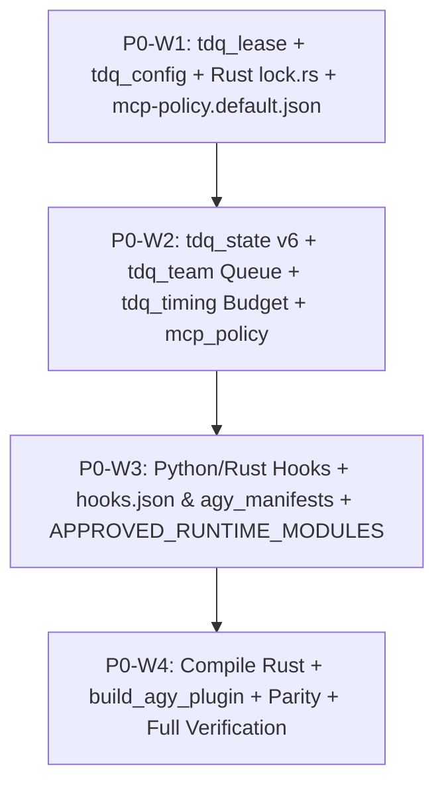

# DEV PLAN P0 — Lõi An toàn Runtime, Khóa NTFS/Rust & Cửa ngõ MCP (`1` Request `feature` Thống nhất)

Ngày: 2026-11-25 · Request lập plan: `2026-11-25-1633-paperclip-3phase-dev-plan` · Nguồn chuẩn: [master-roadmap.md](file:///c:/Users/admin/Documents/Projects/TDQ-Workflow-Antigravity/docs/tdq/artifacts/2026-11-25-1633-paperclip-3phase-dev-plan/master-roadmap.md)

> **Tóm tắt dễ hiểu:** Hiện tại hàm lưu trạng thái của TDQ chưa bọc khóa liên tiến trình ở ngoài hook, hàng đợi chưa xử lý phụ thuộc động và tool MCP mới ngoài LSP chưa bị kiểm tra chữ ký trước khi chạy. Bản kế hoạch này gom toàn bộ phần lõi vào một request tính năng duy nhất chia bốn đợt tách file nóng, đồng bộ cả Python lẫn Rust. Kết quả giúp khóa thuê chống đè, ngăn vòng lặp lỗi, chặn riêng tool ghi MCP lạ và hoàn nguyên tức thì bằng cờ cấu hình.

---

## 1. Phạm vi & Quyết định Đóng gói (`1c`, `2a`, `3a`, `4a`, `5a`)

- **Hình thức mở request:** `1` request `feature` thống nhất (`1c`) trên nhánh `feat/p0-runtime-safety-rust-parity` tách từ `dev`.
- **Chế độ bật mặc định (`3a` cân bằng):**
  - `lease_enabled: true`: khóa thuê sidecar TTL & `tdq_state.save()` lock chạy ngay từ ngày đầu.
  - `breaker_enabled: true`: ngắt mạch 3 lỗi liên tiếp cho tool/task chạy ngay.
  - `mcp_quarantine_enabled: true` với `mode: "balanced"`: chỉ chặn/hỏi khi xuất hiện tool MCP mới có phân loại `write` hoặc `destructive` hoặc đổi SHA-256 mô tả; mọi tool `read` và bộ `tdq-lsp` mặc định cho qua.
  - `budget_caps`: mặc định rỗng (`soft_warn_ratio: 0.8`, `hard_stop_usd: null`, `hard_stop_tokens: null`) — chỉ dừng cứng khi người dùng tự khai trần chi phí trong `docs/tdq/config.json` (ghi đè lên `tdq-config.json` của plugin).
- **Không nâng schema state (`2a`):** Giữ `schema_version=6` ở `scripts/tdq_state.py`, chỉ thêm nhánh tùy chọn tương thích ngược (`aa71d3c3ceee`).
- **Tài sản đóng gói (`2a` + `4a`):** Template mẫu đặt tại `scripts/defaults/mcp-policy.default.json`, biên dịch đồng bộ sang `plugins/tdq-workflow-agy/` qua `tools/build_agy_plugin.py` (`fdfb84511245`), và giữ nguyên danh sách `23` mã cổng `all_agy_codes` trong `tools/patches/gate_guidance.json` (`680ff293a2d4`) bằng cách tái dụng mã `READONLY` khi chặn tool ghi MCP bị cách ly.

---

## 2. Neo Mã nguồn Thật vs Tệp Tạo mới

### 2.1 Neo thật trên đĩa (`Existing Anchors`)

- `scripts/tdq_state.py`: `default_state`, `load`, `save`, `_cong_lsp`, `_validate_work_kind_set` (`aa71d3c3ceee`, `3209613d4046`).
- `hooks/scripts/_common.py`: `with_ntfs_lock`, `read_payload`, `payload_cwd`, `block` (`1879901cb273`).
- `hooks/rust/tdq-dispatch/src/lock.rs`: `SidecarLockGuard`, `acquire_sidecar_lock`, `atomic_write_file` (`3c67a9ede986`).
- `scripts/tdq_team.py`: `chia_dot`, `detect_tcas_collision`, `TRAN_SONG_SONG` (`4582617658f5`).
- `scripts/tdq_config.py`: `DEFAULT_CONFIG` (`6f8f80aeae90`).
- `scripts/tdq_timing.py`: `TIMING_REL`, `TELEMETRY_REL` (`27411db5b47c`).
- `tools/patches/agy_dispatch.py`: `DISPATCH_PY`, `apply_dispatch` (`0616cb0c1fbe`) — template bên trong đẩy `_is_mcp_tool` qua `_route_pre_tool_use` sang `lsp_gate.py` nên không cần sửa file này ở `P0`.
- `hooks/scripts/lsp_gate.py`: `MA`, `FILE_BANG`, `phan_xu`, `phan_xu_blast_radius`, `_phan_xu_lenh`, `main` (`0616cb0c1fbe`).
- `hooks/scripts/edit_gate.py`: `within`, `_enforce_agy_readonly_subagent`, `main` — chạy trên cả Claude Code lẫn Antigravity.
- `hooks/scripts/bash_gate.py`: `eval_bash`, `mutates_tdq_state`, `main`.
- `hooks/scripts/agy_pretooluse_gate.py`: `BAN`, `STATE_WRITES`, `_first_command` — lưu ý `tools/patches/common_utils.py:26` loại trừ file này khỏi bundle AGY nên mọi rào `P0` gắn vào `edit_gate.py`, `bash_gate.py` và `lsp_gate.py`.
- `hooks/scripts/command_gate.py`: `process_payload`.
- `hooks/hooks.json`: `PreToolUse` — dòng 76 hiện chỉ khớp `lsp__(start_lsp|blast_radius)` nên phải mở rộng cho non-LSP MCP.
- `tools/patches/agy_manifests.py`: `generate_hooks_json` — dòng 72 hiện chỉ khớp `mcp_.*lsp_.*|call_mcp_tool` nên phải mở rộng sang `mcp_.*|call_mcp_tool`.
- `tools/patches/common_utils.py`: `EXCLUDED_SCRIPTS`, `copy_clean_tree`.
- `hooks/rust/tdq-dispatch/src/events/pre_tool_use.rs`: `handle_mcp_tool`, `handle_pre_tool_use` (`f75253b39ff2`).
- `hooks/rust/tdq-dispatch/src/command_parser.rs`: `mutates_tdq_state`.
- `tests/test_rust_dispatch_parity.py` & `tools/patches/gate_guidance.json`: `all_agy_codes` (`680ff293a2d4`).
- `tests/test_build_portable.py`: `APPROVED_RUNTIME_MODULES` (`4e175fc25b1b`).
- `tests/test_state.py` & `tests/test_ntfs_concurrency.py` (`8296e3f382cd`, `0080d4ab0cb5`).

### 2.2 Tệp tạo mới ở `P0` (`New Targets`)

- `scripts/tdq_lease.py`: Thư viện khóa sidecar `O_EXCL` + `.lock` neo bền + TTL + gia hạn + thu hồi lease mồ côi.
- `scripts/mcp_policy.py`: Bộ phân loại `read`/`write`/`destructive`, tính SHA-256 tool schema, đối chiếu `scripts/defaults/mcp-policy.default.json` và override `docs/tdq/mcp-policy.json`.
- `scripts/defaults/mcp-policy.default.json`: Chính sách MCP mặc định cân bằng đóng gói vào bundle/main.
- `tests/test_tdq_lease.py`, `tests/test_tdq_queue.py`, `tests/test_tdq_timing_budget.py`, `tests/test_mcp_policy.py`.

---

## 3. Phân hoạch `4` Wave Nội bộ Không Trùng File Nóng



| Wave | Task | File sở hữu (Chạm) | Phụ thuộc | Lệnh test Red -> Green |
|---|---|---|---|---|
| `P0-W1` | `P0-1.1` Dựng `tdq_lease.py` sidecar lock `.lock` (KHÔNG unlink sau unlock) + TTL + `mcp-policy.default.json` + test | `scripts/tdq_lease.py`, `scripts/defaults/mcp-policy.default.json`, `tests/test_tdq_lease.py` | `Không` | `py -3 -X utf8 -m unittest tests/test_tdq_lease.py` |
| `P0-W1` | `P0-1.2` Khai báo khối cấu hình `p0` cân bằng + 3 kill-switch trong `DEFAULT_CONFIG` | `scripts/tdq_config.py` | `Không` | `py -3 -X utf8 -m unittest tests/test_state.py` |
| `P0-W1` | `P0-1.3` Mở rộng `SidecarLockGuard` & `acquire_sidecar_lock` kiểm TTL lease cho `tdq-dispatch` | `hooks/rust/tdq-dispatch/src/lock.rs` | `Không` | `cargo test --manifest-path hooks/rust/tdq-dispatch/Cargo.toml lock` |
| `P0-W2` | `P0-2.1` Bọc sidecar lock vào `tdq_state.save()` (`3209613d4046`), giữ `schema_version=6` thêm nhánh `p0_runtime` vào `default_state()` & `load()` | `scripts/tdq_state.py` | `P0-1.1, P0-1.2` | `py -3 -X utf8 -m unittest tests/test_state.py tests/test_ntfs_concurrency.py` |
| `P0-W2` | `P0-2.2` Thêm hàng đợi 3 tầng + aging `OLDEST_DISPATCH_SHARE=4` + `blocked_by` + `idempotency_key` nối trên `chia_dot` & `detect_tcas_collision` | `scripts/tdq_team.py`, `tests/test_tdq_queue.py` | `P0-1.1` | `py -3 -X utf8 -m unittest tests/test_tdq_queue.py` |
| `P0-W2` | `P0-2.3` Gắn bộ đếm ngưỡng mềm `80%` và dừng cứng `hard_stop` (tắt khi chưa đặt trần) vào `tdq_timing.py` | `scripts/tdq_timing.py`, `tests/test_tdq_timing_budget.py` | `P0-1.2` | `py -3 -X utf8 -m unittest tests/test_tdq_timing_budget.py` |
| `P0-W2` | `P0-2.4` Dựng `scripts/mcp_policy.py` (hash SHA-256 baseline + `evaluate_tool_call` quarantine riêng `write`/`destructive` mới) + test unit | `scripts/mcp_policy.py`, `tests/test_mcp_policy.py` | `P0-1.1, P0-1.2` | `py -3 -X utf8 -m unittest tests/test_mcp_policy.py` |
| `P0-W3` | `P0-3.1` Nối `mcp_policy.evaluate_tool_call()` vào `lsp_gate.py` và Circuit Breaker / Budget check vào `edit_gate.py` + `bash_gate.py` (tránh `agy_pretooluse_gate.py` bị `common_utils.py:26` loại khỏi AGY) | `hooks/scripts/lsp_gate.py`, `hooks/scripts/edit_gate.py`, `hooks/scripts/bash_gate.py` | `P0-2.1, P0-2.3, P0-2.4` | `py -3 -X utf8 -m unittest tests/test_mcp_policy.py` |
| `P0-W3` | `P0-3.2` Đồng bộ `handle_mcp_tool()` và breaker guard trong `pre_tool_use.rs` (tái dụng mã `READONLY`, giữ tròn `23` AGY code) | `hooks/rust/tdq-dispatch/src/events/pre_tool_use.rs` | `P0-1.3, P0-2.4` | `cargo test --manifest-path hooks/rust/tdq-dispatch/Cargo.toml pre_tool_use` |
| `P0-W3` | `P0-3.3` Mở matcher `PreToolUse` non-LSP MCP tại `hooks/hooks.json:76` (`mcp__.*\|call_mcp_tool`) và `tools/patches/agy_manifests.py:72` (`mcp_.*\|call_mcp_tool`) | `hooks/hooks.json`, `tools/patches/agy_manifests.py` | `P0-2.4` | `py -3 -X utf8 -m unittest tests/test_rust_dispatch_parity.py` |
| `P0-W3` | `P0-3.4` Thêm `"tdq_lease"` và `"mcp_policy"` vào `APPROVED_RUNTIME_MODULES` kiểm soát nhánh `main` | `tests/test_build_portable.py` | `P0-1.1, P0-2.4` | `py -3 -X utf8 -m unittest tests/test_build_portable.py` |
| `P0-W4` | `P0-4.1` Biên dịch lại `tdq-dispatch.exe`, chạy `build_agy_plugin.py` sync vào `plugins/tdq-workflow-agy/`, kiểm parity, `run_full_verification.py`, `tdq_test.py tron-bo` và `--sinh-main --dry-run` | `plugins/tdq-workflow-agy/` | `P0-3.1, P0-3.2, P0-3.3, P0-3.4` | `py -3 -X utf8 tools/build_agy_plugin.py; py -3 -X utf8 -m unittest tests/test_rust_dispatch_parity.py; py -3 -X utf8 tools/run_full_verification.py; py -3 -X utf8 scripts/tdq_test.py tron-bo` |

Ghi chú luật file nóng (`81b26479b3d7`, `3209613d4046`): Không có file nào bị `2` task cùng sửa trong một wave; `scripts/` tuyệt đối không import ngược `hooks/` (`tdq_lease.py` dùng thuần `os`/`msvcrt`/`fcntl` + `tdq_timing`/`tdq_state` log service, tách biệt hoàn toàn với `hooks/scripts/_common.py`).

---

## 4. Thiết kế Chi tiết Chữ ký Hàm & Hợp đồng JSON

### 4.1 Chữ ký Hàm Cốt lõi (`Python` & `Rust`)

- **`scripts/tdq_lease.py`** (tối đa `< 50` dòng/hàm, bật ISO timestamp stderr qua `TDQ_LOG=1`, `0B` khi `TDQ_LOG=0`):
  - `sidecar_lock_path(target_path: str) -> str`: trả `<target_path>.lock` (giống quy ước `SidecarLockGuard` trong `lock.rs`, KHÔNG unlink sau khi giải phóng).
  - `acquire_sidecar_lock(target_path: str, timeout_ms: int = 2000) -> ContextManager`: khóa file `.lock` qua `msvcrt.locking` (`LK_NBLCK`) trên Windows và `fcntl.flock` trên POSIX với backoff giống `_common.with_ntfs_lock` (`1879901cb273`).
  - `acquire_lease(project_root: str, owner: str, resource: str, ttl_sec: int = 300, execution_run_id: str = "") -> dict`: tạo nguyên tử `docs/tdq/leases/<lease_id>.json` qua `os.O_CREAT | os.O_EXCL`.
  - `renew_lease(project_root: str, lease_id: str, owner: str, ttl_sec: int = 300) -> dict`: gia hạn nếu còn hiệu lực và đúng `owner`.
  - `release_or_reclaim(project_root: str, lease_id: str, force_expired: bool = False) -> bool`: giải phóng chủ động hoặc thu hồi lease đã quá hạn `expires_at` (`reap`).
- **`scripts/tdq_state.py`** (`3209613d4046`, `aa71d3c3ceee`):
  - `save(cwd: str, state: dict)`: gọi `tdq_lease.acquire_sidecar_lock(state_path(cwd))` trước bước atomic `write + os.replace()`, thay thế khoảng trống `"overwriting anyway"`.
  - `default_state()` giữ `"schema_version": 6` và bổ sung khóa tùy chọn `"p0_runtime"` (backward compatible khi `load()` đọc state cũ).
- **`scripts/tdq_team.py`** (`4582617658f5`):
  - `prioritize_tasks(tasks: list[dict], now_ts: float, share: int = 4) -> list[dict]`: chia 3 tầng (`high`/`normal`/`low`), chọn tối đa 1 tác vụ quá tuổi sau mỗi `share` tác vụ thường (`OLDEST_DISPATCH_SHARE=4`), bỏ qua tác vụ còn `blocked_by` chưa `done`.
  - `dispatch_ready_waves(plan_tasks: list[dict], state: dict) -> list[list[dict]]`: lọc `blocked_by` + `idempotency_key` trước khi gọi `chia_dot()` và `detect_tcas_collision()`.
- **`scripts/tdq_timing.py`** (`27411db5b47c`):
  - `check_budget_status(cwd: str, config: dict) -> dict`: tổng hợp token/chi phí từ `TELEMETRY_REL`, trả `{"state": "ok"|"soft_warn"|"hard_stop", "ratio": float}`; chỉ trả `"hard_stop"` khi user đã đặt trần khác `null`.
- **`scripts/mcp_policy.py`** & **`hooks/scripts/lsp_gate.py`** (`0616cb0c1fbe`):
  - `evaluate_tool_call(cwd: str, server: str, tool_name: str, schema_obj: dict | None) -> dict`: phân loại `read` vs `write`/`destructive`, tính `sha256` schema, đối chiếu baseline `docs/tdq/mcp-policy.json` (rơi về `scripts/defaults/mcp-policy.default.json`); trong chế độ cân bằng `3a`, chỉ trả `"decision": "deny"` với mã `READONLY` khi tool là `write`/`destructive` mới hoặc bị đổi SHA-256 chưa xác nhận.
- **`hooks/rust/tdq-dispatch/src/lock.rs` & `events/pre_tool_use.rs`** (`3c67a9ede986`, `f75253b39ff2`):
  - `acquire_sidecar_lock(path: &Path, timeout_ms: u64) -> Result<SidecarLockGuard, io::Error>` giữ nguyên `.lock` anchor file để không đua tạo/xóa với `tdq_lease.py`.
  - `handle_mcp_tool(tool_name: &str, tool_input: &Value, ctx: &Ctx) -> Decision`: fast-path đọc `docs/tdq/mcp-policy.json` / `scripts/defaults/mcp-policy.default.json`; tool đọc hoặc `mcp__lsp__*` qua thẳng trong `< 0.5ms`; tool `write`/`destructive` mới bị chặn đồng bộ mã `READONLY`.

### 4.2 Hợp đồng JSON Mẫu (`Valid Fenced JSON`)

#### A. `scripts/defaults/mcp-policy.default.json`

```json
{
  "schema_version": 1,
  "mode": "balanced",
  "quarantine_new_tools": true,
  "block_tiers_on_new_or_changed": ["write", "destructive"],
  "allow_read_by_default": true,
  "trusted_servers": ["lsp", "gemini-api-docs"],
  "tool_sha256_baseline": {}
}
```

#### B. `docs/tdq/leases/lease-sample.json`

```json
{
  "lease_id": "lease-20261125-p0-w1",
  "owner": "main-session",
  "resource": "docs/tdq/state.json",
  "execution_run_id": "run-1633-01",
  "acquired_at": "2026-11-25T17:10:00+07:00",
  "expires_at": "2026-11-25T17:15:00+07:00",
  "renew_count": 0
}
```

#### C. Khối `p0` trong `docs/tdq/config.json` (ghi đè `tdq-config.json`, `scripts/tdq_config.py`)

```json
{
  "p0": {
    "lease_enabled": true,
    "lease_ttl_sec": 300,
    "breaker_enabled": true,
    "breaker_consecutive_failures": 3,
    "mcp_quarantine_enabled": true,
    "mcp_mode": "balanced",
    "oldest_dispatch_share": 4,
    "budget_caps": {
      "soft_warn_ratio": 0.8,
      "hard_stop_tokens": null,
      "hard_stop_usd": null
    }
  }
}
```

#### D. Nhánh mở rộng tương thích ngược trong `docs/tdq/state.json` (`schema_version=6`)

```json
{
  "schema_version": 6,
  "active_request": "2026-11-25-1633-paperclip-3phase-dev-plan",
  "p0_runtime": {
    "breaker": {
      "consecutive_failures": 0,
      "open": false,
      "last_tool": ""
    },
    "budget": {
      "soft_warned": false,
      "hard_stopped": false
    },
    "quarantined_tools": []
  }
}
```

---

## 5. Rào chắn & Quy trình Rollback

- **Kill-switch không cần sửa code:** Mọi tính năng mới trong `P0` đi qua `tdq_config` (`lease_enabled`, `breaker_enabled`, `mcp_quarantine_enabled`). Nếu gặp nghẽn cục bộ, tắt cờ trong `docs/tdq/config.json` (hoặc `tdq-config.json` ở cấp plugin) sẽ hoàn nguyên ngay về hành vi trước `P0` mà không phá `state.json` v6.
- **Checkpoint Git trong `1` request `feature`:** Sau mỗi wave `P0-W1`, `P0-W2`, `P0-W3`, `P0-W4`, chạy đủ bộ unit test + parity tương ứng trước khi sang wave kế tiếp; không gộp commit chéo khi một wave chưa xanh.
- **Khóa Log Service & 6 Mục Cấm:** Toàn bộ script mới chỉ xuất stderr khi `TDQ_LOG!=0`, trả `0B` stderr khi `TDQ_LOG=0`, và không đụng tới bất kỳ hạng mục nào trong `6` mục CẤM copy của `master-roadmap.md`.
