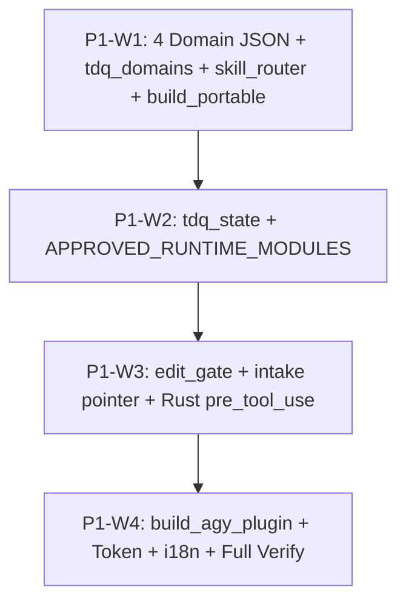

# DEV PLAN P1 — Bộ `4` `Domain Pack`, `KhoBM25` & Khóa Chống Hạ Cấp (`Zero-Downgrade Lock`)

Ngày: 2026-11-25 · Request lập plan: `2026-11-25-1633-paperclip-3phase-dev-plan` · Nguồn chuẩn: [master-roadmap.md](file:///c:/Users/admin/Documents/Projects/TDQ-Workflow-Antigravity/docs/tdq/artifacts/2026-11-25-1633-paperclip-3phase-dev-plan/master-roadmap.md)

> **Tóm tắt dễ hiểu:** Hiện tại bộ định tuyến kỹ năng BM25 mới nằm ở dạng thử nghiệm rời rạc và bị loại khỏi nhánh phát hành chính, còn phân loại yêu cầu phi-code dễ bị nới lỏng khi có lệnh sửa mã nguồn. Bản kế hoạch này gom bốn gói lĩnh vực chuẩn vào thư mục mẫu đóng gói, nối BM25 vào bước tiếp nhận và khóa chặt nâng cấp một chiều sang code. Kết quả giữ trần token luật dưới ngưỡng kiểm tra, không vi phạm quy tắc ngôn ngữ và đóng gói sạch lên cả hai nhánh.

---

## 1. Phạm vi & Ràng buộc Kỹ thuật Phát hiện từ Mã nguồn Thật

- **Hình thức mở request:** `1` request `feature` thống nhất trên nhánh `feat/p1-domain-packs-bm25` tách từ `dev` sau khi `P0` đã merge.
- **Khắc phục nút thắt đóng gói `skill_router.py` (`f04c4142ab16`, `5d2c69ff2fcf`):** Hiện tại `RELEASE_EXCLUDE_SCRIPTS` trong `scripts/build_portable.py:76-81` đang chặn `"skill_router.py"` khỏi nhánh `main`. `P1` bắt buộc gỡ `"skill_router.py"` khỏi danh sách loại trừ đó và cập nhật `APPROVED_RUNTIME_MODULES` trong `tests/test_build_portable.py:37-45` (`4e175fc25b1b`). Trong khi đó, hàm `la_duong_dan_release` (`scripts/build_portable.py:635-655`) chỉ loại `scripts/samples/`, nên thư mục `scripts/defaults/domains/` sẽ tự động đi cùng bản phát hành sạch `main` và bundle Antigravity `tools/build_agy_plugin.py` (`fdfb84511245`).
- **Tương thích kép `i18n_check.py` & `KhoBM25` (`f9b6f2d10c0c`, `ba161e7dac2d`):** Vì `i18n_check.py` quét cả tệp `.json` (`SCAN_SUFFIXES = (".py", ".md", ".json", ".txt")`) mà `skill_router.py` (`tach_tu()`, `bo_dau()`) tự động bỏ dấu tiếng Việt trước khi chấm điểm BM25, toàn bộ từ khóa tiếng Việt trong `scripts/defaults/domains/*.json` được lưu bằng ASCII không dấu (`keywords_vi_ascii`). Cách này vừa khớp `100%` câu lệnh có dấu của người dùng Việt Nam vừa đạt `0` lỗi `i18n_check.py`.
- **Giữ chặt trần `TRAN_TOKEN = 3500` (`7212c05fe18b`):** KHÔNG nhồi bảng cấu hình hay mô tả domain vào `skills/*/references/**/*.md`. Chỉ thêm `<= 8` dòng hướng dẫn ngắn tại `skills/tdq-intake/SKILL.md` (dưới trần byte của `check_md_byte_budgets`) và chạy xác nhận lại `scripts/token_budget.py`.

---

## 2. Neo Mã nguồn Thật vs Tệp Tạo mới

### 2.1 Neo thật trên đĩa (`Existing Anchors`)

- `scripts/skill_router.py`: `KhoBM25`, `tach_tu`, `bo_dau`, `dung_kho`, `ghi_kho`, `doc_kho`, `TRUONG` (`ba161e7dac2d`).
- `scripts/tdq_state.py`: `default_state`, `load`, `save`, `_cli_escalate_to_build`, `_validate_work_kind_set` (`aa71d3c3ceee`, `b01dbd39e180`).
- `scripts/build_portable.py`: `RELEASE_EXCLUDE_SCRIPTS`, `la_duong_dan_release` (`f04c4142ab16`, `5d2c69ff2fcf`).
- `scripts/token_budget.py`: `TRAN_TOKEN`, `VUNG` (`7212c05fe18b`).
- `scripts/i18n_check.py`: `SCAN_SUFFIXES`, `ALLOW_MARKER` (`f9b6f2d10c0c`).
- `tools/build_agy_plugin.py`: `_copy_upstream_assets`, `_verify_staged_bundle`, `check_reference_md_budgets`, `build`, `main` (`fdfb84511245`).
- `tools/patches/common_utils.py`: `copy_clean_tree`, `EXCLUDED_SCRIPTS`, `check_md_byte_budgets`.
- `hooks/scripts/edit_gate.py`: `within`, `_enforce_agy_readonly_subagent`, `main`.
- `hooks/rust/tdq-dispatch/src/events/pre_tool_use.rs`: `handle_pre_tool_use` (`f75253b39ff2`).
- `tests/test_skill_router.py` (`3b8239a918d9`), `tests/test_build_portable.py` (`4e175fc25b1b`), `tests/test_investigate_workflow.py`, `tests/test_state.py` (`8296e3f382cd`).

### 2.2 Tệp tạo mới ở `P1` (`New Targets`)

- `scripts/tdq_domains.py`: Bộ nạp & khớp `Domain Pack` theo thứ tự ưu tiên `env > docs/tdq/domains/ > scripts/defaults/domains/`, kiểm chứng luật `allow_downgrade=false`.
- `scripts/defaults/domains/code-build.json`, `scripts/defaults/domains/research-rca.json`, `scripts/defaults/domains/pm-ba-content.json`, `scripts/defaults/domains/ops-checklist.json`.
- `tests/test_tdq_domains.py`: Kiểm nạp default + override, kiểm khóa Zero-Downgrade và benchmark route `4` domain.

---

## 3. Phân hoạch `4` Wave Nội bộ Không Trùng File Nóng



| Wave | Task | File sở hữu (Chạm) | Phụ thuộc | Lệnh test Red -> Green |
|---|---|---|---|---|
| `P1-W1` | `P1-1.1` Tạo `4` file `Domain Pack` mẫu dưới `scripts/defaults/domains/` + module `scripts/tdq_domains.py` + `tests/test_tdq_domains.py` | `scripts/defaults/domains/code-build.json`, `scripts/defaults/domains/research-rca.json`, `scripts/defaults/domains/pm-ba-content.json`, `scripts/defaults/domains/ops-checklist.json`, `scripts/tdq_domains.py`, `tests/test_tdq_domains.py` | `Không` | `py -3 -X utf8 -m unittest tests/test_tdq_domains.py` |
| `P1-W1` | `P1-1.2` Nối `KhoBM25` hỗ trợ lọc theo `domain_id` + cờ `--domain` trong `scripts/skill_router.py` và thêm test đánh giá domain ở `tests/test_skill_router.py` | `scripts/skill_router.py`, `tests/test_skill_router.py` | `Không` | `py -3 -X utf8 -m unittest tests/test_skill_router.py` |
| `P1-W1` | `P1-1.3` Gỡ `"skill_router.py"` khỏi `RELEASE_EXCLUDE_SCRIPTS` trong `scripts/build_portable.py` để ship cùng nhánh `main` | `scripts/build_portable.py` | `Không` | `py -3 -X utf8 scripts/build_portable.py --sinh-main --dry-run` |
| `P1-W2` | `P1-2.1` Thêm trường tùy chọn `domain_id` (`schema_version=6`) và khóa cứng `Zero-Downgrade Lock` vào `_cli_escalate_to_build` của `scripts/tdq_state.py` | `scripts/tdq_state.py` | `P1-1.1` | `py -3 -X utf8 -m unittest tests/test_state.py tests/test_investigate_workflow.py` |
| `P1-W2` | `P1-2.2` Thêm `"skill_router"` và `"tdq_domains"` vào `APPROVED_RUNTIME_MODULES` kiểm soát nhánh `main` | `tests/test_build_portable.py` | `P1-1.1, P1-1.3` | `py -3 -X utf8 -m unittest tests/test_build_portable.py` |
| `P1-W3` | `P1-3.1` Khóa sửa code ngoài `docs/` khi `domain` hiện tại `escalate_on_code_edit=true` trong `edit_gate.py` (tái dụng `APPROVE`); thêm `<= 8` dòng trỏ router vào `skills/tdq-intake/SKILL.md` | `hooks/scripts/edit_gate.py`, `skills/tdq-intake/SKILL.md` | `P1-1.1, P1-1.2, P1-2.1` | `py -3 -X utf8 -m unittest tests/test_investigate_workflow.py` |
| `P1-W3` | `P1-3.2` Đồng bộ `Zero-Downgrade Lock` trong `handle_pre_tool_use` của `pre_tool_use.rs` (tái dụng `APPROVE`, giữ tròn `23` AGY code) | `hooks/rust/tdq-dispatch/src/events/pre_tool_use.rs` | `P1-1.1, P1-2.1` | `cargo test --manifest-path hooks/rust/tdq-dispatch/Cargo.toml pre_tool_use` |
| `P1-W4` | `P1-4.1` Biên dịch `tdq-dispatch.exe`, sync bundle qua `tools/build_agy_plugin.py`, xác nhận `TRAN_TOKEN <= 3500`, `i18n_check.py` `0` lỗi, parity và `run_full_verification.py` | `plugins/tdq-workflow-agy/` | `P1-2.2, P1-3.1, P1-3.2` | `py -3 -X utf8 tools/build_agy_plugin.py; py -3 -X utf8 -m unittest tests/test_rust_dispatch_parity.py; py -3 -X utf8 scripts/token_budget.py; py -3 -X utf8 scripts/i18n_check.py; py -3 -X utf8 tools/run_full_verification.py` |

---

## 4. Chữ ký Hàm & `4` Hợp đồng `Domain Pack` JSON (`scripts/defaults/domains/`)

### 4.1 Chữ ký Hàm Cốt lõi

- **`scripts/tdq_domains.py`** (`< 50` dòng/hàm, `TDQ_LOG=1` bật timestamp stderr, `TDQ_LOG=0` tắt `0B` stderr):
  - `load_domain_packs(cwd: str) -> dict[str, dict]`: đọc mặc định từ `scripts/defaults/domains/*.json`, cho phép ghi đè từng pack từ `docs/tdq/domains/*.json`.
  - `route_domain(cwd: str, prompt_text: str) -> dict`: dùng `skill_router.tach_tu()` chấm điểm từ khóa kết hợp `keywords_en` + `keywords_vi_ascii`, trả về pack khớp nhất (mặc định rơi về `"code-build"` khi mơ hồ).
  - `can_transition_domain(current_domain: str, target_domain: str, packs: dict[str, dict]) -> tuple[bool, str]`: chỉ cho nâng `escalate_on_code_edit=true -> code-build`; từ chối mọi hạ cấp từ `code-build` sang domain phi-code trong cùng request.
- **`scripts/skill_router.py`** (`ba161e7dac2d`):
  - `tra_cuu(cau: str, ban_ghi: list[dict], domain_id: str | None = None, top_k: int = TOP_K) -> list[dict]`: tăng nhẹ trọng số các skill khớp `preferred_skills` của `domain_id` mà không thay đổi chuẩn BM25 cho query tổng quát trong `tests/test_skill_router.py`.
- **`scripts/tdq_state.py` (`_cli_escalate_to_build`, `b01dbd39e180`) & `hooks/scripts/edit_gate.py`**:
  - Khi nâng cấp `investigate -> build` qua `escalate-to-build`, chuyển `domain_id` thành `"code-build"` và ghi dấu bất biến `downgrade_locked=True` vào state; mọi lần sửa file ngoài `docs/` khi chưa nâng cấp bị chặn bằng mã sẵn có `APPROVE` kèm lệnh `tdq_state.py escalate-to-build`.

### 4.2 Hợp đồng JSON Mẫu cho Cả `4` `Domain Pack`

#### A. `scripts/defaults/domains/code-build.json`

```json
{
  "schema_version": 1,
  "domain_id": "code-build",
  "title": "Engineering Code and Feature Delivery",
  "default_work_kind": "build",
  "allow_downgrade": false,
  "escalate_on_code_edit": false,
  "preferred_lane": "full",
  "default_muc_qc": "standard",
  "preferred_skills": ["tdq-intake", "tdq-spec", "tdq-plan", "tdq-build"],
  "keywords_en": ["implement", "fix", "refactor", "feature", "bug", "test", "api", "script"],
  "keywords_vi_ascii": ["sua loi", "tinh nang", "viet code", "nang cap", "tai cau truc"]
}
```

#### B. `scripts/defaults/domains/research-rca.json`

```json
{
  "schema_version": 1,
  "domain_id": "research-rca",
  "title": "Codebase Investigation and Root Cause Analysis",
  "default_work_kind": "investigate",
  "allow_downgrade": false,
  "escalate_on_code_edit": true,
  "preferred_lane": "full",
  "default_muc_qc": "ultra",
  "preferred_skills": ["tdq-intake", "tdq-spec", "tdq-plan", "tdq-lean"],
  "keywords_en": ["investigate", "audit", "rca", "root cause", "analyze", "architecture", "benchmark"],
  "keywords_vi_ascii": ["phan tich", "khao sat", "tim nguyen nhan", "danh gia", "lo trinh"]
}
```

#### C. `scripts/defaults/domains/pm-ba-content.json`

```json
{
  "schema_version": 1,
  "domain_id": "pm-ba-content",
  "title": "Product Specification, BA Briefs and Technical Writing",
  "default_work_kind": "investigate",
  "allow_downgrade": false,
  "escalate_on_code_edit": true,
  "preferred_lane": "full",
  "default_muc_qc": "standard",
  "preferred_skills": ["tdq-intake", "tdq-spec", "tdq-plan"],
  "keywords_en": ["spec", "roadmap", "prd", "backlog", "user story", "documentation", "plan"],
  "keywords_vi_ascii": ["tai lieu", "ke hoach", "dac ta", "bao cao", "noi dung"]
}
```

#### D. `scripts/defaults/domains/ops-checklist.json`

```json
{
  "schema_version": 1,
  "domain_id": "ops-checklist",
  "title": "Operations Runbook, Packaging and Release Verification",
  "default_work_kind": "investigate",
  "allow_downgrade": false,
  "escalate_on_code_edit": true,
  "preferred_lane": "quick",
  "default_muc_qc": "standard",
  "preferred_skills": ["tdq-setup", "tdq-checkportable", "tdq-status"],
  "keywords_en": ["release", "deploy", "packaging", "verify", "runbook", "ops", "setup"],
  "keywords_vi_ascii": ["dong goi", "phat hanh", "kiem tra", "van hanh", "cai dat"]
}
```

---

## 5. Khóa Ngôn ngữ, Đóng gói & Rollback

- **Khớp `i18n_check.py` & `TRAN_TOKEN = 3500`:** Không đặt văn bản tiếng Việt có dấu bên trong `scripts/defaults/domains/*.json`; chỉ giữ khóa tiếng Anh + `keywords_vi_ascii` chuẩn ASCII để `i18n_check.py` exit `0`. File `skills/tdq-intake/SKILL.md` chỉ nhận thêm tối đa `8` dòng trỏ lệnh CLI `tdq_domains.py`, không làm phình bất kỳ file nào dưới `skills/*/references/**/*.md`.
- **Rollback gọn nhẹ:** Đặt `"domain_router_enabled": false` trong `docs/tdq/config.json` (ghi đè `tdq-config.json`) hoặc xóa thư mục override `docs/tdq/domains/` để quay về chế độ chọn `work_kind` thủ công mà vẫn bảo toàn toàn bộ `state.json` v6.
