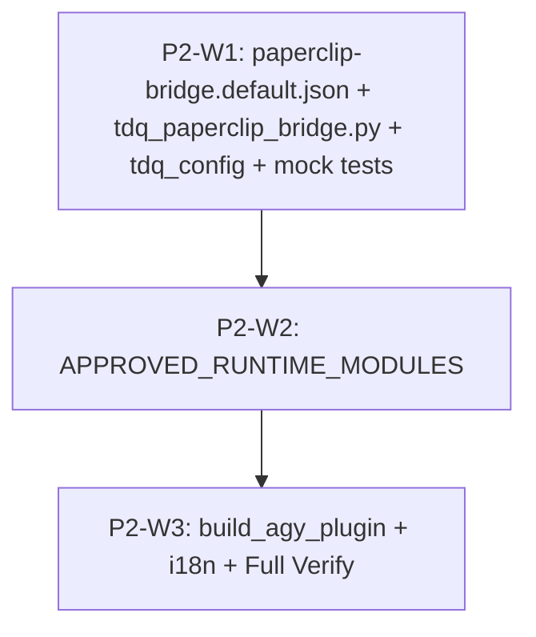

# DEV PLAN P2 — Cầu nối CLI `1` Chiều `Paperclip Bridge` (Tắt Mặc định, Cô lập hoàn toàn)

Ngày: 2026-11-25 · Request lập plan: `2026-11-25-1633-paperclip-3phase-dev-plan` · Nguồn chuẩn: [master-roadmap.md](file:///c:/Users/admin/Documents/Projects/TDQ-Workflow-Antigravity/docs/tdq/artifacts/2026-11-25-1633-paperclip-3phase-dev-plan/master-roadmap.md)

> **Tóm tắt dễ hiểu:** Người dùng chạy trên máy Windows cá nhân không cần dựng thêm máy chủ đồng bộ nền, nhưng người dùng Docker hoặc WSL2 vẫn có thể muốn kéo issue từ Paperclip sang TDQ. Bản kế hoạch này thiết kế cầu nối dòng lệnh một chiều tắt mặc định hoàn toàn, chỉ dùng thư viện chuẩn Python và để state của TDQ làm chân lý duy nhất. Kết quả là không tốn tài nguyên khi chưa bật, test độc lập bằng dữ liệu giả lập và có thể xóa sạch không ảnh hưởng hai pha trước.

---

## 1. Phạm vi & Nguyên tắc Cô lập Tuyệt đối (`4a`, `5a`)

- **Hình thức mở request:** `1` add-on `feature` độc lập trên nhánh `feat/p2-paperclip-cli-bridge` tách từ `dev` sau khi `P0` và `P1` đã ổn định.
- **Tắt mặc định (`"enabled": false`):** Trên máy Windows hằng ngày (`5a`), bridge không tự kích hoạt, không chạy daemon, không mở cổng lắng nghe, không gắn vào bất kỳ hook `PreToolUse`/`Stop` nào.
- **Cầu nối CLI `1` chiều (`4a`):** Người dùng Docker/WSL2 gọi thủ công `scripts/tdq_paperclip_bridge.py`:
  1. `status`: kiểm cấu hình bật/tắt và thử PING endpoint REST một phát bằng `urllib.request` có timeout `5s` (từ chối chạy nếu `enabled` là `false`).
  2. `pull --issue <id>`: kéo payload issue JSON từ Paperclip API, chuyển đổi thành slug/title/brief chuẩn rồi gọi CLI `scripts/tdq_state.py init` (TUYỆT ĐỐI không tự mở ghi `docs/tdq/state.json`, giữ bất biến đơn chủ ghi `81b26479b3d7`).
  3. `push-report --slug <slug>`: đọc báo cáo `docs/tdq/reports/<slug>.md` và trạng thái `tdq_state.py get`, đẩy tóm tắt một chiều lên comment/status của issue trên Paperclip.
- **Không dùng 6 mục CẤM copy:** Không dựng HTTP webhook daemon hai chiều, không giữ Embedded PostgreSQL, không dùng Same-Origin React UI, không dùng `local_trusted` bypass và không dùng timer poll rỗng.

---

## 2. Neo Mã nguồn Thật vs Tệp Tạo mới

### 2.1 Neo thật trên đĩa (`Existing Anchors`)

- `scripts/tdq_state.py`: `default_state`, `load`, `save` (`aa71d3c3ceee`, `81b26479b3d7`) — gọi qua CLI `init`, `get` giữ `schema_version=6` làm chân lý duy nhất.
- `scripts/tdq_config.py`: `DEFAULT_CONFIG` (`6f8f80aeae90`) — thêm khối tắt mặc định `paperclip_bridge`.
- `scripts/tdq_timing.py`: `TIMING_REL`, `TELEMETRY_REL` (`27411db5b47c`) — dùng chung cơ chế `TDQ_LOG=1/0`.
- `tests/test_build_portable.py`: `APPROVED_RUNTIME_MODULES` (`4e175fc25b1b`) — kiểm soát module nhánh `main`.
- `tools/build_agy_plugin.py`: `_copy_upstream_assets`, `_verify_staged_bundle`, `build`, `main` (`fdfb84511245`).
- `tools/patches/common_utils.py`: `copy_clean_tree`, `EXCLUDED_SCRIPTS`.
- `docs/kien-truc.md`: Quy tắc đặt module mới trong `scripts/` và không import ngược `hooks/` (`81b26479b3d7`).

### 2.2 Tệp tạo mới ở `P2` (`New Targets`)

- `scripts/defaults/paperclip-bridge.default.json`: Mẫu cấu hình bridge tắt mặc định (`"enabled": false`, giữ `100%` khóa tiếng Anh qua `i18n_check.py`).
- `scripts/tdq_paperclip_bridge.py`: CLI `1` chiều thuần thư viện chuẩn Python (`urllib.request`, `json`, `argparse`, `subprocess`, `sys`, `os`).
- `tests/test_paperclip_bridge.py`: Bộ kiểm thử `unittest` giả lập bằng `unittest.mock` (không gọi mạng thật, kiểm cả trường hợp tắt mặc định, lỗi HTTP, ánh xạ `pull` và `TDQ_LOG=0` ra `0B` stderr).

---

## 3. Phân hoạch `3` Wave Nội bộ Cô lập Hoàn toàn



| Wave | Task | File sở hữu (Chạm) | Phụ thuộc | Lệnh test Red -> Green |
|---|---|---|---|---|
| `P2-W1` | `P2-1.1` Tạo `scripts/defaults/paperclip-bridge.default.json`, CLI `scripts/tdq_paperclip_bridge.py` (`status`, `pull`, `push-report`) và `tests/test_paperclip_bridge.py` giả lập stdlib `mock` | `scripts/defaults/paperclip-bridge.default.json`, `scripts/tdq_paperclip_bridge.py`, `tests/test_paperclip_bridge.py` | `Không` | `py -3 -X utf8 -m unittest tests/test_paperclip_bridge.py` |
| `P2-W1` | `P2-1.2` Khai báo khối `"paperclip_bridge": {"enabled": false}` mặc định tắt vào `DEFAULT_CONFIG` | `scripts/tdq_config.py` | `Không` | `py -3 -X utf8 -m unittest tests/test_state.py` |
| `P2-W2` | `P2-2.1` Thêm `"tdq_paperclip_bridge"` vào `APPROVED_RUNTIME_MODULES` | `tests/test_build_portable.py` | `P2-1.1` | `py -3 -X utf8 -m unittest tests/test_build_portable.py` |
| `P2-W3` | `P2-3.1` Sync bundle qua `tools/build_agy_plugin.py`, kiểm `i18n_check.py` và chạy `run_full_verification.py` | `plugins/tdq-workflow-agy/` | `P2-1.1, P2-1.2, P2-2.1` | `py -3 -X utf8 tools/build_agy_plugin.py; py -3 -X utf8 scripts/i18n_check.py; py -3 -X utf8 tools/run_full_verification.py` |

---

## 4. Chữ ký Hàm & Hợp đồng JSON Mẫu (`Valid Fenced JSON`)

### 4.1 Chữ ký Hàm trong `scripts/tdq_paperclip_bridge.py`

- `load_bridge_config(cwd: str) -> dict`: nạp `scripts/defaults/paperclip-bridge.default.json`, ghi đè bởi `docs/tdq/paperclip-bridge.json` hoặc biến môi trường (`PAPERCLIP_BRIDGE_ENABLED`, `PAPERCLIP_API_URL`, `PAPERCLIP_TOKEN_ENV`); từ chối chạy với mã thoát `3` nếu `enabled` là `False`.
- `fetch_issue_json(base_url: str, issue_id: str, token: str, timeout_sec: float = 5.0) -> dict`: dùng thuần `urllib.request.urlopen` (stdlib), không dùng `requests` hay thư viện ngoài.
- `map_issue_to_tdq_init(issue_payload: dict) -> dict`: ánh xạ tiêu đề, mô tả, cờ domain sang tham số truyền qua `subprocess.run([sys.executable, "scripts/tdq_state.py", "init", ...])`.
- `push_report_summary(base_url: str, issue_id: str, report_md_path: str, state_snapshot: dict, token: str) -> dict`: đọc tiêu đề + `4` phần tóm tắt từ `docs/tdq/reports/<slug>.md` và đẩy comment một chiều.
- `_log(msg: str) -> None`: bật ISO timestamp trên `stderr` theo mặc định (`TDQ_LOG=1`) và xuất đúng `0B` khi `TDQ_LOG=0`.

### 4.2 Hợp đồng JSON Mẫu

#### A. `scripts/defaults/paperclip-bridge.default.json`

```json
{
  "schema_version": 1,
  "enabled": false,
  "transport": "cli-one-way",
  "base_url": "http://127.0.0.1:3100/api",
  "token_env_var": "PAPERCLIP_API_TOKEN",
  "timeout_sec": 5,
  "default_lane": "full"
}
```

#### B. Kết quả ánh xạ `pull` sang tham số `tdq_state.py init`

```json
{
  "bridge_action": "pull",
  "paperclip_issue_id": "PAP-42",
  "tdq_slug": "2026-11-25-pap-42-sync",
  "tdq_work_kind": "build",
  "tdq_domain_id": "code-build",
  "tdq_lane": "full",
  "authority": "tdq_state.py"
}
```

#### C. Payload tóm tắt gửi đi ở lệnh `push-report`

```json
{
  "bridge_action": "push-report",
  "paperclip_issue_id": "PAP-42",
  "tdq_request": "2026-11-25-pap-42-sync",
  "tdq_phase": "report",
  "report_relpath": "docs/tdq/reports/2026-11-25-pap-42-sync.md",
  "qc_verdict": "PASS"
}
```

---

## 5. Chiến lược Test Mock & Rollback Xóa Sạch

- **Test offline `100%` stdlib (`tests/test_paperclip_bridge.py`):**
  1. Mặc định khi `enabled: false`, lệnh `status` và `pull` trả mã `3` và không mở bất kỳ socket mạng nào.
  2. Giả lập `urllib.request.urlopen` bằng `unittest.mock.patch` trả HTTP `200`, xác nhận `pull` gọi `subprocess` tới `tdq_state.py init` với `schema_version=6` nguyên vẹn và không tự mở ghi `state.json`.
  3. Giả lập HTTP `401`/`TimeoutError` xác nhận fail-closed sạch sẽ, không ghi dở dữ liệu `docs/tdq/`.
  4. Chạy CLI với `TDQ_LOG=1` (có timestamp stderr) và `TDQ_LOG=0` (kiểm `stderr == b""`).
- **Rollback Xóa Sạch (Delete-Only Rollback):** Nếu không cần cầu nối này nữa, chỉ cần xóa `scripts/tdq_paperclip_bridge.py`, `scripts/defaults/paperclip-bridge.default.json`, `tests/test_paperclip_bridge.py` và rút khóa trong `tdq_config.py` + `APPROVED_RUNTIME_MODULES` — không để lại bất kỳ dấu vết nào trong `P0` hay `P1`.
