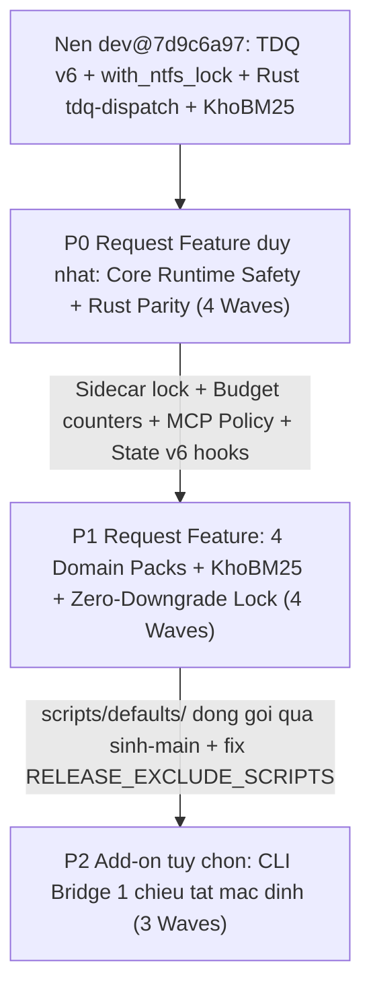

# MASTER ROADMAP — Lộ trình 3 Pha Tích hợp Pattern Paperclip vào TDQ-Workflow-Antigravity (`P0`–`P2`)

Ngày: 2026-11-25 · Request: `2026-11-25-1633-paperclip-3phase-dev-plan` · Nguồn chuẩn: [evidence-log.md](file:///c:/Users/admin/Documents/Projects/TDQ-Workflow-Antigravity/docs/tdq/artifacts/2026-11-25-1633-paperclip-3phase-dev-plan/evidence-log.md)

> **Tóm tắt dễ hiểu:** Trước đây ý tưởng mang sức mạnh điều phối kiểu Paperclip vào TDQ mới nằm ở mức phác thảo tổng quát, chưa ghép vào khóa NTFS, Rust hook hay bộ đóng gói nhánh phát hành. Sau khi rà soát sâu toàn bộ mã nguồn Python và Rust, bản lộ trình này chốt thứ tự làm ba pha rõ ràng từ lõi ổn định đến mở rộng đa lĩnh vực và cầu nối tùy chọn. Kết quả giúp từng pha mở thành request riêng an toàn, chạy mượt trên Windows cá nhân và giữ sạch nhánh phát hành.

---

## 1. Bản đồ Quyết định Kiến trúc Đã chốt (`1abcd 2a 3a 4a 5a` + `1c 2a 3a 4a 5c`)

| Mã chốt | Quyết định | Tác động trực tiếp lên `P0`–`P2` | Chứng cứ nền |
|---|---|---|---|
| `1abcd` | Bao phủ đủ `4` mặt chất lượng: Độ tin cậy & Song song, Bảo mật MCP, Đa host & Đóng gói, Bảo trì & Tách wave | Mọi pha đều bắt buộc kiểm parity NTFS/Rust, gate MCP, `build_agy_plugin.py`, `build_portable.py --sinh-main`, `i18n_check.py`, `TRAN_TOKEN = 3500` và wave `<= 4` task | `1879901cb273`, `f75253b39ff2`, `fdfb84511245`, `7212c05fe18b`, `f9b6f2d10c0c` |
| `2a` + `5a` | Đích chính Antigravity Windows cá nhân (`0` DB nền, `0` dep ngoài); không vỡ Claude Code, Codex, OpenCode, `main` | Dùng thuần Python stdlib + Rust `tdq-dispatch`; mọi dữ liệu đặt ở `scripts/defaults/` (gốc bundle) và `docs/tdq/` (override/runtime); giữ `schema_version=6` ở `state.json` | `aa71d3c3ceee`, `6f8f80aeae90`, `5d2c69ff2fcf`, `81b26479b3d7` |
| `3a` | Xuất `1` Master Roadmap + `3` Development Plan tách pha (`P0`, `P1`, `P2`) | `master-roadmap.md` khóa bất biến và thứ tự pha; `dev-plan-p0/p1/p2.md` chứa chữ ký, JSON schema, bảng wave và lệnh `Red -> Green` | `0cc059920b10` |
| `4a` | Parity Python + Rust ngay trong `P0` (`lock.rs`, `pre_tool_use.rs`, `test_rust_dispatch_parity.py`) | Mọi ràng buộc lock sidecar và kiểm MCP trong `P0` phải cập nhật cả Python hook lẫn Rust `tdq-dispatch.exe` trước khi merge | `3c67a9ede986`, `f75253b39ff2`, `680ff293a2d4`, `0616cb0c1fbe` |
| `1c` | Gom trọn `P0` thành `1` request `feature` thống nhất có `4` wave nội bộ rời file nóng | Giảm phân mảnh PR cho hub `tdq_state.py`; kiểm soát bán kính bằng `4` checkpoint tuần tự và cờ feature tắt nhanh trong `docs/tdq/config.json` (`tdq-config.json` cho plugin) | `3209613d4046`, `4582617658f5`, `27411db5b47c` |
| `3a` (vòng 2) | Bật mặc định cân bằng cho `P0`: Lease + Breaker chạy ngay; MCP Quarantine chỉ chặn tool `write`/`destructive` mới; Budget `hard_stop` chỉ dừng khi khai trần | Không chặn nhầm thao tác đọc hằng ngày; vẫn khóa được rò rỉ ghi MCP lạ và đè lock | `f75253b39ff2`, `27411db5b47c`, `6f8f80aeae90` |
| `4a` (vòng 2) | `P2` dùng cầu nối CLI `1` chiều (`scripts/tdq_paperclip_bridge.py`), tắt mặc định cho Docker/WSL2 | `state.json` giữ quyền chân lý duy nhất; loại bỏ webhook daemon 2 chiều; test hoàn toàn bằng stdlib mock | `aa71d3c3ceee`, `0cc059920b10` |
| `5c` | Mức kiểm chứng `ultra` (`Q1`–`Q6` + `tdq-qc-tester` độc lập) | Cả giai đoạn lập kế hoạch hiện tại và tiêu chuẩn DoD của từng request thi công `P0`–`P2` đều áp dụng kiểm chéo đầy đủ | `2945577b6f04`, `8a81b5bbd05c` |

---

## 2. Đồ thị Phụ thuộc & Toàn cảnh `3` Pha (`P0` → `P1` → `P2`)

### Bảng Tổng hợp Lộ trình Request Mở Sau Này

| Pha | Số request | Loại request | Trọng tâm triển khai | Wave nội bộ | Điều kiện mở khóa (Entry Gate) | Tiêu chí ra (Exit Gate) | Kế hoạch chi tiết |
|---|---|---|---|---|---|---|---|
| `P0` | `1` request | `feature` | Sidecar Lock & `tdq_lease.py`, `state.json` v6 additive + `save()` sidecar lock, 3-tier queue + `blocked_by`, Circuit Breaker + Budget counters, MCP Policy/Quarantine cân bằng + mở matcher `hooks/hooks.json` & `agy_manifests.py` + Rust `lock.rs` & `pre_tool_use.rs` parity | `4` wave (`P0-W1`..`P0-W4`, mỗi wave `<= 4` task, `0` phụ thuộc cùng wave) | Nhánh `dev` sạch, `run_full_verification.py` xanh trước khi mở | `test_state.py`, `test_ntfs_concurrency.py`, `test_rust_dispatch_parity.py`, `test_tdq_lease.py`, `test_mcp_policy.py`, `build_agy_plugin.py`, `build_portable.py --sinh-main --dry-run`, `run_full_verification.py` đều PASS | [dev-plan-p0.md](file:///c:/Users/admin/Documents/Projects/TDQ-Workflow-Antigravity/docs/tdq/artifacts/2026-11-25-1633-paperclip-3phase-dev-plan/dev-plan-p0.md) |
| `P1` | `1` request | `feature` | `4` `Domain Pack` dưới `scripts/defaults/domains/` + override `docs/tdq/domains/`, `tdq_domains.py`, nối `KhoBM25` (`skill_router.py` bỏ khỏi `RELEASE_EXCLUDE_SCRIPTS`), Zero-Downgrade Lock nối `escalate-to-build` + `edit_gate.py`/`pre_tool_use.rs`, neo `TRAN_TOKEN <= 3500` & `i18n_check.py` | `4` wave (`P1-W1`..`P1-W4`, mỗi wave `<= 4` task, `0` phụ thuộc cùng wave) | `P0` đã merge `dev`, `APPROVED_RUNTIME_MODULES` xanh, `build_portable.py` ổn định | `test_skill_router.py` (22 câu mẫu), `test_tdq_domains.py`, `test_investigate_workflow.py`, `token_budget.py`, `i18n_check.py`, `build_agy_plugin.py`, `build_portable.py --sinh-main --dry-run`, `test_rust_dispatch_parity.py` đều PASS | [dev-plan-p1.md](file:///c:/Users/admin/Documents/Projects/TDQ-Workflow-Antigravity/docs/tdq/artifacts/2026-11-25-1633-paperclip-3phase-dev-plan/dev-plan-p1.md) |
| `P2` | `1` request | `feature` | Cầu nối CLI `1` chiều `scripts/tdq_paperclip_bridge.py` (`pull`, `push-report`, `status`) + `scripts/defaults/paperclip-bridge.default.json` (`"enabled": false`), gọi `tdq_state.py init`, test stdlib mock | `3` wave (`P2-W1`..`P2-W3`, `<= 3` task/wave, `0` phụ thuộc cùng wave) | `P1` đã merge `dev` (`Domain Pack` + `tdq_state.py` ổn định) | `test_paperclip_bridge.py` PASS `100%` bằng mock stdlib (`0` network thật), mặc định tắt không chạm luồng Windows thường ngày, `doc_lint` + `tron-bo` PASS | [dev-plan-p2.md](file:///c:/Users/admin/Documents/Projects/TDQ-Workflow-Antigravity/docs/tdq/artifacts/2026-11-25-1633-paperclip-3phase-dev-plan/dev-plan-p2.md) |

---

## 3. Chứng minh 4 Giả thuyết Kiến trúc (`H1`–`H4`)

| Giả thuyết | Vấn đề thực tế trên mã nguồn | Phương án giải quyết đã neo bằng chứng | Nơi chứng minh test |
|---|---|---|---|
| `H1`: Lease + Queue + Breaker tái sử dụng `with_ntfs_lock` & `lock.rs` mà giữ `0` hồi quy `state.json` | `tdq_state.save()` đang gọi `os.replace()` kèm comment cảnh báo `"overwriting anyway"` và chưa bọc sidecar lock (`3209613d4046`); Python `_common.py` giữ lock bằng `msvcrt.locking` còn Rust `lock.rs` giữ file `.lock` trên đĩa (`1879901cb273`, `3c67a9ede986`) | `scripts/tdq_lease.py` tạo file neo `.lock` KHÔNG unlink sau unlock (đồng bộ hoàn toàn với `SidecarLockGuard` của `lock.rs`); `tdq_state.save()` gọi sidecar lock trước khi `os.replace()`; `tdq_state` giữ nguyên `schema_version=6` và dùng khóa additive tùy chọn (`aa71d3c3ceee`) | `P0-W1`–`W4`: `test_ntfs_concurrency.py` (`8296e3f382cd`, `0080d4ab0cb5`) + `test_tdq_lease.py` |
| `H2`: MCP Policy + SHA-256 Quarantine chạy `< 2 ms` trên cả Python và Rust parity | `agy_dispatch.py` đẩy mọi `_is_mcp_tool` qua `lsp_gate.py` (`0616cb0c1fbe`), nhưng `hooks/hooks.json:76` và `tools/patches/agy_manifests.py:72` mới khớp `mcp__lsp__*`; `test_rust_dispatch_parity.py` khóa cứng `len(codes) == 23` (`680ff293a2d4`) | Tạo `scripts/mcp_policy.py`, mở rộng matcher trong `hooks/hooks.json` & `agy_manifests.py` sang `mcp__.*`/`mcp_.*\|call_mcp_tool`; tái dụng mã lỗi `READONLY` (giữ tròn `23` AGY code); chế độ cân bằng `3a` cho qua tool đọc/đã biết và chỉ chặn `write`/`destructive` mới | `P0-W2`–`W4`: `test_mcp_policy.py` + `test_rust_dispatch_parity.py` |
| `H3`: `4` `Domain Pack` + `KhoBM25` + Zero-Downgrade tương thích `TRAN_TOKEN`, `i18n_check.py` và `--sinh-main` | `skill_router.py` đang bị kẹt trong `RELEASE_EXCLUDE_SCRIPTS` (`f04c4142ab16`); `token_budget.py` khóa `TRAN_TOKEN = 3500` trên `skills/*/references/**/*.md` (`7212c05fe18b`); `i18n_check.py` quét cả `.json` (`f9b6f2d10c0c`) | Đặt 4 pack tại `scripts/defaults/domains/*.json` (tự đi qua `la_duong_dan_release` vì chỉ `scripts/samples/` bị loại, `5d2c69ff2fcf`); bỏ `skill_router.py` khỏi `RELEASE_EXCLUDE_SCRIPTS`; dùng từ khóa ASCII không dấu tận dụng `tach_tu()`/`bo_dau()` của `skill_router.py` để vừa match tiếng Việt vừa qua `i18n_check.py` | `P1-W1`–`W3`: `test_skill_router.py` (`3b8239a918d9`), `test_build_portable.py` (`4e175fc25b1b`), `token_budget.py`, `i18n_check.py` |
| `H4`: Tách wave `TRAN_SONG_SONG=4` không đụng file nóng, `P2` cô lập hoàn toàn | Hub `tdq_state.py` có độ quạt phụ thuộc lớn; sửa song song dễ đụng `edit_gate.py` `TDQ:TEAM` | Khóa rule 1 wave = 1 chủ sở hữu trên file (`scripts/tdq_state.py`, `scripts/build_portable.py`, `tools/build_agy_plugin.py` không bao giờ có 2 task sửa cùng 1 wave); `P2` tắt mặc định (`"enabled": false`) chỉ nối qua subprocess/API `tdq_state.py init` | `verify_plans.py` kiểm `wave_non_overlap` + `import_layer_invariant` |

---

## 4. Bất biến Kiến trúc & Đóng gói Đa Host (`docs/kien-truc.md`)

Toàn bộ thiết kế `P0`–`P2` tuân thủ cứng `5` bất biến từ `docs/kien-truc.md` (`81b26479b3d7`), `tdq_config.py` (`6f8f80aeae90`), `build_portable.py` (`f04c4142ab16`, `5d2c69ff2fcf`) và `build_agy_plugin.py` (`fdfb84511245`):

1. **Hướng phụ thuộc `1` chiều:** `hooks/` ĐƯỢC import `scripts/`; `scripts/` TUYỆT ĐỐI KHÔNG import `hooks/` (`verify_plans.py` kiểm tự động).
2. **Đơn chủ ghi `state.json`:** Mọi ghi vào `docs/tdq/state.json` bắt buộc đi qua `scripts/tdq_state.py` (`schema_version=6` giữ nguyên, trường mới từ `P0`/`P1`/`P2` đều tùy chọn và có giá trị mặc định trong `default_state()`, `aa71d3c3ceee`).
3. **Vị trí file code mới:** Mọi module code mới (`tdq_lease.py`, `mcp_policy.py`, `tdq_domains.py`, `tdq_paperclip_bridge.py`) đặt trong `scripts/`, còn test đặt trong `tests/` để Graphify, `token_budget.py` và `tdq_test.py` (`4f5daae5671a`, `2945577b6f04`) tự nhận diện.
4. **Phân tầng Template Mặc định vs Override Dự án (`2a`):**
   - Bản gốc phân phối chung nằm trong `scripts/defaults/` (`scripts/defaults/mcp-policy.default.json`, `scripts/defaults/domains/*.json`, `scripts/defaults/paperclip-bridge.default.json`) để cả `build_agy_plugin.py` (`copy_clean_tree`) lẫn `build_portable.py --sinh-main` (`la_duong_dan_release`) đều giữ nguyên.
   - Bản tùy biến riêng từng repo nằm ở `docs/tdq/` (`docs/tdq/mcp-policy.json`, `docs/tdq/domains/*.json`, `docs/tdq/leases/*.json`).
   - Thứ tự ưu tiên tải cấu hình: `env > docs/tdq/ (project) > scripts/defaults/ (plugin bundle)`, kế thừa mô hình `tdq_config.py` (`6f8f80aeae90`).
5. **Ma trận Tương thích Đa Host & Nhánh `dev`/`main`:**

| Môi trường / Nhánh | Cơ chế chạy hook | Đóng gói đồng bộ bắt buộc | Kiểm chứng hồi quy tối thiểu |
|---|---|---|---|
| **Antigravity (Windows, Đích chính)** | Rust `tdq-dispatch.exe` (`<0.5ms`) + fallback Python `agy_dispatch.py` (`0616cb0c1fbe`) | `cargo build --release` rồi `py -3 tools/build_agy_plugin.py` sync vào `plugins/tdq-workflow-agy/` (`fdfb84511245`) | `test_rust_dispatch_parity.py`, kiểm đủ `23` AGY gate code (`680ff293a2d4`), `verify_staged_bundle` |
| **Claude Code / Codex / OpenCode** | Python hooks trong `hooks/scripts/` (`_common.py`, `lsp_gate.py`, `edit_gate.py`, `bash_gate.py`) | Tự đồng bộ từ `scripts/` + `hooks/scripts/` theo chuẩn `i18n_check.py` và `TRAN_TOKEN = 3500` | `tests/test_state.py`, `tests/test_ntfs_concurrency.py`, `tools/run_full_verification.py` |
| **Nhánh phát hành `main` sạch** | Runtime tối giản sinh bởi `scripts/build_portable.py --sinh-main` | Cập nhật `RELEASE_EXCLUDE_SCRIPTS` (`f04c4142ab16`) và `APPROVED_RUNTIME_MODULES` (`4e175fc25b1b`) | `tests/test_build_portable.py` + dry-run `--sinh-main` |

---

## 5. `6` Hạng mục CẤM Sao chép từ Paperclip (`0cc059920b10`)

Danh sách cứng sau không được xuất hiện dưới bất kỳ hình thức nào trong thiết kế hay mã nguồn tương lai của `P0`–`P2`:

| # | Hạng mục CẤM copy từ Paperclip | Vì sao cấm tại TDQ-Workflow-Antigravity | Cơ chế kiểm chặn trong plan & QC |
|---|---|---|---|
| 1 | **Embedded PostgreSQL / Database Server nền** (`Postgres nhúng`) | Vi phạm ràng buộc `5a` (`0` external DB trên PC Windows cá nhân), phá vỡ bản portable nhánh `main` và tăng chi phí vận hành vô ích | Chỉ dùng atomic JSON (`with_ntfs_lock` + sidecar `.lock`) và append-only JSONL |
| 2 | **Same-Origin UI / Web Dashboard Vite+React phục vụ từ local daemon** | TDQ đã có Archify HTML tĩnh + chat markdown + VS Code/Antigravity UI; nhúng web server riêng tạo bề mặt tấn công localhost và nặng bundle | Dùng báo cáo Archify tĩnh (`docs/tdq/reports/*.html`) và terminal CLI |
| 3 | **Chế độ bỏ xác thực `local_trusted` trên Windows** | Windows PC dùng nhiều công cụ/MCP dễ leo thang đặc quyền nếu tin cậy mù mọi yêu cầu localhost không chữ ký | Bắt buộc chính sách `mcp_policy` + kiểm tra chữ ký SHA-256 trên schema tool |
| 4 | **Native Adapter `ACPX darwin-arm64`** | Đích vận hành chính là Windows Antigravity (`2a`), macOS ARM binary gây phình kích thước và hỏng đóng gói đa nền tảng | Giữ thuần Python stdlib đa nền tảng và Rust biên dịch chuẩn Windows/Linux |
| 5 | **Heartbeat Timer Poll rỗng định kỳ** (`heartbeat poll rỗng`) | Gọi model đánh thức theo chu kỳ khi không có việc vừa đốt token vừa tạo nhiễu `tdq_timing.py` | Chỉ kích hoạt qua hook sự kiện thật (`PreToolUse`, `Stop`, CLI `pull`) |
| 6 | **Gỡ bỏ hoặc nới lỏng `TCAS` (`detect_tcas_collision`) / `Verify-by-Effect`** | Là hàng rào chống 2 agent ghi trùng symbol và ép bằng chứng test thật (`Red -> Green`); bỏ đi sẽ mất kiểm soát chất lượng TDQ | Bổ sung `blocked_by` lên trên `chia_dot` + `detect_tcas_collision` (`4582617658f5`), không thay thế nó |

---

## 6. Cổng Kiểm soát Thực thi & Chiến lược Rollback Liên Pha

- **Nguyên tắc trước khi cắt wave:** Trong mọi bản `dev-plan-p{0,1,2}.md`, một file nguồn chỉ được xuất hiện ở TỐI ĐA `1` task thuộc `1` wave. Nếu cùng pha phải sửa lại file đó (ví dụ `tests/test_build_portable.py` hoặc `tools/build_agy_plugin.py`), phần cập nhật đó phải đặt sang wave kế tiếp có cạnh phụ thuộc rõ ràng (`Cần: Px-Wy`).
- **Quy chuẩn Log Service (`TDQ:GON #6`):** Mọi module chạy mới ở `P0`–`P2` (`tdq_lease.py`, `mcp_policy.py`, `tdq_domains.py`, `tdq_paperclip_bridge.py`) mặc định ghi ISO timestamp stderr qua hàm chung của `tdq_state` / `tdq_timing` (`TDQ_LOG=1`) và tắt im lặng `0B` stderr khi `TDQ_LOG=0` (`27411db5b47c`).
- **Rollback không phá dữ liệu:**
  - `P0`: có 3 cờ kill-switch độc lập trong `docs/tdq/config.json` (mặc định ở `tdq-config.json` của plugin: `lease_enabled`, `breaker_enabled`, `mcp_quarantine_enabled`); tắt cờ lập tức hoàn nguyên hành vi mà không cần chạm dữ liệu `state.json` v6.
  - `P1`: xóa `docs/tdq/domains/` hoặc tắt `router_enabled` hoàn nguyên về flow intake truyền thống nhưng vẫn giữ tương thích `work_kind`.
  - `P2`: `paperclip_bridge.enabled` mặc định là `false`; gỡ `scripts/tdq_paperclip_bridge.py` + `scripts/defaults/paperclip-bridge.default.json` không ảnh hưởng bất kỳ test hay hook nào của `P0`/`P1`.
- **Chuỗi lệnh chốt mỗi pha:** Chạy `py -3 -X utf8 scripts/tdq_test.py tron-bo` (`2945577b6f04`), `py -3 -X utf8 tools/run_full_verification.py`, `py -3 -X utf8 scripts/tdq_finish.py` (`8a81b5bbd05c`) trước khi chuyển từ `dev` lên kiểm phát hành `main` (`build_portable.py --sinh-main`).
