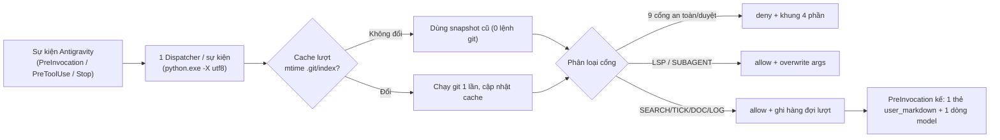

# RESEARCH — Scan ảnh hưởng của hook TDQ tới runtime & thiết kế hook dạng hướng dẫn
Soul: chất lượng > runtime > context cost · luật gốc: skills/tdq-conventions/references/soul.md
Ngày: 2026-11-18 · Spec: [../spec/2026-11-18-1346-scan-hook-anh-huong-runtime.md](../spec/2026-11-18-1346-scan-hook-anh-huong-runtime.md) · Plan: [../plan/2026-11-18-1346-scan-hook-anh-huong-runtime.md](../plan/2026-11-18-1346-scan-hook-anh-huong-runtime.md)
Bằng chứng: [docs/tdq/bench/2026-11-18-1346-hook-runtime/](../bench/2026-11-18-1346-hook-runtime/)

## (a) Kết luận ngắn

Các lượt chạy kéo dài 15–26 phút (như ca `"1 commit"` trong phiên `f9e21752` kéo dài **26,25 phút**) **không phải do git hay hook TDQ chậm**, mà chủ yếu do **chờ lỗi timeout API và thời gian model sinh trên ngữ cảnh quá lớn kèm cache miss**. Trong ca `"1 commit"` (`long_turns.json`), chờ `4` lần `stream idle timeout (5m0s)` chiếm **20,17 phút (76,83%)**, model sinh trên ngữ cảnh `420.176` token (`3` lần cache miss `>50k`) chiếm **5,51 phút (21,00%)**, chạy tool chỉ tốn **13,49 s (0,86%)**, còn **hook TDQ ước tính chỉ mất 2,15 s (0,14%) và 0 deny**. Thử nghiệm đối chứng `commit_merge_trial.json` trên repo tạm `200` file (`N=5`) xác nhận chuỗi `git add/commit/switch/merge --no-ff` thuần mất `1.240,3 ms` (`1,24 s`), còn khi đi qua `command_gate` (`PreToolUse`) + `search_observe` (`PostToolUse`) chỉ thành `4.948,02 ms` (`4,95 s`, hook cộng thêm **3,71 s**). Dù vậy, trên tổng `120` transcript trong `4` ngày (`hook_impact.json`, `bench_hooks.json`), hook TDQ vẫn đóng góp một phần chi phí thực tế đáng tối ưu: **~153,13 phút (~2,55 giờ)** chi phí đồng bộ trực tiếp (`99,97` phút Invocation + `53,07` phút Tool + `0,09` phút Stop) cộng **`34,12` phút** agent chờ sửa/thử lại sau deny (`156` lần đo, median `6,5 s`), tức **~187,25 phút (~3,12 giờ)** — tương đương **2,81%** tổng thời lượng trên `60` lượt dài (`63,55` phút hook + `3,27` phút deny trong `2.377,38` phút), so với **439,85 phút** chờ lỗi API (`model_latency.json`).

## (b) Phương pháp đo & giới hạn

- **Bộ công cụ tự động** trong `docs/tdq/bench/2026-11-18-1346-hook-runtime/`: `bench_hooks.py` (đo wall-clock bản cài `~/.gemini/config/plugins/tdq-workflow-agy`, `N=12`), `commit_merge_trial.py` (đối chứng repo tạm `200` file, `N=5`), `hook_impact.py` & `model_latency.py` (quét `120` file `transcript_full.jsonl` trong `4,0` ngày, `11.241` lời gọi model, `17.429` bước tool), `long_turns.py` (phân rã `60` lượt `>= 10,0` phút trong `2,0` ngày gần nhất), `false_positive_repro.py` (`14` ca tái hiện + `1` ca đối chứng), `gate_inventory.py` (quét AST `20` file `hooks/scripts/*.py` + `2` file plugin + `3` script ủy quyền).
- **Phân biệt `measured` và `estimated`**:
  - `measured`: thời gian thực thi từng hook khi spawn trực tiếp (`bench_hooks.json`), thử nghiệm git/hook (`commit_merge_trial.json`), số đếm `model_calls`, `tool_steps`, `deny`, `stop_block`, độ dài chuỗi bơm vào, khoảng `deny -> tool DONE` (`hook_impact.json`), khoảng chờ lỗi API (`model_latency.json`), và kết quả tái hiện (`false_positive_repro.json`).
  - `estimated`: tổng chi phí hook trong transcript (`hook_est_s` = `số sự kiện × median bench` trong `long_turns.json`, và tổng `153,13` phút / `4` ngày) cùng các con số tiết kiệm ở mục (e). Vì Antigravity chạy hook đồng bộ (*"Hooks run synchronously and block the agent loop"*, `hooks.md` L429), phép nhân tuyến tính phản ánh đúng cận dưới chi phí wall-clock.
- **Giới hạn & sai số tiềm ẩn**:
  - `hook_impact.py` chỉ đếm deny thật ở các bước tool (`196` lần) và tách riêng `3` lần chuỗi xuất hiện trong `PLANNER_RESPONSE`/`SYSTEM_MESSAGE` (`INTAKE: 1, ?: 1, LSP: 1`). Trong `196` deny thô có `6` ca không gắn thẻ (`tag="?"`), `2` hit gán `LOG` từ đoạn agent trích dẫn lại lỗi, `2` hit `NEXT` thực chất là `[TDQ:SEARCH]`, và `1` hit `WORKTREE` thực chất là `[TDQ:TEAM]` do regex lấy thẻ `[TDQ:*]` đầu tiên trong text; sổ kiểm kê `gate_inventory.json` chuẩn hóa còn **`190` deny** đúng mã.
  - `long_turns.json` ghi nhận `40/60` lượt có độ phủ 5 thành phần `do_phu >= 0,90`; `20/60` lượt còn lại có `do_phu < 0,90` do thời gian chờ subagent đánh thức (`subagent_wait = 475,47` phút trên `60` lượt), quá trình nén ngữ cảnh (`compaction = 46,02` phút) hoặc hàng đợi phiên (`other_s = 20,65` phút).

## (c) Phân rã các lượt chạy lâu bất thường

Từ `long_turns.json` (`60` lượt `>= 10` phút trong `2` ngày, tổng `2.377,38` phút), **46/60 lượt** có nguyên nhân đứng đầu là `model_gen_s` (`1.103,52` phút, `46,42%`), **13/60 lượt** do `api_err_s` (`361,37` phút, `15,20%`), **1/60 lượt** do chờ hệ thống/hàng đợi (`other_s = 849,47 s` ở một lượt `1` model call). Tổng chi phí hook ước tính chỉ `63,55` phút (`2,67%`) và chờ deny `3,27` phút (`0,14%`).

| Phiên (`conv`) | Lệnh mở lượt | Tổng (phút) | Chờ lỗi API | Model sinh | Chạy tool | Hook (ước tính) | Deny / Stop chờ | Độ phủ 5 phần | Ngữ cảnh max & ghi chú |
|---|---|---|---|---|---|---|---|---|---|
| `f9e21752` | `"1 commit"` | **26,25** | **20,17m** (4 lỗi) | 5,51m | 0,22m | 0,04m (`2,15s`) | 0,00m (0/0) | **0,988** | `420.176` tok, 3 miss `>50k` |
| `15919377` | `"duyệt plan mode subagent"` | **273,72** | 0,22m (3 lỗi) | **95,83m** | 40,08m | 6,49m | 0,43m (12/2) | 0,523 | `511.313` tok; `subagent_wait=126,1m` |
| `15919377` | `"1a"` | **258,20** | 20,02m (4 lỗi) | **92,04m** | 16,43m | 3,18m | 0,23m (5/1) | 0,511 | `523.881` tok, 49 miss; `subagent_wait=119,1m` |
| `f9e21752` | `"Duyệt plan mode main"` | **177,62** | 30,00m (6 lỗi) | **127,27m** | 15,11m | 2,79m | 0,02m (1/2) | **0,986** | `511.504` tok, 36 miss; `compaction=2,4m` |
| `3b94e6b1` | `"1a"` | **81,77** | 0,00m (0 lỗi) | **36,77m** | 22,80m | 9,81m | 0,13m (7/5) | 0,850 | `823` model calls; `subagent_wait=11,4m` |
| `b717d25b` | `"1a"` | **74,53** | 0,50m (1 lỗi) | **44,18m** | 23,23m | 4,84m | 0,35m (12/2) | **0,981** | `511.645` tok, 12 deny |
| `15919377` | `"duyệt spec"` | **42,02** | **35,78m** (7 lỗi) | 5,86m | 0,23m | 0,06m (`3,79s`) | 0,00m (0/0) | **0,998** | `63.923` tok, 7 lỗi API |
| `b717d25b` | `"check và đọc lại..."` | **35,25** | **31,68m** (6 lỗi) | 3,52m | 0,03m | 0,02m (`0,90s`) | 0,00m (0/0) | **1,000** | `22.256` tok, 6 lỗi API |
| **Tổng 60 lượt** | `>= 10` phút | **2.377,38** | **361,37m (15,2%)** | **1.103,52m (46,4%)** | **303,55m (12,8%)** | **63,55m (2,7%)** | **3,27m (0,1%)** | `40/60 >= 0,9` | `subagent=475,47m`; `compaction=46,02m` |

Thử nghiệm đối chứng `commit_merge_trial.json` (`N=5`, repo tạm `200` file, mỗi chuỗi gồm `git add -A`, `git commit`, `git switch -c`, `git add`, `git commit`, `git switch main`, `git merge --no-ff`):

| Chế độ thử nghiệm | Tổng median (ms) | Tổng p90 (ms) | Git thuần (ms) | PreToolUse `command_gate` (ms) | PostToolUse `search_observe` (ms) | Chênh do hook |
|---|---|---|---|---|---|---|
| `git_only` (thuần) | **1.240,30** | 1.284,26 | 1.240,30 | 0,00 | 0,00 | — |
| `git_with_hook` (PreToolUse) | **4.327,02** | 4.351,84 | 1.234,50 | 3.098,69 | 0,00 | **+3.086,72 ms (+248,9%)** |
| `git_with_pre_and_post_hook` | **4.948,02** | 4.963,27 | 1.221,58 | 3.108,26 | 618,84 | **+3.707,72 ms (+298,9%)** |

Chi tiết từng bước ở nhánh `git_with_pre_and_post_hook`: `git add -A` trên `200` file mất `702,00 ms` git thuần nhưng lên `3.055,33 ms` khi đi qua `command_gate` + `search_observe`; `git merge --no-ff` từ `115,81 ms` lên `327,98 ms`. Tổng thời gian hook thêm cho cả quy trình commit + merge chỉ **3,71 giây**, bác bỏ hoàn toàn giả thuyết hook làm lệnh git kéo dài 15–26 phút.

## (d) Số đo chi phí hook & tác động từ transcript

Kết quả đo trực tiếp từng hook trên bản cài thật (`bench_hooks.json`, `N=12` mỗi phép đo):

| Kịch bản đo (`bench_hooks.json`) | Median (ms) | p90 (ms) | Min–Max (ms) | Ghi chú kỹ thuật |
|---|---|---|---|---|
| `baseline py -3 -c pass` | **43,65** | 44,37 | 42,71–45,50 | Launcher `py.exe` tốn **+17,62 ms/lần spawn** |
| `baseline python.exe -c pass` | **26,03** | 26,49 | 24,35–27,00 | Gọi trực tiếp `python.exe` tiết kiệm 40,4% khởi động |
| `PreInvocation prompt_context` | **363,48** | 378,18 | 352,58–413,81 | Điểm nóng #1: `turn_snapshot` gọi `git status` + `repo_root` mỗi model call |
| `PreInvocation search_observe` | **85,98** | 88,96 | 84,27–90,95 | Spawn tiến trình thứ 2 cho mọi lần gọi model |
| `PreToolUse command_gate` | **145,20** | 148,20 | 140,06–150,32 | Chạy `search_rules` + kiểm tra shell/git/state |
| `PreToolUse read_gate` | **93,67** | 95,28 | 90,69–102,98 | Kiểm tra đọc lặp/file lớn |
| `PreToolUse lsp_gate (call_mcp_tool)` | **87,30** | 90,19 | 83,89–97,40 | Gánh toàn bộ `call_mcp_tool`, kể cả không phải LSP |
| `PreToolUse edit_gate` | **86,66** | 89,97 | 85,51–91,63 | Kiểm tra `[~]`, streak `TICK`, `TEAM`, `APPROVE` |
| `PreToolUse search_gate` | **86,59** | 87,38 | 83,18–88,40 | Kiểm tra tìm kiếm code thô |
| `PreToolUse search_observe (call_mcp_tool)` | **84,47** | 86,41 | 81,85–89,89 | Spawn song song cùng `lsp_gate` -> `171,77 ms` chỉ ở PreToolUse MCP |
| `PostToolUse search_observe (run_command)` | **85,43** | 86,82 | 84,20–89,31 | Spawn sau mỗi lệnh shell/đọc/tìm/MCP |
| `PostInvocation post_invocation` | **84,06** | 86,69 | 82,51–88,27 | Chạy sau tool calls ở mỗi lượt model |
| `Stop stop_gate` | **88,25** | 88,83 | 86,24–89,59 | Kiểm tra checkbox plan & `docs/workinglog/` |

Tổng hợp tác động từ `120` transcript trong `4` ngày (`hook_impact.json`):
- **Tần suất & chi phí đồng bộ ước tính**: `11.241` lần gọi model (`449,46 ms` PreInvocation + `84,06 ms` PostInvocation = `533,52 ms/call`) = **99,97 phút**; `17.429` bước tool (`97,3 ms` PreToolUse TB + `85,43 ms` PostToolUse = `182,73 ms/tool`) = **53,07 phút**; `60` Stop block (`88,25 ms/lần`) = **0,09 phút**. Tổng chi phí đồng bộ = **153,13 phút (~2,55 giờ)**.
- **Deny `PreToolUse` & độ trễ sửa lỗi**: `196` hit thô (~`1,12%` bước tool), gồm `SEARCH=85` (`streak_repeat=4`), `LSP=48` (`streak_repeat=16`), `TICK=30` (`streak_repeat=16`), `TEAM=16` (`streak_repeat=1`), `?=6`, `GIT=4`, `APPROVE=2`, `LOG=2`, `NEXT=2`, `WORKTREE=1`. Trên `156` cặp `deny -> tool DONE` đo được: median **`6,5 s`**, p90 **`27,0 s`**, tổng thời gian chết **`34,12` phút**.
- **Stop block**: **`60` lần** — `53` ca `[TDQ:UNFINISHED]` và `7` ca `[TDQ:LOG]` (có ca chặn nhầm file nháp `docs/.staging.*`).
- **Ký tự bơm vào ngữ cảnh**: **`2.827.845` ký tự** tổng cộng — `PreInvocation` `9.744` lần × TB `239,6` ký tự = **`2.334.784` ký tự** (max `2.107`), `SessionStart` `105` lần × TB `3.962,7` = **`416.084` ký tự** (max `7.819`), `PostInvocation` `311` lần × TB `247,5` = **`76.977` ký tự** (max `2.433`). Mọi `systemMessage` đều lưu vĩnh viễn trong trajectory, làm phình input token cho các lượt gọi kế tiếp.

Kết quả tái hiện ca chặn nhầm (`false_positive_repro.json`, `14` ca + `1` đối chứng):
- **`search_malformed` (`7/8` ca tái hiện deny sai)**: `py -3 -X utf8 -c "..."` có dấu backtick trong chuỗi Python, PowerShell here-string `@'...'@`, và `curl.exe ... -split "\`n"` đều bị `[TDQ:SEARCH] Command could not be parsed safely (malformed)` chặn ở cả `command_gate.py` (Antigravity) lẫn `search_gate.py` (Claude/Codex). Nguyên nhân gốc: `search_rules._tach_script` kiểm tra backtick trước trạng thái double-quote (`L291 < L302`) và `_bo_heredoc` chỉ tách `<<EOF` kiểu POSIX, bỏ sót `@'...'@` và escape `` `n `` của PowerShell. Ca `grep_search` (control) trả `allow`.
- **`lsp_non_lsp` (`0/4` ca tái hiện trên bản `0.99.0`)**: bản cài ngày `2026-11-18` (commit `4c5d5fd5`) đã vá bằng `ten_lenh_tdq_lsp`, nên `call_mcp_tool` tới `chrome-devtools` (`navigate_page`, `new_page`, `select_page`) trả `allow`; nhưng đối chứng positive control `tdq-workflow-agy_lsp start_lsp` thiếu `language_id` vẫn bị deny `[TDQ:LSP]`, và matcher `mcp_.*lsp_.*|call_mcp_tool` trong `hooks.json` vẫn buộc **mọi lời gọi MCP** phải chạy qua cả `lsp_gate.py` + `search_observe.py` (`171,77 ms/lần`).
- **`tick_loop` (`2/2` ca tái hiện vòng lặp)**: khi plan thiếu task `[~]`, `edit_gate.py:266-272` chặn liên tiếp `(lặp)` / `(lặp x3)` trên 3 lần gọi `edit_file`; khi có `[~]` nhưng sửa file `src/app.py` quá `STREAK_NGUONG=3` lần chưa đổi sha256 của `plan.md`, `edit_gate.py:285-299` chặn đứng từ lần sửa thứ 4 trở đi.

## (e) Điểm nóng xếp hạng theo phút tiết kiệm

Tất cả ước tính trong bảng dưới quy về cửa sổ **`4,0` ngày** (`120` transcript) theo đúng công thức `= (hiện_tại − mục_tiêu) × tần_suất` từ `model_latency.json`, `bench_hooks.json`, `hook_impact.json`, `long_turns.json`:

| Hạng | Nhóm | Điểm nóng & bằng chứng đo | Công thức ước tính tiết kiệm (truy về JSON) | Tiết kiệm / 4 ngày |
|---|---|---|---|---|
| 1 | Ngoài hook | Chờ lỗi API (`118` lỗi = `439,85` phút; `79` ca `stream idle timeout (5m0s)` gồm `38` lần retry 2–6; `11/80` ca timeout ở ngữ cảnh `>= 200k`) | Mục tiêu giảm `50%` nhờ cắt ngữ cảnh `< 200k` & chia batch nhỏ: `(439,85 - 219,93)` phút (cận dưới bảo thủ chỉ riêng `11` ca `>=200k` × `5m` = `55,00` phút) | **219,93 phút** (bảo thủ `55,00m`) |
| 2 | Ngoài hook | Model sinh chậm khi ngữ cảnh chưa cache `>= 200k` (`200-300k`: `23,0s` × `163`; `300-400k`: `35,0s` × `98`; `400k+`: `53,0s` × `91`) | Đưa `352` ca `>= 200k` về mức `100-200k` (`18,5s`): `((23,0-18,5)×163 + (35,0-18,5)×98 + (53,0-18,5)×91) / 60` (nếu về `< 50k` = `241,65` phút) | **91,50 phút** (tối đa `241,65m`) |
| 3 | Hook | `PreInvocation` gọi 2 tiến trình + 3 lệnh git mỗi model call (`363,48 + 85,98 = 449,46 ms`) | Mục tiêu `<= 150 ms` (1 dispatcher + cache git theo mtime `.git/index` + `python.exe`): `(449,46 - 150,0) × 11.241 / 60.000` | **56,10 phút** |
| 4 | Hook | Deny nhầm / vòng lặp cổng mềm (`SEARCH` `85` + `LSP` `48` + `TICK` `30` = `163/196` deny = `83,16%`) | Chuyển sang nhắc không chặn / tự sửa `overwrite`: `34,12 phút × (163 / 196)` (theo median `6,5s`: `163 × 6,5 / 60 = 17,66` phút) | **28,38 phút** (theo median `17,66m`) |
| 5 | Hook | `PreToolUse + PostToolUse` chạy 2–3 tiến trình/bước tool (`97,3 + 85,43 = 182,73 ms`) | Mục tiêu `<= 100 ms/tool` (1 dispatcher `python.exe` + bỏ spawn `PostToolUse` khi không cần): `(182,73 - 100,0) × 17.429 / 60.000` | **24,03 phút** |
| 6 | Hook | Launcher `py -3` (`43,65 ms`) thay vì `python.exe` (`26,03 ms`, chênh `17,62 ms/spawn`) | Phần chưa tính ở hạng 3 & 5 (`11.241` PostInvocation + `60` Stop): `17,62 × 11.301 / 60.000` (nếu tính trên cả `49.951` spawn = `14,67` phút) | **3,32 phút** (tổng `14,67m`) |
| 7 | Hook | `Stop` chặn lặp (`53` UNFINISHED + `7` LOG = `60` ca × `88,25 ms`) | Ép tiếp tối đa 1 lần/lượt (`continuationActive`) + bỏ chặn `LOG`: `60 × 88,25 / 60.000` trực tiếp (cộng thêm tránh 1–3 lượt model quay đầu) | **0,09 phút** trực tiếp |

*Lưu ý*: Hạng 6 chỉ cộng phần tách biệt (`PostInvocation` + `Stop`) để không đếm trùng mức tiết kiệm đã tính trong mục tiêu `150 ms` (hạng 3) và `100 ms` (hạng 5). Tổng tiết kiệm phần **hook** cộng gộp = **`111,92` phút / 4 ngày** (~`1,87` giờ, cắt ~`60%` tổng tác động hook), còn tổng tiết kiệm **ngoài hook** = **`311,43` phút / 4 ngày** (~`5,19` giờ).

## (f) Kiểm kê cổng `[TDQ:*]` & mẫu lời chỉ dẫn 4 phần

Quét AST `hooks/scripts/*.py` và các file ủy quyền trong `gate_inventory.json` thu được đúng **`29/29` mã** (`grepped_count == cong_count == 29`): **`9` giữ chặn cứng (`chan_cung`)**, **`1` tự sửa (`tu_sua`)**, **`12` hướng dẫn (`huong_dan`)**, **`7` đề xuất xóa (`xoa`)**. Bảng dưới tổng hợp cả `29` mã kèm lời đề xuất 4 phần (*1. Chuyện gì · 2. Vì sao · 3. Làm gì tiếp · 4. Khi nào bỏ qua*):

| Mã | Sự kiện | Deny/Stop 4d | Phân loại | Định hướng & tóm tắt lời đề xuất 4 phần (1: Chuyện gì · 2: Vì sao · 3: Làm gì · 4: Bỏ qua) |
|---|---|---|---|---|
| `TDQ:SEARCH` | Pre, SS | 85 / 0 | `huong_dan` | Bỏ chặn `malformed`, chỉ nhắc. 1: Lệnh tìm/shell có trích dẫn phức tạp · 2: Ưu tiên LSP/Graphify trước grep · 3: Gọi `start_lsp`/`graphify query` nếu dò code; lệnh thường chạy thẳng · 4: Tên symbol có sẵn, pha analyze/spec, hoặc không tìm code |
| `TDQ:LSP` | PreTool | 48 / 0 | `tu_sua` | Tự điền `language_id` bằng `overwrite`. 1: `start_lsp` thiếu `language_id` hoặc `blast_radius` quá rộng · 2: Tránh bật mọi server / sập tsserver · 3: Truyền `language_id` (hoặc để hook tự điền), `scope="exported"` · 4: Không dùng LSP hoặc có `.tdq-lsp-module.json` |
| `TDQ:TICK` | Pre, Stop | 30 / 0 | `huong_dan` | Bỏ chặn `STREAK_NGUONG=3`. 1: Sửa mã chưa cập nhật `[~]`/`[x]` trong plan · 2: Giữ tiến độ & ETA plan chính xác · 3: Đặt 1 task `[~]`, đổi `[x]` khi test xanh · 4: Sửa `tests/`, `docs/`, hoặc trong `.tdq-worktrees/` |
| `TDQ:TEAM` | PreTool | 16 / 0 | `chan_cung` | Giữ chặn bảo vệ ranh giới đội. 1: Sửa ngoài `VÙNG FILE` hoặc thiếu map phân công · 2: Tránh 2 agent ghi đè nhau · 3: Chạy `py -3 scripts/tdq_team.py assign`, chỉ sửa trong vùng · 4: Chỉ leader sửa task ghi `tu_lam` |
| `TDQ:UNFINISHED` | Stop | 0 / 53 | `chan_cung` | Ép tiếp tối đa 1 lần/lượt (`continuationActive`). 1: Dừng khi plan còn task mở ở `implement` · 2: Tránh bỏ dở task · 3: Mở task kế đánh `[~]`, test xanh rồi `[x]` · 4: Đang chờ `[>]`, đã `pause`, hoặc `continuationActive=true` |
| `TDQ:LOG` | Pre, Stop | 2* / 7 | `huong_dan` | Bỏ chặn Stop, loại trừ `docs/.staging*`. 1: Repo đổi nhưng workinglog hôm nay chưa ghi · 2: Lưu dấu vết file đổi & test · 3: Chạy `py -3 scripts/tdq_finish.py --files ... --log "..."` · 4: Chỉ đổi vùng nháp (`docs/.staging*`, `docs/tdq/`, `graphify-out/`) |
| `TDQ:GIT` | Pre, Stop | 4 / 0 | `chan_cung` | Giữ chặn cứng, gộp check trùng. 1: Tên nhánh theo AI hoặc commit có `Co-Authored-By` · 2: Cấm attribution AI trong git · 3: Đổi nhánh `fix/<mo-ta>`, xóa trailer AI · 4: Không ngoại lệ (cho phép worktree `tdq/...`) |
| `TDQ:APPROVE` | PreInv, Pre, Stop | 2 / 0 | `chan_cung` | Giữ chặn cứng cổng duyệt. 1: Chạy `approve`/sửa code khi lượt chưa có xác nhận user · 2: Cấm model tự duyệt · 3: Trình bản duyệt, kết thúc lượt chờ user rồi mới chạy `tdq_state.py approve` · 4: Vòng sửa QC sau khi đã duyệt |
| `TDQ:NEXT` | SS, PreInv, Stop | 2* / 0 | `huong_dan` | Bỏ `same as last turn`. 1: Báo slug, phase, bước kế · 2: Đồng bộ từ `state.json` thay vì nhớ miệng · 3: Chạy `py -3 scripts/tdq_state.py next` khi đổi pha · 4: Trạng thái không đổi so với lượt trước |
| `TDQ:WORKTREE` | PreInv | 1* / 0 | `huong_dan` | Chỉ hiện ở `SessionStart`/khi đóng request. 1: Còn worktree tạm chưa dọn · 2: Tránh rác đĩa & nhầm nhánh · 3: Chạy `py -3 scripts/tdq_team.py sweep` · 4: Subagent trong đợt vẫn đang chạy |
| `TDQ:READONLY` | PreTool | 0 / 0 | `chan_cung` | Giữ chặn cứng, thêm `qc-tester` vào `bash_gate`. 1: Role chỉ đọc định ghi file · 2: Giữ tách biệt vai trò review/QC · 3: Báo lỗi về leader qua `send_message` · 4: Không ngoại lệ |
| `TDQ:STATE` | Pre, Stop | 0 / 0 | `chan_cung` | Giữ chặn cứng ghi thẳng state. 1: Sửa tay `state.json`/`STATE.md` · 2: Tránh hỏng schema & sha256 · 3: Dùng `py -3 scripts/tdq_state.py set|approve|init` · 4: Không ngoại lệ |
| `TDQ:SUBAGENT` | PreTool | 0 / 0 | `chan_cung` | Giữ chặn `swarm`, cân nhắc `overwrite` `Workspace='inherit'`. 1: Sai mode hoặc sai `Workspace` · 2: Tránh đẻ nhánh chồng lên worktree · 3: Truyền `Workspace="inherit"` & đủ 5 trường · 4: Nhắc thiếu trường chỉ hướng dẫn |
| `TDQ:VUNG` | PreTool | 0 / 0 | `chan_cung` | Giữ chặn sandbox Codex. 1: Ghi ngoài `TDQ_CODEX_VUNG` hoặc chạm `TDQ_CODEX_KHOA` · 2: Bảo vệ test khóa · 3: Sửa đúng `VÙNG FILE` hoặc xin nới vùng · 4: Ngoài phiên `TDQ_CODEX_TASK` |
| `TDQ:ZERO-POPUP` | PreTool | 0 / 0 | `chan_cung` | Giữ chặn popup hỏi. 1: Gọi `ask_question` khi đang có request · 2: Mọi hỏi/duyệt phải ở chat · 3: In lựa chọn `1a 2b` ra chat và chờ user · 4: Không ngoại lệ khi có `active_request` |
| `TDQ:ANCHOR` | SS | 0 / 0 | `huong_dan` | Giữ 1 dòng neo khi compact/resume, bỏ text thừa. 1: Phiên vừa nén/mở lại · 2: Giữ đúng request/phase/worktree · 3: Đọc plan và chạy `tdq_state.py next` · 4: Đã mở request mới hoặc `idle` |
| `TDQ:DOC` | PreTool | 0 / 0 | `huong_dan` | Gộp mã `READ`, bỏ overlap 70%, nhắc ngắn. 1: Đọc lại nguyên file chưa đổi (`>=2KB`) hoặc file `>32KB` · 2: Tránh phình input token · 3: Đọc theo `StartLine`/`EndLine` hoặc `tdq_ccr.py summarize` · 4: File vừa sửa ngoài hoặc vừa compact |
| `TDQ:DOD` | Stop | 0 / 0 | `huong_dan` | Nhắc không chặn khi đóng sổ. 1: QC PASS nhưng còn `[ ]` trong plan · 2: Tránh lệch biên bản và plan · 3: Tick `[x]` mục đã nghiệm thu · 4: Mục lệch đã ghi `lech add` chờ user chốt |
| `TDQ:GON` | SS, Sub, PreInv | 0 / 0 | `huong_dan` | Nạp 1 lần lúc mở phiên, xóa lặp ở `PreInvocation`. 1: Nhắc luật code gọn `muc_gat` · 2: Tránh over-engineering · 3: Bám thang từ bậc 1, ghi `ponytail:` nếu cần · 4: `muc_gat=off` hoặc ngoại lệ Refactor |
| `TDQ:INTAKE` | PreInv | 0 / 0 | `huong_dan` | Chỉ phát ở lượt đầu `idle`/`_tdq_direct`. 1: Chưa mở request TDQ · 2: Đảm bảo đi qua `tdq-intake` · 3: Mở `tdq-intake` hoặc `tdq_state.py init` · 4: User chỉ hỏi đáp không sửa repo |
| `TDQ:OUTPUT` | PreTool | 0 / 0 | `huong_dan` | Ưu tiên `overwrite` qua RTK, nhắc nếu không nén được. 1: Lệnh sắp đổ output dài · 2: Tránh phình context & timeout · 3: Thêm `--stat`, `--oneline -n 20`, hoặc `read_file` · 4: Cần toàn bộ output để kiểm chứng |
| `TDQ:SETUP` | SS | 0 / 0 | `huong_dan` | Gộp 4 nhắc thành 1 thẻ `user_markdown`. 1: Thiếu `rtk`/`rg` hoặc chưa setup · 2: `rtk`/`rg` nén output & tăng tốc tìm · 3: Xin phép chạy `tdq_setup.py --with-rtk` · 4: Đã tắt bằng `--mute-rtk-prompt` |
| `TDQ:ASK` | PreTool | 0 / 0 | `xoa` | **Xóa** (`ZERO-POPUP` đã chặn ở AGY; trùng `tdq-build`). 1: Định dừng hỏi ở `implement`/`qc` khi trượt ngưỡng · 2: Tránh đứt mạch thực thi · 3: Áp dụng dự phòng §6 + `tdq_state.py lech add` · 4: Gặp ca bất khả kháng đã `pause` |
| `TDQ:DEVTOOL` | SS | 0 / 0 | `xoa` | **Xóa** (bơm thừa ở mọi phiên không mở web & tốn probe TCP `9222`). 1: Trạng thái Chrome DevTools MCP lúc mở phiên · 2: Nhận biết MCP sẵn sàng trước khi test UI · 3: Chạy `tdq_setup.py` nếu thiếu cấu hình · 4: Request không liên quan web UI |
| `TDQ:FEEDBACK` | PreInv | 0 / 0 | `xoa` | **Xóa** (khớp thô `lỗi|fail` làm nhiễu TDD đỏ). 1: Prompt chứa từ khóa lỗi/hỏng · 2: Nhắc mở chu trình sửa lỗi thay vì sửa tay · 3: Chạy `tdq_state.py hotfix` nếu là bug mới từ user · 4: Đang chạy TDD đỏ-xanh hoặc phân tích lỗi |
| `TDQ:GATE` | PreTool | 0 / 0 | `xoa` | **Xóa** (trùng 100% với `TDQ:STATE`). 1: Lệnh PowerShell định ghi vào `state.json`/`STATE.md` · 2: Tránh hỏng schema & lệch gương `STATE.md` · 3: Dùng `py -3 scripts/tdq_state.py set|approve|init` · 4: Không ngoại lệ ghi trực tiếp state |
| `TDQ:QC` | PreInv | 0 / 0 | `xoa` | **Xóa** (checklist DoD/SOLID đã có trong skill `tdq-qc` và spec §6). 1: Prompt pha `qc` nhắc kiểm tra DoD/SOLID · 2: Đảm bảo nghiệm thu bằng bằng chứng thật · 3: Kiểm theo spec §6 và ghi biên bản QC · 4: Ngoài pha `qc` hoặc đã làm theo `tdq-qc` |
| `TDQ:RULE` | PreTool | 0 / 0 | `xoa` | **Xóa** (chuẩn cyclomatic/cognitive đã nạp trong `tdq-build` & `tdq-implementer`). 1: Nhắc độ phức tạp khi sửa `.py/.ts/.js` lần đầu · 2: Giữ hàm gọn và chạy linter · 3: Chạy `ruff`/`eslint` sau khi sửa · 4: Trong worktree đội hoặc file ngoài mã nguồn |
| `TDQ:STUCK` | Stop | 0 / 0 | `xoa` | **Xóa** (thừa khi `TDQ:UNFINISHED` đã ép tối đa 1 lần/lượt bằng `continuationActive`). 1: Stop lặp quá 3 lần không đổi checkbox · 2: Ngăn vòng lặp Stop vô hạn · 3: Báo điểm tắc và chạy `tdq_state.py pause` · 4: Task đã xong hoặc đã bật `pause` |

*\*Ghi chú từ `gate_inventory.json`: số raw của `LOG=2`, `NEXT=2`, `WORKTREE=1` trong `hook_impact.json` là lỗi gán thẻ đầu dòng/trích dẫn. Ngoài `29` mã trên, còn 3 script mồ côi chưa nối vào `hooks.json` nên xóa theo `tdq-lean`: `doc_file_gate.py`, `strategic_compact_gate.py`, `stop_batch_checker.py`.*

**8 mẫu đối chiếu Trước (cộc lốc) vs Sau (khung chỉ dẫn 4 phần đầy đủ)**:
1. **`[TDQ:SEARCH]`** — *Trước*: `"[TDQ:SEARCH] Command could not be parsed safely (malformed). Ask first: mcp__lsp__start_lsp ..."` (chặn cứng). *Sau (cho chạy + nhắc qua hàng đợi nếu là tìm kiếm)*: **Chuyện gì**: Lệnh tìm kiếm hoặc shell phức tạp vừa kích hoạt kiểm tra tầng tìm kiếm · **Vì sao**: Hỏi LSP/Graphify trước giúp định vị đúng symbol và tránh grep mò tốn bước · **Làm gì tiếp**: Nếu tìm symbol/caller, chạy `start_lsp(root_dir, language_id="python")` -> `find_symbol`; lệnh `py -3`/PowerShell thông thường được phép chạy thẳng · **Bỏ qua hợp lệ**: Tên symbol đã có sẵn trong prompt hoặc lệnh không tìm kiếm mã.
2. **`[TDQ:LSP]`** — *Trước*: `"[TDQ:LSP] start_lsp without language_id: agent-lsp starts every server... (crash 0xc0000409)"` (chặn cứng, lặp 16 lần). *Sau (`allow` + `overwrite`)*: **Chuyện gì**: `start_lsp` thiếu `language_id` hoặc `blast_radius` yêu cầu phạm vi rộng · **Vì sao**: Thiếu `language_id` làm bật toàn bộ server gây sập tsserver; phạm vi rộng gây treo 1800s · **Làm gì tiếp**: Hook đã tự điền `language_id` từ project (hoặc truyền rõ `language_id="python"`, `scope="exported"`) · **Bỏ qua hợp lệ**: Dự án không dùng LSP hoặc đã có `.tdq-lsp-module.json`.
3. **`[TDQ:TICK]`** — *Trước*: `"[TDQ:TICK] 3 edits in a row with no tick in the plan — close the task before editing on."` (chặn cứng, lặp 16 lần). *Sau (hướng dẫn không chặn)*: **Chuyện gì**: Bạn đã sửa mã nguồn liên tiếp trong pha `implement`/`qc` nhưng file plan chưa đổi dấu `[~]`/`[x]` · **Vì sao**: Plan là nguồn sự thật về tiến độ và giúp tính ETA chuẩn · **Làm gì tiếp**: Mở file plan, giữ đúng 1 task ở `[~]` và đổi sang `[x]` ngay khi test task xanh · **Bỏ qua hợp lệ**: Đang viết test đỏ ở `tests/`, sửa `docs/`, hoặc làm việc trong `.tdq-worktrees/`.
4. **`[TDQ:TEAM]`** — *Trước*: `"[TDQ:TEAM] Team mode with no assignment map — you may not edit code on main first."` *Sau (chặn cứng rõ đường gỡ)*: **Chuyện gì**: Sửa file vi phạm ranh giới phân công đội hoặc chưa có bản đồ phân công · **Vì sao**: Ngăn leader và subagent ghi đè cùng file khi chạy song song · **Làm gì tiếp**: Leader chạy `py -3 scripts/tdq_team.py assign`, rồi `audit`, rồi `open <TASK>`; subagent chỉ sửa file trong `VÙNG FILE` · **Bỏ qua hợp lệ**: Leader sửa task ghi `tu_lam` trong bản đồ phân công.
5. **`[TDQ:UNFINISHED]`** — *Trước*: `"[TDQ:UNFINISHED] 11 open task(s). Keep working... Next: T4.2 Test: ..."` (chặn lặp tới 3 lần). *Sau (`Stop` tối đa 1 lần/lượt)*: **Chuyện gì**: Lượt sắp kết thúc ở pha `implement` trong khi plan vẫn còn task chưa `[x]` · **Vì sao**: Tránh bỏ dở task hợp lệ khi chưa gặp blocker thật · **Làm gì tiếp**: Đọc task mở kế tiếp trong plan, đánh `[~]`, chạy lệnh `Test:` đến khi xanh rồi tick `[x]` · **Bỏ qua hợp lệ**: Đang chờ subagent `[>]`, đã `tdq_state.py pause --loai <loại>`, hoặc `continuationActive=true` đã ép tiếp 1 lần trong lượt.
6. **`[TDQ:LOG]`** — *Trước*: `"[TDQ:LOG] Repo changed (docs/.staging...), docs/workinglog/YYYY-MM-DD.md not appended. Run tdq_finish.py..."` (chặn Stop). *Sau (nhắc không chặn + trừ staging)*: **Chuyện gì**: Repo có thay đổi nhưng nhật ký `docs/workinglog/YYYY-MM-DD.md` chưa được ghi thêm · **Vì sao**: Lưu biên nhận file đã sửa và test đã chạy cho handoff · **Làm gì tiếp**: Chạy `py -3 scripts/tdq_finish.py --files <file> --log "<tóm tắt>"` · **Bỏ qua hợp lệ**: Chỉ đổi file nháp/bookkeeping (`docs/.staging*`, `docs/tdq/`, `graphify-out/`).
7. **`[TDQ:APPROVE]`** — *Trước*: `"[TDQ:APPROVE] The user's prompt this turn did not approve spec — STOP, do not run this command."` *Sau (chặn cứng)*: **Chuyện gì**: Định chạy `approve` hoặc sửa mã khi lượt hiện tại chưa có xác nhận rõ ràng của user · **Vì sao**: Chỉ người dùng mới có quyền mở khóa cổng spec/plan/quick/mode · **Làm gì tiếp**: Trình bày bản cần duyệt trong chat, kết thúc lượt chờ user trả lời rồi mới chạy `py -3 scripts/tdq_state.py approve <target> --by "<lời user>"` · **Bỏ qua hợp lệ**: Không có ngoại lệ (chỉ tự mở ở vòng sửa QC sau khi đã duyệt).
8. **`[TDQ:GIT]`** — *Trước*: `"[TDQ:GIT] AI-prefixed branch names are banned; name the branch after the work."` *Sau (chặn cứng)*: **Chuyện gì**: Tên nhánh/worktree bắt đầu bằng tên AI hoặc commit mang dòng `Co-Authored-By` AI · **Vì sao**: Quy tắc dự án giữ lịch sử git sạch attribution AI và đặt tên nhánh theo công việc · **Làm gì tiếp**: Tạo nhánh theo mô tả công việc (`git switch -c fix/<mo-ta>`) và xóa trailer AI khỏi commit message · **Bỏ qua hợp lệ**: Không có ngoại lệ (worktree chuẩn `tdq/...` được phép).

## (g) Thiết kế hook đề xuất (hướng dẫn thay vì chặn)

Thiết kế mới tuân thủ hợp đồng chính thức `agy-customizations/docs/hooks.md`:

1. **1 tiến trình điều phối / sự kiện + `python.exe` trực tiếp**: gộp cặp `prompt_context.py + search_observe.py` (`PreInvocation`) và cặp `lsp_gate.py + search_observe.py` (`PreToolUse call_mcp_tool`) thành một lệnh `C:/.../python.exe -X utf8 hooks/scripts/dispatch.py --event <Event>`. Bỏ qua `py.exe` tiết kiệm ngay `17,62 ms/spawn`; giảm từ 2–3 tiến trình xuống 1 tiến trình giúp đạt mục tiêu **`<= 150 ms` / model call** và **`<= 100 ms` / tool**. Lưu ý giới hạn nền tảng (`hooks.md` L428–429): *"Only `type: "command"` is supported"* và *"Hooks run synchronously and block the agent loop (no async execution)"*, nên mọi millisecond giảm ở dispatcher đều cộng thẳng vào tốc độ vòng agent.
2. **Cache `git` theo `mtime` của `.git/index` & `HEAD`**: trong `turn_snapshot`, thay vì chạy `_git("status")` và `repo_root` (`3` lệnh git) ở mọi lần gọi model, đọc `os.stat` của `.git/index` và `.git/HEAD` (~`0,2 ms`). Chỉ chạy `git status` khi `mtime_ns` hoặc `size` thay đổi.
3. **Tự sửa bằng `allow` + `overwrite` (`hooks.md` L222–240)**: `PreToolUse` trả `{"decision": "allow", "overwrite": {...}}`. Theo hợp đồng, `overwrite` thực hiện *shallow, top-level merge* vào `toolCall.args`, chạy lệnh đã sửa và tự gắn thông báo cho agent biết các khóa nào đã được hook điền. Áp dụng ngay cho `start_lsp` (tự điền `language_id`, `scope="exported"`) và `invoke_subagent` (tự đặt `Workspace="inherit"` khi có `WORKTREE:`), đồng thời fail-open kèm nhắc nếu `search_rules._tach_script` gặp `malformed`.
4. **Hàng đợi nhắc mỗi lượt + thẻ `metadata.user_markdown` (`hooks.md` L329–335)**: các cổng mềm (`SEARCH`, `TICK`, `DOC`, `OUTPUT`, `LOG`) không trả `deny` làm ngắt luồng mà đẩy `(code, tóm_tắt)` vào hàng đợi theo `conversationId` (khử lặp nếu `code` đã nhắc trong lượt). Ở `PreInvocation` kế tiếp, phát 1 bước `systemMessage`: đặt toàn bộ giải thích 4 phần vào `metadata.user_markdown` (UI hiển thị inline gọn cho người dùng, *model never reads*), còn trường `systemMessage` gửi model chỉ giữ tối đa **1 dòng ngắn** (hoặc `""` nếu chỉ cần user thấy).
5. **Giới hạn `Stop` tối đa 1 lần/lượt bằng `continuationActive` (`hooks.md` L388, L392–395)**: payload `Stop` cung cấp sẵn `"continuationActive": true` khi agent đang thực hiện công việc do `Stop` hook yêu cầu trong lượt hiện tại (và tự reset về `false` ở tin nhắn user mới). Tài liệu nhấn mạnh: *"Check it so a hook that asks the agent to continue doesn't ask again in a loop."* Khi `continuationActive` là `true`, `stop_gate` trả kết quả cho phép dừng thay vì đếm `stop_streak.json` hay ép tiếp 3 lần như hiện nay.

## (h) Đề xuất cải thiện hiệu suất ngoài hook

Do **~74% thời lượng các lượt dài** nằm ở model sinh (`46,42%`), chờ subagent (`20,00%`) và chờ lỗi API (`15,20%`), các cải tiến ngoài hook mới là đòn bẩy lớn nhất:

1. **Giữ ngữ cảnh `< 200k` token & mở hội thoại mới theo nhịp release**: theo `model_latency.json`, thời gian model sinh khi token chưa cache nằm ở `0k–50k` có median **`6,0 s`** (`p90 = 30,0 s`), tăng lên **`23,0 s`** ở `200k–300k`, **`35,0 s`** ở `300k–400k`, và **`53,0 s`** (`p90 = 217,0 s`) ở `400k+`. Mở hội thoại mới ngay sau khi hoàn tất 1 request/release và đặt ngưỡng compact sớm dưới `200k` token sẽ cắt trực tiếp phần chậm của model lẫn số lần compaction (`46,02` phút trên `60` lượt).
2. **Khử dòng bơm lặp `"same as last turn — unchanged"`**: `prompt_context.py:440` trả `[TDQ:NEXT] (same as last turn — unchanged)` trên hàng nghìn `PreInvocation` (`9.744` lần, `2,33M` ký tự). Chỉ bơm `systemMessage` khi `phase` hoặc `slug` thật sự đổi (cũng bỏ phát `[TDQ:GON]` lặp ở `PreInvocation`), giữ trajectory gọn nhẹ mà không mất neo trạng thái.
3. **Nén output tool trước khi vào ngữ cảnh**: dùng `rtk` cho lệnh shell (`git diff`, `pytest`, `ls`) và `tdq_ccr.py summarize` cho file dữ liệu lớn; luôn dùng `read_file` kèm `StartLine`/`EndLine` thay vì đọc toàn bộ file dài để hạn chế token mới sinh ra làm trôi cache (`cache miss >50k`).
4. **Giảm xác suất & né `stream idle timeout (5m0s)` và `503`**: trong `118` lỗi API (`439,85` phút chờ), `79` lần là `stream idle timeout (5m0s)` (`38` lần nằm ở retry 2–6) và `9` lần là `503 No capacity`. Ngoài việc giữ ngữ cảnh `< 200k` (`11/80` ca timeout ở mốc này), cần chia nhỏ tác vụ sinh văn bản dài (tách thành subagent hoặc file nhỏ thay vì 1 lượt output khổng lồ dễ im lặng `> 5` phút) và kết thúc/mở phiên mới nếu API retry liên tiếp 2 lần không thoát.

## (i) Lộ trình triển khai chia request & rủi ro

Nên chia việc triển khai thành **3 request nhỏ độc lập** để dễ kiểm chứng và hồi quy an toàn:

| Request | Phạm vi thay đổi | Tiêu chí kiểm chứng hồi quy |
|---|---|---|
| **R1 — Hiệu năng lõi & cache lượt** | Hợp nhất `dispatch.py` (1 tiến trình/sự kiện), đổi `hooks.json` sang đường dẫn `python.exe` trực tiếp, cache `git` theo `mtime` `.git/index` trong `turn_snapshot`, bỏ bơm dòng `same as last turn — unchanged`. | Chạy lại `bench_hooks.py`: `PreInvocation <= 150 ms`, `PreToolUse <= 100 ms`; chạy `commit_merge_trial.py` xác nhận giảm overhead git; kiểm `0` hồi quy bộ test `tests/test_*hooks*.py`. |
| **R2 — Làm mềm cổng & thẻ `user_markdown`** | Chuyển `SEARCH` (`malformed` fail-open), `TICK` (bỏ `STREAK_NGUONG=3`), `DOC`, `LOG` sang hàng đợi nhắc không chặn; bật `allow` + `overwrite` cho `LSP`/`SUBAGENT`; xuất thẻ `metadata.user_markdown` + 4 phần chỉ dẫn cho cả `22` mã giữ lại. | Chạy lại `false_positive_repro.py`: `0/8` ca `search_malformed` bị deny, `0/2` ca `tick_loop` bị kẹt vòng lặp; giữ nguyên `9/9` cổng an toàn/duyệt (`APPROVE`, `GIT`, `TEAM`, `STATE`, `READONLY`, `ZERO-POPUP`, `VUNG`...) chặn cứng. |
| **R3 — `Stop` 1 lần & dọn `tdq-lean`** | Cập nhật `stop_gate.py` dùng `continuationActive` để ép tối đa 1 lần/lượt; xóa `7` mã thừa (`ASK`, `DEVTOOL`, `FEEDBACK`, `GATE`, `QC`, `RULE`, `STUCK`) và `3` script mồ côi (`doc_file_gate.py`, `strategic_compact_gate.py`, `stop_batch_checker.py`). | Kiểm thử Stop hook với payload `continuationActive=false` (ép 1 lần) và `continuationActive=true` (cho dừng); `doc_lint.py` và bộ test repo xanh toàn phần. |

**Rủi ro chính & cách giảm**:
- *Fail-open làm lọt thao tác nguy hiểm*: tách rạch ròi `9` cổng an toàn/duyệt luôn `deny` cứng với `12` cổng hướng dẫn + `1` cổng `overwrite`; mọi ca `malformed` tuy không chặn nhưng vẫn ghi log vào hàng đợi nhắc để kiểm tra lại quy tắc parse.
- *Đường dẫn `python.exe` thay đổi theo máy người dùng*: `tdq_setup.py` dò `sys.executable` lúc cài để ghi vào `hooks.json` (có fallback `py -3` nếu không tìm thấy file tuyệt đối).
- *Thẻ `metadata.user_markdown` chỉ hỗ trợ ở Antigravity (`hooks.md` L332)*: lớp định dạng trong `dispatch.py` xuất `user_markdown` khi payload có đặc trưng Antigravity (`toolName`/`hookEventName` từ AGY) và rơi về văn bản 4 phần gọn cho Claude/Codex.
