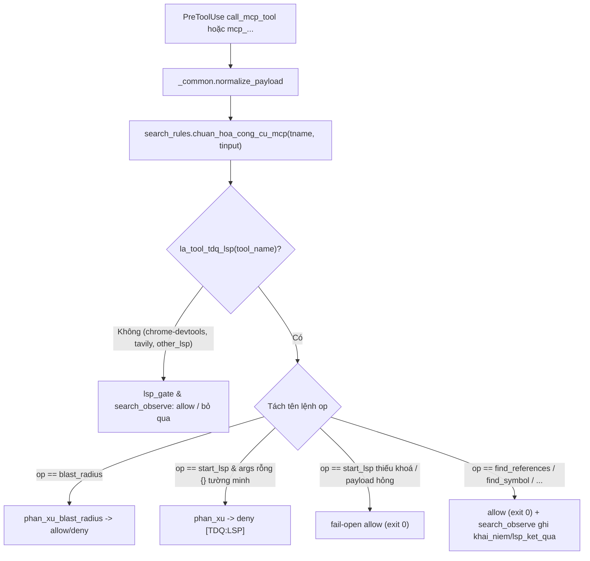

# SPEC — Fix triệt để lỗi lsp_gate chặn nhầm call_mcp_tool và chuẩn hoá phân luồng MCP/LSP

Ngày: 2026-11-16 · Bản: 1.0 · Brief: ../brief/2026-11-16-1953-fix-lsp-gate-mcp-routing.md · Lane: full
Soul: chất lượng > runtime > context cost · luật gốc: skills/tdq-conventions/references/soul.md
Trạng thái: CHỜ DUYỆT

## Mục lục

- 1. Mục tiêu & phạm vi
- 1b. Lộ trình
- 2. Đầu ra cụ thể
- 2b. Ranh giới module
- 2c. Luồng hoạt động & Sơ đồ kiến trúc
- 3. Cách tiếp cận & lý do
- 3b. Năng lực & công cụ
- 3c. Giải thuật & Xử lý cốt lõi
- 3d. Mental Model cho Fresher Dev
- 4. Yêu cầu bắt buộc
- 5. Ràng buộc & rủi ro
- 6. QC & Definition of Done
- 7. Câu hỏi còn mở

## 1. Mục tiêu & phạm vi

- **Mục tiêu:** Chấm dứt hoàn toàn việc `lsp_gate.py` chặn nhầm các lời gọi `call_mcp_tool` của `chrome-devtools`, `tavily-primary`, các tool LSP không phải `start_lsp`/`blast_radius` (cả lazy lẫn eager), và server ngoài không thuộc TDQ; đồng thời siết chuẩn nhận diện TDQ LSP về một hàm thuần duy nhất tại `scripts/search_rules.py`, chặn đúng `start_lsp` gọi tường minh với `Arguments: {}` rỗng, giữ nguyên fail-open khi hỏng/thiếu payload, và biên dịch sạch gói `plugins/tdq-workflow-agy/`.
- **Trong phạm vi:**
  - Hợp nhất logic giải gói `call_mcp_tool` (hỗ trợ cả `Arguments` chuỗi JSON double-encoded) và bộ nhận diện chặt TDQ LSP server về `scripts/search_rules.py`.
  - Cập nhật `hooks/scripts/_common.py`, `hooks/scripts/lsp_gate.py`, `hooks/scripts/search_observe.py` dùng chung chuẩn mới và phân tách rõ payload thiếu tham số (fail-open) vs tham số rỗng `{}` trên `start_lsp` (`deny`).
  - Đồng bộ bộ compiler `tools/patches/{agy_hooks,cli_fixes_a}.py` và biên dịch lại `plugins/tdq-workflow-agy/`.
  - Bổ sung bộ test hồi quy đầy đủ (unit test + dual-protocol `cmd /c` + `agy plugin validate --strict`).
- **NGOÀI phạm vi (theo chốt phỏng vấn `1a 2a 3b 4c`):**
  - Không ghi đè/đồng bộ sang bản cài plugin cục bộ `C:/Users/admin/.gemini/config/plugins/tdq-workflow-agy` trước bước hỏi commit (`3b`).
  - Không sửa matcher `"mcp_.*lsp_.*|call_mcp_tool"` trong `tools/patches/agy_manifests.py` (`hooks.json`) vì runtime Antigravity lọc ở tên tool, chưa hỗ trợ lọc theo giá trị `ServerName` bên trong JSON `args`.
  - Không đụng tính năng khác ngoài định tuyến MCP/LSP; không cần tải thư viện ngoài hay model mới.

## 1b. Lộ trình

| Bước/phase | Chạy? | Vì sao |
|---|---|---|
| Research web | BỎ | Lỗi thuần nội bộ giữa mã nguồn TDQ và đặc tả Antigravity đã xác thực trên đĩa |
| Interview | CÓ (xong) | Đã chốt 5 câu hỏi (`1a 2a 3b 4c agent QC nhiều round 5a`), ghi đủ vào brief và `muc_qc = ultra` |
| Spec + Archify Preview | CÓ | Chạm `hooks/`, `scripts/`, `tools/patches/`, thay đổi hành vi phân luồng đa host |
| Plan + Implement (`mode` do user chọn) | CÓ | Triển khai red → green tuần tự theo 5 module độc lập đường dẫn M1–M5 |
| QC độc lập (`tdq-qc-tester`) | CÓ (`ultra`, cho phép nhiều vòng nếu cần) | Khớp yêu cầu `4c agent QC nhiều round`: full suite + `agy plugin validate` + kiểm chứng qua `tdq-qc-tester` |
| Report + Archify HTML | CÓ | Xuất báo cáo kèm sơ đồ, hỏi commit (cập nhật bản cài local thực hiện sau commit/release) |

## 2. Đầu ra cụ thể

| # | Đầu ra | Đường dẫn/vị trí | Đo "xong" bằng |
|---|---|---|---|
| 1 | Hàm thuần chuẩn hoá MCP + nhận diện TDQ LSP duy nhất | `scripts/search_rules.py`, `tools/patches/cli_fixes_a.py` | Giải gói `call_mcp_tool` + eager AGY cho đúng server TDQ LSP (`lsp`, `tdq-workflow_lsp`, `tdq-workflow-agy_lsp`, `plugin_tdq-workflow_lsp`, `plugin_tdq-workflow-agy_lsp`), giữ `mcp__other_lsp__*` là server ngoài, xử lý `Arguments` chuỗi JSON, vượt qua kiểm tra AST thuần I/O (`test_log_module_thuan_khong_tu_in`) |
| 2 | Chuẩn hoá payload hook dùng chung + cờ hiện diện tham số | `hooks/scripts/_common.py`, `tools/patches/agy_hooks.py` | Gọi helper từ `search_rules.py` (không lặp logic), đánh dấu cờ `_tool_args_present` phân biệt payload thiếu khoá/JSON hỏng với `Arguments: {}` hay `tool_input: {}` tường minh |
| 3 | Định tuyến đúng 3 nhánh trong `lsp_gate.py` | `hooks/scripts/lsp_gate.py` | Chỉ kiểm `phan_xu` khi là TDQ LSP `start_lsp` (chặn cả `Arguments: {}`), chỉ kiểm `phan_xu_blast_radius` khi là TDQ LSP `blast_radius`, cho qua (`allow` / exit `0`) mọi `chrome-devtools`, `tavily-primary`, `find_references`, `find_symbol` và `other_lsp`; thời gian chạy `<= 200 ms` |
| 4 | Ghi telemetry LSP chặt chẽ trong `search_observe.py` | `hooks/scripts/search_observe.py` | Chỉ ghi dòng `lsp_ket_qua` khi `tool_name` thật sự là TDQ LSP (`la_tool_tdq_lsp`), không ghi nhầm cho tool/server ngoài chứa chữ `"lsp"` |
| 5 | Gói plugin Antigravity biên dịch sạch | `plugins/tdq-workflow-agy/` | Sinh bằng `tools/build_agy_plugin.py`, chứa bản cập nhật đồng bộ của các file trên và đạt `0` findings qua `agy.EXE plugin validate --strict --json` |
| 6 | Bộ unit test & dual-protocol hồi quy | `tests/` (4 file test hook/search hiện có) | Bao phủ toàn bộ ca `chrome-devtools` (`select_page`, `list_pages`), `tavily`, `tdq-workflow-agy_lsp` (lazy & eager), `other_lsp`, `start_lsp` rỗng vs thiếu khoá, độ trễ `< 200 ms` |

## 2b. Ranh giới module

| Module | Vùng file | Phụ thuộc module | Đầu ra §2 |
|---|---|---|---|
| `M1 chuan-hoa-mcp` | `scripts/search_rules.py`, `tools/patches/cli_fixes_a.py` | không | 1 |
| `M2 giao-thuc-common` | `hooks/scripts/_common.py`, `tools/patches/agy_hooks.py` | `M1` | 2 |
| `M3 cong-lsp-observe` | `hooks/scripts/lsp_gate.py`, `hooks/scripts/search_observe.py` | `M1`, `M2` | 3, 4 |
| `M4 bien-dich-agy` | `plugins/tdq-workflow-agy/` | `M1`, `M2`, `M3` | 5 |
| `M5 test-hoi-quy` | thư mục `tests/` (4 suite kiểm thử hook LSP, chuẩn hoá tìm kiếm, quan sát, giao thức kép) | `M1`, `M2`, `M3`, `M4` | 6 |

## 2c. Luồng hoạt động & Sơ đồ kiến trúc

Sơ đồ Trước/Sau tương tác đã dựng và gắn kết với spec tại bản xem trước Archify: `docs/tdq/spec/2026-11-16-1953-fix-lsp-gate-mcp-routing-preview.html`.

Cơ chế hiện tại vs Sau update:

| Khía cạnh | Hiện trạng (Trước) | Thiết kế mới (Sau) |
|---|---|---|
| Kiểm nhánh trong `lsp_gate.py` | Chỉ tách `"blast_radius" in tool_name`; còn lại đều chạy `phan_xu()` của `start_lsp` | Kiểm `la_tool_tdq_lsp(tool_name)` trước, rồi rẽ 3 nhánh: `start_lsp`, `blast_radius`, và các tool khác `allow` ngay |
| Nhận diện server LSP | Kiểm `"lsp" in srv` / `"_lsp_" in tname` lặp ở 3 chỗ, gom nhầm cả `other_lsp` | Khớp chặt `TDQ_LSP_SERVER_RE` qua 1 nguồn thuần duy nhất tại `scripts/search_rules.py` |
| Xử lý `start_lsp` với `Arguments: {}` | Thoát sớm chung mọi `tool_input` rỗng → bỏ lọt `start_lsp` gọi `Arguments: {}` | Cờ `_tool_args_present` phân biệt payload hỏng/thiếu khoá (`allow`) với tham số rỗng tường minh trên `start_lsp` (`deny`) |
| Telemetry `search_observe.py` | Kiểm `"lsp" in tool_name.lower()` | Kiểm `la_tool_tdq_lsp(tool_name)` tránh nhiễm `lsp_ket_qua` từ MCP ngoài |

## 3. Cách tiếp cận & lý do

- **Chọn:** Đặt bộ giải gói & nhận diện server LSP TDQ thuần (stdlib regex + `json.loads` an toàn, không I/O) tại `scripts/search_rules.py`; `_common.py`, `lsp_gate.py` và `search_observe.py` dùng lại qua import `hooks/ -> scripts/`; phân tách rõ hai lớp lọc:
  1. **Lớp chuẩn hoá tên MCP:** Chỉ ánh xạ về `mcp__lsp__<op>` khi `ServerName` thuộc tập đóng `TDQ_LSP_SERVER_RE` (`lsp`, `plugin_tdq-workflow_lsp`, `tdq-workflow_lsp`, `tdq-workflow-agy_lsp`, `plugin_tdq-workflow-agy_lsp`) hoặc prefix eager tương ứng; server khác (`chrome-devtools`, `tavily-primary`, `other_lsp`, …) giữ nguyên `mcp__<srv>__<tool>` và **không** được xem là TDQ LSP.
  2. **Lớp định tuyến `lsp_gate.py`:** Dùng `la_tool_tdq_lsp` + lấy `op`: `start_lsp` chạy `phan_xu`, `blast_radius` chạy `phan_xu_blast_radius`, mọi tool khác thoát `0` im lặng (`allow`). Với `start_lsp`, giữ fail-open khi payload hỏng JSON hoặc hoàn toàn thiếu container tham số (`_tool_args_present == False`), và chạy `phan_xu` (bắt thiếu `language_id`) khi có tham số tường minh kể cả `Arguments: {}`.
- **Vì:** Tuân thủ đúng luật gọi `hooks/ -> scripts/` của `docs/kien-truc.md`, giữ `scripts/search_rules.py` thuần I/O (`O(1)` regex/dict lookup, độ trễ không tăng đáng kể so với nền `66.4–72.2 ms`), loại bỏ hoàn toàn 3 bản sao logic lệch nhau, và khớp cả Claude Code lẫn Antigravity 2.0 (lazy + eager).
- **Đã loại:**
  - *Chỉ sửa regex matcher trong `hooks.json` để bỏ `call_mcp_tool` khỏi `lsp_gate.py`*: Đã loại vì runtime Antigravity chỉ lọc `matcher` theo tên tool (`"call_mcp_tool"`), không lọc được theo trường `"ServerName"` lồng bên trong `Arguments` — bỏ `call_mcp_tool` sẽ làm mù cổng bảo vệ đối với `start_lsp` và `blast_radius` bản lazy!
  - *Chỉ thêm `elif "start_lsp" in tool_name:` tại `lsp_gate.py` mà giữ nguyên `"lsp" in srv` trong `_common.py` / `search_rules.py`*: Đã loại theo chốt `1a` vì vẫn để lọt bug nhận nhầm server ngoài (`other_lsp`) và trùng lặp logic 3 nơi.

## 3b. Năng lực & công cụ

| Skill | Nguồn | Phán quyết | Dùng ở đâu / Lý do loại |
|---|---|---|---|
| `tdq-setup` | `plugin:tdq-workflow` | DÙNG | đối chiếu quy ước 3 tầng tìm kiếm và tên MCP server `lsp` tại M1, M3 |
| `tdq-browser-research` | `plugin:tdq-workflow-agy` | DÙNG | lấy mẫu payload `call_mcp_tool` thật của `chrome-devtools` cho ca test M5 |
| `tdq-browser-test` | `plugin:tdq-workflow-agy` | DÙNG | kiểm chứng tương thích luồng tương tác Chrome DevTools tại M5 |
| `tdq-conventions` · `tdq-intake` · `tdq-spec` · `tdq-plan` · `tdq-build` · `tdq-lean` · `tdq-check-status` · `tdq-status` · `tdq-checkportable` | `plugin:tdq-workflow` / `plugin:tdq-workflow-agy` | NỀN | các skill khung của quy trình TDQ |
| Đã xét 19 skill ẩn theo từ khoá + skill built-in khác | user/plugin/built-in | KHÔNG | `khác lĩnh vực` |

## 3c. Giải thuật & Xử lý cốt lõi

- **Từng bước giải thuật (Step-by-step Execution Logic):**
  1. **Tại `scripts/search_rules.py` (`tach_mcp_tool`, `la_tool_tdq_lsp`, `chuan_hoa_cong_cu_mcp`):**
     - Nếu `ten_tool == "call_mcp_tool"` và `tool_input` là `dict`: đọc `srv = ServerName|server`, `tname = ToolName|tool`, đọc `raw_args = Arguments|arguments`. Nếu `raw_args` là chuỗi JSON, thử `json.loads` một vòng (`isinstance(decoded, dict)` → dùng `decoded`; chuỗi JSON hỏng → coi như hỏng/rỗng an toàn `{}` kèm đánh dấu giải mã thất bại nếu cần fail-open).
     - Nếu `srv` khớp `TDQ_LSP_SERVER_RE` (không phân biệt hoa thường) → chuẩn hoá tên thành `f"mcp__lsp__{tname}"`; nếu `srv` khác rỗng và không thuộc TDQ LSP → giữ `f"mcp__{srv}__{tname}"`. Trả `(ten_da_giai, args_dict, hop_le_container)`.
     - Nếu `ten_tool` có dạng eager Antigravity bắt đầu bằng `mcp_` (không phải `mcp__`) và chứa server prefix khớp `^mcp_(?:(?:plugin_)?tdq-workflow(?:-agy)?_)?lsp_(.+)$` → chuẩn hoá thành `mcp__lsp__<op>` (còn `mcp_other_lsp_foo` giữ nguyên).
     - `la_tool_tdq_lsp(ten_tool)` trả `True` duy nhất khi `ten_tool` khớp `TDQ_LSP_TOOL_RE` (`^(?:mcp__lsp__|mcp__plugin_tdq-workflow(?:-agy)?_lsp__|lsp\.)`), trả phần `op` khi cần rẽ nhánh.
  2. **Tại `hooks/scripts/_common.py` (`normalize_payload`):**
     - Ghi nhận container tham số gốc có tồn tại & hợp lệ hay không trước khi giải gói:
       - Direct/eager call: có một trong các khoá `("tool_input", "toolInput", "arguments", "input")` hoặc `toolCall.args` với kiểu `dict` (hoặc chuỗi JSON decode thành `dict`), đặt `_tool_args_present = True`; nếu thiếu khoá hoặc decode lỗi, `_tool_args_present = False`.
       - Lazy `call_mcp_tool`: container thực nằm ở `Arguments` / `arguments` bên trong wrapper `args`: nếu key `Arguments`/`arguments` tồn tại và parse ra `dict` (kể cả `{}` rỗng!) thì `_tool_args_present = True`; nếu `Arguments` là chuỗi JSON hỏng thì `_tool_args_present = False`.
     - Gọi `chuan_hoa_cong_cu_mcp(tname, tinput)` từ `search_rules` để cập nhật `tool_name` và `tool_input`.
  3. **Tại `hooks/scripts/lsp_gate.py` (`main`):**
     - Đọc `payload = _common.read_payload()`, trích `tool_name`, `tool_input`, `has_args = bool(payload.get("_tool_args_present") or tool_input)`.
     - Kiểm `op = ten_lenh_tdq_lsp(tool_name)`: nếu `op is None` (không phải tool của TDQ LSP) → ghi 1 dòng `_log` rồi `sys.exit(0)` (allow).
     - Nếu `op == "blast_radius"`: nếu `not has_args` thoát `0`; ngược lại đọc `doc_so` và gọi `phan_xu_blast_radius(cwd, tool_input, rows)` → `block` nếu có dòng từ chối.
     - Nếu `op == "start_lsp"`: nếu `not has_args` thoát `0` (giữ fail-open khi thiếu/hỏng payload); ngược lại gọi `phan_xu(cwd, tool_input)` → `block` `[TDQ:LSP]` nếu thiếu `language_id` (bao gồm `Arguments: {}` rỗng tường minh!) hoặc sai `(root, language)`.
     - Mọi `op` khác của TDQ LSP (`find_references`, `find_symbol`, `go_to_definition`, `list_symbols`, `get_diagnostics`, `open_document`, …) → thoát `0` (allow).
  4. **Tại `hooks/scripts/search_observe.py` (`PostToolUse` / `PostToolUseFailure`):**
     - Đổi dòng 181 thành `if la_tool_tdq_lsp(tool_name):` (chỉ tính telemetry `lsp_ket_qua` cho tool thật của TDQ LSP).
- **Độ phức tạp tính toán:**
  - Thời gian: $O(L)$ với $L$ là độ dài chuỗi tên tool và JSON arguments nhỏ (< vài KB) — chỉ dùng regex biên dịch sẵn và 1 lần `json.loads`, không quét đĩa thêm ở nhánh bỏ qua (giữ dưới ngưỡng `200 ms`).
  - Không gian: $O(L)$ — giữ 1 dict tham số chuẩn hoá trong bộ nhớ lượt hook.
- **Các ca góc hiểm (Edge Cases & Defensive Handling):**
  1. **`call_mcp_tool` tới `chrome-devtools` hoặc `tavily-primary` (có `Arguments` hoặc `{}`):** Giải gói thành `mcp__chrome-devtools__select_page`, `la_tool_tdq_lsp` trả `False` → `lsp_gate.py` thoát `0` (`allow`).
  2. **`call_mcp_tool` tới `tdq-workflow-agy_lsp` với `ToolName="start_lsp"` và `Arguments: {}` (hoặc `Arguments: "{}"` double-JSON):** `_tool_args_present == True`, `op == "start_lsp"`, `phan_xu` phát hiện thiếu `language_id` → `deny` bằng `[TDQ:LSP]`.
  3. **Payload hỏng JSON hoặc thiếu hẳn khoá `tool_input` / `args` (`{"tool_name": "mcp__lsp__start_lsp", "cwd": ...}` hoặc `Arguments: "{bad"`):** `_tool_args_present == False` → fail-open thoát `0` (`allow`), không gây chết oan vì lỗi transport.
  4. **Server ngoài chứa chữ `lsp` (`ServerName="other_lsp"` hoặc `"mcp__other_lsp__find_symbol"` / `"mcp_custom_lsp_start_lsp"`):** Không khớp `TDQ_LSP_SERVER_RE` → giữ nguyên tên ngoài, `la_tool_tdq_lsp` = `False`, `la_goi_khai_niem` = `None`, `lsp_gate` không chặn nhầm và `search_observe` không ghi nhầm `lsp_ket_qua`.

## 3d. Mental Model cho Fresher Dev

- **Ẩn dụ trực quan (Analogy):** Hãy tưởng tượng toà nhà có 3 cổng ra vào (`chrome-devtools`, `tavily`, `lsp`) đều đi qua một bác bảo vệ ở sảnh chính (`call_mcp_tool` trong `hooks.json`). Trước đây bác bảo vệ chỉ hỏi đúng 1 câu: *"Anh có phải người phòng `blast_radius` không? Không thì trình thẻ nhân viên `start_lsp` + `language_id` ra!"* — khiến shipper `chrome-devtools` lẫn nhân viên `find_references` ngồi sẵn trong toà đều bị đuổi về! Thiết kế mới gắn bảng tên rõ cho từng người: bác bảo vệ đọc đúng tên phòng và tên lệnh trước — đúng người `start_lsp` mới hỏi `language_id`, đúng `blast_radius` mới kiểm hạn mức 3 file, còn lại mời đi thẳng vào trong.
- **Thuật ngữ dự án (Glossary):**
  - `call_mcp_tool`: Công cụ bọc dùng để gọi các MCP tool ở chế độ `Lazy` trên Google Antigravity, chứa `ServerName`, `ToolName` và `Arguments`.
  - `_unwrap_call_mcp` / `_agy_unwrap_tool`: Hai hàm giải gói `call_mcp_tool` về dạng chuẩn `mcp__<server>__<tool>` trước khi đưa vào logic rule/hook.
  - `TDQ_LSP_SERVER_RE`: Biểu thức chính quy tập đóng khớp đúng tên server LSP thuộc hệ thống TDQ (loại trừ server lạ ngoài luồng dù tên có chứa `"lsp"`).
  - `Fail-open` vs `Fail-closed`: `Fail-open` cho qua an toàn khi payload transport bị hỏng/mất trường; `Fail-closed` chặn khi người gọi gửi tường minh `start_lsp` hợp lệ nhưng thiếu `language_id`.

## 4. Yêu cầu bắt buộc

- **Log service bật mặc định:** `lsp_gate.py` và `search_observe.py` đã bật sẵn `_log(...)` có ISO timestamp ra `stderr`, tắt được bằng `TDQ_LOG=0`. Khi bỏ qua tool không thuộc TDQ LSP trong `lsp_gate.py`, log rõ `non-tdq-lsp tool=<tool_name> — allow` để dễ debug. (`scripts/search_rules.py` giữ ngoại lệ thuần không tự in theo hợp đồng `test_log_module_thuan_khong_tu_in`, log đi qua `search_observe`/`search_gate`.)
- Không placeholder, không TODO stub; giữ đúng chuẩn chuỗi máy tiếng Anh (`i18n_check.py`); eval không kích hoạt (opt-in chưa bật).
- Mỗi thành phần mới/sửa đều có unit test riêng chạy red → green bằng một lệnh.
- Bám 5 nguyên tắc SOLID theo `skills/tdq-conventions/references/clean-code.md`, `chung.md` (cyclomatic `<= 10`, cognitive `<= 15`), và `python.md` (`ruff check --select F,E,B`).

## 5. Ràng buộc & rủi ro

Ràng buộc kiến trúc phải giữ (chép nguyên văn từ `docs/kien-truc.md`):
- "`hooks/` được gọi `scripts/`; `scripts/` **không** được import `hooks/`" — chạm ở `hooks/scripts/_common.py`, `hooks/scripts/lsp_gate.py`, `hooks/scripts/search_observe.py` và `scripts/search_rules.py` (đưa helper chuẩn hoá thuần về `scripts/search_rules.py`, không đi ngược).
- "`tests/` gọi được vào mọi tầng; không tầng nào được import `tests/`." — chạm ở toàn bộ test mới/cập nhật trong `tests/`.
- "ngôn ngữ chia 3 tầng — luật trong `skills/`, `agents/`, chú thích/docstring của `hooks/` + `scripts/` và chuỗi máy in ra đều viết TIẾNG ANH cố định" — chạm ở mọi docstring/chuỗi log mới trong `scripts/search_rules.py` và `hooks/scripts/*.py`.
- "Antigravity không đọc thẳng repo nên layout của nó SINH tại máy người dùng" (nay biên dịch tại `plugins/tdq-workflow-agy/` qua `tools/build_agy_plugin.py`) — không sửa tay file trong `plugins/tdq-workflow-agy/` mà phải sửa gốc + `tools/patches/` rồi biên dịch lại.

| Rủi ro | Ảnh hưởng | Cách giảm |
|---|---|---|
| `_common.py` được test load trực tiếp bằng `importlib` khi `scripts/` chưa có trong `sys.path` | Có thể lỗi `ModuleNotFoundError: search_rules` ở test đặc biệt | Đảm bảo `_SCRIPTS_DIR` luôn chèn vào `sys.path` ở đầu `_common.py` trước khi `from search_rules import ...` (giống cách `_common.py` đang import `tdq_state`) |
| Test cũ `test_hooks_dual_protocol.py` load `_common.py` từ `plugins/tdq-workflow-agy/` | Nếu quên chạy `build_agy_plugin.py` bản plugin AGY vẫn mang code cũ | Khoá kiểm bắt buộc chạy `tools/build_agy_plugin.py` + `pytest` vào gói biên dịch |
| Phân biệt sai payload thiếu khoá vs `Arguments: {}` rỗng ở một số host adapter | Có thể chặn nhầm `test_payload_hong_hoac_rong` | Kiểm chính xác từng key container trước `normalize_payload` và viết test riêng cho cả 2 nhánh |

## 6. QC & Definition of Done

| # | Hạng mục kiểm | Điều kiện PASS | Đo trước | Dự phòng nếu trượt |
|---|---|---|---|---|
| Q1 | Chức năng `lsp_gate.py` trên `call_mcp_tool` & eager MCP | Mọi tool không thuộc TDQ LSP (`chrome-devtools` `select_page`/`click`/`list_pages`, `tavily_search`), các tool hỏi đáp TDQ LSP (`find_references`, `find_symbol`, `go_to_definition`) và server ngoài `other_lsp` đều trả allow; riêng `start_lsp` (gồm `Arguments: {}`) thiếu `language_id` hoặc sai `(root, language)` và `blast_radius` vi phạm ngưỡng đều bị deny | 4/5 ca tái hiện trực tiếp bị deny oan (trừ `list_pages`) | Kiểm tra lại điều kiện trích `ServerName`/`ToolName` trong `chuan_hoa_cong_cu_mcp` và `ten_lenh_tdq_lsp` |
| Q2 | Chuẩn hoá hợp nhất + từ chối server ngoài | Không còn bản sao `_unwrap_call_mcp` tách rời; nhận diện `TDQ_LSP_SERVER_RE` từ chối `mcp__other_lsp__*` ở cả `la_goi_khai_niem`, `lsp_gate` lẫn `search_observe` (`lsp_ket_qua`) | — | Rà lại tất cả pattern tên server (`_common.py`, `search_rules.py`, `search_observe.py`, `tools/patches/`) |
| Q3 | Fail-open payload hỏng / thiếu tham số | Payload thiếu `tool_input` hoặc JSON tham số hỏng của `start_lsp` vẫn trả exit `0` allow; hiệu năng `lsp_gate.py <= 200 ms` mỗi lần gọi | `66.4 – 72.2 ms` qua 5 lần đo trực tiếp trên `hooks/scripts/lsp_gate.py` (dư ~2.8 lần dưới trần `200 ms`) | Tối ưu lazy import hoặc biên dịch regex mức module để giảm thời gian khởi động |
| Q4 | Đồng bộ compiler & plugin Antigravity + không đụng local (`3b`) | `tools/build_agy_plugin.py` biên dịch thành công, mã nguồn gói `plugins/tdq-workflow-agy/` khớp gốc và vượt qua trình kiểm tra plugin `agy` với `0` error và `0` warning; bản cài local `~/.gemini/config/plugins/` chưa bị ghi đè | — | Sửa lệch trong `tools/patches/agy_hooks.py` hoặc `cli_fixes_a.py` rồi biên dịch lại |
| Q5 | Chuẩn sạch, thuần I/O, linter, trọn bộ & QC `ultra` | `search_rules.py` không tự gọi `print`/`open`, linter Python & doc lint sạch vi phạm, token lock giữ xanh (`<= 3500` token/file), toàn bộ bộ kiểm thử tự động trong repo và lượt rà nhiều vòng của agent QC độc lập đều PASS | `token_budget.py --kiem` exit `0` (xanh trước sửa) | Mở vòng fix QC (tối đa 3 vòng), sửa red → green rồi cho agent QC kiểm lại |

**Definition of Done:**
- [ ] Giải gói & nhận diện TDQ LSP được chuẩn hoá tại một nguồn thuần duy nhất ở `scripts/search_rules.py`, dùng chung tại `_common.py`, `lsp_gate.py`, `search_observe.py` và đồng bộ trong `tools/patches/{agy_hooks,cli_fixes_a}.py`.
- [ ] `lsp_gate.py` cho qua (`allow`) `chrome-devtools` (`select_page`, `list_pages`, …), `tavily-primary`, các tool LSP khác (`find_references`, `find_symbol`, …) và server ngoài; chặn đúng `start_lsp` (kể cả `Arguments: {}` rỗng tường minh) khi thiếu/sai `(root_dir, language_id)` và `blast_radius` vượt ngưỡng; giữ fail-open khi payload hỏng hoặc thiếu khoá tham số; độ trễ `<= 200 ms`.
- [ ] `plugins/tdq-workflow-agy/` được biên dịch lại khớp gốc, vượt `agy plugin validate --strict --json` với `0` lỗi / `0` cảnh báo, và giữ nguyên plugin cục bộ theo chốt `3b`.
- [ ] Unit test, dual-protocol E2E, full suite, linter (`ruff`, `doc_lint`, `i18n_check`, `token_budget`), và agent QC độc lập (`muc_qc = ultra`, hỗ trợ nhiều vòng kiểm) đều PASS.

## 7. Câu hỏi còn mở

(không có)
<!-- tdq-archify-binding:start -->
<!-- manifest: 2026-11-16-1953-fix-lsp-gate-mcp-routing-preview.manifest.json -->
<!-- manifest_digest: 66bab580cf29120423fed3cc506b3bd00690e8e24d95d2494a1af15697aae024 -->
<!-- tdq-archify-binding:end -->