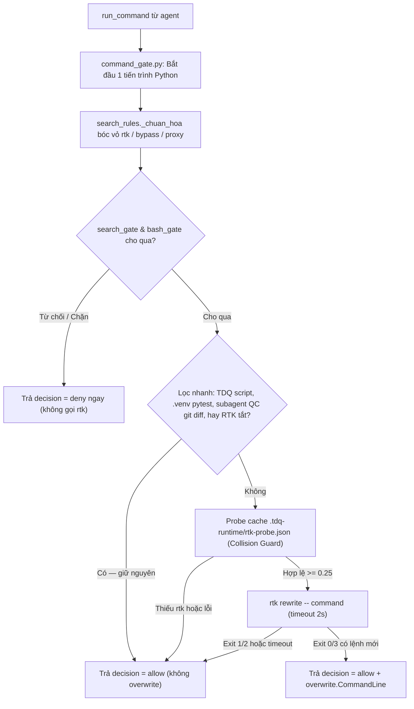

# SPEC — Tích hợp cộng sinh RTK tối ưu token và tự động kiểm/cài cho Antigravity

Ngày: 2026-11-17 · Bản: 1.0 · Brief: ../brief/2026-11-17-0325-tich-hop-rtk-antigravity.md · Lane: full
Soul: chất lượng > runtime > context cost · luật gốc: skills/tdq-conventions/references/soul.md
Trạng thái: CHỜ DUYỆT

## Mục lục

- 1. Mục tiêu & phạm vi
- 1b. Lộ trình
- 2. Đầu ra cụ thể
- 2b. Ranh giới module
- 2c. Luồng hoạt động & Sơ đồ kiến trúc
- 3. Cách tiếp cận & lý do
- 3b. Năng lực & công cụ
- 3c. Giải thuật & Xử lý cốt lõi
- 3d. Mental Model cho Fresher Dev
- 4. Yêu cầu bắt buộc
- 5. Ràng buộc & rủi ro
- 6. QC & Definition of Done
- 7. Câu hỏi còn mở

## 1. Mục tiêu & phạm vi

- **Mục tiêu:** Hợp nhất (`collapse`) trực tiếp cơ chế nén đầu ra CLI của `rtk` vào cổng `PreToolUse` của `tdq-workflow-agy` thông qua một tiến trình Python duy nhất (`command_gate.py`) trên Google Antigravity, vừa cắt giảm một nửa chi phí khởi tạo hook trên mỗi `run_command` vừa tiết kiệm token đầu ra toàn diện cùng kho khôi phục không mất dữ liệu (`rtk recall <hash>`); đồng thời bổ sung cơ chế phát hiện thiếu công cụ và xin quyền người dùng cài đặt + cấu hình user-level đầy đủ `rtk` kèm `rg` (`ripgrep`).
- **Trong phạm vi (khớp các hạng mục đã chốt `1a 2a 3a 4a 5a 6a`):**
  - **Hạng mục 1 (Giữ kho MIT sạch 100% + Cài user-level có kiểm `SHA256`):** Không đưa mã nguồn hay file thực thi `rtk`/`rg` vào kho `TDQ-Workflow-Antigravity`; chỉ cài binary chính thức `rtk-ai/rtk` (`v1.2.0+`) và `BurntSushi/ripgrep` (`15.2.0+`) từ GitHub Releases kiểm `SHA256` vào `~/.local/bin` (thêm User `PATH` trên Windows) khi có sự đồng ý của người dùng (`1a`).
  - **Hạng mục 2 (Collapse `PreToolUse` hợp nhất cho `run_command`):** Tạo `scripts/rtk_integration.py` và cổng hợp nhất `hooks/scripts/command_gate.py`, hỗ trợ xuất `"overwrite": {"CommandLine": ...}` trong `hooks/scripts/_common.py`, giữ nguyên interface của `bash_gate.py` và `search_gate.py` cho bộ test/Codex hiện có, cập nhật matcher `hooks.json` trong `tools/patches/agy_manifests.py` và tắt nhắc `[TDQ:OUTPUT]` trùng khi `rtk` đã nén `git log`/`git diff`/`git show`.
  - **Hạng mục 3 (Cấu hình hòa hợp TDQ & Bảo vệ chất lượng đầu ra):** Sinh/merge an toàn `%APPDATA%\rtk\config.toml` (`awareness.level = "default"`, `telemetry.enabled = false`, `pro_hint = false`, `emoji = false`, `suppress_hook_warning = true`, `retriever.mode = "sqlite"`, `exclude_commands = ["grep", "rg"]`); đồng thời giữ nguyên `.venv`/`py -3 -m pytest` và tự miễn nén `git diff` cho subagent kiểm định (`tdq-qc-tester`, `tdq-security-reviewer`, `tdq-reviewer`) (`3a`).
  - **Hạng mục 4 (Chặn lách `[TDQ:SEARCH]` + Hệ thống Trigger xin quyền cài đặt):** Mở rộng `_chuan_hoa` trong `scripts/search_rules.py` bóc `rtk`, `rtk.exe`, `rtk bypass`, `rtk proxy`, `rtk read`; tích hợp trigger kiểm & xin quyền vào `install.py`, `install.ps1`, `install.sh`, `tools/install_agy_plugin.py`, `scripts/tdq_setup.py`, `scripts/tdq_lsp.py`, `scripts/setup_status.py` và `hooks/scripts/session_start.py` (`4a`).
  - **Biên dịch & Nghiệm thu thực tế (`2a`, `5a`):** Biên dịch đồng bộ `plugins/tdq-workflow-agy/` qua `tools/build_agy_plugin.py`, chạy kiểm thử tự động toàn diện (`muc_qc = ultra`), cài thật `rtk` + `rg` user-level trên máy hiện tại để đo kiểm `rtk gain` và độ trễ hook sống, kèm rà soát độc lập từ `tdq-qc-tester`.
- **NGOÀI phạm vi:**
  - Không đụng `PostToolUse` để biến đổi kết quả sau khi chạy xong (Antigravity `PostToolUse` chỉ chấp nhận `{}`).
  - Không tự động cài ngầm `rtk`/`rg` khi chạy `tdq_setup.py --nen` nếu thiếu cờ `--with-rtk` đã được người dùng đồng ý.
  - Không gỡ bỏ hoặc đổi chữ ký API công khai của `hooks/scripts/bash_gate.py` và `hooks/scripts/search_gate.py`.

## 1b. Lộ trình

| Bước/phase | Chạy? | Vì sao |
|---|---|---|
| Research web / API | CÓ (xong) | Đã truy vấn GitHub Releases `rtk-ai/rtk` (`v1.2.0`) và `BurntSushi/ripgrep` (`15.2.0`), kiểm hợp đồng hook Antigravity và đo baseline `context_surface.py` |
| Interview | CÓ (xong) | Đã chốt đủ 6 câu hỏi vòng 1 (`1a 2a 3a 4a 5a 6a`), ghi đầy đủ vào brief và khóa `muc_qc = ultra` |
| Spec + Archify Preview | CÓ | Chạm nhiều tầng (`scripts/`, `hooks/scripts/`, `tools/patches/`, `install.py`), cần khóa hợp đồng và xem trước kiến trúc Trước/Sau |
| Plan + Implement (`mode` do user chọn) | CÓ | Triển khai `red -> green` qua 5 module M1–M5 theo ranh giới call-graph độc lập |
| QC độc lập (`tdq-qc-tester`) | CÓ (`ultra`) | Đúng lựa chọn `5a`: trọn bộ test + smoke + runtime sống + cài thật `rtk` & `rg` kiểm `rtk gain` theo `2a` + `tdq-qc-tester` soi độc lập |
| Report + Archify HTML | CÓ | Xuất báo cáo kèm sơ đồ Archify HTML phục vụ qua Tailscale và hỏi commit/cập nhật local |

## 2. Đầu ra cụ thể

| # | Đầu ra | Đường dẫn/vị trí | Đo "xong" bằng |
|---|---|---|---|
| 1 | Module lõi tích hợp RTK & bộ cài `SHA256` | `scripts/rtk_integration.py` | Probe `rtk` với Collision Guard (`--version >= 0.25` + `gain == 0`) kèm cache `.tdq-runtime/rtk-probe.json`, probe `rg`, `rewrite_command` an toàn PowerShell/venv/subagent QC, `ensure_rtk_config` sao lưu trước ghi, `install_rtk_and_rg(approve=True)` kiểm `SHA256` + khóa `TDQ_KHONG_CHAM_MAY=1`, quản lý trạng thái ẩn nhắc |
| 2 | Chuẩn hóa vỏ `rtk` chống lách `[TDQ:SEARCH]` | `scripts/search_rules.py`, `tools/patches/cli_fixes_a.py` | `_chuan_hoa` bóc `rtk`, đường dẫn `rtk.exe`, cờ ngắn/dài của `rtk`, `rtk bypass`, `rtk proxy`, `rtk read`; `rtk grep`/`rtk bypass rg` bị phân loại là tìm kiếm code và vẫn thuần không I/O (`test_log_module_thuan_khong_tu_in`) |
| 3 | Cổng `PreToolUse` Collapse + hỗ trợ `overwrite` | `hooks/scripts/command_gate.py`, `hooks/scripts/_common.py`, `hooks/scripts/bash_gate.py`, `tools/patches/{agy_hooks,agy_manifests}.py`, `plugins/tdq-workflow-agy/rules/AGENTS.md` | `_common` hỗ trợ cache payload trong chế độ collapse và xuất `"overwrite": {"CommandLine": ...}`; `command_gate.py` chạy 1 tiến trình xử lý `search_gate` + `bash_gate` + `rtk rewrite`; `bash_gate.py` bỏ nhắc `[TDQ:OUTPUT]` khi RTK đã nén; `hooks.json` trỏ `run_command` về `command_gate.py`; `AGENTS.md` có chỉ dẫn ngắn `rtk recall <hash>` và `rtk bypass` |
| 4 | Trigger kiểm & xin quyền cài đặt đầu cuối + phiên chat | `install.py`, `install.ps1`, `install.sh`, `tools/install_agy_plugin.py`, `scripts/tdq_setup.py`, `scripts/tdq_lsp.py`, `scripts/setup_status.py`, `hooks/scripts/session_start.py` | `install.py` hỏi `[y/N]` ở TTY và hỗ trợ `--with-rtk`/`--skip-rtk`; `tdq_setup.py` nhận `--with-rtk`/`--check-rtk`/`--mute-rtk-prompt`/`--unmute-rtk-prompt`; `tdq_lsp.py check` & `setup_status.py` báo rõ trạng thái `rtk` + `rg`; `session_start.py` nhắc 1 dòng `[TDQ:SETUP]` tối đa 1 lần/phiên và tôn trọng mute |
| 5 | Gói biên dịch sạch & Cài thật E2E trên máy hiện tại | `plugins/tdq-workflow-agy/`, `C:\Users\admin\.local\bin\{rtk,rg}.exe`, `%APPDATA%\rtk\config.toml` | `tools/build_agy_plugin.py --verify` thành công và `agy plugin validate --strict --json` trả `0` lỗi / `0` cảnh báo; cài thật `rtk` + `rg` user-level trên máy theo `2a`, xác minh `rtk --version`, `rtk gain` và `git status` qua hook |
| 6 | Bộ kiểm thử tự động `red -> green` + đo độ trễ | thư mục `tests/` (unit test RTK, `command_gate`, `search_rules`, dual-protocol và trigger setup) | Đầy đủ test cho Collision Guard, bóc vỏ `rtk` trong `search_rules`, collapse `command_gate` (`overwrite`, venv guard, subagent QC `git diff`), trigger `install.py`/`tdq_setup.py`/`session_start.py`, và đo `context_surface.py` |

## 2b. Ranh giới module

| Module | Vùng file | Phụ thuộc module | Đầu ra §2 |
|---|---|---|---|
| `M1 loi-rtk-integration` | `scripts/rtk_integration.py` | không | 1 |
| `M2 chuan-hoa-search-rules` | `scripts/search_rules.py`, `tools/patches/cli_fixes_a.py` | không | 2 |
| `M3 collapse-pretooluse-gate` | `hooks/scripts/_common.py`, `hooks/scripts/command_gate.py`, `hooks/scripts/bash_gate.py`, `tools/patches/{agy_hooks,agy_manifests}.py`, `plugins/tdq-workflow-agy/rules/AGENTS.md` | `M1`, `M2` | 3 |
| `M4 trigger-install-setup` | `install.py`, `install.ps1`, `install.sh`, `tools/install_agy_plugin.py`, `scripts/tdq_setup.py`, `scripts/tdq_lsp.py`, `scripts/setup_status.py`, `hooks/scripts/session_start.py` | `M1` | 4 |
| `M5 bien-dich-test-live-e2e` | `plugins/tdq-workflow-agy/`, thư mục `tests/` (bộ kiểm thử hồi quy, dual-protocol và xác thực plugin) | `M1`, `M2`, `M3`, `M4` | 5, 6 |

## 2c. Luồng hoạt động & Sơ đồ kiến trúc

Sơ đồ kiến trúc Trước/Sau tương tác đã dựng và gắn kết với spec tại bản xem trước Archify: `docs/tdq/spec/2026-11-17-0325-tich-hop-rtk-antigravity-preview.html`.

Đối chiếu hiện trạng và thiết kế mới:

| Khía cạnh | Hiện trạng (Trước) | Thiết kế mới (Sau) |
|---|---|---|
| Số tiến trình hook trên mỗi `run_command` | 2 tiến trình tuần tự (`bash_gate.py` + `search_gate.py`), đo trung vị `136.29 ms` | 1 tiến trình hợp nhất (`command_gate.py`) chạy gộp gate và `rtk rewrite`, loại bỏ 1 lần khởi tạo Python VM |
| Tiết kiệm token đầu ra shell | Chưa có bộ nén CLI, chỉ nhắc thủ công `[TDQ:OUTPUT]` | Tự động viết lại qua `rtk rewrite` (`overwrite.CommandLine`), lưu kho SQLite lossless `rtk recall <hash>` và bỏ nhắc trùng `[TDQ:OUTPUT]` |
| Đường lách `[TDQ:SEARCH]` qua `rtk` | `_chuan_hoa` chưa nhận diện tiền tố `rtk`, có thể để lọt `rtk grep` / `rtk rg` | `_chuan_hoa` bóc sạch `rtk`, `rtk.exe`, `rtk bypass`, `rtk proxy` và ánh xạ `rtk read` về nhóm đọc file |
| Bảo vệ môi trường Python & Audit diff | Chưa có lớp kiểm lọc trước `rtk` | Giữ nguyên `.venv`/`py -3 -m pytest`; tự miễn nén `git diff` cho `tdq-qc-tester`, `tdq-security-reviewer`, `tdq-reviewer` |
| Phát hiện & Xin quyền cài công cụ | Chưa kiểm tra `rtk` hoặc `rg`; cài thủ công | Trigger rõ ràng tại `install.py` (`[y/N]` ở TTY) + `SessionStart` (`[TDQ:SETUP]` 1 lần/phiên có mute) + `tdq_setup.py --with-rtk` kiểm `SHA256` |

## 3. Cách tiếp cận & lý do

- **Chọn:** Tách phần thuần phân tích & cài đặt RTK vào `scripts/rtk_integration.py` (stdlib-only), giữ nguyên tính thuần không I/O của `scripts/search_rules.py`, hợp nhất thực thi trên Antigravity vào `hooks/scripts/command_gate.py` (gọi lại các hàm kiểm tra từ `search_gate.py` và `bash_gate.py` trong chế độ cache payload), và dùng `PreToolUse` `overwrite.CommandLine` để nhúng minh bạch hành vi nén RTK vào chính plugin `tdq-workflow-agy`.
- **Vì:**
  1. Theo đặc tả [hooks.md](C:/Users/admin/.gemini/antigravity/builtin/skills/agy-customizations/docs/hooks.md), Antigravity cho phép `PreToolUse` ghi đè `CommandLine` nhưng chỉ cho `PostToolUse` xuất `{}` — nên tích hợp tại `PreToolUse` vừa hợp đồng gốc vừa giúp người dùng chỉ cài 1 plugin `tdq-workflow-agy` duy nhất.
  2. Giữ nguyên `bash_gate.py` và `search_gate.py` làm hai module chức năng độc lập (thay vì xóa gộp cứng) bảo vệ 100% các bài test hiện hữu (`test_bash_gate.py`, `test_search_gate.py`, `test_lane_label.py`) và adapter Codex MCP (`scripts/tdq_codex_mcp.py`), trong khi `hooks.json` Antigravity trỏ `run_command` vào `command_gate.py` để ăn trọn mức giảm `49.48%` thời gian khởi tạo.
  3. Dùng chung khuôn mẫu tải GitHub Release kiểm `SHA256` và cờ `TDQ_KHONG_CHAM_MAY=1` của `cai_agent_lsp` trong `scripts/tdq_setup.py` đảm bảo an toàn chuỗi cung ứng, không cần quyền Administrator, và không phá hỏng cây repo MIT.
- **Đã loại:**
  - *Cài song song hai plugin `tdq-workflow-agy` và plugin `rtk` tách rời:* Bị loại vì mỗi lệnh `run_command` phải khởi động thêm tiến trình thứ 3, trùng lặp file `AGENTS.md` gây tốn ngữ cảnh mỗi lượt, và có nguy cơ `rtk` viết lại lệnh tìm kiếm trước khi `search_gate` kịp kiểm tra.
  - *Xóa bỏ hẳn file `hooks/scripts/bash_gate.py` hoặc sửa trực tiếp `plugins/tdq-workflow-agy/` không qua `tools/patches/`:* Bị loại vì làm gãy hàng loạt test unit cũ, gãy Codex adapter, và sẽ bị ghi đè mất ngay lần chạy `tools/build_agy_plugin.py` kế tiếp.

## 3b. Năng lực & công cụ

| Skill | Nguồn | Phán quyết | Dùng ở đâu / Lý do loại |
|---|---|---|---|
| `agy-customizations` | `built-in` | DÙNG | đối chiếu hợp đồng `hooks.json` (`PreToolUse` `overwrite`, `SessionStart`) và cấu trúc plugin Antigravity tại M3, M4 |
| `tdq-setup` | `plugin:tdq-workflow-agy` | DÙNG | tái sử dụng thang kiểm tra và mẫu `cai_agent_lsp` (GitHub Release + SHA256 + `TDQ_KHONG_CHAM_MAY=1`) tại M1, M4 |
| `tdq-conventions` · `tdq-intake` · `tdq-spec` · `tdq-plan` · `tdq-build` · `tdq-lean` · `tdq-check-status` · `tdq-status` · `tdq-checkportable` · `tdq-browser-research` · `tdq-browser-test` | `plugin:tdq-workflow-agy` | NỀN | các skill khung của quy trình TDQ |
| Đã xét 19 skill khác trên đĩa + 10 skill built-in khác | user/plugin/built-in | KHÔNG | `khác lĩnh vực` |

## 3c. Giải thuật & Xử lý cốt lõi

- **Từng bước giải thuật (Step-by-step Execution Logic):**
  1. **Probe & Collision Guard với Stamp Cache (`scripts/rtk_integration.py`):**
     - Hàm `locate_rtk_binary()` kiểm biến môi trường `TDQ_RTK_BIN`, ưu tiên `shutil.which("rtk")` rồi tới `~/.local/bin/rtk(.exe)`.
     - Hàm `probe_rtk(cwd)` đọc metadata tệp binary `(path, size, mtime_ns)`. Nếu stamp `.tdq-runtime/rtk-probe.json` còn khớp đúng bộ ba đó và có `valid = True`, trả ngay kết quả đã cache ở bước $O(1)$ không cần tạo tiến trình con.
     - Khi cache thiếu/lệch `mtime`: chạy `[bin_path, "--version"]` (parse `(major, minor, patch) >= (0, 25, 0)`) VÀ chạy `[bin_path, "gain"]` (bắt buộc `returncode == 0` để loại gói *Rust Type Kit* trùng tên; gán env `RTK_DB_PATH` tới file DB tạm hoặc đọc DB mặc định an toàn không làm bẩn dữ liệu người dùng).
     - Hàm `locate_rg_binary()` kiểm `shutil.which("rg")` và `~/.local/bin/rg(.exe)` để phục vụ báo cáo trạng thái và cài đồng bộ.
  2. **Chuẩn hóa tiền tố RTK trong `scripts/search_rules.py` (`_chuan_hoa`):**
     - Khai báo tập bất biến gồm tiền tố `rtk` (kèm xử lý phần tên file sau cắt path + `.exe`, tương thích dạng `C:\Users\...\rtk.exe`) cùng danh sách cờ kèm giá trị ngắn/dài của `rtk` trước subcommand (ví dụ `-v`, `--skip-env`, `--ultra-compact`, `--db-path`).
     - Trong vòng `while argv:` của `_chuan_hoa(argv)`: nếu chương trình đứng đầu (sau khi cắt path và `.exe`) là `rtk`, tiêu thụ mọi cờ trước subcommand; nếu token kế tiếp là `bypass` hoặc `proxy` thì tiêu thụ tiếp token đó; nếu token kế tiếp là `read` thì đổi chương trình chuẩn hóa thành `cat` (thuộc `DOC_FILE` — lớp đọc file, không bị đánh nhầm là tìm kiếm); sau đó vòng lặp tiếp tục lặp để lột nốt `env`, `sudo`, `xargs`, hoặc dấu ngoặc bọc phía sau.
  3. **Tiền lọc, Bảo vệ môi trường & Rewrite trong `scripts/rtk_integration.py`:**
     - `should_skip_rewrite(cmd, role)`: bỏ qua ngay nếu `TDQ_RTK == "0"` hoặc `RTK_DISABLED == "1"`, nếu lệnh rỗng/`> 32 KiB`, nếu gọi script nội bộ `tdq_*.py` (chỉ xét đầu lệnh thực tế sau cd/env, không ăn chuỗi trong commit message), hoặc nếu lệnh là `py -3 -m pytest` / `.venv\Scripts\python` / `venv\bin\python` (bảo toàn đúng trình thông dịch ảo).
     - Nếu `role` chứa `"qc"`, `"reviewer"`, `"security"` và phân đoạn lệnh có `git diff` (không bị redirect): bỏ qua nén để subagent kiểm định luôn nhìn trọn từng dòng diff thô.
     - Nếu `shutil.which("rtk")` đang `None` trong môi trường nhưng `~/.local/bin/rtk.exe` tồn tại: khi viết lại lệnh thành `rtk ...` trên PowerShell Windows, hoặc thay token đầu `rtk` bằng đường dẫn chuẩn được bọc nháy an toàn (`& 'C:\Users\...\rtk.exe' ...` hoặc `& "C:\...\rtk.exe" ...`), hoặc giữ `rtk` nếu thư mục đã nằm trên `PATH` hệ thống để lệnh chạy được ngay cả trong phiên PowerShell mở trước lúc cài.
     - Gọi `subprocess.run([bin_path, "rewrite", "--", cmd], timeout=2.0, ...)`: nếu `returncode in (0, 3)` và `stdout.strip()` khác rỗng và khác `cmd`, trả về chuỗi đã viết lại; mọi lỗi (`FileNotFoundError`, `TimeoutExpired`, `OSError`, exit khác `(0, 3)`) đều fail-open trả về nguyên trạng `cmd`.
  4. **Cổng hợp nhất `hooks/scripts/command_gate.py` & `_common.py`:**
     - Mở rộng `_common.py`: thêm `_RUNTIME_STATE["cached_payload"]`, chế độ `begin_collapsed_session()` / `read_payload()` (trả bản copy nông của payload đã parse nếu đang trong phiên gộp thay vì đọc lại `sys.stdin` và xóa `_RUNTIME_STATE`), và thêm `set_overwrite(fields)` để `_flush_agy_stdout()` phát JSON `{"decision": "allow", "overwrite": {"CommandLine": ...}}` (chỉ emit `"overwrite"` khi `_RUNTIME_STATE["deny_reason"]` là `None` và có ít nhất 1 khóa thay đổi).
     - `command_gate.py` chạy theo thứ tự bất biến:
       - Đọc payload 1 lần duy nhất (`is_run_cmd = tool_name.lower() in search_rules.CONG_CU_SHELL`).
       - Với `run_command` / shell tool: gọi `search_gate.run_check(payload)` → nếu có deny thì `block()` và dừng ngay (không đụng `rtk`).
       - Gọi `bash_gate.run_check(payload, suppress_output_remind=...)` → xác định `rtk_eligible = rtk_integration.can_rewrite(cmd, cwd, role)` để tắt nhắc `[TDQ:OUTPUT]` dư thừa khi RTK đã xử lý `git log`/`git diff`/`git show`. Nếu `bash_gate` phát lệnh `block()` (ví dụ nhánh AI hoặc mutator subagent `READONLY`), dừng ngay.
       - Nếu không bị chặn và `is_agy()` và `tool_name == "run_command"`: gọi `rtk_integration.rewrite_command(cmd, cwd, role=role)`. Nếu chuỗi trả về khác `cmd`, gọi `_common.set_overwrite({"CommandLine": rewritten})`.
     - Trường hợp `matcher` không phải `run_command` (như `grep_search`, `find_by_name`, `list_dir`…): vẫn đi qua `search_gate.py` giữ nguyên hành vi cũ.
  5. **Tải cài xác thực `SHA256`, Cập nhật User `PATH` & Trigger Xin quyền (`scripts/rtk_integration.py`, `scripts/tdq_setup.py`, `install.py`, `hooks/scripts/session_start.py`):**
     - `install_rtk_and_rg(approve=False, edition="full", ...)`: nếu `approve` không `True` → từ chối fail-closed, không ghi gì lên máy; nếu `os.environ.get("TDQ_KHONG_CHAM_MAY") == "1"` và không truyền `fetcher` giả lập → từ chối chạm mạng/đĩa thật.
     - Lấy metadata phát hành từ `https://api.github.com/repos/rtk-ai/rtk/releases/latest` (bản `rtk-x86_64-pc-windows-msvc.zip` / tarball POSIX tương ứng kiến trúc `x86_64`/`aarch64`) và `https://api.github.com/repos/BurntSushi/ripgrep/releases/latest`.
     - Đối chiếu `SHA256` từ `checksums.txt` / `.sha256` (fallback trường `digest: sha256:...` của GitHub asset JSON); sai `SHA256` → hủy cài, không ghi ra đĩa.
     - Giải nén đúng file binary (`rtk.exe`/`rg.exe` hoặc `rtk`/`rg`) qua tệp tạm `tempfile.mkstemp` + `os.replace` nguyên tử vào `~/.local/bin`. Trên Windows gọi `winreg` đọc/cập nhật `HKCU\Environment\Path` (nếu chưa có `~/.local/bin`) và phát `WM_SETTINGCHANGE`.
     - Hàm `ensure_rtk_config()`: xác định đúng đường dẫn `%APPDATA%\rtk\config.toml` (Windows) / `~/Library/Application Support/rtk/config.toml` (macOS) / `~/.config/rtk/config.toml` (Linux); sao lưu `.truoc-tdq.bak` nếu file đã tồn tại; cập nhật/giữ nguyên các section `[telemetry]`, `[display]`, `[retriever]`, `[awareness]`, `[hooks]` qua parser TOML nhẹ stdlib-only sao cho không làm mất cấu hình riêng khác của người dùng.
     - Quản lý ẩn nhắc `SessionStart` trong `~/.gemini/config/tdq-rtk-prefs.json` (`mute_prompt`, `muted_at`, `version_seen`): `session_start.py` chỉ chèn tối đa 1 dòng `[TDQ:SETUP]` khi máy thiếu `rtk` hoặc `rg`, chưa bị mute, và chưa nhắc trong sổ lượt hiện tại (`already_reminded`).
- **Độ phức tạp tính toán:**
  - Thời gian: $O(L)$ với $L$ là độ dài chuỗi lệnh `CommandLine` (cắt theo `32 KiB` của `NganSach` ở `search_rules.py`); kiểm tra stamp `rtk-probe.json` tốn $O(1)$ qua một lần `os.stat`. Khi không cần gọi `rtk rewrite`, đường chạy giữ mức $O(L)$ nội bộ tiến trình `command_gate.py`.
  - Không gian: $O(L)$ lưu payload chuẩn hóa trong `_RUNTIME_STATE["cached_payload"]` và danh sách token lệnh.
- **Các ca góc hiểm (Edge Cases & Defensive Handling):**
  1. **Trùng tên gói *Rust Type Kit* (`Name collision`):** `rtk --version` trả về chuối phiên bản hợp lệ nhưng `rtk gain` báo lỗi không hỗ trợ subcommand → `probe_rtk` đánh dấu `valid = False`, không tự kích hoạt rewrite và nhắc đúng lỗi trùng tên để cài bản chính thức.
  2. **Lách cổng `[TDQ:SEARCH]` bằng `rtk`:** Các dạng `rtk grep foo src/`, `rtk bypass rg foo`, `rtk proxy findstr bar *.py`, `C:\Users\admin\.local\bin\rtk.exe rg baz` đều bị `_chuan_hoa` bóc về đúng chương trình tìm kiếm gốc và chịu mọi luật của `[TDQ:SEARCH]`; riêng `rtk read file.py` quy đổi về `cat` (lớp đọc file, không chặn oan như tìm kiếm).
  3. **Gộp in-process đọc lặp `sys.stdin`:** `command_gate.py` bật `begin_collapsed_session()`, chuẩn hóa `payload` một lần, chia sẻ nguyên trạng cho `search_gate` và `bash_gate`, bảo toàn mọi khóa `remind`/`block`/`observe`/`overwrite` trong `_RUNTIME_STATE`.
  4. **Đường dẫn có khoảng trắng trên PowerShell Windows và `PATH` phiên cha chưa cập nhật:** Nếu `USERPROFILE` có khoảng trắng hoặc phiên Antigravity hiện tại mở trước khi cài `rtk.exe` vào `~/.local/bin`, lớp bọc `rewrite_command` phát hiện `shutil.which("rtk")` rỗng và tạo lệnh PowerShell gọi qua `& '<duong_dan_day_du>' ...` (nếu `rtk rewrite` vừa sinh tiền tố `rtk `) để không bao giờ chết vì `CommandNotFoundException`.
  5. **Bảo vệ `.venv` Python và diff audit cho QC:** Lệnh `py -3 -m pytest`, `.venv\Scripts\python.exe -m pytest`, hoặc `python -m pytest` trong repo không bị `rtk` làm lệch trình thông dịch ảo; các subagent có role `qc`/`reviewer`/`security` vẫn thấy trọn `git diff` thô.
  6. **Chạy bộ cài ở môi trường không tương tác (CI/piped stdin):** `install.py` kiểm `sys.stdin.isatty()`; nếu không phải TTY và không truyền `--with-rtk`, mặc định bỏ qua cài `rtk`/`rg` sạch sẽ (exit `0`, in hướng dẫn chạy `--with-rtk`), không bao giờ treo chờ `input()`.

## 3d. Mental Model cho Fresher Dev

- **Ẩn dụ trực quan (Analogy):** Hãy hình dung hệ thống giống một cửa an ninh sân bay 1 làn duy nhất thay cho 2 cửa xếp hàng nối tiếp trước đây: hành khách (`run_command`) bước qua một nhân viên hợp nhất (`command_gate.py`) — trước tiên nhân viên soi hộ chiếu luật công ty (`_chuan_hoa` bóc áo khoác `rtk` xem bên trong có đi tìm code lậu qua `[TDQ:SEARCH]` hay sửa nhánh sai `[TDQ:GIT]` không). Hợp lệ rồi thì mới đưa hành lý qua máy hút chân không (`rtk rewrite`) ép nhỏ lại 60–90% trước khi lên máy bay, kèm gắn một thẻ mã vạch (`rtk recall <hash>`) để lúc cần rà lỗi vẫn bóc ra nguyên vẹn từng món đồ gốc; riêng hành lý `.venv pytest` hay hồ sơ `git diff` của thanh tra QC được miễn hút chân không để không biến dạng.
- **Thuật ngữ dự án (Glossary):**
  - `Collision Guard`: Cơ chế kiểm tra kép `rtk --version` + `rtk gain` nhằm phân biệt đúng *Rust Token Killer* (`rtk-ai/rtk`) với gói trùng tên *Rust Type Kit*.
  - `Collapse PreToolUse`: Hợp nhất `bash_gate` + `search_gate (run_command)` + `rtk rewrite` vào 1 tiến trình Python duy nhất (`command_gate.py`) để giảm một nửa độ trễ khởi động Python VM trên Antigravity.
  - `Lossless Recall`: Kho SQLite nén gzip cục bộ của `rtk` cho phép lấy lại 100% đầu ra gốc bằng `rtk recall <hash>` khi lệnh thất bại hoặc bị cắt gọn.
  - `overwrite.CommandLine`: Trường JSON trả về trong giao thức `PreToolUse` của Antigravity giúp hook viết lại chuỗi lệnh thực thi mà không cần plugin thứ hai.

## 4. Yêu cầu bắt buộc

- **Log service bật mặc định:** `scripts/rtk_integration.py`, `hooks/scripts/command_gate.py`, `scripts/tdq_setup.py`, `hooks/scripts/session_start.py` đều phát log kèm ISO timestamp ra `stderr`, tắt bằng `TDQ_LOG=0`. Ngoại lệ: `scripts/search_rules.py` giữ thuần không I/O (`test_log_module_thuan_khong_tu_in`), log của nó đi qua `search_gate` / `command_gate`.
- Không placeholder, không TODO stub; tuân thủ chuỗi máy/docstring tiếng Anh cố định (`scripts/i18n_check.py`).
- Mỗi module/chức năng mới đều có test viết trước (`red -> green`) và tách hàm ngắn (`<= 50` dòng, lồng sâu nông theo `skills/tdq-conventions/references/clean-code.md`, `ruff check --select F,E,B`).

## 5. Ràng buộc & rủi ro

Ràng buộc kiến trúc phải giữ (chép nguyên văn từ `docs/kien-truc.md`):
- "`hooks/` được gọi `scripts/`; `scripts/` **không** được import `hooks/`" — chạm ở `hooks/scripts/command_gate.py` gọi `scripts/rtk_integration.py` và `scripts/search_rules.py`; `scripts/rtk_integration.py` tuyệt đối không import gì từ `hooks/`.
- "`tests/` gọi được vào mọi tầng; không tầng nào được import `tests/`." — chạm ở toàn bộ test mới trong `tests/`.
- "ngôn ngữ chia 3 tầng — luật trong `skills/`, `agents/`, chú thích/docstring của `hooks/` + `scripts/` và chuỗi máy in ra đều viết TIẾNG ANH cố định" — chạm ở mọi code mới/sửa trong `scripts/` và `hooks/scripts/`.
- "Antigravity không đọc thẳng repo nên layout của nó SINH tại máy người dùng" — mọi thay đổi cho gói phân phối `plugins/tdq-workflow-agy/` phải đặt ở nguồn gốc + `tools/patches/` rồi biên dịch qua `tools/build_agy_plugin.py`.

| Rủi ro | Ảnh hưởng | Cách giảm |
|---|---|---|
| `sys.stdin` bị đọc lần thứ hai khi `command_gate.py` gọi lần lượt `search_gate` và `bash_gate` | Lần gọi thứ hai nhận dict rỗng làm mất phát hiện vi phạm hoặc reset `_RUNTIME_STATE` | Thêm cơ chế cache payload trong `hooks/scripts/_common.py` chỉ bật qua `begin_collapsed_session()`, giữ nguyên hành vi mặc định khi chạy rời |
| Hàm `rtk rewrite` thay thế `.venv\Scripts\python -m pytest` hoặc cắt bớt dòng diff khi `tdq-qc-tester` audit | Chạy nhầm Python global gây fail test hoặc QC đánh giá thiếu bằng chứng | Bộ tiền lọc `should_skip_rewrite` giữ nguyên các lệnh `-m pytest` có interpreter rõ ràng và miễn `git diff` cho subagent có role kiểm định |
| Người dùng đã có `%APPDATA%\rtk\config.toml` tùy biến riêng trước khi cài `tdq-workflow-agy` | Ghi đè thẳng có thể làm mất cấu hình cũ của user | Sao lưu `.truoc-tdq.bak` trước khi sửa và merge có chọn lọc chỉ các khóa cần thiết cho TDQ |
| `tdq_setup.py --nen` chạy tự động ở `SessionStart` vô tình tải `rtk`/`rg` khi chưa xin phép | Vi phạm nguyên tắc xin quyền người dùng | Tách riêng hàm cài `rtk`/`rg` sau cờ tường minh `--with-rtk` (và `approve=True`); luồng `--nen` chỉ kiểm tra trạng thái read-only |

## 6. QC & Definition of Done

| # | Hạng mục kiểm | Điều kiện PASS | Đo trước | Dự phòng nếu trượt |
|---|---|---|---|---|
| Q1 | Hiệu năng cổng `PreToolUse` Collapse trên Windows | Độ trễ trung vị `command_gate.py` không có `rtk` `<= 110 ms` và khi gọi `rtk rewrite` thực tế `<= 150 ms` | Baseline 2 tiến trình rời `bash_gate + search_gate` = `136.29 ms`, gộp 1 tiến trình Python = `68.85 ms` qua `context_surface.measure_dispatcher_parity(runs=5)` | Giảm import nặng trong đường chạy nóng của `command_gate.py` bằng lazy import cho nhánh `tdq_setup`/`winreg` và cache stamp `rtk-probe.json` |
| Q2 | Chặn lách `[TDQ:SEARCH]` và bảo vệ biến thể `rtk` | `search_rules.phan_loai` bắt trúng 100% biến thể `rtk grep`, `rtk bypass rg`, `rtk proxy findstr`, `rtk.exe rg`, còn `rtk read` về nhóm đọc file và giữ `<= 32768` ký tự ngân sách phân tích | `_chuan_hoa` ở `scripts/search_rules.py:382` hiện có `0` luật bóc `rtk` và `NGAN_SACH` đang dùng giới hạn `32768` ký tự | Mở rộng bảng `TIEN_TO` và vòng lặp tiêu thụ cờ trước subcommand ngay trong `_chuan_hoa`, chạy lại unit test phân loại tìm kiếm trong thư mục `tests/` |
| Q3 | Hợp nhất `command_gate.py` + giữ tương thích cũ & `SHA256` cài đặt | `command_gate.py` phát `"overwrite": {"CommandLine": ...}` hợp lệ trên `PreToolUse`; cài `rtk` + `rg` xác thực `SHA256` và `timeout <= 2 s` fail-open; `tdq_setup.py` khóa `TDQ_KHONG_CHAM_MAY=1` | Hiện chưa có `rtk.exe`/`rg.exe` trên máy (`0` binary), GitHub API ngày `2026-11-17` xác nhận `rtk v1.2.0` + `ripgrep 15.2.0` đủ `SHA256` | Rà lại `_flush_agy_stdout` trong `_common.py`, kiểm tra parser `checksums.txt`/`.sha256` và chạy unit test mock mạng |
| Q4 | Biên dịch plugin Antigravity sạch & kiểm token budget | `tools/build_agy_plugin.py --verify` pass, `agy.EXE plugin validate --strict --json` trả `0` lỗi / `0` cảnh báo, `token_budget.py --kiem` và trần `<= 3500` token/file luật đều xanh, repo sạch bản quyền MIT | `token_budget.py --kiem` trước sửa thoát `0` sạch trên nhánh `feature/tich-hop-rtk-antigravity` | Sửa đồng bộ `tools/patches/{agy_hooks,agy_manifests,cli_fixes_a}.py` và rút gọn dòng hướng dẫn ở `AGENTS.md` |
| Q5 | Nghiệm thu cài thật `rtk` + `rg` theo `2a` & QC `ultra` | Cài thật user-level vào `C:\Users\admin\.local\bin` + `%APPDATA%\rtk\config.toml`, `rtk --version` `>= 0.25.0`, `rtk gain` đạt `exit 0`, đo chạy thật lệnh `git status` qua hook thành công, trọn bộ `tdq_test.py tron-bo` + linter (`ruff`, `doc_lint`, `i18n_check`) + `tdq-qc-tester` PASS | Hiện tại `rtk` và `rg` đều chưa có trên máy (`0` lần đo `rtk gain`) | Kiểm tra lỗi `PATH`/PowerShell quoting hoặc Collision Guard, chạy vòng fix QC rồi cho `tdq-qc-tester` nghiệm thu lại |

**Definition of Done:**
- [ ] `scripts/rtk_integration.py` hoàn chỉnh probe Collision Guard + cache `.tdq-runtime/rtk-probe.json`, `rewrite_command`, merge `config.toml`, `install_rtk_and_rg(approve=True)` kiểm `SHA256` + User `PATH`, và quản lý mute prompt.
- [ ] `scripts/search_rules.py` (`_chuan_hoa`) bóc mọi biến thể `rtk`/`rtk bypass`/`rtk proxy`/`rtk read` và giữ thuần không I/O; đồng bộ `tools/patches/cli_fixes_a.py`.
- [ ] `hooks/scripts/command_gate.py`, `_common.py`, `bash_gate.py` và `tools/patches/{agy_hooks,agy_manifests}.py` hợp nhất xong cổng `run_command` trên `PreToolUse` với `overwrite.CommandLine`, giữ nguyên API `bash_gate.py` & `search_gate.py`.
- [ ] Đủ trigger kiểm & xin quyền cài `rtk` + `rg` trong `install.py` (`install.ps1`/`install.sh`), `tools/install_agy_plugin.py`, `tdq_setup.py`, `tdq_lsp.py`, `setup_status.py`, `session_start.py` và hướng dẫn ngắn ở `AGENTS.md`.
- [ ] `plugins/tdq-workflow-agy/` biên dịch sạch và đạt `0` lỗi / `0` cảnh báo qua `agy.EXE plugin validate --strict --json`.
- [ ] Cài thật `rtk` + `rg` user-level trên máy hiện tại (theo `2a`), vượt qua toàn bộ unit/integration test, `tdq_test.py tron-bo`, linter, đo hiệu năng `command_gate.py`, nghiệm thu sống `rtk gain`, và kiểm định độc lập từ `tdq-qc-tester` (`muc_qc = ultra`).

## 7. Câu hỏi còn mở

(không có)
<!-- tdq-archify-binding:start -->
<!-- manifest: 2026-11-17-0325-tich-hop-rtk-antigravity-preview.manifest.json -->
<!-- manifest_digest: bf307b943abf665b8cefeb2b7ce8f5fe8a4a166b05b2e00f2eb710ef3e673606 -->
<!-- tdq-archify-binding:end -->