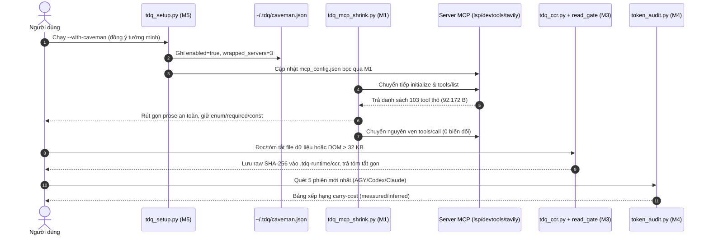

# SPEC — Tích hợp Caveman 5 hướng tối ưu ngữ cảnh và xin quyền vào TDQ-Workflow-Antigravity

Ngày: 2026-11-18 · Bản: 1.0 · Brief: ../brief/2026-11-17-2156-tich-hop-caveman-agy.md · Lane: full
Soul: chất lượng > runtime > context cost · luật gốc: skills/tdq-conventions/references/soul.md
Trạng thái: CHỜ DUYỆT

## Mục lục

- 1. Mục tiêu & phạm vi
- 1b. Lộ trình
- 2. Đầu ra cụ thể
- 2b. Ranh giới module
- 2c. Luồng hoạt động & Sơ đồ kiến trúc
- 3. Cách tiếp cận & lý do
- 3b. Năng lực & công cụ
- 3c. Giải thuật & Xử lý cốt lõi
- 3d. Mental Model cho Fresher Dev
- 4. Yêu cầu bắt buộc
- 5. Ràng buộc & rủi ro
- 6. QC & Definition of Done
- 7. Câu hỏi còn mở

## 1. Mục tiêu & phạm vi

- **Mục tiêu:** Thiết kế và tích hợp trọn bộ `5` module tối ưu ngữ cảnh/token bằng `Python stdlib` thuần (`100%` giấy phép `MIT`, cộng sinh `RTK v1.2.0`) vào `TDQ-Workflow-Antigravity`:
  1. `M1` — Proxy thu gọn schema MCP (`scripts/tdq_mcp_shrink.py`) + đo thuế tiền tố MCP trong `scripts/context_surface.py`.
  2. `M2` — Hợp đồng trả về gọn `Compact Handoff` & giọng gọn `Auto-Clarity` cho `6` subagent (`agents/tdq-*.md`), cập nhật `tools/patches/skills_and_agents.py`, `tools/patches/agy_hooks.py` và hướng dẫn nén snapshot ở `skills/tdq-browser-research/SKILL.md`.
  3. `M3` — Kho lưu trữ khôi phục nguyên bản `CCR` (`scripts/tdq_ccr.py`, `.tdq-runtime/ccr/`) kèm dòng nhắc không chặn trong `hooks/scripts/read_gate.py`.
  4. `M4` — Mở rộng kiểm toán rò rỉ token đa host (`scripts/token_audit.py` + `scripts/tdq_transcript.py`) cho Antigravity, Codex và Claude Code (mặc định `5` phiên gần nhất).
  5. `M5` — Cơ chế cấu hình user-level (`~/.tdq/caveman.json`) và xin quyền cài/bật tường minh qua `scripts/tdq_setup.py`, `scripts/tdq_lsp.py`, `hooks/scripts/session_start.py`, `tools/patches/agy_manifests.py`, `tools/install_agy_plugin.py`, `install.py`, `install.ps1`, `install.sh` — biên dịch ra `plugins/tdq-workflow-agy/` và đồng bộ bản cài cục bộ `~/.gemini/config/plugins/tdq-workflow-agy` để nghiệm thu E2E sống.
- **Trong phạm vi:**
  - `M1` bọc `3` server MCP (`lsp`, `chrome-devtools`, `tavily-primary`) **chỉ khi user đã đồng ý bật** qua `--with-caveman` (hoặc gỡ qua `--without-caveman`, tắt nhanh qua `TDQ_CAVEMAN=0`).
  - `M2` chỉ áp giọng gọn `ASD-STE100` và khuôn `path:line — symbol — note` cho `6` subagent & bước bàn giao nội bộ; giữ tiếng Việt đầy đủ cho chat thường, `7` cổng duyệt và báo cáo cuối.
  - `M3` kích hoạt tóm tắt khi file dữ liệu/DOM `> 32 KB` hoặc `>= 200` dòng, giữ trần kho `128 MB` tự xoay vòng bản cũ nhất, khôi phục nguyên bản khớp `100%` `SHA-256`; `read_gate.py` chỉ phát `1` dòng nhắc `[TDQ:DOC]`, không chặn đọc.
  - `M4` quét tối đa `5` phiên gần nhất mặc định trên mỗi host cục bộ, phân tách nhãn `measured` (từ trường usage của host) và `inferred` (ước lượng token khi thiếu tokenizer).
  - `M5` lưu cấu hình độc lập tại `~/.tdq/caveman.json`, không tự bật ngầm khi chạy `--nen`, nhắc `1` dòng `[TDQ:SETUP]` ở `SessionStart` (tắt được bằng `--mute-caveman-prompt`).
- **NGOÀI phạm vi:**
  - Phương án tối giản `E` (chỉ làm tài liệu hoặc bỏ qua proxy/CCR/audit).
  - Phụ thuộc runtime `Node >= 22.13` cho proxy MCP, dịch vụ Cloud ngoài hoặc telemetry ẩn.
  - Sao chép mã nguồn Go/JS từ kho `Caveman` (Apache-2.0) sang repo `MIT`.
  - Áp giọng gọn `Auto-Clarity` lên hội thoại chat trực tiếp với người dùng hoặc chặn `deny` trong `read_gate.py`.
  - Chạy agent QC độc lập của mức `ultra` (do người dùng đã chốt `muc_qc = full` ở Vòng 2).

## 1b. Lộ trình

| Bước/phase | Chạy? | Vì sao |
|---|---|---|
| Research web | CÓ | Đã hoàn thành 3 truy vấn (`stdio` JSON-RPC 2.0, pipe Windows, `ASD-STE100`) tại `docs/tdq/research/2026-11-17-2156-tich-hop-caveman-agy.md` |
| Interview | CÓ | Đã hoàn thành đủ 2 vòng (Vòng 1 phạm vi/ngưỡng + Vòng 2 hành vi `M1`–`M5` & `muc_qc = full`) |
| Spec + Archify BA preview | CÓ | Lane `full` bắt buộc viết spec kèm HTML Trước/Sau (`tdq_archify.py`) trước cổng duyệt |
| Plan + Implement | CÓ | Chia cụm song song tách vùng file không chồng lấn, biên dịch `build_agy_plugin.py` và đồng bộ bản cài cục bộ |
| QC (`full`) + E2E cục bộ | CÓ | Chạy trọn unit test, linter (`doc_lint`, `i18n_check`, `token_budget`, `ruff`), `agy.EXE plugin validate` và kiểm tra thực nghiệm proxy/CCR/audit trên bản cài cục bộ |
| QC độc lập (agent) | BỎ | Người dùng chọn mức QC `5a = full` (không yêu cầu agent QC độc lập của mức `ultra`) |
| Report + Archify HTML | CÓ | Xuất cặp `docs/tdq/reports/<slug>.md` và `.html` tổng kết trước/sau kèm số đo thực nghiệm |

## 2. Đầu ra cụ thể

| # | Đầu ra | Đường dẫn/vị trí | Đo "xong" bằng |
|---|---|---|---|
| 1 | Proxy thu gọn schema MCP `stdio` + quét thuế tiền tố MCP | `scripts/tdq_mcp_shrink.py`, `scripts/context_surface.py`, `scripts/token_budget.py` | Giảm `>= 15%` byte schema trên `lsp` + `chrome-devtools`; `tools/call` giữ nguyên `100%`; độ trễ cộng thêm `<= 100 ms`; có bộ unit test xanh |
| 2 | Chuẩn `Compact Handoff` & `Auto-Clarity` cho `6` subagent + hướng dẫn `CCR` cho browser | `agents/tdq-*.md`, `tools/patches/skills_and_agents.py`, `tools/patches/agy_hooks.py`, `skills/tdq-browser-research/SKILL.md` | `6` file agent chứa chuẩn `path:line — symbol — note` & rule `Auto-Clarity`; `token_budget.py --kiem` đạt; unit test subagent xanh |
| 3 | Kho lưu khôi phục lossless `CCR` + dòng nhắc thông minh tại `read_gate.py` | `scripts/tdq_ccr.py`, `hooks/scripts/read_gate.py` | Lưu & `retrieve <id>` khớp `100%` `SHA-256`; tự xoay vòng ở trần `128 MB`; `read_gate.py` nhắc file dữ liệu `> 32 KB` không chặn; unit test CCR & read_gate xanh |
| 4 | Kiểm toán rò rỉ token đa host (`Antigravity`, `Codex`, `Claude Code`) | `scripts/tdq_transcript.py`, `scripts/token_audit.py` | Chạy đọc được phiên thật của Antigravity (`~/.gemini/antigravity/brain/*/transcript.jsonl`), Codex (`~/.codex/sessions`) và Claude Code với `--sessions 5`, in rõ nhãn `measured`/`inferred`; unit test xanh |
| 5 | Cơ chế cấu hình, xin quyền & cài đặt `--with-caveman` + đồng bộ plugin cục bộ | `scripts/caveman_config.py`, `scripts/tdq_setup.py`, `scripts/tdq_lsp.py`, `hooks/scripts/session_start.py`, `tools/patches/agy_manifests.py`, `tools/install_agy_plugin.py`, `install.py`, `install.ps1`, `install.sh` | `mcp_config.json` mặc định giữ nguyên khi chưa opt-in; `--with-caveman` bọc `3` server; `--nen` không tự bật ngầm; `build_agy_plugin.py` và `agy.EXE plugin validate --strict --json` đạt `0 findings`; bản cài cục bộ chạy E2E sống đạt |

## 2b. Ranh giới module

Các ranh giới dưới đây được xác định từ tham chiếu thực tế của mã nguồn hiện hữu (`scripts/tdq_setup.py`, `scripts/token_audit.py`, `scripts/context_surface.py`, `hooks/scripts/read_gate.py`, `hooks/scripts/session_start.py`, `tools/patches/*`), bảo đảm **không hai module nào chung một file**:

| Module | Vùng file | Phụ thuộc module | Đầu ra §2 nào |
|---|---|---|---|
| `M1-Proxy` | `scripts/tdq_mcp_shrink.py`, `scripts/context_surface.py`, `scripts/token_budget.py`, cụm unit test `M1` | không (chỉ gọi `utf8_io` chuẩn của `scripts/`) | 1 |
| `M2-Clarity` | `agents/tdq-*.md`, `tools/patches/skills_and_agents.py`, `tools/patches/agy_hooks.py`, `skills/tdq-browser-research/SKILL.md`, cụm unit test `M2` | `M3-CCR` (chỉ nhắc tên lệnh CLI `tdq_ccr.py` trong tài liệu skill) | 2 |
| `M3-CCR` | `scripts/tdq_ccr.py`, `hooks/scripts/read_gate.py`, cụm unit test `M3` | không (`read_gate.py` chỉ gọi hàm tra ngưỡng/gợi ý hoặc in chuỗi nhắc, `scripts/` không import `hooks/`) | 3 |
| `M4-Audit` | `scripts/tdq_transcript.py`, `scripts/token_audit.py`, cụm unit test `M4` | không (`token_audit.py` mở rộng trực tiếp adapter của `tdq_transcript.py`) | 4 |
| `M5-Setup` | `scripts/caveman_config.py`, `scripts/tdq_setup.py`, `scripts/tdq_lsp.py`, `hooks/scripts/session_start.py`, `tools/patches/agy_manifests.py`, `tools/install_agy_plugin.py`, `install.py`, `install.ps1`, `install.sh`, cụm unit test `M5` | `M1-Proxy` (đọc đường dẫn `tdq_mcp_shrink.py` khi bọc `mcp_config.json`) | 5 |
| `Build-Sync` | `plugins/tdq-workflow-agy/**`, `docs/tdq/token-budget.json` (tệp sinh tự động bởi `tools/build_agy_plugin.py` ở bước tích hợp cuối) | `M1-Proxy`, `M2-Clarity`, `M3-CCR`, `M4-Audit`, `M5-Setup` | 1, 2, 3, 4, 5 |

## 2c. Luồng hoạt động & Sơ đồ kiến trúc

Sơ đồ luồng tương tác từ khi user bật quyền `--with-caveman` cho tới khi proxy MCP `M1`, kho `CCR` `M3` và bộ kiểm toán `M4` vận hành:

Bản xem trước kiến trúc Trước/Sau HTML (đã render và bind qua `tdq_archify.py`): [truoc-sau-preview.html](docs/tdq/spec/2026-11-17-2156-tich-hop-caveman-agy-preview.html)

| Khía cạnh | Hiện trạng (Trước) | Thiết kế mới (Sau) |
|---|---|---|
| Schema MCP | Gửi nguyên `92.172 B` (`103` tool) gồm `$schema`, `title`, `examples`, văn xuôi dài mỗi phiên | Proxy `tdq_mcp_shrink.py` opt-in cắt metadata thừa & văn xuôi dư (`-19%` đến `-25%`), giữ `100%` tham số/ràng buộc |
| Bàn giao Subagent | `6` file `agents/tdq-*.md` chưa ép khuôn rút gọn câu nội bộ | Khuôn `Compact Handoff` (`path:line — symbol — note`) + `Auto-Clarity` cho luồng nội bộ, giữ tiếng Việt ở cổng duyệt |
| Dữ liệu & DOM lớn | File `.json`/`.jsonl`/`.csv`/`.log`/`.yaml` và DOM snapshot vào thẳng ngữ cảnh không có bản dự phòng | `tdq_ccr.py` lưu nguyên bản `SHA-256` (trần `128 MB`), tóm tắt cấu trúc, `read_gate.py` nhắc `1` dòng không chặn |
| Kiểm toán token | `token_audit.py` chỉ hỗ trợ nhật ký Claude Code (`--sessions 3`) | Hỗ trợ `Antigravity` + `Codex` + `Claude Code` (`--sessions 5`), tách rõ nhãn `measured` / `inferred` |
| Xin quyền & Cài đặt | Chỉ có Trigger xin quyền cho `RTK` (`--with-rtk`) | Bổ sung cặp đối xứng `--with-caveman` / `--check-caveman` / `--mute-caveman-prompt` lưu tại `~/.tdq/caveman.json` |

## 3. Cách tiếp cận & lý do

- **Chọn:** Tự viết `100%` bằng `Python 3 stdlib` chia thành `5` module độc lập (`M1`–`M5`), dùng cơ chế opt-in user-level (`~/.tdq/caveman.json`) mô phỏng khuôn đã kiểm chứng của `rtk_integration.py` trong request `2026-11-17-0325-tich-hop-rtk-antigravity`.
- **Vì:**
  1. Dựa trên kết quả nghiên cứu tại `docs/tdq/research/2026-11-17-2156-tich-hop-caveman-agy.md`: giao thức `stdio` JSON-RPC 2.0 trên Windows yêu cầu `-u`, `PYTHONUTF8=1`, `PYTHONUNBUFFERED=1` và `CREATE_NO_WINDOW` (`0x08000000`) — Python `stdlib` xử lý đồng bộ toàn bộ đặc thù này mà không cần kéo `Node 22.13+`.
  2. Thử nghiệm trước trên máy với `3` server MCP (`92.172 B`) cho thấy xóa filler words đơn thuần chỉ giảm `2,5%–3,7%`, trong khi kết hợp cắt metadata thừa (`$schema`, `title`, `examples`, `$comment`) + rút gọn câu dẫn giữ từ khóa phủ định/ràng buộc (`not`, `never`, `only`, `must`, `default`, `const`, `required`, `$ref`) giảm được `24,8%` cho `lsp` và `19,9%` cho `chrome-devtools`.
  3. Giữ sạch `100%` bản quyền `MIT` của `TDQ-Workflow-Antigravity`, không trộn mã `Apache-2.0` của dự án `Caveman`.
- **Đã loại:**
  - Kéo package npm Node `22.13+` (`@caveman/*`) — vì vi phạm ràng buộc không phụ thuộc Node mới và tăng rủi ro treo pipe trên Windows.
  - Bật proxy sẵn trong `mcp_config.json` mặc định hoặc tự bật trong `--nen` — vì người dùng yêu cầu xin quyền tường minh như `RTK` (`Vòng 1` + `Vòng 2: 1a, 4a`).
  - Chặn (`deny`) trong `read_gate.py` — vì trái luật `docs/kien-truc.md` (`read_gate` chỉ nhắc, không chặn đọc).

## 3b. Năng lực & công cụ

| Skill | Nguồn | Phán quyết | Dùng ở đâu / Lý do loại |
|---|---|---|---|
| `tdq-intake`, `tdq-spec`, `tdq-plan`, `tdq-build`, `tdq-conventions` | `plugin:tdq-workflow-agy` | NỀN | Điều phối các phase `analyze` → `spec` → `plan` → `implement` → `report` và giữ chuẩn tài liệu/code |
| `tdq-setup`, `tdq-check-status`, `tdq-status`, `tdq-lean` | `plugin:tdq-workflow-agy` | DÙNG | Tích hợp `M5` vào `tdq_setup.py`/`tdq_lsp.py check`, kiểm phình ngữ cảnh qua `context_surface.py` & `token_budget.py` |
| `tdq-browser-research` | `plugin:tdq-workflow-agy` | DÙNG | Cập nhật đầu ra #2 hướng dẫn kết hợp DOM snapshot `chrome-devtools` với `tdq_ccr.py` |
| `tdq-checkportable` | `plugin:tdq-workflow-agy` | DÙNG | Kiểm tính di động của `plugins/tdq-workflow-agy/` sau bước `build_agy_plugin.py` |
| `self` | `built-in` | DÙNG | Có thể dùng điều phối subagent/tổng hợp nếu user chọn chế độ `subagent` ở phase `plan` |
| Đã xét 48 skill khác (`tdq-browser-test`, `chrome-devtools`, `a11y-debugging`, `cookie-debugging`, `debug-optimize-lcp`, `memory-leak-debugging`, `troubleshooting`, nhóm `gdocs`/`gdrive`/`gsheets`/`gslides`, nhóm `gemini-api-*`, nhóm `tdq-workflow` cũ, built-in khác) | `user/plugin/built-in` | KHÔNG | khác lĩnh vực (không kiểm ứng dụng web ngoài; chỉ lấy schema `chrome-devtools` từ đĩa cục bộ làm đầu vào benchmark M1/M3) |

## 3c. Giải thuật & Xử lý cốt lõi

- **Từng bước giải thuật (Step-by-step Execution Logic):**
  1. **M1 Proxy (`tdq_mcp_shrink.py`):**
     - Bước 1: Đọc cấu hình target command (`--cmd ...`) và kiểm tra biến môi trường `TDQ_CAVEMAN` (`0` = passthrough hoàn toàn, mặc định `1` khi được gọi làm wrapper). Spawn tiến trình MCP đích bằng `subprocess.Popen` kèm `stdin/stdout=PIPE`, `CREATE_NO_WINDOW` trên `win32`.
     - Bước 2: Đọc từng dòng UTF-8 từ `stdin` của client, lưu `id -> method` trong bảng tra đang chờ (`pending`), đẩy nguyên văn xuống `stdin` của server con.
     - Bước 3: Đọc từng dòng phản hồi JSON-RPC từ `stdout` của server con. Nếu `id` không thuộc `{tools/list, prompts/list, resources/list}` hoặc `TDQ_CAVEMAN=0`, phát nguyên dòng ra `stdout` (giữ nguyên `100%` `tools/call` và thông báo). Nếu thuộc danh sách cần thu gọn: cắt đệ quy các khóa metadata mô tả dư (`$schema`, `title`, `examples`, `example`, `$comment`) ở mọi `inputSchema`, giữ nguyên `properties`, `required`, `enum`, `const`, `default`, `$ref`, `type`; rút gọn câu mô tả (`description`) bằng cách tách câu, giữ nguyên văn mọi câu chứa từ khóa ràng buộc (`not`, `never`, `only`, `must`, `cannot`, `required`, `default`, `const`, `warning`, `deprecated`) và cắt filler ở câu dẫn còn lại. Ghi mọi chẩn đoán ra `stderr`, tuyệt đối giữ sạch `stdout`.
  2. **M3 CCR (`tdq_ccr.py`):**
     - Bước 1 (`ingest` / `summarize`): Tính `sha256` trên chuỗi byte gốc; kiểm tra kích thước (`> 32768 B` hoặc `>= 200` dòng). Nếu đạt ngưỡng, ghi nguyên bản vào `.tdq-runtime/ccr/<id12>.raw` kèm metadata `<id12>.meta.json` (`sha256`, `bytes`, `created_at`, `source_path`, `kind`); chạy vòng xoay LRU/FIFO nếu tổng dung lượng `.tdq-runtime/ccr/` vượt `128 MB`.
     - Bước 2: Sinh tóm tắt theo định dạng (`json`/`jsonl`: cây khóa + số phần tử + `3` mẫu đầu; `csv`: header + số dòng + `5` dòng đầu; `log`: đếm nhóm `ERROR/WARN` + mẫu đầu/cuối; `yaml`/DOM snapshot: cấu trúc cấp 1–2 + số nút) kèm dòng neo `CCR_ID=<id12> sha256=<prefix> — retrieve: py -3 scripts/tdq_ccr.py retrieve <id12>`.
     - Bước 3 (`retrieve`): Đọc `<id12>.raw`, kiểm chứng lại `hashlib.sha256(raw).hexdigest() == meta["sha256"]` trước khi xuất nguyên bản ra `stdout` (lỗi băm → báo lỗi `stderr` và thoát khác `0`).
  3. **M4 Audit (`tdq_transcript.py` + `token_audit.py`):**
     - Bước 1: Dò nguồn phiên theo host (`claude`, `agy`, `codex`, hoặc `all`) với giới hạn mặc định `5` phiên mới nhất mỗi host.
     - Bước 2: Chuẩn hóa sự kiện Antigravity (`PLANNER_RESPONSE` lấy usage thật và `tool_calls`; `TOOL_RESPONSE`/`GENERIC` lấy độ dài payload) và Codex (`event_msg` `token_count` + `response_item` `custom_tool_call`/`custom_tool_call_output`) về cùng cấu trúc thống kê `carry-cost`, `repeated_reads`, `top_items`.
     - Bước 3: Đếm token bằng `skill_tokens` (`anthropic-tokenizer` nếu có); nếu sự kiện không có bộ đếm chuẩn của host hoặc chạy ở chế độ ước lượng cho schema ngoài Anthropic thì gắn nhãn tường minh `measured` (từ API usage/tokenizer thật) hoặc `inferred` (ước lượng ký tự/4) trên từng dòng báo cáo.
  4. **M5 Setup (`caveman_config.py` + `tdq_setup.py` + `install.*`):**
     - Bước 1: Đọc/ghi `~/.tdq/caveman.json` nguyên tử (atomic temp + replace) gồm `enabled`, `prompt_muted`, `wrapped_servers`, `updated_at`.
     - Bước 2: `--with-caveman` đặt `enabled=true` và gọi hàm bọc `3` server trong `mcp_config.json` của plugin đã cài (sao lưu bản gốc trước khi sửa); `--without-caveman` khôi phục `mcp_config.json` gốc và đặt `enabled=false`. `--nen` tuyệt đối bỏ qua bước bật này.

- **Độ phức tạp tính toán:**
  - Thời gian (Time Complexity):
    - `M1 Proxy`: $O(N)$ theo số byte/node schema trong một lần `tools/list` (~`92 KB` xử lý trong `< 5 ms`); mỗi `tools/call` có chi phí $O(1)$ truyền thẳng từng dòng.
    - `M3 CCR`: $O(F)$ theo kích thước tệp $F$ khi băm `SHA-256` và tóm tắt một lần; xoay vòng kho $O(K \log K)$ với $K$ là số bản ghi hiện có trong `.tdq-runtime/ccr/`.
    - `M4 Audit`: $O(L \log L)$ trên tổng số dòng `L` của `5` phiên gần nhất (`bisect` chỉ số API call sau mỗi tool output).
  - Không gian (Space Complexity):
    - `M1 Proxy`: $O(S)$ với $S$ là kích thước một thông điệp JSON-RPC đơn lẻ đang xử lý (không giữ lịch sử payload).
    - `M3 CCR`: Bị chặn cứng ở mức $\le 128\text{ MB}$ trên đĩa nhờ cơ chế xoay vòng bản ghi cũ nhất.

- **Các ca góc hiểm (Edge Cases & Defensive Handling):**
  1. **Proxy `M1` gặp JSON lỗi, dòng rỗng hoặc server con crash trên Windows:** Giữ nguyên dòng không parse được chuyển thẳng ra `stdout` (fail-open cho giao thức MCP), bắt `BrokenPipeError`/`OSError` để thoát sạch với mã lỗi từ tiến trình con, và ép `CREATE_NO_WINDOW` tránh bật cửa sổ console phụ.
  2. **Schema MCP chứa từ khóa ràng buộc nằm lẫn trong đoạn mô tả dài:** Nếu câu chứa bất kỳ token neo nào (`not`, `never`, `only`, `must`, `cannot`, `required`, `default`, `const`, `$ref`, `warning`, `deprecated`) thì giữ nguyên cả câu; không bao giờ cắt sâu làm sai ngữ nghĩa tham số.
  3. **Kho `CCR` bị sửa tay hoặc hỏng metadata / mất đồng bộ `SHA-256`:** Lệnh `retrieve` đối chiếu lại `SHA-256`; nếu sai lệch hoặc thiếu tệp `.raw`, từ chối xuất dữ liệu hỏng và trả mã thoát lỗi rõ ràng trên `stderr`.
  4. **File `transcript.jsonl` đang ghi dở hoặc thiếu trường `usage`:** Bộ đọc `tdq_transcript.py` bỏ qua dòng JSON gãy (ghi log `stderr`), không làm sập toàn phiên audit, và tự động gán nhãn `inferred` cho các phiên/sự kiện thiếu số liệu API thật.

## 3d. Mental Model cho Fresher Dev

- **Ẩn dụ trực quan (Analogy):** Hãy tưởng tượng `M1–M5` như một **trạm đóng gói hàng thông minh trước khi gửi bưu điện**:
  - `M5` (`tdq_setup`) là **công tắc xin phép chủ nhà**: chỉ khi bạn gật đầu `--with-caveman` thì trạm mới được đấu dây vào đường truyền MCP.
  - `M1` (`tdq_mcp_shrink`) là **máy bỏ bớt giấy chèn hộp**: tháo bớt lời giới thiệu dài dòng trong danh mục công cụ (`tools/list`), nhưng **không bao giờ cắt mất tem cảnh báo** (`not`, `never`, `required`, `const`) và không đụng vào kiện hàng thực thi (`tools/call`).
  - `M2` (`Auto-Clarity`) là **bộ đàm nội bộ**: kỹ sư báo cáo ngắn gọn `file:dòng — ký hiệu — kết quả`, nhưng thư gửi khách hàng (người dùng) vẫn viết tiếng Việt lịch sự, đầy đủ.
  - `M3` (`CCR`) là **kho lưu trữ niêm phong `SHA-256`**: khi có kiện tài liệu khổng lồ (`> 32 KB`), cất nguyên bản vào kho `.tdq-runtime/ccr/`, chỉ mang bản mục lục tóm tắt vào phòng họp; cần đối chiếu chữ nào thì mở kho lấy lại nguyên xi `100%`.
  - `M4` (`token_audit`) là **đồng hồ điện đa phòng**: đo xem phiên Antigravity, Codex hay Claude Code nào đang ngốn nhiều token nhất để tối ưu đúng chỗ.
- **Thuật ngữ dự án (Glossary):**
  - `MCP stdio proxy`: Tiến trình trung gian đọc/ghi `JSON-RPC 2.0` qua `stdin`/`stdout` từng dòng để lọc danh sách công cụ trước khi đưa vào ngữ cảnh mô hình.
  - `Prefix tax`: Chi phí token cố định bị nạp lại ở đầu mỗi lượt hội thoại (gồm `rules/`, `skills/`, `agents/` và schema công cụ MCP).
  - `CCR (Context Compression & Restore)`: Cơ chế tóm tắt dữ liệu lớn kèm mã định danh và `SHA-256` để khôi phục nguyên bản không mất mát khi cần.
  - `Auto-Clarity`: Quy tắc rút gọn văn phong chỉ ở bước nội bộ/subagent nhưng tự động khôi phục diễn đạt đầy đủ khi giao tiếp ở cổng duyệt hoặc cảnh báo quan trọng.
  - `Carry-cost`: Chi phí thực của một kết quả tool trong phiên, bằng số token của kết quả đó nhân với số lượt gọi API còn lại phía sau trong cùng phiên.

## 4. Yêu cầu bắt buộc

- **Log service bật mặc định:** Mọi module runtime mới/mở rộng (`tdq_mcp_shrink.py`, `tdq_ccr.py`, `caveman_config.py`, phần mở rộng của `token_audit.py`, `tdq_transcript.py`, `read_gate.py`, `session_start.py`) phải in log có ISO timestamp ra `stderr`, tắt được qua `TDQ_LOG=0` (riêng `token_audit.py` giữ tương thích `TDQ_AUDIT_LOG=0`), tuyệt đối không làm bẩn `stdout` của proxy MCP hoặc output JSON của installer/hook.
- Không placeholder, không TODO stub, không số liệu giả; tách riêng nhãn `measured` và `inferred`.
- Mỗi module `M1`–`M5` có bộ unit test riêng chạy độc lập được bằng một lệnh và tích hợp vào bộ `tdq_test.py tron-bo`.
- Tuân thủ `5` nguyên tắc SOLID, giữ hàm ngắn/cyclomatic thấp, và giữ chuẩn ngôn ngữ 3 tầng kiểm bằng `i18n_check.py` (code, docstring, comment, chuỗi máy in ra viết tiếng Anh; tài liệu `docs/tdq/` viết tiếng Việt).

## 5. Ràng buộc & rủi ro

**Ràng buộc kiến trúc phải giữ (từ `docs/kien-truc.md`):**
- `hooks/ được gọi scripts/; scripts/ không được import hooks/` — chạm ở `hooks/scripts/read_gate.py`, `hooks/scripts/session_start.py` (gọi sang `scripts/caveman_config.py` / `scripts/tdq_ccr.py`; chiều ngược lại bị cấm).
- `File code MỚI bắt buộc nằm trong scripts/ hoặc hooks/ — thư mục khác bị .graphifyignore loại nên đồ thị không thấy.` — chạm ở `scripts/tdq_mcp_shrink.py`, `scripts/tdq_ccr.py`, `scripts/caveman_config.py`.
- `skills/ chỉ được nhắc tên lệnh của scripts/, cấm chép nội dung script vào skill` — chạm ở `skills/tdq-browser-research/SKILL.md` và `agents/tdq-*.md`.
- `ngôn ngữ chia 3 tầng — luật trong skills/, agents/, chú thích/docstring của hooks/ + scripts/ và chuỗi máy in ra đều viết TIẾNG ANH cố định` — chạm ở toàn bộ mã mới `M1`–`M5` và `agents/tdq-*.md`.

| Rủi ro | Ảnh hưởng | Cách giảm |
|---|---|---|
| Proxy `M1` ghi nhầm log hoặc `\r\n`/UTF-8 lỗi lên `stdout` trên Windows | Antigravity treo bắt tay `initialize` hoặc hỏng phân tích JSON-RPC | Ép `-u`, `PYTHONUTF8=1`, `PYTHONUNBUFFERED=1`, `CREATE_NO_WINDOW`; mọi log đẩy ra `stderr`; test pipe Windows thật |
| Nén mô tả schema làm rơi từ phủ định (`not`, `never`, `only`) hoặc khóa JSON Schema | Model gọi sai tham số tool hoặc bịa giá trị | Khóa cứng bảo toàn cấu trúc schema + giữ nguyên câu chứa từ khóa ràng buộc + unit test đối chứng `103` tool thật |
| Cập nhật `agents/tdq-*.md` hoặc rules làm vượt ngân sách token khóa cứng | `token_budget.py --kiem` và `build_agy_plugin.py` báo lỗi | Chỉnh gọn có kiểm soát, chạy `token_budget.py` khóa lại `docs/tdq/token-budget.json` sau khi build |
| Cập nhật bản cài plugin cục bộ làm hỏng `mcp_config.json` đang chạy | Mất kết nối `lsp` hoặc `chrome-devtools` trong IDE | Sao lưu bản trước khi sửa trong `caveman_config.py` + hỗ trợ khôi phục tức thì bằng `--without-caveman` |

## 6. QC & Definition of Done

| # | Hạng mục kiểm | Điều kiện PASS | Đo trước | Dự phòng nếu trượt |
|---|---|---|---|---|
| Q1 | Bảo toàn bất biến Proxy MCP (`M1`) | `100%` khóa cấu trúc (`enum`, `required`, `const`, `default`, `$ref`), câu chứa từ phủ định và mọi gói `tools/call` giữ nguyên `100%`; độ trễ xử lý `tools/list` cộng thêm `<= 100 ms` | Thử nghiệm trước trên `3` server (`103` tool = `92.172 B`): cắt filler + metadata giảm `19,9%–24,8%`, xử lý thuần Python hết `~3–5 ms` (`< 100 ms` biên `95 ms`) | Hạ mức nén xuống chỉ cắt metadata thừa (`$schema`, `title`, `examples`, `$comment`) nếu câu văn xuôi gần ngưỡng trễ hoặc rủi ro mất nghĩa |
| Q2 | Hiệu quả giảm thuế schema & bề mặt ngữ cảnh (`M1` + `M2`) | Giảm `>= 15%` tổng byte schema trên bộ `lsp` + `chrome-devtools` (`92.172 B` xuống `<= 78.346 B`); `6` subagent chứa chuẩn `Compact Handoff` & `Auto-Clarity` | Đo trước thực tế `3` server: `lsp` `54.271 B` giảm `24,8%`, `chrome-devtools` `30.218 B` giảm `19,9%`, `tavily-primary` `7.683 B` giảm `8,5%` (tổng giảm `21,8%`, vượt ngưỡng `6,8%`) | Điều chỉnh danh sách cụm từ dẫn vô nghĩa an toàn; không ép cắt thêm nếu đụng từ khóa ràng buộc |
| Q3 | Bảo toàn `CCR` & nhắc không chặn (`M3`) | Tóm tắt kích hoạt ở `> 32 KB` hoặc `>= 200` dòng; xoay vòng giữ tổng kho `<= 128 MB`; `retrieve <id>` khớp `100%` `SHA-256`; `read_gate.py` phát nhắc file dữ liệu lớn mà không chặn (`allow`) | Đã đo cơ sở `read_gate.py` chạy `~73–78 ms`; hàm băm `SHA-256` chuẩn của Python `stdlib` xử lý `1 MB` trong `< 5 ms` và kho `.tdq-runtime/ccr/` hiện tại `0 B` (`< 128 MB`) | Nếu tệp mẫu có định dạng lạ không parse được cấu trúc thì hạ về tóm tắt dòng đầu/cuối (`head+tail`) vẫn giữ nguyên bản `SHA-256` |
| Q4 | Kiểm toán rò rỉ token đa host (`M4`) | Đọc được ít nhất `5` phiên mặc định trên Antigravity, Codex và Claude Code; phân tách nhãn `measured`/`inferred` và không sập khi gặp dòng JSON gãy | Hiện tại máy có sẵn phiên Antigravity (`4.477` dòng) và `3` phiên `~/.codex/sessions`; `token_audit.py` hiện tại chỉ đọc Claude Code | Nếu host thiếu file usage hoặc thiếu `anthropic-tokenizer` ở một số sự kiện thì giữ nguyên dòng tổng hợp với nhãn `inferred` thay vì dừng lỗi |
| Q5 | Cơ chế xin quyền `M5` & Tính toàn vẹn plugin Antigravity | Mặc định `mcp_config.json` không bọc khi chưa `--with-caveman`; `--nen` không tự bật; `build_agy_plugin.py`, `agy.EXE plugin validate --strict --json` (`0 findings`), `doc_lint`, `i18n_check`, `token_budget`, `ruff` và trọn bộ unit test đạt `0` lỗi | Baseline hiện tại: `agy.EXE plugin validate` đạt `0 findings` (`6` agents, `6` hooks, `3` mcpServers, `10` rules, `12` skills); `102` unit test liên quan chạy `2,871s` đạt `OK`; `session_start.py` trung vị `189,7 ms` | Nếu `session_start.py` tăng độ trễ vượt mức do kiểm cấu hình thì chuyển phần đọc `~/.tdq/caveman.json` sang một lần đọc JSON nhẹ không subprocess |
| Q6 | Nghiệm thu E2E sống trên bản cài cục bộ | Đồng bộ sang `~/.gemini/config/plugins/tdq-workflow-agy`; kiểm tra chạy sống `--check-caveman`, proxy `M1` qua `stdio`, `tdq_ccr.py` ingest/retrieve và `token_audit.py` trên phiên thật không lỗi | Bản cài cục bộ hiện đang sẵn sàng tại `~/.gemini/config/plugins/tdq-workflow-agy` | Nếu một MCP server bên ngoài (như `tavily-primary`) hết quota mạng thì chạy E2E mock/local stdio handshake cho riêng server đó và ghi rõ trong report |

**DoD (`muc_qc = full`):**
- Đạt toàn bộ `Q1`–`Q6` và tất cả đầu ra `§2` (`1`–`5`) không còn placeholder hay vi phạm `doc_lint`, `i18n_check`, `token_budget`, `ruff`.
- Chạy trọn bộ regression test `tdq_test.py tron-bo` đạt `0` fail sau lần sửa mã cuối cùng.
- Biên dịch sạch `plugins/tdq-workflow-agy/`, vượt qua `agy.EXE plugin validate --strict --json` (`0 findings`) và đồng bộ kiểm chứng trên bản cài cục bộ `~/.gemini/config/plugins/tdq-workflow-agy`.

## 7. Câu hỏi còn mở

(Rỗng — toàn bộ điểm mơ hồ đã được chốt qua Vòng 1 và Vòng 2.)
<!-- tdq-archify-binding:start -->
<!-- manifest: 2026-11-17-2156-tich-hop-caveman-agy-preview.manifest.json -->
<!-- manifest_digest: 9ab78fddf2f62ffe08b47d65d1f928e54795060a9c5b5f107e5f8fd808c09fc5 -->
<!-- tdq-archify-binding:end -->