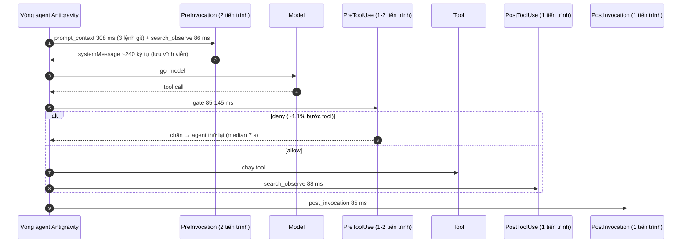
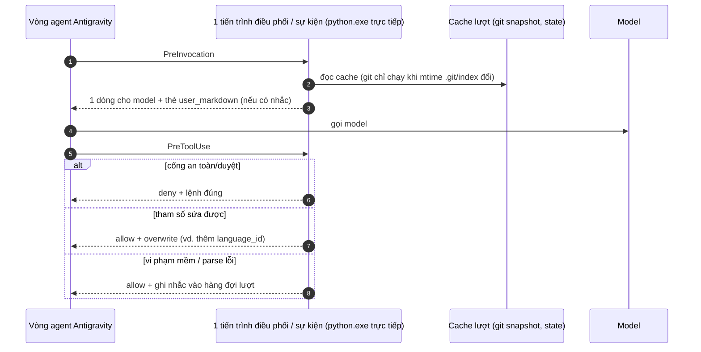

# SPEC — Scan ảnh hưởng của hook TDQ tới runtime & đề xuất hook dạng hướng dẫn

Ngày: 2026-11-18 · Bản: 1.1 (bổ sung phân rã lượt dài bất thường + mẫu lời hook dạng chỉ dẫn theo góp ý 14:03) · Brief: ../brief/2026-11-18-1346-scan-hook-anh-huong-runtime.md · Lane: full
Soul: chất lượng > runtime > context cost · luật gốc: skills/tdq-conventions/references/soul.md
Trạng thái: CHỜ DUYỆT

## Mục lục

- 1. Mục tiêu & phạm vi
- 1b. Lộ trình
- 2. Đầu ra cụ thể
- 2b. Ranh giới module
- 2c. Luồng hoạt động & Sơ đồ kiến trúc
- 3. Cách tiếp cận & lý do
- 3b. Năng lực & công cụ
- 3c. Giải thuật & Xử lý cốt lõi
- 3d. Mental Model cho Fresher Dev
- 4. Yêu cầu bắt buộc
- 5. Ràng buộc & rủi ro
- 6. QC & Definition of Done
- 7. Câu hỏi còn mở

## 1. Mục tiêu & phạm vi

- Mục tiêu: trả lời bằng số đo **vì sao nhiều lượt kéo dài bất thường** (vd. "commit/merge" 15–26 phút) và hook góp bao nhiêu phần trong đó; giao bản đề xuất cải thiện hiệu suất (hook và ngoài hook) cùng thiết kế lại hook theo hướng **chỉ dẫn thay vì chặn cộc lốc**, mỗi ước tính tiết kiệm truy về số đo, đủ để mở request triển khai riêng.
- Trong phạm vi:
  - **Phân rã lượt dài bất thường** (≥ 10 phút, 2 ngày gần nhất, ưu tiên lượt commit/merge/release): thời gian chờ lỗi API, thời gian model sinh theo cỡ ngữ cảnh & cache miss, thời gian tool, hook trực tiếp, deny/Stop; xếp hạng nguyên nhân bằng phút.
  - **Thử nghiệm đối chứng**: đo trực tiếp một luồng commit + merge trên repo tạm (git thuần vs qua hook `command_gate` của bản cài) để tách phần git/hook khỏi phần model.
  - Đo chi phí từng hook trên bản cài thật `~/.gemini/config/plugins/tdq-workflow-agy` (median/p90, N ≥ 12) và profile hook chậm nhất.
  - Quét transcript Antigravity 4 ngày gần nhất: số lần gọi model, bước tool, deny theo mã, Stop block, thời gian deny→hồi phục, ký tự bơm vào ngữ cảnh.
  - Kiểm kê toàn bộ mã chặn `[TDQ:*]` trong `hooks/scripts/` và phân loại: giữ chặn cứng / hướng dẫn / tự sửa (`allow` + `overwrite`).
  - Tái hiện các ca chặn nhầm: `[TDQ:SEARCH] malformed`, `[TDQ:LSP]` trên `call_mcp_tool` không phải LSP, vòng lặp `[TDQ:TICK]`.
  - Đề xuất thiết kế: 1 tiến trình điều phối/sự kiện, cache git theo lượt, gọi `python.exe` trực tiếp, thẻ `metadata.user_markdown` gom nhắc mỗi lượt, Stop ép tiếp tối đa 1 lần/lượt.
  - **Mẫu lời hook dạng chỉ dẫn**: với mỗi mã chặn/nhắc, đặt bản hiện tại cạnh bản đề xuất theo khung 4 phần — *Chuyện gì xảy ra* · *Vì sao luật này tồn tại* · *Làm gì tiếp (lệnh dán được)* · *Khi nào được bỏ qua hợp lệ*.
  - **Đề xuất ngoài hook** có số đo: giữ ngữ cảnh hội thoại nhỏ (mở hội thoại mới mỗi request/sau release, ngưỡng compact), không bơm lại dòng "same as last turn — unchanged", giảm output tool, xử lý lỗi `stream idle timeout (5m0s)`.
- NGOÀI phạm vi:
  - Sửa bất kỳ mã sản phẩm nào (`hooks/`, `scripts/`, `tools/`, `plugins/`) — user chọn 1c.
  - Đổi cấu hình bản cài cục bộ, tắt hook, cài công cụ mới.
  - Sửa phía nhà cung cấp model (timeout API, 503 hết capacity) — chỉ đo, ghi nhận và đề xuất cách né phía TDQ.

## 1b. Lộ trình

| Bước/phase | Chạy? | Vì sao |
|---|---|---|
| spec (thiết kế đề xuất + tiêu chí report) | CÓ | khung bất biến; chốt nội dung & số đo report phải có |
| plan | CÓ | khung bất biến; liệt kê việc đo bổ sung & viết report |
| implement = đo bổ sung + viết report nghiên cứu, không sửa code sản phẩm | CÓ | user chọn 1c |
| Research web (tavily) | BỎ | tài liệu hook chính thức `agy-customizations/docs/hooks.md` đã có cục bộ |
| Interview | CÓ (đã xong) | 6 câu, chốt ở brief `## Hỏi đáp` |
| QC độc lập (agent) | BỎ | QC `lite`, không có code sản phẩm đổi |
| report md + Archify HTML | CÓ | khung bất biến |

## 2. Đầu ra cụ thể

| # | Đầu ra | Đường dẫn/vị trí | Đo "xong" bằng |
|---|---|---|---|
| 1 | Báo cáo nghiên cứu (kết luận nguyên nhân lượt dài, số đo, điểm nóng, kiểm kê cổng, mẫu lời chỉ dẫn, thiết kế đề xuất, đề xuất ngoài hook, ước tính tiết kiệm, lộ trình triển khai) | `docs/tdq/research/2026-11-18-1346-scan-hook-anh-huong-runtime.md` | đủ 9 mục ở §3c bước 5; mọi con số có nguồn ở đầu ra 2 |
| 2 | Bộ bằng chứng đo tái chạy được | `docs/tdq/bench/2026-11-18-1346-hook-runtime/` (`bench_hooks.py`, `hook_impact.py`, `long_turns.py`, `model_latency.py`, `commit_merge_trial.py`, `*.json` kết quả) | chạy lại các script ra số lệch ≤ 20% so với bản ghi |
| 3 | Bảng kiểm kê mã chặn `[TDQ:*]` | mục trong đầu ra 1 | 100% mã `MA = "..."` / `block(` trong `hooks/scripts/*.py` có dòng phân loại |
| 4 | Report phase + Archify HTML | `docs/tdq/reports/2026-11-18-1346-scan-hook-anh-huong-runtime.md` + `.html` | `tdq_archify.py verify` = current; có URL Tailscale |

## 2b. Ranh giới module

| Module | Vùng file | Phụ thuộc module | Đầu ra §2 nào |
|---|---|---|---|
| Đo & bằng chứng | `docs/tdq/bench/2026-11-18-1346-hook-runtime/**` | không (chỉ ĐỌC bản cài + transcript) | 2 |
| Báo cáo nghiên cứu | `docs/tdq/research/2026-11-18-1346-scan-hook-anh-huong-runtime.md` | Đo & bằng chứng | 1, 3 |
| Report phase | `docs/tdq/reports/2026-11-18-1346-*` | Báo cáo nghiên cứu | 4 |

Ranh giới không lấy từ LSP vì request không sửa symbol nào (`--bo-qua-lsp` đã ghi lý do); mã sản phẩm chỉ được đọc.

## 2c. Luồng hoạt động & Sơ đồ kiến trúc

Bản xem trước HTML Archify: **chưa sinh ở spec** — request chỉ ra tài liệu, không đổi luồng sản phẩm; sơ đồ Trước/Sau (đề xuất) sẽ dựng trong Archify HTML của phase report. Mermaid dưới là bản chính ở spec.

Luồng hiện tại (đo được) — mỗi lần gọi model:

Luồng đề xuất (cho request triển khai sau):

| Khía cạnh | Hiện trạng (Trước) | Thiết kế mới (Sau — đề xuất) |
|---|---|---|
| Luồng thực thi | 2 tiến trình PreInvocation + 1–2 Pre + 1 Post + 1 PostInvocation, mỗi tiến trình 85–308 ms | 1 tiến trình/sự kiện, mục tiêu ≤ 150 ms/lần gọi model, ≤ 100 ms/tool |
| Thành phần chạm | `prompt_context.py`, `search_observe.py`, các `*_gate.py`, `agy_hooks.py`, launcher `py -3` | dispatcher chung + cache lượt; gate thành hàm thuần trả `deny/allow/overwrite/nhắc` |
| Điểm nghẽn giải quyết | ~2,35 giờ hook trực tiếp + 36 phút deny / 4 ngày; chặn nhầm SEARCH/LSP; vòng TICK | ước tính trong báo cáo (đầu ra 1), truy về số đo |

## 3. Cách tiếp cận & lý do

- Chọn: đo thực nghiệm trên bản cài thật + quét transcript thật → kiểm kê cổng → thiết kế đề xuất có ước tính, không sửa code.
- Vì: user chọn 1c; hợp đồng chính thức (`agy-customizations/docs/hooks.md` L426-429) xác nhận hook chạy đồng bộ, nên chi phí đo được cộng thẳng vào runtime; transcript cho tần suất thật thay vì đoán.
- Đã loại: sửa ngay (user chọn 1c); chỉ đọc code ước lượng mà không đo (không truy được số); đo trên repo tạm rỗng (hook thoát sớm → đo thiếu).

## 3b. Năng lực & công cụ

| Skill | Nguồn | Phán quyết | Dùng ở đâu / Lý do loại |
|---|---|---|---|
| tdq-intake / tdq-spec / tdq-plan / tdq-build | plugin:tdq-workflow-agy | NỀN | khung pipeline đang chạy |
| agy-customizations (docs/hooks.md) | built-in | DÙNG | hợp đồng hook → kênh `overwrite`, `user_markdown`, `continuationActive` trong đề xuất |
| tdq-lean | plugin:tdq-workflow-agy | DÙNG | soát đề xuất: hook/nhắc nào xóa được thay vì làm mềm |
| tdq-conventions | plugin:tdq-workflow-agy | DÙNG | định dạng report, Archify, Tailscale |
| tdq-browser-test / tdq-browser-research | plugin:tdq-workflow-agy | KHÔNG | khác lĩnh vực — không có UI/web cần kiểm |
| tavily-primary (MCP) | plugin | KHÔNG | spec §3 đã chọn cách khác tốt hơn — tài liệu hook chính thức nằm cục bộ |
| Đã xét 30 skill khác (gdocs, gsheets, gemini-api, chrome-devtools a11y…) | built-in/plugin | KHÔNG | khác lĩnh vực |

## 3c. Giải thuật & Xử lý cốt lõi

- **Từng bước giải thuật**:
  1. Bench: với mỗi hook trong `hooks.json` bản cài, dựng payload Antigravity (`toolName`, `toolInput`, `workingDirectory`, `session_id` riêng `bench-*`), spawn đúng lệnh hook N lần, ghi median/p90/rc; thêm 2 mốc nền (`py -3 -c pass`, `python.exe -c pass`); xóa file runtime của phiên bench sau khi đo.
  2. Profile: `cProfile` hook chậm nhất (`prompt_context.py`, `command_gate.py`) để chỉ ra hàm tốn thời gian.
  3. Quét transcript: duyệt `transcript_full.jsonl` sửa trong 4 ngày; đếm `PLANNER_RESPONSE`, bước tool, chuỗi `denied by pre-tool hook` theo mã `[TDQ:X]`, `Stop hook blocked termination`, độ dài system message theo sự kiện; đo khoảng deny → bước tool DONE kế tiếp; quy deny về lời gọi tool ngay trước.
  4. Kiểm kê cổng: grep `MA =` và `block(` trong `hooks/scripts/*.py`, mỗi mã một dòng: sự kiện, điều kiện chặn, số lần deny đo được, phân loại đề xuất (chặn cứng / tự sửa / hướng dẫn / xóa), kèm lời hiện tại → lời đề xuất theo khung 4 phần.
  4b. Phân rã lượt dài: tách transcript theo `USER_INPUT`; với mỗi lượt ≥ 10 phút cộng (i) khoảng trước mỗi `ERROR_MESSAGE` (chờ lỗi API), (ii) khoảng `PLANNER_RESPONSE` → bước kế (model sinh, kèm `input_tokens`/`cache_read_tokens`), (iii) thời gian tool, (iv) hook trực tiếp ước tính = số sự kiện × median bench, (v) deny/Stop; nguyên nhân = phần lớn nhất.
  4c. Thử commit + merge: tạo repo tạm 200 file, đo `git add/commit/merge --no-ff` thuần và khi mỗi lệnh đi qua `command_gate.py` bản cài (N ≥ 5), báo median.
  5. Viết báo cáo 9 mục: (a) kết luận 1 đoạn trả lời "tại sao lâu"; (b) phương pháp & giới hạn; (c) phân rã lượt dài (có ca commit 15–26 phút); (d) số đo hook; (e) điểm nóng xếp hạng theo phút tiết kiệm (hook và ngoài hook); (f) kiểm kê cổng + mẫu lời chỉ dẫn; (g) thiết kế hook đề xuất (dispatcher, cache, overwrite, thẻ hướng dẫn, Stop 1 lần); (h) đề xuất ngoài hook (ngữ cảnh, compact, output tool, timeout API); (i) lộ trình triển khai chia request + rủi ro.
  6. Ước tính tiết kiệm = (chi phí hiện tại − mục tiêu) × tần suất đo được, ghi rõ là ước tính.
- **Độ phức tạp tính toán**:
  - Thời gian: $O(L)$ với L là số dòng transcript (~40 nghìn), bench $O(H \cdot N)$ với H hook, N lần lặp.
  - Không gian: $O(K)$ — chỉ giữ bộ đếm theo mã và 1 mẫu/mã.
- **Các ca góc hiểm**:
  - Dòng transcript hỏng JSON: bỏ qua, không dừng.
  - Văn bản của agent nhắc lại chuỗi deny (không phải deny thật): chỉ đếm ở bước tool (`GENERIC`), loại `PLANNER_RESPONSE`; ghi sai số trong báo cáo.
  - Bench làm bẩn state: dùng `session_id` riêng, xóa file `*bench*` sau đo, kiểm `git status` không có file sản phẩm đổi.
  - Máy bận làm số dao động: N ≥ 12, báo median + p90.

## 3d. Mental Model cho Fresher Dev

- **Ẩn dụ trực quan**: hook như trạm kiểm soát trên đường cao tốc. Mỗi xe (lời gọi tool/model) phải dừng ở 2–3 trạm, mỗi trạm ~0,1–0,3 s — ít với 1 xe, nhưng 28 nghìn xe trong 4 ngày thành hơn 2 giờ. Tệ hơn, vài trạm đuổi nhầm xe hợp lệ về quay đầu (deny nhầm). Đề xuất: gộp thành 1 trạm, xe hợp lệ đi thẳng kèm tờ hướng dẫn, chỉ chặn xe thật sự nguy hiểm.
- **Thuật ngữ dự án**:
  - `PreInvocation`: hook chạy trước MỖI lần gọi model, không phải mỗi tin nhắn user.
  - `deny`: hook chặn tool; agent phải tự đọc lý do và thử lại.
  - `overwrite`: hook cho chạy nhưng sửa tham số (vd. tự thêm `language_id`).
  - `metadata.user_markdown`: phần chỉ user thấy dưới dạng thẻ markdown, model chỉ đọc bản ngắn.
  - `continuationActive`: cờ Antigravity báo Stop hook đã ép làm tiếp trong lượt này.

## 4. Yêu cầu bắt buộc

- Log service: BỎ — không có task tạo/sửa mã chạy được của sản phẩm; script đo là công cụ bằng chứng, in kết quả ra stdout/JSON.
- Không placeholder, không TODO stub; mọi số trong báo cáo có nguồn (file JSON hoặc lệnh tái chạy).
- Unit test: BỎ — không có thành phần sản phẩm mới; thay bằng tái chạy script đo (Q1).
- SOLID: không áp dụng (không sửa mã sản phẩm).

## 5. Ràng buộc & rủi ro

Ràng buộc kiến trúc phải giữ: không chạm dòng nào — request chỉ đọc mã sản phẩm và ghi tài liệu dưới `docs/tdq/`.

| Rủi ro | Ảnh hưởng | Cách giảm |
|---|---|---|
| Bench trên máy đang chạy nhiều phiên → số dao động | ước tính lệch | median + p90, N ≥ 12, ghi điều kiện máy |
| Quét transcript đếm nhầm văn bản agent nhắc lại deny | số deny phồng | chỉ đếm bước tool, nêu sai số |
| Payload bench khác payload thật → hook đi nhánh ngắn | đo thiếu | dùng đúng hợp đồng `toolCall`/camelCase; đối chiếu stdout với lời gọi thật |
| Đề xuất fail-open làm yếu bảo vệ | agent lách luật | giữ chặn cứng cổng an toàn/duyệt; cổng mềm vẫn ghi sổ & nhắc |

## 6. QC & Definition of Done

Mức QC: `lite`.

| # | Hạng mục kiểm | Điều kiện PASS | Đo trước | Dự phòng nếu trượt |
|---|---|---|---|---|
| Q1 | Số đo tái lập | chạy lại `bench_hooks.py` và `hook_impact.py`: median từng hook và tổng deny lệch ≤ 20% so với bản ghi | prompt_context 307,6 ms; deny ~190 | ghi cả 2 lần đo, báo khoảng |
| Q2 | Kiểm kê cổng đủ | 100% mã chặn `[TDQ:*]` trong `hooks/scripts/*.py` có dòng phân loại | 11 mã đã thấy deny trong transcript (SEARCH, LSP, TICK, TEAM, GIT, APPROVE…) | bổ sung dòng thiếu |
| Q3 | Không sửa mã sản phẩm | `git diff --stat dev` chỉ có file dưới `docs/` | 0 file ngoài docs | hoàn tác file ngoài docs |
| Q4 | Tài liệu sạch | `doc_lint.py` 0 vi phạm trên spec/plan/research/report | — | sửa đến khi 0 |
| Q5 | Ca chặn nhầm có bằng chứng | mỗi ca (SEARCH malformed, LSP trên MCP khác, TICK lặp) có lệnh tái hiện + kết quả, hoặc ghi rõ "không tái hiện được" + lý do | — | ghi giới hạn |
| Q6 | Ước tính truy được | mỗi con số tiết kiệm có công thức = chi phí đo × tần suất đo | — | bỏ con số không truy được |
| Q7 | Trả lời "tại sao lâu" | ca "1 commit" (`f9e21752`) và ≥ 5 lượt dài khác có bảng phân rã 5 thành phần, tổng thành phần ≥ 90% thời lượng lượt | "1 commit": 26,2 phút, chờ lỗi API 20,2 phút | ghi phần chưa quy được kèm lý do |
| Q8 | Lời chỉ dẫn đủ khung | 100% mã ở bảng kiểm kê có lời đề xuất đủ 4 phần (chuyện gì · vì sao · làm gì tiếp · khi nào bỏ qua) | lời hiện tại 1–2 câu | bổ sung phần thiếu |
| Q9 | Thử commit/merge | có median git thuần vs qua hook, N ≥ 5 | bench `command_gate` 145 ms/lần (payload `git status`) | ghi giới hạn nếu không dựng được repo tạm |

DoD: đủ 4 đầu ra §2; Q1–Q6 PASS; report md + Archify HTML `current` kèm URL Tailscale; không file sản phẩm nào đổi.

## 7. Câu hỏi còn mở

(Rỗng.)
