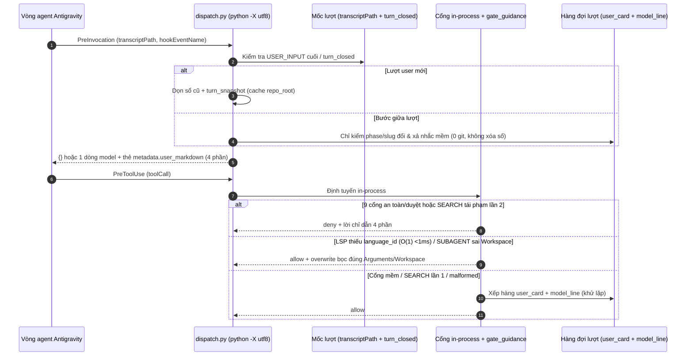

# SPEC — Tối ưu hiệu năng lõi hook, chuyển sang chỉ dẫn 4 phần & dọn cổng (R1+R2+R3)

Ngày: 2026-11-18 · Bản: 1.1 (vá 9 điểm self-recheck + chốt Hướng A cho TDQ:SEARCH) · Brief: ../brief/2026-11-18-1814-toi-uu-hook-huong-dan.md · Lane: full
Soul: chất lượng > runtime > context cost · luật gốc: skills/tdq-conventions/references/soul.md
Trạng thái: CHỜ DUYỆT

## Mục lục

- 1. Mục tiêu & phạm vi
- 1b. Lộ trình
- 2. Đầu ra cụ thể
- 2b. Ranh giới module
- 2c. Luồng hoạt động & Sơ đồ kiến trúc
- 3. Cách tiếp cận & lý do
- 3b. Năng lực & công cụ
- 3c. Giải thuật & Xử lý cốt lõi
- 3d. Mental Model cho Fresher Dev
- 4. Yêu cầu bắt buộc
- 5. Ràng buộc & rủi ro
- 6. QC & Definition of Done
- 7. Câu hỏi còn mở

## 1. Mục tiêu & phạm vi

- Mục tiêu: cắt độ trễ mỗi sự kiện hook của gói plugin Antigravity 2.0 xuống **`<= 150 ms` / lần gọi model (`PreInvocation`)** và **`<= 100 ms` / bước tool (`PreToolUse`)** (riêng `command_gate` `<= 130 ms`), triệt tiêu chặn nhầm (`search_malformed`, `tick_loop`) trong khi giữ nguyên kỷ luật tìm kiếm 3 tầng (`Hướng A`), sửa `2` lỗi logic (`turn_start` trên `invocationNum`, `overwrite` trên `call_mcp_tool`), và thay lời chặn cộc lốc bằng **khung chỉ dẫn 4 phần** qua `metadata.user_markdown`.
- Trong phạm vi:
  - **R1 — Hiệu năng lõi, phát hiện lượt chuẩn & dọn rác phiên:**
    - Lõi chung: lưu cache bền vững `repo_root(cwd)` theo `mtime_ns` của `.git/HEAD` trong `scripts/tdq_state.py`; sửa `scripts/search_rules.py` nhận diện PowerShell here-string `@'...'@`/`@"..."@`, escape `` `n ``/`` `" ``/`` `$ `` và backtick trong chuỗi nháy kép để không báo `malformed` sai.
    - Gói Antigravity 2.0 (`1` tiến trình/sự kiện): tạo `dispatch.py` (`python -X utf8 hooks/scripts/dispatch.py --event <Event>`); phân biệt "lượt user mới" bằng **dấu vết `USER_INPUT` cuối trong `transcriptPath` (offset + size) hoặc cờ `turn_closed` từ `Stop`** (không dựa vào `invocationNum <= 1` hay so prompt thô, tránh mất `[TDQ:APPROVE]` khi user gõ lặp `"1a"`). Chỉ đầu lượt user mới mới chạy `turn_snapshot` + dọn sổ lượt; bước giữa lượt tốn `0` lệnh `git` và không xóa `turns-<sid>.jsonl`. Tắt bơm lặp `"[TDQ:NEXT] (same as last turn — unchanged)"` và `[TDQ:GON]`.
    - Thu hẹp matcher `PostToolUse` bỏ `run_command|read_file|view_file` (chỉ giữ tìm kiếm & MCP `call_mcp_tool|mcp_.*`, bớt hàng chục nghìn spawn thừa); dọn tự động file `.lock`, `turns-*.jsonl`, `pending-reminders-*.jsonl` trong `docs/tdq/.tdq-runtime/` cũ hơn `7` ngày ở `SessionStart`.
  - **R2 — Làm mềm cổng, Hướng A cho `SEARCH`, `overwrite` an toàn & thẻ `metadata.user_markdown`:**
    - Bảng `tools/patches/gate_guidance.py`: chuẩn hóa `22` mã giữ lại theo khung **4 phần** (*Chuyện gì xảy ra · Vì sao luật tồn tại · Làm gì tiếp · Khi nào được bỏ qua hợp lệ*). Tách 2 kênh trong hàng đợi: `model_line` (`<= 160` ký tự tiếng Anh, không bị `trim(200)` cắt cụt thẻ user) và `user_card` (`<= 1.200` ký tự đủ 4 phần tiếng Việt theo `doc_lang`).
    - Giữ **chặn cứng (`deny`)** `9` mã an toàn/duyệt: `APPROVE`, `GIT`, `TEAM`, `STATE`, `READONLY`, `VUNG`, `ZERO-POPUP`, `SUBAGENT` (`swarm`), `UNFINISHED` (`Stop` lần 1).
    - Tự sửa **`allow` + `overwrite`** cho `2` cổng (`3a`) kèm bộ bọc an toàn cho `call_mcp_tool` (bọc vào khóa `Arguments` đúng kiểu `dict`/`JSON string` gốc để merge nông không phá vỡ `ServerName`/`ToolName`): `TDQ:LSP` tự điền `language_id` bằng kiểm tra `O(1)` `< 1 ms` trên `.tdq-lsp-module.json` + file mốc ở thư mục gốc (`pyproject.toml`, `tsconfig.json`, `go.mod`, `Cargo.toml`..., tuyệt đối không gọi `lsp_module.do_module` quét đệ quy `210 ms`), ép `scope="exported"`, `include_transitive=False`; `TDQ:SUBAGENT` tự đổi `Workspace="branch"|"share"` thành `"inherit"` khi prompt có `WORKTREE:`.
    - **`TDQ:SEARCH` theo Hướng A:** lệnh `malformed` luôn `allow` + nhắc mềm; pha `analyze`/`spec` tự do; ở `implement`/`qc`, lần tìm kiếm chưa qua LSP/Graphify đầu tiên cho **`allow` + xếp hàng thẻ 4 phần** ("ân xá 1 lần"), chỉ `deny` ở lần 2 liên tiếp nếu vẫn grep mù chưa hỏi LSP/Graphify hoặc khi gọi `rtk bypass grep`; gọi `mcp__lsp__*` hoặc `graphify` `1` lần tự reset.
    - Chuyển `11` cổng còn lại (`TICK` bỏ chặn ở `edit_gate` & `stop_gate`, `DOC` gộp `READ` bỏ overlap 70%, `LOG` bỏ chặn `Stop` & trừ `docs/.staging*`, `OUTPUT`, `SETUP`, `GON`, `NEXT`, `WORKTREE`, `ANCHOR`, `DOD`, `INTAKE`) sang hướng dẫn không chặn, gom khử lặp theo `code` trong lượt vào `1` thẻ `metadata.user_markdown`.
  - **R3 — `Stop` 1 lần, kiểm tra stub Python Windows & dọn `tdq-lean`:**
    - `stop_gate.py` kiểm `continuationActive`: ép tiếp tối đa `1` lần/lượt cho `TDQ:UNFINISHED`; khi `continuationActive=True` trả `"decision": "allow"`.
    - Bổ sung bước kiểm tra `python -X utf8 -c pass` trong `install_agy_plugin.py` / `tdq_setup.py`: nếu máy Windows trúng stub `WindowsApps` rỗng (`rc != 0`), cảnh báo rõ và hỗ trợ tự fallback sang `py -3 -X utf8`.
    - Xóa `7` mã thừa (`ASK`, `DEVTOOL`, `FEEDBACK`, `GATE`, `QC`, `RULE`, `STUCK`) và loại `3` script mồ côi (`doc_file_gate.py`, `strategic_compact_gate.py`, `stop_batch_checker.py`) khỏi gói biên dịch `plugins/tdq-workflow-agy/` (vẫn giữ file gốc trong `hooks/scripts/` để bảo toàn bộ test Claude/Codex cũ theo `1a`).
    - Biên dịch lại `plugins/tdq-workflow-agy/`, khóa `token-budget.json`, cập nhật & bổ sung bộ kiểm thử giao thức Antigravity 2.0.
- NGOÀI phạm vi:
  - Cài đè lên `~/.gemini/config/plugins/tdq-workflow-agy` (`4b` — chỉ build & đo kiểm trong repo + thư mục staged tạm).
  - Xóa hoặc sửa gãy `hooks/scripts/` gốc dành cho Claude Code / Codex (`1a`).
  - Viết binary Go/Rust (`2b`).

## 1b. Lộ trình

| Bước/phase | Chạy? | Vì sao |
|---|---|---|
| Research web (`tavily`) | BỎ | Nghiên cứu định lượng & hợp đồng `agy-customizations/docs/hooks.md` đã đầy đủ |
| Interview + Self-recheck | CÓ (đã xong) | Chốt `1a 2b 3a 4b 5c` + vá 9 điểm & Hướng A (`vá hết + A`) |
| Spec + Archify BA Preview | CÓ | Khung bất biến; cập nhật Spec 1.1 & render lại preview HTML sạch 0 cảnh báo câu dài |
| Plan + chia đợt subagent | CÓ | Khung bất biến; tách vùng file rõ để chạy đội song song |
| Implement + biên dịch `plugins/tdq-workflow-agy` | CÓ | R1 + R2 + R3 trong repo, không chạm `~/.gemini/...` |
| QC độc lập (`tdq-qc-tester`) + smoke/runtime + `tron-bo` | CÓ | User chọn `muc_qc=ultra` (`5c`) |
| Report md + Archify HTML | CÓ | Khung bất biến |

## 2. Đầu ra cụ thể

| # | Đầu ra | Đường dẫn/vị trí | Đo "xong" bằng |
|---|---|---|---|
| 1 | Cache bền vững `repo_root` & parser `search_rules` chịu PowerShell `@'...'@`/backtick | `scripts/tdq_state.py`, `scripts/search_rules.py` | Unit test cache `mtime_ns` + tái hiện `0/8` deny `search_malformed` |
| 2 | Module chỉ dẫn 4 phần + tách `model_line` / `user_card` trong hàng đợi | `tools/patches/gate_guidance.py`, `tools/patches/agy_hooks.py` (`COMMON_PY`) | `22/22` mã AGY đủ 4 phần; xả hàng đợi ra đúng `metadata.user_markdown` + 1 dòng model `<= 160` ký tự |
| 3 | Dispatcher `dispatch.py` (`python -X utf8`), phát hiện lượt mới, `LSP` `O(1)`, Hướng A `SEARCH`, `Stop` 1 lần, thu hẹp `PostToolUse`, dọn `.tdq-runtime` | `tools/patches/agy_hooks.py`, `tools/patches/agy_manifests.py`, `tools/build_agy_plugin.py`, `tools/install_agy_plugin.py` | `hooks.json` giữ `6` nhóm, `PostToolUse` bỏ `run_command`/`read_file`, mọi lệnh là `python -X utf8 hooks/scripts/dispatch.py` |
| 4 | Gói biên dịch `plugins/tdq-workflow-agy/` & khóa `token-budget.json` | `plugins/tdq-workflow-agy/**`, `docs/tdq/token-budget.json` | `agy.EXE plugin validate --strict --json` trả `0 findings`; không chứa 3 script mồ côi |
| 5 | Bộ kiểm thử đơn vị & hồi quy R1–R3 | các module kiểm thử đơn vị tầng hook Antigravity (khai cụ thể trong plan) | `pytest` xanh 100%; `bench_hooks.py` trên `plugins/tdq-workflow-agy` đạt `PreInvocation <= 150 ms`, `PreToolUse <= 100 ms` |

## 2b. Ranh giới module

Ranh giới được xác lập từ khảo sát phụ thuộc import AST & Graphify (`community=5/24/40/91/99/111`): `scripts/` không import `hooks/`; `tools/patches/` biên dịch một chiều sang `plugins/tdq-workflow-agy/`.

| Module | Vùng file | Phụ thuộc module | Đầu ra §2 nào |
|---|---|---|---|
| `core-cache-search` | `scripts/tdq_state.py`, `scripts/search_rules.py` | không (chỉ stdlib) | 1 |
| `guidance-4part` | `tools/patches/gate_guidance.py` | không (dữ liệu + hàm thuần stdlib) | 2 |
| `agy-dispatcher-gates` | `tools/patches/agy_hooks.py`, `tools/patches/agy_manifests.py`, `tools/build_agy_plugin.py`, `tools/install_agy_plugin.py` | `core-cache-search`, `guidance-4part` | 2, 3 |
| `plugin-compile-tests` | `plugins/tdq-workflow-agy/**`, `docs/tdq/token-budget.json`, vùng kiểm thử hook (khai cụ thể trong plan) | `agy-dispatcher-gates` | 4, 5 |

## 2c. Luồng hoạt động & Sơ đồ kiến trúc

Bản xem trước kiến trúc Trước/Sau (Archify BA): `docs/tdq/spec/2026-11-18-1814-toi-uu-hook-huong-dan-preview.html` (nguồn: `docs/tdq/artifacts/2026-11-18-1814-toi-uu-hook-huong-dan/truoc-sau.archify.md`).

| Khía cạnh | Hiện trạng (Trước) | Thiết kế mới (Sau) |
|---|---|---|
| Luồng thực thi | `2–3` tiến trình `py -3` mỗi sự kiện (`PreInvocation` `449,5 ms`), xóa `turns-<sid>.jsonl` và gọi `3` lệnh git ở mọi bước model; `PostToolUse` chạy cả `run_command`/`read_file` | `1` tiến trình `python -X utf8 hooks/scripts/dispatch.py`; phát hiện lượt mới qua `transcriptPath`/`turn_closed` (0 git & giữ sổ ở bước giữa lượt); `PostToolUse` chỉ bắt tìm kiếm & MCP |
| Thành phần chạm | `hooks.json` gọi 9 script rời; `remind()` cắt cụt ở `200` ký tự; `overwrite` làm vỡ `call_mcp_tool`; còn `7` mã thừa + `3` script mồ côi | Thêm `gate_guidance.py` + `dispatch.py`; tách `model_line <= 160` và `user_card <= 1.200`; bọc `Arguments` cho `call_mcp_tool`; `LSP` dò `O(1)`; loại `7` mã & `3` script mồ côi khỏi gói AGY |
| Điểm nghẽn giải quyết | `85` ca `SEARCH`, `48` ca `LSP`, `30` ca `TICK`, `60` ca `Stop` lặp, mất `[TDQ:APPROVE]` nếu dựa `invocationNum`, `2,33M` ký tự `"same as last turn"` | `0` `search_malformed`, `0` `tick_loop`, `SEARCH` Hướng A (ân xá lần 1, tái phạm mới chặn), `overwrite` `LSP`/`SUBAGENT` an toàn, `Stop` tối đa 1 lần, dọn `.tdq-runtime` > 7 ngày |

## 3. Cách tiếp cận & lý do

- Chọn: vá chuẩn toàn bộ 9 điểm kỹ thuật từ self-recheck ngay trong kiến trúc `dispatch.py` + `gate_guidance.py` (tầng `tools/patches/` → `plugins/tdq-workflow-agy/`) kết hợp cache `repo_root` + parser PowerShell trong `scripts/`.
- Vì: giữ nguyên độ chính xác của cổng duyệt `[TDQ:APPROVE]`, schema `call_mcp_tool`, kỷ luật 3 tầng tìm kiếm (`Hướng A`) và tốc độ mục tiêu `<= 100–150 ms`, mà không làm gãy bộ test Claude Code / Codex cũ (`1a`) và không chạm bản cài local (`4b`).
- Đã loại:
  - Dựa vào `invocationNum <= 1` để nhận diện lượt mới — vì làm mất `[TDQ:APPROVE]` khi user gõ lặp `"1a"`.
  - Gọi `lsp_module.do_module(cwd)` trong `PreToolUse` — vì mất `210 ms`, tự phá mục tiêu `<= 100 ms`.
  - Mở toang 100% `TDQ:SEARCH` không chặn kể cả khi tái phạm grep mù liên tiếp (`Hướng B`) — vì làm suy yếu kỷ luật `LSP -> Graphify -> Grep`.
  - Xóa `doc_file_gate.py`, `strategic_compact_gate.py`, `stop_batch_checker.py` khỏi `hooks/scripts/` gốc — vì làm vỡ bộ test batching & ẩn cửa sổ trên Windows trái với `1a`.

## 3b. Năng lực & công cụ

| Skill | Nguồn | Phán quyết | Dùng ở đâu / Lý do loại |
|---|---|---|---|
| tdq-intake / tdq-spec / tdq-plan / tdq-build | plugin:tdq-workflow-agy | NỀN | khung pipeline đang chạy |
| agy-customizations (docs/hooks.md) | built-in | DÙNG | hợp đồng `transcriptPath`, shallow `overwrite`, `metadata.user_markdown`, `continuationActive` ở đầu ra 2 & 3 |
| tdq-lean | plugin:tdq-workflow-agy | DÙNG | loại bỏ `7` mã thừa và lọc `3` script mồ côi khỏi `plugins/tdq-workflow-agy/` ở đầu ra 3 & 4 |
| tdq-conventions | plugin:tdq-workflow-agy | DÙNG | chuẩn `i18n_check.py`, Soul line, Archify BA & Report |
| tdq-browser-test / tdq-browser-research | plugin:tdq-workflow-agy | KHÔNG | khác lĩnh vực — hook chạy CLI JSON stdin/stdout, không có UI web app |
| tavily-primary (MCP) | plugin | KHÔNG | spec §3 đã chọn cách khác tốt hơn — số đo và tài liệu chính thức đã đầy đủ cục bộ |
| Đã xét 30 skill khác (gdocs, gsheets, gemini-api, chrome-devtools a11y…) | built-in/plugin | KHÔNG | khác lĩnh vực |

## 3c. Giải thuật & Xử lý cốt lõi

- **Từng bước giải thuật (Step-by-step Execution Logic)**:
  1. **Cache `repo_root(cwd)` (`scripts/tdq_state.py`)**: kiểm tra `_ROOT_CACHE`; nếu chưa có, tìm `.git/HEAD` bằng duyệt tối đa `8` bậc thư mục cha và tra `<tempdir>/tdq-repo-roots.json` theo `(abspath(cwd), head_mtime_ns)`. Trúng trả ngay (`~0,2 ms`), trượt mới gọi `git rev-parse --show-toplevel` và lưu cache atomic.
  2. **Sửa parser `scripts/search_rules.py`**: trong `_bo_heredoc`, thay khối PowerShell `@'...'@` và `@"..."@` trước khi tách ống lệnh; trong `_tach_script`, theo dõi trạng thái nháy kép `"..."` trước kiểm tra backtick và bỏ qua chuỗi escape PowerShell (`` `n ``, `` `r ``, `` `t ``, `` `" ``, `` `$ ``) để không gán cờ `malformed` nhầm.
  3. **Phát hiện lượt user mới & dọn rác (`COMMON_PY` / `prompt_context.py` / `session_start.py`)**:
     - Lưu mốc lượt trong `docs/tdq/.tdq-runtime/turn-meta-<sid>.json`: `{last_user_sig, turn_closed}`.
     - Tại `PreInvocation`, đọc tối đa `64 KB` cuối của `transcriptPath` (nếu có) trích cặp `(step_index, created_at)` của bản ghi `USER_INPUT` cuối cùng tạo thành `last_user_sig` (nhanh `O(1)` ~`0,3 ms`). Nếu `last_user_sig` thay đổi **hoặc** `turn_closed == True` -> xác nhận lượt user mới: xóa `turns-<sid>.jsonl`, chạy `turn_snapshot(cwd)` + ghi `turn_start`, reset `turn_closed = False`. Ngược lại -> bước giữa lượt: giữ nguyên `turns-<sid>.jsonl` (để `already_reminded` và `search_observe` hoạt động), không gọi `git`, không phát `"same as last turn"`.
     - Tại `Stop` khi cho phép dừng (`allow`): đặt `turn_closed = True`.
     - Tại `SessionStart`: quét `docs/tdq/.tdq-runtime/` xóa file `.lock`, `turns-*.jsonl`, `pending-reminders-*.jsonl`, `turn-meta-*.json` có `mtime < now - 7*86400`.
  4. **Hàng đợi 2 kênh & `overwrite` an toàn (`COMMON_PY` + `gate_guidance.py`)**:
     - `COMMON_PY` lưu `raw_tool_name` và `raw_arguments_type` (`dict` hoặc `str`) trước khi chuẩn hóa MCP. Khi `set_overwrite(fields)` chạy trên lệnh gốc `call_mcp_tool`, tự đóng gói các khóa đã sửa vào `overwrite["Arguments"]` giữ đúng kiểu `dict`/`JSON string` gốc để merge nông (`hooks.md` L223) không đè mất `ServerName`/`ToolName`.
     - Hàng đợi `pending-reminders-<sid>.jsonl` lưu `{"code", "model_line", "user_card"}`. `queue_remind` kiểm tra `code` đã phát trong lượt (`already_reminded` hoặc có sẵn trong hàng đợi) thì bỏ qua. Khi xả tại `PreInvocation` / `PostInvocation`, ghép các `user_card` (đủ 4 phần tiếng Việt) thành 1 khối Markdown vào `injectSteps[0].systemMessage.metadata.user_markdown`, còn `systemMessage` gửi model là chuỗi ghép `model_line` (tiếng Anh ngắn `<= 160` ký tự/cổng).
  5. **Định tuyến cổng R1–R3 trong `dispatch.py`**:
     - `TDQ:LSP`: kiểm `O(1)` từ `.tdq-lsp-module.json` hoặc file mốc tầng gốc (`pyproject.toml`, `requirements.txt` -> `python`; `tsconfig.json`, `package.json` -> `typescript`; `go.mod` -> `go`; `Cargo.toml` -> `rust`). Xác định được duy nhất -> `allow` + `overwrite`; không xác định được hoặc mơ hồ -> `deny` 4 phần.
     - `TDQ:SUBAGENT`: có `WORKTREE:` + `Workspace="branch"|"share"` -> `allow` + `overwrite={"Workspace": "inherit"}`. `swarm` sai chế độ vẫn `deny`.
     - `TDQ:SEARCH` (**Hướng A**): `malformed` và pha `analyze`/`spec` luôn `allow` (+ nhắc nếu tìm code); pha `implement`/`qc`: khi phạm luật chưa hỏi LSP/Graphify -> đọc cờ `search_grace` trong `turns-<sid>.jsonl`: lần 1 cho `allow` + xếp hàng thẻ 4 phần + ghi `search_grace=warned`; lần 2 liên tiếp vẫn phạm -> `deny` 4 phần; `rtk bypass grep` giữ `deny` cứng.
     - `Stop`: nếu `continuationActive=True` -> `allow` và đặt `turn_closed=True`. Lần đầu còn task mở ở `implement` (`TDQ:UNFINISHED`) -> `continue` 4 phần; `LOG` (trừ `docs/.staging*`), `TICK`, `DOD` chỉ xếp nhắc mềm không chặn.
- **Độ phức tạp tính toán**:
  - Thời gian (Time Complexity): $O(C + R)$ với $C$ là độ dài chuỗi lệnh/payload (~$10^2-10^3$ ký tự) và $R$ là số dòng sổ lượt hiện tại; đọc đuôi `transcriptPath` cố định $O(1)$ (`<= 64 KB`); dò ngôn ngữ `LSP` $O(K)$ tại thư mục gốc ($K$ là số entry cấp 1).
  - Không gian (Space Complexity): $O(R)$ — giữ tối đa `22` nhắc khử lặp và `turn-meta`.
- **Các ca góc hiểm (Edge Cases & Defensive Handling)**:
  - `transcriptPath` không tồn tại hoặc rỗng (unit test synthetic không truyền file transcript): fallback giữ hành vi ổn định — coi lượt có `prompt`/`lastUserInput` đổi HOẶC sau `turn_closed=True` là lượt mới, và không để step đầu trắng `turns-<sid>.jsonl` bị xóa sai.
  - `stdin` rỗng/JSON hỏng: fail-open `{}` / `{"decision": "allow"}`, exit `0`.
  - Hai hook tool chạy song song cùng ghi `pending-reminders` hoặc `turns`: giữ khóa NTFS `with_ntfs_lock` ở mọi thao tác đọc-sửa-ghi.
  - Stub `WindowsApps\python.exe`: trình cài đặt `install_agy_plugin.py` kiểm tra `python -X utf8 -c pass`; nếu trượt trên máy đích thì log cảnh báo rõ hướng dẫn mở PATH hoặc dùng fallback `py -3`.

## 3d. Mental Model cho Fresher Dev

- **Ẩn dụ trực quan (Analogy)**: Phiên bản 1.0 giống trạm thu phí ETC kiểm tra lại giấy tờ dựa trên chữ ký tay trên tờ khai (`invocationNum <= 1`), dễ bị lừa nếu tài xế đưa 2 tờ khai giống hệt nhau (`"1a"`). Bản 1.1 nâng cấp lên **cảm biến vòng xe (`transcriptPath` + cờ đóng lượt `turn_closed`)** để nhận diện chính xác khi nào xe bắt đầu chuyến mới, đồng thời lắp thêm đầu đọc biển số tức thì (`O(1) < 1 ms` ở thư mục gốc) và bọc hộp bảo vệ để cần gạt tự động (`overwrite`) không làm rơi hàng trên xe (`call_mcp_tool Arguments`).
- **Thuật ngữ dự án (Glossary)**:
  - `dispatch.py`: cổng điều phối duy nhất cho mọi sự kiện hook Antigravity.
  - `turn-meta-<sid>.json`: sổ nhớ chữ ký `USER_INPUT` cuối + cờ `turn_closed` để phân biệt chính xác lượt user mới với bước gọi model kế tiếp.
  - `user_card` / `model_line`: hai định dạng song song của hàng đợi nhắc — thẻ Markdown 4 phần hiển thị gọn cho người dùng và dòng ngắn tiếng Anh gửi model.
  - `search_grace` (Hướng A): cơ chế "ân xá 1 lần" cho phép agent grep 1 phát kèm thẻ nhắc, chỉ chặn khi cố tình tái phạm lần 2 liên tiếp.

## 4. Yêu cầu bắt buộc

- Log service bật mặc định: giữ chuẩn `TDQ_LOG` (timestamp ISO, ghi nhận `allow`/`overwrite`/`deny`/`remind` + thời gian chạy `dispatch.py` ở cấp debug, tắt bằng `TDQ_LOG=0`).
- Không placeholder, không TODO stub; eval chỉ chạy khi người dùng yêu cầu (`opt-in`).
- Mỗi thành phần mới/sửa có unit test riêng chạy qua `pytest`.
- Bám 5 nguyên tắc SOLID và rule Python (`chung.md` + `python.md`, cyclomatic `<= 10`, cognitive `<= 15`, `i18n_check.py` sạch).

## 5. Ràng buộc & rủi ro

Ràng buộc kiến trúc phải giữ (từ `docs/kien-truc.md`):
- "`hooks/` được gọi `scripts/`; `scripts/` **không** được import `hooks/`" — chạm ở `scripts/tdq_state.py`, `scripts/search_rules.py`.
- "Chỉ `scripts/tdq_state.py` được ghi `docs/tdq/state.json`; mọi nơi khác chỉ đọc qua CLI" — chạm ở `dispatch.py` và các cổng.
- "ngôn ngữ chia 3 tầng — chú thích/docstring của `hooks/` + `scripts/` và chuỗi máy in ra đều viết TIẾNG ANH cố định (`scripts/i18n_check.py` gác tầng 1-2, cụm `i18n-allow` là cửa miễn cho chuỗi user thấy)" — chạm ở `tdq_state.py`, `search_rules.py`, `gate_guidance.py`, `agy_hooks.py`.

| Rủi ro | Ảnh hưởng | Cách giảm |
|---|---|---|
| `overwrite` trên `call_mcp_tool` làm mất `ServerName`/`ToolName` vì merge nông | Lời gọi MCP lỗi | Lưu `raw_tool_name`/`raw_tool_args` trước unwrap; tự bọc khóa `Arguments` cùng kiểu gốc; khóa bằng unit test |
| Đọc `transcriptPath` lớn trong phiên dài làm chậm `PreInvocation` | Vượt trần `150 ms` | Chỉ `seek` đọc `<= 64 KB` cuối file (`O(1)`), không bao giờ đọc cả file |
| Máy Windows khác thiếu `python.exe` trên PATH (dính stub Store `9009`) | Hook lỗi trên máy mới | `install_agy_plugin.py` kiểm `python -X utf8 -c pass` khi cài và hỗ trợ fallback `py -3` |
| Sửa `tdq_state.py` (node hub) kéo rộng bán kính test | `vung-cham` lâu | Chạy test mục tiêu từng task, chạy `tron-bo` ở cổng `QC-F1` |

## 6. QC & Definition of Done

Mức QC: `ultra` (DoD + trọn bộ unit test + hồi quy vùng chạm + ràng buộc kiến trúc + clean code + smoke test + runtime test dưới trần `120s` + agent `tdq-qc-tester` độc lập).

| # | Hạng mục kiểm | Điều kiện PASS | Đo trước | Dự phòng nếu trượt |
|---|---|---|---|---|
| Q1 | Độ trễ `PreInvocation` & `PreToolUse` sau gộp (R1) | Chạy `bench_hooks.py --n 12 --plugin-dir plugins/tdq-workflow-agy`: median `PreInvocation` giữa lượt `<= 150 ms` và mọi `PreToolUse` qua `dispatch.py` `<= 100 ms` (`command_gate` `<= 130 ms`); `PostToolUse` bỏ `run_command`/`read_file` | `PreInvocation` `449,46 ms`; `PreToolUse` `86,6–171,8 ms` | Tối ưu lazy-import trong `dispatch.py` chỉ nạp đúng module của sự kiện/tool |
| Q2 | Triệt tiêu chặn nhầm & Hướng A cho `TDQ:SEARCH` (R2) | Trên `plugins/tdq-workflow-agy`: `0/8` ca `search_malformed` bị `deny`; `0/2` ca `tick_loop` bị `deny`; ở `implement`, lần 1 grep mù trả `allow` + xếp hàng thẻ 4 phần, lần 2 liên tiếp mới trả `deny`; `rtk bypass grep` giữ `deny` | `search_malformed` `7/8` deny; `tick_loop` `2/2` deny | Rà lại nhánh fallback `malformed` và bộ đếm `search_grace` trong `turns-<sid>.jsonl` |
| Q3 | Tự sửa `allow` + `overwrite` an toàn (`call_mcp_tool` & `O(1)`) | `call_mcp_tool` gọi `start_lsp` thiếu `language_id` trên repo Python trả `decision="allow"` với `overwrite` chứa đúng `Arguments` giữ nguyên `language_id="python"` (< 100 ms, không gọi `do_module`), và `ServerName`/`ToolName` không bị phá; `invoke_subagent` `WORKTREE:` + `Workspace="branch"` trả `overwrite={"Workspace": "inherit"}` | Cả 2 ca hiện trả `decision="deny"` | Sửa lớp bọc `Arguments` trong `COMMON_PY.set_overwrite` và kiểm lại kiểu `dict`/`str` |
| Q4 | Thẻ `metadata.user_markdown`, khung 4 phần & tách kênh | `22/22` mã AGY giữ lại trong `gate_guidance.py` đủ 4 phần không rỗng; xả hàng đợi tạo đúng `injectSteps[0].systemMessage.metadata.user_markdown` (`<= 1.200` ký tự không bị `trim(200)` cắt) và `systemMessage` model `<= 200` ký tự, khử lặp cùng mã trong 1 lượt | Hiện `0` mã có `user_markdown`, bị cắt tại `200` ký tự | Sửa hàm `queue_remind`/`flush_pending_reminders` và bổ sung phần thiếu |
| Q5 | Bảo toàn cổng duyệt & `Stop` 1 lần (`CRITICAL-1` & R3) | `9/9` cổng (`APPROVE`, `GIT`, `TEAM`, `STATE`, `READONLY`, `VUNG`, `ZERO-POPUP`, `SUBAGENT` `swarm`, `UNFINISHED` lần 1) trả `deny`/`continue` đủ 4 phần; user gõ lặp `"1a"` ở `USER_INPUT` mới trên `transcriptPath` vẫn mở khóa `[TDQ:APPROVE]` và ghi `turn_start`; `Stop` với `continuationActive=True` trả `allow`; `LOG` không chặn `Stop`; dọn file `.tdq-runtime` > 7 ngày | `Stop` chặn `LOG` và lặp 3 lần; xóa `turns` giữa lượt | Kiểm lại hàm `_detect_new_user_turn` và tách riêng `HARD_DENY_CODES` |
| Q6 | Dọn `7` mã thừa, lọc `3` script mồ côi & chuẩn gói AGY (R3 + 2b + 4b) | `plugins/tdq-workflow-agy/hooks.json` có `6` nhóm, lệnh `python -X utf8 hooks/scripts/dispatch.py --event ...` không chứa `"`; `3` file mồ côi không có trong `plugins/tdq-workflow-agy/hooks/scripts/` nhưng còn ở `hooks/scripts/`; `~/.gemini/config/plugins/tdq-workflow-agy` nguyên vẹn; `agy.EXE plugin validate --strict --json` trả `0 findings`; `install_agy_plugin.py` có check stub WindowsApps | `hooks.json` gọi `py -3` trên 9 script; gói AGY chép 3 script mồ côi | Cập nhật bộ lọc trong `build_agy_plugin.py` và chạy lại build |
| Q7 | Tương thích Linter & Bộ test `ultra` (`1a` + `5c`) | `i18n_check.py scripts/ hooks/`, `doc_lint.py`, `token_budget.py --kiem` exit `0`; `tdq_test.py tron-bo` xanh `0` fail; smoke + runtime test (`<= 120s`) và `tdq-qc-tester` độc lập PASS | `4.315` pass, `35` skip, `0` fail | Sửa test/chuỗi vướng `i18n_check` trong vòng fix QC |

DoD: Đủ 5 đầu ra §2; Q1–Q7, QC-F1..F4, smoke test, runtime test (`<= 120s`) và biên bản `tdq-qc-tester` độc lập PASS; `~/.gemini/config/plugins/tdq-workflow-agy` giữ nguyên; có báo cáo Markdown + Archify HTML `current` kèm URL Tailscale.

## 7. Câu hỏi còn mở

(Rỗng.)
<!-- tdq-archify-binding:start -->
<!-- manifest: 2026-11-18-1814-toi-uu-hook-huong-dan-preview.manifest.json -->
<!-- manifest_digest: 75e6acddcaf02e1d456d0aa6eb17b3be3c0d0ff5b79ab03ab467045bf2aadddd -->
<!-- tdq-archify-binding:end -->