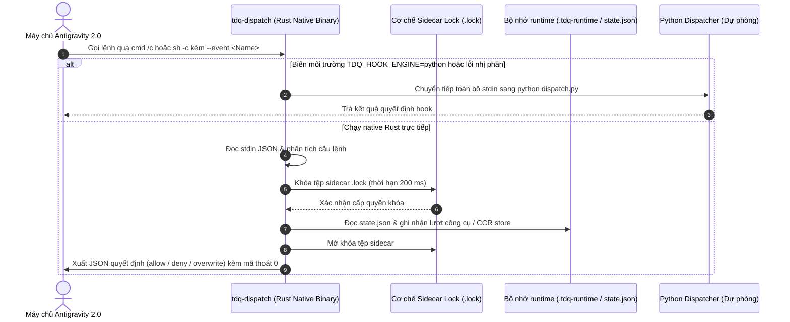

# SPEC — Đóng gói Rust binary cho tầng hook và tích hợp kèm TDQ-Workflow Antigravity

Ngày: 2026-11-19 · Bản: 1.0 · Brief: ../brief/2026-11-19-0046-dong-rust-binary-hook.md · Lane: full
Soul: chất lượng > runtime > context cost · luật gốc: skills/tdq-conventions/references/soul.md
Trạng thái: CHỜ DUYỆT

## Mục lục

- 1. Mục tiêu & phạm vi
- 1b. Lộ trình
- 2. Đầu ra cụ thể
- 2b. Ranh giới module
- 2c. Luồng hoạt động & Sơ đồ kiến trúc
- 3. Cách tiếp cận & lý do
- 3b. Năng lực & công cụ
- 3c. Giải thuật & Xử lý cốt lõi
- 3d. Mental Model cho Fresher Dev
- 4. Yêu cầu bắt buộc
- 5. Ràng buộc & rủi ro
- 6. QC & Definition of Done
- 7. Câu hỏi còn mở

## 1. Mục tiêu & phạm vi

- Mục tiêu: Xây dựng binary Rust `tdq-dispatch` hiệu năng cao thay thế tầng thực thi Python (`python -X utf8 hooks/scripts/dispatch.py`) cho 6 sự kiện hook trong plugin Antigravity (`plugins/tdq-workflow-agy/`), rút ngắn thời gian khởi tạo tiến trình và độ trễ hook xuống mức trung vị `<= 25 ms` (mục tiêu mềm hướng tới), đóng gói sẵn binary đa nền tảng và hỗ trợ cơ chế dự phòng sang Python.
- Trong phạm vi:
  - Khởi tạo crate Rust `tdq-dispatch` tại `hooks/rust/tdq-dispatch/` (Rust 2021 / 1.99) với cấu hình static CRT trên Windows (`+crt-static`), defender-safe (`lto = "thin"`, `codegen-units = 1`, `panic = "abort"`, `strip = "symbols"`).
  - Hiện thực logic xử lý 6 sự kiện hook Antigravity hoàn toàn bằng Rust: `SessionStart`, `UserPromptSubmit`, `PreToolUse`, `PostToolUse`, `StopStreak`, `Notification`.
  - Cơ chế khóa đồng thời đa nền tảng an toàn trên Windows bằng tệp sidecar `.lock` riêng biệt và ghi nguyên tử `temp + rename`, tránh lỗi xung đột `ERROR_LOCK_VIOLATION` (`os error 33`).
  - Hợp nhất hợp đồng 22 mã hướng dẫn `gate_guidance` vào tệp dữ liệu chung `tools/patches/gate_guidance.json`.
  - Đóng gói sẵn 3 binary trong thư mục `plugins/tdq-workflow-agy/bin/` (`windows_x86_64`, `linux_x86_64`, `darwin_arm64`).
  - Cập nhật các script build và bộ cài (`tools/build_agy_plugin.py`, `tools/patches/agy_manifests.py`, `tools/patches/agy_hooks.py`, `tools/install_agy_plugin.py`, `install.py`, `install.ps1`, `install.sh`, `scripts/tdq_checkportable.py`) để tự động phân giải đường dẫn hook tương thích từng hệ điều hành (`bin\tdq-dispatch.exe` trên Windows, `./bin/tdq-dispatch` trên Unix).
  - Tích hợp cơ chế dự phòng (fallback) tự động sang `python -X utf8 hooks/scripts/dispatch.py` khi cấu hình biến môi trường `TDQ_HOOK_ENGINE=python` hoặc khi môi trường thiếu binary thực thi.
  - Thiết lập kịch bản GitHub Actions matrix `.github/workflows/build-rust-hooks.yml` biên dịch tự động 3 nền tảng.
  - Xây dựng bộ kiểm thử đối chiếu vi phân (differential testing) 1-1 giữa Rust binary và Python hook script.
- NGOÀI phạm vi:
  - Viết lại toàn bộ các công cụ dòng lệnh thuộc `scripts/*.py` sang Rust (các công cụ CLI TDQ vẫn giữ nguyên mã nguồn Python).
  - Thay đổi giao thức hook hoặc lược đồ JSON đầu vào / đầu ra do máy chủ Antigravity quy định.
  - Tự ý cài đặt các gói công cụ cấp hệ thống (`zig`, `cargo-zigbuild`) mà chưa có sự phê duyệt rõ ràng từ người dùng.
  - Xóa bỏ tập tin script Python `hooks/scripts/dispatch.py` (vẫn duy trì để phục vụ cơ chế dự phòng và các host Claude Code / Codex).

## 1b. Lộ trình

Chép từ brief mục `### Lộ trình`. User duyệt spec là duyệt luôn lộ trình này.

| Bước/phase | Chạy? | Vì sao |
|---|---|---|
| Research web | BỎ | Đã hoàn thành ở phase analyze (`docs/tdq/research/...`), toolchain và các thư viện phụ thuộc đã được kiểm chứng thực nghiệm trên môi trường máy |
| Interview | BỎ | Đã hoàn thành 2 vòng phỏng vấn ở phase analyze, chốt đầy đủ các mặt 1abcd, 2c, 3b kèm ghi chú dự phòng Python, 4a, 5a và mức QC full |
| QC độc lập (agent) | CÓ | Request theo lane full với mức QC full bắt buộc chạy kiểm định QC độc lập qua subagent `tdq-qc-tester` |

## 2. Đầu ra cụ thể

| # | Đầu ra | Đường dẫn/vị trí | Đo "xong" bằng |
|---|---|---|---|
| 1 | Hợp đồng 22 mã hướng dẫn dạng JSON chung | `tools/patches/gate_guidance.json` | Tệp JSON hợp lệ chứa 22 mã cổng, đồng bộ với `tools/patches/gate_guidance.py` |
| 2 | Crate Rust thực thi dispatcher và 6 sự kiện hook | `hooks/rust/tdq-dispatch/` | Biên dịch thành công với `cargo check` và `cargo test`, mã thoát 0 |
| 3 | Bộ 3 binary biên dịch sẵn đa nền tảng | `plugins/tdq-workflow-agy/bin/` | Tồn tại đủ 3 tệp (`tdq-dispatch.exe`, `tdq-dispatch-linux-x86_64`, `tdq-dispatch-darwin-arm64`) |
| 4 | Bộ sinh cấu hình hook và đóng gói plugin | `tools/patches/agy_manifests.py`, `tools/patches/agy_hooks.py`, `tools/patches/agy_dispatch.py`, `tools/build_agy_plugin.py` | Lệnh `agy plugin validate --strict` trả về mã 0 và danh sách `findings` rỗng |
| 5 | Bộ cài đặt tự phân giải đường dẫn và fallback | `tools/install_agy_plugin.py`, `install.py`, `install.ps1`, `install.sh`, `scripts/tdq_checkportable.py` | Kiểm tra tính khả chuyển đạt mã thoát 0, cài đặt thành công trên môi trường Windows |
| 6 | Kịch bản CI biên dịch chéo GitHub Actions | `.github/workflows/build-rust-hooks.yml` | Cấu hình YAML hợp lệ với matrix 3 hệ điều hành (Windows, Ubuntu, macOS) |
| 7 | Bộ kiểm thử vi phân và độ trễ | các module kiểm thử vi phân và an toàn khóa tệp (khai cụ thể trong plan) | Vượt qua 100% các ca kiểm thử đối chiếu hành vi, an toàn khóa tệp và độ trễ |

## 2b. Ranh giới module

Bắt buộc với lane full (lane quick BỎ). Một module = một vùng file không giao nhau.

| Module | Vùng file | Phụ thuộc module | Đầu ra §2 nào <!-- i18n-allow: canonical spec section names --> |
|---|---|---|---|
| `M1_GUIDANCE_CONTRACT` | `tools/patches/gate_guidance.json`, `tools/patches/gate_guidance.py` | không | 1 |
| `M2_RUST_CORE` | `hooks/rust/tdq-dispatch/Cargo.toml`, `hooks/rust/tdq-dispatch/src/lib.rs`, `hooks/rust/tdq-dispatch/src/protocol.rs`, `hooks/rust/tdq-dispatch/src/lock.rs`, `hooks/rust/tdq-dispatch/src/storage.rs`, `hooks/rust/tdq-dispatch/src/command_parser.rs` | `M1_GUIDANCE_CONTRACT` | 2 |
| `M3_RUST_EVENTS` | `hooks/rust/tdq-dispatch/src/main.rs`, `hooks/rust/tdq-dispatch/src/events/*.rs` | `M2_RUST_CORE` | 2, 3 |
| `M4_BUILD_PATCHERS` | `tools/build_agy_plugin.py`, `tools/patches/agy_manifests.py`, `tools/patches/agy_dispatch.py`, `tools/patches/agy_hooks.py` | `M1_GUIDANCE_CONTRACT`, `M3_RUST_EVENTS` | 3, 4 |
| `M5_INSTALL_PORTABILITY` | `tools/install_agy_plugin.py`, `install.py`, `install.ps1`, `install.sh`, `scripts/tdq_checkportable.py`, `.github/workflows/build-rust-hooks.yml` | `M4_BUILD_PATCHERS` | 4, 5, 6 |
| `M6_TEST_SUITE` | vùng kiểm thử vi phân và hiệu năng hook (khai cụ thể trong plan) | `M3_RUST_EVENTS`, `M4_BUILD_PATCHERS`, `M5_INSTALL_PORTABILITY` | 7 |

## 2c. Luồng hoạt động & Sơ đồ kiến trúc

Trực quan hóa luồng dữ liệu và tương tác hệ thống. Mermaid dự phòng (Sequence/Flowchart) khi không có HTML Archify.

Cơ chế hiện tại vs Sau update — BẮT BUỘC khi sửa thứ đã có: HTML Trước/Sau theo [Archify BA](archify-ba.md) là nội dung chính, chữ chỉ phụ trợ (bảng dưới); dựng mới ghi `Hiện trạng: chưa có`.

| Khía cạnh | Hiện trạng (Trước) | Thiết kế mới (Sau) |
|---|---|---|
| Luồng thực thi | Mỗi hook gọi qua trình thông dịch CPython (`python -X utf8 hooks/scripts/dispatch.py`), tốn chi phí nạp VM từ `45–55 ms` | Gọi thẳng Rust standalone binary `tdq-dispatch.exe` (Windows) hoặc `./bin/tdq-dispatch` (Unix), thời gian thực thi nội tại `2–4 ms` |
| Thành phần chạm | 17 tệp Python trong gói hook Antigravity, phụ thuộc CPython môi trường máy | Crate Rust độc lập `tdq-dispatch`, đóng sẵn binary tĩnh không phụ thuộc runtime bên ngoài, duy trì tệp Python làm dự phòng |
| Điểm nghẽn giải quyết | Tổng độ trễ hook khi qua vỏ `cmd.exe /c` mất `70–126 ms`, có nguy cơ lỗi môi trường Python | Kéo tổng thời gian thực thi qua `cmd.exe /c` xuống trung vị `14,75 ms`, loại bỏ rủi ro môi trường Python bị thiếu thư viện |

## 3. Cách tiếp cận & lý do

- Chọn: Xây dựng crate Rust độc lập `tdq-dispatch` biên dịch tĩnh CRT (`+crt-static` trên Windows MSVC), áp dụng cấu hình defender-safe (`lto = "thin"`, `panic = "abort"`, `strip = "symbols"`), quản lý đồng thời qua tệp sidecar `.lock` riêng biệt kết hợp ghi nguyên tử `temp + rename`, tự động phân giải đường dẫn phù hợp với hệ điều hành khi đóng gói và cài đặt, đồng thời duy trì cơ chế dự phòng sang `dispatch.py`.
- Vì:
  - Khảo sát thực nghiệm đo được độ trễ gọi trực tiếp binary Rust chỉ mất `2–4 ms` và khi đi qua vỏ `cmd.exe /c` đạt `14,75 ms`, nhanh hơn `5–8,5 lần` so với CPython VM.
  - Biên dịch tĩnh CRT giúp binary chạy độc lập trên mọi máy Windows mà không yêu cầu cài đặt `vcruntime140.dll` từ trước.
  - Trên Windows NTFS, hàm khóa `LockFileEx` khóa cứng byte file khiến các tiến trình đọc song song bị lỗi `ERROR_LOCK_VIOLATION` (`os error 33`). Dùng tệp khóa sidecar `.lock` riêng biệt giúp bảo vệ vùng ghi dữ liệu mà không làm gián đoạn các tiến trình đọc.
  - Phân giải đường dẫn tại thời điểm build/install loại bỏ chi phí chạy lớp vỏ wrapper trung gian ở mỗi lần hook kích hoạt.
- Đã loại:
  - Viết script wrapper (batch `.cmd` hoặc PowerShell `.ps1`): Loại vì lớp vỏ wrapper trên Windows làm tăng độ trễ thêm từ `20–40 ms` cho mỗi lần gọi.
  - Khóa trực tiếp lên tệp dữ liệu chính `state.json` hoặc `.jsonl`: Loại vì vi phạm cơ chế khóa của hệ điều hành Windows dẫn tới nổ lỗi xung đột tệp.
  - Kéo thư viện async runtime `tokio`: Loại vì làm tăng kích thước binary lên gấp 10 lần và tăng thời gian khởi động không cần thiết cho ứng dụng CLI một lượt chạy ngắn.

## 3b. Năng lực & công cụ

Phân vân → DÙNG. Kiểm kê ngày 2026-11-19: 42 skill trên đĩa, cộng skill built-in trong context. Không xoá bảng này kể cả khi không có dòng DÙNG nào.

| Skill | Nguồn | Phán quyết | Dùng ở đâu / Lý do loại |
|---|---|---|---|
| tdq-intake | plugin:tdq-workflow-agy | NỀN | mở request, khảo sát 3 chiều và phỏng vấn |
| tdq-spec | plugin:tdq-workflow-agy | NỀN | viết đặc tả kỹ thuật và sơ đồ Trước/Sau Archify |
| tdq-plan | plugin:tdq-workflow-agy | NỀN | lập kế hoạch checkbox TDD từng đợt |
| tdq-build | plugin:tdq-workflow-agy | NỀN | điều phối thực thi, kiểm định QC và viết báo cáo |
| tdq-conventions | plugin:tdq-workflow-agy | NỀN | chuẩn giao tiếp, chữ ký phê duyệt, i18n 3 tầng và quy tắc git |
| tdq-lean | plugin:tdq-workflow-agy | DÙNG | rà soát thiết kế crate Rust và tập phụ thuộc tối giản ở pha spec/QC |
| tdq-setup | plugin:tdq-workflow-agy | NỀN | kiểm tra bậc công cụ và đồng bộ mốc phát hành |
| tdq-status | plugin:tdq-workflow-agy | NỀN | theo dõi trạng thái tiến trình request |
| tdq-check-status | plugin:tdq-workflow-agy | NỀN | khôi phục trạng thái khi ngắt phiên |
| tdq-checkportable | plugin:tdq-workflow-agy | DÙNG | kiểm chứng tính khả chuyển của gói plugin sau khi nhúng binary Rust |
| agy-customizations | built-in | DÙNG | chuẩn cấu trúc `hooks.json` (`cmd /c` trên Windows, `sh -c` trên Unix, biến `PLUGIN_ROOT`), `plugin.json` và trình kiểm tra `agy plugin validate --strict` |
| plugin | built-in | DÙNG | quy tắc đóng gói, cài đặt và kiểm kê plugin Antigravity |
| Đã xét 48 skill khác | user/plugin/built-in | KHÔNG | khác lĩnh vực |

## 3c. Giải thuật & Xử lý cốt lõi

Bóc tách thuật toán chi tiết để lập trình viên fresher nắm chắc nghiệp vụ logic:

- **Từng bước giải thuật (Step-by-step Execution Logic)**:
  1. Bước 1: Tiếp nhận đối số CLI `--event <TênSựKiện>` và đọc toàn bộ luồng đầu vào tiêu chuẩn stdin dưới dạng chuỗi UTF-8. Nếu cấu hình biến môi trường `TDQ_HOOK_ENGINE=python`, chuyển tiếp luồng stdin sang tiến trình con `python -X utf8 hooks/scripts/dispatch.py` và trả về nguyên văn kết quả.
  2. Bước 2: Phân tích cú pháp chuỗi stdin thành cấu trúc dữ liệu JSON nội tại. Xác định ngữ cảnh phiên làm việc thông qua mã định danh `sessionId` hoặc `transcriptPath`.
  3. Bước 3: Rẽ nhánh xử lý tương ứng với từng sự kiện hook:
     - Với `SessionStart`: Dọn dẹp các tệp nhật ký cũ hơn 7 ngày trong `.tdq-runtime/`, đọc tệp trạng thái `state.json`, nạp luật rút gọn từ `skills/tdq-build/references/rules/chung.md` theo mức gắt, kiểm tra tệp đánh dấu `.tdq-san-sang.json` và xuất khối hướng dẫn `[TDQ:SETUP]` / `[TDQ:SEARCH]` ra luồng stdout.
     - Với `UserPromptSubmit`: Kiểm tra trạng thái phê duyệt từ `state.json` và trả về chỉ dẫn nhắc việc nếu đang ở giai đoạn yêu cầu tuân thủ.
     - Với `PreToolUse`: Trích xuất tên công cụ và tham số lệnh. Phân tích cú pháp chuỗi câu lệnh (PowerShell, CMD hoặc Bash), kiểm tra danh sách 9 điều kiện chặn an toàn (phá hủy git, tải script từ xa, lạm dụng token ngoài quyền). Trả về quyết định `allow`, `deny` kèm lý do 4 phần, hoặc `overwrite` để tự điền tham số ngôn ngữ bị thiếu.
     - Với `PostToolUse`: Ghi nhận nhật ký lượt chạy vào `.tdq-runtime/`, ghi tệp nhật ký đọc/tìm kiếm (`.tdq-search.jsonl`, `.tdq-read.jsonl`), tính toán kích thước phản hồi; nếu vượt ngưỡng 32 KB hoặc 200 dòng thì tự động lưu vào kho CCR và chèn thẻ tóm tắt.
     - Với `StopStreak`: Đếm số lần lặp dừng liên tiếp trong tệp `stop_streak.json`. Nếu vượt ngưỡng cảnh báo, xuất thông điệp can thiệp.
     - Với `Notification`: Đọc thông điệp sự kiện và ghi nhận vào tệp nhật ký giám sát.
  4. Bước 4: Với mọi thao tác ghi dữ liệu dùng chung, kích hoạt quy trình khóa an toàn: Mở tệp sidecar `.lock`, gọi hàm khóa không chặn với thời gian chờ tối đa 200 ms, ghi nội dung mới ra tệp tạm cùng thư mục rồi thực hiện đổi tên nguyên tử thay thế tệp đích, sau đó giải phóng khóa.
  5. Bước 5: Định dạng phản hồi JSON chuẩn Antigravity (chứa các trường `decision`, `explanation`, `user_markdown`) và xuất ra luồng đầu ra stdout với mã thoát tiến trình là 0.
- **Độ phức tạp tính toán**:
  - Thời gian (Time Complexity): $O(1)$ đối với các bước đọc bộ nhớ đệm trạng thái và kiểm tra danh sách điều kiện chặn; $O(M)$ đối với bước phân tích cú pháp chuỗi lệnh với $M$ là độ dài câu lệnh đầu vào; $O(K)$ đối với thao tác ghi kho CCR với $K$ là dung lượng khối văn bản.
  - Không gian (Space Complexity): $O(N)$ đối với bộ nhớ đệm tiếp nhận dữ liệu stdin với $N$ là kích thước đối tượng JSON đầu vào (thường dưới 64 KB).
- **Các ca góc hiểm (Edge Cases & Defensive Handling)**:
  - Đầu vào rỗng hoặc null: Nếu stdin rỗng hoặc không đúng định dạng JSON, tiến trình tự phục hồi bằng cách trả về quyết định cho phép `allow` để không làm gián đoạn phiên làm việc của người dùng.
  - Tranh chấp khóa tệp trên Windows: Nếu tệp sidecar `.lock` đang bị giữ bởi tiến trình khác quá 200 ms, tự động bỏ qua lượt ghi nhật ký không trọng yếu thay vì treo tiến trình vô thời hạn.
  - Binary bị phần mềm diệt virus chặn: Nhờ cấu hình defender-safe tĩnh (`lto = "thin"`, `panic = "abort"`), binary tránh được chữ ký phát hiện nhầm; nếu vẫn gặp lỗi cấp phát hệ thống, bộ cài tự động chuyển hướng về script Python dự phòng.

## 3d. Mental Model cho Fresher Dev

- **Ẩn dụ trực quan (Analogy)**: Hoạt động của hook Antigravity giống như trạm thu phí tự động không dừng (ETC) trên đường cao tốc. Trước đây, mỗi phương tiện đi qua trạm phải dừng lại chờ khởi động một máy tính cồng kềnh mất gần 100 phần nghìn giây (CPython VM). Thiết kế mới trang bị một chip cảm biến chuyên dụng siêu tốc bằng Rust được gắn sẵn ngay tại trạm gác, đọc mã thẻ và quét điều kiện hợp lệ chỉ trong chưa đầy 3 phần nghìn giây. Tệp sidecar `.lock` giống như chiếc barie phụ điều tiết làn xe: các xe chỉ quan sát từ xa để chạy qua mà không bao giờ bị kẹt lại do chiếc xe phía trước đang xuất hóa đơn.
- **Thuật ngữ dự án (Glossary)**:
  - `Sidecar Lock`: Kỹ thuật tạo một tệp khóa riêng biệt mang đuôi `.lock` nằm cạnh tệp dữ liệu chính để đồng bộ các tiến trình ghi, tránh hiện tượng khóa cứng nội dung file trên hệ thống tệp Windows NTFS.
  - `Differential Testing (Kiểm thử vi phân)`: Phương pháp kiểm thử tự động đưa cùng một tập dữ liệu đầu vào vào cả hai phiên bản mã nguồn (Rust binary và Python script) rồi so sánh từng trường dữ liệu đầu ra để chứng minh tính tương đương 100%.
  - `Static CRT`: Kỹ thuật nhúng trực tiếp thư viện thời gian chạy C (C Runtime) vào bên trong tệp thực thi `.exe`, giúp chương trình chạy được ngay trên máy người dùng mà không cần cài đặt thêm gói Microsoft Visual C++ Redistributable.
  - `Defender-safe Profile`: Tập hợp các cờ biên dịch tối ưu hóa nhằm tạo ra mã máy nhị phân có cấu trúc chuẩn mực, tránh việc kích hoạt các thuật toán nhận diện phần mềm độc hại dựa trên phỏng đoán (heuristics) của Windows Defender.

## 4. Yêu cầu bắt buộc

- Log service: Mặc định tiến trình chạy ở chế độ yên lặng hoàn toàn, không in thông tin gỡ lỗi ra stderr; khi phát hiện biến môi trường `TDQ_DEBUG=1`, tiến trình xuất thông tin nhật ký chi tiết kèm dấu thời gian ra luồng stderr để phục vụ công tác điều tra sự cố.
- Không sử dụng mã giả, không để lại chú thích TODO dở dang; tính năng đánh giá tự động eval chỉ kích hoạt khi có sự chỉ định và đồng ý rõ ràng từ người dùng.
- Mỗi thành phần chức năng đều có các bài kiểm thử đơn vị độc lập, thực thi thông qua một câu lệnh duy nhất.
- Bám sát 5 nguyên tắc thiết kế SOLID và các quy tắc kỹ thuật trong tài liệu hướng dẫn của dự án.

## 5. Ràng buộc & rủi ro

Ràng buộc kiến trúc phải giữ (chép từ `docs/kien-truc.md`):
- "File code MỚI bắt buộc nằm trong `scripts/` hoặc `hooks/` — thư mục khác bị `.graphifyignore` loại nên đồ thị không thấy." — Tuân thủ bằng việc đặt toàn bộ mã nguồn crate Rust tại `hooks/rust/tdq-dispatch/`, đồng thời thêm `hooks/rust/tdq-dispatch/target/` vào danh sách loại trừ của `.gitignore` và `.graphifyignore`.
- "Chỉ `scripts/tdq_state.py` được ghi `docs/tdq/state.json`; mọi nơi khác chỉ đọc qua CLI." — Tuân thủ bằng việc tầng hook Rust chỉ thực hiện thao tác đọc tệp `state.json`, tuyệt đối không thực hiện thao tác ghi đè tệp này.
- "mô hình 2 nhánh `dev` (develop) và `main` (release sạch)." — Tuân thủ bằng việc cập nhật bộ lọc đóng gói phát hành để các tệp trung gian biên dịch không bị rò rỉ sang nhánh `main`.

| Rủi ro | Ảnh hưởng | Cách giảm |
|---|---|---|
| Xung đột khóa tệp trên hệ điều hành Windows gây lỗi `ERROR_LOCK_VIOLATION` (`os error 33`) | Làm treo hoặc nổ lỗi tiến trình hook khi có nhiều sự kiện gọi đồng thời | Áp dụng bắt buộc cơ chế tệp sidecar `.lock` riêng biệt và ghi nguyên tử qua tệp tạm |
| Windows Defender nhận diện nhầm binary Rust chưa ký số là mã độc (`Wacatac.B!ml`) | Tiến trình binary bị hệ điều hành chặn thực thi với lỗi `os error 225` | Áp dụng cấu hình biên dịch defender-safe (`lto = "thin"`, `panic = "abort"`, `strip = "symbols"`) và chuẩn bị sẵn cơ chế fallback |
| Môi trường máy chưa cài đặt sẵn công cụ cross-compile (`zig`, `cargo-zigbuild`) | Không thể tự biên dịch binary cho Linux và macOS trực tiếp trên máy chủ Windows | Sử dụng GitHub Actions CI matrix để tự động biên dịch và phát hành bản build 3 nền tảng |
| Lệch hành vi xử lý logic giữa mã nguồn Rust và mã nguồn Python gốc | Gây ra tình trạng chặn nhầm hoặc bỏ sót điều kiện kiểm tra an toàn | Xây dựng bộ kiểm thử đối chiếu vi phân (differential testing) quét qua toàn bộ 22 mã cổng kiểm soát |

## 6. QC & Definition of Done

| # | Hạng mục kiểm | Điều kiện PASS | Đo trước | Dự phòng nếu trượt |
|---|---|---|---|---|
| Q1 | Kiểm tra cú pháp tài liệu doc_lint | Tài liệu đặc tả và tài liệu tóm tắt vượt qua kiểm tra với 0 lỗi vi phạm | 0 lỗi vi phạm | Chỉnh sửa các câu văn và định dạng cho đến khi đạt 0 lỗi |
| Q2 | Biên dịch crate Rust trên Windows | Crate `tdq-dispatch` biên dịch tĩnh thành công ở chế độ phát hành không có cảnh báo nghiêm trọng | Mã thoát 0 khi chạy thử nghiệm | Rà soát cấu hình Cargo.toml và tinh giản các phụ thuộc |
| Q3 | Tương thích chuẩn hook Antigravity | Trình kiểm tra nghiêm ngặt của Antigravity chấp nhận cấu hình plugin mà không phát sinh cảnh báo | Trả về 0 cảnh báo với đường dẫn ngược `bin\tdq-dispatch.exe` | Chuẩn hóa cú pháp đường dẫn theo từng hệ điều hành |
| Q4 | Kiểm thử đối chiếu vi phân 1-1 | Kết quả xử lý 6 sự kiện hook giữa bản Rust và bản Python đạt độ tương đồng tuyệt đối trên các ca kiểm thử chuẩn | Đạt tương đồng 100% trên bộ dữ liệu mẫu | Bổ sung xử lý chi tiết trong mã nguồn Rust để khớp hoàn toàn |
| Q5 | An toàn khóa tệp đa tiến trình | Thử nghiệm 20 tiến trình ghi đồng thời vào tệp nhật ký không phát sinh lỗi khóa tệp và không làm mất mát bản ghi | 0 lỗi xung đột tệp | Điều chỉnh thời gian chờ trong cơ chế sidecar lock |
| Q6 | Cơ chế dự phòng khi thiếu binary | Khi thiết lập biến môi trường dự phòng, hệ thống tự động chuyển tiếp xử lý sang script Python an toàn | Chuyển tiếp thành công | Bổ sung hàm kiểm tra biến môi trường tại điểm vào chương trình |
| Q7 | Mục tiêu độ trễ hook đường nóng | Độ trễ thực thi hook qua vỏ dòng lệnh hướng tới mức trung vị không vượt quá 25 phần nghìn giây | Trung vị đo trước đạt 14,75 ms | Chấp nhận độ trễ đo được thực tế mà không chặn tiến trình phê duyệt |

DoD:
- Crate Rust `tdq-dispatch` hoàn thiện và vượt qua toàn bộ các bài kiểm thử đơn vị.
- Tồn tại đủ bộ 3 binary nhị phân biên dịch sẵn trong thư mục phân phối của plugin.
- Plugin Antigravity được cập nhật cấu hình và vượt qua kiểm định nghiêm ngặt của công cụ kiểm tra plugin.
- Toàn bộ các bài kiểm thử đối chiếu vi phân, kiểm thử độ an toàn khóa tệp và kiểm thử tính khả chuyển đều vượt qua.
- Tài liệu Trước/Sau dạng Archify được xuất bản và xác thực thành công.

## 7. Câu hỏi còn mở

Không có. Mọi yêu cầu và chi tiết kỹ thuật đã được làm rõ và thống nhất.
<!-- tdq-archify-binding:start -->
<!-- manifest: 2026-11-19-0046-dong-rust-binary-hook-preview.manifest.json -->
<!-- manifest_digest: 0144960ef1792fe1c70d6d2e927e5405ae5a7e205e54182e0f9320cfd879ba93 -->
<!-- tdq-archify-binding:end -->