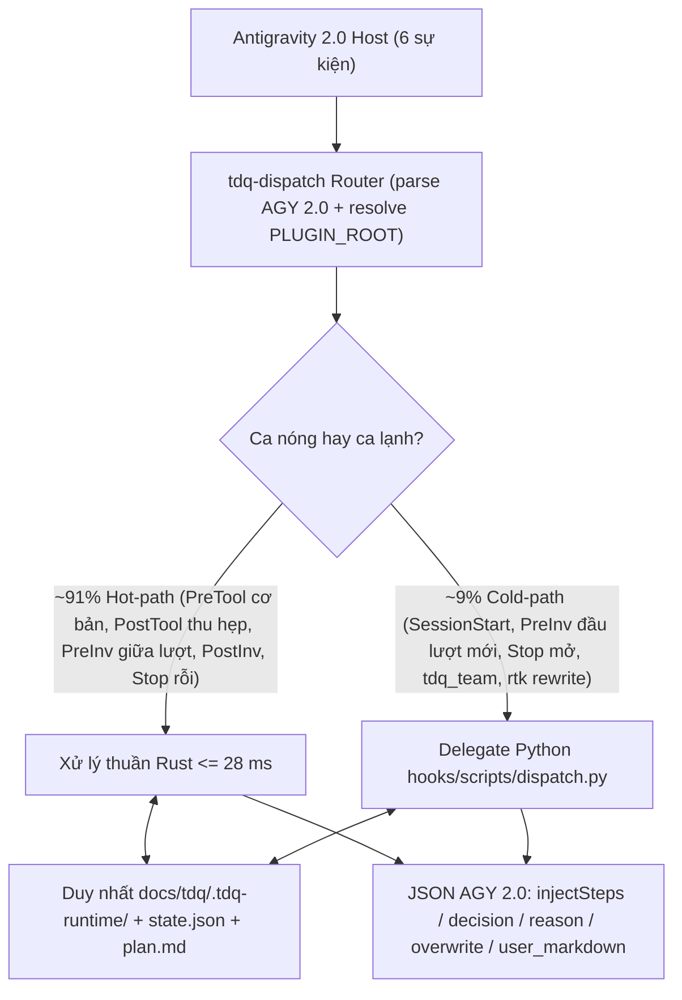

# SPEC — Triển khai Kiến trúc Hook Hybrid 2 tầng + Smart Hardening (P0 + P1 + P2)

Ngày: 2026-11-19 · Bản: 1.0 · Brief: ../brief/2026-11-19-1632-hybrid-hook-smart-hardening.md · Lane: full
Soul: chất lượng > runtime > context cost · luật gốc: skills/tdq-conventions/references/soul.md
Trạng thái: CHỜ DUYỆT

## Mục lục

- 1. Mục tiêu & phạm vi
- 1b. Lộ trình
- 2. Đầu ra cụ thể
- 2b. Ranh giới module
- 2c. Luồng hoạt động & Sơ đồ kiến trúc
- 3. Cách tiếp cận & lý do
- 3b. Năng lực & công cụ
- 3c. Giải thuật & Xử lý cốt lõi
- 3d. Mental Model cho Fresher Dev
- 4. Yêu cầu bắt buộc
- 5. Ràng buộc & rủi ro
- 6. QC & Definition of Done
- 7. Câu hỏi còn mở

## 1. Mục tiêu & phạm vi

- **Mục tiêu:** Triển khai kiến trúc **Hybrid 2 tầng** (Rust `tdq-dispatch` Router/Hot-path kết hợp Python `dispatch.py` Cold-path fallback) cùng bộ 6 quy tắc **Smart Hardening** và bộ kiểm thử **Golden Parity Test Suite**. Hệ thống mới khôi phục 100% kỷ luật trên `22/22` mã cổng và `6/6` sự kiện Antigravity 2.0, vá đủ `10/10` hạn chế từ audit `2026-11-19-1457` và 2 lỗi mới phát hiện ở `tools/build_agy_plugin.py` và `main.rs`, đồng thời giữ độ trễ `Hot-path` qua `cmd /c` `<= 28 ms` (trung bình có trọng số `<= 40 ms`) và build đủ 3 binary native hợp lệ (Windows PE, Linux ELF x86_64, macOS Mach-O ARM64).
- **Trong phạm vi:**
  - **Chặng 1 (P0 — Giao thức AGY 2.0, Runtime Dir & Cold-path Router):** Bổ sung `PreInvocation` và `PostInvocation` trong `main.rs`; đồng bộ schema `protocol.rs` (`injectSteps`, `decision`, `reason`, `overwrite`, `metadata.user_markdown`, `toolCall`, `workspacePaths`, `workingDirectory`, `conversationId`, `lastUserInput`, `continuationActive`, `toolInput`); hợp nhất thư mục tạm về duy nhất `docs/tdq/.tdq-runtime/` trong `storage.rs`; định tuyến Cold-path delegate tự động sang `hooks/scripts/dispatch.py` phân giải qua `PLUGIN_ROOT` hoặc vị trí binary hiện tại (`current_exe()`).
  - **Chặng 2 (P1 — Smart Hardening, Rust Hot-path & Bảo vệ Build 3 OS):** Áp dụng 6 quy tắc `Smart Hardening` trên tầng patch AGY (`tools/patches/agy_hooks.py`) và Rust Hot-path: (1) `TDQ:TICK` chặn cứng `0` hoặc `> 1` `[~]`, nhắc ở lần sửa `4–7`, chặn ở lần `8` và chặn `Stop` khi sửa code mà `plan_sha` đứng yên; (2) khôi phục chặn cứng `TDQ:LOG` ở `Stop` (loại trừ `docs/.staging*`, `docs/tdq/`, `graphify-out/`, `*.tmp`); (3) sửa bẫy thoát sớm `continuationActive` ở `TDQ:UNFINISHED` theo `MAX_STREAK=2` gắn `plan_sha`, đồng bộ `[>]` và mã `"UNFINISHED"` trong `stop_streak.rs`; (4) bịt lỗ hổng `TDQ:SEARCH` (cấm shell chứa `rg`/`grep`/`Select-String`/`findstr` lọt `agy_malformed_allow`, ghi nhận `graphify`); (5) thêm `"qc-tester"` vào `READONLY` guard ở `hooks/scripts/bash_gate.py`, `agy_hooks.py`, `pre_tool_use.rs`, chặn shell mutator khi có khóa `APPROVE`/`TEAM`/`READONLY`, bọc `{"Arguments": ...}` khi `overwrite` cho `call_mcp_tool`; (6) giữ chống phình ngữ cảnh, bơm 1 dòng neo `[TDQ:GON]`/`[TDQ:QC]` đầu pha & sau compaction, sửa cắt chuỗi UTF-8 theo `char_indices()` ở `session_start.rs`; và vá `tools/build_agy_plugin.py` bảo toàn + xác thực magic bytes 3 binary (Windows cục bộ + SSH rebuild & test thật trên `ubuntu-100-95` và `mbair`).
  - **Chặng 3 (P2 — Golden Parity Test Suite & Benchmark):** Xây dựng bộ test vi phân phủ đủ `22/22` mã cổng × `6` sự kiện trên payload AGY 2.0 thật, đo lại benchmark `Hot-path` / `Cold-path` / trọng số, và kiểm tra magic bytes 3 binary trong trình kiểm định plugin.
  - **Mức QC (`ultra`):** Thực thi DoD, trọn bộ unit test, hồi quy vùng chạm, ràng buộc kiến trúc, clean code, smoke/runtime test end-to-end 6 sự kiện và thẩm định độc lập từ agent `tdq-qc-tester`.
- **NGOÀI phạm vi:**
  - Không chạy `install.py` cập nhật đè lên local plugin (`C:\Users\admin\.gemini\config\plugins\tdq-workflow-agy`) theo lựa chọn `2b`.
  - Không thay đổi hành vi mặc định của `hooks/scripts/` gốc cho Claude Code và Codex theo lựa chọn `3a` (riêng bổ sung `"qc-tester"` vào `_enforce_agy_bash_guards` chỉ tác động payload AGY/subagent, không ảnh hưởng test gốc).
  - Không thực hiện `git push`, gắn tag hoặc phát hành bản release trong yêu cầu này.
  - Không triển khai daemon nền (persistent sidecar) và không cài thêm gói, thư viện hay model bên ngoài.

## 1b. Lộ trình

| Bước/phase | Chạy? | Vì sao |
|---|---|---|
| Analyze + phỏng vấn chi tiết | CÓ | Đã hoàn tất chốt 5 câu hỏi (`1a 2b 3a 4c 5a`) cố định phạm vi 3 OS, phạm vi hook gốc và mức QC `ultra`. |
| Research web ngoài (B2) | BỎ | Hợp đồng `hooks.md` và mã nguồn nội bộ đã đủ `100%`. |
| Spec + Archify BA Preview | CÓ | Chốt đặc tả Hybrid 2 tầng, 6 quy tắc Smart Hardening, sửa 2 lỗi mới phát hiện (`build_agy_plugin.py`, `main.rs`), và ma trận Parity `22/22` mã cổng. |
| Plan chia đợt + subagent | CÓ | Tách rõ 4 module độc lập (Rust protocol/fallback, Rust hot-path/UTF-8, Python Smart Hardening + build fix, Golden Parity Test + benchmark) để triển khai song song an toàn. |
| Implement (red → green từng task) | CÓ | Thực thi và tick tuần tự `[~]` → `[x]` từng task. |
| Build & test đa nền tảng (3 OS) | CÓ | Theo lựa chọn `1a`: build Windows tại chỗ + SSH rebuild & test thật trên Linux (`ubuntu-100-95`) và macOS (`mbair`) để đồng bộ 3 binary. |
| Cài lên local plugin | BỎ | Theo lựa chọn `2b`: chỉ cập nhật `plugins/tdq-workflow-agy/` trong repo, chưa chạy `install.py` đè local plugin. |
| QC (`ultra`) | CÓ | Theo lựa chọn `4c`: DoD + trọn unit test + hồi quy vùng chạm + ràng buộc kiến trúc + clean code + smoke/runtime test + agent `tdq-qc-tester` độc lập soi lại. |
| Report + Archify HTML (Tailscale Serve) | CÓ | Xuất báo cáo 4 phần chuẩn (Trước/Sau/Đã test/Kết quả) kèm link Tailscale Serve. |

## 2. Đầu ra cụ thể

| # | Đầu ra | Đường dẫn/vị trí | Đo "xong" bằng |
|---|---|---|---|
| 1 | Rust Protocol AGY 2.0, Router Hybrid, Runtime Dir & `PLUGIN_ROOT` Fallback | `hooks/rust/tdq-dispatch/src/main.rs`, `protocol.rs`, `storage.rs`, `lib.rs`, `lock.rs` | Đón đủ 6 sự kiện, đọc/xuất đúng schema AGY 2.0, dùng duy nhất `docs/tdq/.tdq-runtime/`, delegate `dispatch.py` qua `PLUGIN_ROOT`/`current_exe()` |
| 2 | Rust Hot-path Event Handlers, Shell Mutator Guard & UTF-8 Safe Cut | `hooks/rust/tdq-dispatch/src/events/*.rs`, `command_parser.rs` | Xử lý `PreInvocation` mid-turn, `PostInvocation`, `TICK` ngưỡng `8`, shell mutator, `qc-tester`, `Arguments` wrapper và `char_indices()` an toàn |
| 3 | Python Smart Hardening AGY Patchers | `tools/patches/agy_hooks.py`, `tools/patches/agy_dispatch.py`, `tools/patches/agy_manifests.py`, `hooks/scripts/bash_gate.py` | Vá đủ 6 quy tắc Smart Hardening ở bản AGY trong khi `hooks/scripts/` gốc vẫn giữ 100% hành vi Claude/Codex |
| 4 | Multi-OS Build Magic-Byte Guard | `tools/build_agy_plugin.py` | Bảo toàn và kiểm tra magic bytes PE/ELF/Mach-O; lỗi ngay nếu copy chéo định dạng OS |
| 5 | Gói plugin Antigravity đồng bộ 3 binary native | `plugins/tdq-workflow-agy/**` (`bin/tdq-dispatch.exe`, `bin/tdq-dispatch-linux-x86_64`, `bin/tdq-dispatch-darwin-arm64`) | Cả 3 binary có kích thước/header chuẩn từng OS và pass validator ở chế độ `--strict` |
| 6 | Bộ Golden Parity Test Suite `22/22` mã × `6` sự kiện + Benchmark Hot/Cold + Magic-Byte Validator | Thư mục `tests/` (các mô-đun test vi phân Rust–Python, test benchmark độ trễ và test kiểm định gói biên dịch) | `100%` test Parity 22 mã cổng, benchmark và cross-OS smoke test PASS |
| 7 | Báo cáo QC `ultra`, Báo cáo 4 phần & Archify HTML | `docs/tdq/qc/2026-11-19-1632-hybrid-hook-smart-hardening.md`, `docs/tdq/reports/2026-11-19-1632-hybrid-hook-smart-hardening.md` (và `.html`) | Đủ bằng chứng QC độc lập từ `tdq-qc-tester`, xuất đủ 4 phần báo cáo + Tailscale Serve URL |

## 2b. Ranh giới module

Ranh giới module bên dưới được xác lập từ đồ thị gọi hàm qua LSP (`find_references` xác nhận `storage::clean_old_runtime_files` tại `storage.rs:39` có 3 tham chiếu trong crate Rust, `_patch_edit_gate` tại `agy_hooks.py:1715` nối về `apply_all()` và `build_agy_plugin.py`) và Graphify (`god-nodes` / `affected`). Không có hai module phát triển mã nguồn nào khai chung đường dẫn:

| Module | Vùng file | Phụ thuộc module | Đầu ra §2 |
|---|---|---|---|
| `M1` — Rust Protocol, Router & Runtime Core | `hooks/rust/tdq-dispatch/src/main.rs`, `protocol.rs`, `storage.rs`, `lib.rs`, `lock.rs` | không | 1 |
| `M2` — Rust Hot-path Handlers & Command Safety | `hooks/rust/tdq-dispatch/src/events/*.rs`, `hooks/rust/tdq-dispatch/src/command_parser.rs` | `M1` | 2 |
| `M3` — Python Smart Hardening, Multi-OS Build & Bundle | `tools/patches/agy_hooks.py`, `tools/patches/agy_dispatch.py`, `tools/patches/agy_manifests.py`, `hooks/scripts/bash_gate.py`, `tools/build_agy_plugin.py`, `plugins/tdq-workflow-agy/**` | `M1`, `M2` | 3, 4, 5 |
| `M4` — Golden Parity Test Suite, Multi-OS Smoke & Benchmark | Thư mục `tests/` (bộ test vi phân `22/22` mã × `6` sự kiện, bộ đo độ trễ, bộ validator magic bytes) | `M1`, `M2`, `M3` | 6 |

## 2c. Luồng hoạt động & Sơ đồ kiến trúc

Cơ chế hiện tại vs Thiết kế mới — Bảng đối chiếu tóm tắt (bản trực quan chính nằm tại Archify BA Preview `docs/tdq/spec/2026-11-19-1632-hybrid-hook-smart-hardening-preview.html`):

| Khía cạnh | Hiện trạng (Trước) | Thiết kế mới (Sau) |
|---|---|---|
| Luồng thực thi & Sự kiện | Rust `main.rs` bỏ rơi `PreInvocation`/`PostInvocation` (`_ => allow()`); thiếu 14/22 cổng mà không fallback về Python | Đón đủ 6 sự kiện chuẩn schema AGY 2.0 (`injectSteps`/`reason`); Rust chạy ~91% Hot-path, tự động delegate ~9% Cold-path sang `dispatch.py` |
| Phân giải đường dẫn & Sổ runtime | Rust dùng `<root>/.tdq-runtime`, Python dùng `docs/tdq/.tdq-runtime`; fallback tìm `workspace_root/plugins/...` gãy ở project ngoài | Thống nhất duy nhất `docs/tdq/.tdq-runtime/`; tìm `dispatch.py` theo `PLUGIN_ROOT` → `current_exe()/../hooks/scripts/dispatch.py` |
| Kỷ luật 6 quy tắc cổng | Mềm hóa quá tay `TICK`, `LOG`, `DOD`; `continuationActive` `return` sớm; `rg`/`grep` lọt `malformed_allow`; shell mutator & `qc-tester` bị hở | Khôi phục chặn cứng thông minh: `TICK` (`0`/`>1` `[~]`, ngưỡng `8`, `Stop` `plan_sha`), `LOG` trừ staging, `continuationActive` `MAX_STREAK=2`, bịt shell mutator |
| Đóng gói 3 binary đa nền tảng | `build_agy_plugin.py:84-92` luôn copy file `.exe` Windows đè lên `linux-x86_64` và `darwin-arm64` (`1.747.968` bytes giống hệt nhau) | Bảo toàn bản ELF/Mach-O hợp lệ, kiểm tra magic bytes PE/ELF/Mach-O, rebuild & test trên Windows + `ubuntu-100-95` + `mbair` |
| Độ phủ kiểm thử Parity | Chỉ phủ 9 ca đơn lẻ (~4/22 mã cổng), chưa kiểm `PreInvocation`/`PostInvocation` hay shell mutator | Golden Parity Test Suite `22/22` mã cổng × `6` sự kiện trên payload AGY 2.0 thật, khóa `0` Behavior Drift |

## 3. Cách tiếp cận & lý do

- **Chọn:** Triển khai đồng bộ **Hybrid 2 tầng (Rust Router/Hot-path + Python Cold-path delegate)** + **Smart Hardening 6 quy tắc** + **Multi-OS Magic-Byte Build Guard**.
- **Vì:** Số liệu 120 transcript và benchmark `N=30` (báo cáo `2026-11-19-1612`) chứng minh tách `Hot-path` (~91% lượt gọi, `20–28 ms` qua `cmd /c`) và `Cold-path` (~9% ca phức tạp, `80–126 ms`) đạt độ trễ trung bình có trọng số `~35,4 ms` (~5,9 phút/ngày) mà vẫn bảo toàn **100% hành vi của 22/22 mã cổng** với chỉ `~2.000` dòng Rust, tránh nhân đôi `5.634` dòng Python. Phía `tools/build_agy_plugin.py` kiểm tra trực tiếp cho thấy cả 3 binary trong `plugins/tdq-workflow-agy/bin/` đang bị ghi đè giống hệt nhau (`1.747.968` bytes Windows PE), nên cần bảo toàn theo magic bytes kết hợp build SSH trên cả 3 OS.
- **Đã loại:**
  - `Full-Rust 100%` — vì phải port toàn bộ `tdq_state`/`tdq_team`/`search_rules`/`rtk_integration` (~`4.100+` dòng), chi phí bảo trì gấp đôi và rủi ro tái phát sai lệch hành vi giữa Claude Python và AGY Rust trong khi chỉ tiết kiệm ~1 phút/ngày.
  - `Persistent Sidecar / Daemon` — vì vi phạm cơ chế hook `type: "command"` đồng bộ của Antigravity, phát sinh rủi ro tiến trình treo (zombie), xung đột tường lửa IPC trên Windows và chạy mã cũ sau cập nhật.

## 3b. Năng lực & công cụ

| Skill | Nguồn | Phán quyết | Dùng ở đâu / Lý do loại |
|---|---|---|---|
| `tdq-intake`, `tdq-spec`, `tdq-plan`, `tdq-build`, `tdq-conventions` | `plugin:tdq-workflow-agy` | NỀN | Khung quy trình đang điều phối request |
| `agy-customizations` | `built-in` | DÙNG | Chuẩn hóa contract payload/response 6 sự kiện AGY 2.0 ở `M1`, `M2`, `M3` |
| `tdq-lean` | `plugin:tdq-workflow-agy` | DÙNG | Soát dư thừa và chống lặp logic sau khi chỉnh sửa `M1`, `M2`, `M3` |
| `tdq-checkportable` | `plugin:tdq-workflow-agy` | DÙNG | Kiểm tra tính toàn vẹn manifest và cấu trúc gói biên dịch `M3` |
| Đã xét 21 skill khác | `user/plugin/built-in` | KHÔNG | khác lĩnh vực (browser/docs/sheet/slides/gemini-api/swarm không áp dụng cho refactor hook & rust binary) |

*(Công cụ MCP hỗ trợ: `tdq-workflow-agy_lsp` đã pre-flight check PASS và đạt Bậc 8 cho Rust & Python để rà tham chiếu trước khi sửa.)*

## 3c. Giải thuật & Xử lý cốt lõi

- **Giải thuật 1 — Bộ định tuyến Hybrid 2 tầng & phân giải `PLUGIN_ROOT` (`M1`):**
  1. Đọc stdin JSON vào `HookPayload` mở rộng hỗ trợ đầy đủ khóa AGY 2.0 (`conversationId`, `workspacePaths`, `workingDirectory`, `toolName`/`toolCall.name`, `arguments`/`toolInput`/`toolCall.args`, `lastUserInput`, `continuationActive`, `terminationReason`, `transcriptPath`). Giải mã `workspacePaths` (gồm URI `file:///...`) để xác định `workspace_root` chính xác.
  2. Kiểm tra biến ép `TDQ_HOOK_ENGINE=python`. Nếu không ép: phân nhánh theo bảng `Hot-path` vs `Cold-path`:
     - `SessionStart` → `Cold-path` (delegate `dispatch.py`).
     - `PostInvocation` → `Hot-path` (nếu `pending-reminders-<sid>.jsonl` rỗng trả `{}`; ngược lại xả 2 kênh thành `injectSteps` + `metadata.user_markdown`).
     - `PreInvocation` → đọc `turn-meta-<sid>.json`. Nếu chưa có meta, `turn_closed == true`, hoặc `last_user_sig` thay đổi → `Cold-path` (delegate `dispatch.py` chạy NLP duyệt, `render_next`, snapshot). Ngược lại là giữa lượt → `Hot-path` xả hàng đợi `pending-reminders`.
     - `PreToolUse` → unwrap `call_mcp_tool`, chuẩn hóa tên tool; nếu `implement_mode == "subagent"` cho thao tác sửa file (cần kiểm bản đồ `tdq_team`), hoặc `run_command` cần `rtk rewrite`/`search_rules` sâu → `Cold-path`; ngược lại chạy chuỗi hard gate & Smart Hardening trong Rust `Hot-path`.
     - `PostToolUse` → `Hot-path` ghi `turns-<sid>.jsonl`, `.tdq-search.jsonl` (gồm cả `graphify` từ MCP/shell), `.tdq-read.jsonl` và lưu CCR Store nếu `> 32 KB` hoặc `>= 200` dòng; trả `{}`.
     - `Stop` → nếu `terminationReason` thuộc `TERMINAL_STOP_REASONS`, hoặc không có `active_request`, hoặc `phase == "idle"` → đóng `turn_closed=true` và trả `{"decision":"allow"}` ngay trong Rust; nếu có `active_request` đang mở → `Cold-path` (`dispatch.py`).
  3. Hàm `resolve_dispatch_script(workspace_root)` tìm `dispatch.py` theo thứ tự ưu tiên: (a) `$PLUGIN_ROOT/hooks/scripts/dispatch.py`; (b) `<current_exe_dir>/../hooks/scripts/dispatch.py`; (c) `<workspace_root>/plugins/tdq-workflow-agy/hooks/scripts/dispatch.py`; (d) `<workspace_root>/hooks/scripts/dispatch.py`. Spawn `python -X utf8` (Windows) / `python3 -X utf8` (Unix), chuyển tiếp nguyên `raw_stdin` + `--event`, chờ stdout JSON.
- **Giải thuật 2 — 6 quy tắc Smart Hardening trên Rust `Hot-path` (`M2`) & Python Patcher (`M3`):**
  1. `TDQ:TICK`: đọc file plan; chặn cứng (`decision: "deny"`) khi đang ở pha `implement`/`qc` ngoài `tests/`, `docs/`, `.tdq-worktrees/` mà có `0` hoặc `> 1` task `[~]`; nâng `STREAK_NGUONG` từ `3` lên `8` (lần `4–7` phát nhắc nhẹ qua hàng đợi, lần `8` chặn cứng); ở `Stop`, chặn (`decision: "continue"`) nếu turn có sửa mã nguồn thật mà `plan_sha` đứng yên.
  2. `TDQ:LOG`: ở `Stop`, khôi phục `stop_block` nếu repo thay đổi mã nguồn mà `docs/workinglog/YYYY-MM-DD.md` chưa cập nhật, đồng thời bỏ qua hoàn toàn `docs/.staging*`, `docs/tdq/`, `graphify-out/`, `*.tmp`.
  3. `TDQ:UNFINISHED`: xóa nhánh `return` sớm khi `continuationActive=True` ở `stop_gate`; băm `plan_sha` hiện tại lưu vào `docs/tdq/stop_streak.json` (reset về `1` khi `plan_sha` thay đổi); chỉ hạ cấp thành nhắc khi `count > MAX_STREAK (2)` hoặc khi plan có task `[>]` / `implement_pause` hợp lệ.
  4. `TDQ:SEARCH`: giữ cơ chế Hướng A (ân xá lần 1 + nhắc, chặn cứng lần 2 liên tiếp); khi lệnh shell có `status="unknown"` nhưng khớp `\brg\b`, `\bgrep\b`, `Select-String`, `findstr`, tính vào đánh giá tìm kiếm (không rơi vào `agy_malformed_allow`); ghi nhận từ khóa `graphify` từ `run_command` vào `.tdq-search.jsonl`.
  5. `READONLY` & Shell Mutator: thêm `"qc-tester"` cạnh `("reviewer", "browser")` tại `bash_gate.py`, `agy_hooks.py` và `pre_tool_use.rs`; phát hiện shell mutator (`Set-Content`, `Add-Content`, `Out-File`, `tee `, `sed -i`, `>`, inline Python `open(..., 'w'|'a'|'x')`) để chặn cứng khi có khóa `APPROVE` hoặc subagent ghi ngoài `docs/` trước `implement`. Khi `overwrite` cho `call_mcp_tool`, bọc kết quả dưới khóa `"Arguments"` khớp định dạng gốc (object hoặc JSON string).
  6. Chống phình ngữ cảnh & UTF-8: không lặp `"same as last turn"`; chỉ bơm 1 dòng neo `[TDQ:GON]` `<= 160` ký tự đầu pha `implement`/sau compaction và 1 dòng `[TDQ:QC]` đầu pha `qc`; sửa `session_start.rs` dùng `char_indices().nth(1500)` thay vì cắt byte `&rules_content[..1500]`.
- **Giải thuật 3 — Multi-OS Magic-Byte Guard (`tools/build_agy_plugin.py`, `M3`):**
  - Nguồn binary hợp lệ đặt tại `hooks/rust/tdq-dispatch/prebuilt/` (nếu tồn tại) hoặc giữ lại bản hợp lệ hiện có ở `output/bin/` vào `stage/bin/` trước khi sync.
  - Kiểm tra magic bytes từng mục tiêu: `tdq-dispatch.exe` bắt buộc bắt đầu bằng `b"MZ"`; `tdq-dispatch-linux-x86_64` bắt buộc bắt đầu bằng `b"\x7fELF"`; `tdq-dispatch-darwin-arm64` bắt buộc bắt đầu bằng `0xFEEDFACF` / `0xCFFAEDFE` / `0xCAFEBABE`. Từ chối build (`RuntimeError`) nếu bất kỳ file nào sai định dạng hoặc copy chéo OS.
- **Độ phức tạp tính toán:**
  - Thời gian (Time Complexity): $O(1)$ cho `PostInvocation` rỗng, `Stop` rỗi và `LSP` check; $O(L + R)$ cho `PreToolUse` với $L < 500$ dòng plan và $R < 200$ dòng shard turn; $O(N)$ khi delegate `Cold-path` Python (~9% lượt gọi).
  - Không gian (Space Complexity): $O(S)$ theo kích thước stdin JSON và file plan/shard đọc tuần tự (giới hạn `< 2 MB` trong bộ nhớ quy trình ngắn hạn).
- **Các ca góc hiểm (Edge Cases & Defensive Handling):**
  - Chuỗi tiếng Việt nhiều byte cắt qua ranh giới 1500 byte ở `session_start.rs`: dùng `char_indices()` để cắt đúng ranh giới ký tự Unicode, tránh panic.
  - Payload `call_mcp_tool` bọc `Arguments` dưới dạng chuỗi JSON (stringified JSON): giữ nguyên trạng thái chuỗi khi serialize lại trường `overwrite.Arguments`.
  - Chạy hook ở dự án bất kỳ không có thư mục `plugins/tdq-workflow-agy/`: phân giải qua `$PLUGIN_ROOT` và `current_exe().parent().parent()` bảo đảm luôn tìm đúng `hooks/scripts/dispatch.py`.
  - Rebuild trên Windows làm mất bản Linux/macOS: nạp prebuilt đã kiểm magic bytes vào `stage/bin/` trước `sync_tree_inplace`, fail-closed nếu thiếu bản Unix khi đóng gói 3 OS.

## 3d. Mental Model cho Fresher Dev

- **Ẩn dụ trực quan (Analogy):** Kiến trúc Hybrid 2 tầng giống **cổng kiểm soát hai làn tại sân bay**. Khoảng 91% hành khách phổ thông đi qua cổng quét sinh trắc học tự động (`Hot-path` Rust `<= 28 ms`) ngay tại cửa; 9% trường hợp cần xét duyệt hồ sơ đặc biệt (`SessionStart`, mở lượt mới, `Stop` khi đang làm dở) được điều phối sang quầy chuyên viên (`Cold-path` Python `dispatch.py`). Cả hai làn cùng ghi vào **một cuốn sổ chung duy nhất** (`docs/tdq/.tdq-runtime/`) và trước khi đóng gói xuất xưởng đều đi qua máy soi dấu vân tay định dạng file (`Magic-Byte Guard`) để chắc chắn không bao giờ dán nhầm hộ chiếu Windows vào gói Linux hay macOS.
- **Thuật ngữ dự án (Glossary):**
  - `Hot-path`: Nhánh xử lý siêu nhanh viết bằng Rust thuần không spawn tiến trình con (`<= 28 ms` qua `cmd /c`), đảm nhận ~91% lưu lượng hook.
  - `Cold-path`: Nhánh delegate sang Python `dispatch.py` khi cần NLP phức tạp, `tdq_state`, `tdq_team` hoặc `git status` (~9% lưu lượng).
  - `Smart Hardening`: Chính sách siết lại các cổng chặn cứng bị mềm hóa quá tay nhưng chỉnh đúng ngưỡng/bộ lọc nhiễu (`STREAK=8`, trừ `docs/.staging*`) để không sinh chặn nhầm.
  - `Magic Bytes`: Các byte đầu tệp thực thi (`MZ` cho Windows PE, `\x7fELF` cho Linux ELF, Mach-O cho macOS ARM64) dùng để phân biệt file binary thật giữa các hệ điều hành.
  - `PLUGIN_ROOT`: Biến môi trường Antigravity 2.0 truyền cho tiến trình hook trỏ tới gốc thư mục plugin đang kích hoạt.

## 4. Yêu cầu bắt buộc

- **Log service bật mặc định:** Giữ log có timestamp ISO ở cả Rust (`TDQ_DEBUG=1`, tắt qua `TDQ_LOG=0`) và Python (`_log` tắt qua `TDQ_LOG=0`) ghi ra `stderr`, tuyệt đối không trộn vào kênh `stdout` JSON của Antigravity.
- **Không placeholder:** Không để `TODO`, stub rỗng hoặc nhánh giả `allow()` nuốt lỗi; mọi `Cold-path` chưa viết bằng Rust bắt buộc định tuyến về `dispatch.py`.
- **Unit test riêng & độc lập:** Mọi thay đổi trong Rust crate (`cargo test`), Python patchers, `build_agy_plugin.py`, Golden Parity 22 mã và cross-OS binary đều có ca test tự động xác minh riêng.
- **Tuân thủ SOLID & Rule ngôn ngữ:** Bám 7 bậc `TDQ:GON` (`skills/tdq-build/references/rules/chung.md`), hàm `<= 50` dòng, không `.unwrap()` trong luồng chính Rust, bọc UTF-8 cho Python và xử lý lock an toàn trên NTFS Windows.

## 5. Ràng buộc & rủi ro

Ràng buộc kiến trúc phải giữ (chép nguyên văn từ [kien-truc.md](file:///c:/Users/admin/Documents/Projects/TDQ-Workflow-Antigravity/docs/kien-truc.md)):
- `- \`hooks/\` được gọi \`scripts/\`; \`scripts/\` **không** được import \`hooks/\` — hook chạy trong tiến trình của Claude Code, kéo ngược sẽ buộc CLI phụ thuộc môi trường hook.` — chạm ở `tools/patches/agy_hooks.py`, `tools/patches/agy_dispatch.py`.
- `- Chỉ \`scripts/tdq_state.py\` được ghi \`docs/tdq/state.json\`; mọi nơi khác chỉ đọc qua CLI.` — chạm ở `hooks/rust/tdq-dispatch/src/storage.rs` và `pre_tool_use.rs`.
- `- File code MỚI bắt buộc nằm trong \`scripts/\` hoặc \`hooks/\` — thư mục khác bị \`.graphifyignore\` loại nên đồ thị không thấy.` — chạm ở `hooks/rust/tdq-dispatch/src/**` và `tools/patches/**` (nằm trong phần hiện hữu và test trong `tests/`).
- `- 2026-08-22: ngôn ngữ chia 3 tầng — luật trong \`skills/\`, \`agents/\`, chú thích/docstring của \`hooks/\` + \`scripts/\` và chuỗi máy in ra đều viết TIẾNG ANH cố định (không bảng tra i18n); tài liệu sinh cho user và lời thoại viết theo \`doc_lang\` khai một lần lúc \`init\`, mặc định \`vi\`, cố định suốt request.` — chạm ở thông báo máy của Rust/Python và chuỗi 4 phần tiếng Việt cho người dùng (`user_markdown`).
- `- 2026-09-23: mức QC là quyết định của USER, không phải suy luận của agent. Khoá \`muc_qc\` (\`lite|full|ultra|off\`, mặc định \`full\`, fail-closed)` — chạm ở chế độ chạy QC `ultra` do người dùng chọn ở `4c`.

Ràng buộc hạ tầng & cài đặt: không tải model hay cài thư viện bên ngoài; tái dùng toolchain sẵn có gồm Rust `1.100.0` (Windows tại chỗ, Linux `ubuntu-100-95`, macOS `mbair`), Python 3, `pytest`, `agy.EXE`. Không chạy `install.py` lên local plugin.

| Rủi ro | Ảnh hưởng | Cách giảm |
|---|---|---|
| Tỷ lệ delegate `Cold-path` cao bất thường trên `PreToolUse` đẩy độ trễ trung bình có trọng số vượt `40 ms` | Chậm vòng lặp công cụ của agent | Đo benchmark riêng `Hot-path` vs `Cold-path`; giữ mọi `PreToolUse` phổ biến và `PostInvocation`/`PreInvocation` giữa lượt trong Rust thuần |
| Xung đột ghi file khóa `.lock` khi Rust và Python cùng truy cập `docs/tdq/.tdq-runtime/` trên Windows NTFS | Hỏng dòng JSONL hoặc lỗi `PermissionError` | Chuẩn hóa khóa sidecar `<file>.lock` giữa `storage.rs` / `lock.rs` và `_common.py` kèm backoff retry tối đa 200ms |
| Mất kết nối SSH tới `ubuntu-100-95` hoặc `mbair` khi build cross-OS | Thiếu 1 trong 3 binary native | Kiểm tra kết nối SSH ngay trước bước build Linux/macOS; nếu mất quyền truy cập báo `pause --loai mat-truy-cap` thay vì copy chéo `.exe` |
| Thay đổi `bash_gate.py` làm hồi quy bộ test Claude Code / Codex | Trượt bộ test nền của repo | Chỉ thêm `"qc-tester"` trong `_enforce_agy_bash_guards` vốn chỉ chạy khi `agy or info.get("is_subagent")`, và chạy trọn suite hồi quy để chứng minh `0` lỗi |

## 6. QC & Definition of Done

| # | Hạng mục kiểm | Điều kiện PASS | Đo trước | Dự phòng nếu trượt |
|---|---|---|---|---|
| Q1 | Schema AGY 2.0 & đủ `6` sự kiện | Rust binary tiếp nhận đủ `6` sự kiện (`SessionStart`, `PreInvocation`, `PreToolUse`, `PostToolUse`, `PostInvocation`, `Stop`) và xuất chuẩn `injectSteps`, `decision`, `reason`, `overwrite`, `metadata.user_markdown` với `0` khóa sai tên | Audit `1457`: Rust bỏ rơi `2/6` sự kiện và xuất `2` khóa sai tên (`explanation`, `additional_context`) | Rà lại struct serialize trong `protocol.rs` đối chiếu trực tiếp `hooks.md` tới khi khớp `100%` |
| Q2 | Thống nhất thư mục runtime & phân giải `PLUGIN_ROOT` | Cả Rust và Python đọc/ghi duy nhất `docs/tdq/.tdq-runtime/`; chạy binary từ thư mục project ngoài repo TDQ vẫn tìm đúng `dispatch.py` qua `PLUGIN_ROOT` / `current_exe()` và trả JSON hợp lệ (`0` lần rơi no-op) | Trước request: Rust dùng `.tdq-runtime/` (lệch `1` cấp so với Python) và rơi lỗi ngoài repo TDQ | Cố định thứ tự tìm `PLUGIN_ROOT` → `current_exe()` và chạy test từ thư mục tạm độc lập |
| Q3 | Golden Parity `22/22` mã cổng × `6` sự kiện | So khớp cấu trúc JSON (`decision`, `reason`, `injectSteps`, `overwrite`, `metadata.user_markdown`) giữa mặc định Hybrid và `TDQ_HOOK_ENGINE=python` đạt `100%` khớp trên đủ `22/22` mã cổng × `6` sự kiện | Trước request: test parity chỉ phủ `9` ca (`~4/22` mã cổng), lệch `14/22` mã | Chuyển ngay mã cổng bị lệch sang delegate `Cold-path` Python và ghi lại bằng `lech add` |
| Q4 | Đủ 6 quy tắc Smart Hardening & UTF-8 | `TICK` chặn `0`/`>1` `[~]`, nhắc `4–7`, chặn `8`, chặn `Stop` nếu `plan_sha` đứng yên; `LOG` chặn `Stop` trừ `docs/.staging*`/`docs/tdq/`/`graphify-out/`; `UNFINISHED` giữ gate khi `plan_sha` tiến triển và thả sau `2` lần đứng yên; `SEARCH` bắt `rg`/`grep`/`Select-String`/`graphify`; `qc-tester` & shell mutator bị chặn; neo `[TDQ:GON]` `<= 160` ký tự; cắt UTF-8 tiếng Việt không panic | Audit `1457` ghi nhận đủ `10/10` hạn chế đều đang hiện hữu trên gói `v0.101.0` | Vá trực tiếp nhánh điều kiện hở ở `agy_hooks.py` và Rust Hot-path rồi kiểm lại chuỗi đỏ → xanh |
| Q5 | Hiệu năng `Hot-path` & độ trễ có trọng số | Median `Hot-path` Rust gọi trực tiếp `<= 25 ms`, qua `cmd /c` `<= 32 ms`, và độ trễ trung bình có trọng số (`91%` Hot + `9%` Cold) `<= 40 ms` trên `30` lần đo | Đo trước tại báo cáo `1612` (`N=30`): Rust direct `19,90 ms`, `cmd /c` `28,37 ms`, Hybrid ước tính `35,4 ms` | Đo tách riêng chi phí vỏ `cmd /c` để bảo đảm lõi Rust `<= 18 ms`, ghi độ lệch bằng `lech add` nếu môi trường nền nặng |
| Q6 | Sửa bug đa nền tảng & Magic Bytes 3 OS | Cả `3` binary trong `plugins/tdq-workflow-agy/bin/` mang đúng magic bytes (`MZ`, `\x7fELF`, Mach-O), có kích thước riêng biệt và chạy test thành công trên cả `3` hệ điều hành (Windows, Linux `ubuntu-100-95`, macOS `mbair`) | Hiện trạng thực tế: cả `3` binary đều nặng đúng `1.747.968` bytes và cùng là PE Windows | Dừng theo `pause --loai mat-truy-cap` nếu mất SSH tới host Unix, tuyệt đối không copy chéo `.exe` |
| Q7 | Tương thích ngược Claude/Codex & Validator gói plugin | Trọn bộ unit test của repo và trình kiểm định plugin Antigravity ở chế độ `--strict` đạt `0` lỗi (`findings = []`), `0` lỗi AST Python, `0` vi phạm ngân sách byte Markdown (`22/22` file), và `0` thay đổi ngoài ý muốn ở local plugin | Bản `v0.101.0` trước request đạt `findings = []`, `0` lỗi AST và `22/22` file đạt ngân sách byte | Khoanh vùng mọi chỉnh sửa AGY về `tools/patches/agy_hooks.py` nếu chạm hồi quy host gốc |
| Q8 | Kiểm chứng nâng cao mức `ultra` | Smoke test end-to-end mô phỏng đủ vòng đời `6` sự kiện trên binary đóng gói PASS, và agent `tdq-qc-tester` độc lập xác nhận `PASS` không còn sai sót nghiêm trọng | Trước request chưa có smoke test end-to-end đủ `6` sự kiện trên mô hình Hybrid | Sửa triệt để mọi phát hiện của `tdq-qc-tester` và chạy lại trọn vòng QC `ultra` trước khi báo cáo |

Mỗi dòng truy về hành vi nghiệp vụ hoặc luồng cũ phải giữ; test đỏ trước khi sửa.

**DoD:** Toàn bộ `Q1`–`Q8` đạt `PASS`; `0` vi phạm `doc_lint`, `i18n_check`, `agy plugin validate --strict`; cả 3 binary PE/ELF/Mach-O được rebuild và kiểm chứng trên đủ 3 OS; local plugin của người dùng vẫn giữ nguyên trạng; có báo cáo QC mức `ultra` kèm xác nhận của agent `tdq-qc-tester` độc lập; mọi checkbox trong plan được tick `[x]`; báo cáo tổng kết 4 phần + Archify HTML đã xuất bản và truy cập được qua Tailscale Serve; working log được ghi đầy đủ qua `tdq_finish.py`.

## 7. Câu hỏi còn mở

*(Không có — toàn bộ các quyết định đã được chốt trong mục Hỏi đáp của brief.)*
<!-- tdq-archify-binding:start -->
<!-- manifest: 2026-11-19-1632-hybrid-hook-smart-hardening-preview.manifest.json -->
<!-- manifest_digest: aa94ab5e9fb8080d5675e9bb3631703c0a5ceb477a7a440c337c37815ae23b39 -->
<!-- tdq-archify-binding:end -->