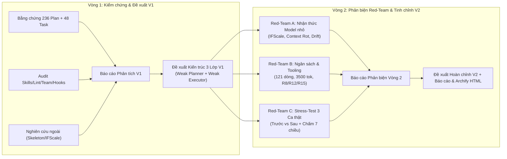

# SPEC — Phân tích độ chi tiết của Plan cho Model Tier Thấp (End-to-End) và Đề xuất Cải thiện TDQ Workflow

Ngày: 2026-11-19 · Bản: 1.0 · Brief: ../brief/2026-11-19-2213-chi-tiet-plan-model-thap.md · Lane: full
Soul: chất lượng > runtime > context cost · luật gốc: skills/tdq-conventions/references/soul.md
Trạng thái: CHỜ DUYỆT

## Mục lục

- 1. Mục tiêu & phạm vi
- 1b. Lộ trình
- 2. Đầu ra cụ thể
- 2b. Ranh giới module
- 2c. Luồng hoạt động & Sơ đồ kiến trúc
- 3. Cách tiếp cận & lý do
- 3b. Năng lực & công cụ
- 3c. Giải thuật & Xử lý cốt lõi
- 3d. Mental Model cho Fresher Dev
- 4. Yêu cầu bắt buộc
- 5. Ràng buộc & rủi ro
- 6. QC & Definition of Done
- 7. Câu hỏi còn mở

## 1. Mục tiêu & phạm vi

- **Mục tiêu:** Kiểm chứng thực nghiệm nhận định rằng `plan` hiện tại của `tdq-workflow` chưa đủ cụ thể (thiếu neo chính xác, thuật toán, công nghệ, chuyển đổi Trước → Sau và kỳ vọng đầu ra từng task) gây giảm chất lượng trên model tier thấp; từ đó thiết kế đề xuất cải thiện `3` lớp cho mô hình **Full Low-Tier End-to-End** (cả người viết plan lẫn người chạy implement đều có thể là model tier thấp), rồi tái phân tích phản biện độc lập thêm `1` vòng (Round 2) để phát hiện nhược điểm và chốt bản đề xuất V2 hoàn chỉnh.
- **Trong phạm vi:**
  - Kiểm chứng nhận định bằng số liệu thực nghiệm trên kho `236` plan thật (`48` task chấm sâu 7 chiều), đối chiếu `4` cặp `spec ↔ plan`, kiểm toán toàn bộ mã nguồn `skills/`, `agents/`, `scripts/`, `hooks/`, `tools/patches/` và đối chiếu nghiên cứu khoa học ngoài.
  - Xây dựng đề xuất thiết kế **V1 (3 lớp)** phục vụ cả **Weak Planner** (phân rã cơ học, trích sự thật từ công cụ thay vì nhớ, chống mega-task) lẫn **Weak Executor** (Executable Task Card chuẩn Structural Contract + Auto Task Packet + sửa bug `tdq_team.py` + siết R15/`approve plan`).
  - Thực hiện **Vòng 2 — Tái phân tích & Phản biện Red-Team độc lập** qua fanout subagent tìm nhược điểm của V1 ở `3` mặt trận: nhận thức model nhỏ (IFScale / Context Rot / Plan Drift / gánh nặng cho Weak Planner), ràng buộc hệ thống TDQ (`SKILL_LINE_LIMITS`, `token-budget`, R8/R12/R13/R15, projection `v1`, AGY patch), và stress-test viết lại Trước → Sau trên `3` ca thất bại thật.
  - Tổng hợp **Đề xuất hoàn chỉnh V2** kèm bảng truy vết Nhược điểm V1 → Bản vá V2, `3` cặp ví dụ Task Card Trước/Sau đạt chuẩn, lộ trình triển khai phân chặng và báo cáo trực quan Archify HTML qua Tailscale Serve.
- **NGOÀI phạm vi:**
  - KHÔNG sửa mã nguồn, file skill, agent, linter, parser, hook hay test của repo (`loai_request=docs`, chốt ở `1a`). Việc hiện thực bản thiết kế V2 sẽ thực hiện ở request `feature` kế tiếp sau khi người dùng duyệt đề xuất.
  - KHÔNG cài đặt gói mới, không tải model mới, không chạy eval gọi LLM tốn phí, không đụng plugin cục bộ đang cài trên máy.

## 1b. Lộ trình

Chép từ brief mục `### Lộ trình`. User duyệt spec là duyệt luôn lộ trình này.

| Bước/phase | Chạy? | Vì sao |
|---|---|---|
| Research web (Tavily) | CÓ | Đã hoàn tất ở `analyze` (`docs/tdq/research/2026-11-19-2213-chi-tiet-plan-model-thap.md`) để tránh bẫy over-specification / IFScale decay |
| Interview | CÓ | Đã hoàn tất 1 vòng (`1a 2b 3a 4a 5a`), chốt đủ phạm vi, mô hình `2b` end-to-end, 3 lớp kỹ thuật và `muc_qc=full` |
| Spec + Archify BA Preview | CÓ | Khóa rõ đầu ra, tiêu chí đo 2 vòng và ranh giới phân công fanout trước khi triển khai |
| Plan (Checkbox từng chặng fanout) | CÓ | Chia rõ Chặng Vòng 1 (Phân tích & Đề xuất V1) và Chặng Vòng 2 (Phản biện Red-Team & Tinh chỉnh V2) |
| Implement (Fanout Subagent 2 vòng) | CÓ | Trực tiếp đáp ứng yêu cầu fanout subagent phân tích kỹ vòng 1 + tái phân tích phản biện vòng 2 tìm nhược điểm và cải thiện |
| QC mức `full` | CÓ | Kiểm chứng chéo 100% trích dẫn `path:line`, số liệu, `doc_lint.py`, tính khớp giữa Vòng 1 → Nhược điểm Vòng 2 → Bản vá V2 và chấm lại ví dụ Trước/Sau |
| Report + Archify HTML (Tailscale) | CÓ | Xuất báo cáo nghiệm thu 4 phần + Archify HTML trực quan hóa giải pháp Trước/Sau qua Tailscale Serve |

## 2. Đầu ra cụ thể

| # | Đầu ra | Đường dẫn/vị trí | Đo "xong" bằng |
|---|---|---|---|
| 1 | Báo cáo Kiểm chứng Nhận định & Giải phẫu Nguyên nhân gốc (Vòng 1) | `docs/tdq/artifacts/2026-11-19-2213-chi-tiet-plan-model-thap/phan-tich-vong-1.md` | Chứa đầy đủ bảng điểm 7 chiều (`48` task / `236` plan), `7` nguyên nhân gốc gắn `path:line` thực chứng, phân tách 2 đầu Weak Planner vs Weak Executor, và đối chiếu nghiên cứu khoa học ngoài |
| 2 | Bản Đề xuất Thiết kế Kiến trúc 3 Lớp — Phiên bản V1 | `docs/tdq/artifacts/2026-11-19-2213-chi-tiet-plan-model-thap/de-xuat-v1.md` | Đặc tả trọn vẹn 3 lớp (Lớp 1 Skill/Template/Agent + Lớp 2 Sửa `tdq_team.py`, Weak-Planner Scaffolder & Auto Task Packet + Lớp 3 R15 cấu trúc & cổng `approve plan`) cùng cấu trúc Task Card chi tiết cho `2b` |
| 3 | Báo cáo Tái phân tích & Phản biện Red-Team Độc lập (Vòng 2) | `docs/tdq/artifacts/2026-11-19-2213-chi-tiet-plan-model-thap/phan-bien-vong-2.md` | Tổng hợp phát hiện từ `3` góc phản biện độc lập (Nhận thức model nhỏ · Ràng buộc kỹ thuật & ngân sách TDQ · Stress-test viết lại `3` ca thất bại thật), liệt kê tường minh từng nhược điểm V1 kèm mức độ nghiêm trọng và phương án khắc phục |
| 4 | Báo cáo Nghiệm thu & Đề xuất Hoàn chỉnh V2 (Markdown + Archify HTML qua Tailscale) | `docs/tdq/reports/2026-11-19-2213-chi-tiet-plan-model-thap.md` và `docs/tdq/reports/2026-11-19-2213-chi-tiet-plan-model-thap.html` | Đủ 4 phần chuẩn TDQ + bảng truy vết Nhược điểm V1 → Bản vá V2 + bản chốt thiết kế V2 + `3` cặp ví dụ Task Card Trước/Sau đạt `>= 12/14` + lộ trình triển khai phân chặng; Archify manifest ở trạng thái `current` và truy cập HTTP 200 qua Tailscale Serve |

## 2b. Ranh giới module

Xây dựng từ phân tích phụ thuộc thực tế (`doc_lint.py` LSP `list_symbols`/`find_references` + `graphify query` trên `doc_plan`, `lint_file`, `rule_r15` + kiểm toán không giao đường dẫn ghi):

| Module | Vùng file | Phụ thuộc module | Đầu ra §2 nào |
|---|---|---|---|
| `vong1-phan-tich` | `docs/tdq/artifacts/2026-11-19-2213-chi-tiet-plan-model-thap/phan-tich-vong-1.md` | `không` (đọc chỉ-đọc `docs/tdq/brief/`, `docs/tdq/research/`, `docs/tdq/plan/`, `skills/`, `scripts/`) | #1 |
| `vong1-dexuat-v1` | `docs/tdq/artifacts/2026-11-19-2213-chi-tiet-plan-model-thap/de-xuat-v1.md` | `vong1-phan-tich` | #2 |
| `vong2-phan-bien` | `docs/tdq/artifacts/2026-11-19-2213-chi-tiet-plan-model-thap/phan-bien-vong-2.md` | `vong1-phan-tich`, `vong1-dexuat-v1` | #3 |
| `vong2-report-v2` | `docs/tdq/reports/2026-11-19-2213-chi-tiet-plan-model-thap.md`, `docs/tdq/reports/2026-11-19-2213-chi-tiet-plan-model-thap.html`, `docs/tdq/artifacts/2026-11-19-2213-chi-tiet-plan-model-thap/bao-cao.archify.md` | `vong1-phan-tich`, `vong1-dexuat-v1`, `vong2-phan-bien` | #4 |

## 2c. Luồng hoạt động & Sơ đồ kiến trúc

Trực quan hóa luồng nghiên cứu – thiết kế – phản biện `2` vòng và kiến trúc mục tiêu **Full Low-Tier End-to-End** (`2b`, `3a`).

Cơ chế hiện tại vs Sau update — Bản xem trước trực quan Archify BA đã gắn với spec tại `docs/tdq/spec/2026-11-19-2213-chi-tiet-plan-model-thap-preview.html` (sơ đồ Trước/Sau của chính quy trình TDQ `spec → plan → implement` trên model tier thấp):

| Khía cạnh | Hiện trạng (Trước) | Thiết kế đề xuất mục tiêu (Sau — `2b` + `3a`) |
|---|---|---|
| Đầu viết Plan (Planner) | `tdq-plan/SKILL.md` (`121/121` dòng) không nhắc Task Block; model viết tay `9` trường theo trí nhớ → `20.8%` đạt chuẩn, mega-task `>= 4` file tăng `2.8×`, hay bịa schema/đường dẫn | Phân rã cơ học `3` bước cho Weak Planner (Trích symbol/AST tự động → Khung Task nguyên tử `<= 3` file → Điền Structural Contract có kiểm chứng) |
| Cấu trúc 1 Task trong Plan | Thiếu Trước → Sau mức task (`58.3%`), thiếu Test Oracle (`37.5%`), thiếu neo dòng (`60.9%`); dễ sa vào "Task Block Theater" | Executable Task Card chuẩn **Structural Contract**: Neo theo Symbol + Công nghệ/Signature + Trước → Sau (Input/State → Output/State) + Giải thuật `<= 5–7` bước cục bộ + Ca hiểm + Locked Test Oracle (`input → assert`), cấm chép body dài |
| Parser & Gói giao việc | `tdq_team.py:176-179` quét `_PATH` mọi dòng làm nhiễm `vung_file` / nổ `HOT FILE`; leader tự ghép tay packet lệch với `tdq-implementer.md` (`model: flash` không LSP) | Sửa parser cô lập riêng `Chạm:` khỏi `Tham chiếu:`; Auto Task Packet Builder bơm đủ contract + snippet vùng neo + bất biến `docs/kien-truc.md` |
| Cổng kiểm soát chất lượng | `R15` chỉ dò `1` từ khóa (`logic`), bỏ sót `QCn.x`/`quick-lane`/`doc_lang=en`, không chạy ở `--pair`, không chặn ở `approve plan` | Nâng cấp `R15` kiểm cấu trúc bắt buộc + giới hạn mega-task + mốc ngày `R15_MOC`; gắn hard-gate tại `--pair` và `approve plan`; cập nhật checklist `tdq-reviewer` |

## 3. Cách tiếp cận & lý do

- **Chọn:** Quy trình **2 vòng Fanout Đối kháng (Round 1 Constructive Design → Round 2 Adversarial Red-Team → V2 Hardened Synthesis)** thiết kế theo nguyên lý **Structural Contract + Mechanical Decomposition** cho mô hình `2b` (Weak Planner + Weak Executor) trên cả `3` lớp (`3a`).
- **Vì:**
  - Nghiên cứu `Skeleton Coding` (`arXiv:2610.38214v1`) chứng minh đặc tả cấu trúc (chữ ký, schema, bất biến, Trước → Sau, Test Oracle) tăng năng lực model nhỏ `+23` đến `+58.4 pp` (`21.1% → 79.5%`), vượt xa văn xuôi dài (`<= +9.4 pp`).
  - Nghiên cứu `IFScale` (`arXiv:2507.11538v1`) và `Context Rot` (Chroma 2025) cảnh báo viết plan quá dài/vụn gây suy giảm hàm mũ trên model nhỏ — vì vậy **bắt buộc phải có Vòng 2 Red-Team độc lập** để cắt bỏ mọi đề xuất gây phình token, gây quá tải cho chính Weak Planner, hoặc làm vỡ luật cứng (`R6`, `R8`, `R12`, `R13`, `tdq_team.py`, `storage.rs`).
- **Đã loại:**
  - **Nhồi full code body hoặc số dòng tĩnh tuyệt đối vào plan** — bị loại vì nghiên cứu Böckeler & Heym (`1,133` commits) chứng minh gây cascade error và plan drift khi wave trước làm lệch số dòng.
  - **Chỉ đề xuất sửa text template không có hard-gate (`3b`/`3c`)** — bị loại vì lịch sử chính TDQ (`2026-11-11-0230`) đã chứng minh template mềm không có cổng chặn dẫn tới "Task Block Theater" (`20.8%` đạt chuẩn).
  - **Giả định chỉ dùng model mạnh làm Planner (`2a`)** — bị loại theo quyết định `2b` của người dùng để hệ thống vẫn vững ngay cả khi chạy end-to-end trên model tier thấp.

## 3b. Năng lực & công cụ

Chép từ brief mục `### Năng lực dùng được`.

| Skill | Nguồn | Phán quyết | Dùng ở đâu / Lý do loại |
|---|---|---|---|
| `tdq-intake`, `tdq-spec`, `tdq-plan`, `tdq-build`, `tdq-conventions`, `tdq-setup`, `tdq-status`, `tdq-check-status`, `tdq-lean`, `tdq-checkportable` | `plugin:tdq-workflow-agy` | NỀN | Khung quy trình đang chạy |
| `tdq-browser-research`, `tdq-browser-test` | `plugin:tdq-workflow-agy` | KHÔNG | khác lĩnh vực |
| Đã xét 55 skill khác (19 ẩn trên đĩa + 36 built-in/plugin ngoài trong context) | user/plugin/built-in | KHÔNG | khác lĩnh vực |

## 3c. Giải thuật & Xử lý cốt lõi

Giải thuật điều phối fanout `2` vòng kiểm chứng – thiết kế – phản biện để sinh ra bản đề xuất V2 không có điểm mù:

- **Từng bước giải thuật (Step-by-step Execution Logic):**
  1. **Bước 1 (Tổng hợp & Chuẩn hóa Bằng chứng Vòng 1 — Đầu ra #1):** Hợp nhất kết quả đo `236` plan (`48` task × `7` chiều), `4` cặp `spec ↔ plan`, kiểm toán `skills/scripts/hooks/agents` và nghiên cứu Tavily thành ma trận `Nhận định → Chứng cứ → Nguyên nhân gốc → Tác động riêng lên Weak Planner & Weak Executor`.
  2. **Bước 2 (Tổng hợp Thiết kế V1 theo `2b` + `3a` — Đầu ra #2):** Xây dựng kiến trúc đề xuất 3 lớp:
     - *Lớp 1*: Quy trình `3` bước cơ học cho Weak Planner + schema **Executable Task Card** (tôn trọng cột 0 `- [ ] **Tx.y**`, giới hạn nguyên tử `<= 3` file, `<= 5–7` luật cục bộ, có `Trước → Sau`, `Công nghệ/API`, `Giải thuật`, `Kỳ vọng/Test Oracle`), phương án thoát trần `121` dòng (`SKILL.md`) & `3,500` token (`plan-template.md`), phủ luôn `quick-lane` và `QC fix task`.
     - *Lớp 2*: Thuật toán vá `tdq_team.py:doc_plan` (tách riêng `Chạm:` vs `Tham chiếu:`), thiết kế tool trích xuất symbol/anchor tự động (cho Weak Planner) và Auto Task Packet Builder (cho Weak Executor `model: flash` không LSP).
     - *Lớp 3*: Thuật toán nâng cấp `doc_lint.py` R15 cấu trúc + `R15_MOC` + kiểm mega-task + gắn vào `--pair` và `approve plan`, đồng bộ `tdq-reviewer` & `tdq-implementer`.
  3. **Bước 3 (Fanout Phản biện Red-Team Vòng 2 — Đầu ra #3):** Tách `3` subagent đọc-chỉ độc lập phản biện V1 (không thiên vị xác nhận):
     - *Red-Team A*: Kiểm định tâm lý/nhận thức model nhỏ — tính tổng số chỉ thị, độ dài context, rủi ro Weak Planner tự làm hỏng plan, rủi ro plan drift giữa các wave.
     - *Red-Team B*: Kiểm định xung đột kỹ thuật — đối chiếu V1 với từng rule `doc_lint` (R1–R15), `token_budget.py`, `tdq_team.py`, `tdq_state.py`, `hooks/rust`, chuỗi trường hợp kiểm thử tuân thủ cũ, và `tools/patches/skills_and_agents.py`.
     - *Red-Team C*: Stress-test thực chiến — viết lại Trước → Sau `3` task thất bại thật (`11-19-0046:T2.3`, `11-19-1632:T2.1` + `QC1.1`, `11-19-1457`) theo V1, chấm lại `7` chiều (`0..14`), đo số dòng/ước lượng token và ghi nhận mọi ma sát phát sinh.
  4. **Bước 4 (Hội tụ & Vá triệt để thành Bản V2 — Đầu ra #4):** Với mỗi nhược điểm mức `Cao`/`Trung bình` từ Vòng 2, lập ánh xạ `Nhược điểm V1 → Cơ chế vá V2 → Bằng chứng không gây tác dụng phụ mới`, chốt thiết kế V2, hoàn thiện `3` ví dụ Trước/Sau, lộ trình triển khai phân chặng và xuất báo cáo + Archify HTML.
- **Độ phức tạp tính toán:**
  - Thời gian (Time Complexity): $O(P + K \cdot C)$ với $P = 236$ plan khảo sát thực nghiệm, $K = 3$ luồng Red-Team song song ở Vòng 2, và $C = 3$ ca stress-test viết lại Trước → Sau (chạy song song giúp tổng thời gian thực tế chỉ theo nhánh chậm nhất $O(\max(T_{R1}, T_{R2}, T_{R3}))$).
  - Không gian (Space Complexity): $O(1)$ trạng thái trên mỗi subagent (mỗi subagent chỉ nạp tài liệu mục tiêu và trả digest `<= 1,500` ký tự hoặc ghi file artifact riêng, không nhồi toàn bộ `236` plan vào context chính).
- **Các ca góc hiểm (Edge Cases & Defensive Handling):**
  - *Bẫy "tự khen mình" (Confirmation Bias ở Vòng 2):* Phòng thủ bằng cách cấp cho `3` subagent Red-Team nhiệm vụ đối kháng bắt buộc tìm tối thiểu `3` lỗ hổng thực tế mỗi nhánh dựa trên trích dẫn code/nghiên cứu cụ thể, cấm nhận xét chung chung.
  - *Xung đột giữa độ chi tiết (`2b`) và trần kỹ thuật (`IFScale` / `3,500` token / `121` dòng):* Phòng thủ bằng cách định lượng rõ số dòng và số trường ngay trong Stress-Test Red-Team C; nếu Task Card phình quá mức gây suy giảm chú ý cho model nhỏ, V2 phải cắt gọt/tách tầng (ví dụ: tách khung skeleton tự sinh + hợp đồng ngắn gọn thay vì nhồi văn xuôi).
  - *Trích dẫn sai dòng hoặc file không tồn tại trong báo cáo:* Phòng thủ bằng bước QC chạy script kiểm tra tồn tại mọi đường dẫn và kiểm `doc_lint.py` trên toàn bộ artifact markdown.

## 3d. Mental Model cho Fresher Dev

- **Ẩn dụ trực quan (Analogy):** Hãy tưởng tượng **đội lắp ráp nội thất IKEA**. Một thợ bậc thầy (model tier cao) chỉ cần nhìn ảnh thành phẩm là tự đoán được loại ốc và thứ tự lắp; nhưng một thợ mới vào nghề (model tier thấp) nếu chỉ đưa câu *"lắp cái tủ này cho chắc"* sẽ gắn ngược bản lề hoặc bỏ quên thanh giằng. Giải pháp tốt nhất **không phải** viết tiểu thuyết `20` trang kể chuyện cái tủ (gây rối mắt — *IFScale / Context Rot*), mà là đưa **tờ bản vẽ kỹ thuật 1 trang theo từng bước nguyên tử**: bước này dùng đúng `2` tấm gỗ nào (`Chạm`), lỗ khoan nằm ở khớp nào (`Vị trí neo theo symbol`), hình trạng trước khi gắn → sau khi gắn (`Trước → Sau`), dùng loại vít nào (`Công nghệ/API`), tối đa `5` thao tác gắn (`Giải thuật`), cảnh báo dễ gắn ngược (`Ca góc hiểm`) và cách lắc thử kiểm tra chắc chắn (`Test Oracle`). Để ngay cả người vẽ bản vẽ cũng không vẽ sai (`2b`), nhà máy có máy scan tự in sẵn danh sách lỗ khoan thật từ bản CAD (trích xuất symbol/AST) và máy soi lỗi bản vẽ trước khi phát xuống xưởng (`R15` + `approve plan`).
- **Thuật ngữ dự án (Glossary):**
  - `Task Block Theater`: Hiện tượng task trong plan điền đủ tên mục để qua mặt luật kiểm từ khóa (`R15`) nhưng nội dung bên trong rỗng hoặc mơ hồ, khiến model nhỏ vẫn thất bại.
  - `Structural Contract`: Đặc tả tập trung vào cấu trúc cứng (chữ ký hàm, schema dữ liệu, trạng thái Trước → Sau, bất biến cục bộ và cặp `input → assert`) thay vì văn xuôi dài dòng.
  - `Weak Planner / Weak Executor (2b)`: Kịch bản cả tác nhân lập kế hoạch (`tdq-plan`) lẫn tác nhân viết code (`tdq-implementer`) đều dùng model tier thấp (`Flash`/`Haiku`/`mini`/local).
  - `IFScale Exponential Decay`: Hiện tượng độ chính xác tuân thủ chỉ thị của model nhỏ tụt theo hàm mũ khi số lượng chỉ thị đồng thời trong một prompt tăng cao.
  - `Auto Task Packet`: Gói ngữ cảnh đóng kín do công cụ tự lắp ráp từ plan + vùng neo + bất biến dự án để giao cho subagent thực thi mà không phụ thuộc trí nhớ phiên trước.

## 4. Yêu cầu bắt buộc

- **Log service:** BỎ — yêu cầu này thuộc loại `docs` (`1a`), chỉ tạo tài liệu phân tích 2 vòng, đề xuất thiết kế và báo cáo Archify HTML, không tạo hoặc sửa bất kỳ mã nguồn runtime nào.
- Không placeholder, không TODO stub, không số liệu tự bịa; mọi trích dẫn mã nguồn phải có đường dẫn `path:line` đã xác minh trực tiếp trên nhánh hiện tại.
- Mọi tài liệu đầu ra phải vượt qua kiểm định `doc_lint.py` (không vi phạm R8, R12, R15) và không làm hỏng tính toàn vẹn của repo hiện tại.
- Mọi đề xuất kiến trúc cho TDQ phải tuân thủ 5 nguyên tắc SOLID, 3 tầng ngôn ngữ (`i18n`), và các ràng buộc kiến trúc trong `docs/kien-truc.md`.

## 5. Ràng buộc & rủi ro

**Ràng buộc kiến trúc phải giữ** (chép từ `docs/kien-truc.md` — yêu cầu này chỉ tạo tài liệu đề xuất trong `docs/tdq/`, không sửa code trực tiếp, nhưng bản thiết kế V2 BẮT BUỘC tôn trọng toàn bộ các luật sau):
- "`hooks/` được gọi `scripts/`; `scripts/` **không** được import `hooks/`" — chạm ở thiết kế Lớp 2 & Lớp 3 (tool sinh Task Packet / nâng cấp `doc_lint.py` trong `scripts/`).
- "`skills/` chỉ được **nhắc tên lệnh** của `scripts/`, cấm chép nội dung script vào skill" — chạm ở thiết kế Lớp 1 (`skills/tdq-plan/**`).
- "Chỉ `scripts/tdq_state.py` được ghi `docs/tdq/state.json`; mọi nơi khác chỉ đọc qua CLI." — chạm ở thiết kế cổng `approve plan` (Lớp 3).
- "`skills/tdq-conventions/references/soul.md` là luật gốc đứng trên mọi luật; đổi soul phải có user duyệt." — chạm ở thiết kế mở rộng ngân sách dòng/token (không tự đề xuất phá soul).
- "ngôn ngữ chia 3 tầng — luật trong `skills/`, `agents/`, chú thích/docstring của `hooks/` + `scripts/` và chuỗi máy in ra đều viết TIẾNG ANH cố định; tài liệu sinh cho user và lời thoại viết theo `doc_lang`" — chạm ở thiết kế Lớp 1 và đa ngôn ngữ cho `R15`.

| Rủi ro | Ảnh hưởng | Cách giảm |
|---|---|---|
| Đề xuất V1 quá nặng cho chính **Weak Planner** (`2b`) khiến model nhỏ không thể tự viết đủ trường hoặc sinh ảo giác | Phá vỡ mục tiêu cốt lõi `2b` (Weak Planner bị kẹt ở cổng `approve plan`) | Thiết kế quy trình phân rã cơ học + tool trích symbol tự động ngay từ V1, và giao riêng cho Red-Team A ở Vòng 2 kiểm tra kịch bản Weak Planner |
| Đề xuất Task Card chi tiết làm phình prompt vượt ngưỡng chú ý của model nhỏ (`IFScale` / `Context Rot`) | Giảm pass@1 thay vì tăng dù thông tin nhiều hơn | Áp dụng Structural Contract súc tích, cấm chép code body dài, giới hạn `<= 3` file/task và đo token/dòng thực tế trên `3` ca stress-test ở Red-Team C |
| Thiết kế xung đột ngầm với ngân sách `121` dòng (`SKILL.md`), `3,500` token (`R13`), `R12` tiếng Việt, hoặc hợp đồng Rust `_TASK_LINE` | Gây tắc nghẽn khi chuyển sang request `feature` triển khai | Giao riêng Red-Team B đối chiếu từng mục thiết kế với toàn bộ danh sách ràng buộc thực đo từ `doc_lint.py`, `token_budget.py`, `tdq_team.py`, `storage.rs` |
| Báo cáo Vòng 2 phản biện hời hợt (chỉ đồng tình với V1) | Không đáp ứng yêu cầu "tái phân tích thêm 1 round tìm nhược điểm và cải thiện" | Tách riêng `3` subagent Red-Team độc lập có chỉ tiêu tìm nhược điểm có chứng cứ và lập bảng truy vết 1-1 từ Nhược điểm V1 → Bản vá V2 |

## 6. QC & Definition of Done

| # | Hạng mục kiểm | Điều kiện PASS | Đo trước | Dự phòng nếu trượt |
|---|---|---|---|---|
| Q1 | Bằng chứng thực nghiệm kiểm chứng nhận định (Đầu ra #1) | Báo cáo Vòng 1 chứa đủ ma trận điểm `7` chiều trên `>= 48` task từ `>= 12` plan (phủ cả trước và sau `2026-11-11`), chỉ rõ `>= 7` nguyên nhân gốc kèm trích dẫn `path:line` tồn tại trên đĩa | Đã đo thực tế `236` plan (`48` task chấm sâu 7 chiều, `7` nguyên nhân gốc) ở pha `analyze` | Nếu trích dẫn nào lệch dòng sau rà soát, kiểm tra lại trực tiếp bằng `read_file` và hiệu chỉnh trước khi chốt QC |
| Q2 | Độ phủ thiết kế 3 lớp cho `2b` End-to-End (Đầu ra #2) | Bản V1 đặc tả đầy đủ cả `2` đầu (Weak Planner + Weak Executor) và đủ `3` lớp (`skills/agents`, sửa parser `tdq_team.py` + auto-scaffolder/packet, nâng cấp `R15` + cổng `approve plan`), phủ cả `quick-lane` và `QC fix task` | Khung `3` lớp và `2` đầu đã được kiểm toán đầy đủ các điểm chạm ở pha `analyze` (`0` vùng mù) | Nếu thiếu hạng mục nào khi tự soát, bổ sung ngay trước khi mở Vòng 2 Red-Team |
| Q3 | Chiều sâu phản biện độc lập Vòng 2 (Đầu ra #3) | Có đủ `3` luồng Red-Team độc lập (Nhận thức model nhỏ · Ràng buộc TDQ · Stress-test `3` ca thật), phát hiện và phân loại tối thiểu `6` nhược điểm cụ thể của V1 có dẫn chứng (không lặp lại) và mọi nhược điểm mức Cao/Trung bình đều có bản vá ánh xạ `100%` sang V2 | Đã xác định sẵn `>= 8` trục xung đột tiềm ẩn (IFScale, Weak Planner drift, `121` dòng, `3,500` token, `R8` 8 dòng, `R12`, `tdq_team.py`, `QC1.1`) ở pha `analyze` | Nếu nhánh Red-Team nào trả về < 2 nhược điểm thực chất, chạy thêm 1 lượt truy vấn đối kháng nhắm vào edge case cụ thể trước khi tổng hợp V2 |
| Q4 | Kiểm chứng thực chiến ví dụ Trước/Sau (Đầu ra #3 & #4) | Viết lại đủ `3` cặp ví dụ Task Card Trước/Sau từ `3` ca thất bại thật (`11-19-0046:T2.3`, `11-19-1632:T2.1`/`QC1.1`, `11-19-1457`), cả `3/3` bản Sau đạt điểm sẵn sàng `>= 12/14` trên bảng `7` chiều và tuân thủ cấu trúc cột 0 + thụt lề không vỡ parser | `3` ca gốc hiện đạt `5/14`, `8/14` (`2/14` cho `QC1.1`), và `0/14`; mẫu chuẩn `2026-11-16-1953:T1.1` đã đạt thực tế `14/14` | Nếu bản Sau nào dưới `12/14` hoặc quá dài gây loãng chú ý, tách task nhỏ hơn (`<= 3` file) và tinh gọn về Structural Contract cho tới khi đạt |
| Q5 | Tính sạch tài liệu, toàn vẹn repo & Archify HTML (Đầu ra #4) | Mọi file `.md` mới vượt qua kiểm định linter với `0` lỗi; `0` file mã nguồn ngoài `docs/` bị thay đổi; báo cáo cuối đủ `4` phần chuẩn TDQ + Archify HTML ở trạng thái `current` và phục vụ HTTP `200` qua Tailscale Serve | Đã xác minh Archify sẵn sàng (`node v24.21.0`, `ready=true`) và đường phục vụ Tailscale `VTranslateDataLog` (`200` OK ở request trước) | Nếu Tailscale Serve tạm gián đoạn, ghi nhận lỗi cụ thể + đường dẫn cục bộ đã kiểm, sửa cấu hình junction trước khi đóng |

**DoD:** Đủ `4` đầu ra ở §2 tồn tại và không có placeholder; toàn bộ `Q1–Q5` đạt `PASS`; kiểm chứng chéo toàn bộ trích dẫn `path:line` và số liệu nhất quán giữa `phan-tich-vong-1.md`, `de-xuat-v1.md`, `phan-bien-vong-2.md` và báo cáo cuối V2; không có thay đổi ngoài phạm vi `docs/`; báo cáo nghiệm thu `4` phần + Archify HTML đã xuất bản và sẵn sàng trình người dùng.

## 7. Câu hỏi còn mở

(Rỗng — toàn bộ các điểm mở đã được chốt ở vòng phỏng vấn 1: `1a 2b 3a 4a 5a`.)
<!-- tdq-archify-binding:start -->
<!-- manifest: 2026-11-19-2213-chi-tiet-plan-model-thap-preview.manifest.json -->
<!-- manifest_digest: 10454c4fcb8cae8a4036d2580e4e4f9392ef5d5c8b1bc62495362486fa9f2632 -->
<!-- tdq-archify-binding:end -->