# SPEC — Triển khai 3 Chặng Plan V2+, Per-Task Mini-Spec, Luật và Ví dụ Mẫu cho Planner

Ngày: 2026-11-20 · Bản: 1.0 · Brief: ../brief/2026-11-20-0015-trien-khai-plan-v2-planner-spec.md · Lane: full
Soul: chất lượng > runtime > context cost · luật gốc: skills/tdq-conventions/references/soul.md
Trạng thái: CHỜ DUYỆT

## Mục lục

- 1. Mục tiêu & phạm vi
- 1b. Lộ trình
- 2. Đầu ra cụ thể
- 2b. Ranh giới module
- 2c. Luồng hoạt động & Sơ đồ kiến trúc
- 3. Cách tiếp cận & lý do
- 3b. Năng lực & công cụ
- 3c. Giải thuật & Xử lý cốt lõi
- 3d. Mental Model cho Fresher Dev
- 4. Yêu cầu bắt buộc
- 5. Ràng buộc & rủi ro
- 6. QC & Definition of Done
- 7. Câu hỏi còn mở

## 1. Mục tiêu & phạm vi

- **Mục tiêu:** Hiện thực đầy đủ kiến trúc **TDQ Plan V2+** qua `3` chặng vào `TDQ-Workflow-Antigravity`, kết hợp toàn bộ `12` bản vá Red-Team (`ND-1`..`ND-12` từ báo cáo `docs/tdq/reports/2026-11-19-2213-chi-tiet-plan-model-thap.md`) với `3` nâng cấp học từ `10` Coding Planner hàng đầu (`docs/tdq/research/2026-11-20-0015-trien-khai-plan-v2-planner-spec.md`): (1) **Per-Task Mini-Spec** tự chứa ngay trong từng task code (`Req:`, `Ngoài phạm vi:` / `GIỮ NGUYÊN`, `Giao tiếp:` `Consumes/Produces`, `Tiêu chí chấp nhận (EARS)` cùng `Ràng buộc toàn cục` và `Ownership Map` ở đầu Plan), (2) bộ **Planner Rules** (`<= 30` chỉ thị) và **Contrastive Few-Shot Examples** (`3` cặp `70% ĐẠT / 30% HỎNG + [Lý do sai]`), và (3) hệ thống parser, scaffolder, auto-packet và cổng kiểm cứng tiền-duyệt (`R15-Full`/`R15-Compact`, Banned-Placeholder, `ANTI-2`) giúp mô hình chạy ổn định ở cả hai đầu **Weak Planner** và **Weak Executor**.
- **Trong phạm vi:**
  - **Chặng 1 — Nền Parser, Scaffolder, Linter & Gates:** Vá `scripts/tdq_team.py` + `scripts/tdq_ten_lenh.py` (cô lập `Chạm:`/`Tham chiếu:`/`Sinh ra:`, theo dõi `indent`/`in_fence`, tách neo khỏi `plan_assignment_sha`, sửa `canh_bao_lach_luat`, đồng bộ `_TASK_REF`, thêm lệnh `packet`), tạo mới `scripts/tdq_plan_scaffold.py` (`--files`, `--refs`, `--from-spec`, `--emit-cards`, `--verify-plan`, `--check-wave`), nâng cấp `scripts/doc_lint.py` (`R15-Full`/`R15-Compact`, Per-Task Spec, Banned-Placeholder, `ANTI-2` độc lập cho 100% task/QC/DoD, `EXT_CAU_HINH`, `R15_MOC = "2026-11-20"`, vá `_r12_van_xuoi` & `pair()`, nâng `SKILL_LINE_LIMITS["tdq-plan"] = 132`), vá `scripts/tdq_state.py` (đọc `Chạm:` nhiều dòng, kiểm R15 tại `set plan_file` và kiểm sạch tại `approve plan`/`approve quick` fail-open khi không có file) và vá `scripts/tdq_eval.py` (`RE_TICK`).
  - **Chặng 2 — Skills, Templates, Planner Rules/Examples, Agents & AGY Bundle:** Tạo mới `3` Tier-1 sibling (`skills/tdq-plan/references/planner-rules.md`, `skills/tdq-plan/references/plan-examples.md`, `skills/tdq-build/references/qc-vong-fix.md`), cập nhật `skills/tdq-plan/{SKILL.md,references/plan-template.md,references/plan-template-huong-dan.md}`, `skills/tdq-spec/references/spec-template-huong-dan.md`, `skills/tdq-intake/references/quick-lane-mini.md`, `skills/tdq-build/references/{qc.md,team-mode.md,team-mode-tra-cuu.md}`, gọt `agents/tdq-implementer.md`, nâng checklist `agents/tdq-reviewer.md`, cập nhật `tools/patches/agy_hooks.py` (`SUBAGENT_DISPATCH_GATE_PY`), cập nhật `docs/tdq/token-budget.json` qua `token_budget.py --khoa` và đóng gói lại `plugins/tdq-workflow-agy/`.
  - **Chặng 3 — Nghiệm thu E2E & Đóng gói:** Bổ sung bộ unit test và kịch bản nghiệm thu E2E `Two-Pass + --emit-cards + packet + --verify-plan` trên `3` hình thái (Greenfield, Multi-file Refactor, Quick Code + Uniform Mechanical Sweep), kiểm `build_portable.py --kiem`, `build_agy_plugin.py` + `agy.EXE plugin validate --strict`, và chạy QC mức `full` (toàn bộ suite unit test).
- **NGOÀI phạm vi:**
  - Không ghi đè thư mục plugin đã cài ngoài repo tại `C:\Users\admin\.gemini\config\plugins\tdq-workflow-agy` (theo quyết định `3a`).
  - Không chạy benchmark gọi API LLM trả phí.
  - Không sửa ngược `236` file plan cũ trước mốc `2026-11-20` hoặc dữ liệu `evals/tuan-thu/`.
  - Không chỉnh sửa `skills/tdq-conventions/references/soul.md` hay cổng kiểm duyệt `hooks/rust/tdq-dispatch/` (bảo toàn 100% Golden Parity hiện tại).

## 1b. Lộ trình

| Bước/phase | Chạy? | Vì sao |
|---|---|---|
| Nghiên cứu bổ sung (`10` Coding Planner ngoài thực tế) | CÓ | Đã hoàn tất qua subagent Tavily tại `docs/tdq/research/2026-11-20-0015-trien-khai-plan-v2-planner-spec.md` |
| Phỏng vấn chốt thiết kế & `muc_qc` | CÓ | Đã hoàn tất Vòng 1 (`1a 2a 3A 4A 5a`, `muc_qc=full`) |
| Spec §1–§6 + Archify BA Preview | CÓ | Bắt buộc ở lane `full`; khóa hợp đồng `§3c`, ranh giới module `§2b` và tiêu chí `§6` trước khi lập plan |
| Plan + Kiểm `--pair` + Chọn Mode | CÓ | Bắt buộc ở lane `full`; áp dụng chính chuẩn Plan V2+ cho bản plan triển khai `3` chặng |
| Triển khai `3` Chặng (Red → Green từng task) | CÓ | Chặng 1 (Parser/Scaffolder/Linter/State), Chặng 2 (Skills/Rules/Examples/Agents/AGY), Chặng 3 (E2E & Đóng gói) |
| QC mức `full` (`DoD` + `tdq_test.py tron-bo` + ràng buộc kiến trúc) | CÓ | Theo lựa chọn `4a` (`muc_qc=full`) của người dùng |
| QC độc lập bằng agent ngoài (`ultra`) | BỎ | Người dùng chọn `4a` (`muc_qc=full`, không chạy `ultra`) |
| Đồng bộ cài thẳng plugin AGY ngoài repo (`install_agy_plugin.py`) | BỎ | Người dùng chọn `3a` (chỉ tái build + validate `plugins/tdq-workflow-agy/` trong repo) |
| Report Markdown + Archify HTML (Tailscale Serve) | CÓ | Bắt buộc kết thúc request với đủ `4` phần Trước/Sau/Đã test/Kết quả test và kiểm HTTP Tailscale |

## 2. Đầu ra cụ thể

| # | Đầu ra | Đường dẫn/vị trí | Đo "xong" bằng |
|---|---|---|---|
| 1 | Bộ parser plan & lệnh `packet` sạch `Chạm:`/`Tham chiếu:`/`Sinh ra:` + ổn định `plan_assignment_sha` | `scripts/tdq_team.py`, `scripts/tdq_ten_lenh.py` | Unit test cô lập `vung_file`, giữ fallback `t.text[0]`, sửa neo không gây STALE giả, `packet` xuất Symbol-Span + `<= 3` bất biến kiến trúc và đăng ký trong `BANG_DOI_TEN` |
| 2 | Công cụ Scaffolder & Verifier tĩnh thuần stdlib có `TDQ_LOG` | `scripts/tdq_plan_scaffold.py` | Hỗ trợ đủ `--files`, `--refs`, `--from-spec`, `--emit-cards`, `--verify-plan`, `--check-wave`; chạy sạch trên Python 3.9+, không spawn LSP mới, log mặc định qua `TDQ_LOG` |
| 3 | Linter R15 V2+ (Per-Task Spec, `R15-Full`/`R15-Compact`, Banned-Placeholder, `ANTI-2` 100% task/DoD, `R15_MOC`) | `scripts/doc_lint.py` | Chặn task code thiếu Per-Task Mini-Spec/placeholder cấm/assert mù từ mốc `2026-11-20`, chạy ở cả `--pair`, miễn `\d+\.\s` ở R12, không làm đỏ plan cũ và `evals/tuan-thu/` |
| 4 | Cổng tiền-duyệt state & đồng bộ regex đánh dấu task | `scripts/tdq_state.py`, `scripts/tdq_eval.py` | `set plan_file` & `approve plan`/`approve quick` kiểm R15/ANTI-2 (fail-open khi `quick` không có file), `_extract_plan_targets` đọc đủ `Chạm:` nhiều dòng, `RE_TICK` nhận `[>]`/`T2.1a`/`QC1.1` |
| 5 | Bộ skill `tdq-plan` V2+ (Per-Task Mini-Spec, Ownership Map, Two-Pass, Planner Rules `<= 30` luật, `3` cặp Contrastive Few-Shot) | `skills/tdq-plan/SKILL.md`, `skills/tdq-plan/references/{plan-template.md,plan-template-huong-dan.md,planner-rules.md,plan-examples.md}` | Đạt `doc_lint.py skills`, `token_budget.py --kiem` (`<= 3,500` token), `<= 235` dòng/ref, `SKILL.md <= 132` dòng, `i18n_check.py`, `test_reference_mot_tang.py`, ví dụ dùng `src/foo.py` |
| 6 | Đồng bộ tài liệu `spec` §3c, `quick-lane`, `team-mode` và tách `qc-vong-fix.md` | `skills/tdq-spec/references/spec-template-huong-dan.md`, `skills/tdq-intake/references/quick-lane-mini.md`, `skills/tdq-build/references/{qc.md,qc-vong-fix.md,team-mode.md,team-mode-tra-cuu.md}` | Mọi file dưới trần `3,500` token (đo trên `anthropic-tokenizer`), `<= 235` dòng, giữ đủ mục bắt buộc của `test_team_mode.py` và `doc_index.py` |
| 7 | Tối giản `tdq-implementer` (`<= 6` luật + circuit breaker `2` retry) & nâng checklist `tdq-reviewer` | `agents/tdq-implementer.md`, `agents/tdq-reviewer.md` | Qua `test_agent_frontmatter.py` (giữ `effort >= high`, `1,500 characters`, cấm raw dump) và `test_team_mode.py` (đủ `7` `TRUONG_PROMPT`) |
| 8 | Cập nhật AGY dispatch gate (mức `remind`), khóa token budget & tái đóng gói `plugins/tdq-workflow-agy/` | `tools/patches/agy_hooks.py`, `docs/tdq/token-budget.json`, `plugins/tdq-workflow-agy/` | Giữ nguyên 100% Parity & Dual-Protocol, `build_agy_plugin.py` và `agy.EXE plugin validate --strict` trả `findings: []`, `build_portable.py --kiem` xanh |
| 9 | Bộ unit test & kiểm thử E2E `3` kịch bản `Two-Pass + --emit-cards + packet + --verify-plan` | Thư mục kiểm thử của repo (`tests/`, tên mô-đun chốt trong plan) | Toàn bộ test mới và trọn bộ test hiện hữu đạt 100% xanh, `0` failed, `0` bỏ sót |

## 2b. Ranh giới module

Ranh giới phân tách dựa trên truy vấn `LSP` (`find_references` trên `doc_plan`, `rule_r15`, `_extract_plan_targets`, `BANG_DOI_TEN`) và đồ thị phụ thuộc `Graphify` (`2` bước nhảy). Không có hai module nào khai chung đường dẫn tệp.

| Module | Vùng file | Phụ thuộc module | Đầu ra §2 nào |
|---|---|---|---|
| `M1-TeamParser` | `scripts/tdq_team.py`, `scripts/tdq_ten_lenh.py` | không | 1 |
| `M2-Scaffolder` | `scripts/tdq_plan_scaffold.py` | `M1-TeamParser` | 2 |
| `M3-LintState` | `scripts/doc_lint.py`, `scripts/tdq_state.py`, `scripts/tdq_eval.py` | `M1-TeamParser` | 3, 4 |
| `M4-PlanSkills` | `skills/tdq-plan/SKILL.md`, `skills/tdq-plan/references/plan-template.md`, `skills/tdq-plan/references/plan-template-huong-dan.md`, `skills/tdq-plan/references/planner-rules.md`, `skills/tdq-plan/references/plan-examples.md` | `M2-Scaffolder`, `M3-LintState` | 5 |
| `M5-SupportSkillsAgents` | `skills/tdq-spec/references/spec-template-huong-dan.md`, `skills/tdq-intake/references/quick-lane-mini.md`, `skills/tdq-build/references/qc.md`, `skills/tdq-build/references/qc-vong-fix.md`, `skills/tdq-build/references/team-mode.md`, `skills/tdq-build/references/team-mode-tra-cuu.md`, `agents/tdq-implementer.md`, `agents/tdq-reviewer.md` | `M1-TeamParser`, `M3-LintState` | 6, 7 |
| `M6-PackagingTests` | `tools/patches/agy_hooks.py`, `docs/tdq/token-budget.json`, `plugins/tdq-workflow-agy/`, thư mục kiểm thử `tests/` | `M1-TeamParser`, `M2-Scaffolder`, `M3-LintState`, `M4-PlanSkills`, `M5-SupportSkillsAgents` | 8, 9 |

## 2c. Luồng hoạt động & Sơ đồ kiến trúc

Sơ đồ luồng trực quan **Trước vs Sau** được kết xuất và gắn dấu kiểm (bound) tại [2026-11-20-0015-trien-khai-plan-v2-planner-spec-preview.html](file:///c:/Users/admin/Documents/Projects/TDQ-Workflow-Antigravity/docs/tdq/spec/2026-11-20-0015-trien-khai-plan-v2-planner-spec-preview.html) (Tailscale Serve: https://unity-pc-rtx3060.tail99896.ts.net/vlog/tdq-workflow-agy/spec/2026-11-20-0015-trien-khai-plan-v2-planner-spec-preview.html). Sơ đồ Mermaid dưới đây làm bản tham chiếu văn bản dự phòng:

```mermaid
flowchart LR
    S["Approved Spec §2/§3c/§6"] --> P1["Pass 1: DAG + Global Constraints + Ownership Map"]
    P1 --> TA["tdq_team assign + tdq_bench simulate"]
    TA --> SC["tdq_plan_scaffold --emit-cards --refs --from-spec"]
    SC --> P2["Pass 2: Per-Task Mini-Spec (planner-rules + plan-examples)"]
    P2 --> V1["Gate 1: doc_lint (R15/ANTI-2/Placeholder) + --verify-plan"]
    V1 --> V2["Gate 2: 5-Question Self-Review + set plan_file"]
    V2 --> AP["User Approve -> tdq_team packet (Symbol-Span)"]
    AP --> EX["tdq-implementer (<=6 rules, <=2 retries) -> Red/Green"]
```



| Khía cạnh | Hiện trạng (Trước) | Thiết kế mới (Sau — Plan V2+) |
|---|---|---|
| Cấu trúc task & ngữ cảnh nghiệp vụ | Task code chỉ có tiêu đề kỹ thuật hoặc `1` dòng lách R15; thiếu `Req:`, `Ngoài phạm vi:`, `EARS`, `Ownership Map` nên Executor phải mở lại `spec.md` hoặc đoán biên | **Adaptive 3-Tier** + **Per-Task Mini-Spec** (`16–24` dòng, trần `<= 30` dòng): gắn `Req:`, `Ngoài phạm vi:` / `GIỮ NGUYÊN`, `Consumes/Produces`, `EARS`, `Trước → Sau`, `Neo`, `Logic <= 5 bước`, `Assert` thật; dùng chung đặt ở `Global Constraints` & `Ownership Map` đầu Plan |
| Chỉ dẫn cho chính Planner | `tdq-plan/SKILL.md` (`121/121` dòng) chưa nhắc Task Block; không có luật chống IFScale hay ví dụ mẫu đối chiếu cho Planner yếu | Tách `2` Tier-1 sibling: `planner-rules.md` (`<= 30` luật bất biến + Two-Pass + ngưỡng tách/gộp + `5` câu Self-Review) và `plan-examples.md` (`<= 1,300` token, `3` cặp Contrastive Few-Shot `70% ĐẠT / 30% HỎNG`) |
| Tự động hóa & Cô lập vùng chạm | `doc_plan()` gom mọi đường dẫn vào `vung_file` gây `HOT FILE` giả; sửa dòng neo kích nổ STALE kép; chưa có Scaffolder hay `Auto Task Packet` | `doc_plan()` cô lập `Chạm:`/`Tham chiếu:`/`Sinh ra:` theo `indent`/`in_fence`; `tdq_plan_scaffold.py` đổ sẵn neo/hợp đồng và kiểm AST `--verify-plan`; `tdq_team.py packet` tự trích **Symbol-Span** trọn hàm |
| Cổng kiểm soát chất lượng | `rule_r15` dò `1` từ khóa, bỏ sót `QCn.x`/`quick`/non-code `ANTI-2`, không chạy ở `--pair` và không chặn trước khi trình duyệt | `R15-Full`/`R15-Compact` + Per-Task Spec + Banned-Placeholder + `ANTI-2` 100% task/DoD sau mốc `2026-11-20`, chặn ngay ở `set plan_file`/`--pair`/`tdq_finish` và kiểm sạch tại `approve plan`/`approve quick` |

## 3. Cách tiếp cận & lý do

- **Chọn:** Triển khai đồng bộ `3` chặng theo kiến trúc **Plan V2+** (kết hợp `12` bản vá Red-Team `ND-1`..`ND-12` + `4` trụ cột từ nghiên cứu `10` Coding Planner):
  1. **Per-Task Mini-Spec gọn trong khuôn `R15-Full` (`1a`):** Gộp trường nghiệp vụ ngắn (`Req:`, `Ngoài phạm vi:` / `GIỮ NGUYÊN`, `Giao tiếp:` `Consumes/Produces`, `Tiêu chí chấp nhận (EARS)`) trực tiếp vào Task Card thay vì mở phân mục văn xuôi dài; dữ kiện dùng chung đưa lên đầu Plan (`Ràng buộc toàn cục`, `Ownership Map`). Giữ mỗi task trong vùng `16–24` dòng (`<= 30` dòng cứng) để Executor đọc `1` task hiểu đủ mà không gặp Context Rot hay lỗi trùng kiểu dữ liệu (`obra/superpowers#2587`, Cognition 2025).
  2. **Tách `2` Tier-1 sibling cho Planner (`2a`):** `planner-rules.md` (`<= 30` chỉ thị — dưới ngưỡng suy giảm mũ `p^N` và primacy bias `150–200` của IFScale arXiv:2507.11538) + `plan-examples.md` (`<= 1,300` token, `3` cặp `70% ĐẠT / 30% HỎNG + [Lý do sai]` chống Pink Elephant Effect, chỉ nạp ở pha `plan`).
  3. **Dịch kiểm tra cơ học sang code & giữ tương thích ngược (`3a`):** Dùng `R15_MOC = "2026-11-20"` để không làm đỏ `236` plan lịch sử và `evals/tuan-thu/`; tái build `plugins/tdq-workflow-agy/` sạch `agy.EXE plugin validate --strict` mà không ghi đè bản cài ngoài repo.
- **Đã loại:**
  - *Mục đặc tả task văn xuôi `30–45` dòng (`1b`):* Loại vì tăng gấp đôi token mỗi task, đẩy model nhỏ vào vùng suy giảm IFScale và gây lệch kép khi sửa `spec.md`.
  - *Gộp luật và ví dụ Planner vào `1` file duy nhất (`2b`):* Loại vì dễ đụng trần `3,500` token (`R13`) và mất lợi ích progressive disclosure khi chỉ cần nạp riêng luật hoặc ví dụ.
  - *Cài đè plugin AGY cục bộ ngoài repo (`3b`):* Loại vì người dùng chọn `3a` để cô lập hoàn toàn trong repo trước khi quyết định cài đặt.

## 3b. Năng lực & công cụ

Phân vân → DÙNG. Kiểm kê ngày 2026-11-20: `42` skill trên đĩa (`skill_inventory.py --loc` giữ `23`, ẩn `19`), cộng `26` skill built-in/khác trong context. Không xoá bảng này kể cả khi không có dòng DÙNG nào.

| Skill | Nguồn | Phán quyết | Dùng ở đâu / Lý do loại |
|---|---|---|---|
| tdq-intake | plugin:tdq-workflow | NỀN | Mở request, kiểm kê B0, khảo sát 3 chiều, research ngoài và phỏng vấn chốt thiết kế |
| tdq-spec | plugin:tdq-workflow | NỀN | Viết spec §1–§6 + Archify preview trước khi lập plan |
| tdq-plan | plugin:tdq-workflow | NỀN | Viết plan chi tiết theo phase, kiểm `--pair`, trình duyệt |
| tdq-build | plugin:tdq-workflow | NỀN | Triển khai code 3 chặng theo red → green, QC và xuất báo cáo Markdown + Archify HTML |
| tdq-conventions | plugin:tdq-workflow | NỀN | Luật nền 1-turn, state, approval, workinglog, trình bày 6 ký hiệu |
| tdq-setup | plugin:tdq-workflow | NỀN | Luật tìm kiếm 3 tầng (LSP → Grep → Graphify) và kiểm chứng môi trường |
| tdq-status / tdq-check-status / tdq-lean / tdq-checkportable | plugin:tdq-workflow | NỀN | Bộ công cụ phụ trợ trạng thái, soát tinh gọn và kiểm tra bundle |
| Đã xét 47 skill khác (gồm 19 skill ẩn trên đĩa, tdq-browser-*, 26 built-in/plugin khác) | user/plugin/built-in | KHÔNG | khác lĩnh vực |

## 3c. Giải thuật & Xử lý cốt lõi

### Hợp đồng giao diện (Contract Schema cho Chặng 1)

- `scripts/tdq_team.py`:
  - `Task` mở rộng thuộc tính: `tham_chieu: list[str]` (file từ `Tham chiếu:`), `sinh_ra: list[str]` (artifact từ `Sinh ra:`), `nhan_loai: str` (`"" | "sweep" | "dong-bo-chu-ky"`).
  - `doc_plan(duong_dan: str) -> list[Task]`: parser theo dõi `indent`, trạng thái `in_fence` (` ``` ` hoặc `~~~`), trích `vung_file` cô lập từ khối `Chạm:` (cả `1` dòng lẫn sub-bullet nhiều dòng, hỗ trợ whitelist tệp gốc `ROOT_FILES = {"CLAUDE.md", "AGENTS.md", "Cargo.toml", "pyproject.toml", "package.json", "pyrightconfig.json"}`); chỉ fallback quét `_PATH` trên `t.text[0]` khi task hoàn toàn không có nhãn `Chạm:`.
  - `_TASK_REF = re.compile(r"\b(?:T\d+(?:\.\d+[a-z]?)?|QC\d+(?:\.\d+)?)\b")`.
  - `chieu_phan_cong(duong_dan: str, ...)`: lọc bỏ các dòng tiền tố `Vị trí neo:`, `Tham chiếu:`, `Neo & Công cụ:`, `CONTRACT-DELTA:` trước khi tính `plan_assignment_sha`; hàm `canh_bao_lach_luat` gọi `kiem_tra_stale` thay vì băm toàn tệp `sha_file(plan)`.
  - `cmd_packet(args: list[str], cwd: str) -> int` (đăng ký `"packet": "packet"` trong `tdq_team.LENH` và `tdq_ten_lenh.BANG_DOI_TEN["tdq_team.py"]`): nhận `<task_id> [--plan <path>] [--format md|json]`, xuất gói giao việc gồm `7` trường `TRUONG_PROMPT` + trích **Symbol-Span** trọn hàm đích kèm `3` dòng biên cho tối đa `2` file trong `Chạm:` (vượt ngưỡng xuất chỉ thị `READ-EXACT`), `1` dòng chữ ký cho mỗi mục `Tham chiếu:` (định dạng `` `path/file.py` (`sym`) ``), và tối đa `3` dòng bất biến liên quan từ `docs/kien-truc.md`.
- `scripts/tdq_plan_scaffold.py` (mô-đun mới, thuần stdlib + `utf8_io`, bật `TDQ_LOG` mặc định ra stderr/log, gọi lệnh ngoài chỉ qua `tdq_ten_lenh.chay_subprocess`, không spawn LSP mới):
  - `extract_symbols(path: str) -> list[dict]` (Python dùng `ast.parse`; `.rs`/`.ts`/`.tsx`/`.js`/`.jsx` đọc cache tĩnh nếu có, fallback regex gắn `anchor_confidence = "LOW"`).
  - `parse_spec_contracts(spec_path: str) -> list[dict]`: đọc mục `§3c` của `spec.md` lấy chữ ký hợp đồng cho file tạo mới (`Greenfield`); thoát mã `1` kèm lỗi rõ nếu `--from-spec` được truyền nhưng `§3c` không có hợp đồng nào.
  - `emit_cards(plan_path: str, refs: list[str], spec_path: str | None) -> str`: đọc khung Pass 1 từ `doc_plan()`, chèn khung neo/chữ ký đã xác minh (kèm `ANCHOR_CONFIDENCE: HIGH|LOW`) mà không phá `Tx.y` / `Chạm:` / `Cần:` / `Test:`.
  - `verify_plan(plan_path: str, root_dir: str) -> tuple[int, list[str]]`: xác minh mọi đường dẫn `Chạm:` (file đã tồn tại trừ file đánh dấu mới/Write) và symbol nêu trong `Vị trí neo:`/`Tham chiếu:` có thật trên đĩa; kiểm tra câu `assert` trong `Ca góc hiểm & Assert:` / `Tiêu chí:` parse được bằng `ast.parse` (với test Python) và không phải biểu thức hằng luôn đúng (`ANTI-2`).
  - `check_wave(plan_path: str, root_dir: str) -> tuple[int, list[str]]`: kiểm tra các dòng `CONTRACT-DELTA:` giữa các wave trước khi mở nhánh song song.
- `scripts/doc_lint.py`:
  - `SKILL_LINE_LIMITS["tdq-plan"] = 132`.
  - `R15_MOC = "2026-11-20"`: áp bộ kiểm nghiêm mới cho mọi plan có slug ngày `>= R15_MOC` (plan cũ giữ nguyên kiểm tương thích cũ hoặc miễn nếu trước mốc).
  - `r15_loi(doc, check_dir: bool = True) -> list[str]` (gọi bởi `rule_r15` với `check_dir=True` và bởi `pair()` với `check_dir=False`):
    1. Quét từng task block (`**Tx.y**`, `**T1**`, `**QCn.x**`) trong khi bỏ qua mọi dòng nằm trong `doc.in_fence[i]`.
    2. Đọc `Chạm:` cả dòng đơn lẫn sub-bullet thụt đầu dòng; phân loại `is_code` theo `EXT_MA_NGUON`, `is_config` theo `EXT_CAU_HINH = (".json", ".yaml", ".yml", ".toml", ".ini", ".cfg")`, `is_sweep` khi khai nhãn `Uniform Mechanical Sweep` (`<= 6` file) hoặc `dong-bo-chu-ky` (`<= 5` file), `is_compact` cho `QCn.x` và lane `quick` (`# QUICK —`).
    3. Với task `R15-Full` (code trong lane `full`, không phải Sweep): bắt buộc có đủ các trường Per-Task Mini-Spec & kỹ thuật (`Req:`, `Ngoài phạm vi:` hoặc `GIỮ NGUYÊN`, `Chạm:`, `Neo & Công cụ:` hoặc `Vị trí neo:`, `Trước → Sau:`, `Tiêu chí chấp nhận` hoặc `EARS`, `Logic`, `Ca góc hiểm` / `Assert` / `Tiêu chí:`), kiểm trần mềm/cứng `<= 35` dòng cho một task block (cảnh báo/lỗi dấu hiệu viết tràn code), và kiểm bảng `Sở hữu hợp đồng` / `Ownership Map` khi plan có `>= 2` task code chia sẻ dữ liệu hoặc `>= 2` task chạm cùng vùng.
    4. Với task `R15-Compact` (`QCn.x`, `quick` code) và `Uniform Sweep`: bắt buộc đủ `5` trường gọn (`Chạm:`/`Sinh ra:`, `Vị trí neo:` hoặc `Quy luật:`, `Trước → Sau:`, `Logic:`, `Tiêu chí:`).
    5. **Banned-Placeholder Scanner (mọi task mới từ `R15_MOC`):** Chặn cứng chuỗi quyết định rỗng ngoài code fence (`TBD`, `TODO`, `handle edge cases`, `appropriate validation`, `xử lý các edge case`, `cập nhật các file liên quan`, `viết test cho các hàm trên`, `...` ở cuối dòng bước).
    6. **Bộ kiểm `ANTI-2` độc lập (100% task/QC/DoD từ `R15_MOC`, gồm cả non-code):** Chặn `assert True`, `assert 1 == 1`, `assert len(...) >= 0`, và lệnh kiểm chỉ gọi `os.path.exists` / `Test-Path` mà không kiểm nội dung hoặc exit code thực chất.
  - Vá `_r12_van_xuoi`: miễn dòng bắt đầu bằng `\d+\.\s` (danh sách bước đánh số trong thân task).
- `scripts/tdq_state.py` & `scripts/tdq_eval.py`:
  - `_extract_plan_targets(cwd, state)` đọc cả `Chạm:` nhiều dòng và bỏ qua dòng trong code fence.
  - Thêm `_kiem_r15_plan(cwd, plan_path, lane)` gọi `doc_lint.r15_loi(Doc(plan_path), check_dir=False)`: chạy kiểm chặn ở `set plan_file=...` (khi tệp tồn tại) và kiểm sạch tại `approve plan` lẫn `approve quick` (fail-open trả `0` nếu `lane == "quick"` chưa tạo file plan trên đĩa để bảo toàn `test_quick_qc.py` và `test_hooks_dual_protocol.py`).
  - `scripts/tdq_eval.py`: cập nhật `RE_TICK` nhận đầy đủ `- [ ]`, `- [~]`, `- [x]`, `- [>]` và mã `T1`, `T1.1`, `T2.1a`, `QC1.1`.

### Từng bước giải thuật chính

1. **Bước 1 — Phân tích cú pháp Plan an toàn (`doc_plan`):** Duyệt tuyến tính từng dòng với `in_fence` và `section_key` (`cham | tham_chieu | sinh_ra | other`). Chỉ ghi đường dẫn vào `t.vung_file` khi đang ở `section_key == "cham"`, ghi vào `t.tham_chieu` khi ở `"tham_chieu"`, ghi vào `t.sinh_ra` khi ở `"sinh_ra"`. Sau khi hết task, nếu chưa gặp dòng `Chạm:` nào thì mới chạy fallback trích `_PATH` từ `t.text[0]`.
2. **Bước 2 — Đổ thẻ tự động (`tdq_plan_scaffold.py --emit-cards`):** Đọc danh sách task Pass 1 từ `doc_plan()`. Với file đã có trên đĩa, chạy `ast.parse` (Python) hoặc đọc cache/regex (Rust/TS) lấy vị trí đầu/cuối từng symbol; với file chưa tồn tại (Greenfield), đọc bảng hợp đồng từ `--from-spec` §3c. Gắn `ANCHOR_CONFIDENCE: HIGH|LOW` và xuất thẻ có sẵn khung Per-Task Mini-Spec.
3. **Bước 3 — Kiểm định 2 tầng tiền-duyệt (`doc_lint` + `--verify-plan`):** Chạy `r15_loi()` kiểm cấu trúc trường Per-Task Mini-Spec, độ dài task, Banned-Placeholder và `ANTI-2`; chạy `--verify-plan` đối chiếu symbol thật trên đĩa và cú pháp AST của `assert`. Nếu `0` lỗi thì cho phép `set plan_file` và trình người dùng duyệt.
4. **Bước 4 — Đóng gói Auto Task Packet (`tdq_team.py packet`):** Đọc task từ `doc_plan()`, trích trọn thân hàm (Symbol-Span + `3` dòng biên) cho tối đa `2` file thuộc `Chạm:`, trích `1` dòng chữ ký cho từng `Tham chiếu:`, đính kèm tối đa `3` bất biến từ `docs/kien-truc.md` và chèn đủ `7` trường `TRUONG_PROMPT`.

### Độ phức tạp tính toán

- **Thời gian (Time Complexity):** $O(L + \sum F_i)$ với $L$ là số dòng file plan và $F_i$ là số dòng của các tệp mã nguồn khai trong `Chạm:` / `Tham chiếu:` của task đang quét (mỗi tệp đọc và parse AST đúng `1` lần).
- **Không gian (Space Complexity):** $O(L + \max F_i)$ — chỉ giữ danh sách task, bản đồ dòng và cây AST của từng tệp hiện hành trong bộ nhớ.

### Các ca góc hiểm (Edge Cases & Defensive Handling)

- **File mới hoàn toàn (Greenfield) không có trên đĩa:** Scaffolder không báo lỗi thiếu file mà chuyển sang đọc chữ ký từ `--from-spec <spec.md>` mục `§3c`; nếu thiếu `--from-spec` hoặc `§3c` rỗng thì fail-closed với thông báo nêu rõ đường dẫn thiếu.
- **Khối code fence chứa chữ `- Chạm:` hoặc `TBD` bên trong ví dụ:** Cả `doc_plan()`, `_extract_plan_targets()` và `r15_loi()` đều theo dõi `in_fence` để bỏ qua dòng bên trong fence, không gây lỗi dương tính giả.
- **Plan cũ trước mốc `2026-11-20` hoặc test `quick` không tạo file plan:** `R15_MOC` giữ tương thích ngược cho `236` plan cũ và `evals/tuan-thu/`; `approve quick` kiểm tra `os.path.isfile(plan_path)` và fail-open sạch nếu tệp không tồn tại.
- **Tệp nguồn đích có hàm lớn vượt `120` dòng hoặc có `> 2` file trong `Chạm:` khi tạo packet:** `tdq_team.py packet` không cắt cụt giữa thân hàm mà chuyển sang chỉ thị `READ-EXACT: <path>:<start>-<end>` để implementer đọc đúng dải dòng.
- **File ngoài Python (`.rs`/`.ts`/`.js`) khi chưa có cache LSP:** Scaffolder fallback sang parser regex nhẹ nhưng bắt buộc gắn nhãn `ANCHOR_CONFIDENCE: LOW` và cảnh báo Planner xác minh lại bằng `read_file`.

## 3d. Mental Model cho Fresher Dev

- **Ẩn dụ trực quan (Analogy):** Hãy tưởng tượng dây chuyền lắp ráp nhà tiền chế. Trước đây, kiến trúc sư chỉ đưa cho thợ `1` tờ giấy ghi "lắp tường phòng khách" (`Plan V1`), khiến thợ mới (`Weak Executor`) phải chạy đi mở cả tập hồ sơ dự án (`spec.md`) và tự đoán kích thước ốc vít. Với **Plan V2+**, bộ khung làm việc gồm `3` khâu khớp nhau: (1) **Máy cắt CNC (`tdq_plan_scaffold.py`)** tự đo đạc khung nhà hiện có và in sẵn tọa độ chốt nối thật lên phiếu việc; (2) **Phiếu việc tự chứa (`Per-Task Mini-Spec`)** ghi gọn ngay mục đích nghiệp vụ, vùng cấm đụng và thước kiểm ngay trên từng tấm phiếu; và (3) **Cổng kiểm tra chất lượng tự động (`doc_lint R15` + `tdq_team packet`)** chặn ngay mọi phiếu việc ghi mơ hồ ("lắp sao cho đẹp") trước khi giao cho thợ.
- **Thuật ngữ dự án (Glossary):**
  - `Per-Task Mini-Spec`: Khối đặc tả ngắn (`Req:`, `Ngoài phạm vi:` / `GIỮ NGUYÊN`, `Giao tiếp:` `Consumes/Produces`, `EARS`) nhúng trực tiếp trong mỗi task để Executor chỉ đọc Header Plan + đúng `1` task là hiểu trọn nghiệp vụ lẫn kỹ thuật.
  - `Ownership Map`: Bảng ở đầu Plan quy định mỗi khái niệm nghiệp vụ, schema trạng thái hoặc kiểu lỗi chỉ có duy nhất `1` file/symbol làm chủ sở hữu, ngăn `2` task song song tự định nghĩa trùng lặp.
  - `EARS`: Khuôn câu tiêu chí chấp nhận hành vi `KHI <điều kiện>, HỆ THỐNG PHẢI <hành vi đo được>` giúp chuyển thẳng sang câu lệnh `assert`.
  - `Two-Pass Skeleton-then-Card`: Quy trình lập plan `2` lượt — Lượt 1 chỉ vẽ DAG nhẹ (`Chạm:`, `Cần:`, `Test:`) và chia cụm; Lượt 2 dùng Scaffolder đổ sẵn neo thật rồi điền chi tiết từng phase.
  - `Symbol-Span`: Kỹ thuật cắt ngữ cảnh theo trọn vẹn ranh giới hàm/class (kèm `3` dòng biên) thay vì cắt cứng theo số dòng cố định.
  - `Contrastive Few-Shot`: Ví dụ mẫu đặt cặp ĐẠT (`70%`) cạnh cặp HỎNG kèm `[Lý do sai]` (`30%`) để vượt lỗi phủ định (Pink Elephant Effect) trên model tầm trung/nhỏ.
  - `Uniform Mechanical Sweep`: Ngoại lệ gom các sửa đổi cơ học đồng nhất (cùng `1` mẫu biến đổi trên `<= 6` file) vào `1` task Tier 1 gọn thay vì nhân bản `6` block giống hệt nhau.
  - `IFScale`: Hiện tượng tỷ lệ tuân thủ chỉ thị của LLM suy giảm theo hàm mũ `p^N` khi số lượng chỉ thị rời rạc vượt ngưỡng chú ý.

## 4. Yêu cầu bắt buộc

- **Log service bật mặc định:** `scripts/tdq_plan_scaffold.py` và các lệnh mới (`tdq_team.py packet`) bắt buộc ghi log có timestamp mức debug ra stderr/log khi chạy mặc định, tắt được qua biến môi trường `TDQ_LOG=0`, dùng `utf8_io` chuẩn của repo và `tdq_ten_lenh.chay_subprocess` (chống popup cửa sổ Windows).
- **Không placeholder, không TODO stub:** Mọi hàm mới, luật kiểm và ví dụ đều hiện thực đầy đủ, chạy thật; không chạy eval gọi LLM trả phí.
- **Unit test riêng cho từng thành phần:** Mỗi mô-đun mới/sửa (`M1`..`M6`) đều có unit test độc lập chạy qua một lệnh theo quy trình Red → Green.
- **Chuẩn ngôn ngữ & kiến trúc sạch:** Luật trong `skills/` và `agents/`, chú thích/docstring/stdout trong `scripts/` viết tiếng Anh cố định (`i18n_check.py`, dùng `<!-- i18n-allow -->` cho nhãn/mẫu tiếng Việt); tuân thủ SOLID và phân tách hàm `<= 50` dòng.

## 5. Ràng buộc & rủi ro

Ràng buộc kiến trúc phải giữ (trích nguyên văn từ `docs/kien-truc.md`):

- `` `hooks/` được gọi `scripts/`; `scripts/` **không** được import `hooks/` `` — chạm ở `scripts/tdq_plan_scaffold.py`, `scripts/tdq_team.py`, `scripts/doc_lint.py`, `scripts/tdq_state.py`.
- `` `skills/` chỉ được **nhắc tên lệnh** của `scripts/`, cấm chép nội dung script vào skill `` — chạm ở `skills/tdq-plan/**`, `skills/tdq-build/references/**`.
- `` Chỉ `scripts/tdq_state.py` được ghi `docs/tdq/state.json`; mọi nơi khác chỉ đọc qua CLI. `` — chạm ở `scripts/tdq_state.py`, `scripts/tdq_plan_scaffold.py`.
- `` File code MỚI bắt buộc nằm trong `scripts/` hoặc `hooks/` — thư mục khác bị `.graphifyignore` loại nên đồ thị không thấy. `` — chạm ở tệp mới `scripts/tdq_plan_scaffold.py`.
- `` ngôn ngữ chia 3 tầng — luật trong `skills/`, `agents/`, chú thích/docstring của `hooks/` + `scripts/` và chuỗi máy in ra đều viết TIẾNG ANH cố định `` — chạm ở mọi tệp mới/sửa trong `scripts/`, `skills/`, `agents/`.

| Rủi ro | Ảnh hưởng | Cách giảm |
|---|---|---|
| Chạm trần `3,500` token (`R13`) ở `qc.md` (`3,496`), `spec-template.md` (`3,486`), `team-mode.md` (`3,390`) hoặc vượt `235` dòng/ref | Đỏ `test_token_budget.py` và `doc_lint.py` | Tách nội dung mới sang Tier-1 sibling (`qc-vong-fix.md`, `planner-rules.md`, `plan-examples.md`, `spec-template-huong-dan.md`, `team-mode-tra-cuu.md`); đo bằng `token_budget.py` (`anthropic-tokenizer`) ở mọi bước |
| R15 mới làm vỡ `236` plan cũ, `evals/tuan-thu/` hoặc test `quick` không có file plan | Hồi quy hàng loạt ở `test_doc_lint.py`, `test_quick_qc.py`, `test_hooks_dual_protocol.py` | Neo chặt `R15_MOC = "2026-11-20"`, giữ fail-open sạch cho `approve quick` khi không tồn tại file plan trên đĩa |
| Sửa `tdq_team.py` hoặc `agents/tdq-implementer.md` làm vỡ `40` tham chiếu test cũ / Parity Rust-Python | Đỏ `test_team_mode.py`, `test_agent_frontmatter.py`, `test_rust_dispatch_parity.py` | Giữ nguyên fallback `t.text[0]`, giữ đủ `7` `TRUONG_PROMPT`, giữ frontmatter `effort: high` + `1,500 characters` + cấm raw dump, sửa `SUBAGENT_DISPATCH_GATE_PY` trong `tools/patches/agy_hooks.py` ở mức `remind` |
| `build_portable.py:346` viết lại chuỗi `scripts/`/`hooks/` bên trong ví dụ của `plan-examples.md` | Sai lệch ví dụ khi đóng gói bản portable | Toàn bộ ví dụ trong `plan-examples.md` và `plan-template.md` sử dụng đường dẫn giả lập dạng `src/foo.py` và thư mục `spec_cases/` thay cho tên file thực trong `scripts/`/`hooks/` |
| Quy tắc mới làm phình số chỉ thị cho Planner vượt ngưỡng IFScale | Model Planner tầm trung bỏ sót luật khi lập plan | Khóa `planner-rules.md` tối đa `<= 30` chỉ thị cốt lõi, chuyển toàn bộ kiểm tra cơ học sang `doc_lint.py` và `tdq_plan_scaffold.py --verify-plan` |

## 6. QC & Definition of Done

Mức QC đã chốt: `full` (`4a` — DoD + trọn bộ unit test toàn repo + hồi quy vùng chạm + ràng buộc kiến trúc + clean code).

| # | Hạng mục kiểm | Điều kiện PASS | Đo trước | Dự phòng nếu trượt |
|---|---|---|---|---|
| Q1 | Cô lập vùng file & `Auto Task Packet` (`M1`) | `doc_plan()` tách rạch ròi `Chạm:`/`Tham chiếu:`/`Sinh ra:` (cả nhiều dòng & bỏ qua code fence), giữ fallback `t.text[0]`; sửa dòng neo không làm đổi `plan_assignment_sha`; lệnh `packet` đăng ký trong `BANG_DOI_TEN` và xuất trọn Symbol-Span tối đa `2` file đích kèm tối đa `3` bất biến kiến trúc | Hiện `tdq_team.py` quét `_PATH` mọi dòng, chưa có lệnh `packet`, `doc_plan` có `40` tham chiếu test hiện hành | Nếu tệp đích dài vượt ngưỡng cắt gói thì xuất chỉ thị `READ-EXACT` theo cặp dòng của hàm thay vì chèn nguyên tệp |
| Q2 | Scaffolder & Verifier tĩnh (`M2`) | `tdq_plan_scaffold.py` chạy thuần stdlib trên Python 3.9+, bật `TDQ_LOG` mặc định, không gọi spawn LSP; xử lý đủ `--files`, `--refs`, `--from-spec`, `--emit-cards`, `--verify-plan`, `--check-wave` và gắn cờ `ANCHOR_CONFIDENCE: LOW` khi fallback regex | Chưa có tệp trên đĩa (`0` dòng); máy đã cài Python 3 + `ast` stdlib | Nếu regex cho tệp `.rs`/`.ts` gặp cú pháp lồng sâu thì gắn `ANCHOR_CONFIDENCE: LOW` và trỏ dòng đầu block để Planner đọc xác minh |
| Q3 | Linter R15 V2+, Per-Task Spec & cổng state (`M3`) | Plan từ mốc `2026-11-20` thiếu trường Per-Task Mini-Spec (`Req:`, `Ngoài phạm vi:`/`GIỮ NGUYÊN`, `EARS`), thiếu trường `R15-Full`/`R15-Compact`, chứa Banned-Placeholder hoặc `ANTI-2` bị chặn ở `doc_lint` (gồm `--pair`) và `set plan_file`/`approve`; `236` plan cũ trước mốc và kịch bản `quick` không tạo file vẫn đi qua sạch | Hiện `rule_r15` dài `42` dòng chỉ kiểm `1` từ khóa, bỏ lọt `76.5%` QC và `100%` quick; có `236` plan cũ trên đĩa | Nếu một mẫu `evals/tuan-thu/` cố tình dùng ngày tương lai gây đỏ không mong muốn thì thêm kiểm tra ngữ cảnh `docs/tdq/plan/` hoặc miễn theo tên fixture chuẩn |
| Q4 | Ngân sách token, trần dòng & cấu trúc Tier-1 của Skills & Agents (`M4`, `M5`) | Mọi tệp trong `skills/` đạt `<= 3,500` token (đo trên `anthropic-tokenizer`) và `<= 235` dòng/ref; `tdq-plan/SKILL.md <= 132` dòng; `planner-rules.md <= 30` chỉ thị; `plan-examples.md <= 1,300` token với đủ `3` cặp Contrastive Few-Shot; `agents/tdq-implementer.md <= 42` dòng (`<= 6` luật cốt lõi) và giữ đủ `7` trường giao việc; `doc_lint`, `i18n_check`, `doc_index` và kiểm tra liên kết một tầng đạt `0` lỗi | Đo thực tế trên đĩa (`docs/tdq/token-budget.json`): `qc.md` `3,496` tok (`195L`), `spec-template.md` `3,486` tok (`156L`), `team-mode.md` `3,390` tok (`177L`), `plan-template.md` `3,279` tok (`113L`), `tdq-plan/SKILL.md` `121L`, `tdq-implementer.md` `70L` | Nếu một tệp ref sát mốc `3,450` token thì tách tiếp phần ví dụ/tra cứu sang Tier-1 sibling và chạy lại `token_budget.py --khoa` |
| Q5 | Đóng gói AGY, Portable & Golden Parity (`M6`) | Bản dựng lại `plugins/tdq-workflow-agy/` vượt qua kiểm định cấu trúc nghiêm ngặt với `0` phát hiện lỗi, kiểm tra đóng gói portable xanh, bảo toàn 100% đối xứng hành vi hook Rust-Python và không sửa thư mục plugin cài đặt ngoài repo | Hiện bản dựng `plugins/tdq-workflow-agy/` hợp lệ với `0` lỗi validate nghiêm ngặt | Nếu bản vá `subagent_dispatch_gate.py` phát sinh khác biệt đầu ra trên bài kiểm parity thì giữ nguyên payload cũ và chỉ thêm dòng `remind` khi trường mới vắng mặt |
| Q6 | Nghiệm thu E2E `3` kịch bản & Trọn bộ hồi quy toàn repo (`muc_qc=full`) | Kịch bản E2E `Two-Pass + --emit-cards + packet + --verify-plan` xanh trên đủ `3` hình thái (Greenfield, Multi-file Refactor, Quick Code + Uniform Sweep); toàn bộ unit test mới và trọn bộ suite hiện hữu đạt `0` thất bại và `0` bỏ sót trên hệ thống đo vùng chạm | Đo thực tế nền `2026-11-20` (`215` module): `4,423 passed, 35 skipped, 0 failed` | Nếu một test hiện hữu phụ thuộc chặt vào văn bản cũ của skill/template đã cải tiến thì cập nhật có lý do và ghi rõ trong báo cáo, không giảm độ chặt của bài kiểm |

DoD: Tất cả `6` hạng mục `Q1`–`Q6` đạt PASS có bằng chứng thực thi trong hồ sơ QC; `0` lỗi linter/i18n/token-budget/AGY-validate; `0` test đỏ trên trọn bộ suite; có báo cáo Markdown đủ `4` phần kèm Archify HTML truy cập được qua Tailscale Serve.

## 7. Câu hỏi còn mở

Không có câu hỏi còn mở.
<!-- tdq-archify-binding:start -->
<!-- manifest: 2026-11-20-0015-trien-khai-plan-v2-planner-spec-preview.manifest.json -->
<!-- manifest_digest: eb171efed5accf305d28d84b5862d1a84e7108b522175e4f7f66f083f40f5d67 -->
<!-- tdq-archify-binding:end -->