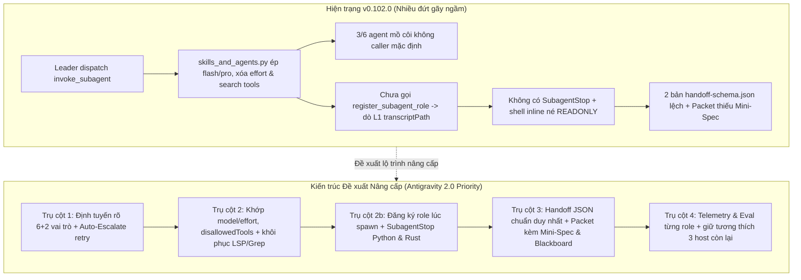

# SPEC — Báo cáo phân tích hạn chế & phương án nâng cấp hệ thống agent TDQ Workflow

Ngày: 2026-11-20 · Bản: 1.0 · Brief: ../brief/2026-11-20-1056-phan-tich-nang-cap-agent.md · Lane: full
Soul: chất lượng > runtime > context cost · luật gốc: skills/tdq-conventions/references/soul.md
Trạng thái: CHỜ DUYỆT

## Mục lục

- 1. Mục tiêu & phạm vi
- 1b. Lộ trình
- 2. Đầu ra cụ thể
- 2b. Ranh giới module
- 2c. Luồng hoạt động & Sơ đồ kiến trúc
- 3. Cách tiếp cận & lý do
- 3b. Năng lực & công cụ
- 3c. Giải thuật & Xử lý cốt lõi
- 3d. Mental Model cho Fresher Dev
- 4. Yêu cầu bắt buộc
- 5. Ràng buộc & rủi ro
- 6. QC & Definition of Done
- 7. Câu hỏi còn mở

## 1. Mục tiêu & phạm vi

- Mục tiêu: Xây dựng báo cáo phân tích toàn diện `6` subagent trong TDQ Workflow kèm ít nhất `10` (thực tế `14`) điểm hạn chế có dẫn chứng mã nguồn. Dựa trên nghiên cứu các workflow và package mã nguồn mở lớn, đề xuất phương án nâng cấp `4` trụ cột ưu tiên chạy ổn định trên Google Antigravity 2.0, trình bày tự nhiên và dễ hiểu.
- Trong phạm vi: Kiểm chứng và trình bày đầy đủ `14` hạn chế trên `6` agent hiện có (`tdq-build-resolver`, `tdq-implementer`, `tdq-qc-tester`, `tdq-refactor-cleaner`, `tdq-reviewer`, `tdq-security-reviewer`) cùng hạ tầng gọi/hook/multi-host. Tổng hợp giải pháp từ tài liệu và mã nguồn nghiên cứu, thiết kế kiến trúc đích và lộ trình nâng cấp chia chặng cho Markdown report, Archify HTML report và biên bản QC mức `full`.
- NGOÀI phạm vi: Không sửa mã nguồn runtime, không sửa tệp `agents/tdq-*.md` hay `hooks/` trực tiếp, không cài đè plugin ngoài repo trong request `docs` này.

## 1b. Lộ trình

| Bước/phase | Chạy? | Vì sao |
|---|---|---|
| Analyze & Fan-out 4 Subagent | CÓ | Đã hoàn tất kiểm toán `6` agent + hooks + 4-host và research ngoài (`14` điểm hạn chế có dẫn chứng). |
| Spec & Archify Preview | CÓ | Chốt cấu trúc báo cáo `4` trụ cột, tiêu chí QC `full` và sơ đồ Trước/Sau trước khi viết báo cáo. |
| Plan | CÓ | Lập danh sách task cụ thể cho từng phần báo cáo, Archify HTML và vòng đối chiếu chứng cứ. |
| Implement (soạn báo cáo) | CÓ | Viết báo cáo đầy đủ bằng ngôn từ tự nhiên, dễ hiểu (`Markdown` + `Archify HTML`), kèm roadmap nâng cấp chia chặng. |
| QC mức full | CÓ | Kiểm chứng toàn bộ dẫn chứng `file:line`, URL nguồn, lint tài liệu, binding Archify HTML và Tailscale Serve (không cần `tdq-qc-tester` vì chọn mức `full`). |
| Report & Merge | CÓ | Xuất báo cáo nghiệm thu `4` phần + Archify HTML qua Tailscale Serve và hỏi duyệt commit/merge về `dev`. |

## 2. Đầu ra cụ thể

| # | Đầu ra | Đường dẫn/vị trí | Đo "xong" bằng |
|---|---|---|---|
| 1 | Báo cáo phân tích & đề xuất nâng cấp hệ thống agent TDQ (Markdown đầy đủ, dễ hiểu) | `docs/tdq/reports/2026-11-20-1056-phan-tich-nang-cap-agent.md` | Có đủ `>= 10` (`14`) điểm hạn chế kèm `file:line` kiểm chứng, `4` trụ cột nâng cấp Antigravity 2.0, bảng đối chiếu nguồn nghiên cứu, lộ trình chia chặng và khối nghiệm thu `4` phần đạt chuẩn lint. |
| 2 | Báo cáo trực quan Trước/Sau & Lộ trình nâng cấp (Archify HTML + Tailscale Serve) | `docs/tdq/reports/2026-11-20-1056-phan-tich-nang-cap-agent.html` | Render qua Archify thành công, manifest ở trạng thái `current` khớp SHA với báo cáo Markdown, và truy cập URL Tailscale trả về HTTP `200`. |
| 3 | Biên bản kiểm định QC mức `full` | `docs/tdq/qc/2026-11-20-1056-phan-tich-nang-cap-agent.md` | Toàn bộ các mục `Q1`–`Q5` đạt `PASS`, mọi `file:line` trích dẫn được xác nhận lại có thật trên đĩa và lint sạch `0` lỗi. |

## 2b. Ranh giới module

Xác định ranh giới từ khảo sát `3` chiều: yêu cầu thuộc nhóm `docs` chỉ đọc và kiểm chứng mã nguồn tại chỗ mà không thay đổi bất kỳ mô-đun thực thi nào trong `scripts/`, `hooks/`, `agents/` hay `tools/`. Ba vùng đầu ra hoàn toàn tách biệt:

| Module | Vùng file | Phụ thuộc module | Đầu ra §2 nào |
|---|---|---|---|
| `M1-report-md` | `docs/tdq/reports/2026-11-20-1056-phan-tich-nang-cap-agent.md` | Đọc `docs/tdq/brief/2026-11-20-1056-phan-tich-nang-cap-agent.md`, `docs/tdq/research/2026-11-20-1056-phan-tich-nang-cap-agent.md`, `agents/tdq-*.md` | `1` |
| `M2-archify-html` | `docs/tdq/artifacts/2026-11-20-1056-phan-tich-nang-cap-agent/bao-cao-nghiem-thu.archify.md`, `docs/tdq/reports/2026-11-20-1056-phan-tich-nang-cap-agent.html` | `M1-report-md` (bind SHA manifest sau khi Markdown xong) | `2` |
| `M3-qc-verify` | `docs/tdq/qc/2026-11-20-1056-phan-tich-nang-cap-agent.md` | `M1-report-md`, `M2-archify-html` | `3` |

## 2c. Luồng hoạt động & Sơ đồ kiến trúc

Sơ đồ mô tả kiến trúc hệ thống agent hiện trạng (Trước) so với kiến trúc nâng cấp `4` trụ cột đề xuất ưu tiên chạy ổn định trên Google Antigravity 2.0 (Sau):

Cơ chế hiện tại vs Sau update — bản xem trước tương tác được kết xuất tại `docs/tdq/spec/2026-11-20-1056-phan-tich-nang-cap-agent-preview.html` (Tailscale: https://unity-pc-rtx3060.tail99896.ts.net/vlog/tdq-workflow-agy/spec/2026-11-20-1056-phan-tich-nang-cap-agent-preview.html):

| Khía cạnh | Hiện trạng (Trước) | Thiết kế mới (Sau — Đề xuất trong Báo cáo) |
|---|---|---|
| Kích hoạt & Vai trò | `3/6` agent mồ côi; `tdq-qc-tester` chỉ chạy `ultra`; thiếu Explorer/Debugger. | Gắn điểm gọi mặc định theo ngưỡng/sự kiện; tinh gọn bộ vai trò và thêm Explorer/Debugger dùng chung. |
| Quyền Tool & Model trên Antigravity | `skills_and_agents.py` bỏ `effort`, đổi `flash`/`pro`, cấp `run_command` cho reviewer, thiếu tool tìm kiếm. | Đồng nhất nguồn–AGY, siết `disallowedTools`, khôi phục LSP/Grep tools, sửa hợp đồng commit worktree. |
| Hook & Bảo vệ thực thi | Không có `SubagentStop`; `register_subagent_role` bỏ trống; `command_parser.rs` sót `python -c`/`node -e`. | Bổ sung `SubagentStop` trên cả Rust và Python; ghi sổ role ngay lúc dispatch; bịt lỗ hổng shell inline. |
| Handoff, Packet & Eval | Hai `handoff-schema.json` khác tên trường; trả text tự do; Packet thiếu Mini-Spec; thiếu đo lường từng agent. | Thống nhất `1` JSON schema + parser; Packet đủ Mini-Spec & AST đa ngôn ngữ; thêm Blackboard và bảng KPI từng role. |

## 3. Cách tiếp cận & lý do

- Chọn: Biên soạn báo cáo theo cấu trúc song song "Chẩn đoán thực chứng → Đối chiếu chuẩn công nghiệp → Phương án kiến trúc Antigravity 2.0 → Lộ trình nâng cấp chia chặng", dùng ngôn từ tự nhiên, dễ hiểu (ví von kèm bảng so sánh và đồ thị trực quan, giải thích rõ "tại sao lỗi xảy ra" và "nâng cấp thế nào cho đáng").
- Vì: Người dùng chọn giữ nguyên yêu cầu là báo cáo phân tích + đề xuất (`1a` = `docs`), đi sâu trọn cả `4` trụ cột (`2abc`) và ưu tiên độ ổn định thực chiến trên **Google Antigravity 2.0** (`3`). Việc tách rõ chặng nâng cấp (`P0` vá lỗi lệch cấu hình/hợp đồng ngay → `P1` siết quyền & `SubagentStop` AGY → `P2` chuẩn hóa JSON Handoff, Packet & Blackboard → `P3` Telemetry & Eval) giúp kế hoạch triển khai kế tiếp cực kỳ an toàn.
- Đã loại phương án 1: Đưa ra đề xuất "đập đi xây lại thành `20+` agent phân mảnh" như các harness đa năng (`ECC` có `71` agent hay `BMAD` có `19+` vai trò) — vì Cognition và Anthropic đều cảnh báo phân mảnh quá mức làm rơi ngữ cảnh giữa các lần handoff và tăng chi phí bảo trì.
- Đã loại phương án 2: Ép mọi đề xuất theo chuẩn tối giản giống hệt nhau cho cả `4` host — vì làm mất các thế mạnh riêng giúp Antigravity 2.0 chạy ổn định (như Rust dispatcher `tdq-dispatch`, `skills_and_agents.py` biên dịch YAML tool bản địa, `subagent_dispatch_gate.py` và worktree isolation).

## 3b. Năng lực & công cụ

| Skill | Nguồn | Phán quyết | Dùng ở đâu / Lý do loại |
|---|---|---|---|
| tdq-intake | plugin:tdq-workflow | NỀN | Mở request, kiểm kê B0, khảo sát 3 chiều, research và phỏng vấn chốt phạm vi |
| tdq-spec | plugin:tdq-workflow | NỀN | Viết spec §1–§6 và Archify preview trước khi lập plan |
| tdq-plan | plugin:tdq-workflow | NỀN | Viết plan chi tiết theo phase, kiểm `--pair`, trình duyệt |
| tdq-build | plugin:tdq-workflow | NỀN | Thực thi plan, chạy QC theo mức chọn và xuất báo cáo Markdown + Archify HTML |
| tdq-conventions | plugin:tdq-workflow | NỀN | Quy định giao thức 1 lượt, state, approval, workinglog và khuôn khối chat |
| tdq-setup / tdq-status / tdq-lean | plugin:tdq-workflow | NỀN | Đảm bảo tìm kiếm 3 tầng (LSP → Grep → Graphify) và soát trạng thái workflow |
| Đã xét 36 skill khác (google-antigravity-sdk, cdesktop, gemini-api-*, tdq-browser-*, built-in) | user/plugin/built-in | KHÔNG | khác lĩnh vực |

## 3c. Giải thuật & Xử lý cốt lõi

Quy trình tổng hợp, đối chiếu chứng cứ và kết xuất báo cáo (`ReportContract`):

- **Từng bước giải thuật (Step-by-step Execution Logic)**:
  1. **Bước 1 (Nạp & đối chiếu chứng cứ nguồn):** Mở `docs/tdq/brief/2026-11-20-1056-phan-tich-nang-cap-agent.md` và `docs/tdq/research/2026-11-20-1056-phan-tich-nang-cap-agent.md`. Đọc đối chứng lại từng `file:line` và symbol trong `agents/tdq-*.md`, `tools/patches/skills_and_agents.py`, `scripts/tdq_team.py`, `hooks/scripts/*`, `hooks/rust/tdq-dispatch/src/*`, `skills/tdq-build/references/qc.md` để bảo đảm `100%` số liệu khớp đĩa.
  2. **Bước 2 (Ánh xạ "Hạn chế → Mẫu giải pháp → Đề xuất Antigravity 2.0"):** Gom `14` điểm hạn chế vào `4` trụ cột (`Vai trò & Prompt`, `Tool & Hook/Rust`, `Handoff/Packet/Blackboard`, `Telemetry & Eval`). Gắn mỗi điểm với mẫu thực chứng từ GitHub/internet (`Claude Code`, `obra/superpowers`, `BMAD-METHOD v6`, `OpenHands`, `SWE-agent`, `Aider`, `Roo Code`, `MAST arXiv:2503.13657`, Anthropic/Cognition, `ECC v2.2.3`) và cách chỉnh cụ thể để chạy ổn trên Antigravity 2.0 mà không phá 3 host còn lại.
  3. **Bước 3 (Soạn báo cáo tự nhiên, Render Archify & Kiểm QC):** Viết báo cáo Markdown dễ hiểu theo hợp đồng cấu trúc `ReportContract` dưới đây (kèm `4` phần chuẩn nghiệm thu + `tdq_timing.py show` + Thân PR). Dựng ứng viên `bao-cao-nghiem-thu.archify.md`, render ra `.html`, verify manifest `current`, kiểm Tailscale HTTP `200` và lập biên bản QC.
- **Hợp đồng cấu trúc báo cáo (`ReportContract`)**:
  - `Phan 1`: Bức tranh nhanh hệ thống `6` agent hiện tại (bảng vai trò, nơi gọi thật, model thực chạy trên Antigravity 2.0 vs bảng quy định gốc).
  - `Phan 2`: `14` điểm hạn chế xếp theo `4` trụ cột — mỗi mục trình bày theo 3 ý dễ hiểu: *Chuyện gì đang xảy ra (bằng chứng `file:line`) → Hậu quả thực tế khi chạy Antigravity → Mức độ nghiêm trọng*.
  - `Phan 3`: Bài học từ các workflow/package lớn trên GitHub và nghiên cứu khoa học (bảng đối chiếu công bằng giữa thực chứng tìm được từ Tavily/Web và kho nội bộ, ghi rõ giới hạn quota).
  - `Phan 4`: Phương án nâng cấp chi tiết trên `4` trụ cột cho Antigravity 2.0 (kiến trúc mục tiêu, ma trận tool & model mới, cơ chế `SubagentStop` Python+Rust, thống nhất `handoff-schema.json`, nâng cấp `tdq_team.py packet`, và cách giữ an toàn cho `Claude Code`/`Codex`/`OpenCode`).
  - `Phan 5`: Lộ trình triển khai `4` chặng (`P0` Vá nhanh không rủi ro → `P1` Siết bảo vệ & Hook AGY → `P2` Schema, Packet & Blackboard → `P3` Telemetry & Eval), kèm ngưỡng đo trước/sau dự kiến.
  - `Phan 6`: Phần tóm tắt nghiệm thu chuẩn TDQ (`Trước request`, `Sau request`, `Đã test gì`, `Kết quả test`, bảng thời gian, `Thân PR (soạn sẵn)`).
- **Độ phức tạp tính toán**:
  - Thời gian: $O(N + M)$ với `N = 14` hạn chế (~40 trích dẫn `file:line`) và `M = 12` nguồn nghiên cứu ngoài cần kiểm tra chéo.
  - Không gian: $O(N + M)$ chỉ lưu tài liệu Markdown và tệp HTML tĩnh đầu ra (`< 2 MB`).
- **Các ca góc hiểm (Edge Cases & Defensive Handling)**:
  - Trích dẫn `file:line` lệch dòng hoặc symbol viết nhầm tên: Mở trực tiếp dải dòng trên đĩa đối chiếu trước khi chốt báo cáo; bỏ mọi con số suy đoán.
  - Hạn mức công cụ tìm kiếm ngoài (`tavily-primary` đạt `2/6` query, 4 query còn lại lỗi keyless limit): Ghi rõ ranh giới dữ liệu thật từ `search_web` failover và đối chiếu nội bộ `ECC v2.2.3`; không bịa chi tiết từ các repo chưa trích xuất được (`CrewAI`, `LangGraph`, `OpenAI Codex`).
  - Hash Archify HTML bị stale nếu chỉnh Markdown sau lúc render: Khóa cứng quy trình chỉ render và verify `tdq_archify.py` sau lần sửa cuối cùng của báo cáo Markdown.

## 3d. Mental Model cho Fresher Dev

- **Ẩn dụ trực quan:** Hãy tưởng tượng đội agent TDQ giống một xưởng phần mềm có `6` kỹ sư chuyên môn rõ ràng. Thế nhưng bảng phân công ngoài cổng chỉ gọi đúng `1` kỹ sư lập trình (`implementer`) đi làm chính, còn `3` kỹ sư chuyên sửa lỗi nhanh, dọn mã thừa và kiểm tra bảo mật gần như ngồi chờ ở sảnh không có việc. Khi `3` giám sát viên chỉ đọc bước vào xưởng, nội quy chỉ dặn bằng miệng chứ không khóa quyền mở két đồ nghề, còn biên bản nghiệm thu lúc giao ca lại dùng `2` mẫu giấy khác hẳn nhau. Nâng cấp lần này giống như **lắp lại dây chuyền phân công, thẻ khóa tool theo đúng vai, mẫu biên bản điện tử thống nhất và camera nghiệm thu lúc giao ca (`SubagentStop`)** để cả đội chạy trơn tru trên Antigravity.
- **Thuật ngữ dự án:**
  - `Orphan Agent`: Agent đã khai báo file định nghĩa nhưng không có lệnh hoặc quy trình nào trong `skills/` kích hoạt tự động.
  - `Least-Privilege Tools (disallowedTools)`: Nguyên tắc chỉ cấp đúng công cụ tối thiểu một agent cần; agent chỉ đọc bị chặn công cụ sửa file và shell ghi ở tầng cấu hình thay vì chỉ nhắc bằng chữ.
  - `SubagentStop`: Hook sự kiện chạy đúng thời điểm subagent kết thúc lượt để kiểm tra chứng cứ, schema handoff và trạng thái commit trước khi trả kết quả về cha.
  - `Model Drift`: Hiện tượng bản đóng gói (`plugins/tdq-workflow-agy/`) tự gán `model: flash` hoặc `pro` làm lệch bảng quy chuẩn `subagent-tuning.md`.
  - `MAST Taxonomy`: Hệ thống phân loại `14` dạng lỗi multi-agent (Spec, Phối hợp, Kiểm chứng) từ nghiên cứu `1.642` execution trace trên `arXiv:2503.13657`.

## 4. Yêu cầu bắt buộc

- Log service: BỎ — request loại `docs` không tạo hoặc sửa mã nguồn chạy được.
- Không để placeholder, TODO stub hay số liệu phỏng đoán; ghi rõ các phần chưa kiểm được vì quota công cụ tìm kiếm.
- Mọi trích dẫn `file:line` và symbol nêu trong báo cáo đều phải được kiểm chứng trực tiếp trên mã nguồn hiện tại của nhánh `docs/phan-tich-nang-cap-agent`.
- Ngôn từ tự nhiên, dễ hiểu cho người đọc Việt Nam, trình bày đúng bảng `6` ký hiệu cho phép.

## 5. Ràng buộc & rủi ro

Ràng buộc kiến trúc phải giữ từ `docs/kien-truc.md`:
- "`skills/` chỉ được **nhắc tên lệnh** của `scripts/`, cấm chép nội dung script vào skill" — giữ nguyên ranh giới khi viết đề xuất nâng cấp, không chỉnh sửa trực tiếp mã nguồn hay skill trong request `docs` này.
- "Chỉ `scripts/tdq_state.py` được ghi `docs/tdq/state.json`; mọi nơi khác chỉ đọc qua CLI." — không chạm tay vào state.
- "tài liệu sinh cho user và lời thoại viết theo `doc_lang` khai một lần lúc `init`, mặc định `vi`" — báo cáo Markdown viết tiếng Việt tự nhiên; phần mã/thuật ngữ kỹ thuật giữ nguyên tên gốc.
- Không cần cài đặt thêm mô hình AI, công cụ hay thư viện ngoài nào cho request `docs` này (dùng sẵn Python, `doc_lint.py`, `tdq_archify.py` và Tailscale Serve đang chạy).

| Rủi ro | Ảnh hưởng | Cách giảm |
|---|---|---|
| Vi phạm quy tắc độ dài câu R5 (`> 40` từ) khi viết báo cáo phân tích dài | Lỗi `doc_lint.py` chặn bước kết thúc | Tách các phân tích dài thành gạch đầu dòng ngắn gọn `<= 35` từ per câu và kiểm `doc_lint.py` ngay sau khi viết. |
| Manifest Archify báo stale nếu sửa báo cáo Markdown sau lúc render | Cổng `set phase=idle` từ chối đóng request | Chốt hoàn toàn nội dung báo cáo Markdown trước khi chạy `tdq_archify.py render` và `verify`. |
| Hiểu nhầm tài liệu đề xuất là code đã chạy thật | Người đọc nhầm tưởng `14` hạn chế đã được vá sẵn vào `agents/` | Nêu rõ ngay đầu báo cáo và cột Hiện trạng/Đề xuất rằng request `docs` này chỉ chẩn đoán và thiết kế phương án nâng cấp. |
| Thiếu dữ liệu ngoài từ 4 truy vấn Tavily chạm limit keyless | Phần so sánh một số framework như `CrewAI`/`LangGraph` bị mỏng | Ghi nhận minh bạch phạm vi đã lấy được từ `search_web` và `ECC v2.2.3` nội bộ, không tự suy diễn thông tin chưa đọc. |

## 6. QC & Definition of Done

| # | Hạng mục kiểm | Điều kiện PASS | Đo trước | Dự phòng nếu trượt |
|---|---|---|---|---|
| Q1 | Độ phủ điểm hạn chế và chứng cứ nguồn (`>= 10` điểm, `4` trụ cột) | Báo cáo có ít nhất `10` điểm hạn chế tách bạch (mục tiêu `14`), bao phủ trọn `4` trụ cột, mọi trích dẫn `file:line` và symbol khớp chính xác mã nguồn đang có trên đĩa và ưu tiên Antigravity 2.0 | Đã xác nhận sơ bộ `14` điểm hạn chế có dẫn chứng trên `6` agent tại file brief (`14 >= 10`) | Bổ sung hoặc hiệu đính lại các trích dẫn lệch dòng ngay trong báo cáo trước khi chốt QC; nếu thiếu chứng cứ phải bỏ mục đó và báo rõ ở Giới hạn |
| Q2 | Độ sâu nghiên cứu nguồn ngoài & tính dễ hiểu tự nhiên | Đủ đối chiếu từ các nguồn đã đọc (`Claude Code`, `obra/superpowers`, `BMAD-METHOD v6`, `OpenHands/SWE-agent/Aider/Roo Code`, `MAST`, `Anthropic/Cognition`, `ECC`), ghi rõ giới hạn quota `tavily-primary` và có ví dụ/ẩn dụ dễ hiểu | Đã thu thập `2/6` truy vấn `tavily-primary`, `1` failover `search_web` (`8` URL) và kho nội bộ `ECC v2.2.3` (`10` trục đối chiếu) | Ghi rõ phần chưa thu thập được (`LangGraph`/`CrewAI`/`Codex`) vào mục Giới hạn và loại bỏ mọi suy diễn |
| Q3 | Chất lượng trình bày & kiểm chuẩn tài liệu (`0` vi phạm lint) | Toàn bộ spec, brief, research, báo cáo và biên bản QC đạt `0` vi phạm quy tắc tài liệu (kể cả độ dài câu `<= 40` từ) và giữ sạch cấu trúc `4` phần + bảng thời gian + Thân PR | `brief` và `research` hiện đạt `0` vi phạm trên `2` tệp (`doc_lint` exit `0`) | Chia nhỏ các câu dài vượt ngưỡng `40` từ hoặc sửa ký tự bị cấm đến khi đạt `0` vi phạm |
| Q4 | Trực quan hóa Archify HTML & Tailscale Serve (HTTP `200`) | Tệp Archify HTML báo cáo kết xuất thành công, manifest khớp SHA ở trạng thái `current`, `valid=true` và URL Tailscale Serve trả về mã trạng thái HTTP `200` | Hạ tầng `VTranslateDataLog/tdq-workflow-agy` đã thông qua Tailscale (`HTTPS` trả HTTP `200` trên bản spec preview) | Nếu engine Archify gặp lỗi render thì cung cấp bản Mermaid đầy đủ làm fallback công khai và xin phép `--bo-qua-archify` khi cần |
| Q5 | Bảo toàn phạm vi `docs` & an toàn hệ thống (`0` tệp code bị sửa) | Không sửa bất kỳ tệp runtime nào trong `agents/`, `scripts/`, `hooks/`, `tools/` hay plugin ngoài repo `~/.gemini`; trạng thái biên bản QC ghi đủ kiểm chứng `full` | Hiện `0` tệp nguồn runtime bị sửa trên nhánh `docs/phan-tich-nang-cap-agent` (chỉ chạm `docs/**`) | Khôi phục ngay nếu lỡ sửa nhầm tệp code qua `git checkout -- <path>` trước khi qua pha report |

DoD: Báo cáo Markdown, Archify HTML qua Tailscale và biên bản QC mức `full` đều hoàn chỉnh, mọi trích dẫn `file:line` và nguồn ngoài được kiểm chứng lại trên đĩa, `0` vi phạm lint tài liệu, `0` tệp runtime bị thay đổi, sẵn sàng trình duyệt commit/merge về `dev`.

## 7. Câu hỏi còn mở

Không có.
<!-- tdq-archify-binding:start -->
<!-- manifest: 2026-11-20-1056-phan-tich-nang-cap-agent-preview.manifest.json -->
<!-- manifest_digest: 46712fd553028b4f8acdad7fee86bf486a96df2f0ec4bf6d84f1fde17fe90195 -->
<!-- tdq-archify-binding:end -->