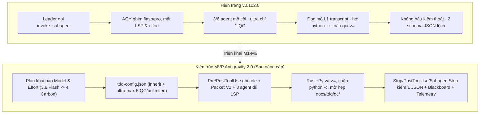

# SPEC — Triển khai 4 trụ cột nâng cấp hệ thống Agent TDQ Workflow (Antigravity-first MVP)

Ngày: 2026-11-20 · Bản: 1.1 · Brief: ../brief/2026-11-20-1230-trien-khai-4-de-xuat-agent.md · Lane: full
Soul: chất lượng > runtime > context cost · luật gốc: skills/tdq-conventions/references/soul.md
Trạng thái: CHỜ DUYỆT

## Mục lục

- 1. Mục tiêu & phạm vi
- 1b. Lộ trình
- 2. Đầu ra cụ thể
- 2b. Ranh giới module
- 2c. Luồng hoạt động & Sơ đồ kiến trúc
- 3. Cách tiếp cận & lý do
- 3b. Năng lực & công cụ
- 3c. Giải thuật & Xử lý cốt lõi
- 3d. Mental Model cho Fresher Dev
- 4. Yêu cầu bắt buộc
- 5. Ràng buộc & rủi ro
- 6. QC & Definition of Done
- 7. Câu hỏi còn mở

## 1. Mục tiêu & phạm vi

- Mục tiêu: Triển khai trọn bộ `4` trụ cột nâng cấp (`P0`–`P3`) cho hệ thống agent TDQ Workflow theo định hướng **MVP ưu tiên ổn định trên Google Antigravity 2.0**, khắc phục toàn bộ `14` hạn chế đã chẩn đoán ở báo cáo `2026-11-20-1056-phan-tich-nang-cap-agent`.
- Trong phạm vi:
  - **Cấu hình & Phân bổ Model/Effort:** Tạo tệp cấu hình plugin `tdq-config.json` + `scripts/tdq_config.py`; bỏ ghim cứng `flash`/`pro` ở `AGENT_FRONTMATTERS` (đưa về `model: inherit`); bổ sung thang phân bổ `4` bậc Gemini mới (`3.8 Flash → 4 Hydrogen → 4 Neon → 4 Carbon` kèm hậu tố effort `-low`/`-medium`/`-high`/`-xhigh` trên `swarm`); bắt buộc mục `## Phân bổ Model & Effort` trong Plan cho `implement`, `qc`, `report` và cho phép người dùng đổi `type model`/`effort` ngay tại cổng trình duyệt Plan.
  - **Đội hình `6 + 2` Agent & QC `ultra` song song:** Nối caller cho `3` agent mồ côi (`tdq-build-resolver`, `tdq-refactor-cleaner`, `tdq-security-reviewer`), tạo `tdq-explorer` và `tdq-debugger`, sửa hợp đồng commit worktree của `tdq-implementer`, mở quyền ghi hẹp `docs/tdq/qc/<slug>.md` cho `tdq-qc-tester`, mở QC nhẹ ở `full`, và nâng mức `ultra` từ `1` lên tối đa `5` subagent QC song song mặc định (cấu hình trong plugin, hỗ trợ `0`/`unlimited`).
  - **Hạ tầng Hook Python + Rust & Plugin AGY:** Vá `command_parser.rs` và `bash_gate.py` (chặn `python -c`/`node -e`/`git -C`, xóa báo giả `>=`), gọi `register_subagent_role` lúc dispatch, bổ sung `hooks/scripts/subagent_stop.py` nối vào `SubagentStop` (Claude Code) và `PostToolUse`/`Stop` (Antigravity 2.0), build mới `tdq-dispatch.exe` và biên dịch lại `plugins/tdq-workflow-agy/`.
  - **Handoff JSON duy nhất, Packet V2+, Blackboard & Telemetry:** Hợp nhất `1` `handoff-schema.json` + parser, nâng `scripts/tdq_team.py packet` (Mini-Spec + đa ngôn ngữ), thêm `.tdq-runtime/blackboard/<slug>.json` + auto-escalation, và ghi telemetry theo từng `agent_role` trong `tdq_timing.py`/`token_audit.py`.
- NGOÀI phạm vi: Không viết lại adapter runtime mới cho Codex hay OpenCode ở MVP này (chỉ giữ tương thích xanh không phá test hiện có); không tự sửa plugin ngoài repo tại `~/.gemini/config/plugins/tdq-workflow-agy`; không tạo nhị phân giả cho Linux/macOS trên máy Windows.

## 1b. Lộ trình

| Bước/phase | Chạy? | Vì sao |
|---|---|---|
| Analyze & Kiểm chứng nền | CÓ | Đã kiểm kê `skill_inventory`, khảo sát 3 chiều LSP/Graphify/Grep, xác nhận `6` hook AGY thật và bộ model `swarm` Gemini 3.8/4. |
| Spec & Archify Preview | CÓ | Chốt hợp đồng `6` module cốt lõi (`M1`–`M6`), thang model Gemini 4, `tdq-config.json`, `SubagentStop`/AGY hooks, Plan Model/Effort và `Q1`–`Q6`. |
| Plan (có bảng Model & Effort) | CÓ | Lập Plan V2+ chia wave song song/tuần tự cho `M1`–`M6`, khai báo rõ `Model & Effort` cho `implement`, `qc` và `report`. |
| Implement | CÓ | Triển khai lần lượt theo TDD Red→Green trên Python, Rust (`cargo test` + `cargo build --release`), Markdown agents/skills và rebuild `plugins/tdq-workflow-agy/`. |
| QC mức ultra (QC song song) | CÓ | Chạy trọn bộ `tdq_test.py tron-bo`, `cargo test`, smoke/runtime hooks, và fan-out nhiều `tdq-qc-tester` độc lập kiểm chứng từng mảng (`Q1`–`Q6`). |
| Report & Merge | CÓ | Xuất báo cáo nghiệm thu `4` phần + `Archify HTML` qua Tailscale Serve (kèm lệnh đồng bộ plugin nếu user cần) rồi hỏi duyệt commit/merge về `dev`. |

## 2. Đầu ra cụ thể

| # | Đầu ra | Đường dẫn/vị trí | Đo "xong" bằng |
|---|---|---|---|
| 1 | Cấu hình plugin `tdq-config.json`, bộ đọc `tdq_config.py` và đội hình `8` agent + skill điều phối | `tdq-config.json`, `scripts/tdq_config.py`, `agents/tdq-*.md` (`8` tệp), `skills/tdq-{build,conventions,lean,plan}/` | Đọc được `ultra_max_subagents=5` và `unlimited`; cả `8` agent có đường gọi rõ; Plan có khối `## Phân bổ Model & Effort` theo thang Gemini 3.8/4. |
| 2 | Chuẩn `1` `handoff-schema.json`, Packet V2+ đa ngôn ngữ, parser & Shared Blackboard | `skills/tdq-conventions/references/handoff-schema.json`, `scripts/tdq_team.py` | Root và AGY chia sẻ cùng `1` JSON schema; `packet` xuất đủ Mini-Spec + AST/regex đa ngôn ngữ; `validate-handoff` và `blackboard` hoạt động có test thật. |
| 3 | Hook Python `subagent_stop.py`, phân quyền QC hẹp, vá shell bypass & Telemetry theo role | `hooks/hooks.json`, `hooks/scripts/{_common,edit_gate,bash_gate,subagent_stop}.py`, `scripts/tdq_timing.py`, `scripts/token_audit.py` | `tdq-qc-tester` ghi được `docs/tdq/qc/*.md` nhưng bị chặn ở code; `python -c`/`node -e` bị chặn; `>=` không báo giả; telemetry ghi đúng theo `agent_role`. |
| 4 | Nhị phân Rust `tdq-dispatch` cập nhật cho Windows và đồng bộ logic nguồn Rust | `hooks/rust/tdq-dispatch/src/{main.rs,command_parser.rs,events/pre_tool_use.rs,events/post_tool_use.rs,events/stop_streak.rs}` | `cargo test` xanh `100%`; `cargo build --release` xuất `tdq-dispatch.exe` xử lý đúng `>=`, shell bypass, scoped QC write, `PostToolUse` role và `SubagentStop`. |
| 5 | Bản biên dịch plugin Antigravity đồng bộ sạch trong repo | `tools/patches/{skills_and_agents,agy_manifests,agy_hooks}.py`, `plugins/tdq-workflow-agy/` | `build_agy_plugin.py --upstream .` trả `status=OK`, `0` lỗi AST, `0` lỗi ngân sách `24KB`, cả `8` agent dùng `model: inherit` + đủ tool LSP/Grep. |
| 6 | Bộ unit test mở rộng + kiểm định parity đa host và biên bản QC `ultra` song song | Bộ kiểm thử tự động trong `tests/`, `docs/tdq/qc/<slug>.md`, `docs/tdq/reports/<slug>.{md,html}` | Toàn bộ `tdq_test.py tron-bo`, `cargo test`, smoke/runtime hooks và các subagent `tdq-qc-tester` song song đều `PASS`. |

## 2b. Ranh giới module

Xác định ranh giới từ khảo sát `3` chiều (LSP + Graphify + Grep) để tránh sửa chéo và cho phép tách wave rõ ràng:

| Module | Vùng file | Phụ thuộc module | Đầu ra §2 nào |
|---|---|---|---|
| `M1-config-agents-skills` | `tdq-config.json`, `scripts/tdq_config.py`, `agents/tdq-*.md`, `skills/tdq-{build,conventions,lean,plan}/`, `scripts/doc_lint.py` | Độc lập (cung cấp `TdqConfigContract` và định nghĩa `8` agent) | `1` |
| `M2-handoff-packet-blackboard` | `skills/tdq-conventions/references/handoff-schema.json`, `scripts/tdq_team.py` | Đọc `TdqConfigContract` từ `M1` | `2` |
| `M3-python-hooks-telemetry` | `hooks/hooks.json`, `hooks/scripts/{_common,edit_gate,bash_gate,subagent_stop}.py`, `scripts/tdq_timing.py`, `scripts/token_audit.py` | Đọc `HandoffContract` + `BlackboardContract` từ `M2` và `TdqConfigContract` từ `M1` | `3` |
| `M4-rust-dispatcher` | `hooks/rust/tdq-dispatch/src/{main.rs,command_parser.rs,events/pre_tool_use.rs,events/post_tool_use.rs,events/stop_streak.rs}` | Khớp hợp đồng role/allowlist/schema của `M1`–`M3` | `4` |
| `M5-agy-plugin-compiler` | `tools/patches/{skills_and_agents,agy_manifests,agy_hooks}.py`, `plugins/tdq-workflow-agy/` | Tổng hợp kết quả sau khi `M1`–`M4` hoàn tất (`cargo build --release` + `build_agy_plugin.py`) | `5` |
| `M6-tests-and-verification` | Bộ test parity agent, shell bypass, packet, config và telemetry trong `tests/` | Kiểm chứng toàn bộ `M1`–`M5` + không phá ràng buộc hook Codex | `6` |

## 2c. Luồng hoạt động & Sơ đồ kiến trúc

Sơ đồ mô tả luồng điều phối subagent trên Google Antigravity 2.0 trước và sau khi triển khai MVP `4` trụ cột:

Cơ chế hiện tại vs Sau update — bản xem trước tương tác được kết xuất tại `docs/tdq/spec/2026-11-20-1230-trien-khai-4-de-xuat-agent-preview.html` (Tailscale: https://unity-pc-rtx3060.tail99896.ts.net/vlog/tdq-workflow-agy/spec/2026-11-20-1230-trien-khai-4-de-xuat-agent-preview.html):

| Khía cạnh | Hiện trạng (Trước) | Thiết kế mới (Sau — Triển khai trong Request này) |
|---|---|---|
| Model, Effort & Plan | AGY ép `flash`/`pro`, mất `effort`; Plan không khai báo model/effort cho từng pha. | Mặc định `inherit`; thang `3.8 Flash → 4 Hydrogen → 4 Neon → 4 Carbon` (kèm hậu tố effort ở `swarm`); Plan bắt buộc có bảng `Model & Effort` cho `implement`/`qc`/`report`. |
| Vai trò & `ultra` QC | `3/6` agent mồ côi; `full` bỏ trống QC độc lập; `ultra` giới hạn `1` `tdq-qc-tester`. | Đủ `6+2` agent có caller rõ; `full` có kiểm đối chứng gọn; `ultra` chạy tối đa `5` QC song song mặc định (cấu hình trong `tdq-config.json`, hỗ trợ `unlimited`). |
| Hook AGY & Rust | Không xử lý thoát subagent; `command_parser.rs` báo giả `>=` và lọt `python -c`; chặn nhầm `tdq-qc-tester` ghi `docs/tdq/qc/`. | Bắt `PostToolUse` + `Stop` trên AGY và `SubagentStop` trên Claude Code; vá `command_parser.rs` + `bash_gate.py`; mở quyền ghi hẹp `docs/tdq/qc/*.md` cho QC. |
| Schema, Packet & Telemetry | Hai `handoff-schema.json` mâu thuẫn; `packet` thiếu Mini-Spec và chỉ đọc `.py`; thiếu đo theo role. | Hợp nhất `1` JSON schema + validator; `packet` kèm Mini-Spec & đa ngôn ngữ; thêm Blackboard, auto-escalation và tổng hợp telemetry theo `agent_role`. |

## 3. Cách tiếp cận & lý do

- Chọn: Xây dựng **MVP đồng bộ lõi cho Google Antigravity 2.0 trước**, dùng một nguồn chân lý duy nhất (`tdq-config.json`, `handoff-schema.json`, `subagent_stop.py`, `agents/tdq-*.md`) rồi biên dịch ra `plugins/tdq-workflow-agy/` qua `tools/build_agy_plugin.py --upstream .` và `cargo build --release`.
- Vì:
  - Kiểm chứng thực tế `agy-customizations/docs/hooks.md` cho thấy Antigravity 2.0 chỉ chạy đúng `6` sự kiện lifecycle (`SessionStart`, `PreToolUse`, `PostToolUse`, `PreInvocation`, `PostInvocation`, `Stop`), không có sự kiện tên `SubagentStop`. Dùng `PostToolUse` (`invoke_subagent|swarm`) + `Stop` (khi phiên có `role_opt`) cho AGY và `SubagentStop` cho Claude Code giúp cả hai nền tảng chạy ổn định tuyệt đối mà dùng chung một bộ kiểm tra.
  - Kiểm chứng `swarm(action="models", all=True)` xác nhận Antigravity 2.0 gộp `effort` ngay trong định danh model của `swarm` (`-low`, `-medium`, `-high`, `-xhigh`), còn `invoke_subagent` dùng `inherit | flash_lite | flash | pro`. Trả frontmatter về `inherit` giúp agent không bị tụt chất lượng ngoài ý muốn mà vẫn cho phép leader chọn đúng bậc trong thang Gemini 3.8/4.
  - Tách cấu hình plugin ra `tdq-config.json` thay vì nhét vào `plugin.json` giúp tránh bẫy schema của Antigravity (`agy_manifests.py:47`) và cho phép người dùng chỉnh `ultra_max_subagents` (mặc định `5`, `0`/`unlimited` để không giới hạn) cực kỳ dễ dàng.
- Đã loại phương án 1: Nhét trường `userConfig` vào `plugin.json` — bị loại vì `agy_manifests.py` đã ghi nhận Antigravity từ chối hoặc báo lỗi với trường cấu hình lạ trong `plugin.json`.
- Đã loại phương án 2: Sửa cả `.codex/hooks.json` hoặc viết lại toàn bộ JS plugin của OpenCode ngay trong MVP — bị loại vì bộ kiểm thử gốc khóa cứng `.codex/hooks.json` chỉ có `PreToolUse`, và user đã chọn MVP Antigravity trước.

## 3b. Năng lực & công cụ

| Skill | Nguồn | Phán quyết | Dùng ở đâu / Lý do loại |
|---|---|---|---|
| tdq-intake / tdq-spec / tdq-plan / tdq-build / tdq-conventions | plugin:tdq-workflow | NỀN | Vận hành trọn chuỗi pipeline deep, cổng duyệt, QC `ultra` và workinglog |
| tdq-setup / tdq-status / tdq-lean | plugin:tdq-workflow | NỀN | Kiểm định tầng tìm kiếm LSP/Graphify và soát mã thừa trong pha implement |
| agy-customizations / antigravity-guide | built-in | DÙNG | Đối chiếu và xác nhận `plugins/tdq-workflow-agy/hooks.json` chỉ đăng ký đúng `6` sự kiện lifecycle hợp lệ của Antigravity 2.0 |
| Đã xét 37 skill khác (google-antigravity-sdk, cdesktop, gemini-api-*, tdq-browser-*, built-in) | user/plugin/built-in | KHÔNG | khác lĩnh vực |

## 3c. Giải thuật & Xử lý cốt lõi

Thiết kế `5` hợp đồng dữ liệu cốt lõi chia sẻ giữa `M1`–`M6`:

- **1. `TdqConfigContract` (`tdq-config.json` + `scripts/tdq_config.py`):**
  - Thứ tự ưu tiên đọc cấu hình: Biến môi trường (`TDQ_MAX_QC_SUBAGENTS`) → tệp dự án (`docs/tdq/config.json`) → tệp mặc định plugin (`<plugin_root>/tdq-config.json`) → hằng mặc định trong mã.
  - Trường chính: `qc.ultra_max_subagents` (`int | "unlimited"`, mặc định `5`; giá trị `0` hoặc `"unlimited"` biểu diễn không giới hạn), `qc.full_light_qc` (`true`), `agents.default_model` (`"inherit"`), `agents.auto_escalate_retries` (`2`), `agents.model_ladder` (danh sách `4` bậc `gemini-3.8-flash` → `gemini-4-hydrogen` → `gemini-4-neon` → `gemini-4-carbon` kèm ánh xạ `invoke_subagent` và hậu tố effort `swarm`).
- **2. `HandoffContract` (`skills/tdq-conventions/references/handoff-schema.json` + `scripts/tdq_team.py`):**
  - Hợp nhất thành **một lược đồ JSON duy nhất** (`draft-07` / `2020-12` tương thích), gồm trường bắt buộc: `task_id`, `role`, `status` (`done|completed|blocked|failed`), `files`, `test_command`, `test_verdict` (`pass|fail|skipped`), `digest` (`<= 1500` ký tự); trường tùy chọn theo vai trò: `branch`, `commit_sha`, `merge_ready`, `tick_ready`, `blocker`, `findings`.
  - Hàm `parse_handoff_from_text(text)` tách khối JSON nhúng (hoặc cặp key-value chuẩn 7 dòng tương thích ngược) và `validate_handoff_payload(payload)` trả về `(ok: bool, errors: list[str])`.
- **3. `PacketV2Contract` & `BlackboardContract` (`scripts/tdq_team.py`):**
  - `_build_packet_payload()` trích xuất bổ sung các mục Mini-Spec của task (`Req:`, `Ngoài phạm vi:`, `GIỮ NGUYÊN:`, `Tiêu chí chấp nhận (EARS):`, `Logic cốt lõi:`), chèn `RANH GIỚI:` và `TỰ KIỂM:` từ chuẩn `team-mode.md`, và chèn tóm tắt `failed_attempts` từ Blackboard nếu task đang chạy lại.
  - `_render_target_spans()` giữ nguyên AST cho `.py` và bổ sung bộ nhận diện cấu trúc hàm/struct/class bằng regex an toàn cho `.ts`, `.tsx`, `.js`, `.rs`, `.ps1`.
  - Blackboard lưu tại `.tdq-runtime/blackboard/<slug>.json` (bị `.gitignore` bỏ qua, không làm bẩn repo), lưu danh sách sự kiện append-only theo `(task_id, role, attempt, status, files, digest, ts)` và hàm `suggest_escalation(events, task_id)` gợi ý chuyển sang `tdq-build-resolver` hoặc nâng bậc model khi số lần thất bại đạt ngưỡng `auto_escalate_retries` (`2`).
- **4. `SecurityAndLifecycleContract` (Python `hooks/scripts/` + Rust `hooks/rust/tdq-dispatch/`):**
  - **Vá nhận diện ghi shell (`command_parser.rs` & `bash_gate.py`):** Tách bước nhận diện `>` chuyển hướng đầu ra bằng cách bỏ qua cặp so sánh `>=`, `<=`, `=>`, `->` và chữ bên trong dấu nháy không phải redirection; bổ sung mẫu nhận diện ghi gián tiếp qua `python3? -c` (`write_text`, `open(..., 'w'|'a'|'x')`, `shutil.`), `node -e` (`writeFile`, `appendFile`, `rmSync`, `unlinkSync`), `git -C <dir> (commit|checkout|reset|clean|rm|mv)`.
  - **Quyền ghi hẹp cho QC (`edit_gate.py` & `pre_tool_use.rs`):** Vai trò chứa `qc-tester` chỉ được `edit_file`/`write_file` khi đường dẫn chuẩn hóa nằm trong `docs/tdq/qc/` và có đuôi `.md` (chặn tuyệt đối `..` traversal và mọi file khác); `reviewer`, `security-reviewer`, `explorer`, `debugger` vẫn bị chặn ghi `100%`.
  - **Hậu kiểm thoát subagent & Đăng ký role:**
    - `PreToolUse` / `PostToolUse` (`invoke_subagent|swarm|Task|Agent`) gọi `register_subagent_role(cwd, conv_id_or_sid, role, task, model)` ghi vào `.tdq-runtime/sessions.json`.
    - `hooks/scripts/subagent_stop.py` kiểm tra worktree commit sạch (cho `implementer`/`build-resolver`/`refactor-cleaner`), kiểm `validate_handoff_payload` nếu có output, ghi bản ghi telemetry vào `docs/tdq/.tdq-agent-telemetry.jsonl` (hoặc `.tdq-runtime/agent-telemetry.jsonl`) và cập nhật Blackboard. Trên Antigravity, luồng này kích hoạt qua `Stop` (khi phiên có `role_opt`) và `PostToolUse` (`invoke_subagent|swarm`); trên Claude Code kích hoạt qua sự kiện `SubagentStop`.
- **5. `PlanModelEffortContract` (`skills/tdq-plan/` + `scripts/doc_lint.py`):**
  - Mọi Plan mới bổ sung mục `## Phân bổ Model & Effort` gồm bảng khai báo `Pha (implement / qc / report) | Vai trò | Model đề xuất | Effort | Ghi chú` theo thang Gemini 3.8/4 (và ánh xạ Claude tương ứng).
  - Tại cổng trình duyệt Plan, hệ thống hiển thị ngắn gọn bảng `Model & Effort` đề xuất và cho phép người dùng đổi `type model` hoặc `effort` cho bất kỳ pha/vai trò nào (ngay trong tin nhắn góp ý hoặc kèm lệnh duyệt); mọi điều chỉnh của người dùng được cập nhật vào Plan trước khi chạy `implement`.
- **Độ phức tạp tính toán:**
  - Hook hot-path Rust (`command_parser.rs`, `pre_tool_use.rs`, `post_tool_use.rs`): $O(L)$ theo độ dài chuỗi lệnh/path (`< 5 ms`).
  - Packet V2 & Blackboard (`tdq_team.py`): $O(F + E)$ theo số tệp trong `Chạm:` (`F <= 6`) và số sự kiện Blackboard (`E`), không tạo vòng lặp toàn kho.
- **Các ca góc hiểm (Edge Cases & Defensive Handling):**
  - Lệnh shell chứa `>=`, `<=`, `=>` hoặc `2>&1` trong chuỗi Python/PowerShell: Không bị báo giả `READONLY`/`APPROVE`.
  - `tdq-qc-tester` cố ghi `docs/tdq/qc/../../scripts/a.py` (path traversal): Chuẩn hóa `realpath`/`canonicalize` trước khi so tiền tố `docs/tdq/qc/`, chặn tuyệt đối.
  - `tdq-config.json` hỏng JSON hoặc `TDQ_MAX_QC_SUBAGENTS` nhập giá trị âm/chuỗi rác: Fail-safe về mặc định `5` và ghi cảnh báo timestamp ra stderr (không crash hook).
  - Bảng telemetry rỗng khi chưa chạy subagent nào: `tdq_timing.py` in rõ chưa có dữ liệu, tuyệt đối không bịa số `0%` giả tạo.
  - Byte budget Antigravity (`24,000` bytes cho `rules/*.md` và `skills/*/SKILL.md`, `3,500` tokens cho `qc.md`): Giữ chỉnh sửa `skills/` gọn gàng, kiểm chứng ngay bằng `build_agy_plugin.py`.

## 3d. Mental Model cho Fresher Dev

- **Ẩn dụ trực quan:** Nếu bản báo cáo trước là bản vẽ khám bệnh cho xưởng `6` kỹ sư, thì request này là đợt **lắp đặt thật toàn bộ dây chuyền mới**: mở thêm `2` vị trí trinh sát (`tdq-explorer`) và bác sĩ bắt bệnh (`tdq-debugger`), phát thẻ từ đúng chức năng (chỉ riêng `tdq-qc-tester` có chìa khóa tủ hồ sơ `docs/tdq/qc/` nhưng không mở được kho code), đổi bảng phân công để mỗi lệnh giao việc (`Packet`) kẹp đủ bản vẽ chi tiết (`Mini-Spec`), lắp cảm biến giao ca (`PostToolUse`/`Stop`/`SubagentStop`) nối với bảng theo dõi chung (`Blackboard`), và cho phép tăng cường tối đa `5` kiểm định viên QC chạy song song (hoặc không giới hạn khi bạn bật).
- **Thuật ngữ dự án:**
  - `tdq-config.json`: Tệp cấu hình tập trung nằm ở gốc repo và gốc plugin AGY để tùy biến `ultra_max_subagents`, `model_ladder` và `auto_escalate_retries` mà không đụng schema `plugin.json`.
  - `Scoped Write Allowlist`: Luật chỉ mở đúng `1` thư mục tài liệu (`docs/tdq/qc/*.md`) cho `tdq-qc-tester`, khóa cứng mọi đường dẫn khác.
  - `Swarm Model-Effort Suffix`: Cách Antigravity 2.0 biểu diễn cặp `(model, effort)` thành `1` chuỗi như `gemini-4-neon-xhigh` hoặc `gemini-3.8-flash-medium` trong `swarm`.
  - `Shared Blackboard`: Sổ sự kiện theo request tại `.tdq-runtime/blackboard/<slug>.json` giúp các agent biết vết lỗi trước đó để tránh lặp vòng `FM-1.3`.

## 4. Yêu cầu bắt buộc

- **Log service:** Mọi mô-đun mã nguồn mới hoặc mở rộng (`scripts/tdq_config.py`, `hooks/scripts/subagent_stop.py`, hàm mới trong `scripts/tdq_team.py`, `scripts/tdq_timing.py`, Rust `tdq-dispatch`) đều có log tiến trình mặc định bật ra `stderr` kèm ISO timestamp và tắt sạch bằng `TDQ_LOG=0`.
- **Unit tests thực tế (Red → Green):** Mọi hành vi mới (`tdq_config`, `8` agent + parity AGY, `handoff-schema`, `packet` đa ngôn ngữ, `blackboard`, `command_parser.rs` `>=` & bypass, `edit_gate` QC allowlist, `subagent_stop`, telemetry theo role, Plan `Model & Effort`) đều có test tự động thật chứng minh đỏ trước, xanh sau; cấm `ANTI-1`/`ANTI-2`.
- **Không placeholder / không bịa số:** Không để stub `TODO`/`TBD`, không tạo binary giả cho OS khác, không đụng tệp ngoài repo `~/.gemini/config/plugins/`.
- **Ngân sách & tương thích:** Giữ toàn bộ `rules/*.md` và `skills/*/SKILL.md` `< 24,000` bytes; giữ `qc.md` gọn trong ngân sách token; giữ `.codex/hooks.json` nguyên vẹn (`TestHooksJsonGocRepo` xanh).

## 5. Ràng buộc & rủi ro

Ràng buộc kiến trúc phải giữ từ `docs/kien-truc.md`:
- "`skills/` chỉ được **nhắc tên lệnh** của `scripts/`, cấm chép nội dung script vào skill" — mọi logic đọc config, validate handoff, blackboard, telemetry nằm ở `scripts/` và `hooks/scripts/`, không nhúng code vào `skills/`.
- "Chỉ `scripts/tdq_state.py` được ghi `docs/tdq/state.json`; mọi nơi khác chỉ đọc qua CLI." — `tdq_config.py`, `subagent_stop.py` và Blackboard chỉ ghi vào `.tdq-runtime/` hoặc đọc state qua `tdq_state.py`.
- "tài liệu sinh cho user và lời thoại viết theo `doc_lang` khai một lần lúc `init`, mặc định `vi`" — mục `## Phân bổ Model & Effort` và cảnh báo mới theo chuẩn `doc_lang`.
- `.codex/hooks.json` ở gốc repo chỉ giữ `PreToolUse` (`Bash`, `apply_patch`) để bảo toàn kiểm định hook Codex gốc.
- Không cần cài thêm công cụ hay gói thư viện ngoài nào (`Python 3`, `pytest`, `cargo 1.99.0`, `rustc 1.99.0`, `tdq_archify.py` đều có sẵn).

| Rủi ro | Ảnh hưởng | Cách giảm |
|---|---|---|
| Thêm `2` agent mới (`tdq-explorer`, `tdq-debugger`) hoặc sửa `qc.md`/`plan-template.md` làm lệch bộ kiểm thử frontmatter, ngân sách token hay lint hiện có | Đỏ bộ `4525` tests hiện có | Chạy `tdq_test.py vung-cham` ngay sau mỗi module, cập nhật đồng bộ `token-budget.json` qua `token_budget.py` và chạy trọn bộ `tron-bo` ở QC. |
| Sửa regex `part_stdout_targets` trong `command_parser.rs` vô tình làm lọt lệnh chuyển hướng `>` thật (`echo x > a.py`) | Hở bảo vệ `READONLY` trên Windows | Viết cặp test đối kháng trong cả Rust (`cargo test`) và bộ test Python mới phủ đồng thời cả ca thật (`>`, `>>`, `python -c`, `node -e`) lẫn ca không chặn (`>=`, `<=`, `2>&1`, `/dev/null`). |
| `build_agy_plugin.py` phát hiện vượt giới hạn `24,000` bytes ở `skills/*/SKILL.md` hoặc `rules/AGENTS.md` | Build plugin AGY thất bại | Đẩy bảng chi tiết thang model Gemini 4 và cấu trúc Plan vào `references/` (`subagent-tuning.md`, `plan-template.md`), chỉ đặt tóm tắt ngắn gọn trong `SKILL.md`. |
| Mở rộng phạm vi `4` trụ cột trong `1` request dễ làm diff quá rộng và khó kiểm soát | Tốn thời gian debug khi tích hợp | Chia rõ `6` module độc lập `M1`–`M6`, khóa hợp đồng dữ liệu ở `§3c`, kiểm đỏ→xanh từng task và dùng nhiều `tdq-qc-tester` song song soi độc lập ở pha `ultra` QC. |

## 6. QC & Definition of Done

Mức QC đã chốt cho request này: **`ultra`** (kèm ủy quyền của người dùng chạy không giới hạn `tdq-qc-tester` song song để thẩm định độc lập từng nhóm đầu ra).

| # | Hạng mục kiểm | Điều kiện PASS | Đo trước | Dự phòng nếu trượt |
|---|---|---|---|---|
| Q1 | Cấu hình plugin `tdq-config.json`, đội hình `8` agent (`6+2`) & thang Gemini 3.8/4 + Plan Model/Effort | Đủ `8` tệp `agents/tdq-*.md` có caller rõ trong `skills/`; `tdq-config.json` mặc định `ultra_max_subagents=5`, hỗ trợ `0`/`unlimited` và thang `3.8 Flash → 4 Hydrogen → 4 Neon → 4 Carbon`; Plan template, khối trình duyệt Plan và lint hỗ trợ mục `## Phân bổ Model & Effort` cho `implement`/`qc`/`report` kèm quyền user đổi `type model` tại cổng duyệt Plan. | Hiện chỉ có `6` agent (`3/6` mồ côi), chưa có `tdq-config.json`, chưa có mục `Model & Effort` trong Plan. | Hiệu chỉnh lại `tdq_config.py`, `plan-template.md` hoặc `skills/` đến khi mọi test hợp đồng đạt xanh. |
| Q2 | Hợp nhất `1` `handoff-schema.json`, Packet V2+ đa ngôn ngữ & Shared Blackboard | Root và `plugins/tdq-workflow-agy/` dùng chung `1` `handoff-schema.json` khớp SHA; `tdq_team.py packet` xuất đủ Mini-Spec + `RANH GIỚI:` + span `.py`/`.ts`/`.rs`/`.ps1`; `validate-handoff`, `blackboard` và `suggest_escalation` vượt mọi ca test biên. | Hiện có `2` `handoff-schema.json` khác tên trường, `packet` thiếu Mini-Spec và chỉ đọc AST `.py`. | Chỉnh sửa parser hoặc extractor trong `scripts/tdq_team.py` và chạy lại bộ test tương ứng. |
| Q3 | Bảo mật Tool/Shell (Python + Rust), quyền ghi hẹp QC & hậu kiểm thoát subagent (`SubagentStop` + AGY `PostToolUse`/`Stop`) | `cargo test` và unit test Python xanh `100%`: chặn `python -c`/`node -e`/`git -C`, không báo giả `>=`, cho `tdq-qc-tester` ghi duy nhất `docs/tdq/qc/*.md` (chặn path traversal), gọi `register_subagent_role` lúc dispatch và chạy đúng `subagent_stop.py`. | Hiện có `0` handler `SubagentStop`, `0` allowlist cho `docs/tdq/qc/`, và `3` nhóm bypass shell (`python -c`, `node -e`, `git -C`) chưa chặn kèm lỗi báo giả `>=`. | Sửa trực tiếp rule Rust/Python, build lại `tdq-dispatch.exe` và chạy lại toàn bộ ca đối kháng. |
| Q4 | Telemetry từng role & Biên dịch đồng bộ `plugins/tdq-workflow-agy/` | `tdq_timing.py` / `token_audit.py` tổng hợp được bản ghi theo `agent_role` (khi rỗng không bịa số); `cargo build --release` + `build_agy_plugin.py --upstream .` trả `status=OK` với `0` lỗi AST, `0` vi phạm `24KB`, cả `8` agent AGY dùng `model: inherit` + đủ LSP/Grep tools, và `hooks.json` chỉ dùng `6` sự kiện hợp lệ của Antigravity 2.0. | Hiện `3/6` agent AGY bị lệch model (`2` `flash`, `1` `pro`), `0/6` agent AGY có tool LSP/Grep, `0` matcher `invoke_subagent` ở `PostToolUse` và `0` bản ghi telemetry theo role. | Sửa script biên dịch `tools/patches/`, relock `token-budget.json` và chạy lại `build_agy_plugin.py`. |
| Q5 | Hồi quy toàn hệ thống, Smoke test & Runtime hook test (`ultra`, không phá 3 host còn lại) | Toàn bộ `tdq_test.py tron-bo` (`>= 4525` tests + test mới) đạt `PASS` với `0` fail, `TestHooksJsonGocRepo` xanh, smoke test CLI (`tdq_config`, `tdq_team packet`, `validate-handoff`, `blackboard`) và runtime test thực thi `tdq-dispatch.exe` trên payload stdin thật đều kết thúc dưới ngưỡng `120s` với exit code và JSON quyết định chính xác. | Hiện `4525` tests gốc pass (`skipped=36`), chưa có smoke/runtime test cho luồng nâng cấp mới. | Cô lập test trượt qua `tdq_test.py vung-cham`, mở vòng fix `QCn.x` (tối đa `3` vòng) rồi chạy lại `tron-bo`. |
| Q6 | Thẩm định độc lập song song (`ultra` QC subagents), `doc_lint` & Archify HTML Tailscale | Chạy song song nhiều `tdq-qc-tester` độc lập kiểm chứng từng mảng (`M1`–`M6`, Rust/Python security, AGY parity, smoke/runtime) không để lỗi nghiêm trọng tồn đọng; toàn bộ tài liệu sạch `doc_lint.py` (`0` lỗi); `Archify HTML` báo cáo ở trạng thái `current` và truy cập Tailscale trả HTTP `200`; `0` tệp ngoài repo `~/.gemini` bị sửa. | Hiện mức `ultra` chỉ ghi `1` `tdq-qc-tester`, chưa chạy QC song song trên request này. | Nếu subagent QC báo defect, tạo task fix `QCn.x` sửa dứt điểm rồi cho QC kiểm lại. |

DoD: Cả `6` hạng mục `Q1`–`Q6` đạt `PASS` có bằng chứng lệnh thật, `cargo test` và `tdq_test.py tron-bo` xanh `0` fail, `plugins/tdq-workflow-agy/` biên dịch sạch trong repo (`0` sửa đổi ngoài repo), các subagent `tdq-qc-tester` song song xác nhận `PASS`, báo cáo Markdown + Archify HTML qua Tailscale hoàn chỉnh và sẵn sàng duyệt commit/merge về `dev`.

## 7. Câu hỏi còn mở

Không có.
<!-- tdq-archify-binding:start -->
<!-- manifest: 2026-11-20-1230-trien-khai-4-de-xuat-agent-preview.manifest.json -->
<!-- manifest_digest: cae2a95624808e6073605b1d74535911aa7567e1ae80b5e81f1130a049a65898 -->
<!-- tdq-archify-binding:end -->