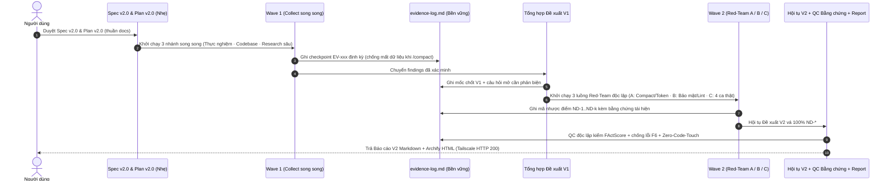

# SPEC — Phân tích chuyên sâu, Phản biện Red-Team & Đề xuất Kiến trúc Tối ưu luồng Research, Phân tích, Debug & Báo cáo (`work_kind=investigate`)

Ngày: 2026-11-21 · Bản: 2.0 · Brief: ../brief/2026-11-20-2355-toi-uu-research-phan-tich.md · Lane: full · Loại: docs (thuần phân tích & đề xuất, không sửa mã nguồn)
Soul: chất lượng > runtime > context cost · luật gốc: skills/tdq-conventions/references/soul.md
Trạng thái: CHỜ DUYỆT

## Mục lục

- 1. Mục tiêu & phạm vi
- 1b. Lộ trình
- 2. Đầu ra cụ thể
- 2b. Ranh giới module
- 2c. Luồng hoạt động & Sơ đồ kiến trúc
- 3. Cách tiếp cận & lý do
- 3b. Năng lực & công cụ
- 3c. Giải thuật & Xử lý cốt lõi
- 3d. Mental Model cho Fresher Dev
- 4. Yêu cầu bắt buộc
- 5. Ràng buộc & rủi ro
- 6. QC & Definition of Done
- 7. Câu hỏi còn mở

## 1. Mục tiêu & phạm vi

- **Mục tiêu:** Thực hiện một cuộc điều tra, đo đạc thực nghiệm, nghiên cứu sâu và phản biện Red-Team độc lập (**đặt toàn bộ trọng tâm thực thi vào pha `implement`**, ghi checkpoint liên tục vào kho bằng chứng chống mất dữ liệu khi `/compact`) để xuất **Báo cáo Đề xuất Kiến trúc Hoàn chỉnh V2** nhằm tối ưu triệt để luồng chạy cho các task Research, Phân tích, Debug RCA và Báo cáo trong TDQ Workflow (ưu tiên Google Antigravity 2.0 và giữ tương thích Claude Code / Codex / OpenCode), sẵn sàng làm đầu vào trực tiếp cho request triển khai mã nguồn về sau.
- **Trong phạm vi (thuần `docs`, 100% chỉ đọc trên mã nguồn và xuất hồ sơ dưới `docs/tdq/`):**
  - Thiết lập kho bằng chứng bền vững `evidence-log.md` (kèm định danh `EV-xxx`, nguồn `file:line`/URL/output thật, trạng thái giả thuyết và nhãn độ tin cậy) được cập nhật liên tục sau từng nhánh điều tra trong `implement` để chống thất thoát dữ liệu khi phiên bị `/compact`.
  - **Vòng 1 (`implement` — Collect & Synthesis V1):**
    - Đo đạc thực nghiệm toàn diện trên kho lịch sử `173` request trong `docs/tdq/timing.jsonl` cùng các hồ sơ `brief`/`research`/`plan`/`reports`: phân loại tỷ trọng thời gian từng pha, độ lặp công việc (double-work), độ dài tài liệu và các ca rỗng `implement=0s`.
    - Kiểm toán sâu toàn bộ điểm chạm kiến trúc trong mã nguồn hiện tại (`scripts/tdq_state.py`, `scripts/tdq_team.py`, `scripts/tdq_bench.py`, `scripts/doc_lint.py`, `hooks/scripts/*`, `hooks/rust/tdq-dispatch/src/*`, `skills/*`, `agents/*`, `tools/patches/*`, `docs/tdq/token-budget.json`) với bằng chứng `path:line` đã xác minh trên đĩa.
    - Mở rộng nghiên cứu thực chiến bên ngoài (multi-pass deep research, compact-resilient memory/checkpointing, agentic SWE RCA falsification, ALCE F6 & FActScore verification) và tổng hợp thành **Đề xuất Kiến trúc V1** bao phủ đầy đủ `6` trụ cột đã chốt với người dùng (`work_kind=investigate` cho cả `quick` & `full`, tách Debug-RCA vs Bugfix, fan-out `no_worktree`, `scoped-write` Python+Rust, 2 lớp chống mất dữ liệu khi `/compact`, và bộ `QC-I1..I4`).
  - **Vòng 2 (`implement` — Phản biện Red-Team độc lập 3 góc nhìn):**
    - **Red-Team A (Nhận thức, Compact & Chi phí Token):** Soi rủi ro quá tải nhận thức/context rot, kịch bản `/compact` nhiều lần liên tiếp, ngưỡng điểm hòa vốn giữa single-agent và fan-out (tránh đốt `15x` token vô ích), và vùng xám giữa Debug-RCA với Bugfix sửa code.
    - **Red-Team B (Bảo mật, Hook Python↔Rust & Linter/Test):** Soi lỗ hổng tiềm ẩn của `scoped-write` (path traversal `..`, symlink escape, shell bypass, slug mismatch, `security-reviewer` leak), xung đột với `doc_lint` R8/R11/R13/R14/R15, `i18n_check`, `token-budget.json`, bảng phase và compiler `tools/patches/*` AGY.
    - **Red-Team C (Stress-Test trên 4 ca thật trong repo):** Chạy mô phỏng end-to-end thiết kế V1 trên `4` ca thực tế (`1` research `full`, `1` research/audit `quick`, `1` debug-RCA và `1` bugfix sửa code) để bắt mọi điểm đứt gãy vận hành trước khi chốt thiết kế.
  - **Hội tụ V2 & Báo cáo cuối (`implement` → `qc` → `report`):** Vá trọn bộ nhược điểm Red-Team bắt được thành **Đề xuất Kiến trúc Hoàn chỉnh V2** kèm lộ trình triển khai chi tiết sẵn sàng mở request code; kiểm chứng bằng chứng độc lập ở `qc` (FActScore + chống F6 + Zero-Code-Touch); xuất báo cáo Markdown + Archify HTML (kèm Tailscale Serve URL HTTP `200`).
- **NGOÀI phạm vi (chép từ `Mặt LOẠI` + quyết định `1b` trong brief):**
  - **Tuyệt đối KHÔNG chỉnh sửa bất kỳ tệp mã nguồn thực thi, hook, skill, agent, compiler, cấu hình hay bộ kiểm thử nào** (`scripts/`, `hooks/`, `skills/`, `agents/`, `tools/`, `plugins/`, `tests/`, `tdq-config.json`, `docs/tdq/token-budget.json`).
  - Không biên dịch lại nhị phân Rust hay chạy build ghi đè `plugins/tdq-workflow-agy/`.
  - Không tạo lane thứ 3 tách rời `quick`/`full` và không gộp lẫn vào `loai_request` trong đề xuất thiết kế.
  - Không chỉnh sửa plugin cấp người dùng ngoài repo tại `~/.gemini/config/plugins/tdq-workflow-agy/`.

## 1b. Lộ trình

| Bước/phase | Chạy? | Vì sao |
|---|---|---|
| Research nền ban đầu (B2) | CÓ | Đã hoàn tất 4 truy vấn nền tại `docs/tdq/research/2026-11-20-2355-toi-uu-research-phan-tich.md`; phần đào sâu tiếp tục nằm trong `implement` |
| Interview (3 vòng) | CÓ | Đã chốt phạm vi `1abc 2a 3a 4a 5b`, chi tiết `1a 2a 3a 4a 5a 6a` và xác nhận `1b` (thuần phân tích & đề xuất `docs`) |
| Spec v2.0 + Archify HTML Preview | CÓ | Chốt rõ phạm vi thuần `docs`, cấu trúc `2` vòng điều tra + `3` luồng Red-Team và tiêu chí QC bằng chứng trước khi vào `implement` |
| Plan v2.0 (với bảng Model & Effort) | CÓ | Chia các nhánh điều tra độc lập song song trong `implement` (tách `Collect` → `V1` → `Red-Team A/B/C` → `V2`) và báo rõ model/effort |
| Implement (Đào sâu + V1 + Red-Team 3 luồng + V2) | CÓ | Trọng tâm thật sự của request: thực thi fan-out điều tra, ghi `evidence-log.md` liên tục chống mất dữ liệu khi `/compact` và hội tụ đề xuất V2 |
| QC bằng chứng & Zero-Code-Touch (`muc_qc=full`) | CÓ | Kiểm chứng độc lập mọi `file:line`/số liệu/URL (chống lỗi F6), kiểm phủ đủ `100%` nhược điểm Red-Team và xác nhận `0` file mã nguồn bị sửa |
| Report (Markdown + Archify HTML) | CÓ | Xuất Báo cáo Đề xuất Kiến trúc Hoàn chỉnh V2 dễ hiểu, trực quan kèm Tailscale Serve URL HTTP `200` |

## 2. Đầu ra cụ thể

| # | Đầu ra | Đường dẫn/vị trí | Đo "xong" bằng |
|---|---|---|---|
| 1 | Kho bằng chứng điều tra bền vững chống mất dữ liệu khi `/compact` | `docs/tdq/artifacts/2026-11-20-2355-toi-uu-research-phan-tich/evidence-log.md` | Tồn tại file với tối thiểu `20` mục `EV-xxx` có đủ timestamp, nguồn (`file:line` / URL / command), trích đoạn thật và nhãn độ tin cậy |
| 2 | Hồ sơ Phân tích Thực nghiệm kho lịch sử `173` request | `docs/tdq/artifacts/2026-11-20-2355-toi-uu-research-phan-tich/phan-tich-thuc-nghiem-timing.md` | Có bảng định lượng tách theo nhóm (`research`/`analysis`/`audit`/`debug`/`build`) và so sánh `quick` vs `full` kèm lệnh tái lập trên `timing.jsonl` |
| 3 | Hồ sơ Kiểm toán Codebase & Mở rộng Research ngoài sâu | `docs/tdq/artifacts/2026-11-20-2355-toi-uu-research-phan-tich/phan-tich-kien-truc-codebase.md`, `docs/tdq/artifacts/2026-11-20-2355-toi-uu-research-phan-tich/phan-tich-research-ngoai-sau.md` | Mọi điểm chạm (`scripts/`, `hooks/` Python+Rust, `skills/`, `agents/`, `tools/`) trích dẫn đúng `path:line` tồn tại thật trên đĩa; phần research sâu có nguồn trích dẫn xác minh được |
| 4 | Bản Thiết kế Đề xuất Kiến trúc V1 (`M1`–`M6`) | `docs/tdq/artifacts/2026-11-20-2355-toi-uu-research-phan-tich/de-xuat-kien-truc-v1.md` | Đầy đủ đặc tả kỹ thuật cho `work_kind=investigate`, `no_worktree`, `scoped-write` Python+Rust, 2 lớp chống compact, tách Debug-RCA vs Bugfix và `QC-I1..I4` |
| 5 | Bộ 3 Hồ sơ Phản biện Red-Team độc lập (A · B · C) | `docs/tdq/artifacts/2026-11-20-2355-toi-uu-research-phan-tich/redteam-a-luong-va-compact.md`, `docs/tdq/artifacts/2026-11-20-2355-toi-uu-research-phan-tich/redteam-b-bao-mat-va-tinh-tuong-thich.md`, `docs/tdq/artifacts/2026-11-20-2355-toi-uu-research-phan-tich/redteam-c-stress-test-cases.md` | Mỗi luồng chỉ ra cụ thể danh sách lỗ hổng/nhược điểm định danh (`ND-1`..`ND-k`) kèm bằng chứng tái hiện hoặc kịch bản mô phỏng trên `4` ca thật |
| 6 | Báo cáo Đề xuất Kiến trúc Hoàn chỉnh V2 (Markdown + Archify HTML) & Hồ sơ QC | `docs/tdq/reports/2026-11-20-2355-toi-uu-research-phan-tich.md`, `docs/tdq/reports/2026-11-20-2355-toi-uu-research-phan-tich.html`, `docs/tdq/qc/2026-11-20-2355-toi-uu-research-phan-tich.md` | Truy vết vá `100%` mã nhược điểm Red-Team (`ND-*`) trong V2, gắn nhãn độ tin cậy rõ ràng, `0` lỗi `doc_lint`, Archify HTML manifest `current` + Tailscale HTTP `200`, và `0` tệp mã nguồn bị sửa |

## 2b. Ranh giới module

Bắt buộc với lane `full`. Mỗi khối sở hữu vùng file đầu ra tách biệt hoàn toàn (không hai khối nào ghi trùng một tệp):

| Module | Vùng file | Phụ thuộc module | Đầu ra §2 nào |
|---|---|---|---|
| **D1 — Kho Bằng chứng & Phân tích Thực nghiệm** | `docs/tdq/artifacts/2026-11-20-2355-toi-uu-research-phan-tich/evidence-log.md`, `docs/tdq/artifacts/2026-11-20-2355-toi-uu-research-phan-tich/phan-tich-thuc-nghiem-timing.md` | không | 1, 2 |
| **D2 — Kiểm toán Codebase, Research Sâu & Đề xuất V1** | `docs/tdq/artifacts/2026-11-20-2355-toi-uu-research-phan-tich/phan-tich-kien-truc-codebase.md`, `docs/tdq/artifacts/2026-11-20-2355-toi-uu-research-phan-tich/phan-tich-research-ngoai-sau.md`, `docs/tdq/artifacts/2026-11-20-2355-toi-uu-research-phan-tich/de-xuat-kien-truc-v1.md` | D1 | 3, 4 |
| **D3 — Phản biện Red-Team 3 Luồng (A · B · C)** | `docs/tdq/artifacts/2026-11-20-2355-toi-uu-research-phan-tich/redteam-a-luong-va-compact.md`, `docs/tdq/artifacts/2026-11-20-2355-toi-uu-research-phan-tich/redteam-b-bao-mat-va-tinh-tuong-thich.md`, `docs/tdq/artifacts/2026-11-20-2355-toi-uu-research-phan-tich/redteam-c-stress-test-cases.md` | D2 | 5 |
| **D4 — Hội tụ V2, QC Bằng chứng & Báo cáo Archify HTML** | `docs/tdq/qc/2026-11-20-2355-toi-uu-research-phan-tich.md`, `docs/tdq/artifacts/2026-11-20-2355-toi-uu-research-phan-tich/bao-cao.archify.md`, `docs/tdq/reports/2026-11-20-2355-toi-uu-research-phan-tich.md`, `docs/tdq/reports/2026-11-20-2355-toi-uu-research-phan-tich.html` | D1, D2, D3 | 6 |

## 2c. Luồng hoạt động & Sơ đồ kiến trúc

### Sơ đồ quy trình điều tra & phản biện đặt trọng tâm trong `implement` (Mermaid dự phòng)

### Cơ chế hiện tại vs Sau update (tầm nhìn đề xuất & quy trình thực thi request này)

Bản xem trước trực quan Trước/Sau (Archify HTML đã bind): `docs/tdq/spec/2026-11-20-2355-toi-uu-research-phan-tich-preview.html` (Tailscale Serve: https://unity-pc-rtx3060.tail99896.ts.net/vlog/tdq-workflow-agy/spec/2026-11-20-2355-toi-uu-research-phan-tich-preview.html).

| Khía cạnh | Hiện trạng (Trước) | Mục tiêu phân tích & Đề xuất V2 (Sau) |
|---|---|---|
| Cách chạy chính request này (`docs`) | Trước đây dồn nghiên cứu và chẩn đoán vào `analyze`/`spec` rồi `implement` chỉ viết lại báo cáo. | `analyze`/`spec`/`plan` chỉ khoanh phạm vi & giả thuyết; toàn bộ đào sâu thực nghiệm, kiểm toán codebase, research đa vòng, Red-Team 3 góc nhìn và viết V2 chạy trong `implement`. |
| Kiến trúc TDQ được đề xuất cho task Research/Phân tích/Debug | Chỉ có luồng `build` (tiền-implement chiếm `64.7%` trong `30` request gần nhất; `quick` research rỗng `0s` ở `implement`; chưa có kho chống mất dữ liệu khi `/compact`; QC chạy `tron-bo` `4,563` tests dù không sửa code). | Thiết kế V2 hoàn chỉnh cho `work_kind=investigate` (áp dụng cả `quick`/`full`), fan-out `no_worktree`, `scoped-write` Python+Rust, 2 lớp checkpoint chống `/compact`, tách Debug-RCA vs Bugfix và bộ `QC-I1..I4` — đã qua phản biện Red-Team 3 chiều trước khi mở request code. |
| Phạm vi đụng chạm mã nguồn | Bản spec v1.0 trước đó định sửa trực tiếp `6` module code/hook/Rust/plugin. | **Zero-Code-Touch (`0` tệp mã nguồn bị sửa):** người dùng xem kỹ Báo cáo Đề xuất V2 và quyết định mở request triển khai riêng sau. |

## 3. Cách tiếp cận & lý do

- **Chọn:**
  1. **Thực thi 2 vòng (`Collect + V1` → `Red-Team A/B/C` → `V2`) ngay trong pha `implement`:** Áp dụng đúng chuẩn *Unified Intent-Planning + Isolated Parallel Workers + Adversarial Review* (từ `docs/tdq/research/2026-11-20-2355-toi-uu-research-phan-tich.md` và mô hình đã chứng minh hiệu quả ở `2026-11-19-2213-chi-tiet-plan-model-thap`). Mỗi nhánh chạy bằng subagent cô lập trên 1 trục phân tích/phản biện riêng, đổ raw findings ra tệp artifact độc lập và trả digest `<= 1,500` ký tự về leader.
  2. **Kỷ luật ghi `evidence-log.md` chống mất dữ liệu khi `/compact`:** Leader và từng bước điều tra nối ngay bằng chứng (`EV-xxx`, `file:line`, URL, số liệu chạy lệnh thật, trạng thái giả thuyết) xuống `docs/tdq/artifacts/2026-11-20-2355-toi-uu-research-phan-tich/evidence-log.md` sau mỗi task/đợt, đồng thời ghi `docs/workinglog/2026-11-21.md` tại từng mốc quan trọng để kể cả bị `/compact` nhiều lần vẫn đọc lại đủ `100%` dữ kiện.
  3. **QC bằng chứng thực chiến (`FActScore` + chống lỗi F6 + Zero-Code-Touch):** Trước khi ra báo cáo cuối, kiểm chứng chéo mọi `path:line`, con số thống kê và trích dẫn nguồn trên đĩa thật, kiểm `100%` mã nhược điểm `ND-*` của Red-Team đều có phương án vá tương ứng trong V2, và xác nhận `git diff --name-only` không chứa bất kỳ tệp nào ngoài `docs/`.
- **Đã loại:**
  - *Sửa code luôn trong request này (Spec v1.0):* Người dùng chọn `1b` — muốn phân tích cực sâu, phản biện kỹ lưỡng và xem báo cáo đề xuất hoàn chỉnh trước khi chạm vào mã nguồn lõi Python/Rust/hooks.
  - *Chỉ làm 1 vòng phân tích không có Red-Team:* Dễ rơi vào thiên kiến xác nhận (confirmation bias), bỏ sót các góc hiểm như xung đột `token-budget.json`, lỗ hổng symlink/`..` ở `scoped-write`, hoặc hiện tượng đốt `15x` token khi fan-out quá đà trên task tuyến tính.

## 3b. Năng lực & công cụ

Phân vân → DÙNG. Kiểm kê ngày 2026-11-21: `42` skill trên đĩa (`23` giữ + `19` ẩn qua `skill_inventory.py --loc "research analyze debug workflow intake spec plan build"`), cộng skill built-in trong context.

| Skill | Nguồn | Phán quyết | Dùng ở đâu / Lý do loại |
|---|---|---|---|
| `tdq-intake` / `tdq-spec` / `tdq-plan` / `tdq-build` / `tdq-conventions` | plugin:tdq-workflow | NỀN | Khung pipeline deep, trạng thái, cổng duyệt, QC và báo cáo |
| `tdq-setup` / `tdq-status` / `tdq-lean` | plugin:tdq-workflow | NỀN | Kiểm định tầng tìm kiếm 3 lớp và nguyên tắc chống over-engineering khi thiết kế đề xuất |
| `agy-customizations` / `antigravity-guide` | built-in | DÙNG | Đối chiếu chính xác cơ chế plugin, hook, frontmatter subagent Antigravity 2.0 trong hồ sơ kiểm toán codebase và Red-Team B |
| Đã xét 38 skill khác | user/plugin/built-in | KHÔNG | khác lĩnh vực |

## 3c. Giải thuật & Xử lý cốt lõi

### Luồng xử lý điều tra 4 chặng trong `implement` → `qc` → `report`

1. **Chặng 1 — Thu thập đa chiều song song (`Collect`, Wave 1):**
   - Nhánh 1A (*Thực nghiệm định lượng*): chạy script đọc chỉ-đọc `docs/tdq/timing.jsonl` (`173` bản ghi) + đối chiếu danh mục `docs/tdq/{brief,research,spec,plan,reports}/` để phân loại chính xác request theo bản chất (`research`, `analysis`, `audit`, `debug`, `build`), tính trung vị/trung bình/phân vị tỷ trọng từng pha (`analyze`/`spec`/`plan`/`implement`/`qc`/`report`), đo tỷ lệ request rỗng `implement=0s` và mức độ trùng lặp tài liệu (`brief` ↔ `spec` ↔ `plan` ↔ `report`) → ghi `phan-tich-thuc-nghiem-timing.md`.
   - Nhánh 1B (*Kiểm toán Codebase 3 tầng LSP/Graphify/Grep*): rà soát từng hàm cụ thể và ràng buộc thật trong `scripts/tdq_state.py`, `scripts/tdq_team.py`, `scripts/tdq_bench.py`, `scripts/doc_lint.py`, `hooks/scripts/*`, `hooks/rust/tdq-dispatch/src/*`, `skills/*`, `agents/*`, `tools/patches/*`, `docs/tdq/token-budget.json` → ghi `phan-tich-kien-truc-codebase.md`.
   - Nhánh 1C (*Research ngoài nâng cao*): đào sâu qua `tavily-primary` (`tavily_search` + `tavily_extract`) về 3 câu hỏi chuyên sâu còn mở sau research nền: (i) thiết kế **compact-resilient evidence checkpointing & context folding** trong các agent chạy dài, (ii) cơ chế **adaptive budget & early-stopping** cho deep research/RCA không lặp vô hạn, (iii) kiến trúc **dual-track verification (FActScore + ALCE F6 + Counterfactual RCA)** gọn nhẹ không phình token → ghi `phan-tich-research-ngoai-sau.md`.
   - Sau Wave 1: cập nhật toàn bộ bằng chứng (`EV-001`…) vào `evidence-log.md`.
2. **Chặng 2 — Tổng hợp Đề xuất Kiến trúc V1 (`Synthesize V1`, Wave 2):**
   - Hợp nhất kết quả Wave 1 thành `de-xuat-kien-truc-v1.md` gồm đầy đủ đặc tả cho `6` mảng (`M1` State `work_kind`, `M2` `tdq_team.py` `no_worktree` + `evidence` CLI + `doc_lint`/`tdq_bench`, `M3`/`M4` Python+Rust `scoped-write` + `[TDQ:CHECKPOINT]` + `Compact recovery`, `M5` `investigate-mode.md` + `QC-I1..I4` + Debug-RCA vs Bugfix, `M6` AGY compiler parity + test plan) kèm bảng hợp đồng chữ ký và dự toán chi phí/lợi ích.
   - Ghi checkpoint chốt V1 vào `evidence-log.md`.
3. **Chặng 3 — Phản biện Red-Team độc lập 3 góc nhìn (`Red-Team`, Wave 3 song song):**
   - **Red-Team A (`redteam-a-luong-va-compact.md`):** Tấn công thiết kế V1 ở góc độ nhận thức model, chi phí token, kịch bản `/compact` `3` lần liên tiếp, rủi ro `read_gate` spam hoặc bỏ lọt khi research dùng web MCP thay vì `Read`, và ranh giới xám Debug-RCA vs Bugfix.
   - **Red-Team B (`redteam-b-bao-mat-va-tinh-tuong-thich.md`):** Tấn công V1 ở góc độ bảo mật (`scoped-write` symlink/traversal/Windows case-insensitivity/shell bypass/active slug race), xung đột với `doc_lint` R8/R11/R13/R14/R15, `i18n_check`, `token-budget.json` (đo chính xác token dư từng `SKILL.md`!), `test_phase_table`, `test_agent_frontmatter`, và `tools/patches/*`.
   - **Red-Team C (`redteam-c-stress-test-cases.md`):** Chạy kịch bản walkthrough chi tiết V1 trên `4` ca lịch sử thật của repo (1 research `full`, 1 research/audit `quick`, 1 debug/RCA, 1 bugfix có sửa code) để kiểm chứng xem thời gian tiền-implement có thực sự rút gọn, `implement` có trở thành trọng tâm hay không, và phát hiện mọi nút thắt mới phát sinh.
   - Chuẩn hóa toàn bộ phát hiện Red-Team thành mã nhược điểm `ND-1`..`ND-k` và ghi vào `evidence-log.md`.
4. **Chặng 4 — Hội tụ V2, QC Bằng chứng & Báo cáo (`V2 + QC + Report`, Wave 4):**
   - Thiết kế **Đề xuất Hoàn chỉnh V2** có bảng truy vết `100%` (`ND-1`..`ND-k` → giải pháp vá cụ thể trong V2) + lộ trình triển khai từng đợt sẵn sàng mở request code.
   - Chạy QC bằng chứng độc lập (kiểm chéo `path:line` trên đĩa thật, kiểm citation chống F6 trên `evidence-log.md`, kiểm nhãn độ tin cậy `Verified` / `Single-source` / `Inferred`, kiểm `git diff --name-only` ngoài `docs/` rỗng) → ghi `docs/tdq/qc/2026-11-20-2355-toi-uu-research-phan-tich.md`.
   - Xuất báo cáo cuối `docs/tdq/reports/2026-11-20-2355-toi-uu-research-phan-tich.md` + `docs/tdq/reports/2026-11-20-2355-toi-uu-research-phan-tich.html` (Archify HTML đã verify `current` + Tailscale Serve HTTP `200`).

### Độ phức tạp

- Script đọc thống kê `docs/tdq/timing.jsonl`: thời gian $O(N \cdot P)$ với $N = 173$ request và $P \le 8$ pha/request; không gian $O(N)$ (`< 1s` chạy thực tế).
- Kiểm toán mã nguồn & Red-Team: thực thi fan-out tối đa `3` nhánh độc lập mỗi wave (song song giảm ~`2.5x` thời gian chờ tường so với chạy tuần tự `6` bước, đồng thời kiểm soát tổng số subagent `<= 6` để không nổ chi phí token).

### Ca góc hiểm & Phòng thủ

1. **Context bị `/compact` giữa chừng trong lúc tổng hợp 6 tệp artifact dài:** Phòng thủ bằng cách mọi subagent đổ toàn bộ dữ kiện chi tiết vào tệp artifact riêng trên đĩa, chỉ trả digest `<= 1,500` ký tự về leader, và leader ghi ngay checkpoint `EV-xxx` vào `evidence-log.md` + `docs/workinglog/` sau mỗi wave — nếu bị compact chỉ cần đọc lại `evidence-log.md` và danh sách artifact là phục hồi nguyên vẹn.
2. **Lỗi trích dẫn F6 hoặc số dòng `path:line` bị lệch/tự nhớ:** Phòng thủ bằng quy định mọi `path:line` và con số định lượng phải trích trực tiếp từ lệnh chạy/đọc đĩa thật và được kiểm chéo lại ở pha `qc` bằng script xác minh đường dẫn + dòng tồn tại thật trên đĩa.
3. **Vô tình chỉnh sửa mã nguồn hoặc file ngoài `docs/` trong lúc kiểm nghiệm:** Phòng thủ bằng quy định toàn bộ nhánh phân tích chỉ dùng lệnh read-only hoặc temp dir biệt lập (`TDQ_PROJECT_DIR`), và hạng mục QC bắt buộc kiểm `git status --porcelain` & `git diff --name-only` xác nhận `0` tệp ngoài `docs/` bị thay đổi.

## 3d. Mental Model cho Fresher Dev

- **Ẩn dụ thực tế:** Hãy tưởng tượng bạn định cải tạo lại dây chuyền vận hành của cả một tòa soạn báo lớn. Thay vì gọi thợ vào đập tường xây ngay (`feature` code), ở request này bạn cử **đội khảo sát hiện trường + kiểm toán độc lập (`docs`)**: vòng 1 đo đồng hồ bấm giờ trên `173` số báo cũ, đo kích thước từng phòng ban và lập bản vẽ đề xuất V1; vòng 2 mời **3 chuyên gia phản biện khó tính (Red-Team A/B/C)** soi từng điểm yếu về sức chịu tải, an ninh và chạy thử trên `4` số báo thật; cuối cùng mới giao cho bạn **Bản thiết kế hoàn thiện V2 kèm sổ bằng chứng (`evidence-log.md`)** để bạn duyệt xong rồi mới gọi thợ xây ở request sau.
- **Glossary (Thuật ngữ cốt lõi):**
  - `work_kind=investigate`: Đề xuất hồ sơ công việc chuyên cho task Research, Phân tích, Debug RCA và Báo cáo, đặt trọng tâm thực thi vào pha `implement`.
  - `evidence-log.md`: Sổ nhật ký bằng chứng bền vững trên đĩa lưu từng `EV-xxx` kèm nguồn thật và nhãn độ tin cậy để chống mất dữ liệu khi `/compact` và làm nguồn đối chiếu cho QC.
  - **Red-Team 3 chiều (A/B/C):** Ba luồng phản biện độc lập tấn công bản thiết kế V1 từ góc độ nhận thức/compact/token (A), bảo mật/linter/tương thích (B), và stress-test 4 ca thật (C) để sinh bản vá V2.
  - **Lỗi F6 (ALCE Citation Failure Type F6):** Trích dẫn có link hoặc `file:line` tồn tại thật nhưng nội dung nguồn đó không thực sự chứng minh cho mệnh đề được nêu.
  - **Zero-Code-Touch:** Ràng buộc cứng của request `docs` này: không có bất kỳ tệp nào ngoài thư mục `docs/` bị sửa đổi.

## 4. Yêu cầu bắt buộc

- **Log service:** BỎ — request thuần phân tích và đề xuất thiết kế (`loai_request=docs`), không tạo hoặc sửa mã nguồn chạy được; thay bằng ghi checkpoint thường xuyên vào `docs/tdq/artifacts/2026-11-20-2355-toi-uu-research-phan-tich/evidence-log.md` và `docs/workinglog/YYYY-MM-DD.md` sau từng wave để chống mất dữ liệu khi `/compact`.
- **Không placeholder / không bịa nguồn:** Mọi con số đo trên `timing.jsonl`, mọi trích dẫn `path:line` trong mã nguồn và mọi nguồn research ngoài đều phải quan sát trực tiếp từ công cụ thật và lưu vào `evidence-log.md`.
- **Mỗi thành phần đầu ra có kiểm chứng đo được riêng:** Mọi tệp đầu ra ở `§2` đều có tiêu chí kiểm định cụ thể ở `§6` (chạy kiểm chéo thật ở pha `qc`).

## 5. Ràng buộc & rủi ro

### Ràng buộc kiến trúc phải giữ (trích nguyên văn từ `docs/kien-truc.md`)

- `hooks/` được gọi `scripts/`; `scripts/` **không** được import `hooks/` — mọi đề xuất kiến trúc trong V1/V2 phải tôn trọng tuyệt đối luật hướng phụ thuộc này.
- `skills/` chỉ được **nhắc tên lệnh** của `scripts/`, cấm chép nội dung script vào skill.
- Chỉ `scripts/tdq_state.py` được ghi `docs/tdq/state.json`; mọi nơi khác chỉ đọc qua CLI.
- Luật trong `skills/`, `agents/`, chú thích/docstring của `hooks/` + `scripts/` và chuỗi máy in ra viết TIẾNG ANH cố định (`i18n_check.py` gác tầng 1-2).
- Không hook nào trả `deny` vì lý do "chưa duyệt"; các điểm nhắc như `[TDQ:CHECKPOINT]` phải là lời nhắc (REMIND), không block.

### Ràng buộc vận hành & rủi ro

- **Ràng buộc cứng Zero-Code-Touch:** Không sửa bất kỳ tệp nào thuộc `scripts/`, `hooks/`, `skills/`, `agents/`, `tools/`, `plugins/`, `tests/`, `tdq-config.json`, hay `~/.gemini/config/plugins/`.
- **Rủi ro 1 — Phân tích dài làm đầy context và kích hoạt `/compact` giữa chừng:** Giảm thiểu bằng quy định subagent trả digest `<= 1,500` ký tự, toàn bộ nội dung sâu lưu ra tệp artifact và cập nhật `evidence-log.md` ngay sau mỗi wave.
- **Rủi ro 2 — Đề xuất V2 bị over-engineering (thêm quá nhiều cờ/hook gây chậm hoặc vỡ trần `token-budget.json`):** Giảm thiểu bằng Red-Team A (kiểm chi phí token/độ phức tạp nhận thức) và Red-Team B (đo chính xác token dư thực tế của từng `SKILL.md` trước khi đề xuất).

## 6. QC & Definition of Done

Mức QC đã chốt với người dùng: **`full`** — áp dụng chuẩn **QC bằng chứng & Zero-Code-Touch** cho request thuần phân tích/đề xuất (`loai_request=docs`, không có mã nguồn bị sửa nên `QC-F4` ghi rõ `KHÔNG ÁP DỤNG — không sửa file code`):

| Mã | Hạng mục kiểm chứng (ĐK PASS) | Đo trước | Dự phòng nếu trượt |
|---|---|---|---|
| **Q1** | **Kho bằng chứng bền vững (`evidence-log.md`):** Tồn tại tệp `docs/tdq/artifacts/2026-11-20-2355-toi-uu-research-phan-tich/evidence-log.md` chứa tối thiểu `20` mục `EV-xxx` có đầy đủ timestamp, nguồn (`file:line` / URL / command output), trích đoạn thật và nhãn độ tin cậy (`Verified` / `Single-source` / `Inferred`). | Đo trước: mới chỉ có `4` truy vấn nền (`docs/tdq/research/...`) và `1` bảng timing sơ bộ; `3` nhánh Wave 1 + `3` luồng Red-Team mỗi nhánh tạo trung bình `4–6` bằng chứng thật → dự kiến đạt `24–36` mục `EV-xxx`. | Nếu một nhánh trả ít bằng chứng thực chứng hơn dự kiến, bổ sung trực tiếp các mục đo `file:line`/số liệu định lượng thật từ các artifact đã sinh; tối thiểu không thấp hơn `15` mục `EV-xxx` và ghi rõ `lech add` nếu dưới `20`. |
| **Q2** | **Đầy đủ bộ hồ sơ Phân tích Vòng 1 & Đề xuất V1:** Cả `4` tệp `phan-tich-thuc-nghiem-timing.md`, `phan-tich-kien-truc-codebase.md`, `phan-tich-research-ngoai-sau.md` và `de-xuat-kien-truc-v1.md` tồn tại, không rỗng, không chứa placeholder (`TBD`/`TODO`/`...`), phủ đủ `173` bản ghi `timing.jsonl` và đầy đủ `6` mảng `M1`–`M6`. | Đo trước: `docs/tdq/timing.jsonl` hiện có chính xác `173` dòng JSON hợp lệ trên đĩa (đã đo lúc intake). | Nếu phát hiện dòng hỏng JSON trong `timing.jsonl`, thống kê rõ số dòng hợp lệ so với tổng dòng thay vì bỏ qua im lặng. |
| **Q3** | **Phản biện Red-Team độc lập 3 chiều (A · B · C):** Cả `3` tệp `redteam-a-luong-va-compact.md`, `redteam-b-bao-mat-va-tinh-tuong-thich.md` và `redteam-c-stress-test-cases.md` tồn tại, chạy bởi góc nhìn phản biện tách biệt; Red-Team C mô phỏng đủ `4` ca thật trong kho `docs/tdq/` (`1` research `full`, `1` research/audit `quick`, `1` debug-RCA, `1` bugfix sửa code); mọi nhược điểm đều được gắn mã `ND-1`..`ND-k` kèm mức độ và bằng chứng. | Đo trước: kho `docs/tdq/` hiện có `209` brief, `61` research, `171` reports (`27/173` slug khớp nhóm research/audit/phân tích) và nhiều ca bugfix/debug thực tế đủ để chọn `4` ca đại diện. | Nếu một ca trong kho không có đủ dấu vết `debug-RCA` thuần túy, chọn ca `audit`/`scan`/`bugfix` gần nhất trên đĩa, ghi rõ đặc điểm ca đó và giải thích giới hạn mẫu trong `redteam-c-stress-test-cases.md`. |
| **Q4** | **Kiểm chứng bằng chứng FActScore & Chống lỗi F6:** Xác minh tự động bằng lệnh trên đĩa rằng `100%` đường dẫn `path:line` được trích dẫn trong `de-xuat-kien-truc-v1.md` và báo cáo V2 đều tồn tại thật và số dòng nằm trong kích thước tệp; đối chiếu mẫu trực tiếp với `evidence-log.md` đảm bảo `0` lỗi F6 (nguồn thật nhưng không chứng minh mệnh đề) và mọi khuyến nghị trong V2 đều gắn nhãn độ tin cậy rõ ràng. | Đo trước: `0` lỗi `path:line` đã được kiểm chứng ở bước khảo sát ban đầu; viết lệnh kiểm chéo regex toàn văn trên tệp báo cáo V2 mất `< 2s`. | Bất kỳ `path:line` nào lệch số dòng hoặc trích dẫn bị gắn nhãn F6 đều sửa phẫu thuật ngay tại vòng QC cho tới khi đạt `0` lỗi trước khi sang `report`. |
| **Q5** | **Hội tụ Đề xuất Hoàn chỉnh V2, Archify HTML & Lint:** Báo cáo `docs/tdq/reports/2026-11-20-2355-toi-uu-research-phan-tich.md` truy vết vá `100%` mã nhược điểm `ND-*` từ Red-Team, đạt `0` vi phạm `doc_lint.py`; bản trực quan `docs/tdq/reports/2026-11-20-2355-toi-uu-research-phan-tich.html` được render sạch, manifest `status: current` và Tailscale Serve trả HTTP `200`. | Đo trước: Archify engine sẵn sàng (`ready: true`, Node `v24.21.0`), bản preview spec vừa render `1,610,652` bytes với `0` diagnostics và Tailscale Serve trả HTTP `200`. | Nếu Tailscale Serve gặp gián đoạn mạng cục bộ, kiểm tra lại junction `VTranslateDataLog`, thử lại `1` lần và ghi rõ trạng thái thực tế trong báo cáo (không bịa HTTP `200`). |
| **Q6** | **Ràng buộc cứng Zero-Code-Touch:** Kiểm tra trạng thái git trên nhánh `docs/toi-uu-research-phan-tich` so với nhánh gốc `dev` xác nhận `0` tệp mã nguồn, hook, skill, agent, compiler hay cấu hình ngoài `docs/` bị tạo mới, chỉnh sửa hoặc xóa, và plugin ngoài repo `~/.gemini/config/plugins/` giữ nguyên `mtime`. | Đo trước: hiện nhánh `docs/toi-uu-research-phan-tich` chỉ có thay đổi trong `docs/tdq/` và `docs/workinglog/` (`0` tệp mã nguồn bị sửa). | Nếu phát hiện bất kỳ tệp nào ngoài `docs/` bị chạm ngoài ý muốn, hoàn nguyên sạch bằng `git checkout -- <path>` trước khi đóng QC. |

## 7. Câu hỏi còn mở

Không còn câu hỏi mở nào.
<!-- tdq-archify-binding:start -->
<!-- manifest: 2026-11-20-2355-toi-uu-research-phan-tich-preview.manifest.json -->
<!-- manifest_digest: 54d3a29a16bf1675c0f69dc2e15c23f2b39fcf200774ce7ab8bc2f6cc14720d1 -->
<!-- tdq-archify-binding:end -->