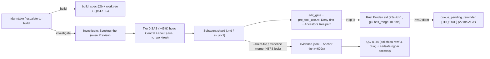

# SPEC — Triển khai Trọn bộ 3 Đợt Kiến trúc `work_kind=investigate` V2

Ngày: 2026-11-21 · Request: `2026-11-21-0217-trien-khai-investigate-v2` · Lane: `full` · Loại: `feature` · Nhánh: `feat/trien-khai-investigate-v2` (từ `dev`)
Soul: chất lượng > runtime > context cost · luật gốc: `skills/tdq-conventions/references/soul.md`
Hồ sơ thiết kế nguồn: `docs/tdq/artifacts/2026-11-20-2355-toi-uu-research-phan-tich/de-xuat-kien-truc-v2.md` (`ND-1`–`ND-9`, `EV-001`–`EV-029`)

---

## 1. Mục tiêu

Triển khai đồng bộ vào mã nguồn thật (`scripts/`, `hooks/`, `hooks/rust/tdq-dispatch/`, `skills/`, `agents/`, `tools/patches/`, `plugins/tdq-workflow-agy/`) toàn bộ **`3` đợt (`M1`–`M6`)** của Đề xuất Kiến trúc Hoàn chỉnh V2 trong một request `feature` thống nhất nhằm:

1. Tách rõ hai luồng công việc `work_kind = "build" | "investigate"` ở cả `quick` và `full`, đưa toàn bộ đào sâu research, phân tích, Debug-RCA và tổng hợp báo cáo vào pha `implement`, bỏ bắt ép `§2b` module code giả và Double Archify cho tác vụ điều tra.
2. Khắc phục bug telemetry `_cli_approve` (`scripts/tdq_state.py`) khiến `implement = 0s` giả tạo, và bổ sung cổng nâng cấp có kiểm duyệt `escalate-to-build` cho kịch bản Two-Stage Bugfix.
3. Dựng hạ tầng chống mất dữ liệu qua nhiều vòng `/compact` (Shard + Leader-Merge `evidence.jsonl`, khóa NTFS cho `blackboard_record`, `--claim-file` chống false-positive `[TDQ:READONLY]`, Anchor tĩnh không timestamp giây bảo toàn KV-cache, hồi phục `resume`/`mode`).
4. Triệt để bảo mật `scoped-write` `5` tầng đồng bộ Python ↔ Rust (khóa đọc `100%` `tdq-security-reviewer`, canonicalize đa cấp `ancestors()`, bịt `cmd /c` và `[IO.File]`, Allow trực tiếp tại Rust) kết hợp Weighted Burden Counter thuần Rust theo từng `sid` giữ nguyên tốc độ `<0.5ms` cho đọc theo dải dòng (`pre_tool_use.rs:444`).
5. Biên dịch mới plugin `plugins/tdq-workflow-agy/` (kèm `tdq-dispatch.exe` Windows; giữ prebuilt Linux/macOS hiện hữu theo chọn `1a`), kiểm `agy.EXE plugin validate --strict`, giữ nguyên `22` mã AGY, tuân thủ `token-budget.json`, chạy trọn bộ suite + mô phỏng `4` ca mẫu (`1056`, `1457`, `1346`, `1953`) trong `tmp_path` (`3a`, `4a` `muc_qc=full`).

## 2. Phạm vi & Yêu cầu

### Trong phạm vi (`3` đợt `M1`–`M6`)

1. **Đợt 1 — State, Telemetry, Lint, Archify & Docs Foundation (`M1`, `M2 phần lint/scaffold/bench`, `M5 phần docs`):**
   - `scripts/tdq_state.py`: thêm `work_kind` (`build | investigate`, fail-closed), `INVESTIGATE_PHASE_ROWS` rẽ nhánh ở `phase_row()` không đụng `len(PHASE_TABLE) == 11`, vá `ghi_moc_phase` trong `_cli_approve`, miễn Archify preview trong `_archify_gate` khi `work_kind == "investigate"`, thêm `escalate-to-build --by`, kiểm `spec_sha256` drift trong `cong_dang_cho`, nối hậu tố `· kind:inv` (`10` ký tự) giữ `next_headline` dưới `600` ký tự.
   - `scripts/doc_lint.py`, `scripts/tdq_plan_scaffold.py`, `scripts/tdq_bench.py`: miễn có điều kiện `rule_r10` & `r14_loi` cho header `Work kind: investigate`, tách Script Chẩn đoán (`docs/tdq/{artifacts,bench}/<slug>/*.py`) khỏi `EXT_MA_NGUON`, gắn cờ `is_created` cho `Sinh ra:` ở `tdq_plan_scaffold.py`, đặt `t_hop = 0.0` cho nhánh `no_worktree` ở `tdq_bench.py`.
   - `skills/`: thêm `skills/tdq-conventions/references/investigate-mode.md` (EN, `<= 3,000` tokens, câu `<= 40` từ, vượt `i18n_check.py`) chứa Tier 0 Zero-Fanout SAS (`>45%`), 4 mức effort, `QC-I1..I4`, Two-Stage Bugfix; tỉa `40–60` tokens dư ngoài vùng bảng khóa ở `spec-template.md`, `qc.md`, `team-mode.md` và gắn pointer gọn ở `SKILL.md` giữ nguyên `SKILL_LINE_LIMITS`; nâng `quick-lane-mini.md` cho `quick+investigate` lên `<= 65` dòng; cập nhật `issue-triage.md`.
2. **Đợt 2 — Evidence Engine, Security `scoped-write` & Rust Burden Checkpoint (`M2 phần team/handoff`, `M3`, `M4`):**
   - `scripts/tdq_team.py` & `skills/tdq-conventions/references/handoff-schema.json`: thêm `evidence add | merge | render` (`--claim-file`, `--excerpt-file`, `kind: hypothesis|tried|evidence`), bọc `with_ntfs_lock` cho `evidence.jsonl` & `blackboard_record`, hỗ trợ `worktree_required: false` qua `_build_packet_payload`, `canh_bao_lach_luat`, và mở rộng `handoff-schema.json` cho biến thể `no_worktree`.
   - `hooks/scripts/` (`_common.py`, `edit_gate.py`, `bash_gate.py`, `prompt_context.py`, `session_start.py`, `subagent_stop.py`, `read_gate.py`) & `hooks/hooks.json`: bảo mật `scoped-write` 5 tầng, đồng bộ `_normalize_tool_aliases`, vá `cmd /c` & `[IO.File]`, tách đăng ký `PostToolUse` khỏi chấm handoff ở `subagent_stop.py`, anchor tĩnh không timestamp giây (kèm bơm tối giản cho subagent), swap `TDQ:GON` investigation mode tiết kiệm token, thêm `search_web` matcher trong `hooks.json`.
   - `hooks/rust/tdq-dispatch/src/` (`storage.rs`, `protocol.rs`, `command_parser.rs`, `events/{pre_tool_use,post_tool_use,pre_invocation}.rs`): thêm `work_kind` & `"mode"` ở `storage.rs`, thêm `resume` & subagent anchor ở `pre_invocation.rs`, cài `is_investigation_artifact_target` 5 tầng trả `HookDecision::allow()` trực tiếp ở Rust (không rơi `pre_tool_use.rs:333`), vá `cmd /c` & `[IO.File]` ở `command_parser.rs`, giữ `100%` fast-path `has_range` tại `pre_tool_use.rs:444` kết hợp bộ đếm **Weighted Burden theo `sid`** (`checkpoint-<sid>.json`, ngưỡng `>= 40` tái sử dụng mã `"DOC"` giữ nguyên `22` mã AGY), bỏ schema chết ở `post_tool_use.rs:76`.
3. **Đợt 3 — Agent Prompts, Compiler AGY, Rebuild Plugin & Kiểm chứng E2E (`M6`):**
   - `agents/tdq-{explorer,debugger,reviewer}.md`: bổ sung `Point-of-Commitment vs Manifestation` + Counterfactual Falsification Test cho `tdq-debugger.md`, cập nhật phạm vi `[TDQ:SCOPED-WRITE]` rõ vùng đích.
   - `tools/patches/` (`skills_and_agents.py`, `agy_hooks.py`): tách `_STRICT_READONLY_AGENTS = ("tdq-security-reviewer.md",)` khỏi nhóm điều tra, bỏ 2 nhánh fallback legacy lệch nhịp, cập nhật `subagent_dispatch_gate.py` cho `worktree_required: false`.
   - Biên dịch `cargo test && cargo clippy -- -D warnings && cargo build --release`, chạy `tools/build_agy_plugin.py --upstream .` (compile `tdq-dispatch.exe` Windows; giữ 2 binary Linux/macOS hiện hữu trong `plugins/tdq-workflow-agy/bin/`), kiểm `agy.EXE plugin validate --strict --json`, chạy `tools/install_agy_plugin.py --dry-run`, khóa `docs/tdq/token-budget.json`, chạy trọn bộ test + harness mô phỏng `4` ca mẫu (`1056`, `1457`, `1346`, `1953`) trong `tmp_path`.

### Ngoài phạm vi

- Không cross-compile hoặc SSH build từ xa binary `tdq-dispatch-linux-x86_64` và `tdq-dispatch-darwin-arm64` (theo chọn `1a`; ghi chú rõ trong `Giới hạn` để build trên Linux/macOS khi phát hành).
- Không ghi đè cài đặt trực tiếp vào `~/.gemini/config/plugins/tdq-workflow-agy` trước khi hoàn tất QC và có xác nhận của người dùng (theo chọn `2a`; chỉ kiểm `--dry-run`).
- Không sửa dữ liệu lịch sử trong `docs/tdq/timing.jsonl` hay `docs/tdq/{brief,spec,plan,reports}/` của các ca cũ (kể cả request `2026-11-20-2355`).

## 2b. Ranh giới module

| Module | Sở hữu (`scripts/ hooks/ skills/ agents/ tools/`) | Ngoài phạm vi | Giao tiếp (Đầu vào / Đầu ra) |
|---|---|---|---|
| **M1 — `tdq_state` & Routing** | `scripts/tdq_state.py`: `work_kind`, `INVESTIGATE_PHASE_ROWS`, `_cli_approve` `ghi_moc_phase`, `_archify_gate`, `escalate-to-build`, `next_headline`, `cong_dang_cho`. | Không chứa CLI shard `evidence`, không chứa logic hook `edit_gate`/`bash_gate`. | Nhập CLI `init`/`set`/`approve`/`escalate-to-build` → xuất `docs/tdq/state.json`, `STATE.md`, `timing.jsonl` (`work_kind`, `phase`, `phase_row`). |
| **M2 — Team, Evidence & Linter** | `scripts/tdq_team.py`, `scripts/doc_lint.py`, `scripts/tdq_plan_scaffold.py`, `scripts/tdq_bench.py`, `handoff-schema.json`. | Không định nghĩa hook runtime hay phân quyền bảo mật `edit_gate`. | Nhập `<task>.ev.jsonl` / `--claim-file` / plan+spec markdown → xuất `evidence.jsonl`, `evidence-log.md`, `.tdq-runtime/blackboard/*.json` (NTFS-locked), báo cáo lint/bench. |
| **M3 — Bảo mật `scoped-write` (Python & Rust)** | `hooks/scripts/{_common,edit_gate,bash_gate}.py`, `hooks/rust/tdq-dispatch/src/{protocol,command_parser}.rs` & nhánh ghi trong `pre_tool_use.rs`. | Không đọc/đếm gánh nặng tra cứu (`M4`) và không thay đổi `all_agy_codes`. | Nhập hook payload (`toolName`, `arguments`, `agent_type`, `cwd`) → trả `allow`/`deny` (`HookDecision`) chuẩn hóa qua `_normalize_tool_aliases`. |
| **M4 — Burden Counter & Compact Anchor** | `hooks/hooks.json`, `hooks/scripts/{read_gate,prompt_context,session_start,subagent_stop}.py`, `hooks/rust/tdq-dispatch/src/{storage.rs,events/{pre_tool_use,post_tool_use,pre_invocation}.rs}`. | Không sửa logic ghi file `M3` và không phá `pre_tool_use.rs:444` fast-path. | Nhập tool/invocation events theo `sid` → cập nhật `checkpoint-<sid>.json`, phát `[TDQ:DOC]` ở `>=40` điểm & `[TDQ:ANCHOR]` tĩnh dưới `600` chars. |
| **M5 — Quy chuẩn `skills/`** | `skills/tdq-conventions/references/investigate-mode.md`, pointer/pruning ở `SKILL.md` (`tdq-conventions`, `tdq-intake`, `tdq-build`, `tdq-spec`), `spec-template.md`, `qc.md`, `team-mode.md`, `quick-lane-mini.md`, `issue-triage.md`. | Không tăng `SKILL_LINE_LIMITS`, không chạm bảng pin của `qc.md`, không sửa mã thực thi. | Văn bản Markdown EN/VI tuân thủ `doc_lint` (`R5`, `R6`, `R13`) & `i18n_check.py` tiêu thụ qua `token_budget.py`. |
| **M6 — Agents, AGY Compiler & Plugin Build** | `agents/tdq-{explorer,debugger,reviewer}.md`, `tools/patches/{skills_and_agents,agy_hooks}.py`, `plugins/tdq-workflow-agy/` (kèm tái khóa `docs/tdq/token-budget.json`). | Không ghi `~/.gemini/config/plugins/` ngoài `--dry-run`, không cross-compile Linux/macOS. | Biên dịch nguồn (`scripts/`, `hooks/`, `skills/`, `agents/`, `tdq-dispatch.exe`) → xuất bundle `plugins/tdq-workflow-agy/` qua `agy.EXE plugin validate --strict`. |

## 2c. Luồng hoạt động & Trước / Sau

### Sơ đồ kiến trúc V2: Rẽ nhánh `work_kind`, Bảo mật 5 tầng & Checkpoint theo `sid`

### Bảng Trước vs Sau & Bản xem trước Archify BA

Bản xem trước trực quan Trước/Sau đã kết xuất và bind: `docs/tdq/spec/2026-11-21-0217-trien-khai-investigate-v2-preview.html` (Tailscale Serve: https://unity-pc-rtx3060.tail99896.ts.net/vlog/tdq-workflow-agy/spec/2026-11-21-0217-trien-khai-investigate-v2-preview.html).

| Điểm chạm | Hiện trạng (Trước) | Đích sau triển khai cả `3` đợt (Sau) |
|---|---|---|
| Trạng thái & Telemetry (`tdq_state.py`) | Không có `work_kind`; `_cli_approve` quên `ghi_moc_phase`; `_archify_gate` bắt preview mọi ca `full`/`quick`. | Có `work_kind`, `INVESTIGATE_PHASE_ROWS`, `escalate-to-build`, `ghi_moc_phase` đầy đủ, miễn preview khi `investigate`, `· kind:inv` `<600` chars. |
| Kho Bằng chứng & Shell (`tdq_team.py`, `bash_gate`) | Không có `evidence` CLI; `blackboard_record` thiếu NTFS lock; `--claim` nhắc `rm`/`write_text` dính `[TDQ:READONLY]`; lọt `cmd /c` & `[IO.File]`. | Shard `<task>.md` + `--claim-file` + `evidence merge` bọc `with_ntfs_lock`; vá `cmd /c` & `[IO.File]` đồng bộ Python/Rust. |
| Bảo mật & Tốc độ Rust (`edit_gate`, `pre_tool_use.rs`) | `"reviewer"` substring lọt `tdq-security-reviewer`; resolve 1 cấp parent; giữ `has_range` mù MCP; bỏ qua `resume` & `"mode"`. | Deny-first + exact allowlist + `ancestors()` realpath + Allow trực tiếp tại Rust; giữ `<0.5ms` `has_range` + Weighted Burden `sid` tái sử dụng `"DOC"`. |
| Skills, Agents & Plugin AGY (`skills/`, `tools/`) | Thiếu `investigate-mode.md`; `spec-template`/`qc`/`team-mode` sát trần `3,500`; `tools/patches/` ép 4 role read-only 100%. | Có `investigate-mode.md` EN (`<=3,000` tok); tỉa gọn trước khi gắn pointer; `tdq-debugger` có `Point-of-Commitment`; rebuild + validate plugin AGY sạch. |

## 3. Cách tiếp cận & lý do

- **Chọn:**
  1. **Triển khai theo đúng `3` đợt phụ thuộc nối tiếp trong 1 request (`Đợt 1` → `Đợt 2` → `Đợt 3`):** Đợt 1 đặt móng State, Linter và tài liệu chuẩn EN (giúp viết mọi test/plan mới không vướng R10/R14/R13); Đợt 2 triển khai `evidence` CLI, bảo mật `scoped-write` và Rust Burden Counter kèm ma trận vector parity; Đợt 3 cập nhật prompt subagent, compiler `tools/patches/`, biên dịch plugin AGY và chạy hồi quy toàn diện + mô phỏng `4` ca lịch sử.
  2. **Tái sử dụng mã `"DOC"` & pattern `MODE_ROWS`:** Thay vì thêm mã thứ 23 `"CHECKPOINT"` làm vỡ cả bộ parity 22 mã AGY hay đụng độ dài `PHASE_TABLE == 11`, dùng `INVESTIGATE_PHASE_ROWS` và tái sử dụng `"DOC"` giữ nguyên `100%` hợp đồng hiện tại.
  3. **Tỉa trước khi chèn & tách file EN `investigate-mode.md`:** Giải quyết triệt để trần `SKILL_LINE_LIMITS` (`tdq-conventions 209`, `tdq-intake 148`, `tdq-plan 132`) và trần `3,500` tokens của `spec-template`/`qc`/`team-mode` trước khi chèn con trỏ `1` dòng, giữ `0` vi phạm `i18n_check.py`.
- **Đã loại:**
  - *Bỏ qua fast-path `has_range` ở `pre_tool_use.rs:444` để đẩy sang Python `read_gate.py`:* Làm sập tốc độ `<0.5ms` xuống ~`80–150ms`/lượt đọc và tranh chấp lock `.tdq-read.jsonl.lock`.
  - *Tự động ghi đè `~/.gemini/config/plugins/tdq-workflow-agy` trong lúc chạy `implement`:* Có nguy cơ làm lệch hook đang chạy ngay phiên hiện tại (`2a` giữ build sạch trong repo + `--dry-run`, chỉ cài khi user xác nhận sau QC).

## 3b. Năng lực & công cụ

Phân vân → DÙNG. Kiểm kê thực tế qua `scripts/skill_inventory.py` (`23` skill giữ + `19` skill ẩn trên đĩa cùng các built-in skill trong ngữ cảnh):

| Skill | Nguồn | Phán quyết | Dùng ở đâu / Lý do loại |
|---|---|---|---|
| `tdq-intake` / `tdq-spec` / `tdq-plan` / `tdq-build` / `tdq-conventions` | plugin:tdq-workflow | NỀN | Khung pipeline `deep`, state, cổng duyệt, QC và báo cáo |
| `tdq-setup` / `tdq-status` / `tdq-lean` | plugin:tdq-workflow | NỀN | Kiểm định tầng tìm kiếm 3 lớp và chuẩn gọn trước/sau sửa code |
| `agy-customizations` / `antigravity-guide` / `plugin` | built-in | DÙNG | Đối chiếu schema plugin, frontmatter và tool Antigravity 2.0 khi cập nhật `tools/patches/*` & validate `plugins/tdq-workflow-agy` |
| Đã xét 19 skill ẩn & các built-in skill khác | disk / built-in | KHÔNG | khác lĩnh vực |

## 3c. Giải thuật & Xử lý cốt lõi

1. **Giải thuật Bảo mật `scoped-write` `5` tầng (Python `_common.py`/`edit_gate.py` & Rust `pre_tool_use.rs`):**
   - Bước 1: Chuẩn hóa alias tool (`_normalize_tool_aliases` / `protocol.rs`) để lấy `target_path`, chuẩn hóa `role = raw_role.trim().to_ascii_lowercase()`.
   - Bước 2 (**Deny-first**): Nếu `role` chứa `"security-reviewer"`, `"browser"`, hoặc rỗng / `"subagent"` → không cấp `scoped-write` (từ chối ngay bằng `[TDQ:READONLY]`).
   - Bước 3 (**Exact allowlist**): Chỉ đi tiếp nếu `role` khớp chính xác tập `{"tdq-explorer", "explorer", "tdq-debugger", "debugger", "tdq-reviewer", "reviewer"}`.
   - Bước 4 (**Recursive Canonicalization & Prefix**): Kiểm tra `active_slug` không rỗng, không chứa `/`, `\`, `..`. Leo ngược `target_path.ancestors()` tìm tổ tiên gần nhất tồn tại trên đĩa, giải phân giải `realpath`/`fs::canonicalize` để khử Windows 8.3 & NTFS Junction/Symlink, xác minh mọi thành phần nằm dưới `workspace_root`, rồi nối phần đuôi mới.
   - Bước 5 (**Denylist & Allowlist Đích + Rust Fast-Allow**): Mở rộng tệp phải nằm trong `{".md", ".json", ".jsonl"}`; cấm tuyệt đối tên đích khớp `evidence*`, `trial_*.json`, `rec_*.json`; đích phải thuộc `docs/tdq/artifacts/<active_slug>/...` hoặc tệp phẳng `docs/tdq/research/<active_slug>.md` / `docs/tdq/research/<active_slug>-<name>.md` (cấm `/` trong `<name>`). Đạt đủ `5` tầng → `pre_tool_use.rs` ghi `observe("edit")` và trả `HookDecision::allow()` trực tiếp tại Rust.
2. **Weighted Burden Counter theo `sid` trong Rust (`pre_tool_use.rs` / `post_tool_use.rs`):**
   - Bước 1: Tại `handle_read_tool` (`pre_tool_use.rs:444`), vẫn trả `RouteOutcome::Decided(HookDecision::allow())` ngay cho `has_range`, **NHƯNG** trước khi return (khi `work_kind == "investigate"` và `phase == "implement"`), cộng nhẹ `+3` vào `docs/tdq/.tdq-runtime/checkpoint-<sid>.json` trong cùng quá trình I/O file state sẵn có.
   - Bước 2: Tương tự cộng trọng số `+3` (`tavily_extract`/`crawl`/`browser_*`), `+2` (`grep_search`/`search_web`/`tavily_search`/LSP), `+1` (`run_command` chỉ đọc).
   - Bước 3: Khi `score >= 40` và `reminded_at_score < score`, gọi `queue_pending_reminder(sid, "DOC", ...)` phát đúng 1 nhắc `[TDQ:DOC]`; reset `score = 0` khi **chính `sid` đó** ghi artifact shard hợp lệ hoặc gọi `evidence add`/`merge`.
3. **Độ phức tạp & Xử lý Góc hiểm:**
   - Độ phức tạp kiểm tra đường dẫn `scoped-write`: $O(D)$ theo độ sâu thư mục $D \le 12$ trên `ancestors()`, `< 0.3ms` trên Rust; Weighted Burden: $O(1)$ đọc/ghi tệp JSON nhỏ `< 200` byte theo từng `sid`.
   - Góc hiểm NTFS race khi `4` subagent kết thúc cùng lúc: Mọi thao tác vào `evidence.jsonl` và `blackboard_record` đều lấy khóa qua `with_ntfs_lock`; đọc song song không ghi chung tệp nhờ kiến trúc Shard (`<task>.md`, `<task>.ev.jsonl`).
   - Góc hiểm mất kết nối hoặc `escalate-to-build` giữa chừng: Lệnh `escalate-to-build --by "<lời user>"` từ chối nếu thiếu `--by`, chuyển `work_kind = "build"` và bắt buộc cập nhật vùng `Chạm:`/`QC-F1..F4` trước khi `edit_gate` mở khóa sửa mã nguồn sản phẩm.

## 3d. Mental Model cho Fresher Dev

- **Ẩn dụ trực quan:** Hãy coi mỗi phiên điều tra như **nhóm phóng viên hiện trường**: trước đây anh chủ bút bắt phóng viên phải nộp bản phác thảo kiến trúc xây nhà rồi mới cho đi phỏng vấn, lại bắt ghi chép chung vào 1 cuốn sổ duy nhất dễ rách khi nhiều người viết cùng lúc. Nay phóng viên mang sổ tay riêng (`<task>.md`), thẻ ra vào chỉ mở được đúng ngăn tủ bài của mình (`scoped-write`), có đồng hồ bấm nháy mỗi khi đọc quá `40` điểm mà chưa ghi chú (`Weighted Burden`), còn kiểm toán viên (`tdq-security-reviewer`) vẫn bị thu hết bút (`read-only 100%`).
- **Thuật ngữ dự án:**
  - `work_kind`: Nhãn phân biệt phiên phát triển mã nguồn (`build`) với phiên điều tra/phân tích/RCA (`investigate`).
  - `Weighted Burden`: Bộ đếm điểm tích lũy đa công cụ theo từng `session_id` trên Rust để nhắc checkpoint kịp thời trước `/compact`.
  - `Shard + Leader-Merge`: Mỗi worker ghi độc lập ra tệp riêng `<task>.md` / `.ev.jsonl`, Leader hợp nhất nguyên tử vào `evidence.jsonl` qua khóa NTFS.

## 4. Yêu cầu bắt buộc

- **Log service bật mặc định:** Mọi CLI/hook mới hoặc chỉnh sửa (`tdq_state.py`, `tdq_team.py`, `doc_lint.py`, `tdq_bench.py`, `tdq_plan_scaffold.py`, `tdq-dispatch`) giữ chuẩn log timestamp ISO mặc định ra `stderr`/tệp telemetry, tắt gọn khi `TDQ_LOG=0`.
- Không để `TBD`/`TODO` stub hay placeholder; không dùng eval; giữ hàm gọn nông đúng SOLID và clean code trong `skills/tdq-build/references/rules/`.
- Mỗi thành phần (`M1`–`M6`) đều có unit test / parity test độc lập chạy được bằng 1 lệnh rõ ràng.

## 5. Ràng buộc & rủi ro

Ràng buộc kiến trúc phải giữ (chép nguyên văn từ `docs/kien-truc.md`):
- `scripts/ chỉ đọc nguồn hooks/scripts/ bằng AST, không import — luật import 2026-07 vẫn đứng.` — chạm ở `scripts/tdq_state.py`, `scripts/tdq_team.py`, `scripts/doc_lint.py` (không `import` từ `hooks/scripts/`).
- `Bảng "mức nào chạy loại kiểm nào" có đúng một bản, ở skills/tdq-build/references/qc.md.` — chạm ở `skills/tdq-build/references/qc.md` (giữ nguyên bảng `lite/full/ultra` và các ô được test khóa cứng; chỉ bổ sung 1 dòng pointer ngắn sau khi tỉa đủ `>=40` tokens).
- `approve spec TỪ CHỐI khi luật R14 của doc_lint đỏ — mọi ngưỡng số ở §6 của spec mới phải có Đo trước và Dự phòng nếu trượt.` — chạm ở `§6` spec này và logic mở rộng `r14_loi` trong `scripts/doc_lint.py`.
- `tdq_state.py init từ chối mở request khi còn module LSP (ngôn ngữ, gốc) chưa được chứng minh qua đường MCP thật (scripts/lsp_module.py, bậc 8)` — chạm ở `scripts/tdq_state.py` (không làm suy yếu cổng LSP/Search).
- `mô hình 2 nhánh dev (develop) và main (release sạch)... Lệnh scripts/build_portable.py --sinh-main lọc bỏ docs/, tests/...` — chạm ở toàn bộ file mới thêm dưới `scripts/`, `hooks/`, `skills/`, `agents/` phải tương thích cấu trúc nhánh `main` sạch và plugin AGY.

| Rủi ro | Ảnh hưởng | Cách giảm |
|---|---|---|
| Phá vỡ bộ test pin cứng (`PHASE_TABLE == 11`, `22` mã AGY, `SKILL_LINE_LIMITS`, bảng `qc.md`, `tdq-reviewer` tùy chọn) | Gãy hàng loạt unit & parity test hiện có | Giữ nguyên `PHASE_TABLE` và `22` mã AGY (tái sử dụng `"DOC"`); rẽ qua `INVESTIGATE_PHASE_ROWS`; tỉa token trước khi chèn pointer; tách riêng `_STRICT_READONLY_AGENTS`. |
| Lệch hành vi giữa Python hooks và Rust binary `tdq-dispatch.exe` | Lỗ hổng bảo mật `scoped-write` hoặc khác quyết định runtime | Cài 5 tầng bảo mật + parser `cmd /c` / `[IO.File]` song song ở cả hai ngôn ngữ; chạy bảng vector đối kháng trực tiếp lên cả Python và `tdq-dispatch.exe`. |
| Chạm ngưỡng trần `3,500` tokens (`spec-template` `3,486`, `qc` `3,479`, `team-mode` `3,472`) | `token_budget.py --kiem` và `doc_lint R13` báo lỗi đỏ | Tỉa bớt `40–60` tokens văn xuôi dư ngoài bảng khóa trước khi chèn link; tái khóa `docs/tdq/token-budget.json` qua `token_budget.py --khoa` & `build_agy_plugin.py`. |
| Quên rebuild `plugins/tdq-workflow-agy/` trước khi test E2E/Parity | Bộ test chạy trên binary `.exe` hoặc script cũ trong `plugins/` | Đưa bước chạy `tools/build_agy_plugin.py --upstream .` làm barrier bắt buộc cuối Đợt 2 và Đợt 3 trước khi chạy suite & `agy.EXE plugin validate --strict`. |

## 6. QC & Definition of Done

| # | Hạng mục kiểm | Điều kiện PASS | Đo trước | Dự phòng nếu trượt |
|---|---|---|---|---|
| Q1 | Đợt 1 — State, Telemetry, Lint & Docs (`M1`, `rule_r10`/`r14_loi`, `investigate-mode.md`, token caps) | `work_kind`, `INVESTIGATE_PHASE_ROWS`, `_cli_approve`, `_archify_gate`, `escalate-to-build` pass sạch; `len(PHASE_TABLE) == 11` giữ nguyên; mọi file trong `docs/tdq/token-budget.json` `<= 3,500` tokens; `investigate-mode.md` `<= 3,000` tokens (`i18n_check.py` `0` lỗi) | `token-budget.json`: `65` file, `spec-template=3486`, `qc=3479`, `team-mode=3472`, `vision-test-loop=3461`; `PHASE_TABLE=11`; `investigate-mode.md=0` | Tỉa thêm văn xuôi trùng ở `references/` ngoài bảng khóa sang `investigate-mode.md` hoặc `qc-vong-fix.md`; giữ `doc_lint` xanh `0` vi phạm |
| Q2 | Đợt 2 — Evidence Engine & Security `scoped-write` (`5` tầng + NTFS lock + `cmd /c` + `[IO.File]`) | `evidence add/merge/render` (`--claim-file`, `with_ntfs_lock`) & `no_worktree` + `handoff-schema.json` PASS; `100%` vector đối kháng (`tdq-security-reviewer`, traversal `..`/NTFS junction/8.3, đè `evidence*`, `cmd /c`, `[IO.File]`) bị chặn đồng nhất ở **CẢ Python VÀ Rust** | Đã đo `bash_gate` & `pre_tool_use.rs` chưa tách `"reviewer"`, chỉ canonicalize `1` cấp, `blackboard_record` chưa bọc lock (`0` test đối kháng V2) | Bắt bất kỳ vector nào sai lệch giữa Python và Rust → sửa đồng thời cả 2 tầng trước khi qua Đợt 3 |
| Q3 | Đợt 2 — Weighted Burden Counter Rust & Bảo toàn Hot-Path `read_file` | Giữ `100%` fast-path `has_range` tại `pre_tool_use.rs:444` (`median <= 25.0 ms` hot-direct); bộ đếm theo `sid` phát nhắc `[TDQ:DOC]` ở `>= 40` điểm và reset đúng theo `sid`; giữ nguyên `22` mã AGY (`0` lỗi parity JSON/Python/Rust) | `PreToolUse(read_file+range)` subprocess median `5.58 ms` (`N=12`); `test_rust_latency_benchmark.py` PASS (`33` tests tổng); `all_agy_codes=22` | Tinh chỉnh chỉ làm I/O tối giản `< 0.5ms` trên `checkpoint-<sid>.json` hoặc tắt bớt bước đọc thừa ở hot-path nếu chạm ngưỡng `25.0 ms` |
| Q4 | Đợt 3 — Agents, AGY Compiler Build & Plugin Strict Validate | `agents/tdq-{explorer,debugger,reviewer}.md` & `tools/patches/*` cập nhật sạch; `cargo test && cargo clippy -- -D warnings && cargo build --release` PASS `0` warning; `tools/build_agy_plugin.py --upstream .` + `agy.EXE plugin validate --strict --json` trả `findings: []`; `install_agy_plugin.py --dry-run` `exit 0` | Baseline `cargo test` `28 passed; 0 failed` (`0.06s`); baseline `test_agy_plugin_validate` `6 passed` (`2.82s`); `tdq-dispatch.exe` `1,939,456` B | Sửa trực tiếp lỗi biên dịch/validator tại `tools/patches/*` và build lại bundle cho tới khi `findings: []` |
| Q5 | Nghiệm thu E2E & Mô phỏng `4` Ca Lịch sử (`3a`, `4a` `muc_qc=full`) | `scripts/tdq_test.py tron-bo` (`bo_sot == 0`) PASS `100%` không test fail; harness mô phỏng `4` ca (`1056`, `1457`, `1346`, `1953`) trong `tmp_path` đạt PASS chứng minh `investigate` dồn trọng tâm sang `implement` & không kích hoạt `QC-F1` với script ở `bench/`; `TDQ_LOG=0` hoạt động sạch | `tdq_test.py so`: `tron_bo=0/2`, `bo_sot=0`; dữ liệu cũ `investigate — full`: `49.9%` tiền-impl vs `12.7%` impl (`4` ca mẫu `0` harness) | Phân tách rõ mọi case thất bại/bỏ sót để sửa dứt điểm bằng vòng fix `QCn.x` (tối đa `3` vòng trước khi báo user) |
| Q6 | Sạch Hiến pháp & Zero-Side-Effect ngoài phạm vi (`1a`, `2a`) | `~/.gemini/config/plugins/tdq-workflow-agy` chưa bị ghi đè ngoài `--dry-run`; binary Linux/macOS giữ nguyên hoặc không làm hỏng cấu trúc repo; `tdq-qc-tester` ký PASS mọi mục Q1–Q6 + `QC-F1..F4`; báo cáo MD + Archify HTML `current` | Plugin `~/.gemini/` mtime cũ (`2026-11-20`); Linux/macOS binary `11/19/2026` | Khôi phục ngay từ git/backup nếu có thao tác ngoài scope và ghi rõ giới hạn platform vào báo cáo cuối |

DoD: Đủ 3 đợt Đợt 1 → Đợt 2 → Đợt 3 hoàn chỉnh trong code/skills/agents/Rust/compiler, `cargo test && cargo clippy` + `tdq_test.py tron-bo` + `agy.EXE plugin validate --strict` + harness `4` ca mẫu + `token_budget.py --kiem` + `doc_lint.py` đều PASS `100%`, không chạm `~/.gemini/` nếu chưa được user duyệt sau QC, và xuất cặp báo cáo Markdown + Archify HTML `current`.

## 7. Câu hỏi còn mở

<!-- Trống: cả 4 điểm quyết định triển khai và muc_qc=full đã được user chốt (1a 2a 3a 4a). -->
<!-- tdq-archify-binding:start -->
<!-- manifest: 2026-11-21-0217-trien-khai-investigate-v2-preview.manifest.json -->
<!-- manifest_digest: 3f1b2b25a0d33cb89c0d29bee0303df9f58118e27bc7d917e2e81d9c6f41683f -->
<!-- tdq-archify-binding:end -->