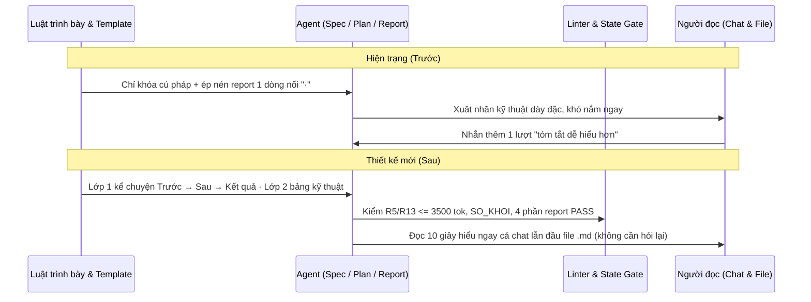

# SPEC — Mặc định Trình bày Report, Spec & Plan Ngắn gọn, Tự nhiên, Dễ hiểu

Ngày: 2026-11-21 · Request: `2026-11-21-0917-mac-dinh-trinh-bay-ngan` · Lane: full · Work kind: build
Soul: chất lượng > runtime > context cost · luật gốc: skills/tdq-conventions/references/soul.md

> **Tóm tắt dễ hiểu:** Trước đây các bản `spec`, `plan` và `report` thường viết dồn thuật ngữ hoặc ép gộp nhiều ý vào một dòng nối bằng `·`, khiến người đọc phải nhắn thêm một lượt nhờ tóm tắt lại. Sau nâng cấp này, mọi bản trình bày trong chat và phần mở đầu file sẽ mặc định kể ngắn gọn theo mạch "Trước → Sau → Kết quả" như ảnh mẫu `1.jpg`, vẫn giữ nguyên bảng kiểm tra bên dưới để hệ thống không bị lỗi.

## Mục lục

- 1. Mục tiêu & Phạm vi
- 1b. Lộ trình
- 2. Sản phẩm & Đầu ra
- 2b. Ranh giới module
- 2c. Luồng hoạt động & Sơ đồ kiến trúc
- 3. Cách tiếp cận
- 3b. Năng lực & công cụ
- 3c. Giải thuật & Xử lý cốt lõi
- 3d. Mental Model cho Fresher Dev
- 4. Yêu cầu bắt buộc
- 5. Ràng buộc kiến trúc
- 6. QC & Definition of Done
- 7. Câu hỏi còn mở

## 1. Mục tiêu & Phạm vi

- **Mục tiêu:** Chuẩn hóa quy tắc văn phong mặc định của TDQ Workflow để `spec`, `plan`, `report` (cả bản đầy đủ lẫn luồng nhanh `quick`) đều tự nhiên, mạch lạc và dễ hiểu ngay từ lượt đầu tiên cho mọi người đọc.
- **Trong phạm vi:**
  - Bổ sung quy chuẩn văn phong tự nhiên (`Trước đây → Sau khi làm xong → Kết quả`, lồng số liệu gọn, đẩy path/lệnh dài về link) vào bộ luật trình bày `user-facing-block.md` và ví dụ minh họa lấy cảm hứng từ [1.jpg](file:///c:/Users/admin/Documents/Projects/TDQ-Workflow-Antigravity/docs/workinglog/assets/2026-11-21-0217-trien-khai-investigate-v2/1.jpg).
  - Nâng cấp khuôn mẫu & hướng dẫn viết của `report`, `spec`, `plan` và `quick-lane-mini`: bỏ lệnh ép nén một dòng dày dấu `·` trong `report-template.md`, thêm ô `> **Tóm tắt dễ hiểu:**` / `> **Tóm tắt nhanh:**` ngay đầu file `.md`, viết lại mẫu khung chat `spec`/`plan`/`report`.
  - Đồng bộ lời nhắc trong `scripts/tdq_setup.py`, `docs/claude-md-mau.md` và bản `AGENTS.md` do `tools/patches/agy_manifests.py` sinh ra.
  - Cập nhật test khóa chuẩn, khóa lại ngân sách token (`token-budget.json` giữ mọi file `<= 3500` token) và build lại gói `plugins/tdq-workflow-agy/`.
- **Ngoài phạm vi (theo chốt Vòng 1 `3b` và `5`):**
  - Không cài đè ra thư mục plugin đang chạy `~/.gemini/config/plugins/` hay ghi đè file global ngoài repo (chỉ kiểm tra `--dry-run`).
  - Không xóa bỏ các bảng kỹ thuật, đề mục bắt buộc (`Trước request (trạng thái/flow)`, `Sau request (trạng thái/flow)`, `Đã test gì`, `Kết quả test`, bảng QC R14) đang được `doc_lint.py`, `tdq_state.py` và bộ test kiểm tra.
  - Không nới lỏng luật 6 ký tự cho phép, cấm emoji, chặn `AskUserQuestion` hay cổng SHA-256.

## 1b. Lộ trình

| Bước | Pha | Trạng thái | Việc chính |
|---|---|---|---|
| 1 | `analyze` | Xong | Chốt bài toán 1 vòng (phạm vi 2 mặt, giọng kể `1.jpg`, chỉ build repo, `muc_qc=full`) và lập bản đồ vùng chạm |
| 2 | `spec` | Đang làm (Chờ duyệt) | Đặc tả luật văn phong tự nhiên, chiến lược giữ trần `3.500` token và sơ đồ Trước/Sau Archify |
| 3 | `plan` | Chờ | Chia nhỏ từng cụm sửa file, cập nhật test khóa, khóa token và build plugin |
| 4 | `implement` | Chờ | Sửa lần lượt theo chu trình Red → Green và biên dịch lại `plugins/tdq-workflow-agy/` |
| 5 | `qc` | Chờ | QC độc lập kiểm `Q1–Q6` với mức `full` |
| 6 | `report` | Chờ | Xuất cặp `report` theo đúng phong cách mới, hỏi commit & merge về `dev` |
| 7 | `idle` | Chờ | Đóng request và dọn nhánh |

## 2. Sản phẩm & Đầu ra

| Thành phần | Đường dẫn / Vị trí | Loại đầu ra | Vai trò mới |
|---|---|---|---|
| Luật khối trình bày | `skills/tdq-conventions/references/user-facing-block.md` | Quy chuẩn | Thêm mục văn phong kể chuyện Trước → Sau → Kết quả & tách lớp thông tin |
| Ví dụ minh họa | `skills/tdq-conventions/references/user-facing-block-vi-du.md` | Ví dụ mẫu | Thêm đối chiếu Trước/Sau tự nhiên theo mẫu `1.jpg` |
| Khuôn & chat report | `skills/tdq-build/references/report-template.md` | Khuôn mẫu | Bỏ ép nén dòng `·`, thêm `Tóm tắt nhanh` & khung chat kể chuyện rõ ràng |
| Luật & khuôn spec | `skills/tdq-spec/SKILL.md`, `references/spec-template.md`, `references/spec-template-huong-dan.md` | Skill & Khuôn | Thêm tóm tắt dễ hiểu ở đầu spec và khung chat giải thích mục tiêu/tác động |
| Luật & khuôn plan | `skills/tdq-plan/SKILL.md`, `references/plan-template.md`, `references/plan-template-huong-dan.md` | Skill & Khuôn | Thêm tóm tắt dễ hiểu ở đầu plan và khung chat nêu việc thực tế làm được |
| Khuôn luồng nhanh | `skills/tdq-intake/references/quick-lane-mini.md` | Khuôn mẫu | Đồng bộ ô tóm tắt dễ hiểu và giọng văn tự nhiên cho express lane |
| Prompt toàn cục & Manifest | `scripts/tdq_setup.py`, `docs/claude-md-mau.md`, `tools/patches/agy_manifests.py` | Code & Bản mẫu | Ghim quy tắc kể chuyện dễ hiểu cho cả `spec`, `plan`, `report` khi cài/build |
| Khóa ngân sách & luật | `docs/tdq/token-budget.json`, `docs/tdq/audit/luat-hien-co.md` | Cấu hình khóa | Khóa SHA-256, token `<= 3500` và đồng bộ neo `L###` sau sửa |
| Bộ kiểm thử bảo vệ | Nhóm kiểm thử khóa khối chat, khuôn report và khuôn spec | Kiểm thử | Khóa quy tắc văn phong tự nhiên, `SO_KHOI`, 6 ký tự và chặn `·`-packing |
| Gói plugin biên dịch | `plugins/tdq-workflow-agy/` (qua `tools/build_agy_plugin.py`) | Build artifact | Bản plugin đầy đủ trong repo chứa luật, skill và `AGENTS.md` mới |

## 2b. Ranh giới module

- **Tầng quy chuẩn chung (`skills/tdq-conventions/`):** Giữ định nghĩa gốc về 6 thành phần khối chat, 8 luật trang trí, 6 ký tự cho phép và nguyên tắc văn phong tự nhiên; không lặp lại chi tiết khuôn từng pha.
- **Tầng từng pha (`tdq-spec/`, `tdq-plan/`, `tdq-build/`, `tdq-intake/`):** Chỉ áp dụng chuẩn trình bày tự nhiên vào đúng đầu ra của pha đó và trỏ về `user-facing-block.md`; không tự phát minh ký tự hay cấu trúc cổng mới.
- **Tầng bản mẫu & biên dịch (`scripts/tdq_setup.py`, `docs/claude-md-mau.md`, `tools/patches/agy_manifests.py`, `plugins/tdq-workflow-agy/`):** Chỉ ghim câu tóm tắt tầng 1 và đồng bộ bản build vào `plugins/tdq-workflow-agy/`, tách biệt với cài đặt live ngoài `~/.gemini/`.
- **Tầng khóa kiểm thử (`tests/` & `docs/tdq/audit/`):** Khóa bất biến của từng tầng theo ranh giới riêng, không trộn sửa đổi chéo vào script runtime `tdq_state.py`.

## 2c. Luồng hoạt động & Sơ đồ kiến trúc

### Cơ chế hiện tại vs Sau update

Bản xem trước trực quan so sánh luồng trình bày hiện tại và thiết kế mới được gắn tại: [2026-11-21-0917-mac-dinh-trinh-bay-ngan-preview.html](docs/tdq/spec/2026-11-21-0917-mac-dinh-trinh-bay-ngan-preview.html).

| Khía cạnh | Hiện trạng (Trước) | Thiết kế mới (Sau) |
|---|---|---|
| Cách viết khối chat `spec` / `plan` / `report` | `user-facing-block.md` chỉ khóa cú pháp; `report-template.md` ép gom 1 dòng nối `·`; `tdq-spec` và `tdq-plan` chỉ liệt kê nhãn khô | Bổ sung luật văn phong kể chuyện: mở đầu 1–2 câu rõ ngữ cảnh, tách `Trước đây:` và `Sau khi làm xong:` dễ quét như ảnh `1.jpg`, lồng số liệu ngắn gọn |
| Cấu trúc đầu file `.md` | Mở ngay bằng mục tiêu kỹ thuật hoặc bảng; muốn nắm nhanh phải tự đọc sâu nhiều đoạn | Có sẵn ô `> **Tóm tắt dễ hiểu:**` / `> **Tóm tắt nhanh:**` ngay dưới tiêu đề cho mọi người, các bảng kỹ thuật bên dưới giữ nguyên |
| Đường dẫn, lệnh dài và bảng lớn | Thường nhồi thẳng vào dòng tóm tắt trong chat khiến tin nhắn nặng nề | Giữ kết quả và tác động ở mặt tiền; đường dẫn dài, câu lệnh và bảng chi tiết đẩy xuống link `Xem đầy đủ tại:` |
| Khả năng tương thích `doc_lint` & `tdq_state` | Khóa chặt bởi `token-budget.json` (`<=3500` tok), `luat-hien-co.md` và bộ kiểm thử khóa khối chat, khuôn report, khuôn spec | Tận dụng khoảng trống ở `user-facing-block`, `report-template`, `*-huong-dan.md`; chèn neo gọn ở `spec-template`/`plan-template` để không vượt trần `3.500` token |

## 3. Cách tiếp cận

1. **Lớp 1 — Định nghĩa chuẩn văn phong tự nhiên ở `tdq-conventions`:**
   - Mở rộng `user-facing-block.md` (`2392/3500` token) thêm mục quy tắc văn phong tự nhiên gồm 3 nguyên tắc: (a) thử nghiệm "bất kỳ ai đọc 10–15 giây cũng nắm được chuyện gì vừa đổi", (b) kể theo mạch `Trước đây → Sau khi làm xong → Kết quả`, và (c) trình bày thoáng, mỗi ý một nhãn ngắn gọn, số liệu lồng trong câu tự nhiên, không dồn nhiều ý bằng dấu `·`.
   - Mở rộng `user-facing-block-vi-du.md` (`1085/3500` token) thêm cặp đối chiếu Trước/Sau cho `report` (phong cách ảnh `1.jpg`) và `spec`/`plan`, giữ chính xác số lượng khối mẫu `➤` hoặc cập nhật `SO_KHOI` đồng bộ kèm kiểm thử.
2. **Lớp 2 — Sửa `report-template.md` theo đúng hình mẫu `1.jpg`:**
   - Gỡ bỏ câu lệnh ép nén `"compress each item into ONE line, separating ideas with ·"` tại phần hướng dẫn viết report trong `skills/tdq-build/references/report-template.md` (`3123/3500` token).
   - Chèn ô `> **Tóm tắt nhanh:**` ngay đầu mẫu `reports/<slug>.md`, giữ nguyên 4 đề mục bắt buộc (`Trước request (trạng thái/flow)`, `Sau request (trạng thái/flow)`, `Đã test gì`, `Kết quả test`), đồng thời cho phép ý con tách dòng tự nhiên thay vì dồn `·`.
   - Nâng cấp mẫu khối chat báo cáo + hỏi commit để mặc định trình bày `1. Trước và sau request có gì khác?` (`Trước đây:` / `Sau khi làm xong:`) và `2. Đã test gì & Kết quả:` ngắn gọn trước dòng hỏi commit `1.`.
3. **Lớp 3 — Cập nhật `spec`, `plan` và `quick` mà không vỡ trần `3.500` token:**
   - Tại `spec-template.md` (`3458/3500`) và `plan-template.md` (`3420/3500`), chỉ chèn 2 dòng neo gọn `> **Tóm tắt dễ hiểu:**` dưới tiêu đề và tinh giản câu chú thích trùng lắp (giữ nguyên mọi dòng/chuỗi khóa khuôn spec, đối chiếu 3 chiều, R14 và bảng `luat-hien-co.md`).
   - Toàn bộ hướng dẫn cách viết tóm tắt đời thường, checklist "người ngoài đọc hiểu ngay", và ví dụ điền mẫu đặt vào `spec-template-huong-dan.md` (`3000/3500`) và `plan-template-huong-dan.md` (`1222/3500`).
   - Tại `skills/tdq-spec/SKILL.md` (`98/100` dòng) và `skills/tdq-plan/SKILL.md` (`121/132` dòng), diễn đạt lại khối mẫu trình bày chat theo mạch mục tiêu → thay đổi cốt lõi → kết quả dự kiến (giữ nguyên nhãn `**Luồng & Giải thuật:**`). Cập nhật tương tự cho `skills/tdq-intake/references/quick-lane-mini.md` (`1006/3500`).
4. **Lớp 4 — Đồng bộ prompt hệ thống, khóa kiểm chứng & build `plugins/tdq-workflow-agy/`:**
   - Cập nhật 1–2 câu chuẩn trình bày tự nhiên cho cả `spec`, `plan`, `report` trong `KHOI_HUONG_DAN` (`scripts/tdq_setup.py`), `docs/claude-md-mau.md` (giữ `<= 12.500` byte và mọi chuỗi khóa prompt lõi), và mục 4 trong `tools/patches/agy_manifests.py`.
   - Chạy `token_budget.py` / `tdq_finish.py` để cập nhật `docs/tdq/token-budget.json`, rà lại `docs/tdq/audit/luat-hien-co.md` giữ tỷ lệ lệch dòng `< 5%`, bổ sung kiểm thử bảo vệ quy chuẩn mới.
   - Chạy `tools/build_agy_plugin.py` để đóng gói `plugins/tdq-workflow-agy/` và kiểm chứng `--dry-run` với `tools/install_agy_plugin.py`.

## 3b. Năng lực & công cụ

| Nguồn | Khớp với việc gì | Phán quyết | Lý do |
|---|---|---|---|
| `tdq-conventions` (`plugin:tdq-workflow-agy` / repo) | Bộ quy chuẩn `user-facing-block.md`, ví dụ và bảng 6 ký tự | NỀN | Đọc để nâng cấp trực tiếp quy tắc văn phong tự nhiên |
| `tdq-spec` (`plugin:tdq-workflow-agy` / repo) | `SKILL.md`, `spec-template.md`, `spec-template-huong-dan.md` | NỀN | Đọc để lồng tóm tắt dễ hiểu đầu spec và khối chat |
| `tdq-plan` (`plugin:tdq-workflow-agy` / repo) | `SKILL.md`, `plan-template.md`, `plan-template-huong-dan.md` | NỀN | Đọc để lồng tóm tắt dễ hiểu đầu plan và khối chat |
| `tdq-build` (`plugin:tdq-workflow-agy` / repo) | `report-template.md` và phần báo cáo cuối `SKILL.md` | NỀN | Đọc để thay dòng nén `·` bằng kể chuyện `1.jpg` |
| `tdq-intake` (`plugin:tdq-workflow-agy` / repo) | `quick-lane-mini.md` cho đầu ra luồng nhanh | NỀN | Đọc để đồng bộ văn phong cho express lane |
| Đã xét 48 skill khác | Trình duyệt, Workspace Google, media, MCP plugin ngoài | KHÔNG | khác lĩnh vực |

## 3c. Giải thuật & Xử lý cốt lõi

1. **Nguyên lý Hai Lớp (Executive-First + Schema-Safe Tail):**
   - **Từng bước giải thuật:**
     1. Tại mỗi điểm phát sinh tài liệu (`spec`, `plan`, `report`, `quick`), lớp đầu tiên xuất văn phong tự nhiên theo khung `"Bối cảnh Trước → Giải pháp Sau → Kết quả"`.
     2. Lớp thứ hai bên dưới giữ nguyên tiêu đề, cột bảng và thẻ neo máy kiểm (`R14`, `Mermaid`, 4 đề mục `report`, `- [ ] **Tx.y**` trong `plan`) để parser của `doc_lint.py` và `tdq_state.py` hoạt động không gián đoạn.
     3. Với các file template đã sát trần `3.500` token (`spec-template.md` `3458`, `plan-template.md` `3420`), tách phần giải thích dài sang file `*-huong-dan.md` anh em và chỉ giữ tối thiểu dòng neo tại template chính (`<= 3500` token sau khi cập nhật `token-budget.json`).
     4. Đóng gói lại `plugins/tdq-workflow-agy/` từ nguồn gốc đã chỉnh qua `tools/build_agy_plugin.py` để plugin AGY kế thừa toàn bộ luật mới mà không sửa lệch giữa repo và bản build.
   - **Time Complexity:** $O(F + T)$ với $F$ là số file rule/template/manifest cần đọc và biên dịch lại, $T$ là số unit test kiểm chứng toàn bộ hợp đồng văn bản.
   - **Space Complexity:** $O(F)$ do mỗi file rule giữ cố định dưới trần `3.500` token và không tạo thêm file runtime ngoài bộ cấu hình/tài liệu hiện có.
   - **Edge Cases & Phòng thủ:**
     1. *Vượt trần `3.500` token (`R13`) hoặc vượt `SKILL_LINE_LIMITS` (`R6`):* Luôn đo lại token qua `token_budget.py` và số dòng `SKILL.md` trước khi khóa; nếu `spec-template.md` hoặc `plan-template.md` tiệm cận trần, tỉa ghi chú thừa trùng với `*-huong-dan.md` nhưng giữ nguyên mọi neo kiểm thử cấu trúc hiện hành.
     2. *Lệch khóa `luat-hien-co.md` hoặc số khối `SO_KHOI`:* Không đổi ký tự đầu 40 chữ của các luật `user-facing` đã khóa; khi thêm ví dụ minh họa mới trong `user-facing-block-vi-du.md`, giữ số khối rào chứa `➤` khớp `SO_KHOI` hoặc cập nhật đồng thời `SO_KHOI` và kiểm thử khối chat trong cùng task.
     3. *Lệch định dạng `i18n_check.py` hoặc `scan_block_symbols.py`:* Các ví dụ tiếng Việt mới trong file rule tiếng Anh phải bọc thẻ `<!-- i18n-allow: ... -->` chuẩn và mọi khối chat chỉ dùng 6 ký tự ngoài ASCII cho phép (`➤`, `·`, `—`, `→`, `–`, `…`), không emoji.

## 3d. Mental Model cho Fresher Dev

- **Ẩn dụ trực quan:** Hãy hình dung mỗi tài liệu `spec`, `plan` và `report` như một **tấm biển thông tin 2 tầng ở nhà ga**: tầng trên cùng (khối chat và ô `Tóm tắt dễ hiểu`) viết chữ lớn bằng tiếng nói hàng ngày để bất kỳ hành khách nào đi ngang cũng biết ngay chuyến tàu vừa đổi giờ gì và đi đâu trong 10 giây; tầng dưới (bảng kỹ thuật, sơ đồ, log test) chứa thông số chi tiết để kỹ sư vận hành và hệ thống kiểm tra tự động đối chiếu. Trước đây bảng đặt ngay ngoài mặt tiền khiến người đi đường cũng phải đọc thông số kỹ thuật mới hiểu chuyện gì xảy ra.
- **Thuật ngữ dự án:**
  - `user-facing-block`: Bộ quy chuẩn chung điều khiển cấu trúc, ký tự và nay bổ sung thêm văn phong kể chuyện của mọi khung chat TDQ gửi người dùng.
  - `SO_KHOI`: Biến đếm số lượng khối chat mẫu chứa ký tự `➤` được bộ kiểm thử khối chat khóa chặt cho từng file skill.
  - `token-budget.json`: Sổ khóa SHA-256 và số token tối đa (`3500`) cho từng file hướng dẫn để agent không nhồi quá nặng ngữ cảnh.
  - `luat-hien-co.md`: Bảng đối chiếu 40 ký tự đầu của từng luật trong `skills/` nhằm ngăn sửa skill làm rơi mất luật quan trọng.

## 4. Yêu cầu bắt buộc

- **Log service:** BỎ — Request chỉ cập nhật quy chuẩn tài liệu, khuôn mẫu, lời nhắc prompt, kiểm thử và đóng gói lại plugin tĩnh trong repo; không xây thêm service hay công cụ runtime chạy nền mới (các script build/lint vẫn giữ log `TDQ_LOG` mặc định hiện có).
- **Không placeholder & tự khép kín (`R8`, `R10`):** Mọi mẫu mới đều là hướng dẫn hoặc ví dụ hoàn chỉnh sẵn sàng dùng ngay; không chứa `TODO`, `TBD` hay chỉ dẫn mơ hồ.
- **Kiểm chứng từng phần:** Mỗi nhóm sửa (quy chuẩn chung, `report`, `spec`/`plan`/`quick`, prompt/build AGY) đều đi kèm unit test kiểm tra trực tiếp nội dung và `doc_lint.py` / `tdq_test.py`.

## 5. Ràng buộc kiến trúc

Trích nguyên văn các ràng buộc liên quan từ `docs/kien-truc.md`:

- "Ngôn ngữ tài liệu: `doc_lang = vi` (`brief`, `spec`, `plan`, `qc`, `report`, working log); chỉ file luật gốc mới thêm quy định ngoại lệ nếu có"
- "`user-facing-block`: hỏi bằng chat (cấm `AskUserQuestion`), ký tự cuối `➤`, danh sách đánh số `1.` — khóa bởi `test_user_facing_block.py`"
- "Tầng `scripts/` là runtime lõi, không phụ thuộc `hooks/`; `skills/` là hướng dẫn cho agent và chỉ gọi CLI `scripts/` qua dòng lệnh"
- "`tdq_state.py` là điểm ghi duy nhất cho `docs/tdq/state.json` và `STATE.md`"

## 6. QC & Definition of Done

| Hạng mục | Tiêu chuẩn | Điều kiện PASS | Đo trước | Dự phòng nếu trượt |
|---|---|---|---|---|
| Q1 · Quy chuẩn văn phong & ký tự | Đủ luật kể chuyện Trước → Sau → Kết quả, không ép nén `·`, vẫn giữ 6 ký tự & 0 emoji | `user-facing-block.md`, `user-facing-block-vi-du.md`, `report-template.md` đạt chuẩn; `scan_block_symbols.py --chi-khoi` trả 0 ký tự lạ và bộ kiểm thử khối chat & ký tự PASS 100% | `user-facing-block.md` hiện `2392/3500` tok; `report-template.md` `3123/3500` tok có dòng ép nén `·` tại dòng 101 & 110–115; `scan_block_symbols` hiện 6 ký tự chuẩn / 0 lạ | Tách bớt ví dụ dài sang `user-facing-block-vi-du.md`, chỉnh lại chuỗi neo đúng cấu trúc `SO_KHOI` |
| Q2 · Khuôn `spec`, `plan` & `quick` + `SKILL.md` | Có `Tóm tắt dễ hiểu` đầu file & khung chat tự nhiên, giữ nguyên mọi neo test & giới hạn dòng `SKILL.md` | `doc_lint.py` 0 lỗi, toàn bộ kiểm thử khuôn spec, report, 3 chiều, luật đúng và bảng `luat-hien-co` đều PASS | `spec-template.md` `3458/3500` tok; `plan-template.md` `3420/3500` tok; `tdq-spec/SKILL.md` `98/100` dòng; `tdq-plan/SKILL.md` `121/132` dòng | Đưa chi tiết hướng dẫn sang `*-huong-dan.md`, giữ neo đầu file ở mức 1–2 dòng hoặc nâng trần kèm lý do `soul.md` |
| Q3 · Prompt toàn cục & AGY build trong repo | `tdq_setup.py`, `claude-md-mau.md` (`<=12.500` B), `agy_manifests.py` & `plugins/tdq-workflow-agy/` đồng bộ, không cài đè ra `~/.gemini/` | `tools/build_agy_plugin.py` chạy exit 0, `tools/install_agy_plugin.py --dry-run` PASS, bộ kiểm thử prompt lõi & xác thực plugin AGY PASS, `~/.gemini/` không bị sửa | `KHOI_HUONG_DAN` đo `8218` byte, `docs/claude-md-mau.md` `9720` ký tự (`MAX_BYTES=12500`); `~/.gemini/config/plugins/` hiện ở bản cũ `0.101.0` | Rà lại bảng thay thế M01–M20 trong `skills_and_agents.py` và kiểm lại chữ ký `plugins/tdq-workflow-agy/` |
| Q4 · Khóa ngân sách token & i18n | Mọi file reference mới sửa đều `<= 3500` token và khóa SHA-256 mới; không vi phạm `i18n_check.py` | `token_budget.py`, `tdq_finish.py` và bộ kiểm thử ngân sách token / khóa SHA-256 / i18n PASS | `token-budget.json` đang khóa toàn bộ hash cũ trước khi sửa; có sẵn venv token `TDQ_TOKENS_VENV` | Rút bớt diễn giải trùng giữa template và `*-huong-dan.md`, khóa lại `token-budget.json` sau sửa cuối |
| Q5 · Trải nghiệm đọc thực tế | Đọc thử bản mẫu `report`, `spec`, `plan` sinh ra theo khuôn mới | Mạch "Trước → Sau → Kết quả" rõ ràng trong <= 15 giây đọc, đúng tinh thần `1.jpg`, không làm gãy `doc_lint` hay `_archify_gate` | Hiện trạng buộc đọc `report-template` nối `·` và hỏi lại lượt 2 như ảnh `1.jpg` | Tinh chỉnh câu mở đầu mẫu và phân cấp nhãn đậm trong `user-facing-block-vi-du.md` và `report-template.md` |
| Q6 · Toàn bộ bộ kiểm thử hồi quy | Bộ test toàn kho mã không phát sinh hồi quy mới | `py -3 -X utf8 scripts/tdq_test.py tron-bo` PASS (không tăng ca skip/lỗi) | Lần chạy gần nhất trước khi mở request (`dev`): `4596 passed, 36 skipped` | Cô lập ngay test đỏ theo nhóm `vung-cham` để vá đúng luật bị lệch |

## 7. Câu hỏi còn mở

Không còn câu hỏi mở — toàn bộ phạm vi, văn phong mẫu `1.jpg`, đóng gói chỉ trong repo (`3b`) và mức QC `full` đã được người dùng chốt ở Vòng 1.
<!-- tdq-archify-binding:start -->
<!-- manifest: 2026-11-21-0917-mac-dinh-trinh-bay-ngan-preview.manifest.json -->
<!-- manifest_digest: 60dae1a9b80ebcbbc8ac435a091b9d29fc1982c4c8f4ad77c40baba0daf9718a -->
<!-- tdq-archify-binding:end -->