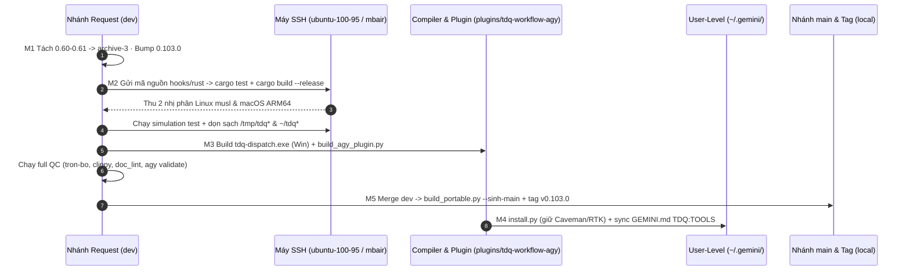

# SPEC — Bump Version `0.103.0`, Build 3-OS Rust, Release `main` & Cập nhật Antigravity Local

Ngày: 2026-11-21 · Bản: 1.0 · Brief: ../brief/2026-11-21-1034-bump-version-release-local.md · Lane: full · Work kind: build
Soul: chất lượng > runtime > context cost · luật gốc: skills/tdq-conventions/references/soul.md
Trạng thái: CHỜ DUYỆT

> **Tóm tắt dễ hiểu:** Hiện tại nhánh `dev` vẫn ghi phiên bản `0.102.0` dù đã gộp thêm 3 đợt nâng cấp lớn (`4 trụ cột agent`, `investigate V2`, `trình bày ngắn gọn`), tệp `CHANGELOG.md` đã chạm `480/500` dòng, nhị phân Rust và bản plugin Antigravity đang dùng trên máy vẫn dừng ở `0.101.0`, còn nhánh phát hành `main` mới ở `v0.100.0`. Đợt nâng cấp này sẽ đồng bộ tất cả lên `0.103.0`, biên dịch lại nhị phân Rust trên cả 3 hệ điều hành (Windows local, Ubuntu và macOS qua SSH kèm dọn sạch tuyệt đối sau khi test), xuất bản nhánh `main` + tag `v0.103.0` ở local, rồi cập nhật trọn bộ plugin lẫn tệp quy tắc `GEMINI.md` chỉ cho Antigravity trên máy.

## Mục lục

- 1. Mục tiêu & phạm vi
- 1b. Lộ trình
- 2. Đầu ra cụ thể
- 2b. Ranh giới module
- 2c. Luồng hoạt động & Sơ đồ kiến trúc
- 3. Cách tiếp cận & lý do
- 3b. Năng lực & công cụ
- 3c. Giải thuật & Xử lý cốt lõi
- 3d. Mental Model cho Fresher Dev
- 4. Yêu cầu bắt buộc
- 5. Ràng buộc & rủi ro
- 6. QC & Definition of Done
- 7. Câu hỏi còn mở

## 1. Mục tiêu & phạm vi

- **Mục tiêu:** Nâng toàn bộ phiên bản mã nguồn, tài liệu phát hành, nhị phân Rust 3 nền tảng và gói plugin `tdq-workflow-agy` lên `0.103.0` qua kiểm định `full` (`0` lỗi), xuất bản nhánh sạch `main` kèm tag local `v0.103.0`, và cập nhật bản user-level Antigravity trên máy hoạt động ổn định với đầy đủ Caveman/RTK và `GEMINI.md` mới nhất.
- **Trong phạm vi:**
  - Bump số phiên bản lên `0.103.0` trên toàn bộ manifest (`.claude-plugin/plugin.json`, `.codex-plugin/plugin.json`), cấu hình compiler AGY (`tools/patches/agy_manifests.py`, `tools/patches/__init__.py`, `tools/build_agy_plugin.py`), tài liệu (`UPSTREAM-TRACE.md`, `README.md` kèm cập nhật số liệu test/script/skill thực tế), và crate Rust (`hooks/rust/tdq-dispatch/Cargo.toml`).
  - Tách 2 mục lịch sử cũ (`0.61.0`–`0.60.0`) từ `CHANGELOG.md` sang `docs/CHANGELOG-archive-3.md` để đưa `CHANGELOG.md` xuống dưới trần `500` dòng (`<= 499` dòng theo R6) rồi ghi mục phát hành `0.103.0` tổng hợp đủ 3 đợt nâng cấp sau `0.102.0`.
  - Biên dịch lại đủ 3 nhị phân native của `tdq-dispatch` phiên bản `0.103.0`: `tdq-dispatch.exe` (`Windows`), `tdq-dispatch-linux-x86_64` (`Ubuntu x86_64` static `musl` qua SSH `ubuntu-100-95`) và `tdq-dispatch-darwin-arm64` (`macOS ARM64` Mach-O qua SSH `mbair`); chạy `cargo test` và kiểm thử mô phỏng 6 sự kiện hook trên máy Linux/macOS thật qua SSH, sau đó **dọn sạch tuyệt đối** mọi thư mục build/simulation tạm và tàn dư cũ (`/home/ubuntu/tdq-dispatch`, `/tmp/tdq_dispatch.tar.gz`, `/tmp/tdq*`, `~/tdq*`) trên cả 2 máy SSH.
  - Đóng gói lại `plugins/tdq-workflow-agy/` (`v0.103.0`), chạy full QC (`muc_qc = full`), gộp về `dev`, xuất bản nhánh `main` sạch tại local qua `scripts/build_portable.py --sinh-main --nguon dev --nhanh-dich main` và tạo tag annotated `v0.103.0`.
  - Cài cập nhật `plugins/tdq-workflow-agy/` ra `C:\Users\admin\.gemini\config\plugins\tdq-workflow-agy` qua `install.py` (giữ nguyên Caveman + RTK và kích hoạt `agy`), đồng thời đồng bộ khối `<!-- TDQ:TOOLS -->` mới trong `C:\Users\admin\.gemini\GEMINI.md`.
- **NGOÀI phạm vi:**
  - Không chạy `git push` lên bất kỳ remote nào (`3a`).
  - Không cập nhật, cài đè hoặc chỉnh sửa plugin/cấu hình của `~/.claude/` hay `~/.codex/` (`chỉ update cho antigravity`).
  - Không tự chế nhị phân cross-compile giả: chỉ dùng nhị phân native biên dịch trên đúng 3 OS thật.

## 1b. Lộ trình

| Bước/phase | Chạy? | Vì sao |
|---|---|---|
| Research web | BỎ | Quy trình bump version, build plugin, `--sinh-main`, SSH host và `install.py` đều có sẵn nội bộ repo và đã khảo sát đầy đủ |
| Interview | CÓ | Đã chốt đủ 5 câu Vòng 1 (`1a`, `2a + SSH Linux/Mac + dọn sạch`, `3a`, `4a + chỉ Antigravity`, `5 không`) |
| QC độc lập (agent) | CÓ | Luồng `full` với `muc_qc = full`: xác minh trọn bộ `tdq_test.py tron-bo`, Rust 3 OS, SSH cleanup, `agy plugin validate` và kiểm bản live `~/.gemini/` |

## 2. Đầu ra cụ thể

| # | Đầu ra | Đường dẫn/vị trí | Đo "xong" bằng |
|---|---|---|---|
| 1 | Manifest & tài liệu `0.103.0` + tách archive | `.claude-plugin/plugin.json`, `.codex-plugin/plugin.json`, `README.md`, `UPSTREAM-TRACE.md`, `CHANGELOG.md`, `docs/CHANGELOG-archive-3.md` | Bộ kiểm thử toàn vẹn tài liệu & adapter 4 host PASS (`0` lỗi); `doc_lint.py CHANGELOG.md docs/CHANGELOG-archive-3.md` exit `0` (`<= 500` dòng) |
| 2 | Crate Rust `0.103.0` & 3 nhị phân native thật | `hooks/rust/tdq-dispatch/Cargo.toml`, `plugins/tdq-workflow-agy/bin/{tdq-dispatch.exe,tdq-dispatch-linux-x86_64,tdq-dispatch-darwin-arm64}` | `cargo test` PASS trên Windows/Linux/macOS; magic header `MZ`/`ELF`/`Mach-O`; mô phỏng SSH Linux & macOS PASS |
| 3 | Dọn sạch 2 máy test SSH | `ubuntu-100-95` & `mbair` (qua SSH) | `ls -d /tmp/tdq* /tmp/tdq_dispatch* ~/tdq*` trả rỗng (`0` mục còn sót) trên cả 2 máy sau khi test xong |
| 4 | Compiler & gói plugin `tdq-workflow-agy` `v0.103.0` | `tools/patches/agy_manifests.py`, `tools/patches/__init__.py`, `tools/build_agy_plugin.py`, `plugins/tdq-workflow-agy/` | `py -3 -X utf8 tools/build_agy_plugin.py --upstream .` trả `"status": "OK"`; `agy.EXE plugin validate plugins/tdq-workflow-agy --strict --json` trả `findings == []` |
| 5 | Bản cài Antigravity user-level & `GEMINI.md` | `C:\Users\admin\.gemini\config\plugins\tdq-workflow-agy\`, `C:\Users\admin\.gemini\GEMINI.md` | `agy plugin list` hiện `tdq-workflow-agy (enabled, 0.103.0)`; `plugin.json` phiên bản `0.103.0`; `mcp_config.json` giữ đủ `tdq_mcp_shrink.py` (`3` server); `GEMINI.md` chứa dòng `1145` và giữ nguyên mục `Ngôn ngữ trong chat` |
| 6 | Nhánh phát hành `main` sạch & tag `v0.103.0` | Nhánh git `dev`, `main` & annotated tag `v0.103.0` (local) | `scripts/build_portable.py --sinh-main --nguon dev --nhanh-dich main` exit `0`; `git show main:.claude-plugin/plugin.json` chứa `"0.103.0"`; `git tag -l v0.103.0` tồn tại; `~/.claude/plugins/installed_plugins.json` không đổi `mtime` |

## 2b. Ranh giới module

Xác định theo luồng gọi thực tế từ LSP (`find_symbol`, `find_references`) và Graphify (`graphify query`):

| Module | Vùng file | Phụ thuộc module | Đầu ra §2 nào <!-- i18n-allow: canonical spec section names --> |
|---|---|---|---|
| M1: Manifests & Changelog | `.claude-plugin/plugin.json`, `.codex-plugin/plugin.json`, `CHANGELOG.md`, `docs/CHANGELOG-archive-3.md`, `README.md`, `UPSTREAM-TRACE.md` | Không (nguồn gốc version) | 1 |
| M2: Rust 3-OS Build & SSH Cleanup | `hooks/rust/tdq-dispatch/Cargo.toml`, `plugins/tdq-workflow-agy/bin/tdq-dispatch*` (cùng bản build tạm qua SSH trên `ubuntu-100-95` và `mbair`) | Không (crate độc lập, giữ nguyên logic Rust hiện hành) | 2, 3 |
| M3: AGY Plugin Compiler | `tools/patches/agy_manifests.py` (`PLUGIN_VERSION`), `tools/patches/__init__.py`, `tools/build_agy_plugin.py` (`_stage_rust_binaries`), `plugins/tdq-workflow-agy/` | Đọc version & binary từ M2 (`existing_output_bin`); ghi khớp version M1 | 4 |
| M4: Antigravity User-Level Sync | `C:\Users\admin\.gemini\config\plugins\tdq-workflow-agy\`, `C:\Users\admin\.gemini\GEMINI.md` | Thực thi `install.py` + `scripts/tdq_setup.py:ghim_huong_dan_tool` từ gói M3 | 5 |
| M5: Git Release `main` & Tag | Nhánh `dev`, nhánh `main` (Git plumbing `--sinh-main`), tag `v0.103.0` | Chạy sau khi M1–M3 đã commit và merge về `dev` vì `sinh_nhanh_main` đọc `git ls-tree dev` | 6 |

## 2c. Luồng hoạt động & Sơ đồ kiến trúc

Bản xem trước trực quan so sánh luồng Trước/Sau qua Archify BA gắn tại: [2026-11-21-1034-bump-version-release-local-preview.html](2026-11-21-1034-bump-version-release-local-preview.html).

| Khía cạnh | Hiện trạng (Trước) | Thiết kế mới (Sau) |
|---|---|---|
| Phiên bản & Lịch sử | Manifests `0.102.0`, thiếu notes cho 3 đợt nâng cấp sau `0.102.0`, `CHANGELOG.md` `480/500` dòng | Tất cả khớp `0.103.0`, tách `0.61.0`–`0.60.0` sang `archive-3`, `CHANGELOG.md < 500` dòng |
| Nhị phân Rust 3 OS | `Cargo.toml` `0.101.0`; Linux/macOS binary cũ ngày `11/19`; tồn đọng `/home/ubuntu/tdq-dispatch` | Cả 3 OS biên dịch mới từ `0.103.0`, qua simulation trên máy thật và dọn sạch `100%` máy SSH |
| Phát hành `main` & Local AGY | `main` dừng ở `v0.100.0`, tag `v0.99.0`; `~/.gemini/` ở `0.101.0` & thiếu luật `1145` | `main` + tag `v0.103.0` local; `~/.gemini/` chạy `0.103.0` + Caveman/RTK + `GEMINI.md` đồng bộ |

## 3. Cách tiếp cận & lý do

- **Chọn:** Chạy biên dịch Rust native thật trên 3 hệ điều hành (Windows local, `ubuntu-100-95` Linux `musl`, `mbair` macOS `arm64`) với thư mục build tạm cô lập trong `/tmp/tdq-build-*` và lệnh dọn bắt buộc ngay sau khi tải nhị phân và chạy simulation; sử dụng lại các công cụ chính quy của repo (`tools/build_agy_plugin.py`, `scripts/build_portable.py --sinh-main`, `install.py`, `tdq_setup.ghim_huong_dan_tool`) và kiểm chứng `README.md`/`Cargo.toml` bằng bộ test thật của repo.
- **Vì:** `tools/build_agy_plugin.py:112-189` bắt buộc đủ 3 nhị phân có magic bytes hợp lệ; `sinh_nhanh_main` dùng Git plumbing từ cây `dev` đã commit nên tách sạch khỏi working tree; `install.py` tự xử lý Windows `WinError 32` và giữ nguyên trạng thái `Caveman` (`~/.tdq/caveman.json`) + `RTK` đang hoạt động.
- **Đã loại:** Không cài đặt công cụ cross-compile giả trên Windows (nhị phân dễ lệch CRT hoặc không chạy được trên macOS Apple Silicon); không dùng `tools/install_agy_plugin.py` đơn lẻ làm bước cài chính vì `install.py` bao phủ thêm `agy plugin validate` và `agy plugin enable`; không dùng `git checkout main` để merge (nguy cơ xung đột `modify/delete` thay vì Git plumbing `--sinh-main`).

## 3b. Năng lực & công cụ

| Skill | Nguồn | Phán quyết | Dùng ở đâu / Lý do loại |
|---|---|---|---|
| `tdq-conventions` | `plugin:tdq-workflow-agy` | NỀN | Luật định dạng, git safety, `doc_lint` và kiểm chứng đầu ra |
| `tdq-setup` | `plugin:tdq-workflow-agy` | DÙNG | Đồng bộ khối `<!-- TDQ:TOOLS -->` trong `~/.gemini/GEMINI.md` từ `ghim_huong_dan_tool` |
| `tdq-checkportable` | `plugin:tdq-workflow-agy` | DÙNG | Tham chiếu bước tự kiểm tính khả chuyển sau khi cài plugin AGY |
| `tdq-spec`, `tdq-plan`, `tdq-build`, `tdq-intake`, `tdq-status`, `tdq-check-status`, `tdq-lean` | `plugin:tdq-workflow-agy` | NỀN | Khung pipeline `full` cho toàn bộ request hiện tại |
| `agy-customizations`, `antigravity-guide`, `plugin` | `built-in` | DÙNG | Đối chiếu đường dẫn và cơ chế nạp plugin/rules tại `~/.gemini/` |
| Đã xét 33 skill đĩa khác + 11 skill built-in còn lại (`tdq-browser-*`, `chrome-devtools-plugin`, `gdocs`/`gdrive`/`gsheets`/`gslides`, `gemini-api*`, `google-antigravity-sdk`, `mcp-app-development`, `generative_ui`, `run-workflow`, `automation`, `migrate-*`, `swarm_monitor`, `9router-image`, `cdesktop`, `frontend-design`, `illustrator-preflight`) | `user` / `plugin` / `built-in` | KHÔNG | khác lĩnh vực |

## 3c. Giải thuật & Xử lý cốt lõi

- **Từng bước thực thi (Step-by-step Execution Logic):**
  1. **Bước 1 (`M1`):** Tách `0.61.0`–`0.60.0` từ `CHANGELOG.md:449-476` lên đầu `docs/CHANGELOG-archive-3.md`; viết mục `## 0.103.0 — 2026-11-21` lên đầu `CHANGELOG.md` tổng hợp `4 trụ cột agent` (`1230`), `investigate V2` (`0217`), `trình bày ngắn gọn` (`0917`) và đợt phát hành 3-OS hiện tại; cập nhật `0.103.0` cho `.claude-plugin/plugin.json`, `.codex-plugin/plugin.json`, `README.md` (kèm badge test & số thực đo `scripts/` `73`, `tests/` `4.602 passed`), và `UPSTREAM-TRACE.md` (`Release Tag: v0.103.0`).
  2. **Bước 2 (`M2`):** Nâng `hooks/rust/tdq-dispatch/Cargo.toml` (`version = "0.103.0"`). Chạy `cargo test` và `cargo build --release` (`+crt-static`) trên Windows. Đóng gói mã nguồn `hooks/rust/tdq-dispatch` (loại `target/`) gửi qua SSH lên `ubuntu-100-95` (`/tmp/tdq-build-linux-<id>`) chạy `cargo test` + `cargo build --release --target x86_64-unknown-linux-musl`, tải nhị phân về `plugins/tdq-workflow-agy/bin/tdq-dispatch-linux-x86_64` và chạy bộ kiểm thử mô phỏng Linux qua SSH. Làm tương tự trên `mbair` (`/tmp/tdq-build-mac-<id>`) chạy `cargo test` + `cargo build --release --target aarch64-apple-darwin`, tải nhị phân về `plugins/tdq-workflow-agy/bin/tdq-dispatch-darwin-arm64` và chạy bộ kiểm thử mô phỏng macOS qua SSH. Ngay trong khối `try...finally` sau build và test, chạy dọn toàn bộ `/tmp/tdq*`, `~/tdq*`, `/home/ubuntu/tdq-dispatch` và `/tmp/tdq_dispatch.tar.gz` rồi kiểm lại bằng `ls` trên cả 2 máy để xác nhận sạch `0` file sót.
  3. **Bước 3 (`M3`):** Nâng `PLUGIN_VERSION = "0.103.0"` ở `tools/patches/agy_manifests.py:11` và chuỗi version ở `tools/patches/__init__.py:1`, `tools/build_agy_plugin.py:2,275`. Kiểm đảm bảo không tồn tại thư mục `hooks/rust/tdq-dispatch/prebuilt/` cũ chen ngang thứ tự ưu tiên ở `_resolve_binary_source`, rồi chạy `py -3 -X utf8 tools/build_agy_plugin.py --upstream .`. Chạy `agy.EXE plugin validate plugins/tdq-workflow-agy --strict --json`.
  4. **Bước 4 (`QC`):** Chạy trọn bộ `tdq_test.py tron-bo --workers 1 --fresh --reuse off`, `cargo test`, `cargo clippy --all-targets -- -D warnings`, `doc_lint.py`, `token_budget.py --kiem`, `tdq-qc-tester` đối soát độc lập và kiểm sạch 2 máy SSH.
  5. **Bước 5 (`M5` & `M4` tại cuối `report` sau khi commit & merge `dev`):** Commit trên nhánh request, merge `--no-ff` vào `dev`, chạy `py -3 -X utf8 scripts/build_portable.py --sinh-main --nguon dev --nhanh-dich main`, tạo annotated tag `v0.103.0` trên `main`, rồi chạy `py -3 -X utf8 install.py` cài plugin mới ra `C:\Users\admin\.gemini\config\plugins\tdq-workflow-agy` và gọi `tdq_setup.ghim_huong_dan_tool` cập nhật khối `<!-- TDQ:TOOLS -->` trong `C:\Users\admin\.gemini\GEMINI.md` (ghi rõ không sửa `~/.claude/`).
- **Độ phức tạp tính toán:**
  - Thời gian (Time Complexity): $O(F + T)$ — với $F$ là số tệp trong cây nguồn khi biên dịch `plugins/tdq-workflow-agy/` + Git tree `--sinh-main`, và $T$ là số test chạy trong `tdq_test.py tron-bo` (~`4.630+` ca tuần tự mất ~`20–25` phút).
  - Không gian (Space Complexity): $O(S_{target})$ — vùng nhớ tạm trong `/tmp` trên máy SSH cho `cargo` build (`~150–300 MB` trong lúc biên dịch, thu hồi về `0 B` sau bước cleanup).
- **Các ca góc hiểm (Edge Cases & Defensive Handling):**
  - `CHANGELOG.md` chạm `500` dòng: Tách mục `0.61.0`–`0.60.0` sang `docs/CHANGELOG-archive-3.md` TRƯỚC khi chèn mục `0.103.0` và kiểm `doc_lint.py CHANGELOG.md docs/CHANGELOG-archive-3.md` cả trước lẫn sau sửa.
  - SSH build/test bị lỗi giữa chừng vẫn bỏ rác trên Linux/Mac: Mọi thao tác SSH phải bọc lệnh xóa `/tmp/tdq-*` ở phía kết thúc (tương đương `try/finally`) và có bước xác minh hậu kiểm (`ls -d ...` rỗng) cho cả `ubuntu-100-95` và `mbair`.
  - Lỡ đọc lại binary cũ từ `prebuilt/` hoặc lỗi `WinError 32` khi ghi đè plugin `~/.gemini/`: Xác minh kích thước/thời gian/sha256 của 3 file trong `plugins/tdq-workflow-agy/bin/` khớp bản mới; dùng `install.py` có `_copy_tree` in-place tránh xóa thư mục gốc đang bị tiến trình giữ.
  - Lệch tree giữa nhánh request và `main`: Chỉ chạy `scripts/build_portable.py --sinh-main --nguon dev --nhanh-dich main` SAU KHI nhánh request đã commit và merge `--no-ff` vào `dev`.

## 3d. Mental Model cho Fresher Dev

- **Ẩn dụ trực quan (Analogy):** Hãy hình dung việc phát hành `0.103.0` giống như xuất xưởng một mẫu xe mới cho showroom Antigravity: trước hết đổi tem nhãn và sổ bảo hành ở `dev` (`M1`), gửi khung máy lên 3 xưởng Windows/Ubuntu/macOS đúc đúng 3 bộ động cơ thật rồi quét sạch mạt sắt tại xưởng (`M2`), lắp ráp nguyên chiếc xe mẫu (`M3`), cho qua kiểm định toàn diện (`QC`), ghi sổ lưu kho thành phẩm sạch trên `main` (`M5`), rồi mới giao xe mới nhất vào gara cá nhân `~/.gemini/` của chủ xe (`M4`).
- **Thuật ngữ dự án (Glossary):**
  - `Git plumbing (--sinh-main)`: Cơ chế dựng nhánh phát hành sạch trực tiếp từ Git tree bằng chỉ mục tạm (`GIT_INDEX_FILE`) mà không cần `git checkout`, tránh xung đột file tài liệu/test.
  - `In-place sync & Caveman wrap`: Cơ chế sao chép ghi đè từng file của `install.py` giúp không làm sập thư mục đang khóa trên Windows và tự động bọc lại 3 MCP server bằng `tdq_mcp_shrink.py` dựa trên `~/.tdq/caveman.json`.

## 4. Yêu cầu bắt buộc

- **Log service bật mặc định:** `tools/build_agy_plugin.py`, `scripts/build_portable.py`, `install.py` và `tdq-dispatch` (Windows/Linux/macOS) đều giữ log kèm timestamp ISO bật mặc định (`TDQ_LOG=1`) ra `stderr` và tắt sạch khi `TDQ_LOG=0`. Đợt này giữ nguyên hành vi và kiểm chứng không rò log khi `TDQ_LOG=0`.
- Không placeholder, không TODO stub, không nhị phân cross-OS giả danh.
- Mỗi thay đổi cấu hình/version/binary đều có test tự động xác minh hành vi thật (tính nhất quán tài liệu & adapter đa host, kiểm định cấu trúc plugin AGY, đối chiếu vi phân & khóa đa tiến trình Rust, mô phỏng SSH Linux/macOS, và `cargo test` trên 3 OS).
- Tuân thủ quy tắc Python UTF-8 (`CREATE_NO_WINDOW` trên Windows), Rust không `.unwrap()` bừa bãi trong code mới, PowerShell 5.1 khi gọi CLI.

## 5. Ràng buộc & rủi ro

Ràng buộc kiến trúc phải giữ (từ `docs/kien-truc.md`):
- `"Mọi nền tảng đọc cùng một thư mục skills/ chung qua lớp adapter mỏng; cấm quay lại mô hình nhân bản 3 thư mục bundle cũ"` — chạm khi bump manifest tại `.claude-plugin/plugin.json`, `.codex-plugin/plugin.json` và xác nhận qua bộ kiểm thử adapter 4 nền tảng.
- `"Lệnh scripts/build_portable.py --sinh-main lọc bỏ docs/, tests/, evals/ và nhóm script phát triển để giữ nhánh main tinh gọn"` — chạm tại bước xuất bản `main` từ `dev` và xác nhận qua bộ kiểm thử lọc phát hành portable.

| Rủi ro | Ảnh hưởng | Cách giảm |
|---|---|---|
| `CHANGELOG.md` vượt 500 dòng làm trượt R6 | `doc_lint.py` và `tdq_finish.py` chặn cổng commit | Tách `0.61.0`–`0.60.0` sang `docs/CHANGELOG-archive-3.md`, kiểm `line_count <= 500` sau khi viết |
| SSH `ubuntu-100-95` hoặc `mbair` còn rác build/tarball hoặc dùng nhầm binary cũ | Tốn dung lượng máy test hoặc đóng gói nhị phân `0.101.0` cũ | So sánh `sha256`/size trước-sau của cả 3 nhị phân, kiểm chứng chuỗi version/Cargo mới và chạy lệnh hậu kiểm `ls` trống trên cả 2 máy SSH |
| Mất cấu hình Caveman MCP hoặc lệch `hooks.json` khi cài ra `~/.gemini/` | Gãy hook Antigravity hoặc mất tối ưu token `tdq_mcp_shrink.py` | Dùng `install.py` (không dùng raw copy), kiểm lại `mcp_config.json`, `hooks.json` và `agy plugin validate` ngay trên `~/.gemini/config/plugins/tdq-workflow-agy` |
| Cập nhật `~/.gemini/GEMINI.md` làm mất phần ngoài `<!-- TDQ:TOOLS -->` (`Ngôn ngữ trong chat`) | Mất rule ngôn ngữ chat của người dùng | Dùng đúng `tdq_setup.ghim_huong_dan_tool` chỉ thay vùng giữa `<!-- TDQ:TOOLS -->` và `<!-- /TDQ:TOOLS -->`, đọc diff xác nhận lại |
| Chạy `--sinh-main` trước khi commit/merge vào `dev` | Nhánh `main` không có code `0.103.0` | Đặt thứ tự cứng: chỉ chạy `--sinh-main` sau khi gộp xong vào `dev`, kiểm `git show main:...` |

## 6. QC & Definition of Done

| # | Hạng mục kiểm | Điều kiện PASS | Đo trước | Dự phòng nếu trượt |
|---|---|---|---|---|
| Q1 | Manifest, README, UPSTREAM-TRACE & CHANGELOG | Kiểm thử toàn vẹn tài liệu & adapter 4 host PASS `0 failed`; mọi file manifest khớp `"0.103.0"`; `CHANGELOG.md` `<= 500` dòng và `doc_lint.py` `0` lỗi | `CHANGELOG.md` `480` dòng; manifests `0.102.0`; badge `4525` | Chỉnh lại số dòng archive hoặc khóa chữ trong manifest rồi kiểm lại |
| Q2 | Rust 3 OS (`Cargo.toml` `0.103.0`) & Simulation | `cargo test` PASS `100%` trên Windows, Linux (`ubuntu-100-95`) & macOS (`mbair`); `cargo clippy -- -D warnings` `0` warning; đối chiếu vi phân, khóa đa tiến trình Rust và mô phỏng SSH Linux/macOS PASS `0 failed`; 3 binary khác nhau có header `MZ`/`ELF`/`Mach-O` | `Cargo.toml` `0.101.0`; binary Linux/Mac mốc `11/19` | Sửa lỗi biên dịch/môi trường trên máy tương ứng, build và chạy lại đến khi xanh `100%` |
| Q3 | Dọn sạch 2 máy test SSH Linux & Mac | Trên cả `ubuntu-100-95` và `mbair`, lệnh `ls -d /tmp/tdq* /tmp/tdq_dispatch* ~/tdq*` trả `0` tệp/thư mục tồn đọng | `ubuntu-100-95` đang dư `/home/ubuntu/tdq-dispatch` & `/tmp/tdq_dispatch.tar.gz` | Chạy `rm -rf` đúng đường dẫn còn sót và kiểm lại đến khi trống `100%` |
| Q4 | Compiler & Plugin AGY `v0.103.0` | `build_agy_plugin.py` trả `"status": "OK"`; `agy.EXE plugin validate plugins/tdq-workflow-agy --strict --json` trả `findings == []`; `token_budget.py --kiem` `0` lỗi (`<= 3500` token) | Plugin repo đang `0.102.0` | Sửa rule/manifest hoặc byte budget và build lại trước khi qua QC |
| Q5 | Bộ kiểm thử toàn repo (`muc_qc = full`) | `py -3 -X utf8 scripts/tdq_test.py tron-bo --workers 1 --fresh --reuse off` kết thúc `0 failed` (`bo_sot == 0`); `tdq-qc-tester` xác nhận độc lập `PASS` mọi tiêu chí | Mốc gần nhất trên `dev`: `4.602 passed, 36 skipped, 0 failed` | Cô lập ca hồi quy thành task fix, test lại đến khi đạt `0 failed` |
| Q6 | Release local `main` + tag `v0.103.0` | `scripts/build_portable.py --sinh-main --nguon dev --nhanh-dich main` exit `0`; `git show main:.claude-plugin/plugin.json` ghi `"0.103.0"`; `git rev-parse v0.103.0` trỏ đúng `main`; không chạy `git push` | `main` ở `v0.100.0`; tag mới nhất `v0.99.0` | Chạy lại `--sinh-main` sau khi xác nhận `dev` HEAD sạch và tag đúng commit `main` |
| Q7 | Cài đặt Antigravity user-level & `GEMINI.md` | `~/.gemini/config/plugins/tdq-workflow-agy/plugin.json` ghi `"0.103.0"`; `agy plugin list` hiện `enabled, 0.103.0`; `agy plugin validate` trỏ thư mục user-level đạt `findings == []`; `mcp_config.json` giữ bọc `tdq_mcp_shrink.py`; `GEMINI.md` có dòng `1145` và giữ nguyên phần `Ngôn ngữ trong chat`; `~/.claude/plugins/installed_plugins.json` không bị sửa | `~/.gemini/` ở `0.101.0`; `GEMINI.md` thiếu dòng `1145` | Sửa lại hàm gọi sync hoặc cờ `install.py` và chạy validate lại bản `~/.gemini/` |

DoD: Tất cả `Q1`–`Q7` đạt `PASS`, nhánh `chore/bump-version-release-local` đã merge sạch về `dev` (chưa push remote), `main` & tag `v0.103.0` đã phát hành tại local, Antigravity `~/.gemini/` chạy `0.103.0` kèm `GEMINI.md` mới, 2 máy SSH Linux/Mac sạch hoàn toàn, và báo cáo nghiệm thu (`.md` + Archify HTML qua Tailscale URL) được duyệt xuất bản.

## 7. Câu hỏi còn mở

(Rỗng — mọi điểm phạm vi và ràng buộc đã được người dùng chốt rõ ở Vòng 1.)
<!-- tdq-archify-binding:start -->
<!-- manifest: 2026-11-21-1034-bump-version-release-local-preview.manifest.json -->
<!-- manifest_digest: 8a69e38a77597d790f4be8c80d0a56bc33c9ebcdb98476a6b5485bf9e6714cf5 -->
<!-- tdq-archify-binding:end -->