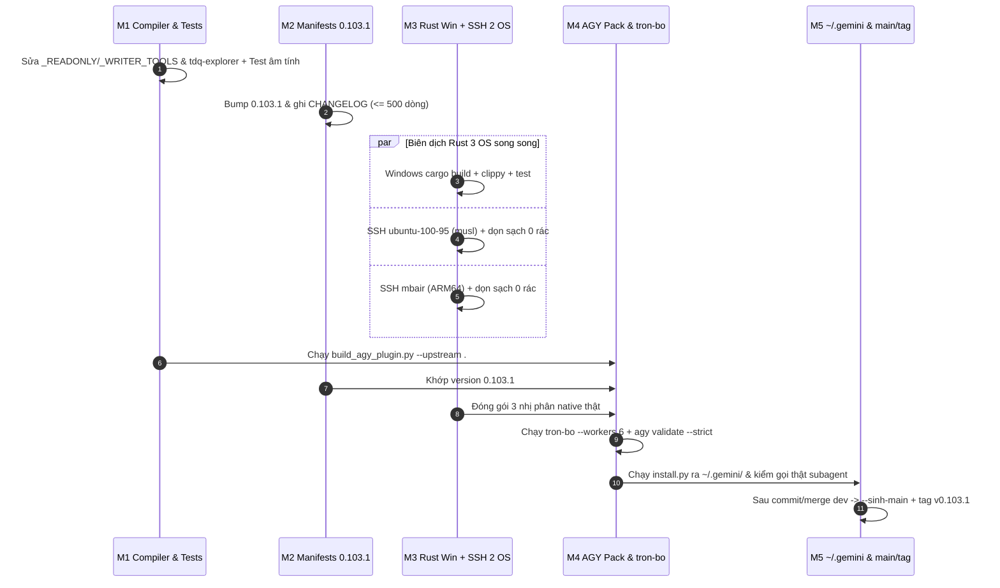

# SPEC — Sửa Lỗi Registry Tool 8 Subagent Antigravity, Build Rust 3 OS & Phát hành `0.103.1`

Ngày: 2026-11-21 · Bản: 1.0 · Brief: ../brief/2026-11-21-1253-fix-subagent-tools-bump.md · Lane: full · Work kind: build
Soul: chất lượng > runtime > context cost · luật gốc: skills/tdq-conventions/references/soul.md
Trạng thái: CHỜ DUYỆT

> **Tóm tắt dễ hiểu:** Hiện tại cả `8/8` subagent của plugin `tdq-workflow-agy` đều lỗi khởi tạo executor trên Antigravity 2.0 (`unknown component: tool "call_mcp_tool" not found in registry`) vì commit `4859058b` đã đưa `call_mcp_tool`, `grep_search`, `find_by_name`, `list_dir` vào `tools/patches/skills_and_agents.py` và lặp chuỗi `write_file` ở `tdq-explorer.md`. Đợt sửa này sẽ chuẩn hóa danh sách tool đúng registry Antigravity (`read_file`, `edit_file`, `write_file`, `run_command`, `manage_task`, `search_web`, `send_message`), khóa thêm test âm tính chống tái diễn, nâng đồng bộ cả repo lẫn Rust 3 OS lên `0.103.1`, kiểm thử trọn bộ đa worker (`--workers 6`), cập nhật riêng `~/.gemini/` và xuất nhánh local `main` + tag `v0.103.1`.

## Mục lục

- 1. Mục tiêu & phạm vi
- 1b. Lộ trình
- 2. Đầu ra cụ thể
- 2b. Ranh giới module
- 2c. Luồng hoạt động & Sơ đồ kiến trúc
- 3. Cách tiếp cận & lý do
- 3b. Năng lực & công cụ
- 3c. Giải thuật & Xử lý cốt lõi
- 3d. Mental Model cho Fresher Dev
- 4. Yêu cầu bắt buộc
- 5. Ràng buộc & rủi ro
- 6. QC & Definition of Done
- 7. Câu hỏi còn mở

## 1. Mục tiêu & phạm vi

- **Mục tiêu:** Sửa triệt để lỗi khởi tạo executor khiến `8/8` subagent của `tdq-workflow-agy` không chạy được trên Antigravity 2.0, bổ sung test khóa chống hồi quy, phát hành bản vá đồng bộ `0.103.1` trên cả Rust 3 OS, gói plugin và bản cài `~/.gemini/` với `0` lỗi kiểm định.
- **Trong phạm vi:**
  - Chuẩn hóa `_READONLY_TOOLS` (`["read_file", "run_command", "manage_task", "send_message"]`) và `_WRITER_TOOLS` (`["read_file", "edit_file", "write_file", "run_command", "manage_task", "search_web", "send_message"]`) tại `tools/patches/skills_and_agents.py:28-47`, giữ nguyên `model: inherit` và các notice `[TDQ:READONLY]` / `[TDQ:SCOPED-WRITE]` / `[TDQ:QC-SCOPED]`.
  - Sửa lặp chuỗi ``(`Write`/`Edit`/`write_file`)`` thành ``(`Write`/`Edit`)`` ở `agents/tdq-explorer.md:15`.
  - Cập nhật bộ kiểm thử frontmatter agent khớp bộ tool hợp lệ Antigravity và thêm test âm tính cấm `call_mcp_tool`, `grep_search`, `find_by_name`, `list_dir` trong frontmatter `plugins/tdq-workflow-agy/agents/tdq-*.md`.
  - Bump đồng bộ phiên bản lên `0.103.1`: `.claude-plugin/plugin.json`, `.codex-plugin/plugin.json`, `README.md` (cập nhật badge & số test thực đo), `UPSTREAM-TRACE.md` (`v0.103.1`), `CHANGELOG.md` (thêm mục `## 0.103.1 — 2026-11-21`, giữ `<= 500` dòng trên nền `461` dòng), `tools/patches/agy_manifests.py`, `tools/patches/__init__.py`, `tools/build_agy_plugin.py`, và `hooks/rust/tdq-dispatch/Cargo.toml`.
  - Biên dịch lại đủ `3` nhị phân native thật `0.103.1`: Windows local (`tdq-dispatch.exe`), SSH song song trên `ubuntu-100-95` (`tdq-dispatch-linux-x86_64` static `musl`) và `mbair` (`tdq-dispatch-darwin-arm64` Mach-O); chạy `cargo test`, `clippy`, mô phỏng SSH và dọn sạch tuyệt đối `0` tàn dư trên cả `2` máy SSH.
  - Rebuild `plugins/tdq-workflow-agy/` (`0.103.1`), chạy `tdq_test.py tron-bo --workers 6 --fresh --reuse off` (dự phòng `--workers 2`/`1` nếu có va chạm lock), QC độc lập `muc_qc = full`, cập nhật chỉ Antigravity user-level (`C:\Users\admin\.gemini\config\plugins\tdq-workflow-agy`, giữ Caveman 3 server + RTK, không chạm `~/.claude/` hay `~/.codex/`), kiểm gọi thật subagent, và sau khi duyệt commit + merge `dev` sẽ xuất nhánh local `main` (`--sinh-main`) + tag `v0.103.1`.
- **NGOÀI phạm vi:**
  - Không xóa `call_mcp_tool` hoặc `grep_search` khỏi `hooks.json`, `tools/patches/agy_hooks.py`, hay `hooks/rust/tdq-dispatch/` (vẫn dùng để bảo vệ agent chính và giữ nguyên parity Python–Rust).
  - Không chạy `git push` lên bất kỳ remote nào (`3a`).
  - Không sửa hoặc ghi đè cấu hình/plugin của `~/.claude/` hay `~/.codex/`.

## 1b. Lộ trình

| Bước/phase | Chạy? | Vì sao |
|---|---|---|
| Nghiên cứu web bổ sung | BỎ | Đã hoàn tất xác minh root cause, `migrate-agent-settings/SKILL.md` và web Antigravity ngay trong pha `analyze` |
| Phỏng vấn chi tiết (Vòng 1) | CÓ | Đã chốt `1a 2b 3a 5a` + `muc_qc = full` và chạy `tron-bo` nhiều worker |
| QC & Kiểm chứng thực thi | CÓ | Chạy `tron-bo --workers 6` (`muc_qc = full`), gọi thật `invoke_subagent` và đối soát `Q1`–`Q7` |

## 2. Đầu ra cụ thể

| # | Đầu ra | Đường dẫn/vị trí | Đo "xong" bằng |
|---|---|---|---|
| 1 | Bản vá tool subagent & test âm tính | `tools/patches/skills_and_agents.py`, `agents/tdq-explorer.md`, bộ kiểm thử frontmatter agent | Test khóa âm tính đi qua chu trình Red → Green; `8/8` file `plugins/tdq-workflow-agy/agents/tdq-*.md` sạch tool ngoài registry và không lặp `write_file` |
| 2 | Manifest & tài liệu `0.103.1` | `.claude-plugin/plugin.json`, `.codex-plugin/plugin.json`, `README.md`, `UPSTREAM-TRACE.md`, `CHANGELOG.md` | Bộ kiểm thử tài liệu & adapter 4 host PASS `0` lỗi; `CHANGELOG.md <= 500` dòng và `doc_lint.py` exit `0` |
| 3 | Crate Rust `0.103.1` & `3` nhị phân native thật | `hooks/rust/tdq-dispatch/Cargo.toml`, `plugins/tdq-workflow-agy/bin/tdq-dispatch*` | `cargo test` `100%` PASS trên Windows/Ubuntu/macOS; `clippy` `0` warning; magic bytes `MZ`/`ELF`/`Mach-O`; mô phỏng SSH Linux/macOS PASS |
| 4 | Dọn sạch `2` máy test SSH | `ubuntu-100-95` & `mbair` (qua SSH) | Hậu kiểm `ls -d /tmp/tdq* /tmp/tdq_dispatch* ~/tdq*` trả `0` tệp/thư mục sót trên cả `2` máy |
| 5 | Gói plugin `tdq-workflow-agy` `v0.103.1` & QC đa worker | `tools/patches/agy_manifests.py`, `tools/patches/__init__.py`, `tools/build_agy_plugin.py`, `plugins/tdq-workflow-agy/` | `build_agy_plugin.py` trả `"status": "OK"`; `agy plugin validate --strict` trả `findings == []`; `tdq_test.py tron-bo --workers 6` đạt `0 failed` (`bo_sot == 0`) |
| 6 | Bản cài Antigravity user-level `0.103.1` & kiểm gọi thật | `C:\Users\admin\.gemini\config\plugins\tdq-workflow-agy\` | `install.py` PASS; `agy plugin list` hiện `enabled, 0.103.1`; `mcp_config.json` bọc đủ `3` server Caveman; `~/.claude/` không đổi `mtime`; xác minh runtime gọi `invoke_subagent` (hoặc nêu rõ cơ chế reload session của Antigravity) |
| 7 | Nhánh phát hành local `main` & tag `v0.103.1` | Nhánh git `dev`, `main` & annotated tag `v0.103.1` (local) | `--sinh-main --nguon dev --nhanh-dich main` exit `0`; `git show main:.claude-plugin/plugin.json` chứa `"0.103.1"`; `v0.103.1^{commit} == main`; không `git push` |

## 2b. Ranh giới module

Xác định theo luồng gọi thực tế từ LSP (`find_references` `transform_agents()` trả `3` tham chiếu) và Graphify (`graphify affected` cho thấy `build()` ở `tools/build_agy_plugin.py:242` và `main()` ở `L279` gọi `transform_agents`):

| Module | Vùng file | Phụ thuộc module | Đầu ra §2 nào <!-- i18n-allow: canonical spec section names --> |
|---|---|---|---|
| M1: Subagent Registry Fix & Guard Tests | `tools/patches/skills_and_agents.py`, `agents/tdq-explorer.md`, bộ kiểm thử frontmatter agent | Không (nguồn sinh frontmatter `agents/*.md`) | 1 |
| M2: Version `0.103.1` Docs & Manifests | `.claude-plugin/plugin.json`, `.codex-plugin/plugin.json`, `README.md`, `UPSTREAM-TRACE.md`, `CHANGELOG.md` | Không (nguồn version `0.103.1`) | 2 |
| M3: Rust 3-OS Build & SSH Cleanup | `hooks/rust/tdq-dispatch/Cargo.toml`, `plugins/tdq-workflow-agy/bin/tdq-dispatch*` (build tạm qua SSH song song `ubuntu-100-95` & `mbair`) | Không (crate độc lập, giữ nguyên logic Rust `command_parser.rs`/`pre_tool_use.rs`) | 3, 4 |
| M4: AGY Compiler & Multi-Worker Full QC | `tools/patches/agy_manifests.py`, `tools/patches/__init__.py`, `tools/build_agy_plugin.py`, `plugins/tdq-workflow-agy/` | Đọc M1 (`transform_agents`), M2 (version `0.103.1`), M3 (`tdq-dispatch*`) | 5 |
| M5: Antigravity Local & Release `main`/Tag | `C:\Users\admin\.gemini\config\plugins\tdq-workflow-agy\`, nhánh `dev` → `main`, tag `v0.103.1` | Chạy `install.py` từ M4; chạy `--sinh-main` từ `dev` đã gộp M1–M4 | 6, 7 |

## 2c. Luồng hoạt động & Sơ đồ kiến trúc

Bản xem trước trực quan luồng Trước/Sau qua Archify BA gắn tại: [2026-11-21-1253-fix-subagent-tools-bump-preview.html](2026-11-21-1253-fix-subagent-tools-bump-preview.html).

| Khía cạnh | Hiện trạng (Trước) | Thiết kế mới (Sau) |
|---|---|---|
| Tool trong `agents/tdq-*.md` (`8/8`) | Chứa `call_mcp_tool`, `grep_search`, `find_by_name`, `list_dir` làm executor sập; `tdq-explorer.md` lặp `write_file` | Chỉ dùng tool chuẩn registry (`read_file`, `edit_file`, `write_file`, `run_command`, `manage_task`, `search_web`, `send_message`); test âm tính khóa vĩnh viễn |
| Phiên bản & Rust 3 OS | `0.103.0` (`agents/` lỗi); mất ~22 phút khi chạy `tron-bo` `1` worker | Toàn bộ repo, Rust 3 OS (`Cargo.toml` + 3 nhị phân SSH song song) và `~/.gemini/` đồng bộ `0.103.1`; `tron-bo --workers 6` rút ngắn thời gian QC |
| Phát hành & Local Antigravity | `main` & `~/.gemini/` ở `0.103.0` bị lỗi subagent | `main` & tag `v0.103.1` sạch ở local; `~/.gemini/` chạy `0.103.1` nguyên Caveman/RTK và không chạm `~/.claude/` |

## 3. Cách tiếp cận & lý do

- **Chọn:** Chuẩn hóa danh sách tool subagent theo tài liệu nội bộ `migrate-agent-settings/SKILL.md:157-161` (`1a`), đồng bộ nâng version `0.103.1` kèm build lại Rust 3 OS song song qua SSH (`2b`), cập nhật riêng `~/.gemini/` rồi phát hành nhánh local `main` + tag `v0.103.1` sau commit (`3a`), và tăng tốc QC bằng `tdq_test.py tron-bo --workers 6` (xác nhận `xdist: True` trên máy `24` CPU).
- **Vì:** Giữ đủ năng lực tìm kiếm web (`search_web`) và quản lý tác vụ nền (`manage_task`) cho `7` agent cần thiết mà vẫn giữ `tdq-security-reviewer` chỉ đọc tối giản; build lại Rust 3 OS giúp chuỗi `CARGO_PKG_VERSION` bên trong nhị phân khớp tuyệt đối `0.103.1` mà không tốn thêm lượt nếu chạy song song `ubuntu-100-95` và `mbair`; chạy đa worker giảm đáng kể thời gian chờ `tron-bo` trên `222` module.
- **Đã loại:** Không chọn `1b` vì cắt mất `manage_task` và `search_web` khiến `tdq-explorer`/`tdq-debugger` kém linh hoạt; không chọn `2a` hay `2c` vì người dùng đã chốt `2b` (`0.103.1` kèm rebuild Rust 3 OS); tuyệt đối không sửa `call_mcp_tool`/`grep_search` trong `hooks/` vì hook phải tiếp tục giám sát agent chính.

## 3b. Năng lực & công cụ

| Skill | Nguồn | Phán quyết | Dùng ở đâu / Lý do loại |
|---|---|---|---|
| `tdq-conventions`, `tdq-intake`, `tdq-spec`, `tdq-plan`, `tdq-build`, `tdq-status`, `tdq-check-status`, `tdq-lean` | `plugin:tdq-workflow-agy` | NỀN | Luật định dạng, pipeline `full` `bugfix`, git safety, `doc_lint` và kiểm chứng |
| `tdq-setup`, `tdq-checkportable` | `plugin:tdq-workflow-agy` | DÙNG | Kiểm chứng bậc tìm kiếm và tính toàn vẹn gói plugin sau cài đặt |
| `agy-customizations`, `migrate-agent-settings`, `antigravity-guide`, `plugin` | `built-in` | DÙNG | Chuẩn frontmatter subagent, bảng ánh xạ tên tool hợp lệ và cấu trúc plugin `~/.gemini/` |
| Đã xét các skill còn lại (`tdq-browser-*`, `19` skill ẩn trên đĩa và `8` skill built-in khác) | `user` / `plugin` / `built-in` | KHÔNG | khác lĩnh vực |

## 3c. Giải thuật & Xử lý cốt lõi

- **Từng bước thực thi (Step-by-step Execution Logic):**
  1. **Bước 1 (`M1` — Red → Green):** Cập nhật bộ kiểm thử frontmatter agent (chỉnh `AGY_DISCOVERY_TOOLS` hợp lệ theo registry Antigravity và thêm test `test_built_agy_agents_forbid_unregistered_tools` cấm `call_mcp_tool`, `grep_search`, `find_by_name`, `list_dir` trên `plugins/tdq-workflow-agy/agents/tdq-*.md`) → chạy test xác nhận Đỏ trước (`AssertionError`). Sau đó sửa `_READONLY_TOOLS` / `_WRITER_TOOLS` trong `tools/patches/skills_and_agents.py:28-47` và sửa `agents/tdq-explorer.md:15`.
  2. **Bước 2 (`M2`):** Nâng chuỗi version từ `0.103.0` → `0.103.1` trong `.claude-plugin/plugin.json`, `.codex-plugin/plugin.json`, `UPSTREAM-TRACE.md`, `README.md`, và chèn mục `## 0.103.1 — 2026-11-21` lên đầu `CHANGELOG.md` (giữ `<= 500` dòng trên nền `461` dòng).
  3. **Bước 3 (`M3` — Rust 3 OS song song & dọn sạch):** Nâng `hooks/rust/tdq-dispatch/Cargo.toml` lên `0.103.1`. Biên dịch + test + clippy trên Windows; đồng thời khởi chạy song song script SSH trên `ubuntu-100-95` (`x86_64-unknown-linux-musl`) và `mbair` (`aarch64-apple-darwin`) kèm `finally` xóa toàn bộ `/tmp/tdq*` và `~/tdq*`, thu về `3` nhị phân mới, chạy kiểm thử mô phỏng SSH và xác nhận `ls` trả `0` rác trên cả `2` máy SSH.
  4. **Bước 4 (`M4` — Build & QC đa worker):** Nâng `PLUGIN_VERSION = "0.103.1"` ở `tools/patches/agy_manifests.py:11`, `tools/patches/__init__.py:1`, `tools/build_agy_plugin.py:2,275`, chạy `build_agy_plugin.py --upstream .`, kiểm test Red → Green xanh `100%`, `agy plugin validate --strict --json` (`findings == []`), `doc_lint.py`, `token_budget.py --kiem`, và chạy `py -3 -X utf8 scripts/tdq_test.py tron-bo --workers 6 --fresh --reuse off` (nếu có test đụng lock đa tiến trình trên Windows, cô lập/fallback xuống `--workers 2` hoặc `--workers 1` để đảm bảo `0 failed` thực chất).
  5. **Bước 5 (`M5` — Cài `~/.gemini/`, Kiểm gọi thật & Xuất `main` + `v0.103.1`):** Chạy `py -3 -X utf8 install.py`, kiểm `agy plugin validate` + `agy plugin list` tại `~/.gemini/` (`0.103.1`, Caveman `3` server, không đổi `mtime` của `~/.claude/`). Gọi thử `invoke_subagent(TypeName="tdq-explorer")` để kiểm chứng; ghi rõ nếu tiến trình IDE hiện tại chưa restart để nạp lại catalog plugin trong bộ nhớ RAM (thì kiểm chứng disk + frontmatter sau cài `0.103.1` không còn `call_mcp_tool` và hướng dẫn user kiểm thêm lượt gọi thật sau restart nếu cần). Cuối `report`, sau khi user duyệt `"commit"` và merge `--no-ff` về `dev`, chạy `--sinh-main --nguon dev --nhanh-dich main` và gắn tag `v0.103.1`.
- **Độ phức tạp tính toán:**
  - Thời gian (Time Complexity): $O(F + T / W)$ — với $F$ là `~253` tệp của plugin khi đóng gói/cài đặt và $T \approx 4.640$ ca test chia cho $W = 6$ worker song song qua `pytest-xdist` (kèm `2` luồng SSH chạy đồng thời).
  - Không gian (Space Complexity): $O(S_{target})$ — vùng build Rust tạm `/tmp/tdq-*` trên `2` máy SSH được giải phóng về `0` ngay trong khối `finally`.
- **Các ca góc hiểm (Edge Cases & Defensive Handling):**
  - Antigravity IDE cache danh sách tool của plugin trong bộ nhớ RAM từ lúc khởi động phiên: `install.py` cập nhật tức thì tệp trên đĩa nhưng `invoke_subagent` trong cùng phiên đang chạy có thể vẫn giữ catalog lúc boot IDE; cần ghi rõ hiện trạng thực nghiệm vào QC & Report nếu IDE chưa restart giữa chừng.
  - Phối hợp nhiều worker `pytest-xdist` (`--workers 6`): một số test worktree/lock có thể cạnh tranh tài nguyên nếu đặt worker quá cao; giới hạn ở `6` worker (trên `24` CPU) và dự phòng `--workers 2` hoặc `--workers 1` nếu trượt do race điều kiện môi trường.
  - Đụng chuỗi `git` khi mở/merge hoặc chạy SSH lỗi giữa chừng: luôn bọc `try...finally` dọn SSH và không xóa `call_mcp_tool`/`grep_search` khỏi `hooks/`.

## 3d. Mental Model cho Fresher Dev

- **Ẩn dụ trực quan (Analogy):** Hãy tưởng tượng `8` subagent giống `8` nhân viên đi hiện trường, trước khi ra khỏi cổng (`invoke_subagent`), bảo vệ tòa nhà Antigravity soát thẻ đồ nghề trong túi (`tools:`). Bản `0.102.0` phát cho mỗi nhân viên `4` món đồ nghề vốn chỉ đặt cố định ở quầy lễ tân (`call_mcp_tool`, `grep_search`...), nên bảo vệ chặn ngay ngoài cửa trước khi nhân viên kịp làm việc. Lần sửa này đổi lại đúng danh sách đồ nghề chuẩn hợp lệ cho từng vai trò và đặt máy quét kiểm tra tại cổng (`test_built_agy_agents_forbid_unregistered_tools`) để không bao giờ phát nhầm nữa.
- **Thuật ngữ dự án (Glossary):**
  - `Executor Tool Registry`: Danh sách tên tool hợp lệ mà bộ khởi tạo subagent Antigravity 2.0 nhận diện khi đọc trường `tools:` trong frontmatter Markdown.
  - `Negative Contract Test`: Bài test khẳng định các giá trị sai/cấm (`call_mcp_tool`, `grep_search`, `find_by_name`, `list_dir`) KHÔNG bao giờ được phép xuất hiện trong bản build xuất xưởng.
  - `Multi-Worker xdist`: Chế độ `tdq_test.py tron-bo --workers 6` chia `222` module test ra `6` tiến trình chạy song song để rút ngắn thời gian QC.

## 4. Yêu cầu bắt buộc

- **Log service bật mặc định:** `tools/build_agy_plugin.py`, `scripts/build_portable.py`, `install.py` và `tdq-dispatch` (`Windows`/`Linux`/`macOS`) tiếp tục giữ log ISO timestamp bật mặc định ra `stderr` (`TDQ_LOG=1`) và tắt sạch khi `TDQ_LOG=0`.
- Không placeholder, không TODO stub, không nhị phân cross-compile giả danh.
- Chu trình Red → Green bắt buộc cho lỗi registry tool của `skills_and_agents.py` & `tdq-explorer.md` trước khi build plugin và cập nhật user-level.
- Bảo toàn 100% hook `call_mcp_tool`/`grep_search` cho agent chính, tuân thủ Python UTF-8 (`CREATE_NO_WINDOW`), Rust `clippy -D warnings` sạch `0` cảnh báo.

## 5. Ràng buộc & rủi ro

Ràng buộc kiến trúc phải giữ (từ `docs/kien-truc.md`):
- `"Mọi nền tảng đọc cùng một thư mục skills/ chung qua lớp adapter mỏng; cấm quay lại mô hình nhân bản 3 thư mục bundle cũ"` — chỉ chỉnh compiler `tools/patches/skills_and_agents.py` cho AGY `agents/` và nguồn `agents/tdq-explorer.md`, không nhân bản thư mục `skills/`.
- `"CHANGELOG.md giữ dưới trần 500 dòng của doc_lint R6"` — từ `461` dòng hiện tại chèn mục `0.103.1` ngắn gọn (~`12–18` dòng), đảm bảo vẫn `<= 490` dòng.
- `"Nhánh main chỉ chứa phần lõi runtime của plugin (~190 files) qua scripts/build_portable.py --sinh-main"` — xuất bản sạch từ `dev` sau khi commit & merge.

| Rủi ro | Ảnh hưởng | Cách giảm |
|---|---|---|
| Phiên Antigravity đang chạy cache bản agent `0.103.0` trong RAM khiến `invoke_subagent` thử nghiệm ngay trước restart vẫn báo `call_mcp_tool` | Khó phân biệt lỗi chưa sửa vs cache IDE | Xác minh `8/8` file đĩa ở cả repo lẫn `~/.gemini/agents/` sạch `call_mcp_tool`, chạy `agy plugin validate --strict`, và nếu cùng phiên còn cache RAM thì ghi rõ vào `Giới hạn` để xác nhận sau `1` lần restart |
| Chạy `tron-bo --workers 6` gây tranh chấp khóa hoặc worktree trên Windows | Tốn thêm vòng chạy lại nếu 1–2 ca timeout | Dùng mức vừa phải `6` trên `24` CPU; nếu gặp flake đa tiến trình thì hạ `--workers 2` hoặc `--workers 1` cho đến khi `0 failed` |
| Xóa nhầm `call_mcp_tool` ở `hooks.json`/`agy_hooks.py` làm gãy kiểm soát tìm kiếm của agent chính | Hồi quy bộ kiểm thử cổng LSP, luật tìm kiếm & parity Rust | Chỉ chạm `tools/patches/skills_and_agents.py`, `agents/tdq-explorer.md` và bộ kiểm thử frontmatter agent |
| SSH build `ubuntu-100-95` / `mbair` để sót tệp tạm khi lỗi | Tốn đĩa trên máy test | Dùng khối `try...finally` và kiểm hậu kiểm `ls -d ...` trả `0` |

## 6. QC & Definition of Done

| # | Hạng mục kiểm | Điều kiện PASS | Đo trước | Dự phòng nếu trượt |
|---|---|---|---|---|
| Q1 | Vá `_READONLY_TOOLS` / `_WRITER_TOOLS`, `tdq-explorer.md` & test âm tính | `8/8` tệp `plugins/tdq-workflow-agy/agents/tdq-*.md` chỉ chứa tool chuẩn registry Antigravity, `0` xuất hiện `call_mcp_tool`/`grep_search`/`find_by_name`/`list_dir` ở `tools:`, không lặp `write_file`; bộ kiểm thử frontmatter agent đi từ Red → Green `0` lỗi | `8/8` tệp chứa `call_mcp_tool` & lỗi `unknown component`; `tdq-explorer.md` lặp `write_file`; hợp đồng cũ khóa sai `AGY_DISCOVERY_TOOLS` | Rà lại bảng tool của `migrate-agent-settings/SKILL.md` và cập nhật danh sách/test rồi build lại |
| Q2 | Manifest, `README.md`, `UPSTREAM-TRACE.md` & `CHANGELOG.md` `0.103.1` | Toàn bộ manifest/doc khớp `0.103.1`; `CHANGELOG.md <= 500` dòng; `doc_lint.py` `0` lỗi; bộ kiểm thử nhất quán tài liệu & adapter 4 host PASS `0 failed` | Đang ở `0.103.0`, `CHANGELOG.md` `461` dòng | Chỉnh số chữ/archive trong `CHANGELOG.md` hoặc manifest rồi kiểm lại |
| Q3 | Rust `0.103.1` trên 3 OS & dọn sạch 2 máy SSH | `Cargo.toml` = `0.103.1`; `cargo test` & `cargo clippy -- -D warnings` `0` lỗi trên Windows, `ubuntu-100-95` và `mbair`; bộ kiểm thử parity/lock và mô phỏng SSH Linux/macOS PASS; `ls -d /tmp/tdq* /tmp/tdq_dispatch* ~/tdq*` trả `0` trên cả `2` máy SSH | Đang ở `0.103.0`; `2` máy SSH đang sạch `0` | Chạy sửa lỗi biên dịch/dọn tay đường dẫn sót trên máy SSH tương ứng rồi kiểm lại |
| Q4 | Compiler & gói plugin `plugins/tdq-workflow-agy/` `v0.103.1` | `build_agy_plugin.py --upstream .` trả `"status": "OK"`; `agy plugin validate plugins/tdq-workflow-agy --strict --json` trả `findings == []`; `token_budget.py --kiem` `0` lỗi | Đang ở `0.103.0` | Sửa rule/budget trong `tools/patches/` và rebuild lại |
| Q5 | Bộ kiểm thử toàn repo `muc_qc = full` (`--workers 6`) & QC độc lập | `py -3 -X utf8 scripts/tdq_test.py tron-bo --workers 6 --fresh --reuse off` đạt `0 failed` (`bo_sot == 0`); bộ kiểm thử hook agent chính & parity Rust giữ `0` lỗi; QC độc lập `PASS` | Nền `0.103.0`: `4.603 passed, 36 skipped` (chạy `1` worker trong `1332.27s`) | Nếu `--workers 6` lỗi race môi trường thì hạ `--workers 2`/`1`; nếu lỗi code thì tách task fix QC và chạy lại |
| Q6 | Cài Antigravity user-level `0.103.1` & kiểm gọi subagent | `~/.gemini/config/plugins/tdq-workflow-agy/plugin.json` = `0.103.1`, `agy plugin list` hiện `enabled, 0.103.1`, `agy plugin validate` trả `findings == []`, `mcp_config.json` bọc đủ `3` server Caveman, `~/.claude/plugins/installed_plugins.json` giữ nguyên `mtime`; gọi `invoke_subagent` kiểm chứng hoặc ghi nhận rõ trạng thái reload cache IDE | `~/.gemini/` ở `0.103.0` và `8/8` file có `call_mcp_tool` làm crash `tdq-explorer` | Sửa cờ `install.py` / đối chiếu lại `agents/*.md` và validate lại bản `~/.gemini/` |
| Q7 | Release local `main` + tag `v0.103.1` (sau commit & merge `dev`) | `--sinh-main --nguon dev --nhanh-dich main` exit `0`; `git show main:.claude-plugin/plugin.json` ghi `"0.103.1"`; `v0.103.1^{commit} == main`; không `git push` | `main` & tag đang ở `v0.103.0` (`38f7ce6`) | Chạy lại `--sinh-main` sau khi gộp xong `dev` và gắn lại tag đúng `main` |

DoD: Tất cả `Q1`–`Q7` đạt `PASS`, nhánh `bugfix/fix-subagent-tools-bump` đã merge sạch về `dev` (chưa push), nhánh `main` + tag `v0.103.1` đã xuất bản tại local, Antigravity `~/.gemini/` chạy `0.103.1` sạch `call_mcp_tool` trong `agents/`, `2` máy SSH sạch `0` tàn dư, và báo cáo (`.md` + Archify HTML qua Tailscale URL) được duyệt xuất bản.

## 7. Câu hỏi còn mở

(Rỗng — mọi quyết định về bộ tool subagent, phiên bản `0.103.1`, build Rust 3 OS, phạm vi cài local, multi-worker và mức QC đã được chốt.)
<!-- tdq-archify-binding:start -->
<!-- manifest: 2026-11-21-1253-fix-subagent-tools-bump-preview.manifest.json -->
<!-- manifest_digest: ba16eedcfbe523cec525210933fb2369ce196c944f3757510fd2409c62a16a51 -->
<!-- tdq-archify-binding:end -->