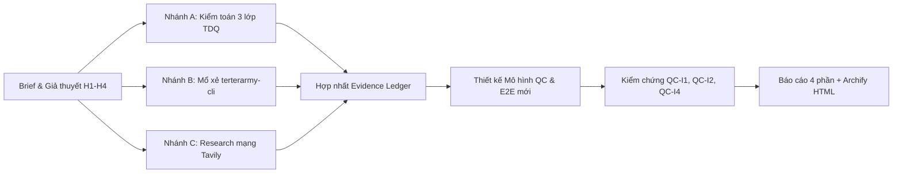

# SPEC — Đánh giá Quy trình QC/Test Hiện tại & Đề xuất Mô hình QC Nhanh, Dễ hiểu, Trọng tâm E2E

Ngày: 2026-11-21 · Bản: 1.0 · Brief: ../brief/2026-11-21-1438-cai-thien-qc-test-e2e.md · Lane: full · Work kind: investigate
Soul: chất lượng > runtime > context cost · luật gốc: skills/tdq-conventions/references/soul.md
Trạng thái: CHỜ DUYỆT

> **Tóm tắt dễ hiểu:** Người dùng phản ánh quy trình QC và kiểm thử hiện tại mang nặng tính hàn lâm, khiến dev khó theo dõi và có dấu hiệu lệch khỏi hành vi E2E thực tế. Đợt điều tra này (`work_kind=investigate`, `Zero-Code-Touch`) sẽ kiểm chứng thực tế cả `3` lớp QC/test của TDQ, mổ xẻ mô hình `C:\Users\admin\Documents\terterarmy-cli` cùng `4`–`6` chuẩn/plugin QA lớn trên mạng qua `tavily-primary`, rồi xuất báo cáo đề xuất cải tiến QC nhanh hơn, dễ hiểu hơn và bám sát E2E hơn.

## Mục lục

- 1. Mục tiêu & phạm vi
- 1b. Lộ trình
- 2. Đầu ra cụ thể
- 2b. Ranh giới module
- 2c. Luồng hoạt động & Sơ đồ kiến trúc
- 3. Cách tiếp cận & lý do
- 3b. Năng lực & công cụ
- 3c. Giải thuật & Xử lý cốt lõi
- 3d. Mental Model cho Fresher Dev
- 4. Yêu cầu bắt buộc
- 5. Ràng buộc & rủi ro
- 6. QC & Definition of Done
- 7. Câu hỏi còn mở

## 1. Mục tiêu & phạm vi

- **Mục tiêu:** Trả lời bằng bằng chứng `path:line` và số liệu đo được từ kho mã nguồn xem `4` giả thuyết `H1`–`H4` về tình trạng QC/test hiện tại của TDQ đúng tới mức nào, đối chiếu có hệ thống với `terterarmy-cli` và `4`–`6` hệ thống QA/E2E chuẩn ngành, và trình bày một bản thiết kế mô hình QC/E2E mới giúp giảm thời gian phản hồi cho dev, tăng tỷ lệ phát hiện lỗi tích hợp thật và dễ đọc cho mọi lập trình viên.
- **Trong phạm vi (`1a 2a 3a 4a 5a`):**
  1. Kiểm toán `3` lớp nội bộ TDQ: quy trình & template (`skills/tdq-build/references/qc*.md`, `report-template.md`, `agents/tdq-qc-tester.md`, `tdq-browser-test`), `8` biên bản QC gần đây (`docs/tdq/qc/*.md` và thời gian trong `docs/tdq/timing.jsonl`), và hạ tầng test (`scripts/tdq_test.py`, `scripts/tdq_archify.py`, chiến lược `tron-bo` vs runtime/E2E).
  2. Mổ xẻ toàn bộ `33` tệp của `C:\Users\admin\Documents\terterarmy-cli` (kịch bản plain-language, `TESTER.md`, `BUG_BOARD.md`, `reporting-template.md`, workflow CI/manifest).
  3. Research mạng `4`–`6` framework/plugin QA/E2E lớn (`Playwright Test Agents / MCP`, `Testing Trophy`, `Risk-Based Testing & Test Impact Analysis`, AI QA agents/plugins phổ biến) qua `tavily-primary` và lưu nhật ký nghiên cứu ngoài ngữ cảnh chính.
  4. Thiết kế kiến trúc QC & Testing mới (`Changed-Flow E2E Smoke`, `Dev-Friendly Behavior Report`, tách `Meta-Compliance Gate` khỏi `Behavior QC`, tùy chọn tích hợp/tham khảo `testerarmy` / `Playwright MCP`) và xuất bộ tài liệu đề xuất + Archify HTML.
- **NGOÀI phạm vi:**
  - Không sửa mã nguồn sản phẩm (`scripts/`, `hooks/`, `tools/`, `skills/`, `agents/`, `plugins/`, `tests/`) — giữ nguyên `Zero-Code-Touch`; nếu sau báo cáo người dùng muốn áp dụng, sẽ chuyển bằng yêu cầu/escalate riêng.
  - Không chạy vòng Red-Team riêng (`QC-I3` của mức `ultra`) vì người dùng đã chọn `muc_qc = full` (`4a`).
  - Không đăng ký/chạy thử nghiệm trả phí lên cloud `tester.army` bằng tài khoản thật.

## 1b. Lộ trình

| Bước/phase | Chạy? | Vì sao |
|---|---|---|
| Khảo sát nội bộ 3 lớp TDQ QC/Test (pha `implement`) | CÓ | Kiểm chứng thực tế `H1`–`H4` trên `qc.md`, biên bản `docs/tdq/qc/*.md`, `timing.jsonl` và `tdq_test.py` |
| Mổ xẻ cục bộ `C:\Users\admin\Documents\terterarmy-cli` | CÓ | Rút pattern kịch bản plain-language, `TESTER.md`, `BUG_BOARD.md`, `reporting-template.md` |
| Research mạng `4`–`6` framework/plugin lớn (`tavily-primary`) | CÓ | Đối chiếu chuẩn ngành (`Playwright Agents/MCP`, `Testing Trophy`, `Risk-Based E2E`, AI QA plugins) |
| Archify preview ở pha `spec` | BỎ | Miễn theo `investigate-mode.md`; chỉ render Archify HTML `1` lần ở pha `report` sau khi có kết quả thực tế |
| Vòng Red-Team phản biện riêng (`QC-I3`) | BỎ | Người dùng chọn `muc_qc=full` (`4a`), không chạy vòng Red-Team bổ sung của mức `ultra` |
| QC bằng chứng (`QC-I1`, `QC-I2`, `QC-I4` + Zero-Code-Touch) | CÓ | Xác minh `100%` `[EV-xxx]`, `path:line`, nguồn web trích xuất và `0` sửa code ngoài `docs/tdq/` |

## 2. Đầu ra cụ thể

| # | Đầu ra | Đường dẫn/vị trí | Đo "xong" bằng |
|---|---|---|---|
| 1 | Nhật ký bằng chứng hợp nhất (`[EV-001..]` + bản thô nguồn trích) | `docs/tdq/artifacts/2026-11-21-1438-cai-thien-qc-test-e2e/` (`evidence-log.md` + `evidence.jsonl` + `raw/`) | `100%` `[EV-xxx]` trỏ tới `path:line` hoặc URL có thật trên đĩa (`QC-I1`) |
| 2 | Nhật ký nghiên cứu mạng (`tavily-primary`) | `docs/tdq/research/2026-11-21-1438-cai-thien-qc-test-e2e.md` | Có đủ query, URL nguồn, trích đoạn thực chứng cho `4`–`6` chuẩn/plugin ngoài |
| 3 | Báo cáo đánh giá & đề xuất `4` phần | `docs/tdq/reports/2026-11-21-1438-cai-thien-qc-test-e2e.md` | Đủ `4` phần theo yêu cầu (`3a`), `0` lỗi `doc_lint.py`, đủ nhãn tin cậy `QC-I4`, mục `Thời gian` đầy đủ |
| 4 | Báo cáo trực quan Archify HTML + Tailscale URL | `docs/tdq/reports/2026-11-21-1438-cai-thien-qc-test-e2e.html` | `tdq_archify.py verify` trả `status="current"`, `valid=true` và Tailscale URL đạt `HTTP 200` |
| 5 | Biên bản QC đối chứng bằng chứng (`QC-I1`, `QC-I2`, `QC-I4`) | `docs/tdq/qc/2026-11-21-1438-cai-thien-qc-test-e2e.md` | `git diff --name-only` xác nhận Zero-Code-Touch ngoài `docs/tdq/`, `Q1`–`Q6` **PASS** |

## 2b. Ranh giới module

BỎ — `Work kind: investigate` (miễn khai báo ranh giới module mã nguồn sản phẩm theo `skills/tdq-conventions/references/investigate-mode.md` vì đợt này giữ `Zero-Code-Touch`, mọi đầu ra chỉ nằm trong `docs/tdq/`).

## 2c. Luồng hoạt động & Sơ đồ kiến trúc

Miễn bản xem trước Archify HTML ở pha `spec` theo `skills/tdq-conventions/references/investigate-mode.md`; sơ đồ kiến trúc đầy đủ sẽ được render một lần duy nhất bằng Archify HTML tại pha `report` sau khi chốt kết quả thực chứng. Luồng thu thập và tổng hợp bằng chứng trong pha `implement`:

| Khía cạnh | Hiện trạng khảo sát (`0.103.1`) | Hướng điều tra & đầu ra đề xuất (Sau) |
|---|---|---|
| Cách nhìn về chất lượng | Trộn lẫn meta-compliance (`Q1..Qn`, `5` SOLID, `receipt`, `doc_lint`) và hành vi tính năng | Tách rõ chứng cứ thực nghiệm `H1`–`H4`, chỉ ra phần nào cần giữ cho máy check, phần nào cần viết cho dev |
| Trọng tâm E2E | `muc_qc=full` chạy `4.641` unit/integration tests (`~5` phút) nhưng mặc định bỏ qua runtime E2E | So sánh với `terterarmy-cli` & chuẩn ngành để đề xuất tầng **Changed-Flow E2E Smoke** nhanh + đúng hành vi người dùng |
| Khả năng đọc báo cáo | Bảng dày ký hiệu kỹ thuật nội bộ (`QC-F1..F4`, `bo_sot`, hash dài) | Đề xuất mẫu **Dev-First Behavior QC Card** (Kịch bản người dùng → Thao tác → Kết quả thật → Bằng chứng tái hiện) |

## 3. Cách tiếp cận & lý do

- **Chọn:** Chạy `3` nhánh điều tra độc lập theo `Tier 2` trong `investigate-mode.md` (Nhánh A kiểm toán nội bộ `3` lớp TDQ bằng đọc mã trực tiếp + phân tích log thời gian/biên bản QC, Nhánh B phân tích kiến trúc & template của `C:\Users\admin\Documents\terterarmy-cli`, Nhánh C dùng subagent đọc/research `4`–`6` hệ thống QA/E2E lớn qua `tavily-primary` ghi trực tiếp ra `docs/tdq/research/` với digest `<= 1.500` ký tự), sau đó hợp nhất chứng cứ `[EV-xxx]` để bác bỏ hoặc xác nhận `H1`–`H4` rồi mới thiết kế mô hình đề xuất.
- **Vì:** Tách `3` nhánh giúp không bị thiên kiến nội bộ, giữ token ngữ cảnh sạch khỏi dữ liệu web thô (`tavily-primary` đi qua file shard theo luật `tavily.md`), và mỗi nhận xét "hàn lâm" hay "thiếu E2E" đều có chứng cứ `path:line` / URL đối chứng theo `QC-I1` & `QC-I2`.
- **Đã loại:** Không đọc cào cảm tính rồi viết đề xuất chung chung trong ngữ cảnh chính (dễ bỏ sót góc nhìn E2E thực chiến từ `terterarmy-cli` và ngốn token từ kết quả web); không sửa thử mã nguồn `qc.md` hoặc `tdq_test.py` ngay khi chưa có đồng thuận kiến trúc của người dùng.

## 3b. Năng lực & công cụ

| Skill | Nguồn | Phán quyết | Dùng ở đâu / Lý do loại |
|---|---|---|---|
| `tdq-intake` | `plugin:tdq-workflow / plugin:tdq-workflow-agy` | NỀN | kỹ năng nền của TDQ Workflow đang chạy |
| `tdq-spec` | `plugin:tdq-workflow / plugin:tdq-workflow-agy` | NỀN | kỹ năng nền của TDQ Workflow đang chạy |
| `tdq-plan` | `plugin:tdq-workflow / plugin:tdq-workflow-agy` | NỀN | kỹ năng nền của TDQ Workflow đang chạy |
| `tdq-build` | `plugin:tdq-workflow / plugin:tdq-workflow-agy` | NỀN | kỹ năng nền của TDQ Workflow đang chạy |
| `tdq-conventions` | `plugin:tdq-workflow / plugin:tdq-workflow-agy` | NỀN | kỹ năng nền của TDQ Workflow đang chạy |
| `tdq-setup` | `plugin:tdq-workflow / plugin:tdq-workflow-agy` | NỀN | kỹ năng nền của TDQ Workflow đang chạy |
| `tdq-status` | `plugin:tdq-workflow / plugin:tdq-workflow-agy` | NỀN | kỹ năng nền của TDQ Workflow đang chạy |
| `tdq-check-status` | `plugin:tdq-workflow / plugin:tdq-workflow-agy` | NỀN | kỹ năng nền của TDQ Workflow đang chạy |
| `tdq-checkportable` | `plugin:tdq-workflow-agy` | NỀN | kỹ năng nền của TDQ Workflow đang chạy |
| `tdq-lean` | `plugin:tdq-workflow / plugin:tdq-workflow-agy` | NỀN | kỹ năng nền của TDQ Workflow đang chạy |
| `tdq-browser-test` | `plugin:tdq-workflow / plugin:tdq-workflow-agy` | NỀN | kỹ năng nền của TDQ Workflow đang chạy |
| `tdq-browser-research` | `plugin:tdq-workflow / plugin:tdq-workflow-agy` | NỀN | kỹ năng nền của TDQ Workflow đang chạy |
| Đã xét 19 skill khác trên đĩa và các skill built-in trong context | user/plugin/built-in | KHÔNG | khác lĩnh vực |

## 3c. Giải thuật & Xử lý cốt lõi

- **Từng bước giải thuật thu thập & đối chứng giả thuyết:**
  1. **Bước 1 (Tạo shard & bằng chứng nền):** Khởi tạo `docs/tdq/artifacts/2026-11-21-1438-cai-thien-qc-test-e2e/{raw,}` và đọc `3` nhóm dữ liệu độc lập: (A) `skills/tdq-build/references/qc*.md`, `8` biên bản `docs/tdq/qc/*.md`, `docs/tdq/timing.jsonl`, `scripts/tdq_test.py`, `agents/tdq-qc-tester.md`; (B) toàn bộ `skills/testerarmy-cli/`, `examples/`, `docs/BUG_BOARD.md`, `.github/` trong `terterarmy-cli`; (C) kết quả `tavily_search` + `tavily_extract` từ subagent nghiên cứu ngoài.
  2. **Bước 2 (Phản biện định lượng & định tính `H1`–`H4`):** Đếm tỷ lệ mục kiểm meta-compliance vs mục kiểm hành vi người dùng trong `8` biên bản QC thật, đo thời gian chạy `tron-bo` vs số lỗi thực tế từng lọt (như `v0.103.0` pass `4.603` test nhưng vỡ `8/8` subagent runtime), kiểm tra giả thuyết phản chứng (những chỗ TDQ làm tốt thực sự cần giữ lại như parity check hoặc receipt chống gian lận).
  3. **Bước 3 (Tổng hợp bảng đối chiếu & Kiến trúc QC 3 tầng mới):** Ánh xạ từng điểm đau sang giải pháp cụ thể (ví dụ: *Dev Behavior Card*, *2-Speed Gate: Pre-QC Changed-Flow E2E Smoke + Async/Nightly Deep Audit*, *Auto-check ẩn nghi thức máy*, *Plain-Language Scenario DSL học từ `terterarmy-cli`*).
  4. **Bước 4 (Khóa chéo bằng chứng `QC-I1`, `QC-I2`, `QC-I4`):** Xác minh từng `[EV-xxx]`, kiểm trích dẫn đối ứng `Claim <-> Source` và gắn nhãn `Verified` / `Single-source` / `Inferred` trên mọi luận điểm chính trong báo cáo.
- **Độ phức tạp xử lý & lưu trữ:**
  - Thời gian đọc & đối chiếu: $O(N + Q)$ với $N$ là số tệp nội bộ/`terterarmy-cli` được rà và $Q$ là số truy vấn Tavily/extract giới hạn theo ngân sách shard (`<= 12` lượt gọi mỗi nhánh).
  - Không gian ngữ cảnh chính: $O(K)$ với $K \le 1.500$ ký tự digest mỗi worker; dữ liệu thô lớn nằm trong `artifacts/.../raw/` và `research/*.md`.
- **Các ca góc hiểm (Edge Cases & Defensive Handling):**
  - Nguồn web trả về quảng cáo hoặc tài liệu marketing thiếu chi tiết kỹ thuật → bắt buộc dùng `tavily_extract` / tài liệu chính thức (GitHub docs, Playwright docs, blog kỹ thuật có tác giả rõ ràng) hoặc gắn nhãn `Single-source` / hạ bậc luận điểm theo `QC-I4`.
  - Nhận định quá phiến diện ("bỏ hết unit test/hàn lâm"): phòng thủ bằng bước tìm phản ví dụ — chỉ rõ quy chuẩn nào của TDQ đã giúp ngăn lỗi thật (ví dụ `[TDQ:GIT]`, `[TDQ:STATE]`, Rust parity) cần *tự động hóa ẩn* thay vì xóa bỏ hay bắt dev đọc tay.

## 3d. Mental Model cho Fresher Dev

- **Ẩn dụ trực quan:** Quy trình QC hiện tại giống một *bảng kiểm đăng kiểm hành chính* rất kỹ ở con dấu, số khung, số máy (`receipt sha256`, `5` câu SOLID, `QC-F1..F4`) nhưng lại để tài xế chờ `5` phút kiểm hết toàn bộ bu-lông trong gara (`4.641` unit tests) mà đôi khi chưa nổ máy chạy thử một vòng ngoài đường (`E2E behavior`). Đợt điều tra này thiết kế lại sao cho mỗi thay đổi được "lái thử ngay đúng tuyến đường vừa sửa" trong vài chục giây với báo cáo dễ hiểu như nhật ký lái thử (`terterarmy-cli`), còn kiểm tra hồ sơ máy móc để robot chạy ngầm.
- **Thuật ngữ dự án:**
  - `Work kind = investigate`: Chế độ làm việc chỉ điều tra, phân tích và viết báo cáo có chứng cứ, cấm sửa mã nguồn sản phẩm (`Zero-Code-Touch`).
  - `Meta-compliance QC`: Các bước kiểm chứng tính tuân thủ quy trình/tài liệu của chính workflow (`doc_lint`, `SOLID`, `bo_sot`, `receipt`), khác với **Behavior / E2E QC** (kiểm chứng tính năng chạy thật từ góc nhìn người dùng).
  - `Evidence Ledger [EV-xxx]`: Sổ cái bằng chứng gắn ID tuần tự từ `[EV-001]` trỏ trực tiếp tới tệp, số dòng hoặc URL đã kiểm chứng, dùng để khóa độ chính xác ở `QC-I1`/`QC-I2`.

## 4. Yêu cầu bắt buộc

- **Log service:** **BỎ** — Request này chạy ở chế độ `work_kind = investigate` (`Zero-Code-Touch`), không tạo hoặc chỉnh sửa mã nguồn runtime nào trong kho.
- Mọi kết luận đánh giá TDQ và mọi đề xuất tham chiếu `terterarmy-cli` hoặc nguồn ngoài đều phải gắn `[EV-xxx]` trỏ tới `path:line` có thật trên đĩa hoặc URL đã trích xuất vào `docs/tdq/research/`.
- Cấm bịa số liệu thời gian, tỷ lệ pass/fail, hay tên tính năng của framework ngoài nếu chưa đọc trực tiếp trong phiên.

## 5. Ràng buộc & rủi ro

Ràng buộc kiến trúc phải giữ: không chạm dòng nào — đây là request điều tra & báo cáo (`work_kind = investigate`, `Zero-Code-Touch`), không chỉnh sửa mã nguồn trong `scripts/`, `hooks/`, `tools/`, `skills/`, `agents/`, `plugins/`, hoặc `tests/`.

| Rủi ro | Ảnh hưởng | Cách giảm |
|---|---|---|
| Tràn ngữ cảnh khi research nhiều framework ngoài bằng Tavily | Vượt ngân sách token, suy giảm chất lượng tổng hợp báo cáo | Giao nhánh research ngoài cho worker ghi thô vào `docs/tdq/research/` và `raw/`, chỉ trả digest `<= 1.500` ký tự |
| Phân tích một chiều chê hết QC TDQ mà bỏ sót giá trị chống lỗi thực | Đề xuất mất cân bằng, thiếu tính khả thi khi áp dụng lại vào TDQ | Bắt buộc phân tách `Cần giữ (tự động hóa ngầm)` vs `Nên bỏ/gộp` và nêu rõ bằng chứng sự cố thực tế (`v0.103.0` vs `v0.103.1`) |
| Nguồn web marketing nói quá về công cụ QA AI | Dẫn tới đề xuất phụ thuộc tool bên ngoài kém ổn định | Đối chiếu trực tiếp với code thật tại `terterarmy-cli`, tài liệu chính thức Playwright/Martin Fowler và gắn nhãn tin cậy `QC-I4` |
| Báo cáo dài, hàn lâm lặp lại đúng lỗi đang phê bình | Dev đọc tiếp tục thấy khó hiểu | Áp dụng chính cấu trúc dev-first ngắn gọn tự nhiên (`Tóm tắt nhanh`, ví dụ Trước/Sau cụ thể, bảng quyết định hành động, Archify HTML trực quan) |

## 6. QC & Definition of Done

| # | Hạng mục kiểm | Điều kiện PASS | Đo trước | Dự phòng nếu trượt |
|---|---|---|---|---|
| Q1 | Chẩn đoán thực chứng `H1`–`H4` trên `3` lớp TDQ | Có ít nhất `10` `[EV-xxx]` trỏ thẳng `path:line` tại `qc*.md`, `docs/tdq/qc/*.md`, `timing.jsonl`, `tdq_test.py`, `agents/tdq-qc-tester.md`; xác nhận/bác bỏ rõ từng giả thuyết | Số lượng `[EV]` hiện có = `0`; giả thuyết mới nêu định tính | Bổ sung trích đoạn trực tiếp từ file thật và log `timing.jsonl` |
| Q2 | Phân tích đầy đủ `C:\Users\admin\Documents\terterarmy-cli` & `4`–`6` nguồn mạng | Đọc thực tế cấu trúc/mẫu `terterarmy-cli` (`SKILL.md`, `TESTER.md`, `BUG_BOARD.md`, `reporting-template.md`, `examples/tests/*`) và `4`–`6` nguồn chuẩn ngành từ `tavily-primary` ghi tại `docs/tdq/research/` | Đã liệt kê `33` tệp ở pha `analyze`, chưa đọc nội dung sâu | Chạy truy vấn `tavily_search`/`tavily_extract` bổ sung cho nguồn thiếu chi tiết |
| Q3 | Thiết kế mô hình QC mới + Lộ trình KPI trong báo cáo `4` phần | Báo cáo đủ `4` phần (`Chẩn đoán` → `Đối chiếu` → `Kiến trúc QC/E2E mới` → `Lộ trình & KPI`), nêu rõ phần giữ/gộp/bỏ, mẫu báo cáo QC dev-friendly và tầng **Changed-Flow E2E** | Chưa có báo cáo | Bổ sung phần thiết kế còn thiếu trước khi render Archify HTML |
| Q4 | Cổng bằng chứng `QC-I1`, `QC-I2`, `QC-I4` (`muc_qc = full`) | `100%` `[EV-xxx]` khớp `evidence.jsonl` & `path:line`/URL thật (`QC-I1`), đối chiếu chéo Claim ↔ Source đạt `0` hallucination (`QC-I2`), mọi luận điểm lớn có nhãn `Verified` / `Single-source` / `Inferred` (`QC-I4`) | Chưa kiểm chứng | Hạ bậc nhãn hoặc sửa/gỡ claim không có nguồn trên đĩa |
| Q5 | Định dạng, `doc_lint` & Zero-Code-Touch | `py -3 -X utf8 scripts/doc_lint.py` thoát `0` (`0 violation(s)`) trên báo cáo; `git diff --name-only dev..HEAD` chỉ gồm file dưới `docs/tdq/` (và `docs/workinglog/`) | `0` file mã nguồn chạm | Rewind mọi thay đổi ngoài `docs/` nếu phát sinh |
| Q6 | Archify HTML & Tailscale Serve `HTTP 200` | `tdq_archify.py verify` trả `status="current"`, `valid=true` và Tailscale URL của báo cáo HTML trả `HTTP 200` | Chưa render (miễn preview ở spec) | Sửa nhãn sơ đồ `<= 22` ký tự rồi render & verify lại |

DoD: Hoàn tất đầy đủ `Q1`–`Q6`, toàn bộ `4` phần báo cáo dễ hiểu với lập trình viên, mọi `[EV-xxx]` kiểm chéo sạch theo `QC-I1`/`QC-I2`/`QC-I4`, `doc_lint` `0` lỗi, Archify HTML `current` kèm Tailscale `HTTP 200`, và `git diff --name-only` xác nhận Zero-Code-Touch.

## 7. Câu hỏi còn mở

Không có.
