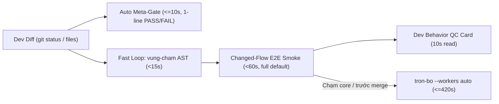

# SPEC — Nâng cấp QC và Tester TDQ theo `3` Wave (Dev-First, E2E-First)

Ngày: 2026-11-21 · Bản: 1.0 · Brief: ../brief/2026-11-21-1536-nang-cap-qc-tester-e2e.md · Lane: full · Work kind: build
Soul: chất lượng > runtime > context cost · luật gốc: skills/tdq-conventions/references/soul.md
Trạng thái: CHỜ DUYỆT

> **Tóm tắt dễ hiểu:** Trước đây `tron-bo` chạy tuần tự `1` luồng mất `19.8` phút, mức `full` tắt `smoke test`, bảng `tdq_timing.py show` in `5` cột `[unavailable]`, và biên bản QC chứa tới `48.8%` mục hành chính. Đợt nâng cấp `3` Wave này vá runner + bật `--workers auto`, tách tầng *Changed-Flow E2E Smoke* `<60s` ở mức `full`, gom thủ tục vào *Auto Meta-Gate* `1` dòng, xuất mặt tiền *Dev Behavior QC Card* đọc `10` giây, chuyển mặc định `tdq-browser-test` sang Accessibility Tree Snapshot, đồng thời bump phiên bản lên `0.104.0` và build lại `plugins/tdq-workflow-agy/`.

## Mục lục

- 1. Mục tiêu & phạm vi
- 1b. Lộ trình
- 2. Đầu ra cụ thể
- 2b. Ranh giới module
- 2c. Luồng hoạt động & Sơ đồ kiến trúc
- 3. Cách tiếp cận & lý do
- 3b. Năng lực & công cụ
- 3c. Giải thuật & Xử lý cốt lõi
- 3d. Mental Model cho Fresher Dev
- 4. Yêu cầu bắt buộc
- 5. Ràng buộc & rủi ro
- 6. QC & Definition of Done
- 7. Câu hỏi còn mở

## 1. Mục tiêu & phạm vi

- **Mục tiêu:** Triển khai trọn vẹn `3` Wave thiết kế **Dev-First, E2E-First** từ báo cáo `2026-11-21-1438` nhằm rút thời gian `tron-bo` xuống `<= 420s`, mở cổng `Changed-Flow E2E Smoke <60s` ở mức `full`, tự động hóa kiểm tra thủ tục qua `Auto Meta-Gate` `1` dòng, chuẩn hóa `Dev Behavior QC Card` cho dev, chuyển kiểm thử web mặc định sang Accessibility Tree Snapshot, và phát hành mã nguồn đồng bộ `v0.104.0`.
- **Trong phạm vi:**
  - **Wave 1 (Runner, Tốc độ & Dev Behavior QC Card):** Vá `DATA_EXTS` (`.html`, `.htm`) ở `scripts/tdq_test.py` và `EXCLUDED_DIRS` (`.ruff_cache`) ở `scripts/tdq_test_receipt.py`; thêm `--workers auto` (`min(6, cpu_count)`); cập nhật `skills/tdq-build/references/qc.md` dùng `--workers auto`, mở `smoke test = CÓ` cho `full` và giới hạn `QC-F4` OOP SOLID cho diff chạm class/kiến trúc; cập nhật `scripts/tdq_timing.py` ẩn `5` cột V2 `[unavailable]` ở bảng markdown (giữ nguyên JSON v2) và áp dụng `Dev Behavior QC Card` trong `qc.md`, `report-template.md`, `agents/tdq-qc-tester.md`.
  - **Wave 2 (`Changed-Flow E2E Smoke <60s` & `Auto Meta-Gate`):** Khai báo marker `smoke` / `e2e` trong `pytest.ini`, gắn `@pytest.mark.smoke` / `@pytest.mark.e2e` cho nhóm bài test luồng sống còn trong `tests/` kèm bài test khóa lỗi `v0.103.0`; bổ sung lệnh `tdq_test.py smoke-e2e --changed`; tạo `scripts/tdq_meta_gate.py` gom `doc_lint` + `token_budget` + `i18n_check` + `git` thành `1` dòng trạng thái; nâng cấp `scripts/doc_lint.py` kiểm lệnh CLI trong kịch bản và Bug Board.
  - **Wave 3 (Browser Accessibility Snapshot, Plain-Language Scenarios & Opt-in Adapter):** Cập nhật `skills/tdq-browser-test/SKILL.md` và `skills/tdq-build/references/vision-test-loop.md` dùng mặc định Accessibility Tree Snapshot + kiểm `console`/`errors` fail-closed (giữ pixel diff cho case giao diện); bổ sung mẫu kịch bản plain-language `7–19` dòng, Bug Board mẫu và cổng khai báo opt-in `e2e_adapter` cho Playwright MCP / TesterArmy.
  - **Đóng gói & Phiên bản (`4a bump ver luôn`):** Bump `0.103.1` → `0.104.0` trên toàn bộ manifests, `Cargo.toml`, `README.md`, `UPSTREAM-TRACE.md`, `tools/`, `CHANGELOG.md` (`<= 500` dòng); đồng bộ `token-budget.json`; build lại `plugins/tdq-workflow-agy/` và kiểm `agy.EXE plugin validate --strict` đạt `0` findings.
- **NGOÀI phạm vi:** Không cài đè trực tiếp ra `~/.gemini/config/plugins/` người dùng; không chạy `git push` hoặc xuất bản lên `main`; không biên dịch lại binary Rust trên `macOS`/`Linux` vì không sửa file `.rs`; không chỉnh sửa `skills/tdq-conventions/references/soul.md`.

## 1b. Lộ trình

| Bước/phase | Chạy? | Vì sao |
|---|---|---|
| Research ngoài | BỎ | Đã hoàn tất cùng ngày ở `2026-11-21-1438-cai-thien-qc-test-e2e` (`22` URL + `33` tệp `terterarmy-cli`) |
| Interview | CÓ | Đã chốt đủ `6` câu trong `1` vòng (`1a 2a 3a 4a bump ver luôn 5a 6a`) |
| Spec & Archify BA | CÓ | Khóa hợp đồng `M1`–`M5`, ràng buộc R14 (`Đo trước` / `Dự phòng`), và sơ đồ Trước/Sau |
| Plan (`subagent`/wave) | CÓ | Chia `5` module `M1`–`M5` theo `3` Wave triển khai không chồng lấn vùng file |
| Implement | CÓ | Cài đặt `Wave 1` → `Wave 2` → `Wave 3` + bump `0.104.0` + build `plugins/tdq-workflow-agy/` |
| QC mức `full` | CÓ | `DoD` (`Q1`–`Q8`) + `tron-bo --workers auto` + `smoke-e2e --changed` + `agy plugin validate --strict` |
| QC độc lập (agent) | BỎ | Theo mức `muc_qc = full` đã chốt (`5a`: giữ agent `tdq-qc-tester` riêng cho `ultra`) |
| Report & Archify HTML | CÓ | Xuất báo cáo `4` phần + Archify HTML (`Tailscale HTTP 200`), chờ user duyệt commit/merge về `dev` |

## 2. Đầu ra cụ thể

| # | Đầu ra | Đường dẫn/vị trí | Đo "xong" bằng |
|---|---|---|---|
| 1 | Runner & `--workers auto` + `smoke-e2e --changed` + vá `DATA_EXTS` / `EXCLUDED_DIRS` | `scripts/tdq_test.py`, `scripts/tdq_test_receipt.py`, `pytest.ini` | Bộ test runner & smoke routing pass; `smoke-e2e` chạy `< 60s` |
| 2 | `tdq_timing.py` ẩn cột `[unavailable]` khi toàn rỗng | `scripts/tdq_timing.py` | Bộ test timing & phase1 contract pass; `0` cột `[unavailable]` |
| 3 | `Auto Meta-Gate` `1` dòng & lint Scenario/Bug Board | `scripts/tdq_meta_gate.py`, `scripts/doc_lint.py` | Bộ test meta-gate & `doc_lint` pass; chặn cờ CLI sai |
| 4 | Phân tầng `@pytest.mark.smoke` / `e2e` + khóa `v0.103.0` | Kho `tests/` (`>= 15` module gắn marker) | `pytest -m smoke` pass `< 60s`; bắt được `call_mcp_tool` giả lập |
| 5 | `Dev Behavior QC Card`, bảng `muc_qc`, phạm vi `QC-F4` | `skills/tdq-build/references/qc.md`, `skills/tdq-build/references/report-template.md`, `agents/tdq-qc-tester.md` | `i18n_check.py`, `doc_lint.py`, khóa `muc_qc` & Dev QC Card pass |
| 6 | Browser Accessibility Snapshot + mẫu kịch bản/Bug Board + opt-in | `skills/tdq-browser-test/SKILL.md`, `skills/tdq-build/references/vision-test-loop.md`, `skills/tdq-browser-test/references/scenario-template.md` | `doc_lint.py`, `i18n_check.py` & kiểm tra hợp đồng vision loop pass |
| 7 | Bump version `0.104.0` + `CHANGELOG.md <= 500` dòng | `.claude-plugin/plugin.json`, `.codex-plugin/plugin.json`, `hooks/rust/tdq-dispatch/Cargo.toml`, `README.md`, `UPSTREAM-TRACE.md`, `CHANGELOG.md`, `tools/` | Quét `0.103.1` trong vùng runtime/manifest = `0`; `CHANGELOG.md <= 500` dòng |
| 8 | Đồng bộ `token-budget.json` & build `plugins/tdq-workflow-agy/` | `token-budget.json`, `plugins/tdq-workflow-agy/` | Kiểm khóa token budget pass & `agy.EXE plugin validate --strict` có `0` findings |

## 2b. Ranh giới module

Phân ranh giới theo đúng dữ liệu khảo sát `LSP` và `Graphify` (`scripts/tdq_test.py` → `tdq_runtime_bench.py`; `scripts/tdq_timing.py` → `token_audit.py` + `step_audit.py`; `scripts/doc_lint.py` → `tdq_state.py` + `tdq_finish.py`):

| Module | Vùng file | Phụ thuộc module | Đầu ra §2 nào |
|---|---|---|---|
| `M1` Runner & Smoke Router | `scripts/tdq_test.py`, `scripts/tdq_test_receipt.py`, `pytest.ini`, nhóm test runner & smoke routing | Không (giữ tương thích `tdq_runtime_bench.py`) | `#1` |
| `M2` Timing, Meta-Gate & Lint | `scripts/tdq_timing.py`, `scripts/tdq_meta_gate.py`, `scripts/doc_lint.py`, nhóm test timing & meta-gate | Không (giữ JSON v2 cho `token_audit.py` / `step_audit.py`) | `#2`, `#3` |
| `M3` Smoke/E2E Suite Markers | Gắn marker `@pytest.mark.smoke` / `e2e` trên các module kiểm thử lõi & test khóa lỗi `v0.103.0` | `M1` (`pytest.ini`) | `#4` |
| `M4` Skills, Agents & Browser A11y | `skills/tdq-build/references/{qc.md,report-template.md,vision-test-loop.md}`, `skills/tdq-browser-test/{SKILL.md,references/scenario-template.md}`, `agents/tdq-qc-tester.md`, nhóm test hợp đồng `muc_qc` & Dev QC Card | `M1` (`tdq_test.py smoke-e2e`, `--workers auto`), `M2` (`tdq_meta_gate.py`) | `#5`, `#6` |
| `M5` Version `0.104.0` & AGY Build | `.claude-plugin/plugin.json`, `.codex-plugin/plugin.json`, `hooks/rust/tdq-dispatch/Cargo.toml`, `tools/patches/{__init__.py,agy_manifests.py}`, `tools/build_agy_plugin.py`, `README.md`, `UPSTREAM-TRACE.md`, `CHANGELOG.md`, `token-budget.json`, `plugins/tdq-workflow-agy/` | `M1`, `M2`, `M3`, `M4` | `#7`, `#8` |

## 2c. Luồng hoạt động & Sơ đồ kiến trúc

Cơ chế hiện tại vs Sau update — Bản vẽ trực quan Archify BA (tổng hợp trước/sau + 5 module) được xuất tại [2026-11-21-1536-nang-cap-qc-tester-e2e-preview.html](file:///c:/Users/admin/Documents/Projects/TDQ-Workflow-Antigravity/docs/tdq/spec/2026-11-21-1536-nang-cap-qc-tester-e2e-preview.html) và phục vụ qua Tailscale tại https://unity-pc-rtx3060.tail99896.ts.net/vlog/tdq-workflow-agy/spec/2026-11-21-1536-nang-cap-qc-tester-e2e-preview.html.

| Khía cạnh | Hiện trạng (Trước `v0.103.1`) | Thiết kế mới (Sau `v0.104.0`) |
|---|---|---|
| Luồng thực thi QC | Chạy `tron-bo --workers 1` (`~19.8p`), `full` tắt `smoke`/`runtime`, kiểm tay `doc_lint`/SOLID/V2 table `[unavailable]` | `Auto Meta-Gate` chạy ngầm `1` dòng → `Fast Loop` (`vung-cham`) → `Changed-Flow E2E Smoke <60s` bật sẵn ở `full` → `Dev Behavior QC Card` → `tron-bo --workers auto` (`<= 5.5–7p`) |
| Thành phần chạm | `qc.md` ép `--workers 1`, thiếu `.html` ở `DATA_EXTS`, thiếu `.ruff_cache` ở `EXCLUDED_DIRS`, `0/222` test có marker | `M1`–`M5` bổ sung `--workers auto`, vá bộ lọc cache/html, phân tầng `@pytest.mark.smoke`/`e2e`, script `tdq_meta_gate.py`, và Accessibility Tree Snapshot ở `tdq-browser-test` |
| Điểm nghẽn giải quyết | `21.4%` `INCOMPLETE`, lọt lỗi live subagent (`v0.103.0`), `48.8%` hạng mục giấy tờ che khuất luồng chạy thật | Loại lỗi hủy nhầm `.ruff_cache`/`.html`, bắt regression tích hợp `<60s`, rút báo cáo QC cho dev còn `10s` đọc |

## 3. Cách tiếp cận & lý do

- **Chọn:** Triển khai đầy đủ `3` Wave theo thiết kế từ báo cáo [2026-11-21-1438-cai-thien-qc-test-e2e.md](file:///c:/Users/admin/Documents/Projects/TDQ-Workflow-Antigravity/docs/tdq/reports/2026-11-21-1438-cai-thien-qc-test-e2e.md) và các phương án `1a`, `2a`, `3a`, `4a + bump ver 0.104.0`, `5a` đã được người dùng phê duyệt: tách tầng `Auto Meta-Gate` + `Changed-Flow E2E Smoke <60s` + `Dev Behavior QC Card`, giữ nguyên `5` chốt lõi TDQ chạy ngầm (`TDQ_LOG`, receipt SHA-256/`bo_sot`, runtime guards, Rust parity, `vung-cham`/`doc_lint`) và giữ tương thích CLI cho toàn bộ caller nội bộ.
- **Vì:** Tận dụng được hạ tầng sẵn có của TDQ (tăng tốc gấp `~4x` từ `--workers 6` đã đo ở `v0.103.1`, giảm hủy nhầm `INCOMPLETE` `21.4%`, mở cổng E2E sống ở `full` mà không phá khóa chống treo ngày `2026-09-23` và không phá hợp đồng JSON v2 / `clean-code.md`).
- **Đã loại:** (1) Đổi mặc định ngầm `tdq_test.py` khi không truyền cờ thành `auto` — vì phá tương thích test runner cũ; (2) Mở luôn `runtime test = CÓ` (120s) ở `full` — vì phá khóa `2026-09-23` của hợp đồng `muc_qc`; (3) Xóa `doc_lint` hoặc sửa trực tiếp `clean-code.md` xóa 5 câu SOLID — vì dễ gây doc drift như `BUG_BOARD.md` của `terterarmy-cli` và vỡ bộ kiểm clean code.

## 3b. Năng lực & công cụ

Phân vân → DÙNG. Kiểm kê ngày 2026-11-21: `42` skill trên đĩa (`23` khớp từ khóa `qc test e2e browser smoke pytest`, `19` ẩn khác lĩnh vực từ `skill_inventory.py`), cộng skill built-in trong context. Không xóa bảng này kể cả khi không có dòng DÙNG nào.

| Skill | Nguồn | Phán quyết | Dùng ở đâu / Lý do loại |
|---|---|---|---|
| `tdq-intake`, `tdq-spec`, `tdq-plan`, `tdq-build`, `tdq-conventions`, `tdq-setup`, `tdq-status`, `tdq-check-status`, `tdq-lean` | `plugin:tdq-workflow-agy` / `project` | NỀN | Luồng điều phối lõi đang chạy |
| `tdq-browser-test` | `project` / `plugin:tdq-workflow-agy` | DÙNG | Wave 3 (`M4`, `Q6`): chuyển mặc định sang Accessibility Tree Snapshot và kiểm thử E2E giao diện HTML |
| `chrome-devtools` | `plugin` / `built-in` | DÙNG | Hỗ trợ kiểm thử E2E trình duyệt sống (`snapshot`, `console`, `network`) ở `Q6` |
| Đã xét `25+` skill khác (`19` ẩn + built-in) | user / plugin / built-in | KHÔNG | khác lĩnh vực |

## 3c. Giải thuật & Xử lý cốt lõi

1. **Giải quyết số worker `--workers auto` trong `scripts/tdq_test.py`:**
   - Bước 1: Cho phép cờ `--workers` nhận số nguyên dương hoặc chuỗi `"auto"`.
   - Bước 2: Khi nhận `"auto"`, tính `min(6, max(1, os.cpu_count() or 1))`; khi không truyền `--workers` và không có `--parallel`, giữ nguyên `1` để bảo toàn backward compatibility (`3a`).
   - Bước 3: Vá `DATA_EXTS` bổ sung `{".html", ".htm"}` và `EXCLUDED_DIRS` trong `scripts/tdq_test_receipt.py` bổ sung `".ruff_cache"`.
   - Độ phức tạp: $O(1)$ tính worker; $O(F)$ quét cây tệp lọc `.ruff_cache`. Ca biên: `os.cpu_count() is None` → rơi an toàn về `1`; `--workers 0` hoặc `--workers -1` hoặc `--workers auto` kèm `--parallel` → raise lỗi syntax/ValueError.

2. **Định tuyến `tdq_test.py smoke-e2e [--changed] [--files ...]`:**
   - Bước 1: Thu danh sách tệp thay đổi qua `--files` hoặc `git diff --name-only <nhanh_goc>...HEAD` (cộng `git status --porcelain`).
   - Bước 2: Ánh xạ qua bảng tuyến tiền định `SMOKE_ROUTES`:
     - Chạm `agents/`, `tools/patches/`, `tools/build_*` → chọn test marker `e2e`/`smoke` kiểm frontmatter + compile bundle + `v0.103.0` regression.
     - Chạm `hooks/` → chọn test `rust_dispatch_parity` + `bash_gate` + hook contracts.
     - Chạm `scripts/tdq_test*`, `scripts/tdq_state*`, `scripts/doc_lint*`, `scripts/tdq_timing*` → chọn `test_tdq_runner_integration` + `test_v01030_regression_smoke` + marker `smoke` liên quan.
     - Chạm `skills/`, `docs/` HTML hoặc fallback chung khi không khớp tuyến chuyên biệt → chạy gói nền tảng `-m "smoke"` (trừ khi toàn bộ file đổi chỉ là `.md`/`.json` docs thuần túy không chạm runtime/rules thì vẫn chạy smoke lint + scenario check `<15s`).
   - Bước 3: Thực thi `pytest -m "<selector>" --tb=short` qua cùng runner `tdq_test.py` (giữ `TDQ_LOG` và receipt SHA-256, trần `60s` khuyến nghị và dừng nhanh fail-fast `-x` nếu cờ `--fail-fast` được bật).
   - Độ phức tạp: $O(C \times R + T_{smoke})$ với $C$ là số file đổi, $R$ là số quy tắc tuyến (hằng số nhỏ), $T_{smoke} \ll T_{full}$. Ca biên: git repo rỗng / diff rỗng → nếu không truyền `--files`, chạy lõi `-m "smoke"` mặc định (không im lặng trả PASS giả!).

3. **`scripts/tdq_meta_gate.py` (`Auto Meta-Gate` + `doc_lint` CLI Bug Board):**
   - Bước 1: Nhận `--files` (hoặc tự lấy file `.md` đổi từ git), chạy tuần tự hoặc gộp kết quả `doc_lint.py`, `i18n_check.py`, `token_budget.py --kiem` (nếu đụng `skills/`/`agents/`/`hooks/`), `git` guard (`Co-Authored-By` check trên commit/diff nếu có).
   - Bước 2: Phát hiện các block `Lệnh:` / backtick chứa `scripts/<tool>.py <subcommand> --<flag>` trong file dưới `docs/tdq/scenarios/` hoặc `docs/tdq/bugs/`, xác minh bằng `--help` hoặc AST subparser rằng tên script tồn tại và subcommand/flag không sai tên (chống doc drift kiểu `BUG_BOARD.md`).
   - Bước 3: Nếu mọi bước đạt, in đúng `1` dòng `Auto Meta-Gate: PASS (<N>/<N> checks, <t>s)` (kèm `TDQ_LOG` ISO trên `stderr` nếu `TDQ_LOG=1`) và exit `0`; nếu có bất kỳ bước nào lỗi, in `FAIL` + dòng lỗi cụ thể rồi exit `1` (fail-closed).
   - Độ phức tạp: $O(D)$ theo số file tài liệu kiểm tra. Ca biên: file scenario chưa tồn tại → skip riêng rule scenario, không skip các check còn lại; gặp cờ CLI lạ không xác định được trong bug board → cảnh báo rõ hoặc fail ở rule Bug Board nghiêm ngặt.

4. **`scripts/tdq_timing.py` ẩn cột `[unavailable]` khi không có dữ liệu host:**
   - Bước 1: Trong `bang_markdown(so_lieu)`, kiểm tra `METRIC_KEYS` trên toàn bộ hàng `phases` và hàng `Total`: những cột nào mọi hàng đều có `quality == "unavailable"` thì loại khỏi danh sách cột in trên bảng markdown (luôn giữ cột `Phase`, `Wall clock`, và `Times entered`).
   - Bước 2: Nếu **tất cả** `5` cột đều bị ẩn (như trên Antigravity 2.0), ghi gọn `1` dòng chú thích thay thế khối `5` dòng `no_usable_source` liệt kê đủ tên metric đã ẩn, giữ nguyên `model_giay=null`, attribution và `role_telemetry`; còn JSON trả về từ `tong_hop()` / `show --json` giữ nguyên 100% schema v2.
   - Độ phức tạp: $O(P \times M)$ với $P \approx 8$ phase, $M = 5$ metric. Ca biên: khi một phiên *có* dữ liệu `partial` hoặc `complete` ở bất kỳ cột nào (đang khóa ở test hợp đồng timing), giữ nguyên cột đó trên bảng markdown.

## 3d. Mental Model cho Fresher Dev

- **Ẩn dụ trực quan:** Hệ thống QC cũ giống trạm kiểm an ninh sân bay buộc mọi hành khách dỡ hết vali ký gửi kiểm tra thủ công `20` phút ngay cả khi chỉ đổi chỗ ngồi (`48.8%` giấy tờ). Thiết kế mới chia `3` cửa rõ ràng: **Auto Meta-Gate** là máy quét hành lý tự động đèn xanh `1` giây; **Changed-Flow E2E Smoke** là soi nhanh đúng chiếc túi vừa thay đồ trong `<60s`; **Dev Behavior QC Card** là tấm thẻ tóm tắt `10` giây cho biết chính xác hành trình nào vừa chạy qua an toàn và còn túi nào chưa kiểm.
- **Thuật ngữ dự án:**
  - `Auto Meta-Gate`: Lệnh CLI (`scripts/tdq_meta_gate.py`) chạy ngầm toàn bộ lint/token/i18n và rút gọn kết quả thành `1` dòng PASS/FAIL.
  - `Dev Behavior QC Card`: Khối mở đầu biên bản QC trả lời `4` ý ngắn (*Luồng đổi*, *Lệnh chạy thật Before → After*, *Bằng chứng tươi*, *Rủi ro còn lại*).
  - `Changed-Flow E2E Smoke`: Tầng test `@pytest.mark.smoke`/`e2e` chạy chọn lọc dưới `60` giây đúng theo vùng code thay đổi, bật mặc định ở `muc_qc = full`.
  - `Accessibility Tree Snapshot`: Cây vai trò ngữ nghĩa UI (`role`, `name`, `state`, `ref`) đọc qua DevTools/Playwright thay cho ảnh pixel nặng token.
  - `SHA-256 Receipt`: Cơ chế vân tay nguồn trước/sau chạy test trong `tdq_test_receipt.py` giúp chống báo PASS giả khi code đổi giữa chừng.

## 4. Yêu cầu bắt buộc

- **Log service bật mặc định:** Mọi script runtime sửa hoặc tạo mới (`scripts/tdq_test.py`, `scripts/tdq_timing.py`, `scripts/tdq_meta_gate.py`, `scripts/doc_lint.py`) có hàm `_log()` in timestamp ISO ra `stderr` mặc định bật và tắt được qua `TDQ_LOG=0`.
- **Không placeholder, không TODO stub:** Không cài hàm giả lập hay test bỏ trống; `eval`: chưa kích hoạt (opt-in).
- **Mỗi thành phần có test riêng:** Mỗi module `M1`–`M5` có unit/integration test thực thi bằng một lệnh qua `tdq_test.py` (`red → green`).
- **Tuân thủ Clean Code & rule ngôn ngữ:** Bám `skills/tdq-build/references/rules/chung.md`, `python.md`, hàm `<= 50` dòng, không lặp logic, fail-closed, không nuốt lỗi.

## 5. Ràng buộc & rủi ro

Ràng buộc kiến trúc phải giữ (chép từ `docs/kien-truc.md`):
- Phân tầng `3` ngôn ngữ (`2026-08-22`): nội dung luật trong `skills/`, `agents/`, docstring và chuỗi máy của `hooks/` + `scripts/` viết **TIẾNG ANH** (`i18n-allow` chỉ dùng cho chuỗi user thấy cố định); kiểm chứng qua `scripts/i18n_check.py` — chạm ở `M1`, `M2`, `M4`.
- Luật gọi một chiều: `hooks/` gọi `scripts/`; `scripts/` không import `hooks/`; file Python sản phẩm mới bắt buộc đặt trong `scripts/` (`M2`: `scripts/tdq_meta_gate.py`).
- Khóa ngân sách token (`doc_lint.py` R13) & giới hạn dòng (`R6`): mọi thay đổi `skills/`/`agents/` đồng bộ `token-budget.json` và giữ `CHANGELOG.md <= 500` dòng — chạm ở `M4`, `M5`.
- Hai cổng `tron-bo` (`2026-10-03`): giữ `vung-cham` + `bo_sot` receipt SHA-256; không hạ bảo chứng toàn vẹn test — chạm ở `M1`.
- Quyết định `muc_qc` (`2026-09-23`): tôn trọng giữ `runtime test = KHÔNG` (`120s`) và `tdq-qc-tester = KHÔNG` ở `full`, chỉ mở `smoke test = CÓ` theo lựa chọn `1a` của người dùng — chạm ở `M4` (bảng `muc_qc` và test hợp đồng kèm theo).
- Mô hình `2` nhánh `dev` và `main` (`2026-10-14`): làm trên nhánh `feature/nang-cap-qc-tester-e2e`, merge `--no-ff` về `dev`; không push hay sửa `main` trực tiếp trong request này.

| Rủi ro | Ảnh hưởng | Cách giảm |
|---|---|---|
| Chạy song song `--workers auto` (`6` workers) làm test dùng chung đường dẫn tạm bị flaky | `tron-bo` fail ngẫu nhiên hoặc sai đếm | Chạy `tron-bo --workers auto --fresh` `2` lần liên tiếp, kiểm định danh tính cô lập `tmp_path` nếu phát hiện xung đột |
| Đổi bảng `qc.md` / `tdq_timing.py` / `vision-test-loop.md` làm vỡ các test hợp đồng cũ | Đỏ `test_muc_qc_qc_md.py`, `test_timing.py`, `test_vision_test_loop_doc.py` | Rà trước caller bằng LSP/Grep (`§2b`), giữ JSON v2 nguyên vẹn và cập nhật test hợp đồng đúng theo quyết định `1a`–`4a` đã chốt |
| Quy tắc `i18n_check.py` hoặc `token-budget.json` từ chối build plugin `tdq-workflow-agy` | `agy plugin validate --strict` fail | Luôn viết text luật `skills/`/`agents/` bằng tiếng Anh chuẩn, chạy `i18n_check.py`, cập nhật `token-budget.json` trước khi build `M5` |
| Chrome DevTools MCP không mở được trình duyệt trong phiên build | Tắc kiểm chứng `Q6` bằng browser thật | Kiểm kết nối MCP trước; nếu môi trường headless chặn, kiểm chứng `Q6` trên file `truoc-sau.archify.md`/HTML + test hợp đồng và ghi rõ giới hạn |

## 6. QC & Definition of Done

Mức QC đã chọn: **`full`** (`5a`).

| # | Hạng mục kiểm | Điều kiện PASS | Đo trước | Dự phòng nếu trượt |
|---|---|---|---|---|
| `Q1` | Wave 1 runner (`--workers auto`, `.html` ở `DATA_EXTS`, `.ruff_cache` ở `EXCLUDED_DIRS`) | Nhóm test runner và smoke routing đạt `0` lỗi; chỉnh `.html` không fallback full và chỉnh `.ruff_cache` khi đang chạy test không gây `INCOMPLETE` | Trung vị `1,190.11s`, tỷ lệ `INCOMPLETE` `21.4%` (`6/28` lượt) ở `.tdq-test.jsonl` | Cô lập từng rule lọc trong `tdq_test.py` / `tdq_test_receipt.py`, giữ mặc định an toàn nếu hệ điều hành báo lỗi lock file |
| `Q2` | `tdq_timing.py` ẩn `5` cột `[unavailable]` & giữ nguyên JSON v2 | Bộ test timing và phase1 contract đạt `0` lỗi; `tdq_timing.py show` ra `0` cột `[unavailable]` trên Antigravity 2.0 khi thiếu nguồn | `5` cột `— [unavailable]` hiển thị trên báo cáo `v0.103.1` | Thu hẹp logic ẩn cột sang chỉ ẩn `no_usable_source` và kiểm giữ nguyên text bắt buộc của test contract |
| `Q3` | Wave 2 `Changed-Flow E2E Smoke` (`smoke-e2e --changed`, `pytest.ini`, markers, khóa `v0.103.0`) | `>= 15` module test mang marker `smoke`/`e2e`; `tdq_test.py smoke-e2e --changed` chạy xong `< 60s` (`0` failed); mô phỏng `call_mcp_tool` giả bắt lỗi chuẩn | `0` / `222` tệp trong `tests/` có marker `smoke`/`e2e` | Cắt gọn test chậm khỏi marker `smoke` sang `e2e` hoặc fallback chạy nhóm lõi `smoke` cố định nếu router không xác định tuyến |
| `Q4` | Wave 2 `Auto Meta-Gate` (`scripts/tdq_meta_gate.py`) & `doc_lint.py` kiểm Scenario/Bug Board | Chạy 1 lệnh `tdq_meta_gate.py` đạt exit `0` trong `<= 15s` in đúng `1` dòng `PASS`; kiểm giả lập cờ CLI sai trong Bug Board bị chặn exit `1` | `40/82` (`48.8%`) mục kiểm QC hiện tại là thủ công | Tách kiểm CLI nặng thành cờ tùy chọn `--check-cli` nếu vượt ngưỡng `15s` |
| `Q5` | Wave 1–3 `skills/` & `agents/` (`qc.md`, `report-template.md`, `vision-test-loop.md`, `tdq-browser-test/SKILL.md`, `tdq-qc-tester.md`) | `scripts/i18n_check.py`, `scripts/doc_lint.py`, `test_muc_qc_qc_md.py`, `test_clean_code_rule.py`, `test_vision_test_loop_doc.py`, `test_dev_qc_card_rules.py` tất cả exit `0` | `0` / `8` biên bản QC gần nhất kích hoạt `tdq-browser-test`; `full` đặt `smoke=KHÔNG` | Chuyển phần diễn giải dài sang `references/` để không vượt trần dòng/token R6 của skill |
| `Q6` | Wave 3 Accessibility Tree Snapshot E2E (`tdq-browser-test` / Chrome DevTools) | Xác minh `take_snapshot` + đọc `console`/`errors` trên HTML Archify preview/report đạt `0` console error (hoặc test unit + HTML check nếu MCP headless giới hạn) | `0` / `8` biên bản QC dùng Accessibility Snapshot | Ghi rõ phạm vi kiểm bằng `tdq_archify.py verify` + unit test nếu trình duyệt Chrome MCP không khả dụng |
| `Q7` | Bump `0.104.0`, `CHANGELOG.md <= 500` dòng, `token-budget.json`, build `plugins/tdq-workflow-agy/` | Mọi manifest/version trỏ `0.104.0`; `test_token_budget*.py` pass; `agy.EXE plugin validate --strict` trả `0` findings | Phiên bản hiện hành `0.103.1` | Chạy `token_budget.py --cap-nhat` đúng khóa cho phép; sửa trường schema plugin nếu `agy validate` cảnh báo |
| `Q8` | `QC-F1`: `tdq_test.py tron-bo --workers auto --fresh --reuse off` + `TDQ_LOG=1/0` | Tổng suite `0` failed, `0` `INCOMPLETE`, `bo_sot = 0`, thời lượng chạy `<= 420s`, `TDQ_LOG=0` tắt log gọn | `4,641 passed` trong `314.31s` (`6` workers) ở `v0.103.1`; `1,332.27s` ở `--workers 1` | Hạ trần `--workers auto` từ `6` xuống `4` nếu xảy ra tranh chấp tài nguyên trên máy |

## 7. Câu hỏi còn mở

Không còn câu hỏi mở.
<!-- tdq-archify-binding:start -->
<!-- manifest: 2026-11-21-1536-nang-cap-qc-tester-e2e-preview.manifest.json -->
<!-- manifest_digest: 37e532d4f9cb97a0d70c7aff2d2fb67d384dd7fad0b28db0b8f280d26c983c1c -->
<!-- tdq-archify-binding:end -->