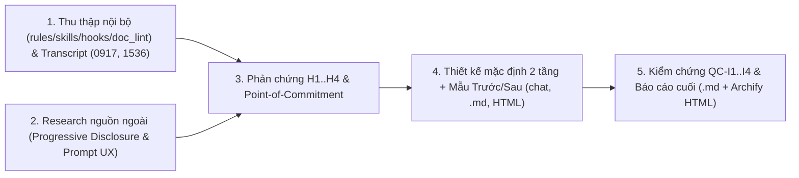

# SPEC — Điều tra và thiết kế chuẩn mặc định trình bày trực quan, dễ hiểu cho TDQ-Workflow

Ngày: 2026-11-21 · Bản: 1.0 · Brief: ../brief/2026-11-21-1736-mac-dinh-trinh-bay-de-hieu.md · Lane: full · Work kind: investigate
Soul: chất lượng > runtime > context cost · luật gốc: skills/tdq-conventions/references/soul.md
Trạng thái: CHỜ DUYỆT

> **Tóm tắt dễ hiểu:** Dù đợt `2026-11-21-0917` đã từng bổ sung luật trình bày ngắn gọn, khi chạy thật `spec`, `report` và câu trả lời chat vẫn hay bị dày thuật ngữ và buộc người dùng nhắc viết lại dễ hiểu hơn. Đợt điều tra này đi tìm nguyên nhân gốc từ mã nguồn, transcript thực tế và nghiên cứu UX/prompt bên ngoài, rồi đề xuất thiết kế mặc định 2 tầng kèm bộ mẫu Trước–Sau cho cả 3 bề mặt (chưa sửa code sản phẩm).

## Mục lục

- 1. Mục tiêu & phạm vi
- 1b. Lộ trình
- 2. Đầu ra cụ thể
- 2b. Ranh giới module
- 2c. Luồng hoạt động & Sơ đồ kiến trúc
- 3. Cách tiếp cận & lý do
- 3b. Năng lực & công cụ
- 3c. Giải thuật & Xử lý cốt lõi
- 3d. Mental Model cho Fresher Dev
- 4. Yêu cầu bắt buộc
- 5. Ràng buộc & rủi ro
- 6. QC & Definition of Done
- 7. Câu hỏi còn mở

## 1. Mục tiêu & phạm vi

- Mục tiêu: Chẩn đoán tận gốc lý do TDQ-Workflow vẫn tạo đầu ra dày chữ kỹ thuật dù đã có luật dễ hiểu, đồng thời thiết kế kiến trúc mặc định trực quan kèm mẫu Trước–Sau áp dụng ngay cho đợt triển khai kế tiếp.
- Trong phạm vi: Kiểm tra cả `3` bề mặt (tin nhắn chat, tài liệu `.md` `spec`/`plan`/`report`, và báo cáo trực quan Archify HTML); đối chiếu mã nguồn/hook/template trong repo, transcript các phiên gần đây (`0917`, `1536`) và research bên ngoài; xuất báo cáo `.md` kèm Archify HTML và bộ mẫu Trước–Sau.
- NGOÀI phạm vi: KHÔNG chỉnh sửa mã nguồn sản phẩm (`skills/`, `hooks/`, `scripts/`, `agents/`, `docs/claude-md-mau.md`), KHÔNG biên dịch plugin, KHÔNG ghi đè `~/.gemini/`, không chạm nhánh `main` hay `git push`; chỉ chuyển sang `build` nếu người dùng chủ động duyệt `escalate-to-build` hoặc mở request mới.

## 1b. Lộ trình

| Bước/phase | Chạy? | Vì sao |
|---|---|---|
| `analyze` | CÓ | Khảo sát nông điểm vào, lập `4` giả thuyết `H1`–`H4` và chốt phạm vi qua `1a 2a 3a 4a` |
| `spec` | CÓ | Chốt câu hỏi điều tra, `4` đầu ra, `5` mốc DoD `Q1`–`Q5` và ngưỡng chứng cứ `QC-I1..I4` |
| `plan` | CÓ | Chia nhánh điều tra độc lập theo `no_worktree` và chọn chế độ thực thi `main` hoặc `subagent` |
| `implement` | CÓ | Đọc sâu nội bộ, soi transcript, research ngoài, phản chứng `H1`–`H4` và soạn nháp báo cáo kèm `[EV-xxx]` |
| `qc` | CÓ | Kiểm chứng hai đường `QC-I1..I4` (`muc_qc=full`) bảo đảm `100%` bằng chứng tồn tại thật |
| `report` | CÓ | Hoàn thiện báo cáo `.md` và dựng `1` bản Archify HTML trực quan qua Tailscale Serve |

## 2. Đầu ra cụ thể

| # | Đầu ra | Đường dẫn/vị trí | Đo "xong" bằng |
|---|---|---|---|
| 1 | Sổ bằng chứng điều tra & đối chiếu `H1`–`H4` | `docs/tdq/artifacts/2026-11-21-1736-mac-dinh-trinh-bay-de-hieu/evidence.jsonl` | Mỗi khẳng định chính có ID `[EV-xxx]` trỏ đúng `path:line` thật hoặc URL sống |
| 2 | Hồ sơ research UX báo cáo AI & prompt | `docs/tdq/research/2026-11-21-1736-mac-dinh-trinh-bay-de-hieu.md` | Có `>= 3` nguồn uy tín/khác góc nhìn kèm URL thật và rút ra quy tắc áp dụng |
| 3 | Báo cáo phân tích, kiến trúc & mẫu Trước–Sau | `docs/tdq/reports/2026-11-21-1736-mac-dinh-trinh-bay-de-hieu.md` | Đủ 3 phần: chẩn đoán, thiết kế giải pháp và mẫu Trước–Sau cho chat/`.md`/HTML; `doc_lint` `0` lỗi |
| 4 | Báo cáo trực quan Archify HTML trên Tailscale | `docs/tdq/reports/2026-11-21-1736-mac-dinh-trinh-bay-de-hieu.html` | `tdq_archify.py verify` đạt `status=current`, `valid=true`, `HTTP 200`, `0` lỗi console |

## 2b. Ranh giới module

Bỏ qua ranh giới module code vì `Work kind: investigate` không chỉnh sửa mã nguồn sản phẩm theo [investigate-mode.md](../../skills/tdq-conventions/references/investigate-mode.md). Các nhánh đọc, soi transcript và research độc lập sẽ tách vùng tài liệu `no_worktree` ở pha `plan`.

## 2c. Luồng hoạt động & Sơ đồ kiến trúc

Bản xem trước Archify HTML trước khi duyệt spec được miễn theo `investigate-mode.md`. Bản Archify HTML trực quan cuối sẽ được dựng một lần ở pha `report`.

| Khía cạnh | Hiện trạng (`0917` về trước) | Mục tiêu điều tra đợt này |
|---|---|---|
| Cách tìm nguyên nhân | Đọc lướt rule trình bày và viết thêm đoạn văn nhắc | Phản chứng `4` giả thuyết `H1`–`H4` qua code + transcript + research |
| Độ phủ bề mặt | Mới chạm một phần template `.md` và chat block | Soi đủ `3` bề mặt: chat, `.md` và Archify HTML + cơ chế hook/lint |
| Sản phẩm bàn giao | Đề xuất rời rạc thiếu số đo mật độ jargon | Chẩn đoán chứng cứ, kiến trúc giải pháp khả thi và mẫu Trước–Sau |

## 3. Cách tiếp cận & lý do

- Chọn: Điều tra bằng chứng hai đường (`evidence.jsonl` nội bộ + đối chiếu transcript + research nguồn ngoài + phản chứng giả thuyết `H1`–`H4`) trước khi chốt thiết kế kiến trúc trình bày mặc định.
- Vì: Đợt `0917` từng chỉ bổ sung câu nhắc ở `user-facing-block.md` và template nhưng hiện tượng viết dày chữ vẫn lặp lại. Cần tách đúng **Manifestation** (chat/`spec`/`report` dày chữ) khỏi **Point-of-Commitment** (cấu trúc prompt/hook/lint ưu tiên chi tiết kỹ thuật trước phần tóm tắt người đọc).
- Đã loại: Phương án tự đoán và sửa ngay chữ trong `SKILL.md` — vì vừa sai phạm vi `investigate` vừa dễ vá nhầm triệu chứng mà không giải quyết lực kéo từ hook và tiêu chí bằng chứng.

## 3b. Năng lực & công cụ

| Skill | Nguồn | Phán quyết | Dùng ở đâu / Lý do loại |
|---|---|---|---|
| `tdq-intake` | `plugin:tdq-workflow-agy` | NỀN | Đã dùng để mở request, khảo sát nông và phỏng vấn |
| `tdq-spec` | `plugin:tdq-workflow-agy` | NỀN | Khung lập spec chuẩn chế độ `investigate` |
| `tdq-plan` | `plugin:tdq-workflow-agy` | NỀN | Khung chia nhánh điều tra `no_worktree` |
| `tdq-build` | `plugin:tdq-workflow-agy` | NỀN | Khung tổng hợp báo cáo và kiểm chứng `QC-I1..I4` |
| `tdq-conventions` | `plugin:tdq-workflow-agy` | NỀN | Khung quy tắc lõi, ngôn ngữ và đối chiếu trình bày |
| `tdq-browser-research` | `plugin:tdq-workflow-agy` | DÙNG | Dùng ở Đầu ra #2: nghiên cứu nguồn ngoài (kèm MCP `tavily-primary`) về UX báo cáo AI và cognitive load |
| `tdq-browser-test` | `plugin:tdq-workflow-agy` | DÙNG | Dùng ở Đầu ra #4: kiểm Accessibility Tree và `0` lỗi console trên Archify HTML báo cáo |
| `generative_ui` | `built-in` | KHÔNG | spec §3 đã chọn cách khác tốt hơn (dùng Archify HTML mặc định của TDQ) |
| Đã xét `19` skill đĩa khác và `15+` skill built-in khác | `plugin` / `built-in` | KHÔNG | khác lĩnh vực |

## 3c. Giải thuật & Xử lý cốt lõi

- **Từng bước điều tra (Step-by-step Execution Logic):**
  1. Thu thập & đo đếm (`Collect`): kiểm vị trí xuất hiện, thứ tự nạp và token weight của toàn bộ chỉ dẫn trình bày qua `rules/`, `skills/`, `hooks/`, `scripts/doc_lint.py` và soi các lượt viết `spec`/`report` trong transcript gần nhất (`0917`, `1536`).
  2. Research ngoài (`Research`): dùng `tavily-primary` / `tdq-browser-research` tìm nguồn thực chứng về progressive disclosure, cognitive load cho non-technical readers, rule ordering (`lost-in-the-middle`, recency/primacy) và lint readability.
  3. Phản chứng `H1`–`H4` (`Falsify`): đối chiếu từng giả thuyết với bằng chứng thuận và nghịch (`Point-of-Commitment` vs `Manifestation`), đo các chỉ số thật như mật độ backtick, số từ/dòng mở đầu, tỷ lệ token nhắc bằng chứng vs nhắc dễ hiểu.
  4. Tổng hợp thiết kế & mẫu Trước–Sau (`Synthesize`): đề xuất kiến trúc chuẩn mặc định khả thi (giữ trần `3.500` token và không làm mất độ chính xác kỹ thuật) kèm bộ mẫu Trước–Sau cho chat, `spec`, `report` và HTML.
- **Độ phức tạp phân tích:**
  - Thời gian (Time Complexity): $O(F + Q)$ với $F$ là tập file luật/template/transcript trong phạm vi và $Q$ là `3`–`5` truy vấn research ngoài.
  - Không gian (Space Complexity): $O(E)$ bị chặn nhờ tóm tắt shard `<= 1.500` ký tự và ghi nối tiếp `evidence.jsonl`.
- **Các ca góc hiểm (Edge Cases & Defensive Handling):**
  - Mất hoặc nghẽn `tavily-primary`: tự động failover sang backup hoặc dùng Chrome DevTools MCP (`tdq-browser-research`) lấy trang chính thức.
  - Bằng chứng mâu thuẫn giữa `AGENTS.md`, hook `[TDQ:*]` và `user-facing-block.md`: ghi rõ mức ưu tiên thực tế của model thay vì suy đoán một chiều.
  - Rủi ro trôi phạm vi sang sửa code: khóa cứng kiểm tra `git diff --name-only` giữ `0` sửa đổi ngoài `docs/`.

## 3d. Mental Model cho Fresher Dev

- **Ẩn dụ trực quan (Analogy):** Hãy hình dung bảng đồng hồ xe hơi: tài xế chỉ cần thấy tốc độ, xăng và đèn báo lỗi ngay trước mắt trong `3` giây, còn toàn bộ mã lỗi kỹ thuật nằm sau cổng OBD cho thợ đọc khi cần. Hiện nay TDQ đang ép model in cả dữ liệu hộp đen OBD lên thẳng mặt kính lái cùng lúc.
- **Thuật ngữ dự án (Glossary):**
  - `Progressive Disclosure`: kỹ thuật chỉ đưa phần cốt lõi dễ hiểu lên tầng mặt tiền, giấu chi tiết kỹ thuật sâu xuống tầng phụ hoặc link chi tiết.
  - `Attention Dilution / Lost in the Middle`: hiện tượng model bỏ sót luật nằm giữa hoặc ở file tham chiếu xa khi prompt dồn nhiều mệnh lệnh đối nghịch.
  - `Point-of-Commitment`: điểm quyết định gốc rễ sinh ra lỗi hệ thống, khác với `Manifestation` (nơi lỗi lộ ra trên bề mặt).
  - `QC-I1..I4`: bộ `4` lớp kiểm chứng nguồn thật cho request điều tra (`100%` `[EV-xxx]` hợp lệ, đối chiếu đĩa, phản biện và gắn nhãn độ tin cậy).

## 4. Yêu cầu bắt buộc

- `100%` khẳng định chẩn đoán chính phải gắn mã `[EV-xxx]` nối về dòng file thật trên đĩa trong `evidence.jsonl` hoặc URL nguồn ngoài sống.
- Mọi kết luận chính đều gắn nhãn độ tin cậy (`Verified`, `Single-source`, `Inferred`, hoặc `Unverified`).
- Không sử dụng placeholder rỗng; mọi đề mục trong báo cáo cuối phải dùng số liệu đếm thật từ mã nguồn và transcript.
- Ghi nhận đầy đủ nhật ký công việc (`docs/workinglog/`) và kiểm `doc_lint.py` sạch `0` lỗi trước khi trình.

## 5. Ràng buộc & rủi ro

Ràng buộc kiến trúc phải giữ từ `docs/kien-truc.md`:
- Giữ phân tầng `3` ngôn ngữ: luật trong `skills/`, `agents/`, chú thích `hooks/`+`scripts/` viết tiếng Anh (chỉ nội dung user thấy dùng tiếng Việt với `i18n-allow`); tài liệu điều tra trong `docs/tdq/` viết tiếng Việt rõ ràng.
- Bảo toàn trần `3.500` token cho mỗi file reference và giới hạn `<= 40` từ/câu (`doc_lint.py` R5/R13) khi đề xuất giải pháp kiến trúc.
- Mọi đề xuất sửa `skills/tdq-conventions/references/soul.md` (nếu có) bắt buộc đánh dấu cần user duyệt riêng.
- Giữ mô hình `2` nhánh: làm việc trên nhánh `docs/mac-dinh-trinh-bay-de-hieu` tách từ `dev` và gộp lại về `dev`; không chạm `main`, `~/.gemini/` hay `git push`.

| Rủi ro | Ảnh hưởng | Cách giảm |
|---|---|---|
| Đổ lỗi chung chung cho model mà thiếu chỉ số đo từ repo và transcript | Đề xuất sửa lại rơi vào vết cũ của đợt `0917` | Đếm thật số từ, mật độ backtick, token trọng số và độ sâu nạp rule ở từng file trước khi kết luận |
| Giải pháp dễ hiểu làm mất độ trung thực bằng chứng hoặc vượt trần `3.500` token | Bị `doc_lint.py` R13 hoặc `QC` từ chối | Thiết kế tách rõ tầng tóm tắt cho người dùng với tầng bảng chứng cứ và trích dẫn link/HTML |
| Nghẽn mạng hoặc thiếu nguồn research bên ngoài | Thiếu góc nhìn UX/prompt chuẩn quốc tế | Kết hợp `tavily-primary` với `tdq-browser-research` và giữ nguồn chính thức từ Anthropic/OpenAI/Nielsen Norman Group |

## 6. QC & Definition of Done

Áp dụng mức `muc_qc = full` cho chế độ điều tra (`QC-I1..I4` theo `investigate-mode.md`):

- [ ] Q1 Kiểm chứng đủ `4` giả thuyết `H1`–`H4` trên cả `3` bề mặt (chat, `.md`, HTML) với dẫn chứng `path:line` và transcript trong `docs/tdq/artifacts/2026-11-21-1736-mac-dinh-trinh-bay-de-hieu/evidence.jsonl` — Test: `py -3 -X utf8 scripts/tdq_team.py evidence merge --slug 2026-11-21-1736-mac-dinh-trinh-bay-de-hieu` (hoặc kiểm đếm `100%` `[EV-xxx]` hợp lệ trên đĩa).
- [ ] Q2 Hồ sơ research ngoài (`docs/tdq/research/2026-11-21-1736-mac-dinh-trinh-bay-de-hieu.md`) có `>= 3` nguồn uy tín/khác góc nhìn kèm URL sống và rút ra quy tắc áp dụng — Test: kiểm tra tồn tại URL và đối chiếu vào mục giải pháp của báo cáo.
- [ ] Q3 Báo cáo cuối (`docs/tdq/reports/2026-11-21-1736-mac-dinh-trinh-bay-de-hieu.md`) có đủ `3` phần (chẩn đoán nguyên nhân, kiến trúc giải pháp kèm trần/cổng kiểm, mẫu Trước–Sau cho chat/`spec`/`report`) và sạch lint — Test: `py -3 -X utf8 scripts/doc_lint.py docs/tdq/reports/2026-11-21-1736-mac-dinh-trinh-bay-de-hieu.md`.
- [ ] Q4 Đạt đủ `QC-I1..I4` (`100%` `[EV-xxx]` trỏ file/dòng thật, có nhãn độ tin cậy, qua phản biện `QC-I3`) và giữ `0` thay đổi ngoài `docs/` — Test: `git diff --name-only dev...HEAD` chỉ chứa tệp dưới `docs/`.
- [ ] Q5 Báo cáo trực quan Archify HTML (`docs/tdq/reports/2026-11-21-1736-mac-dinh-trinh-bay-de-hieu.html`) hợp lệ và kiểm thật trên Tailscale — Test: `py -3 -X utf8 scripts/tdq_archify.py verify --document docs/tdq/reports/2026-11-21-1736-mac-dinh-trinh-bay-de-hieu.md --manifest docs/tdq/reports/2026-11-21-1736-mac-dinh-trinh-bay-de-hieu.manifest.json --project .` và Chrome DevTools `take_snapshot` (`0` console errors).

## 7. Câu hỏi còn mở

không có
