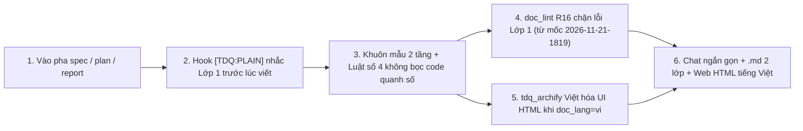

# SPEC — Triển khai kiến trúc mặc định trình bày 2 tầng vào TDQ-Workflow

Ngày: 2026-11-21 · Bản: 1.0 · Brief: [2026-11-21-1819-trien-khai-trinh-bay-2-tang.md](../brief/2026-11-21-1819-trien-khai-trinh-bay-2-tang.md)
Soul: chất lượng > runtime > context cost · luật gốc: skills/tdq-conventions/references/soul.md
Loại: Triển khai tính năng (`build`) · Trạng thái: CHỜ DUYỆT

> **Tóm tắt dễ hiểu:** Hệ thống hiện viết lẫn thông số kỹ thuật vào phần mở đầu vì luật trình bày nằm cuối tệp hướng dẫn. Quy định cũ còn ép bọc code quanh con số, cho chép báo cáo dài ra chat và bỏ qua kiểm tra đầu ra thật. Đợt sửa này tách đầu ra thành hai lớp trên chat, tài liệu và web, gắn thẻ nhắc đúng lúc viết và bật luật kiểm tự động từ hôm nay. Ngoài ra, bản mới còn Việt hóa trang web trực quan và đóng gói sạch trong repo để mọi tài liệu đều dễ đọc ngay.

## Mục lục

- 1. Mục tiêu & phạm vi
- 1b. Lộ trình
- 2. Đầu ra cụ thể
- 2b. Ranh giới module
- 2c. Luồng hoạt động & Sơ đồ kiến trúc
- 3. Cách tiếp cận & lý do
- 3b. Năng lực & công cụ
- 3c. Giải thuật & Xử lý cốt lõi
- 3d. Mental Model cho Fresher Dev
- 4. Yêu cầu bắt buộc
- 5. Ràng buộc & rủi ro
- 6. QC & Definition of Done
- 7. Câu hỏi còn mở

## 1. Mục tiêu & phạm vi

- **Mục tiêu:** Chuyển hóa trọn bộ `6` giải pháp từ [báo cáo điều tra 2026-11-21-1736](../reports/2026-11-21-1736-mac-dinh-trinh-bay-de-hieu.md) thành cơ chế mặc định tự vận hành và tự kiểm định trong mã nguồn `tdq-workflow`.
- **Trong phạm vi:**
  - Nâng cấp quy chuẩn trình bày `user-facing-block.md`, `user-facing-block-vi-du.md`, khuôn `spec`/`plan`/`report`/`qc` và chỉ dẫn `SKILL.md`, giữ ròng token `<= 3.500` mỗi tệp.
  - Bổ sung mã hook `[TDQ:PLAIN]` vào `gate_guidance.py`, `agy_hooks.py` và `prompt_context.py` cho `3` pha `spec`, `plan`, `report`.
  - Thêm luật kiểm `R16` trong `scripts/doc_lint.py` áp dụng từ mốc `2026-11-21-1819` (`block`) kèm bộ test riêng.
  - Việt hóa giao diện trang web Archify HTML trong `scripts/tdq_archify.py` theo `doc_lang=vi`.
  - Cập nhật test hành vi thật, nâng bản phát hành nội bộ `0.104.0` → `0.105.0`, đóng gói lại `plugins/tdq-workflow-agy/` và khóa lại `docs/tdq/token-budget.json`.
- **Ngoài phạm vi:** Không sửa `skills/tdq-conventions/references/soul.md`; không sửa mã nguồn ngoài của `Archify`; không ghi đè `~/.gemini/`; không chạm nhánh `main` hay chạy `git push`.

## 1b. Lộ trình

| Bước/phase | Chạy? | Vì sao |
|---|---|---|
| `analyze` | CÓ | Đã khảo sát 3 chiều khóa test, ngân sách token, định tuyến hook và giới hạn gói ngôn ngữ Archify |
| `spec` | CÓ | Chốt ranh giới `5` module `M1`–`M5`, `7` mốc `Q1`–`Q7` chuẩn `R14` và bản xem trước Archify BA |
| `plan` | CÓ | Chia cụm tệp rời nhau giữa `M1`–`M5` theo sở hữu module và benchmark `main` vs `subagent` |
| `implement` | CÓ | Thực thi TDD đỏ–xanh cho từng module, khóa lại token budget và build plugin `0.105.0` |
| `qc` | CÓ | Áp dụng `muc_qc = full`: lint, test vùng chạm, `smoke-e2e`, toàn suite và kiểm HTML qua trình duyệt |
| `report` | CÓ | Xuất báo cáo `.md` mẫu chuẩn `2` tầng + Archify HTML tiếng Việt và kiểm trên Tailscale |

## 2. Đầu ra cụ thể

| # | Đầu ra | Đường dẫn / Vị trí | Đo "xong" bằng |
|---|---|---|---|
| 1 | Quy chuẩn & Khuôn mẫu `2` tầng dưới `3.500` token | `skills/tdq-conventions/references/user-facing-block*.md`, `skills/tdq-{spec,plan,build}/...`, `docs/claude-md-mau.md` | Mọi reference `<= 3.500` token; giữ đủ `8` luật & `3` câu tự kiểm; thống nhất `> **Tóm tắt dễ hiểu:**` |
| 2 | Hook nhắc `[TDQ:PLAIN]` lúc xuất | `tools/patches/gate_guidance.py`, `tools/patches/agy_hooks.py`, `hooks/scripts/prompt_context.py` | Phát đúng `1` thẻ `<= 240` ký tự khi vào `spec`/`plan`/`report` hoặc sau compact |
| 3 | Luật lint dễ đọc `R16` & kiểm thử đơn vị | `scripts/doc_lint.py` | Bắt vi phạm Lớp 1 từ mốc `2026-11-21-1819`, bỏ qua tài liệu cũ và Lớp 2 |
| 4 | Archify HTML tiếng Việt | `scripts/tdq_archify.py`, `skills/tdq-spec/references/archify-ba.md` | HTML sinh ra tự mang nhãn UI tiếng Việt khi `doc_lang=vi`, manifest `current`/`valid=true` |
| 5 | Đóng gói `0.105.0` & Bộ test hành vi | `plugins/tdq-workflow-agy/**`, `docs/tdq/token-budget.json`, `CHANGELOG.md` | `agy plugin validate` = `0` lỗi, toàn suite test pass, `README`/manifest mang bản `0.105.0` |

## 2b. Ranh giới module

| Module | Sở hữu file & thay đổi chính | Ngăn rủi ro va chạm |
|---|---|---|
| **`M1` — Quy chuẩn & Khuôn mẫu `2` tầng** | Sửa `user-facing-block.md` (`2.863` tok): đưa trần Lớp 1 (`<= 120` từ tóm tắt, `<= 6` backtick/`100` từ, `<= 35` từ/câu) lên `L1–40`, viết lại luật #4 (cấm bọc backtick chữ số và văn xuôi Lớp 1, giữ nguyên đánh số `1–8` và `1–3` câu tự kiểm); cập nhật `user-facing-block-vi-du.md`, `spec-template.md`, `plan-template.md`, `report-template.md` (bỏ `"verbatim"`, thống nhất `> **Tóm tắt dễ hiểu:**`, xóa mẫu nhồi `·`), `tdq-build/SKILL.md`, `docs/claude-md-mau.md`, `scripts/tdq_setup.py`. | Dùng nguyên tắc cắt chữ thừa để net token của mọi template không vượt trần `3.500`. |
| **`M2` — Hook nhắc đúng lúc `[TDQ:PLAIN]`** | Thêm `"PLAIN"` vào `GUIDANCE_CODES` (`12 → 13`) và `ALL_AGY_CODES` (`22 → 23`) cùng `GUIDANCE_TABLE` trong `tools/patches/gate_guidance.py`; mở rộng `_agy_phase_anchor` trong `tools/patches/agy_hooks.py` và logic đồng bộ trong `hooks/scripts/prompt_context.py` để bơm `[TDQ:PLAIN]` (`<= 240` ký tự) khi vào `spec`, `plan`, `report` (hoặc sau compact/resume); cập nhật bộ kiểm thử bảng mã và dual-protocol tương ứng. | Giữ nguyên `[TDQ:GON]` (`implement`) và `[TDQ:QC]` (`qc`); không đụng Rust hot-path vì `pre_invocation.rs` chuyển lượt đổi pha về Python. |
| **`M3` — Luật lint độ dễ đọc `R16`** | Thêm `R16_MOC = "2026-11-21-1819"`, hàm thuần `r16_loi(text, ten_file)` và `rule_r16(doc, out)` vào `scripts/doc_lint.py` (kích hoạt trong `OUTPUT_DIRS` cho `spec/`, `plan/`, `reports/`); bổ sung kiểm thử đơn vị phủ đủ các ca đúng/vi phạm và tài liệu cũ. | Chỉ quét vùng Lớp 1 (từ đầu file đến trước `## 1.` hoặc `## Mục lục`); miễn tài liệu trước mốc `R16_MOC`, bảng `|`, khối code và log `Thời gian`. |
| **`M4` — Việt hóa Archify HTML** | Cập nhật `scripts/tdq_archify.py`: đọc `doc_lang`, bơm `@meta locale=en` vào bản tạm nếu candidate thiếu `@meta locale=` (tránh engine rơi về `zh-CN`), chạy `_localize_explainer_html_vi` thay thế nhãn giao diện tĩnh và JSON `explainer-reader-words` sang tiếng Việt trước bước băm manifest; điền `"locale": "vi"` và `meta.translations` tiếng Việt trong `_build_master_explainer`; cập nhật hướng dẫn `archify-ba.md`, `archify-lifecycle.md` và test kiểm đầu ra HTML tiếng Việt. | Chỉ biến đổi chuỗi UI trước khi lưu và băm manifest nên `tdq_archify.py verify` vẫn khớp `100%`, không đụng công cụ Archify ngoài repo. |
| **`M5` — Test hành vi & Đóng gói `0.105.0`** | Nâng cấp kiểm thử trực quan báo cáo (đổi `"Tóm tắt nhanh:"` → `"Tóm tắt dễ hiểu:"` và kiểm chứng hành vi tốt/xấu trên mẫu báo cáo thật), rà bộ kiểm khuôn khối người dùng; nâng `0.104.0 → 0.105.0` ở `.claude-plugin/plugin.json`, `tools/build_agy_plugin.py`, `tools/patches/__init__.py`, `tools/patches/agy_manifests.py`, `README.md`, `CHANGELOG.md` (cập nhật mô tả số mã gate trong `plugin.json`); chạy `build_agy_plugin.py`, `doc_index.py` và `token_budget.py`. | Biên dịch lại sạch `plugins/tdq-workflow-agy/` từ nguồn gốc, giữ nguyên `~/.gemini/` và `main`. |

## 2c. Luồng hoạt động & Sơ đồ kiến trúc

Trang đối chiếu trực quan Trước–Sau: [2026-11-21-1819-trien-khai-trinh-bay-2-tang-preview.html](2026-11-21-1819-trien-khai-trinh-bay-2-tang-preview.html)

| Điểm chạm | Trước đây (`v0.104.0`) | Sau triển khai (`v0.105.0`) |
|---|---|---|
| Đầu tệp & Luật số `4` | Luật dễ hiểu ở `L127`, luật #4 bọc backtick cả chữ số | Ngưỡng Lớp 1 ở `L1–40`, luật #4 chỉ bọc code kỹ thuật ở Lớp 2 |
| Nhắc nhở lúc viết | Pha `spec`/`plan`/`report` không có hook nhắc văn phong | Hook `[TDQ:PLAIN]` (`<= 240` ký tự) nhắc ngay trước khi viết |
| Bộ kiểm tra tự động | `doc_lint` miễn `R1–R7` cho `docs/tdq/**`; `report` cho dán `verbatim` | `R16` khóa Lớp 1 cho tài liệu mới; bỏ `"verbatim"`, thống nhất nhãn |
| Trang web HTML | Chrome mặc định tiếng Trung nếu thiếu `@meta`, hoặc tiếng Anh | Tự động Việt hóa thanh công cụ & bảng chú giải khi `doc_lang=vi` |

## 3. Cách tiếp cận & lý do

- **Chọn:** Triển khai đồng bộ `5` module từ nguồn gốc (`skills/`, `tools/`, `hooks/`, `scripts/`, `tests/`) rồi đóng gói lại `plugins/tdq-workflow-agy/` theo chuỗi chuẩn `build_agy_plugin.py`.
- **Vì:** Khảo sát 3 chiều chứng minh nếu chỉ sửa chữ trong `skills/` sẽ đụng ngay `3` chốt khóa: trần `3.500` token ở khuôn mẫu, test khóa cứng số đếm (`8` luật, `Tóm tắt nhanh:`, `22` mã hook), và giới hạn không có gói `vi` của công cụ Archify ngoài.
- **Đã loại:** Sửa trực tiếp bản cài `~/.gemini/` hoặc sửa thẳng engine `C:\Users\admin\Documents\archify` — vì sai ranh giới repo và làm mất khả năng tái lập khi cài lại từ git.

## 3b. Năng lực & công cụ

| Skill | Nguồn | Phán quyết | Dùng ở đâu / Lý do loại |
|---|---|---|---|
| `tdq-intake` | `plugin:tdq-workflow-agy` | NỀN | Đã dùng để mở request, kiểm tra LSP, khảo sát `3` chiều và phỏng vấn |
| `tdq-spec` | `plugin:tdq-workflow-agy` | NỀN | Lập đặc tả kỹ thuật, ranh giới module và bản xem trước BA |
| `tdq-plan` | `plugin:tdq-workflow-agy` | NỀN | Chia task song song/tuần tự kèm bench chế độ thực thi |
| `tdq-build` | `plugin:tdq-workflow-agy` | NỀN | Thực thi TDD đỏ–xanh, QC đa tầng và viết báo cáo cuối |
| `tdq-conventions` | `plugin:tdq-workflow-agy` | NỀN | Luật cốt lõi, token budget, git hai nhánh và văn phong trình bày |
| `tdq-browser-test` | `plugin:tdq-workflow-agy` | DÙNG | Nghiệm thu Archify HTML báo cáo tiếng Việt trên trình duyệt (`0` lỗi console) |
| `plugin` | `built-in` | DÙNG | Dùng ở Đầu ra #5: chuẩn đóng gói và kiểm định `plugins/tdq-workflow-agy/` |
| Đã xét `34` skill đĩa khác và `15+` skill built-in | `plugin` / `built-in` | KHÔNG | khác lĩnh vực |

## 3c. Giải thuật & Xử lý cốt lõi

- **Luật `R16` tách Lớp 1 khỏi Lớp 2 (`r16_loi`):**
  1. Kiểm tra tên tệp theo mẫu `YYYY-MM-DD-HHMM-*.md` nằm trong `spec/`, `plan/` hoặc `reports/`. Nếu mốc thời gian `< "2026-11-21-1819"` thì trả về rỗng.
  2. Lấy vùng mở đầu Lớp 1 từ dòng đầu đến trước dòng `## 1.` hoặc `## Mục lục` (bỏ qua dòng tiêu đề `#`, metadata ngắn chuẩn, dòng `Soul:`, `Trạng thái:` và khối trích dẫn mẫu code).
  3. Tìm khối trích dẫn bắt đầu bằng `> **Tóm tắt dễ hiểu:**` (cho phép nhiều dòng liên tiếp bắt đầu bằng `>`). Bắt lỗi nếu thiếu khối này, vượt `120` từ, chứa câu quá `35` từ, vượt `6` cặp backtick mỗi `100` từ, hoặc có đường dẫn dạng `a/b.ext` hay `:line`.
  4. Quét các dòng mở đầu ngoài bảng `|` và khối trích dẫn trong vùng Lớp 1: báo lỗi nếu một dòng văn xuôi hoặc tiêu đề có từ `3` dấu `·` trở lên.
- **Việt hóa HTML Archify (`_localize_explainer_html_vi`):** Nếu `doc_lang == "vi"`, trước khi gọi `run_finalize`, thêm tạm `@meta locale=en` vào candidate chưa có `@meta locale=` để công cụ dùng chuẩn HTML tiếng Anh sạch; sau khi render xong tệp `.tmp.*.html` và trước khi ghi đích/băm manifest, thay chính xác các nhãn UI tiếng Anh cố định (`Skip to content`, `Theme`, `Auto`, `Light`, `Dark`, `Style`, `Export`, `Sources`, `Overview`, `Close`, `Follow flow`, `Open interactive diagram`...) và JSON `#explainer-reader-words` sang tiếng Việt tự nhiên.
- **Độ phức tạp:** Thời gian $O(L)$ tuyến tính theo số dòng tệp Markdown ở `r16_loi` và kích thước HTML đầu ra ở `_localize_explainer_html_vi`; bộ nhớ $O(L)$.
- **Ca góc hiểm:** File lịch sử trước `2026-11-21-1819` không bị quét `R16`; bảng biểu và log `Thời gian` tiếng Anh giữ nguyên miễn trừ; `test_user_facing_block.py` vẫn giữ đủ `8` luật đánh số và `3` câu tự kiểm; nếu `M4` gặp chuỗi JSON khác cấu trúc ở bản Archify mới sẽ kiểm lỗi qua parser JSON thay vì replace mù.

## 3d. Mental Model cho Fresher Dev

- **Ẩn dụ trực quan:** Bảng đồng hồ xe hơi chỉ báo tốc độ, nhiên liệu và đèn cảnh báo cho người lái nhìn trong 3 giây (Lớp 1), còn toàn bộ mã lỗi kỹ thuật và thông số cảm biến nằm ở cổng chẩn đoán OBD bên dưới cho thợ kiểm tra (Lớp 2). Đợt nâng cấp này lắp thêm "vách ngăn" ở khuôn mẫu, gắn nhắc nhở ngay lúc chuẩn bị in lên màn hình, và đặt cảm biến kiểm tra tự động (`R16`) để không ai in nhầm dữ liệu thô OBD ra kính lái nữa.
- **Thuật ngữ dự án:**
  - `Lớp 1 / Mặt tiền`: Phần mở đầu chat, khối `> **Tóm tắt dễ hiểu:**` ở đầu `.md`, và nhãn sơ đồ web Archify viết bằng ngôn ngữ đời thường.
  - `Lớp 2 / Cổng OBD`: Mục chi tiết bên dưới tài liệu `.md`, bảng `Evidence`, bảng `Thời gian`, `QC Card` và `detail` ẩn trong HTML.
  - `[TDQ:PLAIN]`: Mã nhắc nhở ngắn (`<= 240` ký tự) chèn vào cuối ngữ cảnh khi agent chuyển sang pha `spec`, `plan` hoặc `report`.
  - `R16_MOC`: Chuỗi cắt mốc `2026-11-21-1819` trong `doc_lint.py` bảo vệ tài liệu cũ không bị lỗi hồi tố.

## 4. Yêu cầu bắt buộc

- Bảo toàn `100%` bất biến quy tắc hiện có trừ những chỗ chủ đích nâng cấp đã chốt ở `§2b`: `doc_lint` sạch `0` lỗi toàn repo, không còn câu văn xuôi `> 40` từ trong `skills/` (`R5`), mọi file reference `<= 3.500` token (`R13`).
- Cập nhật đồng bộ bản đồ kiểm thử: không bỏ sót `test_gate_guidance.py`, `test_hooks_dual_protocol.py`, `test_report_visual.py`, `test_user_facing_block.py`.
- Không để lại ký hiệu ngoài `6` ký hiệu whitelist (`➤`, `·`, `—`, `→`, `–`, `…`) hoặc emoji trong mọi khối giao tiếp người dùng.
- Tự thực hành chính chuẩn `R16` trên toàn bộ tài liệu mở ra trong request này (`spec`, `plan`, `qc`, `report`).

## 5. Ràng buộc & rủi ro

- Ràng buộc kiến trúc: phân tầng ngôn ngữ tài liệu luật tiếng Anh / giao tiếp người dùng tiếng Việt (`i18n-allow`); trần `3.500` token; giữ `2` nhánh git (`feature/trien-khai-trinh-bay-2-tang` tách từ `dev` và gộp lại về `dev`); chỉ tạo/đổi trong repo, không sửa `~/.gemini/` hay `soul.md`.

| Rủi ro | Ảnh hưởng | Cách giảm |
|---|---|---|
| Thêm hướng dẫn làm `plan-template.md` (`3.472`) hoặc `spec-template.md` (`3.372`) vượt `3.500` token | Hỏng kiểm tra `token_budget.py` và `build_agy_plugin.py` | Áp dụng nguyên tắc trừ bù net `<= 0` token ở mọi template, đo ngay sau khi sửa bằng `token_budget.py` |
| Thay đổi `User-Facing Block` hoặc `ALL_AGY_CODES` làm đỏ các test khóa cũ | Trượt bộ test regression | Đã khảo sát trước toàn bộ điểm khóa trong `test_user_facing_block.py`, `test_gate_guidance.py`, `test_hooks_dual_protocol.py`, `test_report_visual.py` để cập nhật đồng bộ |
| Việt hóa chuỗi trong HTML Archify làm hỏng cú pháp JS/JSON hoặc sai chữ ký manifest | Trang web lỗi console hoặc `tdq_archify.py verify` báo `stale`/`invalid` | Thực hiện dịch UI trên HTML tạm *trước* bước băm manifest và kiểm bằng `json.loads` + Chrome DevTools `take_snapshot` |

## 6. QC & Definition of Done

Áp dụng mức `muc_qc = full` và chuẩn đối chiếu `R14`:

| Q | Hạng mục | Điều kiện pass | Đo trước | Dự phòng nếu trượt |
|---|---|---|---|---|
| **Q1** | Quy chuẩn & Khuôn mẫu `M1` dưới trần `3.500` token | Sửa đủ `user-facing-block*.md` + template `spec`/`plan`/`report`/`qc`; mọi reference `<= 3.500` token; `test_user_facing_block.py` đạt `100%` | `plan-template` `3.472`, `spec-template` `3.372`, `report-template` `3.333`, `user-facing-block` `2.863` token | Cắt bớt câu diễn giải lặp hoặc chuyển ví dụ dài sang `user-facing-block-vi-du.md` để giữ trần |
| **Q2** | Hook nhắc lúc viết `M2` (`[TDQ:PLAIN]`) | Thêm đủ mã `PLAIN` (`23` mã `ALL_AGY_CODES`), `_agy_phase_anchor` + `prompt_context.py` phát thẻ `<= 240` ký tự ở `spec`/`plan`/`report`; `test_gate_guidance.py` + `test_hooks_dual_protocol.py` pass `0` lỗi | Hiện `22` mã `[TDQ:*]` (`12` guidance), `0` hook ở `spec`/`plan`/`report` | Rút ngắn nội dung thẻ hint xuống dưới `200` ký tự hoặc kiểm tra lại bảng `EXPECTED_CODES` |
| **Q3** | Luật dễ đọc `R16` `M3` | `doc_lint.py` có `R16` (mốc `2026-11-21-1819`), bắt chuẩn `<= 120` từ và `<= 6` backtick/`100` từ ở `Tóm tắt dễ hiểu:`; toàn bộ tệp cũ vẫn đạt `0` vi phạm khi chạy `doc_lint.py` toàn repo; `test_doc_lint_r16.py` pass | Hiện `OUTPUT_DIRS` chạy `0` check mật độ; báo cáo `1536` mở đầu `27,94` backtick/`100` từ | Tinh chỉnh regex loại trừ header/metadata hoặc bảng biểu để không bắt nhầm Lớp 2 |
| **Q4** | Việt hóa Archify HTML `M4` | `tdq_archify.py` tạo UI tiếng Việt khi `doc_lang=vi` (nội bộ JSON `explainer-reader-words` hợp lệ, `0` nhãn `zh-CN` lọt ra giao diện chính); `tdq_archify.py verify` đạt `status=current`, `valid=true` và `test_archify_vi.py` pass | Hiện `locales/manifest.json` có `0` gói `vi`, `tdq_archify.py:451` cứng `"locale": "en"`, bỏ `@meta` rơi về `zh-CN` | Ánh xạ từ điển JSON trực tiếp theo key chuẩn `explainer-reader-words` và fallback tiếng Anh cho nhãn phụ |
| **Q5** | Test hành vi & Đóng gói `0.105.0` `M5` | Cập nhật `test_report_visual.py` có fixture xấu/tốt thật; `build_agy_plugin.py` biên dịch sạch sang `plugins/tdq-workflow-agy/` bản `0.105.0`; `agy plugin validate` = `0` findings; `token-budget.json` cập nhật khớp `100%` | Bản hiện tại `0.104.0`; `test_report_visual.py` (`75` dòng) mới kiểm chuỗi tĩnh trong template | Đồng bộ lại `manifest.json`/`README.md` và chạy lại `token_budget.py --ghi` + `doc_index.py` |
| **Q6** | Toàn bộ test suite & `Meta-Gate` | `tdq_meta_gate.py`, `tdq_test.py --smoke-e2e` và `tdq_test.py --tron-bo --workers auto` đạt `100%` pass (`0` fail, `<= 420` giây); `doc_lint.py` toàn repo = `0` lỗi | Baseline `v0.104.0`: `4.693/4.704` pass (`0` fail) trong `313,9` giây | Khoanh vùng test fail đầu tiên bằng `tdq-debugger`, sửa đúng điểm lệch rồi chạy lại toàn bộ |
| **Q7** | Nghiệm thu giao diện Web thực tế | Render báo cáo cuối request này thành Archify HTML tiếng Việt, kiểm qua Tailscale `HTTP 200`, Chrome DevTools `take_snapshot` có UI tiếng Việt rõ ràng và `0` lỗi console | Bản `1736` không gắn `@meta` hiện chrome tiếng Trung; bản có `@meta locale=en` hiện chrome tiếng Anh | Kiểm tra map từ điển UI trong `_localize_explainer_html_vi`, render lại và chụp snapshot mới |

## 7. Câu hỏi còn mở

không có
<!-- tdq-archify-binding:start -->
<!-- manifest: 2026-11-21-1819-trien-khai-trinh-bay-2-tang-preview.manifest.json -->
<!-- manifest_digest: ae40c984815aa9a94753ff81e062ff4825b06603897f9c5d57c86adfe339fee9 -->
<!-- tdq-archify-binding:end -->