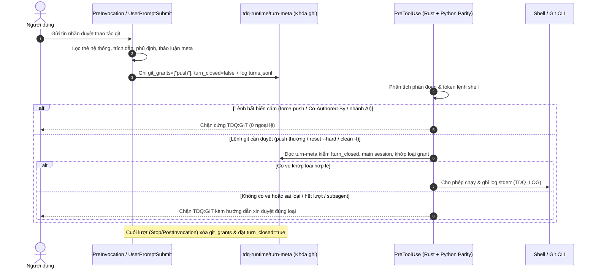

# SPEC — Cập nhật hook cho phép thao tác git khi người dùng duyệt

Ngày: 2026-11-22 · Bản: 1.0 · Brief: ../brief/2026-11-22-0023-hook-duyet-thao-tac-git.md
Soul: chất lượng > runtime > context cost · luật gốc: skills/tdq-conventions/references/soul.md
Chế độ: full · Loại: build · Trạng thái: CHỜ DUYỆT

> **Tóm tắt dễ hiểu:** Trước đây bộ hook chặn cứng mọi lệnh đẩy mã và đặt lại kho ngay cả khi người dùng đã đồng ý. Thiết kế mới xác thực lời cho phép trực tiếp từ tin nhắn người dùng và lưu vé tạm trong vùng khóa. Nhờ đó thao tác git hợp lệ chạy thông suốt, còn các rào cấm force-push, tên nhánh AI và dòng đồng tác giả AI vẫn khóa chặt.

## Mục lục

- 1. Mục tiêu & phạm vi
- 1b. Lộ trình
- 2. Đầu ra cụ thể
- 2b. Ranh giới module
- 2c. Luồng hoạt động & Sơ đồ kiến trúc
- 3. Cách tiếp cận & lý do
- 3b. Năng lực & công cụ
- 3c. Giải thuật & Xử lý cốt lõi
- 3d. Mental Model cho Fresher Dev
- 4. Yêu cầu bắt buộc
- 5. Ràng buộc & rủi ro
- 6. QC & Definition of Done
- 7. Câu hỏi còn mở

## 1. Mục tiêu & phạm vi

- **Mục tiêu:** Nâng cấp đồng bộ hook Rust (`tdq-dispatch`) và hook Python (`hooks/scripts/`, `tools/patches/`) để cho phép thực thi an toàn `git push` thường (không force), `git reset --hard`, và `git clean -f` khi người dùng cho phép rõ ràng trong đúng lượt chat hiện tại, chấm dứt 3 lỗi nền kèm theo (chặn nhầm chuỗi con, thông điệp `TDQ:GIT` thiếu rõ ràng, kẹt mở nhánh bước 3b), và giữ nguyên 100% rào chắn bất biến chống vượt cổng.
- **Trong phạm vi:**
  - Cơ chế trích xuất đồng thuận thao tác git theo từng loại (`push`, `reset_hard`, `clean_f`) từ lời nhắc gốc của người dùng tại `PreInvocation` và `UserPromptSubmit` (hỗ trợ cả Antigravity `transcriptPath`/`USER_INPUT` và payload `prompt`/`user_prompt`).
  - Lưu trữ vé quyền hiệu lực single-turn (`git_grants`) trong `docs/tdq/.tdq-runtime/turn-meta-<sid>.json` và dấu vết kiểm toán vào `turns-<sid>.jsonl`; xóa sạch vé khi đóng lượt (`mark_turn_closed`) hoặc mở lượt mới; không cấp quyền cho subagent.
  - Khóa cứng toàn bộ `docs/tdq/.tdq-runtime/**` không cho agent ghi trực tiếp qua tool sửa file hay shell (`TDQ:STATE`) trên cả Rust và Python.
  - Phân tích phân đoạn và token lệnh shell thực sự (hỗ trợ vỏ bọc `bash -c`, `sh -c`, `pwsh -Command`, `cmd /c`, `rtk bypass`, cờ toàn cục `git -C`, `git -c`, `--git-dir`) để loại bỏ chặn nhầm chuỗi con trong đối số của lệnh không phải git.
  - Bảo toàn tuyệt đối các lệnh chặn cứng không ngoại lệ: mọi dạng force-push (`--force`, `-f`, `--force-with-lease`, `--force-if-includes`, refspec `+...`), **`Co-Authored-By:`** và các trailer AI (`generated with ...`), cùng tên nhánh/worktree mang tiền tố AI (`claude|antigravity|gemini|codex`).
  - Cập nhật thẻ hướng dẫn `GIT` trong `tools/patches/gate_guidance.json` (giữ nguyên 23 mã) kèm thông điệp chi tiết riêng theo từng nguyên nhân chặn.
  - Miễn trừ lệnh tạo nhánh request thuần túy `git switch -c <feature|bugfix|hotfix|chore|docs>/<mô-tả>` và `git checkout -b <loại>/<mô-tả>` ở pha `analyze`/`idle` khi đã mở request (bước 3b của `tdq-intake`).
  - Bổ sung kiểm thử đơn vị Rust, kiểm thử Python parity, dựng lại `tdq-dispatch.exe` và đóng gói lại `plugins/tdq-workflow-agy/`.
- **NGOÀI phạm vi:**
  - Không tự động ghi hay cập nhật thư mục plugin cài sẵn tại `~/.gemini/config/plugins/tdq-workflow-agy/` (chỉ cung cấp lệnh đồng bộ trong báo cáo cuối để người dùng tự chạy theo lựa chọn 5a).
  - Không mở khóa `--force` / `--force-with-lease` / `+refspec`, `Co-Authored-By:`, hay tiền tố nhánh AI dưới bất kỳ hình thức nào.
  - Không thêm mã hướng dẫn thứ 24 ngoài bộ 23 mã trong `gate_guidance.json`.
  - Không chạy `eval` opt-in, không dọn nợ `i18n_check` cũ có sẵn trên nhánh `dev`, không sửa nhánh `main` hay `skills/tdq-conventions/references/soul.md`.

## 1b. Lộ trình

| Bước/phase | Chạy? | Vì sao |
|---|---|---|
| Research web | BỎ | Bài toán 100% nội bộ trên tầng hook Rust/Python của repo, không phụ thuộc API ngoài |
| Interview | CÓ | Đã hoàn tất 1 vòng 7 câu, chốt rõ phạm vi lệnh, chống vượt cổng, hiệu lực lượt, sửa lỗi kèm theo và mức QC |
| Spec + Archify preview | CÓ | Bắt buộc ở chế độ `full`; khóa thiết kế bảo mật, ranh giới module và DoD đo được trước khi lập plan |
| Plan | CÓ | Bắt buộc ở chế độ `full`; chia nhỏ từng task có test red → green |
| Implement | CÓ | Sửa Rust hook, Python hook/patches, test parity, build release và đóng gói `plugins/tdq-workflow-agy/` |
| QC (`full`) | CÓ | Người dùng chọn `6a` (`full`): DoD + trọn unit test Rust/Python + hồi quy vùng chạm + ràng buộc kiến trúc + clean code |
| QC độc lập (agent) | BỎ | Mức `full` không yêu cầu agent QC độc lập (chỉ ở `ultra`), vẫn chạy đầy đủ kiểm thử thật và `agy plugin validate --strict` |
| Report + Archify HTML | CÓ | Xuất báo cáo 4 phần Markdown + Archify HTML tiếng Việt (HTTP 200 qua Tailscale) kèm lệnh đồng bộ plugin global cho người dùng |

## 2. Đầu ra cụ thể

| # | Đầu ra | Đường dẫn/vị trí | Đo "xong" bằng |
|---|---|---|---|
| 1 | Bộ phân tích lệnh shell & trích xuất vé duyệt git bằng Rust | `hooks/rust/tdq-dispatch/src/command_parser.rs`, `storage.rs` | `cargo test` xanh toàn bộ case mới (token parser, anti-spoof, `.tdq-runtime` lock, Step 3b branch exemption) |
| 2 | Cổng thực thi PreToolUse / UserPromptSubmit / PreInvocation bằng Rust | `hooks/rust/tdq-dispatch/src/events/pre_tool_use.rs`, `user_prompt_submit.rs`, `pre_invocation.rs` | Grant hợp lệ mở đúng 1 loại lệnh trong lượt hiện tại; hết lượt/subagent/force/`Co-Authored-By:` luôn chặn |
| 3 | Tầng hook Python & patch Antigravity đồng bộ hành vi 1-1 | `hooks/scripts/prompt_context.py`, `bash_gate.py`, `edit_gate.py`, `agy_pretooluse_gate.py`, `tools/patches/agy_hooks.py`, `tools/patches/gate_guidance.json` | Kiểm thử parity Rust ↔ Python và bảng hướng dẫn đúng 23 mã pass 100% |
| 4 | Bộ kiểm thử tự động khóa hành vi & bảo mật | Bộ test đơn vị Rust và 5 module kiểm thử parity/cổng hook Python (chi tiết đường dẫn tệp test đặt trong plan) | 0 fail trên trọn bộ kiểm thử mục tiêu và `pytest` toàn bộ repo ở cổng QC `full` |
| 5 | Bản dựng release `tdq-dispatch.exe` và gói plugin Antigravity sạch | `plugins/tdq-workflow-agy/bin/tdq-dispatch.exe`, `plugins/tdq-workflow-agy/` | `tools/build_agy_plugin.py --upstream .` trả `"status": "OK"` và `agy plugin validate plugins/tdq-workflow-agy --strict --json` trả 0 findings |

## 2b. Ranh giới module

Xác định theo quan hệ gọi thực tế từ LSP (`find_references` trên `inspect_command_safety` = 9 tham chiếu, `needs_python_command_gate` = 3 tham chiếu) và kiểm chứng đường dẫn import:

| Module | Vùng file | Phụ thuộc module | Đầu ra §2 nào |
|---|---|---|---|
| `M1: rust-parser` | `hooks/rust/tdq-dispatch/src/command_parser.rs` | không (module lõi thuần phân tích chuỗi/token) | 1, 4 |
| `M2: rust-events-storage` | `hooks/rust/tdq-dispatch/src/storage.rs`, `events/pre_tool_use.rs`, `events/user_prompt_submit.rs`, `events/pre_invocation.rs` | `M1: rust-parser`, `M4` (`gate_guidance.json` nhúng qua `include_str!`) | 1, 2, 4 |
| `M3: py-hooks-core` | `hooks/scripts/prompt_context.py`, `bash_gate.py`, `edit_gate.py`, `agy_pretooluse_gate.py` | `scripts/tdq_state.py` (chỉ đọc qua `hooks/ → scripts/`) | 3, 4 |
| `M4: agy-patches-guidance` | `tools/patches/agy_hooks.py`, `tools/patches/gate_guidance.json` | `M3: py-hooks-core` (patch nguồn khi build plugin) | 3, 4, 5 |
| `M5: tests-parity` | Thư mục kiểm thử đơn vị & parity của `tdq-dispatch` và hook Python | `M1`, `M2`, `M3`, `M4` | 4 |
| `M6: agy-plugin-bundle` | `plugins/tdq-workflow-agy/` | `M1`, `M2`, `M3`, `M4` (sinh tự động bằng `cargo build --release` + `tools/build_agy_plugin.py`) | 5 |

## 2c. Luồng hoạt động & Sơ đồ kiến trúc

Sơ đồ Trước/Sau đầy đủ dạng HTML tương tác được gắn kèm và kiểm chứng tại `docs/tdq/spec/2026-11-22-0023-hook-duyet-thao-tac-git-preview.html`. Sơ đồ Mermaid dưới đây mô tả luồng tuần tự dự phòng:

| Khía cạnh | Hiện trạng (Trước) | Thiết kế mới (Sau) |
|---|---|---|
| Chặn `git push`, `git reset --hard`, `git clean -f` | Chặn cứng vô điều kiện kể cả khi người dùng vừa đồng ý trực tiếp | Mặc định chặn; tự động mở đúng loại lệnh trong lượt hiện tại khi có vé xác thực từ tin nhắn gốc của người dùng |
| Kháng giả mạo vượt cổng | Chưa có kênh vé; mọi cách mở bằng biến môi trường đều dễ bị agent tự đặt trong shell | Vé lưu trong `.tdq-runtime/turn-meta-<sid>.json` do hook lượt sinh ra; khóa agent sửa `.tdq-runtime/**` ở cả tool file lẫn shell; subagent không kế thừa vé |
| Chính xác phân tích lệnh | Dùng `lower.contains("git push")` nên chặn nhầm cả lệnh đọc/script có đối số chứa cụm từ git | Tách phân đoạn và token shell thực sự (bắt cả `bash -c`/`pwsh -Command`/`git -C`); chỉ áp luật lên lệnh thực thi `git` |
| Bất biến bảo vệ Git | Gộp chung 1 thẻ `TDQ:GIT` báo sai lý do cho lệnh push/reset | Giữ chặn cứng tuyệt đối force-push, `Co-Authored-By:`, nhánh tiền tố AI; tách rõ `detail` đúng nguyên nhân trên thẻ `GIT` |
| Mở nhánh bước 3b (`tdq-intake`) | `git switch -c` sau `init` bị `[TDQ:APPROVE]` chặn trước `spec_approved` | Miễn trừ lệnh tạo nhánh request thuần túy `git switch -c <loại>/<mô-tả>` / `git checkout -b` ở pha `analyze`/`idle` |

## 3. Cách tiếp cận & lý do

- **Chọn:** Cơ chế vé cấp quyền single-turn sinh trực tiếp từ hook lượt (`PreInvocation`/`UserPromptSubmit`) lưu trong `docs/tdq/.tdq-runtime/turn-meta-<sid>.json` được khóa ghi, kết hợp bộ phân tích token lệnh shell đồng bộ giữa Rust và Python.
- **Vì:**
  1. Tận dụng đúng vòng đời lượt đã tồn tại (`turn-meta-<sid>.json` + `turns-<sid>.jsonl` + `transcriptPath` đọc `<= 64 KB` đuôi tệp), không thêm thư viện ngoài hay tiến trình nền.
  2. Chặn tuyệt đối kịch bản agent tự mở khóa (không dùng biến môi trường trong shell, khóa ghi `.tdq-runtime/**`, lọc thẻ hệ thống/trích dẫn/câu hỏi/meta-request, không cho subagent dùng vé).
  3. Giữ nguyên bộ 23 mã của `gate_guidance.json` nên tương thích 100% với `test_gate_guidance.py` và trải nghiệm UI thẻ 4 phần hiện tại.
- **Đã loại:**
  - Dùng biến môi trường `TDQ_ALLOW_GIT_PUSH=1` trong shell — vì agent có thể tự đặt biến đó trong cùng một lệnh `run_command`, làm vô hiệu hoàn toàn hàng rào bảo mật.
  - Bắt buộc cú pháp từ khóa cứng duy nhất (`duyệt git push`) — vì gây ma sát khi người dùng nói tự nhiên như "ok push code lên origin đi", trong khi bộ lọc phủ định/câu hỏi/meta-request vẫn ngăn được mở nhầm.
  - Thêm lệnh CLI duyệt riêng trong `tdq_state.py` — vì tăng thêm một bước gọi công cụ trung gian không cần thiết cho thao tác lặp lại thường ngày.
  - Mở hiệu lực suốt request — vì diện rủi ro cao nếu ở bước sau agent tự chạy thêm lệnh git ngoài ý định ban đầu.

## 3b. Năng lực & công cụ

Phân vân → DÙNG. Kiểm kê ngày 2026-11-22: 42 skill trên đĩa (23 giữ lại sau lọc, 19 ẩn khác lĩnh vực), cộng các skill built-in trong context. Không xoá bảng này kể cả khi không có dòng DÙNG nào.

| Skill | Nguồn | Phán quyết | Dùng ở đâu / Lý do loại |
|---|---|---|---|
| tdq-intake, tdq-spec, tdq-plan, tdq-build, tdq-conventions, tdq-setup, tdq-status, tdq-check-status, tdq-lean, tdq-checkportable | plugin:tdq-workflow / plugin:tdq-workflow-agy | NỀN | Luồng TDQ Workflow đang chạy |
| Đã xét 32 skill khác (cả đĩa và built-in) | user/plugin/built-in | KHÔNG | khác lĩnh vực |

## 3c. Giải thuật & Xử lý cốt lõi

- **Từng bước giải thuật (Step-by-step Execution Logic):**
  1. **Bước 1 — Trích xuất lời nhắc gốc & tạo vé lượt (`extract_git_grants` ở `PreInvocation`/`UserPromptSubmit`):**
     - Đọc văn bản lời nhắc người dùng từ `payload.prompt` / `payload.user_prompt` / `payload.lastUserInput`; nếu rỗng và có `transcriptPath`, đọc `<= 64 KB` cuối tệp tìm bản ghi `USER_INPUT` gần nhất có `source` rỗng hoặc `USER_EXPLICIT` (bỏ qua `SYSTEM`/`MODEL`).
     - Gỡ vỏ `<TDQ_WORKFLOW>...</TDQ_WORKFLOW>`. Trả `[]` ngay nếu chuỗi rỗng, bọc toàn bộ trong ngoặc kép, chứa thẻ hệ thống (`NON_HUMAN_RE`) hay trích dẫn (`QUOTED_SPEECH_RE`), có dấu hỏi `?`, chứa từ phủ định/trì hoãn (`không`, `ko`, `chưa`, `đừng`, `not`, `don't`, `do not`, `never`, `cancel`, `wait`, `hold on`, `maybe`), hoặc là câu thảo luận/mở request chỉnh hook/spec (`mở request`, `open request`, `update.*hook`, `cập nhật.*hook`, `sửa.*hook`, `viết.*spec`, `test.*hook`).
     - Khớp ý định duyệt/ra lệnh thực thi trực tiếp theo từng loại độc lập:
       - `push`: có từ chỉ ý định thực thi/đồng thuận đi cùng mục tiêu push (`git push`, `push ... lên/origin/upstream/dev/nhánh/code/đi/now/it`, `đẩy code/lên/nhánh/origin/remote`, `duyệt/cho phép/allow/approve ... push`) và không có cụm phủ định trực tiếp trước động từ push.
       - `reset_hard`: bắt buộc nêu tường minh `reset --hard` hoặc `reset hard` đi cùng ý định thực thi/duyệt (từ `reset` đơn lẻ như `reset state` không bao giờ sinh vé).
       - `clean_f`: bắt buộc nêu tường minh `clean` kèm cờ `-f`/`-fd`/`-fdx`/`--force` đi cùng ý định thực thi/duyệt (từ `clean` đơn lẻ như `clean code` không bao giờ sinh vé).
     - Ghi `git_grants` (đã sắp xếp, không trùng) và `turn_closed = false` vào `docs/tdq/.tdq-runtime/turn-meta-<sid>.json` bằng ghi nguyên tử dưới sidecar lock; đồng thời ghi dòng `kind="signal", target="git_grant", grants=[...]` vào `turns-<sid>.jsonl` nếu có vé. Khi `mark_turn_closed` chạy ở `Stop`/`PostInvocation`, đặt `turn_closed = true` và xóa `git_grants = []`.
  2. **Bước 2 — Phân tích phân đoạn & token lệnh shell (`inspect_command_safety` trong `command_parser.rs` và `_has_banned_agy_git` trong `agy_hooks.py`):**
     - Gỡ PowerShell here-string (`strip_powershell_herestrings`), tách phân đoạn lệnh theo `;`, `&&`, `||`, `|`, xuống dòng (`split_shell_segments`), và duyệt đệ quy tối đa độ sâu 2 vào các vỏ bọc shell (`bash -c`, `sh -c`, `pwsh -Command`, `powershell -Command`, `cmd /c`) bằng `extract_shell_subcommands`.
     - Với từng phân đoạn, gọi `tokenize_command`, bỏ qua gán biến môi trường đầu dòng (`KEY=VAL`, `$env:K=...`) và các tiền tố bọc (`env`, `command`, `time`, `rtk`, `rtk bypass`). Kiểm tra tên thực thi (bỏ đường dẫn và hậu tố `.exe`, không phân biệt hoa thường): chỉ khi lệnh thực thi là `git` mới xét luật git.
     - Duyệt bỏ cờ toàn cục của git (`-C <arg>`, `-c <arg>`, `--git-dir <arg>`, `--work-tree <arg>`, `--git-dir=...`, `--work-tree=...`, `--no-pager`, `-p`, `-P`, `--bare`, `--paginate`) để tìm đúng tiểu lệnh git (`subcmd`) và danh sách tham số còn lại (`args`):
       - Nếu là `commit`, `merge`, `tag`, `cherry-pick`, `revert`, `notes`, `am` (hoặc bất kỳ lệnh git nào chứa `co-authored-by:` / `generated with <ai>` / `được tạo cùng/với/bởi <ai>` trong tham số): trả ngay `CoAuthoredTrailer` (**chặn cứng tuyệt đối**, bất kể có `git_grants` hay không).
       - Nếu là `push`: kiểm tra mọi tham số — nếu có `-f`, `--force`, `--force-with-lease` (hoặc `--force-with-lease=...`), `--force-if-includes`, hay refspec bắt đầu bằng `+` (trừ giá trị cờ khác) → trả `GitForcePushForbidden` (**chặn cứng tuyệt đối**). Ngược lại → trả `GitPushNeedsApproval`.
       - Nếu là `reset` và có tham số `--hard` → trả `GitResetHardNeedsApproval`.
       - Nếu là `clean` và có tham số `--force` hoặc cụm cờ ngắn bắt đầu bằng `-` (không phải `--`) chứa ký tự `f` (như `-f`, `-fd`, `-fdx`, `-df`) → trả `GitCleanForceNeedsApproval`.
       - Nếu là `checkout -b`, `switch -c/--create`, `branch`, `worktree add` với tên nhánh/worktree bắt đầu bằng `claude|antigravity|gemini|codex` → chặn cứng `TDQ:GIT` (giữ nguyên luật hiện có).
  3. **Bước 3 — Quyết định ở `PreToolUse` (Rust + Python fallback):**
     - Luôn kiểm tra khóa ghi `docs/tdq/state.json`, `docs/tdq/STATE.md` VÀ `docs/tdq/.tdq-runtime/**` trước tiên trên cả tool sửa file (`edit_file`/`write_file`) và shell (`mutates_tdq_state`); mọi nỗ lực ghi từ agent đều bị chặn cứng `TDQ:STATE`.
     - Nếu `inspect_command_safety` trả bất biến cấm (`GitForcePushForbidden`, `CoAuthoredTrailer`, `RemoteScriptExecution`, `ExecutionPolicyBypass`) → chặn cứng ngay lập tức.
     - Nếu trả loại cần duyệt (`GitPushNeedsApproval` → `"push"`, `GitResetHardNeedsApproval` → `"reset_hard"`, `GitCleanForceNeedsApproval` → `"clean_f"`): chỉ cho phép khi `role_opt.is_none()` (không phải subagent) VÀ `read_turn_meta(workspace_root, sid)` tồn tại với `!meta.turn_closed` VÀ `meta.git_grants` chứa đúng loại khóa đó. Khi cho phép, ghi 1 dòng log có timestamp ra `stderr` (tắt được bằng `TDQ_LOG=0`) và ghi 1 bản ghi `observe` vào `turns-<sid>.jsonl`. Nếu thiếu điều kiện → chặn `TDQ:GIT` với `detail` nêu rõ lệnh nào cần người dùng duyệt trong lượt hiện tại.
     - Miễn trừ bước 3b ở cổng `[TDQ:APPROVE]` (`pre_tool_use.rs:526`): nếu toàn bộ câu lệnh chỉ gồm 1 phân đoạn `git switch -c <loại>/<mô-tả>` hoặc `git checkout -b <loại>/<mô-tả>` với `<loại>` thuộc `{feature, bugfix, hotfix, chore, docs}`, không có tên nhánh AI, không có lệnh nối hay chuyển hướng ghi file, và `effective_phase(&state)` là `"analyze"` hoặc `"idle"` (khi `active_request` đã mở) → cho phép mở nhánh request mà không vướng `spec has no recorded approval`.
- **Độ phức tạp tính toán:**
  - Thời gian (Time Complexity): $O(L)$ với $L$ là độ dài chuỗi lệnh hoặc tin nhắn người dùng (quét đuôi transcript cố định tối đa 64 KB; độ sâu đệ quy vỏ bọc shell chặn cứng ở mức 2).
  - Không gian (Space Complexity): $O(L)$ cho mảng token của câu lệnh và danh sách tối đa 3 khóa trong `git_grants`.
- **Các ca góc hiểm (Edge Cases & Defensive Handling):**
  - Tệp `turn-meta-<sid>.json` thiếu hoặc JSON hỏng: fail-closed cho mọi lệnh git cần duyệt (coi như `git_grants = []`, chặn an toàn).
  - Câu lệnh ghép 2 hành động khác loại (`git push origin dev && git reset --hard HEAD~1`) khi người dùng chỉ duyệt `push`: kiểm tra mọi phân đoạn, phân đoạn `reset --hard` thiếu vé → chặn toàn bộ câu lệnh.
  - Câu lệnh `git commit -m "Co-Authored-By: ..."` lồng trong `bash -c` hay PowerShell `pwsh -Command`: đệ quy độ sâu 2 vẫn bắt và chặn cứng.
  - Chuỗi đối số không phải lệnh git (`py -3 scripts/skill_inventory.py --loc "hook git push"` hoặc `git commit -m "docs: explain git push"`): token thực thi không phải `git push` → không chặn nhầm; riêng `git commit` vẫn kiểm chặt `Co-Authored-By:`.
  - Đường dẫn Windows dùng dấu `\` khi agent thử ghi `docs\tdq\.tdq-runtime\turn-meta-x.json`: chuẩn hóa `\` sang `/` và không phân biệt hoa thường trên Windows trước khi kiểm khóa `TDQ:STATE`.
  - Lệnh `git switch -c feature/foo; echo bad > src/a.py` ở pha `analyze`: có trên 1 phân đoạn / có mutator ngoài `docs/` → không được miễn trừ bước 3b, bị chặn `TDQ:APPROVE`.

## 3d. Mental Model cho Fresher Dev

- **Ẩn dụ trực quan (Analogy):** Hãy hình dung cơ chế mới giống như **thẻ ra vào 1 lượt do lễ tân tự in**: khi chính chủ (người dùng) đứng trước cửa nói "cho phép đẩy mã lên kho", lễ tân (`PreInvocation`/`UserPromptSubmit`) kiểm tra đúng giọng chính chủ rồi bỏ tấm thẻ `"push"` vào tủ kính khóa kín (`.tdq-runtime/`). Nhân viên thực thi (AI agent) không thể tự mở tủ kính viết thêm thẻ hay dùng thẻ `"push"` để mở kho `"reset --hard"`; và ngay khi hết ca (kết thúc lượt chat), tủ kính tự thu hồi toàn bộ thẻ. Những hành động cấm tuyệt đối như xóa lịch sử bằng force-push hay gắn tên AI vào commit thì không bao giờ có thẻ để mở.
- **Thuật ngữ dự án (Glossary):**
  - `turn-meta-<sid>.json`: Tệp trạng thái theo từng phiên nằm trong `docs/tdq/.tdq-runtime/`, lưu dấu vân tay lượt chat, trạng thái đóng lượt `turn_closed` và danh sách vé duyệt tạm `git_grants`.
  - `git_grants`: Mảng chuỗi các quyền thao tác git được người dùng xác nhận trong đúng lượt chat hiện tại, nhận giá trị trong tập đóng `{"push", "reset_hard", "clean_f"}`.
  - `single-turn`: Phạm vi hiệu lực tồn tại từ lúc nhận tin nhắn người dùng đến khi kết thúc lượt (`Stop`/`PostInvocation`) hoặc có tin nhắn mới.
  - `false-positive chuỗi con`: Lỗi kiểm tra bằng `contains` thô khiến lệnh không phải git bị chặn oan chỉ vì đối số chuỗi có chứa chữ `git push`.
  - `parity Rust/Python`: Yêu cầu binary Rust `tdq-dispatch.exe` và kịch bản dự phòng Python (`bash_gate.py` / `agy_hooks.py`) trả cùng một quyết định cho mọi tình huống kiểm thử.

## 4. Yêu cầu bắt buộc

- **Log service bật mặc định:** Mọi sự kiện cấp vé `git_grants` (tại `PreInvocation`/`UserPromptSubmit`) và mọi quyết định cho phép chạy lệnh git nhờ vé (tại `PreToolUse` Rust & Python) đều ghi log có timestamp ISO ra `stderr` (bật mặc định, tắt được qua `TDQ_LOG=0`) và ghi nhận sự kiện vào sổ lượt `turns-<sid>.jsonl`.
- Không placeholder, không TODO stub; eval chỉ chạy khi người dùng yêu cầu và đồng ý.
- Mỗi thành phần (Rust parser, Rust event/storage, Python hooks/patches, guidance table) có unit test và parity test riêng, chạy được bằng một lệnh.
- Bám 5 nguyên tắc SOLID, giữ hàm gọn (`<= 50` dòng, nhánh nông), không thêm dependency ngoài; mã nguồn/docstring/chuỗi máy giữ chuẩn tiếng Anh (`i18n_check.py` delta `+0`).

## 5. Ràng buộc & rủi ro

Ràng buộc kiến trúc phải giữ (chép từ `docs/kien-truc.md` và hợp đồng hiện hành):
- `hooks/` được gọi `scripts/`; `scripts/` **không** được import `hooks/` — chạm ở `hooks/scripts/prompt_context.py`, `bash_gate.py`, `edit_gate.py`, `tools/patches/agy_hooks.py`.
- Chỉ `scripts/tdq_state.py` được ghi `docs/tdq/state.json`; mọi nơi khác chỉ đọc qua CLI — mở rộng thêm hàng rào khóa `docs/tdq/.tdq-runtime/**` không cho agent ghi trực tiếp ở `pre_tool_use.rs`, `command_parser.rs`, `edit_gate.py`, `bash_gate.py`, `agy_hooks.py`.
- Ngôn ngữ chia 3 tầng (`scripts/i18n_check.py`): docstring, chú thích và chuỗi máy in ra ở `hooks/`, `scripts/`, `tools/` viết tiếng Anh cố định; không làm tăng lỗi `i18n_check` so với nhánh `dev`.
- Bộ mã hướng dẫn `tools/patches/gate_guidance.json` giữ đúng 23 mã (`9` hard deny, `2` overwrite, `13` guidance) và `model_hint <= 160` ký tự ASCII.
- Không ghi ngoài workspace (`~/.gemini/config/plugins/tdq-workflow-agy/` giữ nguyên phiên bản hiện tại trong suốt request theo lựa chọn 5a).

| Rủi ro | Ảnh hưởng | Cách giảm |
|---|---|---|
| Trích xuất ý định sai lệch (nhận nhầm câu thảo luận hoặc phủ định thành vé `git_grants`) | Cho phép lệnh git khi người dùng chưa thực sự duyệt | Danh sách chặn rõ câu hỏi `?`, phủ định Việt/Anh, thẻ hệ thống, trích dẫn và cụm từ thảo luận về hook/request/spec; phủ test dày cả ca dương và ca âm |
| Lệch hành vi giữa Rust `tdq-dispatch` và Python fallback `agy_hooks.py` | Một nhánh cho phép nhưng nhánh kia chặn hoặc ngược lại | Chia sẻ cùng quy ước `turn-meta-<sid>.json` (`git_grants`), cùng bảng ca kiểm parity chạy đối chiếu trực tiếp hai tầng |
| Hook `v0.103.1` đang cài trên máy chặn lệnh shell chứa chữ nhạy cảm trong quá trình implement | Gây gián đoạn lệnh test/commit nếu gõ chuỗi đó trên shell | Dùng `write_file`/`edit_file` cho mã nguồn và test; các lệnh `pytest`/`cargo test` không chứa chuỗi cấm trực tiếp trên dòng lệnh |
| Xung đột ghi song song tệp `turn-meta-<sid>.json` trên Windows NTFS | Mất vé hoặc đọc JSON nửa vời | Dùng `acquire_sidecar_lock` + `atomic_write_file` (Rust) và `with_ntfs_lock` (Python), fail-closed nếu đọc lỗi |

## 6. QC & Definition of Done

Mức QC đã chốt từ vòng phỏng vấn (`6a`): **`full`** (DoD + trọn unit test + hồi quy vùng chạm + ràng buộc kiến trúc + clean code).

| # | Hạng mục kiểm | Điều kiện PASS | Đo trước | Dự phòng nếu trượt |
|---|---|---|---|---|
| Q1 | Kiểm thử Rust `tdq-dispatch` (`cargo test --manifest-path hooks/rust/tdq-dispatch/Cargo.toml`) | 100% test pass (0 fail), bao phủ đủ phân tích token lệnh git, 3 loại vé single-turn, chặn cứng force-push/`Co-Authored-By:`/nhánh AI, khóa `.tdq-runtime/` và miễn trừ bước 3b | Đã đo 2026-11-22: 29 passed, 0 failed (`25` lib + `4` main) | Khoanh vùng case trượt theo tên hàm trong `command_parser.rs`/`pre_tool_use.rs`, sửa và chạy lại `cargo test` đến khi đạt 0 fail |
| Q2 | Kiểm thử parity Rust ↔ Python & cổng hook (`pytest` 5 module cốt lõi: `test_rust_dispatch_parity.py`, `test_gate_guidance.py`, `test_bash_gate.py`, `test_agy_hooks.py`, `test_hooks_dual_protocol.py`) | 100% pass (0 fail), khớp quyết định Rust ↔ Python trên toàn bộ ma trận duyệt/không duyệt/hết lượt/subagent/anti-spoof/false-positive; `test_gate_guidance.py` giữ đúng 23 mã | Đã đo 2026-11-22: 137 passed, 19 subtests passed, 0 failed (120.68s) | So sánh chi tiết diff đầu ra JSON giữa Rust binary và Python `dispatch.py`, cân chỉnh regex/logic và chạy lại |
| Q3 | Trọn bộ hồi quy Python (`pytest` toàn repo theo mức QC `full`) | 0 fail trên toàn bộ bộ test hiện hành (không thêm case fail hay làm giảm số test pass) | Nền nhánh `dev` gần nhất (v0.105.0): 4700 passed, 36 skipped, 0 failed | Gọi `tdq_test.py` khoanh vùng module hồi quy, sửa nguyên nhân gốc và chạy lại trọn suite 1 lần sau vòng sửa cuối |
| Q4 | Đóng gói binary & plugin (`cargo build --release`, `tools/build_agy_plugin.py --upstream .`, `agy plugin validate plugins/tdq-workflow-agy --strict --json`) | Build exit 0, `build_agy_plugin.py` trả `"status": "OK"`, `agy plugin validate --strict` trả 0 findings | Bản build hiện tại trên `dev`: 0 findings, `tdq-dispatch.exe` 1,967,616 byte | Kiểm tra log lỗi của `build_agy_plugin.py` hoặc `agy plugin validate`, sửa patch trong `tools/patches/` và dựng lại |
| Q5 | Ràng buộc kiến trúc, `i18n_check` & `doc_lint` | `i18n_check.py` delta `+0` trên mọi file sửa so với `dev`; `doc_lint.py` 0 violation trên `brief`/`spec`/`plan`/`report`; không sửa `~/.gemini/`, `main`, `soul.md` | Delta hiện tại trên các file chưa sửa: `+0`; `doc_lint` brief: 0 violation | Chuyển chuỗi/docstring tiếng Việt phát sinh trong code sang tiếng Anh và sửa mục vi phạm lint trước khi chốt QC |
| Q6 | Kiểm tra clean code & log service | Mỗi hàm sửa/thêm giữ gọn (`<= 50` dòng), có log timestamp mặc định tắt được bằng `TDQ_LOG=0`, chạy `ruff check` trên các file Python chạm đạt 0 lỗi mới | `ruff 0.17.3` đã sẵn sàng trong User `PATH` | Tách helper ngắn gọn và xử lý toàn bộ cảnh báo `ruff` trên file chạm |

**DoD:** Hoàn thành đầy đủ 5 đầu ra ở §2, toàn bộ 6 hạng mục `Q1`–`Q6` đạt `PASS`, nhánh `feature/hook-duyet-thao-tac-git` sạch không vi phạm ranh giới ngoài repo (`~/.gemini/` không bị chạm), xuất báo cáo 4 phần Markdown + Archify HTML tiếng Việt (`HTTP 200` qua Tailscale) kèm lệnh đồng bộ plugin global sẵn dùng cho người dùng.

## 7. Câu hỏi còn mở

(Không có — toàn bộ câu hỏi đã được chốt trong vòng phỏng vấn 1.)
<!-- tdq-archify-binding:start -->
<!-- manifest: 2026-11-22-0023-hook-duyet-thao-tac-git-preview.manifest.json -->
<!-- manifest_digest: cd4e24edc806b80eda1cce07cfc7d123ef08e96bc020e9ff5f10a0fa87e06e44 -->
<!-- tdq-archify-binding:end -->