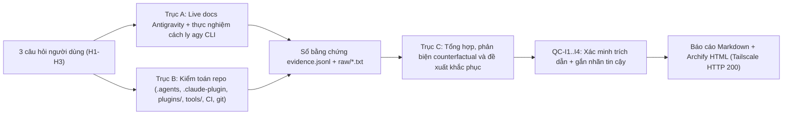

# SPEC — Nghiên cứu custom marketplace GitHub, sẵn sàng Git và cơ chế auto-update của Antigravity

Ngày: 2026-11-22 · Bản: 1.0 · Brief: ../brief/2026-11-22-0821-research-marketplace-va-update.md
Soul: chất lượng > runtime > context cost · luật gốc: skills/tdq-conventions/references/soul.md
Chế độ: full · Work kind: investigate · Trạng thái: CHỜ DUYỆT

> **Tóm tắt dễ hiểu:** Hiện chưa rõ Google Antigravity có hỗ trợ custom marketplace từ GitHub và tự cập nhật plugin theo phiên bản mới hay không. Cấu trúc đóng gói của kho mã nguồn này cũng chưa được rà soát cho mục tiêu phát hành cộng đồng đa hệ điều hành. Yêu cầu này tập trung nghiên cứu tài liệu chính thức, thử nghiệm cách ly và đối chiếu cấu hình repo. Kết quả cuối là báo cáo kiểm chứng có dẫn chứng cụ thể kèm phương án đề xuất, hoàn toàn không sửa mã nguồn hay chạm cấu hình máy.

## Mục lục

- 1. Mục tiêu & phạm vi
- 1b. Lộ trình
- 2. Đầu ra cụ thể
- 2b. Ranh giới module
- 2c. Luồng hoạt động & Sơ đồ kiến trúc
- 3. Cách tiếp cận & lý do
- 3b. Năng lực & công cụ
- 3c. Giải thuật & Xử lý cốt lõi
- 3d. Mental Model cho Fresher Dev
- 4. Yêu cầu bắt buộc
- 5. Ràng buộc & rủi ro
- 6. QC & Definition of Done
- 7. Câu hỏi còn mở

## 1. Mục tiêu & phạm vi

- **Mục tiêu:** Trả lời chính xác, có dẫn chứng nguồn chính thức và thực nghiệm cô lập cho 3 câu hỏi cốt lõi: (1) Google Antigravity (`agy` CLI / IDE / App) có hỗ trợ khai báo custom marketplace từ GitHub không và điều kiện phát hành ra cộng đồng là gì; (2) kho mã nguồn `TDQ-Workflow-Antigravity` hiện đã sẵn sàng đẩy lên GitHub để phân phối cộng đồng đa hệ điều hành (`Windows`, `macOS`, `Linux`) chưa và còn những lệch/thiếu nào; (3) khi plugin cài từ Git remote (hoặc marketplace), Antigravity có tự động kiểm tra và auto-update khi có phiên bản mới hay không, đồng thời đề xuất phương án xử lý cụ thể nếu còn khoảng trống.
- **Trong phạm vi:**
  - Nghiên cứu tài liệu sống chính thức của Google Antigravity (`https://antigravity.google/llms.txt`, `docs/plugins.md`, `docs/cli/reference.md`, `docs/changelog.md`), built-in skills (`antigravity-guide`, `plugin`, `agy-customizations`) và nguồn web xác thực.
  - Kiểm chứng thực tế `agy` CLI (`v1.4.12`) qua các lệnh read-only và thử nghiệm cách ly hoàn toàn trong thư mục tạm (`TEMP`/`TDQ_TEST_DIR`, không chạm `~/.gemini/`).
  - Kiểm toán toàn bộ cấu hình phân phối hiện có trong repo: `.agents/plugins.json`, `.agents/plugins/marketplace.json`, `.claude-plugin/`, `.codex-plugin/`, `plugins/tdq-workflow-agy/` (kể cả binary Rust đa nền tảng & `hooks.json`/`mcp_config.json`), `tools/build_agy_plugin.py`, `tools/install_agy_plugin.py`, `scripts/build_portable.py`, `.github/workflows/`, trạng thái nhánh `dev`/`main` và các Git remote.
  - Tổng hợp sổ bằng chứng `evidence.jsonl`, báo cáo phân tích Markdown 4 phần kèm ma trận khoảng trống + phương án đề xuất (`1a`, `2b`), phiếu QC bằng chứng (`QC-I1`–`QC-I4`) và `Archify HTML` phục vụ qua Tailscale HTTPS.
- **NGOÀI phạm vi:**
  - Không sửa bất kỳ tệp mã nguồn, cấu hình plugin, manifest, workflow CI hay script nào ngoài `docs/tdq/` và `docs/workinglog/` (chỉ mở rộng sang `build` nếu người dùng chủ động yêu cầu ở request sau hoặc `escalate-to-build`).
  - Không thay đổi thư mục cài đặt người dùng `~/.gemini/` và không chỉnh sửa `main` hay chạy `git push`.

## 1b. Lộ trình

Chép từ brief mục `### Lộ trình`. User duyệt spec là duyệt luôn lộ trình này.

| Bước/phase | Chạy? | Vì sao |
|---|---|---|
| Phân tích nông & phỏng vấn (`analyze`) | CÓ | Đã hoàn tất 1 vòng phỏng vấn (`1a 2b 3a 4a 5a`), chốt `muc_qc=full` và 3 giả thuyết `H1`–`H3` |
| Đặc tả (`spec` — `investigate`) | CÓ | Khóa phạm vi câu hỏi, đầu ra báo cáo, tiêu chí kiểm chứng `QC-I1..I4` (miễn `§2b` và Archify preview theo `investigate-mode.md`) |
| Lập kế hoạch (`plan`) | CÓ | Chia 3 trục khảo sát độc lập (Antigravity docs/CLI, kiểm toán cấu hình repo/multi-OS, tổng hợp khuyến nghị) và hợp đồng 5 trường cho 3 skill `DÙNG` |
| Thực thi nghiên cứu (`implement`) | CÓ | Chạy nghiên cứu sâu đa nguồn, thực nghiệm cách ly `agy`, ghi sổ bằng chứng `evidence.jsonl` và soạn báo cáo nháp |
| Kiểm chứng bằng chứng (`qc` — `full`) | CÓ | Chạy đủ `QC-I1`–`QC-I4` (đối chiếu trích dẫn đĩa/URL, phản biện counterfactual, gắn nhãn độ tin cậy `Verified`/`Single-source`/`Inferred`/`Unverified`) |
| Báo cáo cuối (`report` + `Archify HTML`) | CÓ | Chốt báo cáo Markdown 4 phần, render và verify `Archify HTML` một lần kèm đường dẫn Tailscale HTTPS `200`, hỏi commit/merge về `dev` |

## 2. Đầu ra cụ thể

| # | Đầu ra | Đường dẫn/vị trí | Đo "xong" bằng |
|---|---|---|---|
| 1 | Sổ bằng chứng nghiên cứu & trích đoạn gốc | `docs/tdq/artifacts/2026-11-22-0821-research-marketplace-va-update/` (`evidence.jsonl`, `raw/*.txt`, shard nghiên cứu) | Mọi `[EV-xxx]` trích dẫn trong báo cáo đều tồn tại trong `evidence.jsonl` và khớp nội dung nguồn gốc |
| 2 | Tài liệu nghiên cứu chi tiết 3 trục + thực nghiệm `agy` | `docs/tdq/research/2026-11-22-0821-research-marketplace-va-update.md` | Bao phủ đủ 3 câu hỏi gốc, góc nhìn phát hành cộng đồng đa OS (`2b`) và kết quả chạy thử cách ly `agy` (`3a`) |
| 3 | Phiếu kiểm chứng bằng chứng `QC-I1`–`QC-I4` | `docs/tdq/qc/2026-11-22-0821-research-marketplace-va-update.md` | Đạt 100% `PASS` cho `QC-I1`–`QC-I4`, mọi nhận định chính có nhãn tin cậy và `0` thay đổi ngoài `docs/tdq/` + `docs/workinglog/` |
| 4 | Báo cáo cuối Markdown + `Archify HTML` trực quan | `docs/tdq/reports/2026-11-22-0821-research-marketplace-va-update.md` và `.html` (kèm Tailscale HTTPS) | `doc_lint.py` 0 lỗi, `tdq_archify.py verify` trả `status=current`, Tailscale URL trả HTTP 200 |

## 2b. Ranh giới module

BỎ — Miễn theo `investigate-mode.md` (`Work kind: investigate`) vì request này không tạo hoặc sửa mã sản phẩm; toàn bộ đầu ra ghi nằm trong `docs/tdq/` (`research/`, `artifacts/`, `qc/`, `reports/`) và `docs/workinglog/`. Phạm vi đọc được chia thành 2 trục độc lập (Trục A: hệ sinh thái & CLI Antigravity; Trục B: cấu hình Git/marketplace/đóng gói đa OS trong repo).

## 2c. Luồng hoạt động & Sơ đồ kiến trúc

Archify preview trước duyệt spec: MIỄN theo `investigate-mode.md` (`Work kind: investigate`) — sơ đồ trực quan `Archify HTML` sẽ được render và verify một lần duy nhất ở pha `report`. Dưới đây là sơ đồ luồng điều tra và kiểm chứng:

| Khía cạnh | Hiện trạng (Trước) | Trạng thái sau điều tra (Sau) |
|---|---|---|
| Cơ chế marketplace GitHub & auto-update của Antigravity | Chưa xác thực; mới có tín hiệu sơ bộ từ `agy plugin --help` (`1.4.12`) | Có kết luận rõ ràng kèm dẫn chứng nguồn chính thức (`antigravity.google/docs/*.md`) và kết quả chạy thử cách ly trên `agy` |
| Mức độ sẵn sàng GitHub cộng đồng đa OS của repo | Nhiều adapter song song (`.agents/`, `.claude-plugin/`, `plugins/tdq-workflow-agy/`) nhưng chưa đối chiếu hết điểm lệch | Có bảng kiểm từng tệp/nhánh/CI/nhị phân Windows–macOS–Linux kèm mức độ sẵn sàng và khoảng trống cụ thể |
| Lộ trình xử lý tiếp theo | Chưa rõ cần sửa gì trước khi đẩy Git và cài plugin từ remote | Có bộ phương án đề xuất ưu tiên theo thứ tự tác động để tách thành request triển khai nếu người dùng duyệt |

## 3. Cách tiếp cận & lý do

- **Chọn:** Điều tra hai trục song song ở pha `implement` (Trục A kiểm chứng nền tảng Antigravity từ tài liệu `.md` chính thức, `search_web`/Tavily và thực nghiệm cách ly `agy`; Trục B kiểm toán toàn diện cấu trúc đóng gói, manifest, CI release đa OS và trạng thái nhánh Git của repo), sau đó gom vào `evidence.jsonl`, tổng hợp ma trận khoảng trống + phương án đề xuất và kiểm chứng chéo bằng `QC-I1`–`QC-I4`.
- **Vì:** Tách rạch ròi sự thật về năng lực của Antigravity (`H1`, `H3`) khỏi hiện trạng cấu hình nội bộ của repo (`H2`), ngăn chặn nguy cơ nhầm lẫn chuẩn Claude Code Marketplace (`.claude-plugin/marketplace.json`) với chuẩn thực tế của Google Antigravity, đồng thời bảo đảm mọi khuyến nghị đều truy vết được về đường dẫn/trích dẫn gốc.
- **Đã loại:**
  - Chỉ suy đoán từ `agy plugin --help` và tên tệp hiện có trong repo — vì dễ bỏ sót cơ chế IDE/App Marketplace hoặc hành vi thật của lệnh `agy plugin install`/`link`.
  - Dùng Chrome DevTools cào web ngay từ đầu — vì `antigravity-guide` đã cung cấp mirror `.md` chính thức nhẹ và ổn định hơn (`antigravity.google/docs/*.md`), chỉ dùng trình duyệt nếu mirror không khả dụng.

## 3b. Năng lực & công cụ

Chép từ brief mục `### Năng lực dùng được`. Pre-flight check MCP/CLI: xác nhận `agy` (`v1.4.12`), `search_web`/`tdq-workflow-agy_tavily-primary`, `tdq-workflow-agy_lsp` (6/8 bậc ĐẠT) trước khi vào trục nghiên cứu.

| Skill | Nguồn | Phán quyết | Dùng ở đâu / Lý do loại |
|---|---|---|---|
| tdq-intake, tdq-spec, tdq-plan, tdq-build, tdq-conventions, tdq-setup, tdq-status, tdq-check-status, tdq-lean, tdq-checkportable | plugin:tdq-workflow / plugin:tdq-workflow-agy | NỀN | Luồng TDQ Workflow đang chạy (`investigate`) |
| antigravity-guide | built-in | DÙNG | Nguồn sitemap chính thức (`antigravity.google/docs/plugins.md`, `cli/reference.md`, `changelog.md`) để đối chiếu custom marketplace & auto-update |
| plugin | built-in | DÙNG | Tham chiếu quy trình cài/gỡ/liệt kê plugin, catalog ID và RPC `GetAllPlugins` của Antigravity |
| agy-customizations | built-in | DÙNG | Đối chiếu discovery roots (`.agents/`, `~/.gemini/config/`) và thứ tự ưu tiên nạp plugin/skill |
| tdq-browser-research | plugin:tdq-workflow / plugin:tdq-workflow-agy | KHÔNG | `spec §3 đã chọn cách khác tốt hơn` (dùng mirror `.md` chính thức của Antigravity, `search_web`/`tavily` và `agy` CLI) |
| Đã xét 30 skill khác | user/plugin/built-in | KHÔNG | `khác lĩnh vực` |

## 3c. Giải thuật & Xử lý cốt lõi

Quy trình điều tra có kiểm chứng (`Evidence-Backed Triangulation Pipeline`):

- **Từng bước xử lý (Step-by-step Execution Logic):**
  1. **Bước 1 (Thu thập Trục A — Nền tảng Antigravity):** Tải và đọc mirror `.md` chính thức (`llms.txt`, `plugins.md`, `cli/reference.md`, `changelog.md`), đọc tiếp phần tham chiếu trong skill `plugin` và `agy-customizations`, tìm kiếm bổ sung về GitHub custom marketplace/auto-update của Antigravity, và chạy thử nghiệm cô lập `agy plugin link`/`install`/`validate` trong thư mục tạm không chạm `~/.gemini/`. Lưu trích đoạn vào `raw/*.txt` và ghi mục `[EV-A*]` vào `evidence.jsonl`.
  2. **Bước 2 (Thu thập Trục B — Kiểm toán kho mã nguồn):** Đọc toàn bộ tệp đóng gói & metadata (`.agents/plugins.json`, `.agents/plugins/marketplace.json`, `.claude-plugin/*`, `.codex-plugin/*`, `plugins/tdq-workflow-agy/{plugin.json,manifest.json,hooks.json,mcp_config.json,README.md}`, `tools/build_agy_plugin.py`, `tools/install_agy_plugin.py`, `scripts/build_portable.py`, `.github/workflows/*`), đối chiếu trạng thái `dev`/`main`/`origin`/`upstream` và hỗ trợ binary đa hệ điều hành (`Windows`, `macOS`, `Linux`). Ghi mục `[EV-B*]` vào `evidence.jsonl`.
  3. **Bước 3 (Đối chiếu, phản biện & tổng hợp):** Gắn từng nhận định với mã `[EV-xxx]`, kiểm tra giả thuyết đối nghịch (`H1`–`H3` — đặc biệt phân biệt Antigravity App/IDE UI với `agy` CLI, và phân biệt Claude Code/Codex marketplace với Antigravity), xếp hạng khoảng trống hiện tại và lập bảng phương án đề xuất (`Ưu tiên 1/2/3`), sau đó chạy vòng kiểm chứng `QC-I1`–`QC-I4`.
- **Độ phức tạp & ngân sách thao tác:**
  - Thời gian / số lượt gọi: $O(A + B + C)$ tuyến tính theo số nguồn đọc (giới hạn `<= 12` lời gọi/nhánh theo Tier 1–2 của `investigate-mode.md`, dừng sớm sau 2 truy vấn rỗng).
  - Không gian lưu trữ: $O(E)$ theo số đoạn trích bằng chứng lưu gọn trong `docs/tdq/artifacts/<slug>/raw/` và `evidence.jsonl`.
- **Các ca góc hiểm (Edge Cases & Defensive Handling):**
  - Tài liệu online đổi URL hoặc không truy cập trực tiếp được qua HTTP: rơi sang `search_web`/`tavily_search` + ghi rõ trạng thái không truy cập được thay vì suy đoán; gắn nhãn `Single-source` hoặc `Unverified` theo `QC-I4`.
  - Thực nghiệm `agy plugin install/link` có nguy cơ ghi vào `%USERPROFILE%\.gemini`: bắt buộc kiểm tra cờ/biến môi trường cách ly (`USERPROFILE`/`HOME` tạm trong subprocess) và kiểm tra băm/thời gian sửa thư mục `~/.gemini/config/` trước và sau thử nghiệm để bảo đảm bất biến `0` thay đổi.
  - Nhầm lẫn cơ chế giữa 3 host (Antigravity vs Claude Code vs Codex): mọi bảng đối chiếu tách riêng cột theo từng host để tránh gán tính năng của Claude Code sang Antigravity.

## 3d. Mental Model cho Fresher Dev

- **Ẩn dụ trực quan (Analogy):** Hãy hình dung Google Antigravity giống một chiếc điện thoại có "kho ứng dụng chính hãng" (Official/Partner Marketplace) và tính năng "cài ứng dụng từ thư mục cục bộ" (sideload). Yêu cầu này đi kiểm tra xem chiếc điện thoại đó có cho phép thêm một "kho ứng dụng riêng đặt trên GitHub" để tự báo có bản mới và tự bấm cập nhật hay không, đồng thời kiểm tra xem gói cài đặt của dự án mình đã đóng đúng hộp cho cả Windows, macOS và Linux trước khi đưa lên mạng chưa.
- **Thuật ngữ dự án (Glossary):**
  - `Custom Marketplace`: Danh mục plugin do bên thứ ba/cá nhân tự lưu trữ (ví dụ trên GitHub qua `marketplace.json`) để công cụ cài đặt đọc danh sách và tải plugin.
  - `Discovery root`: Thư mục mặc định mà Antigravity tự quét để nạp plugin/skill (như `.agents/` ở cấp dự án hoặc `~/.gemini/config/` ở cấp máy).
  - `Auto-check / Auto-update`: Cơ chế nền tự kiểm tra phiên bản mới từ nguồn từ xa (Git remote hoặc catalog) và tự kéo/cập nhật mã plugin khi có bản phát hành mới.
  - `Two-branch model (dev / main)`: Quy ước của repo này — nhánh `dev` chứa đầy đủ tài liệu, bài test, công cụ phát triển; nhánh `main` được sinh sạch bằng `build_portable.py --sinh-main` để chỉ chứa tệp runtime phát hành.
  - `Evidence ledger (evidence.jsonl)`: Sổ bằng chứng dạng dòng JSON liên kết từng kết luận trong báo cáo với đúng đường dẫn tệp, dòng mã hoặc trích đoạn tài liệu gốc để chống suy đoán.

## 4. Yêu cầu bắt buộc

- **Log service:** BỎ — yêu cầu thuộc loại `work_kind=investigate` (chỉ nghiên cứu và viết tài liệu trong `docs/tdq/`), không có task nào tạo hay sửa mã runtime sản phẩm.
- **Không placeholder, không suy đoán không căn cứ:** Mọi khẳng định về năng lực của Antigravity và trạng thái repo phải có mã `[EV-xxx]` và nhãn tin cậy (`Verified`, `Single-source`, `Inferred`, `Unverified`); không chạy `eval`.
- **Mỗi trục có phép kiểm chứng độc lập:** Trục A kiểm chứng bằng nguồn chính thức + output thật từ `agy`; Trục B kiểm chứng bằng đọc file thật + `git`/`build` metadata; toàn bộ báo cáo kiểm chứng bằng `doc_lint.py` và `tdq_archify.py verify`.

## 5. Ràng buộc & rủi ro

Ràng buộc kiến trúc phải giữ: không chạm dòng nào — yêu cầu thuần nghiên cứu và báo cáo (`work_kind=investigate`), chỉ ghi tài liệu trong `docs/tdq/` và `docs/workinglog/`, giữ nguyên toàn bộ `scripts/`, `hooks/`, `skills/`, `plugins/`, `~/.gemini/` và nhánh `main`.

| Rủi ro | Ảnh hưởng | Cách giảm |
|---|---|---|
| Tài liệu web của Antigravity cập nhật nhanh hoặc khác giữa App/IDE 2.0 với CLI `1.4.12` | Kết luận đúng với CLI nhưng thiếu ngữ cảnh ở IDE/App (hoặc ngược lại) | Đối chiếu song song `antigravity.google/docs/plugins.md`, `changelog.md`, skill `plugin` (RPC UI) và CLI `agy` thực tế; tách rõ bảng so sánh theo từng bề mặt |
| Chạy thử lệnh `agy plugin` vô tình sửa cấu hình `~/.gemini/` của người dùng | Làm hỏng môi trường plugin đang hoạt động (`0.103.1`) | Chỉ chạy thử ghi trong subprocess với `HOME`/`USERPROFILE` trỏ thư mục tạm cô lập, xác minh trước–sau rằng `~/.gemini/config/` không đổi |
| Lẫn lộn schema `.claude-plugin/marketplace.json` hoặc `.agents/plugins/marketplace.json` (Codex) với chuẩn Antigravity | Đánh giá sai mức độ sẵn sàng của repo | Kiểm tra riêng từng file adapter và đối chiếu đúng chuẩn schema được Antigravity công nhận |
| Thiếu dữ liệu cho macOS/Linux vì máy đang chạy Windows | Đánh giá thiếu sót cho phát hành cộng đồng đa OS (`2b`) | Kiểm toán trực tiếp workflow CI `.github/workflows/build-rust-hooks.yml`, `tools/build_agy_plugin.py`, `tools/install_agy_plugin.py` và `plugins/tdq-workflow-agy/hooks.json` để xác minh cách phát hành nhị phân cho cả 3 OS |

## 6. QC & Definition of Done

Mức QC đã chốt: `full` (`work_kind=investigate` → áp dụng `QC-I1`–`QC-I4` cùng kiểm tra tài liệu và phạm vi kho sạch).

| # | Hạng mục kiểm | Điều kiện PASS | Đo trước | Dự phòng nếu trượt |
|---|---|---|---|---|
| Q1 | Trả lời có dẫn chứng cho 3 câu hỏi cốt lõi (Custom GitHub Marketplace, Sẵn sàng Git cộng đồng đa OS, Auto-check & Auto-update) | Tài liệu `docs/tdq/research/<slug>.md` và báo cáo `docs/tdq/reports/<slug>.md` trả lời trực diện cả 3 câu hỏi kèm ma trận khoảng trống và phương án đề xuất (`1a`, `2b`) | — | Bổ sung trục truy vấn còn thiếu và ghi rõ giới hạn nếu nguồn công khai không tài liệu hóa |
| Q2 | Thực nghiệm cách ly `agy` CLI & an toàn `~/.gemini/` (`3a`) | Có log kết quả thực tế từ `agy` (`v1.4.12`) trong môi trường cách ly và xác nhận `0` thay đổi tại `~/.gemini/config/` | — | Nếu lệnh từ chối chạy dưới `HOME` tạm, dừng ghi và chỉ giữ bằng chứng read-only + tài liệu chính thức, ghi rõ lý do |
| Q3 | `QC-I1` & `QC-I2` — Toàn vẹn bằng chứng và Focused Grounding | 100% mã `[EV-xxx]` trong báo cáo có mặt trong `evidence.jsonl`; 100% `path:line` tồn tại trên đĩa; đối chiếu từng nhận định chính với dòng đĩa / `raw/<ev_id>.txt` đạt `0` sai lệch | — | Sửa lại nhận định lệch nguồn hoặc hạ nhãn tin cậy về `Unverified` |
| Q4 | `QC-I3` & `QC-I4` — Phản biện counterfactual & gắn nhãn tin cậy | Có mục phản biện/giả thuyết đối nghịch cho cả 3 kết luận chính; 100% kết luận chính mang nhãn `Verified` / `Single-source` / `Inferred` / `Unverified` | — | Chạy thêm 1 vòng rà soát phản chứng độc lập trước khi đóng QC |
| Q5 | Ranh giới phạm vi kho (`work_kind=investigate`) | `git diff --name-only dev...HEAD` và `git status --short` xác nhận `0` tệp sửa ngoài `docs/tdq/` và `docs/workinglog/`, `0` commit lên `main`, không chạy `git push` | — | Hoàn nguyên mọi thay đổi ngoài `docs/tdq/` nếu phát sinh ngoài ý muốn |
| Q6 | Chất lượng tài liệu & `Archify HTML` qua Tailscale | `doc_lint.py` đạt `0 violation` trên `brief`, `spec`, `plan`, `qc`, `report`; `tdq_archify.py verify` trả `status=current`; URL Tailscale HTTPS của `reports/<slug>.html` trả HTTP `200` | — | Sửa định dạng/bố cục sơ đồ đến khi `doc_lint` và `tdq_archify.py verify` đạt xanh |

**DoD:** Hoàn thành đầy đủ 4 đầu ra §2, 100% tiêu chí `Q1`–`Q6` đạt `PASS` trong phiếu QC (`docs/tdq/qc/2026-11-22-0821-research-marketplace-va-update.md`), mọi checkbox task và DoD trong plan được đánh `[x]`, `Archify HTML` mở được qua Tailscale HTTPS `200` và không có thay đổi mã nguồn ngoài `docs/tdq/` + `docs/workinglog/`.

## 7. Câu hỏi còn mở

không có
