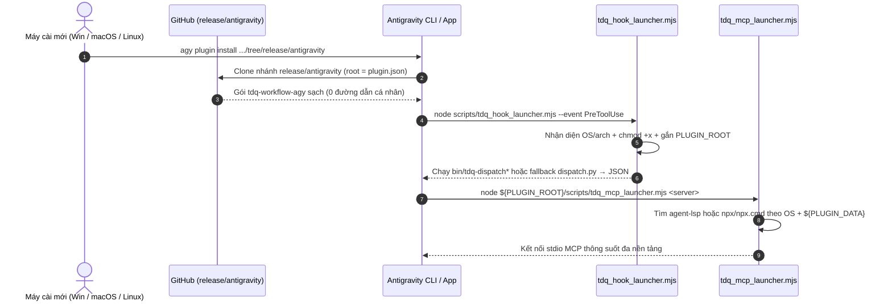

# SPEC — Nhánh release Antigravity đa hệ điều hành và đồng bộ remote

Ngày: 2026-11-22 · Bản: 1.0 · Brief: ../brief/2026-11-22-1033-nhanh-release-agy-da-os.md
Soul: chất lượng > runtime > context cost · luật gốc: skills/tdq-conventions/references/soul.md
Chế độ: full · Loại: build · Trạng thái: CHỜ DUYỆT

> **Tóm tắt dễ hiểu:** Bản plugin Antigravity trên GitHub hiện chưa có nhánh phát hành riêng và nhánh phát triển đang tụt sau máy cục bộ. Cấu hình MCP cùng hook vẫn dính cứng đường dẫn Windows khiến máy khác cài bị lỗi. Sau nâng cấp, hệ thống xuất bản nhánh phát hành sạch đặt trực tiếp plugin ở gốc kèm hai bộ khởi chạy đa hệ điều hành bằng Node. Nhờ đó mọi máy Windows, macOS và Linux chỉ cần một lệnh cài là dùng trọn vẹn và kho GitHub được đồng bộ đầy đủ.

## Mục lục

- 1. Mục tiêu & phạm vi
- 1b. Lộ trình
- 2. Đầu ra cụ thể
- 2b. Ranh giới module
- 2c. Luồng hoạt động & Sơ đồ kiến trúc
- 3. Cách tiếp cận & lý do
- 3b. Năng lực & công cụ
- 3c. Giải thuật & Xử lý cốt lõi
- 3d. Mental Model cho Fresher Dev
- 4. Yêu cầu bắt buộc
- 5. Ràng buộc & rủi ro
- 6. QC & Definition of Done
- 7. Câu hỏi còn mở

## 1. Mục tiêu & phạm vi

- **Mục tiêu:**
  1. Cung cấp nhánh phát hành Antigravity độc lập `release/antigravity` trên `origin` chứa trực tiếp gói `tdq-workflow-agy` sạch tại thư mục gốc để mọi máy Windows, macOS và Linux cài đặt trọn vẹn bằng một lệnh `agy plugin install https://github.com/TDQUOC/TDQ-Workflow-Antigravity/tree/release/antigravity`.
  2. Khử 100% đường dẫn máy cá nhân (`C:\Users\admin\...`, `npx.cmd`) trong `mcp_config.json` và lệnh đóng cứng Windows (`bin\tdq-dispatch.exe`) trong `hooks.json` thông qua cặp launcher Node.js đa hệ điều hành chuẩn Antigravity.
  3. Cập nhật CI build Rust đa OS, đồng bộ binary macOS/Linux qua SSH nếu máy đích trực tuyến (hoặc đảm bảo cơ chế fallback Python chạy thông suốt), và đồng bộ sạch `dev` cùng `release/antigravity` lên `origin` sau khi toàn bộ QC mức `full` đạt xanh.

- **Trong phạm vi:**
  - Bộ sinh manifest & launcher đa OS trong `tools/patches/agy_manifests.py`, `tools/patches/agy_launchers.py` (mới), `tools/build_agy_plugin.py` và bản biên dịch `plugins/tdq-workflow-agy/`.
  - Hai tập lệnh launcher Node.js không phụ thuộc gói ngoài (`scripts/tdq_hook_launcher.mjs` và `scripts/tdq_mcp_launcher.mjs`) được đóng gói vào `plugins/tdq-workflow-agy/scripts/`.
  - Giữ tương thích trình cài cục bộ `tools/install_agy_plugin.py` và `install.py` (`--sync-local-mcp`, `--with-caveman`, kiểm tra binary và hook).
  - Bổ sung lệnh sinh nhánh release sạch `--sinh-release-agy` trong `scripts/build_portable.py` dùng Git plumbing (`ls-tree` → `update-index` → `write-tree` → `commit-tree` → `update-ref`), giữ nguyên nhánh `main` cho Claude Code.
  - Cập nhật `.github/workflows/build-rust-hooks.yml` (bổ sung `x86_64-apple-darwin`) và thử build đồng bộ binary Linux/macOS qua SSH (`ubuntu-100-95`, `mbair`) nếu máy online.
  - Cập nhật tài liệu cài đặt `README-Antigravity.md`, bộ kiểm thử đơn vị và thử nghiệm cài cô lập `agy plugin install` trên kho Git cục bộ mô phỏng máy khác.
  - Sau khi QC `full` đạt xanh và gộp về `dev`, đẩy `dev` và `release/antigravity` lên `origin` theo duyệt trước `5b` (không `--force`, không sửa nhánh `main`).

- **NGOÀI phạm vi:**
  - Không thay đổi cấu trúc nhánh `main` của Claude Code hay chuyển nhánh mặc định trên giao diện GitHub Web.
  - Không nộp hồ sơ lên Google Antigravity Official/Partner Marketplace hay xây dịch vụ tự kiểm tra phiên bản ngầm (`SessionStart` GitHub polling) — để tách thành request riêng nếu cần sau này.
  - Không thay đổi logic nghiệp vụ các gate `[TDQ:*]` trong `hooks/rust/tdq-dispatch/` hay `hooks/scripts/dispatch.py` (chỉ biên dịch lại binary sẵn có nếu máy SSH online).
  - Không chỉnh sửa dữ liệu thật trong `~/.gemini/config/` của người dùng hiện tại khi chạy kiểm thử.

## 1b. Lộ trình

Chép từ brief mục `### Lộ trình`. User duyệt spec là duyệt luôn lộ trình này.

| Bước/phase | Chạy? | Vì sao |
|---|---|---|
| Research web | BỎ | Đã thu thập đầy đủ 11 tài liệu sống `antigravity.google` và thực nghiệm cách ly `agy v1.4.12` ngay trước request này |
| Interview chi tiết | CÓ | Đã chốt đủ 7 quyết định đổi đầu ra (`1a 2a 3a 4a 5b 6a 7a`) |
| Spec + Archify preview Trước/Sau | CÓ | Sửa luồng đóng gói và phát hành đang hoạt động, cần bản vẽ trực quan trước khi duyệt |
| Plan + kiểm hợp đồng | CÓ | Chia task không trùng file nóng, gắn kiểm chứng từng bước |
| Implement (đỏ → xanh) | CÓ | Xây launcher hook/MCP, bộ sinh nhánh release, cập nhật CI/docs và đồng bộ binary |
| QC mức `full` | CÓ | User chọn `6a` (`full`): DoD + trọn unit test + hồi quy vùng chạm + kiểm cài cô lập `agy` + ranh giới kiến trúc |
| QC độc lập (subagent) | BỎ | Mức QC đã chốt là `full` (chưa yêu cầu `ultra`) |
| Report + Archify HTML + đồng bộ `origin` | CÓ | Xuất báo cáo 4 phần, sơ đồ HTML qua Tailscale và đẩy `dev` + `release/antigravity` lên `origin` theo chấp thuận `5b` |

## 2. Đầu ra cụ thể

| # | Đầu ra | Đường dẫn/vị trí | Đo "xong" bằng |
|---|---|---|---|
| 1 | Bộ đôi launcher Node.js đa OS (hook + MCP) kèm log chuẩn | `tools/patches/agy_launchers.py` → đóng gói ra `plugins/tdq-workflow-agy/scripts/tdq_hook_launcher.mjs` và `plugins/tdq-workflow-agy/scripts/tdq_mcp_launcher.mjs` | Cú pháp JS sạch (`node --check`), chạy thật với stdin/args đa OS, tự fallback Python và tắt log khi `TDQ_LOG=0` |
| 2 | Cấu hình plugin đa OS không đường dẫn cá nhân | `tools/patches/agy_manifests.py`, `tools/build_agy_plugin.py`, `plugins/tdq-workflow-agy/{hooks.json,mcp_config.json,rules/AGENTS.md}` | `0` chuỗi `C:\Users\admin` / `C:/Users/admin` / `npx.cmd` / `bin\tdq-dispatch.exe`, `0` dấu `"` trong `hooks.json`, `agy plugin validate --strict --json` đạt `0 findings` |
| 3 | Trình cài cục bộ tương thích bố cục launcher mới | `tools/install_agy_plugin.py`, `install.py` | Vượt kiểm thử dry-run, staged install, `--sync-local-mcp`, `--with-caveman` và cài lại tại chỗ không làm vỡ `hooks.json` |
| 4 | Bộ xuất bản nhánh `release/antigravity` idempotent | `scripts/build_portable.py` (`--sinh-release-agy`) và nhánh Git `release/antigravity` | Sinh nhánh chứa trực tiếp cây `plugins/tdq-workflow-agy/` tại gốc không chạm working tree, idempotent khi chạy lại, giữ nguyên `main`, vượt cài cô lập `agy plugin install` |
| 5 | CI workflow đa OS và đồng bộ binary Rust (nếu SSH online) | `.github/workflows/build-rust-hooks.yml`, `plugins/tdq-workflow-agy/bin/*` | Workflow khai đủ `4` target (`win-x64`, `linux-x64-musl`, `darwin-arm64`, `darwin-x64`); các binary có magic bytes PE/ELF/Mach-O hợp lệ |
| 6 | Tài liệu cài đặt đa máy và đồng bộ `origin` | `README-Antigravity.md`, `origin/dev`, `origin/release/antigravity` | Tài liệu ghi đúng phiên bản `v0.105.0` và lệnh cài 1 bước; `origin/dev` khớp `dev` cục bộ và `origin/release/antigravity` trỏ đúng bản release đã kiểm chứng |

## 2b. Ranh giới module

Xác định theo ngữ nghĩa gọi thực tế từ LSP (`find_references` trên `generate_mcp_config`, `generate_hooks_json`, `sinh_nhanh_main`) và đồ thị gọi trong mã nguồn; không có hai module nào khai trùng đường dẫn:

| Module | Vùng file | Phụ thuộc module | Đầu ra §2 nào |
|---|---|---|---|
| `agy_launchers` | `tools/patches/agy_launchers.py` | `common_utils` (`tools/patches/common_utils.py`) | 1 |
| `agy_manifests_builder` | `tools/patches/agy_manifests.py`, `tools/build_agy_plugin.py`, `plugins/tdq-workflow-agy/` | `agy_launchers` | 1, 2 |
| `local_installers` | `tools/install_agy_plugin.py`, `install.py` | `agy_manifests_builder` (đọc bản đóng gói `plugins/tdq-workflow-agy/`) | 3 |
| `release_branch_publisher` | `scripts/build_portable.py` | không (đọc cây `plugins/tdq-workflow-agy/` trực tiếp từ commit Git bằng plumbing) | 4 |
| `ci_rust_matrix` | `.github/workflows/build-rust-hooks.yml` | không | 5 |
| `docs_and_verification` | `README-Antigravity.md` và bộ kiểm thử đơn vị tương ứng (tên tệp test khai trong plan) | `agy_manifests_builder`, `local_installers`, `release_branch_publisher` | 1, 2, 3, 4, 6 |

## 2c. Luồng hoạt động & Sơ đồ kiến trúc

Sơ đồ Trước/Sau tương tác HTML đã dựng và ràng buộc hash tại:
- Cục bộ: [2026-11-22-1033-nhanh-release-agy-da-os-preview.html](file:///c:/Users/admin/Documents/Projects/TDQ-Workflow-Antigravity/docs/tdq/spec/2026-11-22-1033-nhanh-release-agy-da-os-preview.html)
- Tailscale HTTPS: https://unity-pc-rtx3060.tail99896.ts.net/vlog/tdq-workflow-agy/spec/2026-11-22-1033-nhanh-release-agy-da-os-preview.html

Sơ đồ dự phòng dạng Mermaid cho luồng cài đặt và chạy thực thi đa hệ điều hành sau nâng cấp:

### Cơ chế hiện tại (Trước) vs Thiết kế mới (Sau)

| Khía cạnh | Hiện trạng (Trước) | Thiết kế mới (Sau) |
|---|---|---|
| Cài từ GitHub trên máy khác | `origin/main` chỉ có `.claude-plugin/` (`v0.98.0`), `origin/dev` tụt `27` commit và chứa cả `docs/`/`tests/` | Nhánh `release/antigravity` đặt trực tiếp gốc `tdq-workflow-agy` sạch bằng Git plumbing, cài 1 lệnh và `validate --strict` đạt `0 findings` |
| Thực thi 6 lifecycle hooks | `hooks.json` ghi cứng `bin\tdq-dispatch.exe --event ...` theo OS máy build → lỗi trên macOS/Linux | `hooks.json` dùng `node scripts/tdq_hook_launcher.mjs --event <Event>` (không dấu `"`) tự chọn binary Rust theo OS/arch hoặc fallback Python |
| Kết nối 3 MCP servers | `mcp_config.json` đóng cứng `C:\Users\admin\.local\bin\agent-lsp.exe`, `npx.cmd`, `--userDataDir=C:/Users/admin/...` | `mcp_config.json` dùng `node` + `${PLUGIN_ROOT}/scripts/tdq_mcp_launcher.mjs` và `${PLUGIN_DATA}/chrome-devtools-profile`, `0` đường dẫn cá nhân |
| Tùy biến máy cục bộ | Trộn lẫn đường dẫn cục bộ ngay lúc build vào cây commit Git | Cây commit luôn portable sạch; tùy biến đường dẫn máy cá nhân tách riêng qua `install_agy_plugin.py --sync-local-mcp` |

## 3. Cách tiếp cận & lý do

- **Chọn:**
  1. Sinh nhánh `release/antigravity` bằng Git plumbing trong `scripts/build_portable.py` (`--sinh-release-agy`): đọc trực tiếp các entry dưới tiền tố `plugins/tdq-workflow-agy/` từ commit nguồn (`dev`), cắt bỏ tiền tố đó để đưa lên gốc cây tree mới, dùng `git update-index --index-info` + `git write-tree` + `git commit-tree` + `git update-ref` (giữ chế độ `100755` cho file binary/script thực thi).
  2. Đóng gói 2 launcher Node.js chuẩn ESM (`.mjs`, chỉ dùng module cốt lõi `node:child_process`, `node:fs`, `node:os`, `node:path`, `node:process`) tại `scripts/` bên trong plugin:
     - `tdq_hook_launcher.mjs`: chọn binary theo `(process.platform, process.arch)`, đặt `chmod 0o755` trên POSIX nếu thiếu quyền thực thi, truyền `PLUGIN_ROOT` và `stdio: "inherit"`, khi binary thiếu/lỗi spawn tự fallback sang chuỗi trình thông dịch Python an toàn (`python3` trên Unix; `py -3` → `python` trên Windows, bỏ qua stub `WindowsApps`) chạy `hooks/scripts/dispatch.py`.
     - `tdq_mcp_launcher.mjs`: hỗ trợ chế độ `lsp` (tìm `agent-lsp`/`agent-lsp.exe` trên `PATH` và các thư mục chuẩn `~/.local/bin`, `~/.cargo/bin`, `/opt/homebrew/bin`, `/usr/local/bin`; chạy chế độ auto-detect hoặc nối tham số truyền vào) và chế độ `npx` (trên Windows gọi `cmd.exe /d /s /c npx.cmd ...` hoặc `npx.cmd` với `shell: true`, trên Unix gọi trực tiếp `npx` không cần shell, đảm bảo chuyển tiếp stdio/tín hiệu sạch).
  3. Cập nhật `tools/patches/agy_manifests.py` mặc định luôn sinh cấu hình portable (không đọc `~/.claude.json` hay `Path.home()` khi build vào repo), đồng thời giữ nguyên `--sync-local-mcp` trong `tools/install_agy_plugin.py` cho người muốn đồng bộ cấu hình máy cá nhân sau khi cài cục bộ.
  4. Mở rộng `.github/workflows/build-rust-hooks.yml` thêm target `x86_64-apple-darwin` và kiểm tra biên dịch lại binary mới nhất cho `ubuntu-100-95` / `mbair` nếu SSH truy cập được.

- **Vì:**
  - Khớp 100% tài liệu chính thức Google Antigravity (`build-plugins.md`: `hooks.json` dùng `node ./scripts/...`, `mcp_config.json` ưu tiên `"command": "node"` cùng `${PLUGIN_ROOT}` và `${PLUGIN_DATA}`).
  - Tránh cùng lúc 3 bẫy thực tế đã đo được: bẫy escape dấu `"` của Windows `cmd /c`, bẫy `WindowsApps\python.exe` stub trên Windows sạch, và bẫy `ENOENT` khi gọi batch `npx.cmd` hoặc thiếu `~/.local/bin` trên `PATH` của macOS GUI App.
  - Giữ nguyên kiến trúc 2 nhánh `dev`/`main` (tôn trọng quyết định 2026-10-14 trong `docs/kien-truc.md`) và không phá bất kỳ test hiện hữu nào của Claude Code.

- **Đã loại:**
  - *Thay nội dung nhánh `main` sang Antigravity (`1b`)* — phá tương thích bản release Claude Code/Codex và các bài kiểm thử `test_build_portable.py`.
  - *Cài trực tiếp bằng subpath `dev` (`1c`)* — kéo theo toàn bộ `docs/`/`tests/` và rủi ro hỏng máy khác bởi commit đang làm dở trên `dev`.
  - *Ghi thẳng `python -X utf8 hooks/scripts/dispatch.py` (`2b`)* — kẹt WindowsApps stub và bỏ phí tốc độ binary Rust.
  - *Ghi thẳng `"command": "npx"` không qua launcher (`3b`)* — rủi ro lỗi `ENOENT` với `.cmd` trên Windows và thiếu `PATH` cho `agent-lsp` trên macOS GUI.

## 3b. Năng lực & công cụ

| Skill | Nguồn | Phán quyết | Dùng ở đâu / Lý do loại |
|---|---|---|---|
| `tdq-intake` | `plugin:tdq-workflow-agy` | NỀN | Mở yêu cầu, phân tích và phỏng vấn đầu vào |
| `tdq-spec` | `plugin:tdq-workflow-agy` | NỀN | Soạn đặc tả kỹ thuật và dựng sơ đồ Archify Trước/Sau |
| `tdq-plan` | `plugin:tdq-workflow-agy` | NỀN | Lập kế hoạch thực thi chia đợt và kiểm tra hợp đồng |
| `tdq-build` | `plugin:tdq-workflow-agy` | NỀN | Thực thi đỏ–xanh, QC mức full và xuất báo cáo |
| `tdq-conventions` | `plugin:tdq-workflow-agy` | NỀN | Luật chung về trạng thái, Git, nhật ký và trình bày |
| `tdq-setup` | `plugin:tdq-workflow-agy` | NỀN | Kiểm chứng bộ tìm kiếm 3 tầng (LSP, Graphify, Grep) |
| `tdq-lean` | `plugin:tdq-workflow-agy` | NỀN | Kiểm soát mã gọn nhẹ, tránh viết thừa vòng |
| `tdq-status` | `plugin:tdq-workflow-agy` | NỀN | Đọc trạng thái yêu cầu khi cần kiểm tra tiến độ |
| `tdq-check-status` | `plugin:tdq-workflow-agy` | NỀN | Phục hồi trạng thái trên đĩa nếu gián đoạn phiên |
| `tdq-checkportable` | `plugin:tdq-workflow-agy` | NỀN | Đối chiếu tính di động của gói plugin khi chuyển máy |
| `plugin` | `built-in` | DÙNG | Đối chiếu cấu trúc chuẩn gói Antigravity (`plugin.json`, `hooks.json`, `mcp_config.json`, `${PLUGIN_ROOT}`, `${PLUGIN_DATA}`) ở đầu ra #1, #2, #3 |
| `agy-customizations` | `built-in` | DÙNG | Đối chiếu quy tắc discovery, rules, hooks và tương thích đường dẫn đa OS của Antigravity ở đầu ra #1, #2 |
| Đã xét 32 skill khác | `plugin` / `built-in` | KHÔNG | khác lĩnh vực |

## 3c. Giải thuật & Xử lý cốt lõi

### Hợp đồng chữ ký mới (Contract Signatures)

- `tools/patches/agy_launchers.py`:
  - `generate_launchers(plugin_root: Path) -> list[Path]` — sinh cả 2 tệp `scripts/tdq_hook_launcher.mjs` và `scripts/tdq_mcp_launcher.mjs` kèm quyền thực thi `0o755` trên POSIX.
- `scripts/build_portable.py`:
  - `loc_muc_agy_release(raw_bytes: bytes, prefix: str = "plugins/tdq-workflow-agy/") -> list[bytes]` — lọc các entry `git ls-tree -r -z` dưới `prefix`, cắt bỏ `prefix` để đưa lên gốc nhánh và chuẩn hóa mode `100755` cho tệp dưới `bin/` và `scripts/*.mjs`.
  - `sinh_nhanh_release_agy(repo: str, nguon: str = "dev", nhanh_dich: str = "release/antigravity", plugin_prefix: str = "plugins/tdq-workflow-agy/", dry_run: bool = False) -> dict` — dựng commit nhánh release sạch bằng Git plumbing không chạm working tree; trả `{kept, dropped, source_sha, tree_sha, commit_sha, changed}`.
- `plugins/tdq-workflow-agy/scripts/tdq_hook_launcher.mjs`:
  - `resolveBinaryName(platform: string, arch: string) -> string | null`
  - `selectPythonFallback(platform: string) -> Array<{cmd: string, prefix: string[]}>`
- `plugins/tdq-workflow-agy/scripts/tdq_mcp_launcher.mjs`:
  - `resolveAgentLspCommand(envPath: string, homeDir: string, platform: string) -> string`
  - `buildSpawnSpec(mode: "lsp" | "npx", forwardedArgs: string[], platform: string) -> {command: string, args: string[], shell: boolean}`

### Từng bước giải thuật (Step-by-step Execution Logic)

1. **Khởi chạy Hook đa hệ điều hành (`tdq_hook_launcher.mjs`):**
   - Bước 1: Đọc `pluginRoot = path.resolve(path.dirname(fileURLToPath(import.meta.url)), "..")`, nhận toàn bộ tham số sau script (`--event <EventName>`), đọc cờ `TDQ_LOG` (`!= "0"` thì ghi log ISO ra `stderr`).
   - Bước 2: Ánh xạ `(process.platform, process.arch)` sang tên binary (`win32/x64` → `tdq-dispatch.exe`, `darwin/arm64` → `tdq-dispatch-darwin-arm64`, `darwin/x64` → `tdq-dispatch-darwin-x64`, `linux/x64` → `tdq-dispatch-linux-x86_64`, kèm kiểm tra dự phòng `tdq-dispatch`).
   - Bước 3: Nếu tệp `bin/<name>` tồn tại, đặt `chmodSync(binPath, 0o755)` trên non-Windows (bọc `try/catch` an toàn), rồi chạy `spawnSync(binPath, argv, {cwd: pluginRoot, env: {...process.env, PLUGIN_ROOT: pluginRoot}, stdio: "inherit", windowsHide: true})`. Nếu `result.error` rỗng và mã thoát là số hợp lệ → thoát đúng mã đó.
   - Bước 4: Khi binary không có trên kiến trúc hiện tại hoặc gặp lỗi spawn (`ENOENT`/`EACCES`/`ENOEXEC`), duyệt danh sách ứng viên Python (`python3`, `python` trên Unix; `py -3`, `python` lọc bỏ `WindowsApps` trên Windows) để chạy `hooks/scripts/dispatch.py` với `-X utf8` cùng `stdin`/`stdout` kế thừa nguyên vẹn. Nếu mọi ứng viên đều không tồn tại → xuất JSON fail-open `{}` ra `stdout`, ghi cảnh báo `stderr` và thoát `0` để không treo phiên Antigravity.

2. **Khởi chạy MCP đa hệ điều hành (`tdq_mcp_launcher.mjs`):**
   - Bước 1: Đọc `mode` (`lsp` hoặc `npx`) và các tham số còn lại; tạo thư mục từ `--userDataDir=<dir>` nếu đối số này được truyền và chưa tồn tại.
   - Bước 2: Nếu `mode === "lsp"`, dò `agent-lsp` / `agent-lsp.exe` theo thứ tự: biến môi trường `TDQ_AGENT_LSP_BIN` (nếu có) → các thư mục trong `PATH` → thư mục mặc định theo OS (`~/.local/bin`, `~/.cargo/bin`, `/opt/homebrew/bin`, `/usr/local/bin`). Khi tìm thấy (hoặc fallback tên lệnh `agent-lsp`), chạy `spawn` kế thừa trọn vẹn `stdio: "inherit"`.
   - Bước 3: Nếu `mode === "npx"`, trên Windows gọi `npx.cmd` với `shell: true` và `windowsHide: true`, trên POSIX gọi trực tiếp `npx` với `shell: false`. Chuyển tiếp tín hiệu `SIGINT`/`SIGTERM` xuống tiến trình con và thoát đúng mã thoát của tiến trình con.

3. **Xuất bản nhánh `release/antigravity` (`sinh_nhanh_release_agy`):**
   - Bước 1: Phân giải `source_sha = git rev-parse --verify <nguon>^{commit}` và đọc `git ls-tree -r -z <source_sha>`.
   - Bước 2: Lọc các bản ghi có đường dẫn bắt đầu bằng `plugins/tdq-workflow-agy/`, bỏ tiền tố để đặt trực tiếp ở gốc cây, bỏ qua `__pycache__`/`.pyc`, đặt mode `100755` cho file dưới `bin/` và `scripts/*.mjs`, khẳng định phải có `plugin.json` (nếu thiếu → dừng lỗi fail-closed).
   - Bước 3: Nếu `dry_run=True` trả thống kê ngay không ghi ref. Ngược lại ghi cây vào `GIT_INDEX_FILE` tạm bằng `git update-index -z --index-info` → `git write-tree`.
   - Bước 4: Đọc `parent_sha` của `refs/heads/<nhanh_dich>`. Nếu `parent_sha^{tree} == tree_sha` → trả `changed=False` (idempotent). Nếu có thay đổi → tạo commit nối 1 parent bằng `git commit-tree` với thông điệp `release(antigravity): v<version> (from <nguon>@<sha7>)` và cập nhật `git update-ref`.

### Độ phức tạp tính toán

- **Thời gian (Time Complexity):**
  - `tdq_hook_launcher.mjs` & `tdq_mcp_launcher.mjs`: $O(K)$ với $K \le 8$ ứng viên đường dẫn tra cứu cố định — thời gian định tuyến nội bộ dưới 1 ms ngoài thời gian khởi động Node (`~50 ms`).
  - `sinh_nhanh_release_agy`: $O(N)$ theo tổng số tệp $N$ trong cây `git ls-tree` của nhánh nguồn (~800 tệp, hoàn tất trong dưới 1 giây).
- **Không gian (Space Complexity):**
  - Launcher: $O(1)$ bộ nhớ bổ sung vì dùng `stdio: "inherit"` truyền thẳng luồng `stdin`/`stdout`, không đệm toàn bộ tải JSON vào RAM.
  - `sinh_nhanh_release_agy`: $O(N)$ cho danh sách entry đường dẫn trong bộ nhớ đệm tạm và chỉ mục `GIT_INDEX_FILE` tạm (tự xóa sau khi kết thúc).

### Các ca góc hiểm (Edge Cases & Defensive Handling)

- **WindowsApps `python.exe` stub khi rơi về fallback Python:** Launcher kiểm tra đường dẫn thực thi chứa `windowsapps` hoặc mã thoát lỗi stub (`9009`/lỗi spawn) và ưu tiên thử `py -3` trước `python` trên Windows để tránh gọi nhầm cửa sổ Microsoft Store.
- **Thiếu quyền thực thi (`+x`) sau khi giải nén `.zip`/clone trên macOS/Linux:** `tdq_hook_launcher.mjs` chủ động chạy `fs.chmodSync(binPath, 0o755)` trên non-Windows trước khi `spawnSync`; nếu thư mục plugin bị mount chỉ đọc khiến `chmod` báo `EACCES`/`EROFS` và `spawnSync` báo `EACCES`, launcher bắt lỗi và rơi sang fallback Python `dispatch.py` sạch sẽ.
- **Thiếu `plugins/tdq-workflow-agy/plugin.json` trên nhánh nguồn khi chạy `--sinh-release-agy`:** Fail-closed ngay bằng `RuntimeError`, tuyệt đối không tạo nhánh release rỗng hoặc ghi đè nhánh `release/antigravity` cũ.
- **Tương thích Caveman MCP proxy (`caveman_config.py`):** Vì `mcp_config.json` giữ chuẩn `{command, args}` (`command: "node"`), `wrap_mcp_config` và `unwrap_mcp_config` bọc/gỡ nguyên vẹn mà không cần đổi định dạng trạng thái `~/.tdq/caveman.json`.
- **Tên nhánh an toàn:** Nhánh phát hành đặt tên `release/antigravity` (tiền tố `release/`, không bắt đầu bằng tiền tố bị cấm `claude`, `antigravity`, `gemini`, `codex`).

## 3d. Mental Model cho Fresher Dev

- **Ẩn dụ trực quan (Analogy):** Trước đây gói plugin giống một chiếc máy pha cà phê chỉ gắn duy nhất phích cắm dẹt kiểu Mỹ (`bin\tdq-dispatch.exe`) và ghi sẵn địa chỉ nhà tác giả (`C:\Users\admin`), nên đem sang nhà khác hay nước khác là không cắm điện được. Sau nâng cấp, ta gắn thêm bộ đổi nguồn du lịch đa năng (`tdq_hook_launcher.mjs` + `tdq_mcp_launcher.mjs`) tự nhận đúng ổ cắm Windows/macOS/Linux, và đóng gói gọn thành hộp quà trưng bày riêng trên kệ `release/antigravity` tách biệt hoàn toàn với xưởng chế tạo `dev`.
- **Thuật ngữ dự án (Glossary):**
  - `Git plumbing`: Bộ lệnh Git tầng thấp (`ls-tree`, `update-index`, `write-tree`, `commit-tree`, `update-ref`) cho phép tạo commit trên một nhánh khác mà không đổi nhánh hay đụng tệp đang sửa trong thư mục làm việc.
  - `${PLUGIN_ROOT}` / `${PLUGIN_DATA}`: Hai biến môi trường và chuỗi thay thế chính thức của Antigravity trong `mcp_config.json`, lần lượt trỏ tới thư mục cài đặt chỉ đọc của plugin và thư mục dữ liệu ghi bền vững theo từng máy.
  - `Fail-open` (trong hook): Khi gặp sự cố môi trường bất khả kháng (như thiếu cả Rust binary lẫn Python), hook ghi cảnh báo `stderr` và trả `{}` với mã thoát `0` để không làm treo toàn bộ phiên trò chuyện của người dùng.

## 4. Yêu cầu bắt buộc

- **Log service bật mặc định:** Mọi thành phần runtime mới (`scripts/tdq_hook_launcher.mjs`, `scripts/tdq_mcp_launcher.mjs`, và nhánh `--sinh-release-agy` trong `scripts/build_portable.py`) bắt buộc ghi nhật ký có dấu thời gian ISO ra `stderr` khi bật mặc định và im lặng hoàn toàn khi đặt `TDQ_LOG=0`.
- Không placeholder, không TODO stub; eval chỉ chạy khi người dùng yêu cầu và đồng ý.
- Mỗi thành phần mới/sửa đều có unit test riêng chạy được bằng một lệnh và kiểm theo trình tự đỏ → xanh.
- Bám 5 nguyên tắc SOLID, hàm ngắn `<= 50` dòng, không lặp logic, UTF-8 mặc định và `CREATE_NO_WINDOW` cho subprocess trên Windows.

## 5. Ràng buộc & rủi ro

**Ràng buộc kiến trúc phải giữ (chép nguyên văn từ `docs/kien-truc.md`):**
- `hooks/` được gọi `scripts/`; `scripts/` **không** được import `hooks/` — chạm ở `scripts/build_portable.py` (chỉ đọc cây tệp qua Git plumbing, không import module trong `hooks/`).
- Chỉ `scripts/tdq_state.py` được ghi `docs/tdq/state.json`; mọi nơi khác chỉ đọc qua CLI — chạm ở `tdq_hook_launcher.mjs` (chỉ chuyển tiếp tới `tdq-dispatch` / `dispatch.py`, không tự ghi state).
- **mô hình 2 nhánh `dev` (develop) và `main` (release sạch).** — chạm ở `scripts/build_portable.py` (bổ sung nhánh `release/antigravity` độc lập, giữ nguyên toàn bộ quy tắc lọc và xuất bản của nhánh `main`).
- Không cài gói npm ngoài cho launcher (dùng thuần Node.js stdlib sẵn có trên máy người dùng Antigravity). Không cần tải thêm mô hình AI.

| Rủi ro | Ảnh hưởng | Cách giảm |
|---|---|---|
| Máy SSH Linux (`ubuntu-100-95`) hoặc macOS (`mbair`) ngoại tuyến trong lúc implement | Binary `tdq-dispatch-linux-x86_64` hoặc `tdq-dispatch-darwin-arm64` tạm giữ bản `d74393da` cho tới lần chạy GitHub Actions kế tiếp | Kiểm tra kết nối SSH ngay khi làm; nếu offline, launcher vẫn hoạt động bình thường, đồng thời cập nhật workflow CI 4 target để build lại ngay sau khi push `origin` |
| Thay đổi `hooks.json` làm gãy các bài kiểm thử cũ đang khẳng định tiền tố `bin\tdq-dispatch.exe` | Bộ test hồi quy báo đỏ nếu không đồng bộ hợp đồng kiểm tra | Cập nhật có kiểm soát danh sách tiền tố hợp lệ trong test validator và giữ bài test chạy thực tế qua `cmd /c` trên Windows |
| `tdq_mcp_launcher.mjs` không tìm thấy `agent-lsp` trên máy sạch chưa cài `agent-lsp` | Server MCP `lsp` báo lỗi khởi động nếu thiếu công cụ trên máy người dùng | Bắt lỗi rõ ràng trên `stderr` hướng dẫn chạy `/tdq-setup`, không làm sập 2 server MCP còn lại và không rơi vào vòng lặp treo |
| Đẩy nhánh lên `origin` gây lệch hoặc ghi đè nhánh không mong muốn | Sai lịch sử từ xa nếu push sai nhánh hoặc force push | Chỉ chạy `git push origin dev` và `git push origin release/antigravity` không dùng `--force`, chỉ thực thi sau khi toàn bộ QC `full` đạt xanh |

## 6. QC & Definition of Done

Mức QC đã chốt với người dùng: **`full`** (`muc_qc=full`).

| # | Hạng mục kiểm | Điều kiện PASS | Đo trước | Dự phòng nếu trượt |
|---|---|---|---|---|
| Q1 | Launcher hook đa hệ điều hành và `hooks.json` | Mọi lệnh trong `hooks.json` đều dùng `node scripts/tdq_hook_launcher.mjs --event <Event>`, không chứa dấu `"` hay `bin\tdq-dispatch.exe`; chạy thực tế qua `cmd /c` trả JSON hợp lệ trên đủ `6` sự kiện lifecycle; mô phỏng nhánh chọn OS (`win32`, `darwin/arm64`, `darwin/x64`, `linux/x64`) và nhánh fallback Python đều xanh | Đã đo `cmd /c node -v` thoát `0` và độ trễ khởi động trống `49.8 ms` trên Windows 11 (nhỏ hơn `246.2 ms` của lệnh trực tiếp); hiện tại có đủ `6` sự kiện hook trong `hooks.json` | Nếu môi trường máy đích không có Node hoặc lỗi spawn binary → rơi về nhánh fallback Python `dispatch.py` và ghi rõ giới hạn yêu cầu Node.js trong `README-Antigravity.md` |
| Q2 | Launcher MCP đa hệ điều hành và `mcp_config.json` | `mcp_config.json` chứa `0` đường dẫn cá nhân (`C:\Users\admin`, `C:/Users/admin`, `npx.cmd`), giữ đủ `3` server (`lsp`, `chrome-devtools`, `tavily-primary`) qua `node` + `${PLUGIN_ROOT}/scripts/tdq_mcp_launcher.mjs` + `${PLUGIN_DATA}/chrome-devtools-profile`; kiểm thử độ phân giải lệnh `lsp` và `npx` cho cả Windows lẫn POSIX đều xanh, và trình cài cục bộ `--sync-local-mcp` + `--with-caveman` không bị phá | Đã kiểm chứng `agent-lsp --help` hỗ trợ auto-detect không tham số, `node` có sẵn trên `PATH` (`v24.21.0`), và `caveman_config.py` bọc nguyên vẹn mọi entry `{command, args}` | Nếu `agy plugin validate --strict` cảnh báo về `${PLUGIN_ROOT}` trong `args` của MCP → điều chỉnh cú pháp đúng chuẩn schema validator ngay tại bước implement và ghi nhận bằng `lech add` |
| Q3 | Đóng gói `plugins/tdq-workflow-agy/` và kiểm định nghiêm ngặt Antigravity | Biên dịch lại sạch không lỗi AST Python hay lỗi cú pháp JS (`node --check`), giữ nguyên `12` skills, `8` agents, `10` rules, `3` mcpServers, `6` hooks, đạt `0` findings từ trình kiểm định nghiêm ngặt của `agy` và vượt trọn bộ kiểm thử đơn vị của kho mã nguồn | Bản hiện tại trước sửa đạt `0 findings` trên `12` skills, `8` agents, `10` rules, `3` mcpServers, `6` hooks qua `agy plugin validate --strict --json` | Nếu phát sinh warning mới từ `agy plugin validate --strict` với file `.mjs` trong `scripts/` → kiểm nguyên nhân trực tiếp qua JSON diagnostic của `agy` và sửa ngay cấu trúc thư mục/manifest |
| Q4 | Nhánh `release/antigravity` và thử nghiệm cài cô lập từ Git | Lệnh `--sinh-release-agy` tạo/cập nhật nhánh `release/antigravity` có `plugin.json` ngay tại gốc nhánh, chạy lặp không đổi commit khi nguồn không đổi, không chạm working tree và nhánh `main`; thử nghiệm cài cô lập bằng `agy plugin install` từ bản checkout nhánh release vào `HOME`/`USERPROFILE` tạm đạt mã thoát `0` và giữ nguyên `371` tệp ở `~/.gemini/config/` thật | Đã đo thực tế `sinh_nhanh_main` dùng Git plumbing chạy idempotent trong dưới `1s` và `~/.gemini/config/` hiện có đúng `371` tệp thường | Nếu `agy plugin install` không chấp nhận đường dẫn Git cục bộ kiểu `file://` → kiểm bằng `git worktree`/thư mục xuất bản nhánh `release/antigravity` kết hợp kiểm thử URL nhánh sau khi đẩy lên `origin` |
| Q5 | Workflow CI 4 nền tảng và đồng bộ binary Rust | Workflow CI build Rust khai đủ `4` mục tiêu (`windows-x86_64`, `linux-x86_64-musl`, `darwin-arm64`, `darwin-x86_64`); binary hiện hữu vượt kiểm tra magic bytes PE/ELF/Mach-O; thực hiện kiểm tra kết nối SSH tới máy Linux/macOS để biên dịch đồng bộ nếu trực tuyến | Hiện có `3` binary trên đĩa có magic bytes riêng biệt (Windows bản `f1e7fcfb`, Linux/macOS bản `d74393da`) và workflow hiện có `3` mục tiêu thiếu Intel Mac | Nếu máy SSH Linux hoặc macOS ngoại tuyến trong lúc chạy → giữ nguyên binary hiện có vượt kiểm magic bytes, đảm bảo fallback Python qua launcher xanh và ghi rõ trạng thái trong báo cáo để chạy GitHub Actions sau khi push |
| Q6 | Nhật ký dịch vụ, tài liệu cài đặt và đồng bộ `origin` | Các lệnh và launcher mới xuất log `stderr` có dấu thời gian ISO khi mặc định và im lặng hoàn toàn khi `TDQ_LOG=0`; `README-Antigravity.md` cập nhật đúng lệnh cài nhánh `release/antigravity`; `doc_lint` đạt `0` lỗi; sau khi QC `full` xanh và hợp nhất về `dev`, `origin/dev` khớp `dev` cục bộ (`0` commit tụt) và `origin/release/antigravity` tồn tại khớp bản release cục bộ | `origin/dev` hiện tụt `27` commit so với `dev` cục bộ và `origin/release/antigravity` chưa tồn tại | Nếu `git push` gặp lỗi mạng hoặc xác thực GitHub ngoài quyền tự xử lý → dừng đúng quy tắc blocker, giữ nguyên nhánh đã kiểm chứng ở cục bộ và báo rõ lệnh đẩy tay cho user |

**DoD:** Hoàn thành đủ `6/6` hạng mục `Q1`–`Q6`, toàn bộ unit test cũ và mới xanh ở cổng `QC-F1`, `agy plugin validate --strict --json` đạt `0 findings` trên cả `plugins/tdq-workflow-agy/` lẫn nhánh `release/antigravity`, giữ nguyên `371` tệp `~/.gemini/config/` thật, đồng bộ sạch `origin/dev` cùng `origin/release/antigravity` (theo chấp thuận `5b`) và xuất đầy đủ cặp báo cáo Markdown + Archify HTML qua Tailscale HTTP `200`.

## 7. Câu hỏi còn mở

_(Không còn câu hỏi mở.)_
<!-- tdq-archify-binding:start -->
<!-- manifest: 2026-11-22-1033-nhanh-release-agy-da-os-preview.manifest.json -->
<!-- manifest_digest: 9fa70c9dc535e7f70e7b201084e1d181935bf451a0567d37f885b11bf622a75c -->
<!-- tdq-archify-binding:end -->