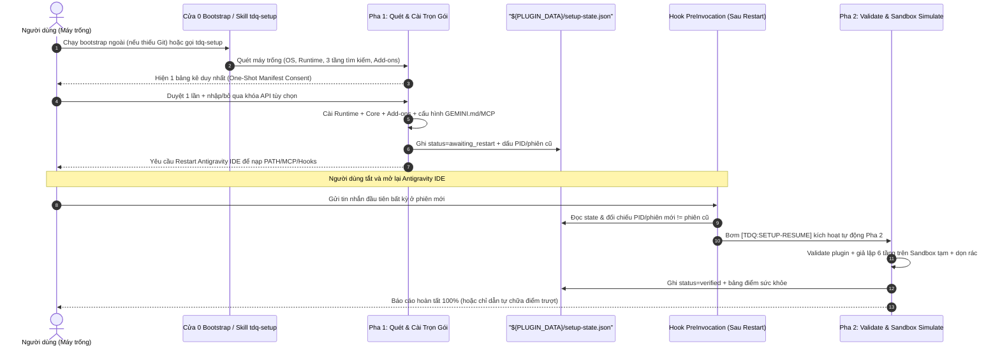

# SPEC — Nghiên cứu và thiết kế quy trình setup zero-to-full từ máy trống kèm tự động kiểm chứng sau restart

Ngày: 2026-11-22 · Bản: 1.0 · Brief: ../brief/2026-11-22-1424-phan-tich-setup-may-trong.md
Soul: chất lượng > runtime > context cost · luật gốc: skills/tdq-conventions/references/soul.md
Chế độ: full · Work kind: investigate · Trạng thái: CHỜ DUYỆT

> **Tóm tắt dễ hiểu:** Bộ cài đặt hiện tại vẫn trỏ cấu hình cũ của Claude Code, thiếu bước dựng môi trường gốc cho máy mới và chưa lưu vết qua lúc khởi động lại. Yêu cầu này nghiên cứu và thiết kế quy trình cài đặt hai cửa vào với một lần duyệt trọn gói duy nhất. Ngay khi ứng dụng mở lại, hệ thống sẽ tự kiểm định và chạy giả lập trên thư mục tạm. Đầu ra là bản đề xuất kiến trúc kèm sơ đồ trực quan, chưa sửa mã sản phẩm.

## Mục lục

- 1. Mục tiêu & phạm vi
- 1b. Lộ trình
- 2. Đầu ra cụ thể
- 2b. Ranh giới module
- 2c. Luồng hoạt động & Sơ đồ kiến trúc
- 3. Cách tiếp cận & lý do
- 3b. Năng lực & công cụ
- 3c. Giải thuật & Xử lý cốt lõi
- 3d. Mental Model cho Fresher Dev
- 4. Yêu cầu bắt buộc
- 5. Ràng buộc & rủi ro
- 6. QC & Definition of Done
- 7. Câu hỏi còn mở

## 1. Mục tiêu & phạm vi

- **Mục tiêu:** Nghiên cứu có dẫn chứng thực nghiệm và xuất bản một bản thiết kế kiến trúc toàn diện (Blueprint sẵn sàng chuyển sang triển khai) cho quy trình `tdq-setup` zero-to-full trên Google Antigravity giải quyết trọn vẹn 4 bài toán: (1) dựng môi trường từ máy trống tinh trên `Windows`, `macOS`, `Linux` qua mô hình hai cửa vào nối tiếp (`1a`); (2) gom toàn bộ Core Dependencies và Add-ons về một cổng duyệt bảng kê duy nhất kèm cơ chế nhánh mềm cho tiện ích cần khóa API (`2a`); (3) lưu trạng thái bền vững qua ranh giới khởi động lại và tự động đánh thức pha kiểm chứng ngay lượt chat đầu tiên bằng đối chiếu dấu phiên mới (`3a`); (4) thiết kế bộ kiểm định và giả lập toàn trình trên sandbox tạm kết hợp gọi thật MCP, hooks, 3 tầng tìm kiếm, bộ nén và subagent (`4a`).
- **Trong phạm vi:**
  - Nghiên cứu tài liệu chính thức của Google Antigravity (`antigravity.google/docs/{plugins,hooks,mcp,rules,getting-started}.md`, `cli/reference.md`) và các built-in skills (`antigravity-guide`, `plugin`, `agy-customizations`) để xác minh cơ chế nạp `PATH`, vòng đời tiến trình MCP stdio, thời điểm nạp `hooks.json` / `GEMINI.md` và biến môi trường `${PLUGIN_ROOT}` / `${PLUGIN_DATA}` qua ranh giới restart.
  - Kiểm toán sâu mã nguồn hiện tại trong repo: `plugins/tdq-workflow-agy/skills/tdq-setup/` (`SKILL.md`, `references/*`), `scripts/tdq_setup.py`, `scripts/tdq_lsp.py`, `scripts/lsp_module.py`, `scripts/setup_status.py`, `scripts/rtk_integration.py`, `scripts/caveman_config.py`, `scripts/tdq_devtool_mcp.py`, `scripts/tdq_checkportable.py`, `tools/install_agy_plugin.py`, `install.py`, `plugins/tdq-workflow-agy/scripts/tdq_{hook,mcp}_launcher.mjs`, `hooks/rust/tdq-dispatch/` và `hooks/scripts/session_start.py` để lập ma trận điểm lệch `Claude Code -> Antigravity`.
  - Chạy các phép thử nghiệm đọc/mô phỏng cách ly an toàn trong thư mục tạm (`TEMP`, tuyệt đối không sửa `~/.gemini/`) để xác thực dấu hiệu nhận biết phiên tiến trình mới của Antigravity và tính khả thi của kịch bản giả lập sandbox 6 tầng.
  - Thiết kế chi tiết đặc tả máy trạng thái `setup-state.json`, giao thức `[TDQ:SETUP-RESUME]`, ma trận lệnh cài đặt đa hệ điều hành (`winget`, `brew`, `apt`/`dnf`/`pacman`, `uv`, `npm`), kiến trúc bộ `simulate test`, phân tích bảo mật/quyền hạn và lộ trình tách task triển khai, xuất ra báo cáo Markdown 4 phần + `Archify HTML` qua Tailscale HTTPS (`5a`).
- **NGOÀI phạm vi:**
  - Không sửa đổi bất kỳ tệp mã nguồn sản phẩm, script, hook Rust/Python hay manifest plugin nào ngoài `docs/tdq/` và `docs/workinglog/` trong khuôn khổ request này (`5a`).
  - Không tự ý cài đặt phần mềm mới lên máy chủ đang chạy, không chỉnh sửa thư mục `~/.gemini/` thật và không chạm nhánh `main` hay `release/antigravity`.

## 1b. Lộ trình

Chép từ brief mục `### Lộ trình`. User duyệt spec là duyệt luôn lộ trình này.

| Bước/phase | Chạy? | Vì sao |
|---|---|---|
| Phân tích nông & phỏng vấn (`analyze`) | CÓ | Đã hoàn tất kiểm kê năng lực, khảo sát điểm vào 3 chiều và chốt đủ 6 câu hỏi (`1a 2a 3a 4a 5a 6a`, `muc_qc=full`) |
| Đặc tả (`spec` — `investigate`) | CÓ | Khóa phạm vi 4 trụ cột thiết kế, đầu ra báo cáo đề xuất và tiêu chí kiểm chứng bằng chứng `QC-I1`–`QC-I4` (miễn `§2b` và Archify preview theo `investigate-mode.md`) |
| Lập kế hoạch (`plan`) | CÓ | Chia các trục điều tra độc lập (vòng đời Antigravity & đa OS, kiểm toán mã nguồn setup/add-ons/hooks, tổng hợp kiến trúc & thực nghiệm cô lập) kèm hợp đồng 5 trường cho 3 skill `DÙNG` |
| Thực thi nghiên cứu (`implement`) | CÓ | Đọc sâu tài liệu chính thức Antigravity và mã nguồn, chạy thử nghiệm cô lập không chạm `~/.gemini/`, ghi `evidence.jsonl` và viết bản đề xuất kiến trúc + nháp báo cáo |
| Kiểm chứng bằng chứng (`qc` — `full`) | CÓ | Chạy đủ `QC-I1`–`QC-I4` (đối chiếu trích dẫn đĩa/tài liệu, phản biện counterfactual đa OS, gắn nhãn độ tin cậy, khóa phạm vi sạch kho) |
| Báo cáo cuối (`report` + `Archify HTML`) | CÓ | Xuất báo cáo Markdown 4 phần và render `Archify HTML` một lần phục vụ qua Tailscale HTTPS `200`, hỏi commit/merge về `dev` |

## 2. Đầu ra cụ thể

| # | Đầu ra | Đường dẫn/vị trí | Đo "xong" bằng |
|---|---|---|---|
| 1 | Sổ bằng chứng điều tra & dữ liệu trích xuất thô | `docs/tdq/artifacts/2026-11-22-1424-phan-tich-setup-may-trong/` (`evidence.jsonl`, `raw/*.txt`, các shard phân tích trục A/B/C) | 100% mã `[EV-xxx]` trong tài liệu nghiên cứu và báo cáo đều có mặt trong `evidence.jsonl` và khớp nguồn gốc |
| 2 | Hồ sơ nghiên cứu & Bản thiết kế kiến trúc `tdq-setup` v2 | `docs/tdq/research/2026-11-22-1424-phan-tich-setup-may-trong.md` | Bao phủ đủ 4 trụ cột (`1a` Dual-Entry đa OS, `2a` One-Shot Manifest + Add-ons, `3a` Restart State Machine + Hook Auto-Resume, `4a` Sandbox 6-Layer Simulate Test) kèm bảng lệch mã nguồn hiện tại và lộ trình chia task triển khai |
| 3 | Phiếu kiểm chứng bằng chứng `QC-I1`–`QC-I4` | `docs/tdq/qc/2026-11-22-1424-phan-tich-setup-may-trong.md` | Đạt 100% `PASS` trên `QC-I1`–`QC-I4`, mọi nhận định chính gắn nhãn độ tin cậy, `0` thay đổi ngoài `docs/tdq/` + `docs/workinglog/` |
| 4 | Báo cáo tổng hợp cuối Markdown + `Archify HTML` trực quan | `docs/tdq/reports/2026-11-22-1424-phan-tich-setup-may-trong.md` và `.html` (kèm Tailscale HTTPS URL) | `doc_lint.py` 0 lỗi, `tdq_archify.py verify` trả `status=current`, đường dẫn Tailscale HTTPS trả HTTP `200` khớp SHA-256 cục bộ |

## 2b. Ranh giới module

BỎ — Miễn theo `investigate-mode.md` (`Work kind: investigate`) vì yêu cầu này không tạo hay sửa mã nguồn sản phẩm; toàn bộ tệp ghi nằm trong `docs/tdq/` và `docs/workinglog/`. Quá trình điều tra được tách thành 3 trục độc lập không chồng chéo ghi đĩa: Trục A (Nền tảng Antigravity, vòng đời restart & trình quản lý gói đa OS), Trục B (Kiểm toán sâu mã nguồn `tdq_setup`, `tdq_lsp`, add-ons & hooks dispatch trong repo), và Trục C (Thực nghiệm cô lập dấu phiên/sandbox & tổng hợp kiến trúc đề xuất).

## 2c. Luồng hoạt động & Sơ đồ kiến trúc

Archify preview trước duyệt spec: MIỄN theo `investigate-mode.md` (`Work kind: investigate`) — sơ đồ trực quan `Archify HTML` được xuất bản và kiểm chứng ở pha `report`. Sơ đồ dưới đây mô tả luồng mục tiêu 2 pha trước và sau khi khởi động lại sẽ được phân tích và đặc tả chi tiết trong báo cáo đề xuất:

| Khía cạnh | Hiện trạng (Trước) | Kiến trúc đề xuất sẽ đặc tả (Sau) |
|---|---|---|
| Điểm xuất phát máy trống | Giả định máy đã có sẵn `Python 3`, `Node.js`, `Git` và trỏ cấu hình `~/.claude*` | Dual-Entry (`1a`): có cả one-liner bootstrap ngoài terminal lẫn luồng trong `tdq-setup` tự dựng từ `Git`/`Node`/`Python`/`uv` qua `winget`/`brew`/`apt` |
| Trải nghiệm duyệt & Add-ons | `tdq-setup` chỉ tập trung 7 bậc LSP, các add-ons (`rtk`, `caveman`, `chrome-devtools`, `tavily`) nằm rải rác | One-Shot Manifest Consent (`2a`): quét toàn cảnh, duyệt 1 lần duy nhất, cài liền mạch Core + toàn bộ Add-ons, tách nhánh mềm cho khóa API |
| Vòng đời qua Restart | Không lưu trạng thái; người dùng tự nhớ kiểm tra lại sau khi mở lại IDE | State machine bền vững trong `${PLUGIN_DATA}/setup-state.json` + hook `PreInvocation` đối chiếu dấu phiên mới tự động chạy tiếp (`3a`) |
| Kiểm chứng sau cài đặt | Kiểm tra từng mảnh hoặc phụ thuộc mã nguồn của repo đang mở | Bộ `Simulate Test` 6 tầng trên sandbox tạm tự tạo + live probe MCP/Hooks/Subagent, chạy được ngay cả trên workspace trống (`4a`) |

## 3. Cách tiếp cận & lý do

- **Chọn:** Điều tra đa trục kết hợp kiểm chứng thực nghiệm cô lập (`Evidence-Backed Architecture Synthesis`):
  1. **Trục A (Nền tảng & Đa hệ điều hành):** Đối chiếu tài liệu chính thức của Google Antigravity và chuẩn gói cài đặt user-level trên `Windows` (`winget` / `uv` / `npm`), `macOS` (`brew` / `uv` / `npm`) và `Linux` (`apt`/`dnf`/`pacman` + `uv` standalone / `fnm` hoặc `nodesource`) để chốt cơ chế nạp lại sau restart và ma trận bootstrap không đòi quyền root khi có đường user-level hợp lệ.
  2. **Trục B (Kiểm toán mã nguồn nội bộ):** Đọc chi tiết các hàm cốt lõi trong `scripts/tdq_setup.py`, `scripts/tdq_lsp.py`, `scripts/setup_status.py`, `scripts/rtk_integration.py`, `scripts/caveman_config.py`, `scripts/tdq_devtool_mcp.py`, `tools/install_agy_plugin.py`, `install.py` và `hooks/rust/tdq-dispatch/` (cùng `hooks/scripts/session_start.py`) để chỉ ra chính xác từng hằng số/hàm đang đóng cứng cho Claude Code, từng module có thể tái sử dụng và vị trí chèn nhẹ nhất vào `PreInvocation` mà không làm chậm đường nóng `< 0.5ms` của Rust dispatch.
  3. **Trục C (Thực nghiệm cô lập & Tổng hợp Blueprint):** Kiểm tra thực tế môi trường biến truyền vào hook `PreInvocation` của Antigravity (cây tiến trình cha `ppid`, biến môi trường phiên, đường dẫn `${PLUGIN_DATA}`) và thử nghiệm mẫu khung sandbox tạm trong `TEMP` để chứng minh cơ chế chống báo giả restart (`H2`) cùng bộ `simulate test` 6 tầng (`H4`) là hoàn toàn khả thi trên thực tế, trước khi đóng thành bản thiết kế chi tiết và lộ trình task triển khai.
- **Vì:** Một bản đề xuất cho hệ thống cài đặt đa OS và hook khởi động chỉ có giá trị khi bám sát 100% hành vi thật của Antigravity runtime và tận dụng lại tối đa các module sẵn có (`rtk_integration.py`, `caveman_config.py`, `tdq_lsp.py`), tránh thiết kế lý thuyết trên giấy tới lúc code lại đụng giới hạn sandbox hoặc làm chậm mọi lượt chat thường ngày.
- **Đã loại:**
  - Thiết kế trên giả định suông không đọc sâu `tdq_setup.py` (`2,183` dòng) và `tdq-dispatch` Rust — dễ đề xuất trùng lặp công cụ đã viết hoặc phá vỡ bất biến hiệu năng hook.
  - Đề xuất dùng trình duyệt cào tài liệu Antigravity — vì mirror Markdown chính thức (`antigravity.google/docs/*.md`) và bộ skill built-in đã cung cấp nguồn chuẩn, nhanh và chính xác hơn.

## 3b. Năng lực & công cụ

Chép từ brief mục `### Năng lực dùng được`. Pre-flight check MCP/CLI: đã xác nhận `tdq-workflow-agy_lsp` khởi động thành công (`start_lsp` cho Python), `graphify` hoạt động (`8,096` nodes), `rg` (`ripgrep`) và `agy` CLI sẵn sàng.

| Skill | Nguồn | Phán quyết | Dùng ở đâu / Lý do loại |
|---|---|---|---|
| tdq-intake, tdq-spec, tdq-plan, tdq-build, tdq-conventions, tdq-setup, tdq-status, tdq-check-status, tdq-lean, tdq-checkportable | plugin:tdq-workflow / plugin:tdq-workflow-agy | NỀN | Luồng TDQ Workflow đang vận hành (`investigate`) và chính đối tượng nghiên cứu `tdq-setup` |
| antigravity-guide | built-in | DÙNG | Tra cứu tài liệu chính thức của Google Antigravity (`plugins.md`, `hooks.md`, `mcp.md`, `cli/reference.md`) về vòng đời nạp lại sau restart |
| plugin | built-in | DÙNG | Đối chiếu cơ chế cài đặt, bật/tắt, `plugin.json`, `${PLUGIN_ROOT}`, `${PLUGIN_DATA}` và kiểm định `agy plugin validate` |
| agy-customizations | built-in | DÙNG | Đối chiếu discovery roots (`~/.gemini/config/`, `.agents/`, `~/.gemini/GEMINI.md`) và thứ tự nạp rules/skills/hooks/MCP |
| tdq-browser-research, tdq-browser-test | plugin:tdq-workflow / plugin:tdq-workflow-agy | KHÔNG | spec §3 đã chọn cách khác tốt hơn |
| Đã xét 31 skill khác | user/plugin/built-in | KHÔNG | khác lĩnh vực |

## 3c. Giải thuật & Xử lý cốt lõi

Quy trình điều tra, xác thực thực nghiệm và tổng hợp kiến trúc (`3-Axis Evidence & Feasibility Pipeline`):

- **Từng bước giải thuật (Step-by-step Execution Logic):**
  1. **Bước 1 (Thu thập Trục A — Vòng đời Antigravity & Bootstrap Đa OS):** Đọc mirror `.md` chính thức của Antigravity (`plugins.md`, `hooks.md`, `mcp.md`, `rules.md`, `sandbox.md`) và tài liệu tham chiếu của 3 built-in skills (`antigravity-guide`, `plugin`, `agy-customizations`); tra cứu thêm chuẩn cài đặt không tương tác (`winget --accept-package-agreements`, `brew`, `uv` standalone, `fnm`/Node LTS) trên 3 OS. Ghi trích đoạn vào `raw/axis_a_*.txt` và sổ `evidence.jsonl`.
  2. **Bước 2 (Thu thập Trục B — Kiểm toán Mã Nguồn Setup, Add-ons & Hooks):** Phân tích theo khoanh vùng dòng các tệp `scripts/tdq_setup.py`, `scripts/tdq_lsp.py`, `scripts/setup_status.py`, `scripts/rtk_integration.py`, `scripts/caveman_config.py`, `scripts/tdq_devtool_mcp.py`, `tools/install_agy_plugin.py`, `install.py`, `hooks/rust/tdq-dispatch/src/` và `hooks/scripts/session_start.py`. Lập bảng ánh xạ đầy đủ mọi tham chiếu `~/.claude*` cần chuyển sang Antigravity native và đo chi phí kiểm tra tệp cờ `setup-state.json` trong `PreInvocation` (`O(1)` `stat()` một đường dẫn cố định khi không ở chế độ chờ restart).
  3. **Bước 3 (Thu thập Trục C — Thực nghiệm Khả thi Cô lập & Chốt Blueprint):** Chạy script chẩn đoán chỉ đọc trong `docs/tdq/artifacts/<slug>/` (hoặc `TEMP` cô lập) để kiểm tra thực tế cây PID cha / thời điểm khởi chạy của tiến trình Antigravity hiện tại và đo thời gian dựng/xóa một workspace mẫu tạm đa ngôn ngữ. Tổng hợp toàn bộ thành bản đặc tả kiến trúc chi tiết tại `docs/tdq/research/<slug>.md`, soạn nháp `docs/tdq/reports/<slug>.md` và chạy kiểm định `QC-I1`–`QC-I4`.
- **Độ phức tạp tính toán:**
  - Thời gian điều tra (Investigation Complexity): $O(A + B + C)$ tuyến tính theo số nguồn tài liệu và phân đoạn mã nguồn đọc có mục tiêu (tuân thủ ngân sách `<= 12` lời gọi/nhánh của Tier 2 trong `investigate-mode.md`).
  - Độ phức tạp của giải thuật đề xuất ở runtime (Target Design Complexity): Kiểm tra cờ `setup-state.json` ở mọi lượt chat thông thường đạt thời gian $O(1)$ (1 phép `stat` tệp không tồn tại `< 0.1\text{ ms}$) và bộ nhớ $O(1)$, bảo đảm bằng không chi phí phụ cho người dùng sau khi đã setup xong.
- **Các ca góc hiểm (Edge Cases & Defensive Handling cần giải quyết trong bản thiết kế):**
  - **Người dùng chưa restart IDE mà gõ tiếp câu chat mới:** Nếu chỉ kiểm tra cờ `status == "awaiting_restart"` thì hook sẽ chạy nhầm Pha 2 trong tiến trình cũ (khi `PATH` và MCP chưa nạp lại). Bản thiết kế phải khóa bằng cặp `(host_ancestor_pid, host_process_create_time)` lưu lúc kết thúc Pha 1: nếu trùng dấu tiến trình cũ thì chỉ nhắc nhẹ "Bạn vẫn đang ở phiên cũ, vui lòng tắt và mở lại Antigravity IDE" thay vì chạy Pha 2.
  - **Máy Windows mới tinh bị bẫy `WindowsApps\python.exe` hoặc cài xong nhưng `PATH` chưa thấy:** Thiết kế phải quy định trình tự dò đường dẫn tuyệt đối chuẩn (`%LOCALAPPDATA%\Programs\Python\...`, `%USERPROFILE%\.local\bin`, `C:\Program Files\nodejs\`) ở Pha 1 ngay sau khi cài để không cần restart nửa chừng giữa Pha 1, gom toàn bộ thành **đúng 1 lần restart duy nhất** ở cuối Pha 1.
  - **Máy Linux tối giản không có `sudo` hoặc thiếu `brew`:** Phân nhánh rõ luồng user-space thuần túy (`uv` standalone quản lý cả Python 3 lẫn CLI tools + `fnm`/`nvm` cho Node.js + binary tĩnh `ripgrep`/`rtk`/`agent-lsp` vào `~/.local/bin`) để không bị chặn bởi quyền root; nếu buộc cần gói hệ thống mới dừng báo rõ lệnh cho người dùng.
  - **Người dùng gọi `tdq-setup` khi đang mở một cửa sổ Antigravity chưa chọn folder project (hoặc folder hoàn toàn trống):** Tệp trạng thái không thể chỉ lưu ở `docs/tdq/` của project mà phải neo ở `${PLUGIN_DATA}/setup-state.json` cấp user, và bộ `simulate test` phải tự tạo project mẫu trong `tempfile` để không phụ thuộc thư mục đang mở.

## 3d. Mental Model cho Fresher Dev

- **Ẩn dụ trực quan (Analogy):** Hãy hình dung việc thiết lập `tdq-workflow` trên máy mới giống như **lắp đặt hệ thống điện nước cho một căn nhà thô và nghiệm thu đóng cầu dao**:
  - **Cửa 0 & Pha 1 (Lắp đặt một lần duyệt):** Thợ khảo sát toàn bộ căn nhà trống, đưa chủ nhà ký **một tờ dự toán duy nhất** rồi lắp luôn từ đường ống chính (`Git`, `Node`, `Python`, `uv`) tới các thiết bị thông minh (`agent-lsp`, `graphify`, `rtk`, `caveman`, `chrome-devtools`), sau đó dán một **tờ phiếu chờ nghiệm thu** ngay trên cầu dao tổng (`setup-state.json`) và nhờ chủ nhà bật tắt lại cầu dao tổng (**Restart Antigravity IDE**).
  - **Pha 2 (Tự động nghiệm thu thử tải sau khi bật lại cầu dao):** Ngay khi điện bật lại, công tắc cảm biến đầu nguồn (`PreInvocation` hook) thấy tờ phiếu cộng với dòng điện mới liền tự động mở thử từng vòi nước, từng bóng đèn trên một mô hình thử tải riêng (**Sandbox Simulate Test 6 tầng**), xác nhận không rò rỉ rồi mới gỡ phiếu và bàn giao nhà.
- **Thuật ngữ dự án (Glossary):**
  - `Dual-Entry Bootstrap`: Kiến trúc hai điểm vào bổ trợ nhau — một lệnh ngắn ngoài terminal cho máy chưa có `Git`/plugin và luồng tự hành ngay trong skill `tdq-setup` khi đã vào Antigravity.
  - `One-Shot Manifest Consent`: Giao thức gom toàn bộ công cụ thiếu thành một bảng kê duy nhất để người dùng phê duyệt một lần, thay vì hỏi xin phép lắt nhắt ở từng bước cài.
  - `${PLUGIN_DATA}`: Thư mục dữ liệu bền vững cấp người dùng do Antigravity cấp riêng cho plugin (`~/.gemini/config/plugin-data/tdq-workflow-agy`), không bị xóa khi cập nhật plugin và luôn tồn tại dù người dùng mở bất kỳ project nào.
  - `Host Session Fingerprint`: Cặp định danh tiến trình gốc của IDE (PID cha + mốc thời gian khởi tạo tiến trình) dùng để chứng minh ứng dụng đã thực sự được tắt đi mở lại chứ không phải chỉ mở tab chat mới.
  - `Sandbox Simulate Test`: Bộ kiểm thử hậu cài đặt tự dựng một dự án giả lập siêu nhỏ trong thư mục tạm để chạy thật toàn bộ hooks, MCP, 3 tầng tìm kiếm và bộ nén rồi tự xóa sạch.

## 4. Yêu cầu bắt buộc

- **Log service:** BỎ cho chính request nghiên cứu này (`work_kind=investigate`, không sinh mã sản phẩm runtime), NHƯNG bản thiết kế đề xuất cho `tdq-setup` v2 bắt buộc phải quy định rõ chuẩn nhật ký ISO-timestamp ghi vào `${PLUGIN_DATA}/logs/setup.log` và `stderr` (tắt được qua `TDQ_LOG=0`).
- **Không placeholder, không thiết kế chung chung:** Mọi đề xuất trong hồ sơ kiến trúc phải chỉ rõ đường dẫn tệp đích, cấu trúc JSON mẫu của `setup-state.json`, danh sách lệnh cụ thể trên từng hệ điều hành (`Windows`, `macOS`, `Linux`), mã sự kiện hook và tiêu chí PASS/FAIL cụ thể của từng bài `simulate test`; không chạy `eval`.
- **Mỗi nhận định có bằng chứng truy vết được:** 100% khẳng định về hiện trạng mã nguồn và hành vi của Antigravity phải gắn mã `[EV-xxx]` đối chiếu được trong `evidence.jsonl` và kiểm định qua `doc_lint.py` + `tdq_archify.py verify`.

## 5. Ràng buộc & rủi ro

Ràng buộc kiến trúc phải giữ (đối chiếu `docs/kien-truc.md` cho cả quá trình điều tra lẫn kiến trúc đề xuất):
- Không sửa bất kỳ tệp nào ngoài `docs/tdq/` và `docs/workinglog/` trong request `investigate` này; giữ nguyên `0` thay đổi trên `~/.gemini/`.
- Kiến trúc đề xuất phải tuân thủ nghiêm luật phân tầng của `docs/kien-truc.md`: `skills/` chỉ giữ văn bản điều phối và gọi lệnh trong `scripts/` (không chép nhúng logic cài đặt dài vào `SKILL.md`); `scripts/` không import ngược `hooks/`; chỉ `tdq_state.py` ghi `docs/tdq/state.json` (nên trạng thái cài đặt máy cấp user phải tách riêng vào `${PLUGIN_DATA}/setup-state.json`, không làm ô nhiễm `docs/tdq/state.json` của request!).

| Rủi ro | Ảnh hưởng | Cách giảm |
|---|---|---|
| Kiểm tra trạng thái hậu restart trong hook `PreInvocation` làm tăng độ trễ mọi lượt chat sau này | Phá vỡ đường nóng `< 0.5ms` của `tdq-dispatch` Rust | Thiết kế kiểm tra bằng một lệnh `fs::metadata` (`stat`) duy nhất tới tệp cờ `setup-pending.flag` / `setup-state.json`; khi setup đã xong (xóa cờ pending hoặc đánh dấu tắt), đường nóng chỉ tốn `< 0.1ms` không parse JSON |
| Nhận diện sai PID tiến trình cha của Antigravity giữa Windows, macOS và Linux | Báo nhầm đã restart khi chưa restart, hoặc ngược lại bắt restart mãi không nhận | Thực nghiệm kiểm chứng cây tiến trình (`ppid` chain / thời điểm khởi chạy tiến trình cha cấp cao) ngay ở Trục C và thiết kế thêm cờ vượt tay `--confirm-restarted` dự phòng |
| Khác biệt trình quản lý gói trên các bản phân phối Linux (`Ubuntu/Debian` vs `Fedora` vs `Arch`) hoặc máy không có `sudo` | Cài đặt thất bại trên Linux tối giản | Ưu tiên chuỗi cài đặt user-space độc lập distro (`uv` cài cả Python standalone + công cụ, binary tĩnh GitHub Releases cho `agent-lsp`/`rg`/`rtk`, `fnm` cho Node LTS) trước khi rơi về `apt`/`dnf`/`pacman` |
| Xung đột hoặc làm treo khi `simulate test` gọi `chrome-devtools` MCP trên máy chưa cài trình duyệt Chrome/Edge | Làm đỏ toàn bộ pha hậu restart dù workflow cốt lõi đã chạy tốt | Phân tách kết quả `simulate test` thành 2 hạng: `Core Gate` (bắt buộc 100% xanh: Runtime, Hooks, LSP, Ripgrep, Graphify, RTK, Caveman) và `Optional Add-on Gate` (`chrome-devtools` khi có trình duyệt, `tavily-primary` khi có API key) với hướng dẫn khắc phục riêng |

## 6. QC & Definition of Done

Mức QC đã chốt: `full` (`work_kind=investigate` → áp dụng bộ kiểm chứng bằng chứng kép `QC-I1`–`QC-I4`, kiểm tra chất lượng tài liệu và khóa phạm vi sạch kho).

| # | Hạng mục kiểm | Điều kiện PASS | Đo trước | Dự phòng nếu trượt |
|---|---|---|---|---|
| Q1 | Độ phủ trọn vẹn 4 trụ cột thiết kế (`1a`, `2a`, `3a`, `4a`) & Lộ trình triển khai | Hồ sơ `docs/tdq/research/<slug>.md` và báo cáo `docs/tdq/reports/<slug>.md` đặc tả đầy đủ: (1) Dual-Entry bootstrap + ma trận 3 OS, (2) One-Shot Manifest Consent + toàn bộ Dependencies/Add-ons + bảng ánh xạ điểm lệch `Claude -> Antigravity`, (3) Schema `setup-state.json` + giao thức `PreInvocation` chống chưa restart, (4) Đặc tả `Simulate Test` 6 tầng trên sandbox tạm + danh sách task sẵn sàng cho request `build` | — | Bổ sung ngay mục đặc tả còn khuyết trước khi đóng QC |
| Q2 | Thực nghiệm khả thi cô lập & an toàn tuyệt đối `~/.gemini/` | Mọi phép đo/thử nghiệm về dấu tiến trình và khung sandbox tạm chạy hoàn toàn chỉ đọc hoặc trong thư mục `TEMP` cô lập; số tệp và trạng thái `~/.gemini/config/` giữ nguyên trước và sau | — | Nếu một phép thử có nguy cơ chạm cấu hình người dùng thì chuyển sang phân tích mã nguồn tĩnh + ghi rõ giới hạn |
| Q3 | `QC-I1` & `QC-I2` — Toàn vẹn sổ bằng chứng & Focused Grounding | 100% mã `[EV-xxx]` trong báo cáo tồn tại trong `evidence.jsonl`; 100% đường dẫn `path:line` tồn tại thật trên đĩa; đối chiếu từng nhận định chính với tệp nguồn / `raw/<ev_id>.txt` đạt `0` sai lệch | — | Sửa chính xác số dòng/nhận định hoặc hạ nhãn tin cậy về `Unverified` |
| Q4 | `QC-I3` & `QC-I4` — Phản biện góc khuất đa OS & gắn nhãn tin cậy | Có mục phản biện counterfactual cho tối thiểu 4 góc khuất lớn (chưa restart thật, bẫy `WindowsApps` + trễ `PATH`, Linux không `sudo`, thiếu trình duyệt/khóa API); 100% nhận định chính gắn nhãn `Verified` / `Single-source` / `Inferred` / `Unverified` | — | Bổ sung phân tích phản chứng và chuẩn hóa nhãn tin cậy trước khi xuất báo cáo |
| Q5 | Ranh giới kho sạch (`work_kind=investigate`) | `git diff --name-only dev...HEAD` và `git status --short` xác nhận `0` tệp sửa đổi ngoài `docs/tdq/` và `docs/workinglog/`, không chạm `main` hay `release/antigravity` | — | Khôi phục ngay mọi tệp ngoài `docs/tdq/` nếu phát sinh |
| Q6 | Chuẩn tài liệu & `Archify HTML` qua Tailscale Serve | `doc_lint.py` đạt `0` vi phạm trên trọn bộ `brief`, `spec`, `plan`, `qc`, `report`; `tdq_archify.py verify` trả `status=current`, `binding.valid=true`; đường dẫn Tailscale HTTPS trả HTTP `200` khớp SHA-256 cục bộ | — | Chỉnh sửa bố cục và render lại `Archify HTML` đến khi xanh 100% |

**DoD:** Hoàn thành đầy đủ 4 đầu ra ở §2, đạt `PASS` toàn bộ `Q1`–`Q6` trong phiếu QC (`docs/tdq/qc/2026-11-22-1424-phan-tich-setup-may-trong.md`), mọi checkbox trong plan được đánh `[x]`, `Archify HTML` mở được qua Tailscale HTTPS `200` và không phát sinh bất kỳ thay đổi mã nguồn nào ngoài `docs/tdq/` + `docs/workinglog/`.

## 7. Câu hỏi còn mở

không có
