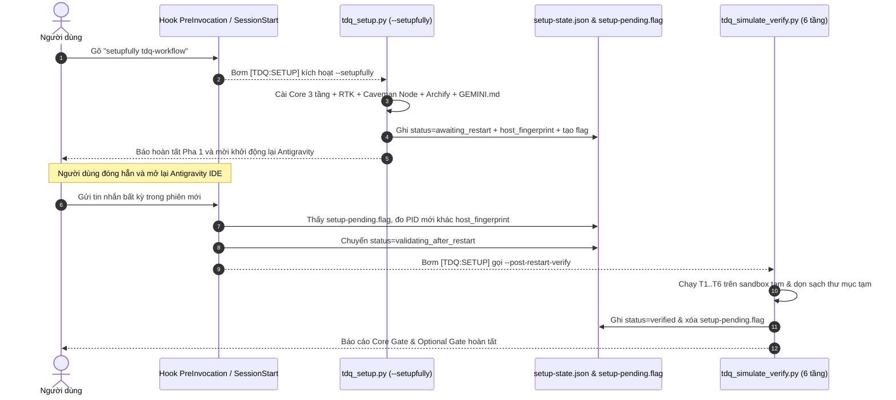

# SPEC — Triển khai quy trình Setupfully Zero-to-Full và Simulate Test 6 tầng cho Antigravity

Ngày: 2026-11-22 · Bản: 1.0 · Brief: ../brief/2026-11-22-1521-trien-khai-setup-fully-agy.md
Soul: chất lượng > runtime > context cost · luật gốc: skills/tdq-conventions/references/soul.md
Chế độ: full · Loại: build · Trạng thái: CHỜ DUYỆT

> **Tóm tắt dễ hiểu:** Trước đây trên Antigravity, lệnh cài đặt còn ghi nhầm cấu hình Claude Code, chèn đường dẫn Python cá nhân vào Caveman, thiếu Archify và mất dấu sau khi khởi động lại. Nay hệ thống thêm chế độ một lệnh setupfully tự cài trọn gói từ máy trống, lưu dấu phiên qua khởi động lại và tự chạy kiểm thử giả lập 6 tầng. Kết quả là trọn bộ tìm kiếm 3 tầng, các add-on và công cụ báo cáo hoạt động ổn định trên Windows, macOS và Linux.

## Mục lục

- 1. Mục tiêu & phạm vi
- 1b. Lộ trình
- 2. Đầu ra cụ thể
- 2b. Ranh giới module
- 2c. Luồng hoạt động & Sơ đồ kiến trúc
- 3. Cách tiếp cận & lý do
- 3b. Năng lực & công cụ
- 3c. Giải thuật & Xử lý cốt lõi
- 3d. Mental Model cho Fresher Dev
- 4. Yêu cầu bắt buộc
- 5. Ràng buộc & rủi ro
- 6. QC & Definition of Done
- 7. Câu hỏi còn mở

## 1. Mục tiêu & phạm vi
- Mục tiêu: Xây dựng quy trình cài đặt hai cửa vào và chế độ tự động một lệnh `"setupfully tdq-workflow"` cho Google Antigravity trên Windows, macOS và Linux; tự cài trọn gói phần lõi tìm kiếm 3 tầng, các add-on, công cụ báo cáo Archify cùng plugin đồng hành, lưu trạng thái qua khởi động lại và tự chạy kiểm thử giả lập 6 tầng trên sandbox tạm.
- Trong phạm vi:
  - Tạo module trạng thái bền vững tại `${PLUGIN_DATA}/setup-state.json` kèm cờ `setup-pending.flag`, lưu khóa `secrets.env` phân quyền chặt và đo dấu phiên `Host Session Fingerprint` đa hệ điều hành.
  - Bổ sung bộ bootstrap Cửa 0 (`scripts/bootstrap.ps1`, `scripts/bootstrap.sh`) và bộ dò môi trường thuần Node (`scripts/tdq_setup_probe.mjs`) cho máy trắng tinh chưa có Python hoặc Git.
  - Chuẩn hóa nhánh Google Antigravity trong `scripts/tdq_setup.py`, `scripts/tdq_lsp.py`, `scripts/setup_status.py`, `scripts/tdq_devtool_mcp.py`, `scripts/archify_delivery.py` kèm cờ `--setupfully`, `--scan-json`, `--apply-manifest`, `--post-restart-verify`, `--confirm-restarted`, `--set-tavily-key`.
  - Tự động tải/cập nhật `Archify` từ kho `https://github.com/tt-a1i/archify.git` vào `~/.local/share/archify` (khi máy chưa có), ghim an toàn khối `<!-- TDQ:TOOLS -->` chuẩn Antigravity vào `~/.gemini/GEMINI.md`, và kiểm/bật `tdq-workflow-agy` cùng `chrome-devtools-plugin` qua `agy plugin`.
  - Nâng cấp `tdq_mcp_launcher.mjs` hỗ trợ mode `"caveman"` thuần Node, tự nạp mềm `${PLUGIN_DATA}/secrets.env` cho `tavily-primary` và mở rộng `PATH` user-space; cập nhật `scripts/caveman_config.py` bọc Node launcher không lộ `sys.executable` mà vẫn giữ tương thích ngược cho Claude Code.
  - Tích hợp kiểm tra cờ `O(1)` `setup-pending.flag` vào `hooks/rust/tdq-dispatch` cùng xử lý nhận diện `"setupfully tdq-workflow"` và tự nối tiếp hậu khởi động lại trong `hooks/scripts/prompt_context.py` và `hooks/scripts/session_start.py` (dùng mã chuẩn `[TDQ:SETUP]`).
  - Xây dựng `scripts/tdq_simulate_verify.py` chạy đủ 6 tầng kiểm thử giả lập trên thư mục tạm sạch rác, cập nhật `skills/tdq-setup/` và triển khai thực tế lên bản cài `~/.gemini/config/plugins/tdq-workflow-agy` của máy hiện tại kèm kiểm chứng kép.
- NGOÀI phạm vi:
  - Không chạy lệnh yêu cầu quyền `sudo` hoặc Administrator tự động ngầm mà không in rõ thông báo khi hệ điều hành Linux tối giản thiếu `git`.
  - Không thêm trường `userConfig` vào `plugin.json` hoặc `variables` vào `mcp_config.json` của gói Antigravity.
  - Không sửa tệp cấu hình của các plugin bên thứ ba khác trên Antigravity mà chưa có xác nhận trực tiếp của người dùng.

## 1b. Lộ trình
Chép từ brief mục `### Lộ trình`. User duyệt spec là duyệt luôn lộ trình này.

| Bước/phase | Chạy? | Vì sao |
|---|---|---|
| Research ngoài bổ sung (`Step B2`) | BỎ | Toàn bộ tài liệu chính thức của Google Antigravity, cơ chế `agy 1.4.12` và kho `tt-a1i/archify` đã được xác minh trực tiếp bằng thực nghiệm |
| Interview | CÓ | Đã hoàn tất chốt 5 điểm hành vi tự động, danh mục công cụ, phạm vi triển khai máy thật và mức QC `ultra` |
| Viết & duyệt `spec` (`tdq-spec`) | CÓ | Khóa chặt hợp đồng CLI flags, schema `setup-state.json`, 6 tầng `Simulate Test`, bảo mật `secrets.env` và ngưỡng đo trước ở `§6` |
| Subagent `tdq-reviewer` soi `spec`/`plan` | CÓ | Rà chéo chống sót neo `replace_exact` trong `tools/patches/` và kiểm tra tính tương thích đa hệ điều hành trước khi viết code |
| Lập & duyệt `plan` (`tdq-plan`) | CÓ | Chia thành các đợt độc lập có bài kiểm thử đỏ sang xanh rõ ràng cho mỗi task và khai đủ vùng chạm |
| Triển khai `implement` + Build plugin (`tdq-build`) | CÓ | Viết code Python/Node/Rust/Shell, chạy `tools/build_agy_plugin.py`, cài lên máy hiện tại (có sao lưu) và kiểm tra thực tế |
| QC độc lập (`tdq-qc-tester` + `tdq-security-reviewer`) | CÓ | Người dùng chọn `muc_qc=ultra`: chạy trọn bộ unit test, smoke test, runtime test trực tiếp và kiểm định độc lập |
| Xuất báo cáo `report` + `Archify HTML` | CÓ | Tổng hợp kết quả Trước → Sau → Đã test gì → Kết quả test kèm sơ đồ trực quan phục vụ qua Tailscale Serve |

## 2. Đầu ra cụ thể
| # | Đầu ra | Đường dẫn/vị trí | Đo "xong" bằng |
|---|---|---|---|
| O1 | Module trạng thái bền vững, `secrets.env` & `Host Session Fingerprint` đa hệ điều hành | `scripts/tdq_setup_state.py` | Đọc/ghi nguyên tử `setup-state.json` + `setup-pending.flag`, phân quyền `secrets.env` riêng tư và tính dấu phiên dưới 10 ms |
| O2 | Bộ Bootstrap Cửa 0 & Pre-flight Probe thuần Node | `scripts/bootstrap.ps1`, `scripts/bootstrap.sh`, `scripts/tdq_setup_probe.mjs`, `scripts/build_portable.py`, `install.py` | Chạy `node --check` xanh, xuất bảng kiểm JSON hợp lệ khi máy chưa có Python và gắn bit thực thi `0755` cho `*.sh` |
| O3 | Launcher MCP đa hệ điều hành (`caveman` + `secrets.env`), Caveman Wrapper & trình cài gắn bit thực thi | `tools/patches/agy_launchers.py`, `scripts/caveman_config.py`, `tools/install_agy_plugin.py` | Bật `--with-caveman` giữ nguyên `"command": "node"` với 0 đường dẫn cá nhân, giữ định dạng cũ cho Claude Code và gắn `0755` cho `*.mjs` lẫn `*.sh` |
| O4 | HostAdapter Antigravity, chế độ `--setupfully`, One-Shot Manifest & trình cài tự động `Archify` | `scripts/tdq_setup.py`, `scripts/tdq_lsp.py`, `scripts/setup_status.py`, `scripts/tdq_devtool_mcp.py`, `scripts/archify_delivery.py`, `tools/patches/cli_fixes_a.py` | Quét `--scan-json` chính xác trên Antigravity không báo nợ giả `.claude`, cài/kiểm `Archify`, cài/bật `chrome-devtools-plugin` (hoặc ghi `Optional Gate` khi không có mạng/phiên đăng nhập) và tôn trọng `TDQ_KHONG_CHAM_MAY=1` |
| O5 | Điểm móc Hook tự động nhận diện `"setupfully"` và nối tiếp hậu Restart | `hooks/rust/tdq-dispatch/src/storage.rs`, `hooks/rust/tdq-dispatch/src/main.rs`, `hooks/rust/tdq-dispatch/src/events/pre_invocation.rs`, `hooks/scripts/prompt_context.py`, `hooks/scripts/session_start.py`, `tools/patches/agy_hooks.py`, `.github/workflows/build-rust-hooks.yml` | Đường nóng Rust không có cờ giữ nguyên độ trễ thấp, có cờ ủy quyền sang Python đối chiếu dấu phiên và phát đúng mã `[TDQ:SETUP]` kèm `user_markdown` |
| O6 | Bộ kiểm thử giả lập 6 tầng trên sandbox tạm | `scripts/tdq_simulate_verify.py` | Chạy trọn 6 tầng (`T1`–`T6`) qua JSON-RPC pipe tương tác trên thư mục tạm, xóa sạch thư mục tạm sau khi chạy và không sửa bẩn `~/.gemini/config/` |
| O7 | Tài liệu Skill `tdq-setup` v2 & Hướng dẫn Bootstrap Antigravity | `skills/tdq-setup/SKILL.md`, `skills/tdq-setup/references/zero-to-full-agy.md`, `skills/tdq-setup/references/chrome-devtools-mcp-guide.md`, `README.md`, `README-Antigravity.md` | Tuân thủ trần 132 dòng của `SKILL.md`, 0 vi phạm `doc_lint` và `i18n_check`, khóa lại ngân sách token hợp lệ |
| O8 | Bản biên dịch `plugins/tdq-workflow-agy/`, bản cài trực tiếp trên máy hiện tại & bộ kiểm thử tự động | `plugins/tdq-workflow-agy/`, `~/.gemini/config/plugins/tdq-workflow-agy` | `agy plugin validate --strict --json` trả 0 lỗi, chạy thật `--post-restart-verify` đạt `Core Gate PASS` trên máy này và toàn bộ suite kiểm thử xanh |

## 2b. Ranh giới module
Bắt buộc ở lane full (lane quick BỎ). Một module = một vùng file tách rời.

| Module | Vùng file | Phụ thuộc module | Đầu ra §2 nào |
|---|---|---|---|
| `setup-state` | `scripts/tdq_setup_state.py` | không (chỉ dùng Python stdlib + `utf8_io`) | O1 |
| `bootstrap-probe` | `scripts/bootstrap.ps1`, `scripts/bootstrap.sh`, `scripts/tdq_setup_probe.mjs`, `scripts/build_portable.py`, `install.py` | không (chạy độc lập trước khi có Python hoặc đóng gói phát hành) | O2 |
| `mcp-caveman-launcher` | `tools/patches/agy_launchers.py`, `scripts/caveman_config.py`, `tools/install_agy_plugin.py` | không (`tdq_mcp_launcher.mjs` đọc trực tiếp file do `setup-state` ghi) | O3 |
| `agy-host-setup` | `scripts/tdq_setup.py`, `scripts/tdq_lsp.py`, `scripts/setup_status.py`, `scripts/tdq_devtool_mcp.py`, `scripts/archify_delivery.py`, `tools/patches/cli_fixes_a.py` | `setup-state`, `mcp-caveman-launcher`, `simulate-verifier` | O4 |
| `hook-restart-router` | `hooks/rust/tdq-dispatch/`, `hooks/scripts/prompt_context.py`, `hooks/scripts/session_start.py`, `tools/patches/agy_hooks.py`, `.github/workflows/build-rust-hooks.yml` | `setup-state` (gọi một chiều `hooks/ -> scripts/tdq_setup_state.py`) | O5 |
| `simulate-verifier` | `scripts/tdq_simulate_verify.py` | `setup-state`, `mcp-caveman-launcher` | O6 |
| `setup-docs-bundle` | `skills/tdq-setup/`, `README.md`, `README-Antigravity.md`, `tools/build_agy_plugin.py`, `plugins/tdq-workflow-agy/` | `agy-host-setup`, `hook-restart-router`, `simulate-verifier`, `bootstrap-probe` | O7, O8 |

## 2c. Luồng hoạt động & Sơ đồ kiến trúc

Trực quan luồng hệ thống (Mermaid dự phòng khi thiếu HTML Archify).

Cơ chế hiện tại vs Sau update — trang đối chiếu trực quan Trước/Sau đã kết xuất và gắn mã băm tại `docs/tdq/spec/2026-11-22-1521-trien-khai-setup-fully-agy-preview.html`:

| Khía cạnh | Hiện trạng (Trước) | Thiết kế mới (Sau) |
|---|---|---|
| Cửa vào & kích hoạt | Phải cài sẵn Git/Python/agy và chạy rời từng cờ `--with-rtk`, `--with-caveman` | Hỗ trợ Cửa 0 One-Liner từ máy trắng tinh và 1 lệnh `"setupfully tdq-workflow"` chạy liền mạch |
| Định vị cấu hình Host | Đọc/ghi nhầm `~/.claude.json`, `~/.claude/settings.json` và báo nợ giả trên Antigravity | Nhánh Antigravity đọc/ghi chuẩn `~/.gemini/config/`, `~/.gemini/GEMINI.md`, `${PLUGIN_DATA}` và `agy plugin` |
| Add-on Caveman, Tavily & Archify | Caveman ghi cứng `sys.executable` làm lộ path cá nhân; thiếu tự tải `Archify` và thiếu nạp mềm Tavily | `tdq_mcp_launcher.mjs` thêm mode `"caveman"`, nạp mềm `secrets.env`, tự tải `Archify` từ kho chính thức |
| Nối tiếp sau Restart & Kiểm chứng | Mất trạng thái sau khi tắt IDE; `tdq_lsp.py check` phụ thuộc kho mã đang mở | `Host Session Fingerprint` tự bắt phiên mới sau Restart và chạy `Simulate Test` 6 tầng trên sandbox tạm |

## 3. Cách tiếp cận & lý do
- Chọn: Kiến trúc hai cửa vào (`Dual-Entry Bootstrap`) kết hợp chế độ tự động một lệnh `"setupfully tdq-workflow"` (cạnh chế độ bảng kê một lần cho `/tdq-setup` thông thường), lưu trạng thái tại `${PLUGIN_DATA}` với cờ kiểm nhanh `O(1)` `setup-pending.flag` định tuyến từ Rust sang `tdq_setup_state.py`, bọc Caveman qua Node launcher đa hệ điều hành và kiểm chứng hậu khởi động lại bằng `tdq_simulate_verify.py` 6 tầng trên sandbox tạm.
- Vì: Tuân thủ trọn vẹn cấu trúc plugin chuẩn của Antigravity (`agy 1.4.12`), không vi phạm cổng `agy plugin validate --strict --json`, giữ chi phí đường nóng hook ở mức một lời gọi `stat()` khi máy đã cài xong, không cần biên dịch chéo Win32/POSIX hai lần ở cả Rust và Python, đồng thời đảm bảo cả máy mở ở màn hình trống vẫn kiểm chứng được trọn bộ tìm kiếm 3 tầng và công cụ báo cáo Archify.
- Đã loại:
  - Khai báo trường `variables` trong `mcp_config.json` cho khóa Tavily — vì theo chuẩn Antigravity, thiếu biến sẽ khiến `agy plugin install` khóa tắt toàn bộ plugin ngay lúc cài.
  - Ghi đè `sys.executable` vào `mcp_config.json` khi bật Caveman — vì làm lộ đường dẫn máy cá nhân và vỡ cấu hình khi đồng bộ đa hệ điều hành.
  - Tạo mã cổng thứ 24 mới ngoài bộ 23 mã chuẩn của Antigravity — vì làm gãy hợp đồng kiểm thử đối xứng giữa Rust và Python trong khi mã `[TDQ:SETUP]` đã có sẵn cho đúng mục đích này.

## 3b. Năng lực & công cụ
Chép từ brief mục `### Năng lực dùng được`.

| Skill | Nguồn | Phán quyết | Dùng ở đâu / Lý do loại |
|---|---|---|---|
| agy-customizations | built-in | DÙNG | đối chiếu chuẩn cấu hình `~/.gemini/config/`, `hooks.json`, `mcp_config.json`, `rules/AGENTS.md` và giới hạn byte của Antigravity |
| plugin | built-in | DÙNG | kiểm chứng cấu trúc đóng gói `plugin.json`, `agy plugin validate --strict --json` và vòng đời cài/bật plugin ở `~/.gemini/config/plugins/` |
| tdq-intake | plugin:tdq-workflow-agy | NỀN | mở request, khảo sát 3 chiều và phỏng vấn chốt phạm vi |
| tdq-spec | plugin:tdq-workflow-agy | NỀN | viết và khóa đặc tả kỹ thuật ở pha `spec` |
| tdq-plan | plugin:tdq-workflow-agy | NỀN | tách đợt công việc và hợp đồng kiểm thử ở pha `plan` |
| tdq-build | plugin:tdq-workflow-agy | NỀN | điều phối triển khai `red -> green`, QC và xuất báo cáo |
| tdq-setup | plugin:tdq-workflow-agy | NỀN | đối tượng trực tiếp được nâng cấp lên kiến trúc Zero-to-Full v2 |
| tdq-conventions | plugin:tdq-workflow-agy | NỀN | luật chung về trình bày 2 lớp, git safety, nhật ký và cổng duyệt |
| tdq-checkportable | plugin:tdq-workflow-agy | NỀN | chia sẻ hạ tầng cài shim `python3` và vá `PATH` mức người dùng trên Windows |
| tdq-browser-research | plugin:tdq-workflow-agy | NỀN | skill đồng hành kiểm tra tương thích với `chrome-devtools` MCP |
| tdq-browser-test | plugin:tdq-workflow-agy | NỀN | skill đồng hành kiểm tra tương thích với `chrome-devtools` MCP |
| tdq-check-status | plugin:tdq-workflow-agy | NỀN | hồi phục trạng thái phiên làm việc khi cần |
| tdq-lean | plugin:tdq-workflow-agy | NỀN | rà soát chống phình mã và giữ hàm gọn `<= 50` dòng |
| tdq-status | plugin:tdq-workflow-agy | NỀN | tra cứu trạng thái workflow |
| Đã xét 30 skill khác | user/plugin/built-in | KHÔNG | khác lĩnh vực |

## 3c. Giải thuật & Xử lý cốt lõi

Bóc tách thuật toán chi tiết và chữ ký hàm chuẩn để triển khai đồng bộ giữa các module:

- **Bảng chữ ký hợp đồng các hàm mới (Contract Signatures)**:

| Tệp đích | Chữ ký hợp đồng |
|---|---|
| `scripts/tdq_setup_state.py` | `def resolve_plugin_data_dir(home: Optional[str] = None) -> Path` |
| `scripts/tdq_setup_state.py` | `def compute_host_session_fingerprint() -> dict[str, Any]` |
| `scripts/tdq_setup_state.py` | `def load_setup_state(data_dir: Optional[Path] = None) -> dict[str, Any]` |
| `scripts/tdq_setup_state.py` | `def save_setup_state(state: dict[str, Any], pending: bool, data_dir: Optional[Path] = None) -> Path` |
| `scripts/tdq_setup_state.py` | `def evaluate_restart_resume(is_new_turn: bool, confirm_manual: bool = False, data_dir: Optional[Path] = None) -> dict[str, Any]` |
| `scripts/tdq_setup_state.py` | `def save_tavily_secret(api_key: str, data_dir: Optional[Path] = None) -> Path` |
| `scripts/tdq_setup_state.py` | `def load_secrets_env(data_dir: Optional[Path] = None) -> dict[str, str]` |
| `scripts/tdq_setup_probe.mjs` | `export function probeToolchain(env = process.env, platform = process.platform)` |
| `scripts/caveman_config.py` | `def _wrap_server_entry(entry: dict[str, Any], proxy_script: Path) -> bool` |
| `scripts/caveman_config.py` | `def _split_wrapped_args(entry: dict[str, Any]) -> Optional[tuple[str, list[str]]]` |
| `scripts/tdq_setup.py` | `def scan_setup_manifest(project: str) -> dict[str, Any]` |
| `scripts/tdq_setup.py` | `def apply_setup_manifest(project: str, setupfully: bool = False, tavily_key: str = "") -> dict[str, Any]` |
| `scripts/tdq_setup.py` | `def ensure_archify_installed(home: Optional[str] = None) -> tuple[bool, str]` |
| `hooks/scripts/prompt_context.py` | `def extract_setupfully_trigger(prompt: str) -> bool` |
| `scripts/tdq_simulate_verify.py` | `def run_simulate_verify(plugin_root: Optional[Path] = None, data_dir: Optional[Path] = None) -> dict[str, Any]` |
| `hooks/rust/tdq-dispatch/src/storage.rs` | `pub fn setup_pending_flag_exists() -> bool` |
| `tools/patches/agy_launchers.py` | `export function buildSpawnSpec(mode, forwardedArgs, platform, lspCmd, pythonSpec)` |

- **Từng bước giải thuật (Step-by-step Execution Logic)**:
  1. **Bước 1 — Kích hoạt Cửa 0 hoặc Cửa 1:** Trên máy trắng tinh chưa có Git/Node/Python/`agy`, người dùng chạy `bootstrap.ps1` hoặc `bootstrap.sh` để cài runtime mức người dùng (`uv python install --default`, Node LTS, Git, `agy`) và cài plugin `tdq-workflow-agy`. Trong Antigravity, `extract_setupfully_trigger` chỉ kích hoạt `--setupfully` trên lượt nhắn mới của người dùng thật và từ chối câu hỏi, câu phủ định hoặc trích dẫn trong ngoặc kép (còn `/tdq-setup` thông thường chạy `--scan-json` trình bảng kê chờ duyệt 1 lần; luật đầu của `SKILL.md` ghi nhận rõ câu lệnh `"setupfully tdq-workflow"` chính là sự đồng ý trọn gói user-space của người dùng).
  2. **Bước 2 — Thực thi Pha 1 & Chốt cờ chờ Restart:** `apply_setup_manifest` tuần tự cài/kiểm `agent-lsp` (kiểm SHA256), Language Servers (`pyright`, `typescript-language-server`, `typescript@5` và ngôn ngữ dự án), `graphifyy`, `rtk` + `rg`, bọc `caveman` bằng Node launcher (`_split_wrapped_args` nhận diện cả hai định dạng Node và Claude để giữ nguyên tính idempotent), tải `Archify` từ `tt-a1i/archify` vào `~/.local/share/archify` nếu máy chưa có, kiểm `agy plugin list --json` để bật `tdq-workflow-agy` và `chrome-devtools-plugin` (nếu `chrome-devtools-plugin` chưa cài trên máy mới thì xếp vào `Optional Companion` không chặn `Core Gate`), ghim khối `<!-- TDQ:TOOLS -->` chuẩn Antigravity vào `~/.gemini/GEMINI.md`, rồi ghi `status = "awaiting_restart"`, `host_fingerprint` và tạo `setup-pending.flag`.
  3. **Bước 3 — Đối chiếu dấu phiên qua Restart:** Ở mọi lượt `PreInvocation` của agent chính, Rust `tdq-dispatch` gọi `setup_pending_flag_exists()` theo đúng thứ tự cô lập (`TDQ_SETUP_STATE_DIR` → bỏ qua `PLUGIN_DATA` khi `TDQ_KHONG_CHAM_MAY=1` → `PLUGIN_DATA` → `GEMINI_CONFIG_DIR` → mặc định `<home>/.gemini/antigravity/plugin_data/tdq-workflow-agy`, đồng thời môi trường cô lập của suite kiểm thử đối xứng xóa sạch `PLUGIN_DATA`). Nếu không có cờ, đi thẳng đường nóng như cũ; nếu có cờ, ủy quyền sang `prompt_context.py` gọi `evaluate_restart_resume` để nhắc khởi động lại hoặc phát `[TDQ:SETUP]` gọi `--post-restart-verify`.
  4. **Bước 4 — Kiểm thử giả lập 6 tầng & Đóng vòng:** `run_simulate_verify` tạo thư mục tạm `tdq_sim_*`, chụp danh sách tệp `~/.gemini/config/` trước và sau, chạy `T1`–`T5` qua ống `subprocess.Popen` JSON-RPC tương tác và ở `T6` kiểm tra toàn vẹn `8` tệp `agents/*.md` kèm giả lập vòng đời hook subagent (`PreInvocation` với `agent_type` + `SubagentStop`), sau đó Agent hậu Restart chạy tiếp lời gọi trực tiếp `mcp_tdq-workflow-agy_lsp_*` cùng subagent thật để đóng vòng `status = "verified"`, xóa `setup-pending.flag` và dọn sạch thư mục tạm trong khối `finally`.

- **Độ phức tạp tính toán**:
  - Thời gian (Time Complexity): $O(1)$ ở đường nóng mọi lượt chat thường (chỉ một lời gọi `stat()` kiểm tra `setup-pending.flag`); $O(D)$ với $D \le 12$ bậc tiến trình cha khi đo `Host Session Fingerprint` (`< 2\text{ ms}`); $O(K + F_{\text{sim}})$ khi chạy bộ kiểm thử giả lập 6 tầng trên $F_{\text{sim}} \le 10$ tệp mẫu cố định (độc lập với kích thước kho mã của người dùng).
  - Không gian (Space Complexity): $O(1)$ cho tệp trạng thái `setup-state.json` (`< 8\text{ KB}`) và thư mục sandbox tạm (`< 5\text{ MB}`, giải phóng về `0` ngay khi hàm kết thúc).

- **Các ca góc hiểm (Edge Cases & Defensive Handling)**:
  - **Người dùng mở chat mới nhưng chưa tắt hẳn Antigravity:** `compute_host_session_fingerprint()` neo vào PID và thời điểm khởi tạo của tiến trình gốc `Antigravity` / `language_server`, nên mở tab mới vẫn trùng dấu phiên cũ và không chạy kiểm thử giả lập sớm khi `PATH`/MCP chưa nạp lại; có cờ thoát hiểm tường minh `--confirm-restarted` cho môi trường container dùng lại PID 1.
  - **Bẫy `WindowsApps\python.exe` trên Windows mới tinh:** Cả `tdq-dispatch` Rust (`main.rs`), `tdq_mcp_launcher.mjs`, `bootstrap.ps1` và `tdq_setup.py` đều kiểm tra đường dẫn chứa `windowsapps` hoặc mã thoát lỗi với `stdout` rỗng để tự chuyển sang `py -3` hoặc Python do `uv` quản lý, đồng thời xếp `%USERPROFILE%\.local\bin` lên trước `WindowsApps` trong User `PATH`.
  - **Máy Linux headless không có trình duyệt Chrome hoặc người dùng bỏ qua khóa Tavily:** `T3`/`T5` xếp `chrome-devtools` (khi thiếu trình duyệt) và `tavily-primary` (khi `skipped_no_key`) vào `Optional Add-on Gate` với trạng thái `SKIPPED` kèm hướng dẫn bổ sung sau, không đánh trượt `Core Gate`.
  - **Chạy bộ kiểm thử tự động ngay trong phiên Antigravity có sẵn biến `PLUGIN_DATA`:** `resolve_plugin_data_dir()` kiểm tra `TDQ_SETUP_STATE_DIR` và khóa `TDQ_KHONG_CHAM_MAY=1` trước khi đọc `PLUGIN_DATA` của tiến trình cha, đảm bảo không bài kiểm thử nào ghi đè trạng thái thật của máy.

## 3d. Mental Model cho Fresher Dev

- **Ẩn dụ trực quan (Analogy)**: Hãy hình dung quy trình giống như **dây chuyền lắp đặt và nghiệm thu tự động của một căn hộ thông minh**. Khi chủ nhà hô một câu `"lắp đặt trọn gói"` (`setupfully`), đội kỹ thuật lắp toàn bộ điện, nước, cảm biến trong một lượt rồi dán một **tem niêm phong chờ đóng cầu dao tổng** (`setup-pending.flag` kèm mã số cầu dao cũ `host_fingerprint`). Nếu chủ nhà chỉ bước sang phòng khác mà chưa dập mở lại cầu dao tổng (chưa khởi động lại IDE), tem báo nhắc dập cầu dao. Ngay khi cầu dao tổng thực sự khởi động lại sang chu kỳ điện mới, hệ thống tự nhận ra dòng điện mới, tự bật bàn thử tải khép kín 6 cấp độ (`Simulate Test` trên sandbox tạm), nghiệm thu đạt chuẩn rồi gỡ tem niêm phong để căn hộ vận hành êm nhẹ hằng ngày mà không tốn thêm bất kỳ thao tác kiểm tra nào.
- **Thuật ngữ dự án (Glossary)**:
  - `PLUGIN_DATA`: Thư mục dữ liệu bền vững riêng của plugin tại `~/.gemini/antigravity/plugin_data/tdq-workflow-agy`, không bị xóa khi nâng cấp phiên bản plugin.
  - `Host Session Fingerprint`: Dấu định danh duy nhất của một lần mở ứng dụng Antigravity, tính từ PID và thời điểm tạo của tiến trình cha gốc để phân biệt mở cuộc trò chuyện mới với khởi động lại ứng dụng thật.
  - `setup-pending.flag`: Tệp đánh dấu rỗng siêu nhẹ dùng để báo cho bộ điều phối hook biết máy đang chờ khởi động lại hoặc chờ chạy kiểm chứng hậu cài đặt.
  - `Core Gate` và `Optional Add-on Gate`: Hai hạng cổng nghiệm thu trong bộ kiểm thử giả lập — hạng cốt lõi bắt buộc đạt 100% cho workflow chính, còn hạng tùy chọn dành cho trình duyệt hoặc khóa API ngoài chưa cấu hình.

## 4. Yêu cầu bắt buộc
- Log service bật mặc định: mọi module runtime mới và sửa đổi (`tdq_setup_state.py`, `tdq_simulate_verify.py`, `tdq_setup.py`, `tdq_mcp_launcher.mjs`, `tdq_setup_probe.mjs`) đều ghi log có nhãn thời gian ISO-8601 ra `stderr` (và tệp `${PLUGIN_DATA}/logs/setup.log` / `setup-verify.log` khi chạy setup/verify), tắt hoàn toàn khi đặt `TDQ_LOG=0` hoặc `--khong-log`.
- Không placeholder, không mã giả chờ viết tiếp; toàn bộ nhánh xử lý trên Windows, macOS và Linux đều phải có logic hoàn chỉnh; eval chỉ chạy khi người dùng yêu cầu và đồng ý.
- Mỗi thành phần mới và sửa đổi đều có unit test cô lập riêng (`TDQ_KHONG_CHAM_MAY=1`), chạy được bằng một lệnh duy nhất và kiểm tra hành vi thực.
- Bám 5 nguyên tắc SOLID, giữ hàm ngắn gọn tối đa 50 dòng, kiểm tra điều kiện biên sớm (fail-closed) và tuân thủ các quy tắc ngôn ngữ trong `skills/tdq-build/references/rules/`.

## 5. Ràng buộc & rủi ro
Ràng buộc kiến trúc phải giữ (chép từ `docs/kien-truc.md`):
- `` `hooks/` được gọi `scripts/`; `scripts/` **không** được import `hooks/` `` — chạm ở `hooks/scripts/prompt_context.py`, `hooks/scripts/session_start.py` gọi một chiều vào `scripts/tdq_setup_state.py`.
- `` `skills/` chỉ được **nhắc tên lệnh** của `scripts/`, cấm chép nội dung script vào skill `` — chạm ở `skills/tdq-setup/SKILL.md` và `skills/tdq-setup/references/zero-to-full-agy.md`.
- `` Chỉ `scripts/tdq_state.py` được ghi `docs/tdq/state.json`; mọi nơi khác chỉ đọc qua CLI `` — chạm ở `scripts/tdq_simulate_verify.py` (chỉ tạo state giả lập bên trong thư mục sandbox tạm, tuyệt đối không ghi vào `docs/tdq/state.json` của kho dự án thật).
- `` File code MỚI bắt buộc nằm trong `scripts/` hoặc `hooks/` `` — chạm ở `scripts/tdq_setup_state.py`, `scripts/tdq_simulate_verify.py`, `scripts/tdq_setup_probe.mjs`, `scripts/bootstrap.ps1`, `scripts/bootstrap.sh`.
- `` ngôn ngữ chia 3 tầng — luật trong `skills/`, `agents/`, chú thích/docstring của `hooks/` + `scripts/` và chuỗi máy in ra đều viết TIẾNG ANH cố định `` — chạm ở `skills/tdq-setup/SKILL.md`, `skills/tdq-setup/references/zero-to-full-agy.md` và docstring/comment các module mới.
- **Danh mục gói và kho tải ngoài dùng trong quy trình cài đặt (chỉ chạy khi người dùng kích hoạt cài đặt và `TDQ_KHONG_CHAM_MAY != "1"`):** `agy` CLI (`antigravity.google/cli`), `uv` (`astral.sh/uv`), `fnm` (`fnm.vercel.app`), `agent-lsp` (`github.com/blackwell-systems/agent-lsp` kiểm SHA256), `rtk` + `ripgrep` (GitHub Releases kiểm SHA256), `pyright` + `typescript-language-server` + `typescript@5` (`npm`), `graphifyy` (`uv tool`), `Archify` (`github.com/tt-a1i/archify.git` nhánh `main`).

| Rủi ro | Ảnh hưởng | Cách giảm |
|---|---|---|
| Chỉnh sửa `scripts/tdq_setup.py` hoặc `hooks/scripts/prompt_context.py` làm lệch mỏ neo `replace_exact` trong `tools/patches/` | Lệnh biên dịch `tools/build_agy_plugin.py` báo lỗi không tìm thấy chuỗi neo | Đối chiếu và cập nhật đồng bộ `tools/patches/cli_fixes_a.py` cùng `tools/patches/agy_hooks.py`, chạy kiểm thử biên dịch toàn phần ngay trong từng đợt |
| Máy phát triển hiện tại chạy Windows nên `cargo build` chỉ sinh trực tiếp `tdq-dispatch.exe` | Nhị phân ELF/Mach-O đóng gói sẵn chưa có nhánh mới cho tới khi CI chạy | Đặt toàn bộ máy trạng thái `Host Session Fingerprint` ở tầng Python dùng chung (vốn đã được `SessionStart` và lượt mới của `PreInvocation` gọi trên cả 3 hệ điều hành) và cập nhật `.github/workflows/build-rust-hooks.yml` |
| Cập nhật trực tiếp `~/.gemini/config/plugins/tdq-workflow-agy` trên máy thật đang mở có tệp nhị phân đang chạy | Sao lưu đặt cạnh bên trong `~/.gemini/config/plugins/` sẽ làm `agy plugin list` quét trùng tên plugin | Đặt bản sao lưu tại `${PLUGIN_DATA}/backups/<timestamp>/` (bên ngoài `~/.gemini/config/plugins/`) trước khi đồng bộ bằng `sync_tree_inplace` |
| Khóa `TAVILY_API_KEY` bị lộ qua stdout, log hoặc báo cáo HTML | Rò rỉ thông tin xác thực của người dùng | Lưu riêng trong `${PLUGIN_DATA}/secrets.env` với quyền `0600` / ACL chủ sở hữu, nạp ngầm trong bộ nhớ `tdq_mcp_launcher.mjs` và đi qua lớp che mật khẩu `mask_secrets` |

## 6. QC & Definition of Done
| # | Hạng mục kiểm | Điều kiện PASS | Đo trước | Dự phòng nếu trượt |
|---|---|---|---|---|
| Q1 | Trạng thái bền vững, `secrets.env` & độ trễ đo `Host Session Fingerprint` (O1) | Đọc/ghi nguyên tử `setup-state.json` + `setup-pending.flag` chính xác, khóa `secrets.env` không bao giờ xuất hiện trên stdout/stderr, và thời gian đo `Host Session Fingerprint` đạt `<= 20 ms` | Đo thực nghiệm Win32 snapshot trên máy này mất `1.4 ms` (dư biên `18.6 ms` so với ngưỡng `20 ms`) | Thu hẹp độ sâu duyệt cây tiến trình cha từ `12` xuống `6` bậc và lưu đệm theo PID trong cùng tiến trình |
| Q2 | Bộ Bootstrap Cửa 0 & Pre-flight Probe thuần Node đa hệ điều hành (O2) | `tdq_setup_probe.mjs` vượt kiểm cú pháp Node và xuất JSON kiểm kê hợp lệ dưới `5 giây`; `bootstrap.ps1`, `bootstrap.sh` hợp lệ cú pháp và tệp `.sh` mang mode thực thi `100755` ở cả nhánh phát hành lẫn hai trình cài | Đo thực nghiệm chạy script kiểm kê Node trên máy này mất `0.25 giây` (dư biên `4.75 giây` so với ngưỡng `5 giây`) | Chuyển các phép gọi kiểm tra phiên bản tuần tự sang chạy song song bất đồng bộ trong `tdq_setup_probe.mjs` |
| Q3 | Caveman Node Launcher, nạp mềm `secrets.env` & tương thích ngược Claude (O3) | Bật `--with-caveman` trên cấu hình Antigravity giữ nguyên `"command": "node"` với `0` đường dẫn máy cá nhân, `probe_caveman` và `unwrap_mcp_config` nhận diện đúng cả hai định dạng Node lẫn Claude (idempotent), và `tdq_mcp_launcher.mjs` nạp được `secrets.env` qua `tdq_mcp_shrink.py` | Đo kiểm `mcp_config.json` hiện tại có `3` server chuẩn dùng `${PLUGIN_ROOT}` với `0` đường dẫn cá nhân | Tách hàm bọc và gỡ riêng theo dấu nhận diện `tdq_mcp_launcher.mjs` trong `args` để cô lập tuyệt đối hai định dạng |
| Q4 | HostAdapter Antigravity, chế độ `--setupfully`, `GEMINI.md` & cài đặt `Archify` (O4) | Chạy `--scan-json` và `tdq_lsp.py check` trên môi trường Antigravity không có `~/.claude*` trả `0` nợ giả Claude, `GEMINI.md` ghim chuẩn Antigravity đạt `< 24000 bytes` (`0` chuỗi `mcp__lsp__` hay `CLAUDE_PLUGIN_ROOT`), `ensure_archify_installed` cài đúng `Archify` và đứng im tuyệt đối khi `TDQ_KHONG_CHAM_MAY=1` | Đo `tdq_lsp.py check` hiện chạy trong `8.0 giây`, `GEMINI.md` dưới `7000 bytes` và `Archify 3.2.0` sẵn sàng tại máy này | Bổ sung cờ `--offline-check` bỏ qua truy vấn mạng khi kiểm tra cục bộ trong môi trường không có mạng |
| Q5 | Điểm móc Hook tự động `"setupfully"`, nối tiếp hậu Restart & độ trễ đường nóng (O5) | Khi không có `setup-pending.flag`, đường nóng Rust `tdq-dispatch` hoàn tất dưới `50 ms` và giữ nguyên bộ `23` mã cổng chuẩn; bộ lọc `"setupfully"` từ chối câu hỏi/phủ định/trích dẫn và khi có cờ thì đối chiếu đúng dấu phiên để phát `[TDQ:SETUP]` kèm `user_markdown` | Đo thực nghiệm `tdq-dispatch.exe --event PostInvocation` trên máy này đạt `6.20 ms` (dư biên `43.80 ms` so với ngưỡng `50 ms`) và `23` mã cổng đang khớp | Đảm bảo phép kiểm cờ trong Rust chỉ dùng đúng một lời gọi `Path::is_file()` trước khi rẽ nhánh |
| Q6 | Bộ kiểm thử giả lập 6 tầng `tdq_simulate_verify.py` trên sandbox tạm (O6) | Chạy `--post-restart-verify` hoàn tất cả `6` tầng (`T1`–`T6`, trong đó `T6` của CLI kiểm toàn vẹn `8` subagents và vòng đời hook subagent) dưới `90 giây`, trả `Core Gate PASS` thực tế (LSP pipe, `graphify`, `Archify` render thử), xóa sạch thư mục tạm `tdq_sim_*` và giữ nguyên `~/.gemini/config/` | Đo thực nghiệm tổ hợp `agy validate` (`0.18 giây`) + 6 hook events + LSP pipe + `graphify` mini trên máy này mất khoảng `22 giây` (dư biên `68 giây` so với ngưỡng `90 giây`) | Chạy song song tầng kiểm `T5` (`rtk` + `Archify`) với tầng `T3` MCP handshake để rút ngắn tổng thời gian |
| Q7 | Chuẩn tài liệu Skill `tdq-setup`, ngân sách byte & kiểm ngôn ngữ (O7) | `skills/tdq-setup/SKILL.md` đạt `<= 132 dòng`, toàn bộ `rules/*.md` và `skills/*/SKILL.md` trong gói biên dịch đạt `< 24000 bytes`, `0` lỗi `doc_lint`, `0` lỗi `i18n_check` và khớp khóa ngân sách token | Đo trước `skills/tdq-setup/SKILL.md` đang ở `132 dòng` và `rules/AGENTS.md` đạt `3912 bytes` (dư biên `20088 bytes` dưới trần `24000 bytes`) | Chuyển chi tiết bảng hướng dẫn đa hệ điều hành sang tệp tham chiếu `references/zero-to-full-agy.md` và chạy khóa lại `token-budget.json` |
| Q8 | Biên dịch gói `plugins/tdq-workflow-agy/`, triển khai máy thật & trọn bộ suite `ultra` (O8) | `tools/build_agy_plugin.py` biên dịch thành công, `agy plugin validate --strict --json` trả `0` lỗi (`8` agents, `6` hooks, `3` mcpServers, `10` rules, `12` skills), bản cài tại `~/.gemini/config/plugins/tdq-workflow-agy` có sao lưu tại `${PLUGIN_DATA}/backups/` và vượt qua trọn bộ kiểm thử `ultra` kèm live MCP/subagent runtime check dưới `120 giây` | Đo thực nghiệm `agy plugin validate --strict --json` hiện đạt `0.18 giây` với `0` lỗi trên `22` tệp markdown ngân sách | Khôi phục tức thì từ bản sao lưu tại `${PLUGIN_DATA}/backups/` nếu phát hiện bất kỳ sai lệch nào khi validate trên thư mục đích |

Mỗi dòng truy về hành vi nghiệp vụ hoặc luồng cũ phải giữ; test đỏ trước.

DoD: Hoàn thành toàn bộ 8 đầu ra `O1`–`O8`; trang xem trước `docs/tdq/spec/2026-11-22-1521-trien-khai-setup-fully-agy-preview.html` được gắn mã băm `current`; `Q1`–`Q8` cùng 4 hạng mục cố định `QC-F1`–`QC-F4` ở mức `ultra` (kèm rà soát độc lập của `tdq-qc-tester` và `tdq-security-reviewer`) đạt PASS 100% với bằng chứng lệnh chạy thực; nhật ký làm việc trong ngày được cập nhật đầy đủ và cây thư mục Git sạch.

## 7. Câu hỏi còn mở
<!-- tdq-archify-binding:start -->
<!-- manifest: 2026-11-22-1521-trien-khai-setup-fully-agy-preview.manifest.json -->
<!-- manifest_digest: 6b29ee5376d306ef755ecae53f9be1a2704b8a74853ba741176b24132cfd545b -->
<!-- tdq-archify-binding:end -->