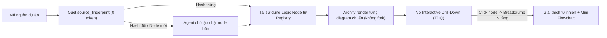

# SPEC — Nghiên cứu cải tiến Archify đa tầng drill-down và tái sử dụng Logic Node

Ngày: 2026-11-24 · Bản: 1.0 · Brief: ../brief/2026-11-24-1106-research-archify-drilldown-nodes.md
Soul: chất lượng > runtime > context cost · luật gốc: skills/tdq-conventions/references/soul.md
Chế độ: full · Work kind: investigate · Trạng thái: CHỜ DUYỆT

> **Tóm tắt dễ hiểu:** Archify trong hệ thống hiện mới vẽ sơ đồ tổng quan kèm một tầng thẻ mở chi tiết phẳng nên người đọc khó bấm sâu vào từng bước nhỏ như luồng đăng nhập. Nghiên cứu này khảo sát sâu engine gốc và bốn module tích hợp để đề xuất kiến trúc đào sâu nhiều tầng kèm giải thích tự nhiên cho từng bước. Điểm cốt lõi là tách kho Logic Node tái sử dụng theo dấu vân tay nguồn giúp giảm mạnh token và thời gian xử lý của agent.

## Mục lục

- 1. Mục tiêu & phạm vi
- 1b. Lộ trình
- 2. Đầu ra cụ thể
- 2b. Ranh giới module
- 2c. Luồng hoạt động & Sơ đồ kiến trúc
- 3. Cách tiếp cận & lý do
- 3b. Năng lực & công cụ
- 3c. Giải thuật & Xử lý cốt lõi
- 3d. Mental Model cho Fresher Dev
- 4. Yêu cầu bắt buộc
- 5. Ràng buộc & rủi ro
- 6. QC & Definition of Done
- 7. Câu hỏi còn mở

## 1. Mục tiêu & phạm vi

- **Mục tiêu:** Tiến hành nghiên cứu kỹ thuật sâu (`work_kind=investigate`) trên engine gốc `tt-a1i/archify` (`C:\Users\admin\Documents\archify`) và lớp tích hợp TDQ (`scripts/*archify*.py`, `docs/tdq/models/`) để đưa ra đề xuất kiến trúc tối ưu cho hệ thống Archify đa tầng (`>= 5` tầng, `> 100` Logic Node) đáp ứng đồng thời ba tiêu chí: đầy đủ thông tin từng bước, tối ưu token kèm thời gian xử lý của agent, và dễ đọc dễ hiểu cho con người.
- **Trong phạm vi:**
  - Kiểm chứng toàn bộ 4 giả thuyết `H1`–`H4` bằng bằng chứng nguồn (`path:line`) và kiểm tra DOM/SVG thực tế của bản HTML đã xuất.
  - Phủ đủ 2 tầng tài liệu: Master Architecture Map (`docs/architecture/`, hướng đóng gói `index.html` gọn + tải lười mảnh qua HTTP/Tailscale) và Spec/Report từng request (tự chứa gọn).
  - Thiết kế chiến lược cập nhật **Incremental Dirty-Only (tầng 1–2) + Lazy Depth (tầng 3–5+)** kèm kho **Logic Node Registry** định danh theo dấu vân tay nguồn để chống vẽ lại node không đổi.
  - Đánh giá đủ 4 mặt đã chốt: tương thích upstream `tt-a1i/archify` (ưu tiên không fork), bám nguồn chống bịa (`path:line` cho node thật và nhãn `planned` cho node Spec), ước tính định lượng chi phí token & thời gian agent xử lý trước/sau, và ngưỡng dễ đọc + browser-check tự động.
  - Soạn kèm Schema JSON chuẩn của Logic Node Registry và ví dụ minh họa trọn vẹn chuỗi Login `4–5` tầng.
- **NGOÀI phạm vi (chép từ brief `### Phạm vi đã chốt`):**
  - Chỉnh sửa mã nguồn TDQ Workflow trong request này (chỉ nghiên cứu và đề xuất tối ưu; `git diff --name-only dev -- scripts/ hooks/ plugins/ tools/ tests/` phải rỗng).
  - Fork trực tiếp engine `tt-a1i/archify` (trừ khi kết quả khảo sát H1 chứng minh engine gốc bị chặn cứng ở mức không thể bọc ngoài).
  - Đóng gói đơn khối `1` file `file://` khổng lồ cho Master Map `> 100` node (đã loại ở Vòng 2 do nặng trình duyệt và tốn thời gian dựng lại).

## 1b. Lộ trình

Chép nguyên từ brief mục `### Lộ trình`. Duyệt spec này là duyệt luôn lộ trình thực thi bên dưới.

| Bước/phase | Chạy? | Vì sao |
|---|---|---|
| `analyze` (B0 + B1 nông + phỏng vấn 2 vòng) | CÓ | Khung bất biến — đã chốt đủ phạm vi, quy mô lớn, ưu tiên không fork và mức `muc_qc=full` |
| `spec` (Spec nghiên cứu, miễn Archify preview) | CÓ | Khung bất biến — chốt câu hỏi nghiên cứu, 4 giả thuyết H1–H4, cấu trúc đề xuất và tiêu chí đo; miễn preview trước duyệt theo `investigate-mode.md:13` |
| `plan` (Kế hoạch shard điều tra độc lập) | CÓ | Khung bất biến — chia 4 shard song song (`tdq-explorer`) với `Worktree: none` và ngân sách tool rõ ràng |
| `implement` (Thu thập bằng chứng + phân tích sâu + mẫu Login) | CÓ | Khung bất biến — khảo sát sâu `C:\Users\admin\Documents\archify`, 4 module `scripts/*archify*.py`, kiểm DOM thực tế và tổng hợp kiến trúc + schema + ước lượng token |
| `qc` (`QC-I1..I4` mức `full`) | CÓ | Theo lựa chọn `4a` (`muc_qc=full`) — kiểm grounding `100%` `[EV]` và `path:line`, bác bỏ giả thuyết, nhãn độ tin cậy và phạm vi `0` file code sửa |
| `qc` Red-Team độc lập (`ultra`) | BỎ | User chọn `full` (`4a`), không chọn `ultra` (`4c`) |
| `report` (Báo cáo MD + Archify HTML + Tailscale verify) | CÓ | Khung bất biến — xuất cặp tài liệu báo cáo trực quan và hỏi commit/merge |

## 2. Đầu ra cụ thể

| # | Đầu ra | Đường dẫn/vị trí | Đo "xong" bằng |
|---|---|---|---|
| 1 | Sổ bằng chứng điều tra hợp nhất (`evidence.jsonl` + bảng đọc) | `docs/tdq/artifacts/2026-11-24-1106-research-archify-drilldown-nodes/evidence.jsonl` và `evidence-log.md` | `tdq_team.py evidence merge` thành công; 100% `[EV]` ID và `path:line` trích dẫn tồn tại thật trên đĩa |
| 2 | 4 shard phân tích chuyên sâu (`S1` engine upstream, `S2` TDQ model/artifacts + DOM, `S3` Logic Node Registry & token/latency model, `S4` thiết kế mẫu Login + ma trận so sánh) | `docs/tdq/artifacts/2026-11-24-1106-research-archify-drilldown-nodes/s{1,2,3,4}.md` | Đủ 4 file shard, mỗi giả thuyết `H1`–`H4` có kết luận rõ + nhãn độ tin cậy (`Verified`/`Inferred`) |
| 3 | Bản thiết kế Schema JSON Logic Node Registry & ví dụ chuỗi Login `4–5` tầng | `docs/tdq/artifacts/2026-11-24-1106-research-archify-drilldown-nodes/logic-node-schema-and-login-example.json` | JSON hợp lệ (`json.loads` exit `0`), thể hiện đủ node tái dùng, `source_fingerprint`, giải thích tự nhiên và mini flowchart `>= 4` tầng |
| 4 | Báo cáo tổng hợp & Đề xuất kiến trúc tối ưu (Markdown + Archify HTML) | `docs/tdq/reports/2026-11-24-1106-research-archify-drilldown-nodes.md` và `.html` | `doc_lint.py` exit `0`, `QC-I1..I4` PASS, `tdq_archify.py verify` trả `current`, HTTP `200` trên Tailscale Serve |

## 2b. Ranh giới module

BỎ — Theo `investigate-mode.md:21`, request `Work kind: investigate` không thêm hay sửa module mã nguồn sản phẩm (`git diff` mã nguồn bằng `0`), nên thay ranh giới code bằng 4 vùng khảo sát đọc-chỉ ở §2 (`S1`–`S4`) và ghi rõ ranh giới sẽ đề xuất cho pha triển khai ở báo cáo cuối.

## 2c. Luồng hoạt động & Sơ đồ kiến trúc

Miễn bản xem trước Archify HTML trước duyệt theo `investigate-mode.md:13` (`Work kind: investigate`); sơ đồ kiến trúc mục tiêu sẽ được dựng thành Archify HTML chính thức ở pha `report`. Sơ đồ Mermaid minh họa luồng đích cần nghiên cứu và kiểm chứng:

| Khía cạnh | Hiện trạng (Trước) | Đích nghiên cứu đề xuất (Sau) |
|---|---|---|
| Độ sâu sơ đồ | `1` tầng phẳng: Overview → thẻ Flow → `1` modal diagram tĩnh (`master.model.json`) | `>= 5` tầng đệ quy: Flow tổng → click từng node → giải thích tự nhiên + mini flowchart / sub-flow + breadcrumb |
| Tái sử dụng & token | Mỗi lần `sync-master` agent phải đọc và viết lại toàn bộ nội dung mô tả | Kho **Logic Node Registry** định danh theo `source_fingerprint`: node không đổi tái dùng `100%`, chỉ sinh lại node bẩn |
| Thời gian xử lý agent | Đọc rộng và dựng lại cả bộ sơ đồ lớn mỗi khi code đổi | Máy lọc hash trước (`0` token); Incremental tầng 1–2 + Lazy Depth tầng 3–5+ |
| Đóng gói HTML `> 100` node | Nhồi tập trung trong `docs/architecture/index.html` | Lai: Master Map `index.html` gọn + lazy-load mảnh qua HTTP/Tailscale; Spec/Report vẫn tự chứa gọn |

## 3. Cách tiếp cận & lý do

- **Chọn:** Điều tra dựa trên bằng chứng thực nghiệm chia 4 luồng đọc-chỉ song song (`S1`–`S4`) để kiểm chứng/bác bỏ `H1`–`H4`, sau đó tổng hợp kiến trúc khuyến nghị (ưu tiên **không fork `tt-a1i/archify`** bằng kiến trúc lai: `tt-a1i/archify` dựng diagram chuẩn đạt cổng đọc `desktop-readability` + lớp TDQ Logic Node Registry & Interactive Drill-Down Shell tải lười mảnh) kèm Schema JSON và ví dụ chuỗi Login `4–5` tầng.
- **Vì:** Cả mã nguồn upstream `C:\Users\admin\Documents\archify` lẫn 4 module `scripts/*archify*.py` và file HTML thật `docs/architecture/index.html` đều có sẵn cục bộ, cho phép đo đạc trực tiếp thay vì suy đoán lý thuyết.
- **Đã loại:** (1) Đề xuất fork `tt-a1i/archify` ngay từ đầu — làm mất đường cập nhật upstream và tăng chi phí bảo trì (chỉ cân nhắc nếu `S1` chứng minh engine gốc chặn cứng); (2) Đề xuất sửa mã nguồn TDQ ngay trong request này — trái yêu cầu rõ ràng của người dùng.

## 3b. Năng lực & công cụ

Chép nguyên từ brief mục `### Năng lực dùng được`. Với `tdq-browser-test` / `chrome-devtools`, kiểm tra pre-flight kết nối Chrome DevTools trước khi mở trang DOM thật; nếu không có phiên Chrome CDP thì phân tích trực tiếp mã nguồn DOM/JS từ `docs/architecture/index.html` và `C:\Users\admin\Documents\archify\viewer\`.

| Skill | Nguồn | Phán quyết | Dùng ở đâu / Lý do loại |
|---|---|---|---|
| `tdq-intake`, `tdq-conventions`, `tdq-spec`, `tdq-plan`, `tdq-build`, `tdq-status`, `tdq-setup`, `tdq-check-status`, `tdq-lean`, `tdq-checkportable` | `plugin:tdq-workflow-agy` | NỀN | Khung vận hành workflow TDQ (`full` + `investigate`) |
| `tdq-browser-test` / `chrome-devtools` | `plugin:tdq-workflow-agy` / `built-in` | DÙNG | Kiểm tra trực quan DOM/SVG tương tác thực tế của `docs/architecture/index.html` trong shard `S2` khi xác minh hành vi click/modal hiện hữu |
| Đã xét 40+ skill khác (`tdq-browser-research`, Google Workspace, Gemini API, `a11y-debugging`, `generative_ui`, `plugin`…) | `user/plugin/built-in` | KHÔNG | khác lĩnh vực |

## 3c. Giải thuật & Xử lý cốt lõi

Nghiên cứu sẽ thiết kế và chứng minh mô hình giải thuật cho vòng đời **Incremental Logic Node Sync + Multi-Level Drill-Down**:

- **Từng bước giải thuật mục tiêu cần thẩm định:**
  1. **Quét dấu vân tay nguồn (`0` token LLM):** Tính `sha256` cho từng file/dải dòng nguồn gắn với mỗi `node_id` trong Logic Node Registry (`nodes/<node_id>.json`).
  2. **Lọc tập node bẩn (Dirty Set Propagation):** So khớp hash mới với `source_fingerprint` đã lưu; chỉ đánh dấu `dirty` cho các node có file nguồn đổi hoặc chưa có bản lưu, lan ngược dấu trạng thái lên node cha nếu nhãn tóm tắt thay đổi.
  3. **Sinh có chọn lọc (Incremental tầng 1–2 + Lazy Depth tầng 3–5+):** Chỉ gọi agent cập nhật phần giải thích tự nhiên và mini-flow cho tập `dirty` trong tầng cần thiết; mọi node `clean` được tái sử dụng trực tiếp bằng `node_ref`.
  4. **Dựng phân mảnh & chống vòng lặp:** Render từng sub-flow nhỏ (`<= 5` node/hàng để đạt `desktop-readability`), xuất thành mảnh JSON/SVG riêng kèm bảng chỉ mục và kiểm duyệt chống chu trình đồ thị (`visited_stack`) khi người dùng bấm đào sâu `>= 5` tầng.
- **Độ phức tạp tính toán mục tiêu:**
  - Thời gian kiểm tra thay đổi: $O(F + N)$ với $F$ là số file nguồn theo dõi và $N$ là số Logic Node (chạy hoàn toàn cục bộ không tốn token).
  - Thời gian gọi LLM & dựng lại: $O(D)$ với $D \ll N$ là số node thực sự thay đổi thay vì $O(N)$ như hiện tại.
  - Không gian lưu trữ: $O(N)$ cho kho mảnh `nodes/*.json` tách rời, tải vào bộ nhớ trình duyệt theo từng tầng $O(d)$ ($d$ là độ sâu đang xem).
- **Các ca góc hiểm cần phân tích sâu:**
  - **Chu trình (Cycle) trong sub-flow:** Ví dụ `Node A` gọi `Node B` gọi ngược `Node A` → phát hiện chu trình bằng tập đường đi hiện tại và hiện liên kết "nhảy tới node đã mở" thay vì đệ quy vô hạn.
  - **Lệch dòng (`path:line` drift) khi refactor nhẹ:** Dòng dịch chuyển nhưng hàm không đổi logic → đề xuất neo theo `symbol` (LSP/AST) kết hợp hash thân hàm thay vì chỉ hash toàn file.
  - **Node `planned` ở pha Spec chưa có mã nguồn:** Phân biệt rạch ròi `evidence_kind: "planned"` (chưa gắn dòng code thật) với `working-tree` / `committed` (bắt buộc gắn `path:line` thật).

## 3d. Mental Model cho Fresher Dev

- **Ẩn dụ trực quan (Analogy):** Hãy hình dung hệ thống Archify mới giống **Google Maps phóng to từng lớp kèm thẻ địa điểm**: lúc đầu bạn thấy bản đồ tổng thể thành phố (Flow Login gồm 4 bước chính), bấm vào một điểm ("Kiểm tra nhớ đăng nhập") thì bản đồ phóng to vào sơ đồ nội bộ bên trong điểm đó kèm bảng chú thích dễ hiểu như hướng dẫn viên, và những tòa nhà không sửa chữa thì giữ nguyên ảnh chụp cũ không cần vẽ lại.
- **Thuật ngữ dự án (Glossary):**
  - `Logic Node`: Đơn vị nhỏ nhất đại diện cho một bước nghiệp vụ hoặc khối xử lý có tên dễ hiểu, lời giải thích tự nhiên, dẫn chứng mã nguồn và tùy chọn một mini-flow con bên trong.
  - `Logic Node Registry`: Kho lưu trữ tập trung các Logic Node tách mảnh kèm dấu vân tay mã nguồn để tái sử dụng qua nhiều flow và nhiều lần cập nhật.
  - `Drill-down đa tầng`: Cơ chế bấm liên tiếp vào từng node để đi sâu từ luồng tổng xuống luồng con nhiều cấp kèm thanh breadcrumb quay ngược.
  - `Incremental + Lazy Depth`: Chiến lược chỉ cập nhật các node có code thay đổi (tầng nông) và chỉ đào sâu sinh chi tiết các nhánh mới khi được chạm tới (tầng sâu).

## 4. Yêu cầu bắt buộc

- **Log service:** BỎ — Request này thuộc `work_kind=investigate`, không tạo hay sửa mã nguồn chạy được trong TDQ Workflow.
- **Không placeholder / không bịa chứng cứ:** Mọi nhận định kỹ thuật về `tt-a1i/archify` và TDQ phải có bằng chứng `path:line` hoặc kết quả đo/kiểm chứng thật lưu trong `evidence.jsonl`; không tự chế tính năng engine không tồn tại.
- **Kiểm chứng JSON & tài liệu:** File Schema JSON mẫu phải parse hợp lệ bằng Python `json.loads`; mọi tài liệu markdown qua `doc_lint.py` exit `0`.
- **Giữ nguyên mã nguồn sản phẩm:** Cấm sửa file trong `scripts/`, `hooks/`, `plugins/`, `tools/`, `tests/`.

## 5. Ràng buộc & rủi ro

Ràng buộc kiến trúc phải giữ (chép từ `docs/kien-truc.md`):
- `scripts/` không được import `hooks/`; `skills/` chỉ nhắc tên lệnh của `scripts/` — đề xuất kiến trúc tương lai phải tuân thủ đúng ranh giới tầng này.
- Chỉ `scripts/tdq_state.py` được ghi `docs/tdq/state.json` — kho Logic Node Registry và cache phải tách riêng dưới `docs/tdq/models/` hoặc `docs/architecture/`, không lẫn vào `state.json`.
- Tài liệu sinh cho user viết tiếng Việt (`doc_lang=vi`), chuỗi máy và chú thích code giữ tiếng Anh theo quyết định 2026-08-22.

| Rủi ro | Ảnh hưởng | Cách giảm |
|---|---|---|
| `tt-a1i/archify` gốc khóa chặt SVG/DOM không hỗ trợ click trực tiếp trên native node (`archify-lifecycle.md:27`) | Đề xuất bám 100% native click sẽ bất khả thi nếu không có vỏ bọc phù hợp | Shard `S1` đọc trực tiếp `viewer/` và schema của `C:\Users\admin\Documents\archify` để xác định chính xác điểm nối hợp lệ (event hook, post-process, hoặc lớp vỏ bọc ngoài) |
| Khóa hash theo toàn file gây "false dirty" (sửa 1 hàm nhỏ nhưng làm bẩn cả 10 node cùng file) | Giảm hiệu quả tiết kiệm token và thời gian agent | Shard `S3` đánh giá chiến lược hash ở cấp `symbol`/khối dòng (`AST`/LSP) so với hash cấp file |
| Tách mảnh lazy-load qua HTTP bị lỗi CORS khi người dùng lỡ mở trực tiếp bằng `file://` | Trải nghiệm đứt gãy khi mở cục bộ không qua Tailscale Serve | Thiết kế rõ chế độ fallback hoặc cảnh báo kèm lệnh mở local bridge (`tdq_archify.py open`) trong đề xuất |
| Mini-flow quá nhiều node làm rớt cổng `composition/desktop-readability` (`< 6px`) | Dựng HTML thất bại ở kiểm định Archify | Khóa quy tắc mỗi tầng chỉ `3–5` node chính (nhánh chi tiết đẩy xuống tầng con), đo kiểm trực tiếp với engine Archify thật |

## 6. QC & Definition of Done

Mức QC đã chốt với người dùng: **`full`** (`muc_qc=full`). Do đây là `work_kind=investigate`, các mục kiểm áp dụng bộ `QC-I1..I4` theo `investigate-mode.md:53-58` (miễn `QC-F1` chạy test mã nguồn vì `0` file code sửa):

| # | Hạng mục kiểm | Điều kiện PASS | Đo trước | Dự phòng nếu trượt |
|---|---|---|---|---|
| Q1 | `QC-I1` Grounding tự động (`L1/L4`) | `100%` ID bằng chứng trích dẫn tồn tại trong `evidence.jsonl`; `100%` dải `path:line` tồn tại thật trên đĩa; `0` placeholder | Chưa có (tạo mới ở `implement`) | Rà từng trích dẫn lỗi, đối chiếu lại file gốc và cập nhật `evidence.jsonl` |
| Q2 | `QC-I2` Đối chiếu nguyên văn (`L2`) | Toàn bộ kết luận chính về `tt-a1i/archify` và `scripts/*archify*.py` khớp nguyên văn mã nguồn thực tế, không suy diễn vượt nguồn | — | Đọc lại dòng gốc, chỉnh nhận định hoặc hạ cấp nhãn tin cậy |
| Q3 | `QC-I3` Kiểm chứng & bác bỏ giả thuyết `H1`–`H4` | Cả 4 giả thuyết `H1`–`H4` đều có kết luận rõ (Xác nhận / Có điều kiện / Bác bỏ) kèm phản ví dụ hoặc điểm nghẽn thực tế | — | Bổ sung phép đo hoặc khảo sát hẹp trên đúng giả thuyết còn thiếu |
| Q4 | `QC-I4` Nhãn độ tin cậy & tính hợp lệ đầu ra | Mọi phát hiện lớn mang nhãn `Verified` / `Single-source` / `Inferred`; file Schema JSON mẫu parse sạch (`json.loads` exit `0`); `doc_lint.py` exit `0` | — | Sửa schema/tài liệu lỗi và chạy lại kiểm định |
| Q5 | Ranh giới phạm vi & Xuất bản báo cáo trực quan | `git diff --name-only dev -- scripts/ hooks/ plugins/ tools/ tests/` rỗng (`0` file); `tdq_archify.py verify` báo `current`; Archify HTML báo cáo đạt HTTP `200` trên Tailscale Serve | `0` file sửa trước khi chạy | Hoàn tác bất kỳ thay đổi lạc vùng và dựng lại Archify HTML |

**DoD:** Đủ 4 đầu ra ở §2, cả 5 cổng `Q1`–`Q5` đạt `PASS`, trả lời trọn vẹn 4 bài toán (flow chi tiết, click từng node đào sâu nhiều tầng kèm giải thích tự nhiên, tái sử dụng Logic Node tối ưu token + thời gian agent, và tương thích `tt-a1i/archify`), kèm Schema JSON chuẩn + ví dụ chuỗi Login `4–5` tầng + bảng ước lượng token/thời gian và lộ trình triển khai rõ ràng cho request sau.

## 7. Câu hỏi còn mở

(Rỗng — toàn bộ câu hỏi đã được chốt qua 2 vòng phỏng vấn trong `docs/tdq/brief/2026-11-24-1106-research-archify-drilldown-nodes.md`.)
