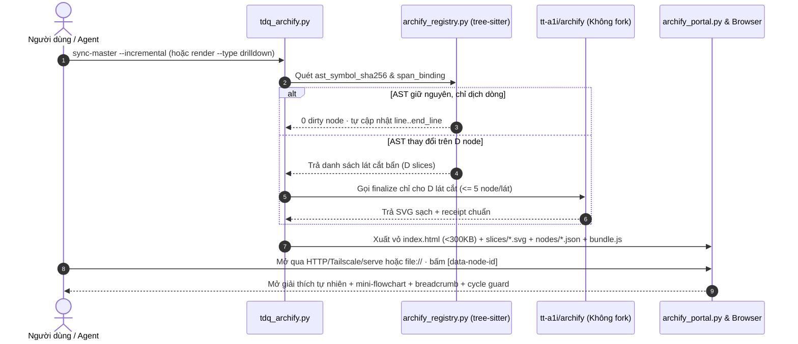

# SPEC — Triển khai trọn bộ cải thiện Archify (Drill-down nhiều tầng, Logic Node Registry và Tree-sitter Setup)

Ngày: 2026-11-24 · Bản: 1.0 · Brief: ../brief/2026-11-24-1308-implement-archify-drilldown-registry.md
Soul: chất lượng > runtime > context cost · luật gốc: skills/tdq-conventions/references/soul.md
Chế độ: full · Loại: build · Trạng thái: CHỜ DUYỆT

> **Tóm tắt dễ hiểu:** Trước đây Archify chỉ vẽ một tầng phẳng nên 4 trên 6 sơ đồ bị tràn màn hình và toàn kho nặng 9.27 MB. Chỉ cần sửa một dòng không liên quan cũng làm hỏng toàn bộ bộ nhớ đệm. Bản nâng cấp này giữ nguyên công cụ gốc không fork, thêm kho Logic Node tái sử dụng băm bằng tree-sitter và vỏ điều hướng nhiều tầng. Người dùng bấm vào từng bước để xem giải thích dễ hiểu cùng sơ đồ con tới 4 tầng ngay trên bản đồ chính và báo cáo.

## Mục lục

- 1. Mục tiêu & phạm vi
- 1b. Lộ trình
- 2. Đầu ra cụ thể
- 2b. Ranh giới module
- 2c. Luồng hoạt động & Sơ đồ kiến trúc
- 3. Cách tiếp cận & lý do
- 3b. Năng lực & công cụ
- 3c. Giải thuật & Xử lý cốt lõi
- 3d. Mental Model cho Fresher Dev
- 4. Yêu cầu bắt buộc
- 5. Ràng buộc & rủi ro
- 6. QC & Definition of Done
- 7. Câu hỏi còn mở

## 1. Mục tiêu & phạm vi

- **Mục tiêu:** Triển khai hoàn chỉnh kiến trúc **Phương án A (No-Fork Hybrid)** đã chọn từ báo cáo `2026-11-24-1106-research-archify-drilldown-nodes` trong một request duy nhất: xây kho Logic Node Registry có hash 2 lớp bằng `tree-sitter`, đưa `tree-sitter` thành dependency chính thức trong `tdq_setup.py`, nâng cấp `tdq_archify.py` xuất lát cắt SVG cùng vỏ HTML drill-down đa tầng (tải lười cho Master Portal + tự chứa cho Spec/Report + lệnh `serve` cục bộ), thí điểm chuyển đổi trực tiếp cụm `hooks-and-gates` và `search-and-archify` sang cây 4 tầng trong `docs/architecture/`, và đồng bộ bản đóng gói `plugins/tdq-workflow-agy/`.
- **Trong phạm vi:**
  - Tạo `scripts/archify_registry.py` (schema Logic Node, hash AST 2 lớp bằng `tree-sitter` 0.25+ cho Python/JS/TS/Rust kèm fallback Python `ast` và cờ `file_fallback`, relink `span_binding`, phát hiện chu trình `visited_stack`, tách `planned` khỏi `working-tree`/`committed`).
  - Tạo `scripts/archify_portal.py` (vỏ HTML Drill-Down Portal dùng chung `< 300 KB` tải đầu, gắn listener ngoài theo `data-node-id`, giải thích tự nhiên + mini-flowchart + breadcrumb + neo chu trình, chế độ lazy HTTP + fallback `<script>` cho `file://`, và chế độ tự chứa gọn `<= 4` tầng cho Spec/Report).
  - Mở rộng `scripts/archify_model.py` (chấp nhận trường `registry` tùy chọn nhưng giữ 100% tương thích ngược `master.model.json` v1), `scripts/archify_artifacts.py` (loại `target` và `.pytest_cache` khỏi `EXCLUDED_DIR_NAMES`, hỗ trợ manifest cho bundle lát cắt), `scripts/archify_delivery.py` (thêm helper HTTP server `127.0.0.1` cho `serve`), và `scripts/tdq_archify.py` (`sync-master --incremental`, `render --type drilldown`, `serve`).
  - Nâng cấp `scripts/tdq_setup.py`: khai báo `tree-sitter`, `tree-sitter-python`, `tree-sitter-javascript`, `tree-sitter-typescript`, `tree-sitter-rust` làm dependency chính thức của TDQ Workflow (kiểm tra, báo trạng thái trong manifest setup và tự cài khi chạy setup, tôn trọng `TDQ_KHONG_CHAM_MAY=1`).
  - Chuyển đổi thí điểm cụm `hooks-and-gates` và `search-and-archify` sang Logic Node Registry 4 tầng tại `docs/tdq/models/registry/` và xuất lại `docs/architecture/index.html` cùng các lát cắt.
  - Cập nhật tài liệu hướng dẫn tại `skills/tdq-build/references/archify-lifecycle.md`, `skills/tdq-spec/references/archify-ba.md`, `skills/tdq-intake/references/archify-quick.md` (giữ trọn vẹn các cụm hợp đồng hiện có), đồng bộ sang `plugins/tdq-workflow-agy/` qua `build_portable.py --sinh-agy`, và mở rộng bộ kiểm thử đơn vị + E2E trình duyệt Chrome DevTools.
- **NGOÀI phạm vi:**
  - Không sửa hay fork bất kỳ tệp nào trong engine gốc `C:\Users\admin\Documents\archify` (giữ 0% fork).
  - Không chuyển đổi 4 view còn lại (`overview`, `pipeline-lifecycle`, `runtime-verification`, `optimization-report`) sang cây 4 tầng trong request này (chúng vẫn hoạt động nguyên vẹn trong `docs/architecture/` theo cơ chế tương thích ngược; chỉ thí điểm 2 cụm `hooks-and-gates` và `search-and-archify` theo lựa chọn `2a`).
  - Không thêm mô hình AI ngoài, không gọi endpoint LLM từ Python runtime (toàn bộ `scripts/*archify*.py` chạy thuần cục bộ với 0 API key).
  - Không đẩy lên nhánh `main` hay `git push` từ xa khi chưa có lệnh riêng của người dùng.

## 1b. Lộ trình

Chép từ brief mục `### Lộ trình`. User duyệt spec là duyệt luôn lộ trình này.

| Bước/phase | Chạy? | Vì sao |
|---|---|---|
| Research web ngoài (`B3`) | BỎ | Triển khai thuần nội bộ trên `tree-sitter 0.25.2` (có sẵn cùng `graphifyy`), Python stdlib và `tt-a1i/archify` v3.2 đã kiểm chứng ở request trước |
| Phỏng vấn chi tiết (`B4`) | CÓ | Đã hoàn tất chốt đủ 6 câu (`1b + tree-sitter setup`, `2a`, `3a`, `4a`, `5a muc_qc=full`, `6a`) |
| Đặc tả + Bản xem trước Archify BA (`spec`) | CÓ | Request `work_kind=build` chạm hạ tầng Archify → bắt buộc dựng và bind `spec-preview.html` trước duyệt spec |
| Kế hoạch chia pha + Chọn chế độ thực thi (`plan`, `mode`) | CÓ | Chia rõ 4 pha + tích hợp `tdq_setup.py`, xác lập đồ thị phụ thuộc và để user chọn `main` hoặc `subagent` |
| Triển khai TDD Red → Green (`implement`) | CÓ | Code sạch `<= 50` dòng/hàm, test thật từng đơn vị, chạy Pilot 2 cụm thật và đồng bộ `plugins/tdq-workflow-agy/` |
| Kiểm chứng `muc_qc=full` + Chrome DevTools (`qc`) | CÓ | Chạy DoD + trọn bộ unit test + `tdq_meta_gate.py` + hồi quy vùng chạm + ràng buộc kiến trúc + clean code + kiểm click `>= 4` tầng trên Chrome DevTools (bỏ `tdq-qc-tester` độc lập vì mức `full`, không phải `ultra`) |
| Báo cáo + Archify HTML (`report`) | CÓ | Đo thực tế Trước → Sau (dung lượng HTML, thời gian sync, `0` false-dirty, tổng test pass) và hỏi commit |

## 2. Đầu ra cụ thể

| # | Đầu ra | Đường dẫn/vị trí | Đo "xong" bằng |
|---|---|---|---|
| 1 | Module Logic Node Registry & Hash AST 2 lớp (`tree-sitter`) | `scripts/archify_registry.py` | Phân tích AST `tree-sitter` trên Python/JS/TS/Rust; dịch dòng/thêm comment cho `0` false-dirty; relink `span_binding`; chặn chu trình `visited_stack`; tách `planned` khỏi `working-tree` |
| 2 | Module Vỏ HTML Drill-Down Portal & Standalone | `scripts/archify_portal.py` | Xuất vỏ `index.html` `< 300 KB`, lắng nghe `[data-node-id]` ngoài SVG (không sửa native SVG), hiện giải thích tự nhiên + mini-flowchart + breadcrumb + neo chu trình, hỗ trợ cả HTTP lazy và fallback `<script>` `file://` |
| 3 | Nâng cấp adapter & CLI Archify | `scripts/archify_model.py`, `scripts/archify_artifacts.py`, `scripts/archify_delivery.py`, `scripts/tdq_archify.py` | `sync-master --incremental` chỉ render lại lát cắt bẩn; `render --type drilldown` xuất 1 HTML tự chứa `<= 4` tầng; lệnh `serve` phục vụ HTTP `127.0.0.1`; `EXCLUDED_DIR_NAMES` bỏ `target` & `.pytest_cache`; giữ 100% tương thích ngược |
| 4 | Dependency `tree-sitter` trong bộ cài TDQ | `scripts/tdq_setup.py` | Khai báo và kiểm tra đủ 5 gói `tree-sitter*`, hiển thị trong kết quả setup/manifest, tự cài khi chạy setup và tôn trọng tuyệt đối `TDQ_KHONG_CHAM_MAY=1` |
| 5 | Kho Pilot 4 tầng & Portal `docs/architecture/` mới | `docs/tdq/models/registry/`, `docs/tdq/models/master.model.json`, `docs/architecture/` | Cụm `hooks-and-gates` và `search-and-archify` đào sâu đủ 4 tầng (`>= 12` Logic Nodes, có node dùng lại `reused_by >= 2` và nhánh lỗi), `docs/architecture/index.html` `< 300 KB` mở sạch với `0` lỗi console trên Chrome DevTools |
| 6 | Hướng dẫn Skill, đồng bộ AGY và Bộ test mở rộng | `skills/tdq-*/references/archify-*.md`, `scripts/build_portable.py`, `plugins/tdq-workflow-agy/`, `tests/` | Toàn bộ 218 test Archify cũ + test mới cho registry, portal, serve và setup đều PASS; hợp đồng skill và kiểm tra phân phối release đều xanh; gói `plugins/tdq-workflow-agy/` đồng bộ khớp |

## 2b. Ranh giới module

Xác lập từ kiểm tra tham chiếu LSP (`validate_model`: 39 tham chiếu, `sync_master`: 11 tham chiếu, `mark_stale`: 7 tham chiếu) và Graphify (`archify_model` / `archify_artifacts` → `tdq_archify.py`):

| Module | Vùng file | Phụ thuộc module | Đầu ra §2 nào |
|---|---|---|---|
| `archify-registry` | `scripts/archify_registry.py` | không (chỉ Python stdlib + `tree-sitter` tùy chọn cài sẵn) | 1 |
| `archify-portal` | `scripts/archify_portal.py` | `archify-registry` | 2 |
| `archify-model-ext` | `scripts/archify_model.py` | `archify-registry` (tùy chọn kiểm tra mục registry) | 3 |
| `archify-artifacts-ext` | `scripts/archify_artifacts.py` | không (giữ luật stdlib-only, không import model/delivery) | 3 |
| `archify-delivery-serve` | `scripts/archify_delivery.py` | không (chỉ Python stdlib + Node CLI ngoài) | 3 |
| `archify-cli-orchestrator` | `scripts/tdq_archify.py` | `archify-registry`, `archify-portal`, `archify-model-ext`, `archify-artifacts-ext`, `archify-delivery-serve` | 3 |
| `setup-tree-sitter` | `scripts/tdq_setup.py` | `archify-delivery-serve` (có sẵn), `archify-registry` (dùng danh sách gói chuẩn) | 4 |
| `pilot-skills-packaging` | `docs/tdq/models/`, `docs/architecture/`, `skills/`, `scripts/build_portable.py`, `plugins/tdq-workflow-agy/`, `tests/` | `archify-cli-orchestrator`, `setup-tree-sitter` | 5, 6 |

## 2c. Luồng hoạt động & Sơ đồ kiến trúc

Trực quan luồng hệ thống (Mermaid dự phòng bên cạnh HTML Archify Trước/Sau đã bind tại `docs/tdq/spec/2026-11-24-1308-implement-archify-drilldown-registry-preview.html`):



Cơ chế hiện tại vs Sau update — Bản xem trước trực quan HTML Trước/Sau đi kèm đặc tả: `docs/tdq/spec/2026-11-24-1308-implement-archify-drilldown-registry-preview.html` (Tailscale: https://unity-pc-rtx3060.tail99896.ts.net/vlog/tdq-workflow-agy/spec/2026-11-24-1308-implement-archify-drilldown-registry-preview.html).

| Khía cạnh | Hiện trạng (Trước) | Thiết kế mới (Sau) |
|---|---|---|
| Luồng thực thi | `master.model.json` 1 tầng phẳng → `sync_master` chạy lại toàn bộ 6 view (~20.3s) → nhúng lặp 6 × ~276 KB `htmlGzip` vào `index.html` (2.62 MB) | `archify_registry.py` quét AST `tree-sitter` lọc đúng `D` lát cắt bẩn → `tt-a1i/archify` vẽ SVG lát `<= 5` node → `archify_portal.py` xuất 1 vỏ nhẹ `< 300 KB` tải lười đa tầng |
| Thành phần chạm | `archify_model.py`, `archify_artifacts.py`, `archify_delivery.py`, `tdq_archify.py` (4 file) + `master.model.json` phẳng | Thêm `archify_registry.py` + `archify_portal.py`, nâng cấp 4 file trên + `tdq_setup.py` (`tree-sitter`) + kho `docs/tdq/models/registry/` 4 tầng cho 2 cụm Pilot |
| Điểm nghẽn giải quyết | 4/6 view tràn khung đọc inline; sửa 1 comment hoặc build Rust `target/` đánh `stale` toàn bộ 5,804 file; không bấm đi sâu xuống tầng con được | Bấm sâu 4+ tầng với giải thích tự nhiên + mini-flowchart + chống chu trình; bỏ `target`/`.pytest_cache`; sửa comment/dịch dòng cho `0` false-dirty và `0` lần render lại |

## 3. Cách tiếp cận & lý do

- **Chọn:** Triển khai trọn bộ **Phương án A (No-Fork Hybrid)** kết hợp **`tree-sitter` làm bộ phân tích AST đa ngôn ngữ chính thức** (được đăng ký và tự kiểm tra/cài đặt trong `tdq_setup.py`), phân tách 2 module mới gọn nhẹ (`archify_registry.py` và `archify_portal.py`) để giữ ranh giới trách nhiệm sạch (SRP) và bảo toàn 100% tương thích ngược cho 218 bài test hiện hữu.
- **Vì:** (1) `graphifyy` trên môi trường TDQ đã dùng `tree-sitter 0.25.2` kèm sẵn grammar Python/JS/TS/Rust, giúp trích cây cú pháp chính xác không phụ thuộc regex mong manh; (2) giữ `tt-a1i/archify` nguyên bản bảo toàn toàn bộ cổng kiểm `desktop-readability` và khả năng nâng cấp upstream sau v3.2; (3) tách vỏ Portal dùng chung giúp cắt dung lượng tải đầu từ `2.62 MB` xuống `< 300 KB` và hỗ trợ cả HTTP/Tailscale lẫn fallback `<script>` trên `file://`.
- **Đã loại:**
  - Fork `tt-a1i/archify` (`viewer/` + `workflow.schema.json`) — vì vỡ kiểm định byte-for-byte của upstream và khó bảo trì lâu dài.
  - Chỉ dùng regex phân tách hàm JS/TS/Rust — vì user chọn `1b` đưa `tree-sitter` làm dependency chính thức của TDQ Workflow để đảm bảo độ chính xác AST cao nhất khi dự án có nhiều ngôn ngữ.

## 3b. Năng lực & công cụ

Chép từ brief mục `### Năng lực dùng được`.

| Skill | Nguồn | Phán quyết | Dùng ở đâu / Lý do loại |
|---|---|---|---|
| `tdq-intake`, `tdq-conventions`, `tdq-spec`, `tdq-plan`, `tdq-build`, `tdq-status`, `tdq-setup`, `tdq-check-status`, `tdq-lean`, `tdq-checkportable` | `plugin:tdq-workflow` / `plugin:tdq-workflow-agy` | NỀN | Khung vận hành workflow TDQ (`full` + `build`) |
| `tdq-browser-test` / `chrome-devtools` | `plugin:tdq-workflow-agy` / `built-in` | DÙNG | Kiểm thử trình duyệt thật ở Pha 4: mở Portal `docs/architecture/index.html` và Spec/Report drill-down, bấm kiểm tra đào sâu `>= 4` tầng, breadcrumb, cycle guard, fallback offline và xác nhận `0` console error |
| Đã xét 40+ skill khác (`tdq-browser-research`, Google Workspace, Gemini API, `a11y-debugging`, `generative_ui`, `plugin`…) | user/plugin/built-in | KHÔNG | khác lĩnh vực |

## 3c. Giải thuật & Xử lý cốt lõi

### Hợp đồng chữ ký hàm (`Contract Signatures`)

```python
# scripts/archify_registry.py
TREE_SITTER_PACKAGES: tuple[str, ...]
def check_tree_sitter_support() -> dict[str, Any]: ...
def extract_symbol_ast_hash(file_path: Path, symbol: str) -> dict[str, Any]: ...
def validate_logic_node(node: dict[str, Any]) -> dict[str, Any]: ...
def detect_cycles(nodes: dict[str, dict[str, Any]], root_id: str, max_depth: int = 6) -> list[dict[str, Any]]: ...
def compute_dirty_set(registry_dir: Path, project_root: Path) -> dict[str, Any]: ...
def sync_registry_index(registry_dir: Path, project_root: Path, include_planned: bool = False) -> dict[str, Any]: ...

# scripts/archify_portal.py
def build_portal_shell(registry_index: dict[str, Any], slices: dict[str, str], nodes: dict[str, dict[str, Any]], *, mode: str = "lazy", title: str = "Archify Portal", doc_lang: str = "vi") -> str: ...
def build_registry_bundle_js(registry_index: dict[str, Any], slices: dict[str, str], nodes: dict[str, dict[str, Any]]) -> str: ...
def render_drilldown_standalone(candidate: dict[str, Any], slices: dict[str, str], *, doc_lang: str = "vi") -> str: ...

# scripts/archify_delivery.py
def serve_directory(directory: Path, host: str = "127.0.0.1", port: int = 0, open_browser: bool = False) -> tuple[Any, str]: ...

# scripts/tdq_setup.py
def kiem_tra_tree_sitter() -> tuple[bool, str]: ...
def ensure_tree_sitter_installed(allow_network: bool = True) -> tuple[bool, str]: ...
```

### Từng bước giải thuật (Step-by-step Execution Logic)

1. **Bước 1 — Trích xuất AST 2 lớp (`extract_symbol_ast_hash`):**
   - Ánh xạ đuôi file (`.py`, `.js`, `.jsx`, `.ts`, `.tsx`, `.rs`…) sang grammar `tree-sitter` tương ứng; phân tích cây cú pháp và tìm nút khai báo có tên khớp `symbol` (hỗ trợ cả `Class.method`).
   - Duyệt đệ quy nút con của hàm/lớp đó, **loại bỏ mọi nút comment** (`comment`, `line_comment`, `block_comment`) và tọa độ dòng/cột tuyệt đối, chỉ lấy chuỗi tuần tự `(node.type, leaf_text)` để tính `ast_symbol_sha256` (64-hex) kèm `span_binding = {path, line, end_line}` thật trên đĩa và `hash_mode = "tree_sitter_ast"`.
   - Nếu `tree-sitter` chưa có trên máy cho file `.py` → rơi có kiểm soát về Python stdlib `ast` (`hash_mode = "python_ast"`); nếu ngôn ngữ chưa hỗ trợ hoặc không tìm thấy tên `symbol` → băm tệp có gắn nhãn minh bạch `hash_mode = "file_fallback"` (không giả mạo AST hit).
2. **Bước 2 — Lọc tập bẩn & cập nhật dòng (`compute_dirty_set`):**
   - Đọc `registry/index.json` và từng `registry/nodes/<node_id>.json`; bỏ qua node có `evidence_kind == "planned"` khi đồng bộ Master chính thức (`include_planned=False`).
   - Với từng node, so `ast_symbol_sha256` mới với bản lưu:
     - **Khớp AST & khớp dòng:** `cache_status = "clean"` (tốn 0 render).
     - **Khớp AST & lệch dòng:** cập nhật `span_binding` mới ngay vào `node.json` + `index.json`, đặt `cache_status = "span_shifted_only"` (tốn 0 LLM và 0 lần chạy `finalize`).
     - **Khác AST hoặc thiếu tệp SVG lát cắt:** đưa `node_id` và `slice_id` liên quan vào `dirty_slices` (`cache_status = "dirty"`).
3. **Bước 3 — Render chọn lọc & Chống chu trình (`sync-master --incremental`):**
   - Chạy `detect_cycles` bằng DFS + `visited_stack` (giới hạn `max_depth = 6`) để ghi nhận mọi cạnh quay ngược (`cycle_back_to`) mà không rơi vào đệ quy vô tận.
   - Chỉ gọi `archify_delivery.run_finalize` cho danh sách `dirty_slices` (mỗi lát `<= 5` node, bảo đảm đọc sắc nét `>= 6px`), trích xuất thẻ `<svg>` sạch (còn nguyên `data-node-id`) lưu vào `slices/<slice_id>.svg`, giữ nguyên các lát cắt sạch từ lần dựng trước.
4. **Bước 4 — Đóng gói 2 chế độ HTML (`archify_portal.py`):**
   - **Master Portal (`mode="lazy"`):** Xuất 1 tệp `index.html` duy nhất chứa UI Drill-Down + thanh Breadcrumb + Drawer giải thích tự nhiên + mini-flowchart con + bảng dẫn chứng `path:line` + `registry-bundle.js` (biến toàn cục `window.__TDQ_ARCHIFY_REGISTRY__`). Khi chạy qua HTTP/Tailscale/`serve`, UI tải lười mảnh qua `fetch('./slices/...')`; khi mở trực tiếp `file://` bị chặn CORS, UI tự chuyển mượt sang đọc từ `window.__TDQ_ARCHIFY_REGISTRY__`.
   - **Spec / Report (`render --type drilldown`):** Nhúng gọn cây lát cắt `<= 4` tầng và dictionary Logic Node vào duy nhất 1 tệp HTML tự chứa, ghi manifest và bind vào tài liệu Markdown theo đúng hợp đồng `archify_artifacts.py`.

### Độ phức tạp tính toán

- **Thời gian (Time Complexity):** Quét dirty set mất $O(F_{reg} \cdot L_{avg} + N)$ (phân tích `tree-sitter` tuyến tính theo độ dài $L_{avg}$ của chỉ các file có trong Registry, không quét toàn repo `5,804` file); phần render SVG tốn $O(D)$ với $D \ll N$ là số lát cắt có AST thực sự thay đổi.
- **Không gian (Space Complexity):** $O(N)$ trên đĩa cho kho mảnh `nodes/*.json` và `slices/*.svg`; bộ nhớ trình duyệt khi xem Master Portal ở chế độ HTTP lazy chỉ giữ $O(d)$ lát cắt dọc theo đường đi breadcrumb hiện tại ($d \le 6$).

### Các ca góc hiểm (Edge Cases & Defensive Handling)

- **Chu trình đệ quy (`A -> B -> A`):** `detect_cycles` đánh dấu cạnh chu trình; trên UI khi bấm bước mang `cycle_back_to` hoặc đích đã nằm trong `visited_stack`, trình xem không sinh tầng mới mà hiện thẻ neo `↺ Quay về "<tiêu đề>" (tầng k)` và cuộn ngược breadcrumb về đúng tầng đó.
- **Lệch dòng / sửa comment ngoài hàm:** Dịch toàn bộ hàm xuống 15 dòng hoặc thêm docstring/comment mới không làm thay đổi `ast_symbol_sha256` → `compute_dirty_set` chỉ cập nhật `span_binding`, trả `dirty_slices = []` và không gọi `finalize`.
- **Node `planned` ở Spec lẫn vào Master:** `sync_registry_index(..., include_planned=False)` từ chối trộn node có `evidence_kind="planned"` vào Master Portal (fail-closed với chẩn đoán rõ).
- **Mở cục bộ qua `file://` không chạy server:** Vỏ Portal phát hiện lỗi `fetch` CORS trên `file://` và tự nạp từ `registry-bundle.js` gắn kèm; đồng thời lệnh `tdq_archify.py serve` chỉ bind `127.0.0.1` (cấm bind `0.0.0.0` ra mạng ngoài) và chặn path traversal/symlink thoát khỏi thư mục phục vụ.
- **Môi trường test cô lập (`TDQ_KHONG_CHAM_MAY=1`) hoặc thiếu mạng khi setup:** `ensure_tree_sitter_installed` kiểm tra cờ `TDQ_KHONG_CHAM_MAY=1` và `allow_network=False` trước khi gọi `pip install`; nếu thiếu mạng thì báo cảnh báo rõ ràng chứ không treo hay phá vỡ luồng setup cốt lõi.

## 3d. Mental Model cho Fresher Dev

- **Ẩn dụ trực quan (Analogy):** Hệ thống mới giống **bản đồ Google Maps ghép từ từng ô gạch (tile)**: mỗi ô chỉ vẽ 3–5 địa điểm chính nên nhìn lúc nào cũng rõ chữ; khi bạn bấm vào một tòa nhà, bản đồ phóng to sang bản vẽ tầng bên trong cùng bảng thuyết minh dễ hiểu; khi thợ chỉ sơn lại 1 căn phòng (`ast_symbol_sha256` đổi), bản đồ chỉ chụp ảnh lại đúng ô gạch đó thay vì chụp lại cả thành phố.
- **Thuật ngữ dự án (Glossary):**
  - `Logic Node`: Đơn vị dữ liệu JSON mô tả 1 bước nghiệp vụ (giải thích tự nhiên, hợp đồng vào/ra, nguồn `path:line`, dấu vân tay AST và `sub_flow` con tùy chọn).
  - `ast_symbol_sha256`: Mã băm SHA-256 tính trên cây cú pháp `tree-sitter` đã bỏ comment và bỏ số dòng tuyệt đối của riêng 1 hàm/class.
  - `span_binding`: Cặp `[line, end_line]` hiện hành của symbol trên đĩa, tự động dịch chuyển theo code mà không tốn render lại.
  - `Lazy Portal`: Trang `docs/architecture/index.html` chỉ chứa 1 khung vỏ giao diện nhẹ và nạp các lát cắt SVG khi người dùng bấm tới.

## 4. Yêu cầu bắt buộc

- **Log service bật mặc định:** Mọi module mới (`scripts/archify_registry.py`, `scripts/archify_portal.py`) và các hàm mở rộng trong `scripts/tdq_archify.py`, `scripts/archify_delivery.py`, `scripts/tdq_setup.py` đều phải ghi log ra `stderr` kèm ISO timestamp (`[YYYY-MM-DDTHH:MM:SS] <module>: ...`), bật mặc định và tắt sạch khi `TDQ_LOG=0`.
- **Không placeholder, không TODO stub:** Mọi hàm mới, node trong cụm Pilot 4 tầng và giao diện Portal phải chạy thực tế đầy đủ từ đầu đến cuối; không để lại stub rỗng hay node giả không có `path:line` thật.
- **Mỗi thành phần có unit test riêng:** Từng module (`archify_registry`, `archify_portal`, `tdq_archify` incremental/drilldown/serve, `archify_artifacts` exclusions, `tdq_setup` tree-sitter) có bộ test đơn vị độc lập chạy được bằng 1 lệnh.
- **Tuân thủ Clean Code & SOLID:** Giữ hàm `<= 50` dòng, không lặp khối mã, fail-closed trên kiểm tra an toàn đường dẫn/schema, tuyệt đối không tiêm `onclick` vào SVG gốc của `tt-a1i/archify`.

## 5. Ràng buộc & rủi ro

Ràng buộc kiến trúc phải giữ (chép từ `docs/kien-truc.md`):
- `hooks/` được gọi `scripts/`; `scripts/` **không** được import `hooks/` — chạm ở `scripts/archify_registry.py`, `scripts/archify_portal.py`, `scripts/tdq_archify.py`, `scripts/tdq_setup.py`.
- `skills/` chỉ được **nhắc tên lệnh** của `scripts/`, cấm chép nội dung script vào skill — chạm ở `skills/tdq-build/references/archify-lifecycle.md`, `skills/tdq-spec/references/archify-ba.md`, `skills/tdq-intake/references/archify-quick.md`.
- Chỉ `scripts/tdq_state.py` được ghi `docs/tdq/state.json` — kho Registry nằm tách biệt tại `docs/tdq/models/registry/`, tuyệt đối không đụng `state.json`.
- Tài liệu cho user viết tiếng Việt (`doc_lang=vi`); luật trong `skills/`, chú thích code và chuỗi máy trong `scripts/` giữ tiếng Anh theo quyết định 2026-08-22 (`scripts/i18n_check.py`).
- Phụ thuộc cài mới: `tree-sitter >= 0.25`, `tree-sitter-python`, `tree-sitter-javascript`, `tree-sitter-typescript`, `tree-sitter-rust` (đã xác nhận cài sẵn bản `0.25.2` trên máy qua `graphifyy`, không cần model AI mới).

| Rủi ro | Ảnh hưởng | Cách giảm |
|---|---|---|
| Thêm `tree-sitter` vào `tdq_setup.py` làm vỡ test setup chạy trong môi trường cô lập không mạng | Hỏng test `test_tdq_setup` hoặc `test_agy_host_setup` | Khóa cứng nhánh kiểm tra `TDQ_KHONG_CHAM_MAY=1` và `allow_network=False`; giữ nguyên các khóa JSON cũ trong receipt setup |
| Sửa `skills/*/references/archify-*.md` vô tình xóa cụm từ bắt buộc hoặc vượt trần ngân sách token | Đỏ `test_archify_workflow_contract` hoặc `token_budget` | Giữ nguyên toàn bộ 17 cụm từ hợp đồng hiện tại, chỉ bổ sung đoạn ngắn gọn và chạy `tdq_finish.py` tái sinh `token-budget.json` |
| Thay đổi cấu trúc `docs/architecture/` làm vỡ `check_master_status` hoặc các test `sync_master` cũ | Hồi quy trên 218 bài test Archify hiện có | Giữ nguyên định dạng `manifest.json` `schema_version=1` cùng danh sách `child_files` và chỉ kích hoạt vỏ Portal mới khi model có `registry` (hoặc cờ `--incremental`) |
| Trích SVG từ bản HTML do `tt-a1i/archify` sinh ra làm mất thuộc tính `data-node-id` hoặc CSS nét vẽ | Click trên node không hoạt động hoặc hình bị mất kiểu | Bảo toàn nguyên phần `<svg ...>...</svg>` cùng `<style>` cục bộ của SVG (đã kiểm chứng `staticSvg` giữ nguyên `data-node-id`), chỉ gắn event delegation trên thẻ bọc ngoài |

## 6. QC & Definition of Done

Mức QC đã chốt với người dùng: **`full`** (`muc_qc=full`).

| # | Hạng mục kiểm | Điều kiện PASS | Đo trước | Dự phòng nếu trượt |
|---|---|---|---|---|
| Q1 | Bộ Hash 2 lớp `tree-sitter` chống false-dirty & relink dòng | Phân tích AST `tree-sitter` thành công trên 4 ngôn ngữ (Python, JS, TS, Rust); dịch số dòng hoặc thêm comment giữ nguyên `ast_symbol_sha256` (`0` dirty node) và tự cập nhật đúng `span_binding`; báo rõ `file_fallback` với ngôn ngữ không hỗ trợ; phát hiện và chặn chu trình `A -> B -> A` | Chưa có module; `tree-sitter 0.25.2` + 4 grammar đã đo chạy thật `< 100 ms` trên máy | Nếu một grammar chưa cài trên môi trường test, ghi rõ `hash_mode=python_ast` hoặc `file_fallback` theo cơ chế giảm cấp đã thiết kế |
| Q2 | Vỏ HTML Drill-Down Portal & Chế độ Spec/Report `drilldown` | Vỏ `docs/architecture/index.html` có dung lượng `< 300 KB` (giảm từ 2.62 MB hiện tại); không tiêm `onclick` vào node SVG gốc; bấm vào `[data-node-id]` mở giải thích tự nhiên + mini-flowchart + breadcrumb; hỗ trợ cả tải lười HTTP lẫn fallback `file://` qua `registry-bundle.js`; `render --type drilldown` tạo 1 file HTML tự chứa `<= 4` tầng và verify manifest `current` | `docs/architecture/index.html` hiện nặng `2,622,525` bytes (`2.62 MB`), tổng thư mục `9,268,027` bytes (`9.27 MB`) | Nếu CSS/JS nội tuyến vượt `300 KB`, rút gọn CSS không dùng và đẩy dữ liệu lát cắt sang file mảnh ngoài để giữ vỏ `index.html <= 350 KB` và ghi nhận lệch `lech add` |
| Q3 | Sync Incremental, Loại trừ `target` & Lệnh `serve` | `sync-master --incremental` khi không đổi AST chạy `0` lần gọi `finalize`; khi sửa 1 hàm chỉ chạy `finalize` cho đúng lát cắt bẩn; `source_fingerprint` bỏ qua `target/` và `.pytest_cache/`; lệnh `serve` bind `127.0.0.1`, trả HTTP `200` cho `index.html` & mảnh `slices/` và từ chối path traversal | `sync_master` cũ chạy lại cả 6 view tốn `20,335 ms` (~`2,833 ms`/view); `manifest.json` hiện quét `5,804` file gồm cả `target/` | Nếu trường hợp đặc biệt cần rebuild full, hỗ trợ cờ `--full` rõ ràng song song chế độ mặc định `--incremental` |
| Q4 | Tích hợp `tree-sitter` vào `tdq_setup.py` & Đồng bộ AGY | `kiem_tra_tree_sitter` nhận diện đúng 5 gói `tree-sitter*`; `ensure_tree_sitter_installed` tôn trọng `TDQ_KHONG_CHAM_MAY=1` và không gọi mạng khi `allow_network=False`; `plugins/tdq-workflow-agy/` đồng bộ đủ 2 module mới (`archify_registry.py`, `archify_portal.py`) và vượt qua kiểm tra phân phối release + hợp đồng skill + `i18n_check` | Chưa có kiểm tra `tree-sitter` trong `tdq_setup.py`; `test_archify_distribution` hiện chỉ kiểm 4 module Archify cũ | Nếu máy người dùng tắt quyền cài `pip --user`, in lệnh cài rõ ràng và không làm treo các bước setup lõi |
| Q5 | Cụm Pilot 4 tầng thật & Kiểm chứng trình duyệt Chrome DevTools | Cụm `hooks-and-gates` và `search-and-archify` có `>= 12` Logic Nodes xuyên suốt `4` tầng với `path:line` thật (có `>= 2` node tái sử dụng `reused_by >= 2` và nhánh lỗi); mở `docs/architecture/index.html` trên Chrome DevTools bấm đi sâu đủ `4` tầng, kiểm tra breadcrumb lùi tầng, thẻ neo chu trình, không còn lỗi ẩn SVG do quá khổ trên cụm Pilot và ghi nhận `0` console error/warning | Hiện tại `4/6` view trên `docs/architecture/index.html` bị ẩn SVG inline do tràn khung đọc và chỉ có 1 tầng modal | Nếu bất kỳ lát cắt nào rớt `desktop-readability`, tách nhỏ lát cắt đó xuống tối đa `3–4` node/hàng trước khi xuất bản |
| Q6 | Hồi quy toàn bộ bộ test & Log service `TDQ_LOG=1/0` | Toàn bộ `>= 218` bài test Archify cũ + các bài test mới (registry, portal, incremental, serve, setup) và trọn suite dự án PASS `100%` (0 fail); `Auto Meta-Gate` PASS; mọi module mới bật log timestamp mặc định và im lặng sạch khi `TDQ_LOG=0` | Đo nền hiện tại: `218` test Archify đạt `OK` (`1` skipped) trong `52.494s` | Nếu có test cũ phụ thuộc cứng chi tiết HTML cũ không thuộc hợp đồng công khai, cập nhật theo đúng ranh giới tương thích ngược và ghi rõ lý do |

DoD: Đủ 6 đầu ra ở §2, toàn bộ 6 hạng mục `Q1`–`Q6` và các mục cố định `QC-F1`–`QC-F4` (trọn bộ unit test, hồi quy vùng chạm, ràng buộc kiến trúc `docs/kien-truc.md`, clean code `<= 50` dòng/hàm, `TDQ_LOG=1/0`) đạt `PASS`; kiểm thử trực quan Chrome DevTools xác nhận click drill-down 4 tầng với `0` lỗi console trên cả `docs/architecture/index.html` lẫn HTML Spec/Report; `0` tệp trong `C:\Users\admin\Documents\archify` bị chỉnh sửa; báo cáo cuối kèm Archify HTML đạt `current` và HTTP `200` trên Tailscale Serve.

## 7. Câu hỏi còn mở

(Rỗng — toàn bộ quyết định kỹ thuật và `muc_qc=full` đã được chốt qua vòng phỏng vấn ở `docs/tdq/brief/2026-11-24-1308-implement-archify-drilldown-registry.md`.)
<!-- tdq-archify-binding:start -->
<!-- manifest: 2026-11-24-1308-implement-archify-drilldown-registry-preview.manifest.json -->
<!-- manifest_digest: 3ebdedaa5e1181acb3db2dd61d67283f801a532e0fe3dfaee7448d51e106446a -->
<!-- tdq-archify-binding:end -->