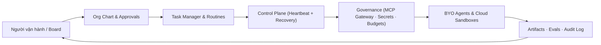

# SPEC — Phân tích, nghiên cứu chức năng và ứng dụng của Paperclip

Ngày: 2026-11-25 · Bản: 1.0 · Brief: ../brief/2026-11-24-2359-research-paperclip-features-apps.md
Soul: chất lượng > runtime > context cost · luật gốc: skills/tdq-conventions/references/soul.md
Chế độ: full · Work kind: investigate · Trạng thái: CHỜ DUYỆT

> **Tóm tắt dễ hiểu:** Paperclip là nền tảng mã nguồn mở điều phối đội ngũ tác nhân AI như một công ty thật, nhưng mã nguồn hiện rất lớn. Nghiên cứu này khảo sát sâu kho cục bộ, đối chiếu tài liệu chính thức và kiểm chứng thực tế bốn trụ cột của hệ thống. Kết quả xuất ra báo cáo hai tầng kèm bảng chấm điểm ưu tiên cho ba hướng dùng trực tiếp, học cho TDQ Workflow và dự án riêng.

## Mục lục

- 1. Mục tiêu & phạm vi
- 1b. Lộ trình
- 2. Đầu ra cụ thể
- 2b. Ranh giới module
- 2c. Luồng hoạt động & Sơ đồ kiến trúc
- 3. Cách tiếp cận & lý do
- 3b. Năng lực & công cụ
- 3c. Giải thuật & Xử lý cốt lõi
- 3d. Mental Model cho Fresher Dev
- 4. Yêu cầu bắt buộc
- 5. Ràng buộc & rủi ro
- 6. QC & Definition of Done
- 7. Câu hỏi còn mở

## 1. Mục tiêu & phạm vi

- **Mục tiêu:** Tiến hành nghiên cứu kỹ thuật dựa trên bằng chứng mã nguồn (`work_kind=investigate`) đối với kho `C:/Users/admin/Documents/paperclip` (`github.com/paperclipai/paperclip`) để lập bản đồ đầy đủ kiến trúc, danh mục chức năng thật và tiềm năng ứng dụng thực tế. Đầu ra là bộ báo cáo 2 tầng (dễ hiểu ở trên, bằng chứng `path:line` chi tiết ở dưới) kèm bảng chấm điểm ưu tiên cho 3 hướng sử dụng.
- **Trong phạm vi:**
  - Kiểm chứng toàn bộ 4 giả thuyết `H1`–`H4` bằng bằng chứng nguồn (`path:line`) trong kho local, bổ sung đối chiếu tài liệu web/GitHub chính thức khi cần kiểm tra sai lệch phiên bản.
  - Bao phủ sâu đủ 4 mặt đã chốt: (1) Kiến trúc & danh mục chức năng 4 trụ cột kèm đối chiếu code thật vs README/ROADMAP; (2) Đối chiếu & chắt lọc ý tưởng cho TDQ Workflow; (3) Đánh giá cài đặt & dùng trực tiếp thực chiến (Windows/local vs Docker/cloud, yêu cầu hạ tầng, chi phí/rủi ro); (4) Bảo mật, phân quyền & kiểm soát chi phí (Secrets per-agent, MCP Access Governance, RBAC, audit log, khóa ngân sách).
  - Kiểm tra kỹ khả năng hỗ trợ BYO Agent cho 6 công cụ ưu tiên: `Antigravity`, `Claude Code`, `Codex`, `Gemini CLI`, `OpenCode` và `OpenClaw` (phân rõ adapter gốc và hướng ghép nối tùy biến).
  - Lập bảng chấm điểm ưu tiên (Giá trị / Độ khó / Rủi ro) và phân 3 nhóm hành động (nên áp dụng ngay, cân nhắc sau, không nên học theo kèm lý do) cho cả 3 hướng ứng dụng: dùng trực tiếp, nâng cấp TDQ Workflow và áp dụng cho dự án riêng.
- **NGOÀI phạm vi (chép từ brief `### Phạm vi đã chốt`):**
  - Chỉnh sửa mã nguồn của `paperclip` hoặc `TDQ-Workflow-Antigravity` (`git diff --name-only dev -- scripts/ hooks/ plugins/ tools/ tests/` phải rỗng).
  - Cài đặt hoặc khởi chạy server Paperclip thực tế trên máy cá nhân.
  - Viết báo cáo thuần kỹ thuật khó đọc hoặc chỉ nêu tổng quan thiếu bằng chứng mã nguồn.

## 1b. Lộ trình

Chép nguyên từ brief mục `### Lộ trình`. Duyệt spec này là duyệt luôn lộ trình thực thi bên dưới.

| Bước/phase | Chạy? | Vì sao |
|---|---|---|
| `analyze` (B0 + B1 nông + phỏng vấn 2 vòng) | CÓ | Khung bất biến — đã chốt đủ 4 mặt khảo sát, 3 hướng ứng dụng, nhóm 6 agent và mức `muc_qc=full` |
| `spec` (Đặc tả nghiên cứu, miễn Archify preview) | CÓ | Khung bất biến — chốt mục tiêu, 4 giả thuyết `H1`–`H4`, đầu ra và cổng kiểm `Q1`–`Q5`; miễn preview trước duyệt theo `investigate-mode.md:13` |
| `plan` (Kế hoạch 4 shard điều tra độc lập) | CÓ | Khung bất biến — chia 4 shard đọc-chỉ (`S1`–`S4`) với `Worktree: none` và ngân sách tool rõ ràng |
| `implement` (Khảo sát sâu code local + đối chiếu web + viết báo cáo) | CÓ | Khung bất biến — đào sâu `C:/Users/admin/Documents/paperclip`, đối chiếu web chính thức khi cần, hợp nhất `evidence.jsonl` và soạn báo cáo 2 tầng |
| `qc` (`QC-I1..I4` mức `full`) | CÓ | Theo lựa chọn `4a` (`muc_qc=full`) — kiểm grounding `100%` `[EV]` và `path:line`, bác bỏ giả thuyết, nhãn độ tin cậy và `0` file code sửa |
| `qc` Red-Team độc lập (`ultra`) | BỎ | Người dùng chọn `full` (`4a`), không chọn `ultra` (`4c`) |
| `report` (Hoàn thiện MD + Archify HTML + Tailscale verify) | CÓ | Khung bất biến — xuất cặp báo cáo trực quan và hỏi commit/merge |

## 2. Đầu ra cụ thể

| # | Đầu ra | Đường dẫn/vị trí | Đo "xong" bằng |
|---|---|---|---|
| 1 | Sổ bằng chứng điều tra hợp nhất (`evidence.jsonl` + bảng đọc) | `docs/tdq/artifacts/2026-11-24-2359-research-paperclip-features-apps/evidence.jsonl` và `evidence-log.md` | `tdq_team.py evidence merge` thành công; 100% `[EV]` ID và `path:line` trích dẫn tồn tại thật trên đĩa |
| 2 | 4 shard phân tích chuyên sâu (`S1` kiến trúc & 4 trụ cột, `S2` runtime/BYO Agent/bảo mật/ngân sách, `S3` plugin/Skill Studio/eval/triển khai thực chiến, `S4` đối chiếu TDQ & chấm điểm 3 hướng ứng dụng) | `docs/tdq/artifacts/2026-11-24-2359-research-paperclip-features-apps/s{1,2,3,4}.md` | Đủ 4 file shard; mọi giả thuyết `H1`–`H4` đều có kết luận rõ cùng nhãn độ tin cậy (`Verified`/`Single-source`/`Inferred`) |
| 3 | Phụ lục tra cứu chi tiết (danh mục tính năng, ma trận 6 agent ưu tiên và bảng chấm điểm ứng dụng) | `docs/tdq/artifacts/2026-11-24-2359-research-paperclip-features-apps/feature-and-application-matrix.md` | Đủ bảng 4 trụ cột (code vs README), bảng 6 agent ưu tiên và bảng chấm điểm Giá trị/Độ khó/Rủi ro kèm 3 nhóm hành động; `doc_lint.py` exit `0` |
| 4 | Báo cáo tổng hợp 2 tầng (Markdown + Archify HTML) | `docs/tdq/reports/2026-11-24-2359-research-paperclip-features-apps.md` và `.html` | `doc_lint.py` exit `0`, `QC-I1..I4` PASS, `tdq_archify.py verify` trả `current`, Archify HTML mở HTTP `200` trên Tailscale Serve |

## 2b. Ranh giới module

BỎ — Theo `investigate-mode.md:21`, request `Work kind: investigate` không thêm hay sửa mã nguồn sản phẩm (`git diff` mã nguồn bằng `0`). Thay vào đó, công việc chia theo 4 vùng khảo sát đọc-chỉ (`S1`–`S4`) nêu ở §2.

## 2c. Luồng hoạt động & Sơ đồ kiến trúc

Miễn bản xem trước Archify HTML trước duyệt theo `investigate-mode.md:13` (`Work kind: investigate`); sơ đồ tương tác chính thức sẽ được xuất bản bằng Archify HTML ở pha `report`. Sơ đồ Mermaid khái quát khung kiến trúc 4 trụ cột của Paperclip cần kiểm chứng trong pha thực thi:

| Khía cạnh | Hiện trạng (Trước) | Đích nghiên cứu đề xuất (Sau) |
|---|---|---|
| Hiểu biết về Paperclip | Mới dừng ở mức thư mục local và tóm tắt README/ROADMAP | Có bản đồ đầy đủ 4 trụ cột đã đối chiếu trực tiếp trên mã nguồn thật, tách rõ phần hoàn chỉnh và phần thử nghiệm |
| Tương thích nhóm agent đang dùng | Chưa rõ hỗ trợ thực tế cho Antigravity, Claude Code, Codex, Gemini CLI, OpenCode, OpenClaw | Có bảng tương thích kèm cơ chế adapter cụ thể cho từng công cụ |
| Định hướng áp dụng thực tế | Chưa có tiêu chí chọn nên dùng thẳng, học kiến trúc hay bỏ qua | Có bảng chấm điểm Giá trị / Độ khó / Rủi ro và 3 nhóm hành động cho cả 3 hướng ứng dụng |

## 3. Cách tiếp cận & lý do

- **Chọn:** Điều tra thực nghiệm song song theo 4 trục đọc-chỉ độc lập (`S1`–`S4`, mỗi shard ghi chứng cứ riêng và hợp nhất vào `evidence.jsonl`), ưu tiên đọc trực tiếp mã nguồn TypeScript/React/SQL tại `C:/Users/admin/Documents/paperclip` và chỉ dùng `tavily-primary` cho các câu hỏi đối chiếu bản phát hành/tài liệu mới nhất trên web.
- **Vì:** Toàn bộ kho mã nguồn, đặc tả nội bộ (`doc/`, `docs/`), adapter và bộ test của Paperclip đã có sẵn trên máy nên kiểm chứng trực tiếp trên code cho độ chính xác cao hơn hẳn việc tóm tắt tài liệu quảng bá. Chia 4 shard độc lập giúp tránh nghẽn ngữ cảnh trên monorepo lớn và giữ tỉ lệ trích dẫn có kiểm chứng đạt `100%`.
- **Đã loại:** (1) Khởi chạy server Paperclip hay cài dependency lên máy — người dùng chọn loại trừ ở vòng 1 (`4a`); (2) Đọc tuần tự toàn bộ monorepo trong một luồng chính — dễ tràn ngữ cảnh và trộn lẫn bằng chứng giữa các mảng.

## 3b. Năng lực & công cụ

Chép nguyên từ brief mục `### Năng lực dùng được`. Với công cụ MCP `tdq-workflow-agy_tavily-primary` (nếu cần đối chiếu docs/release chính thức trên web theo `4a`), luôn kiểm kết nối trước khi gọi và tóm gọn kết quả về shard dưới `1.500` ký tự.

| Skill | Nguồn | Phán quyết | Dùng ở đâu / Lý do loại |
|---|---|---|---|
| `tdq-intake`, `tdq-conventions`, `tdq-spec`, `tdq-plan`, `tdq-build`, `tdq-status`, `tdq-setup`, `tdq-check-status`, `tdq-lean`, `tdq-checkportable` | `plugin:tdq-workflow-agy` | NỀN | Khung vận hành workflow TDQ (`full` + `investigate`) |
| Đã xét 40+ skill khác (`tdq-browser-research`, `tdq-browser-test`, Google Workspace, Gemini API, `a11y-debugging`, `generative_ui`, `plugin`…) | `user/plugin/built-in` | KHÔNG | khác lĩnh vực |

## 3c. Giải thuật & Xử lý cốt lõi

Quy trình điều tra và tổng hợp bằng chứng vận hành theo 4 bước có kiểm chứng:

- **Từng bước xử lý (Step-by-step Execution Logic):**
  1. **Bước 1 — Phân rã 4 shard đọc-chỉ (`S1`–`S4`):** Mỗi shard quét vùng tệp được giao trong `C:/Users/admin/Documents/paperclip` (bằng đọc có dải dòng, grep chính xác và kiểm tra cấu trúc export/schema), ghi nhận định kèm `path:line` vào `s{1..4}.md` và `s{1..4}.ev.jsonl`.
  2. **Bước 2 — Đối chiếu Code vs Tài liệu & Kiểm tra 6 agent:** Với mỗi tính năng được `README.md`/`ROADMAP.md` công bố, xác minh tồn tại cài đặt thật trong `server/src/`, `packages/`, `ui/src/`, `cli/src/` để phân loại `Implemented` / `Partial-Experimental` / `Planned`.
  3. **Bước 3 — Hợp nhất chứng cứ & Soạn báo cáo 2 tầng:** Chạy `tdq_team.py evidence merge` tạo `evidence.jsonl`, dựng phụ lục `feature-and-application-matrix.md` và viết báo cáo 2 tầng (`docs/tdq/reports/<slug>.md`) với phần đầu dễ hiểu, phần sau đủ bằng chứng `[EV-xxx]`.
  4. **Bước 4 — Kiểm định `QC-I1..I4` theo thứ tự `L1 → L4 → L2`:** Kiểm tự động `100%` mã `[EV]` và `path:line` tồn tại trên đĩa, đọc đối chiếu nguyên văn cho các nhận định trọng yếu, kiểm tra phản biện 4 giả thuyết và gắn nhãn độ tin cậy.
- **Độ phức tạp & ngân sách tài nguyên:**
  - Thời gian / Số bước gọi công cụ: $O(K \cdot B)$ với $K = 4$ shard song song và ngân sách $B \le 12$ lượt công cụ/shard theo Tier 2 (`investigate-mode.md:33`), dừng sớm nếu `2` truy vấn liên tiếp rỗng.
  - Không gian ngữ cảnh: $O(K)$ bản tóm tắt gọn (`<= 1.500` ký tự/shard) trả về luồng chính; toàn bộ trích đoạn chi tiết giữ trên đĩa tại `docs/tdq/artifacts/<slug>/`.
- **Các ca góc hiểm cần xử lý phòng thủ:**
  - **Lệch giữa `README`/`ROADMAP` và mã nguồn thật:** Không tin nhãn tick trong `ROADMAP.md`; mọi tính năng chỉ gắn `Verified` khi tìm thấy logic thực thi thật trong code.
  - **Lệch thời điểm bản local (`2026-11-17`) và web mới nhất:** Nếu đối chiếu web thấy thay đổi mới hơn bản clone local, ghi rõ mốc ngày và nguồn riêng thay vì trộn chung.
  - **Nhầm lẫn hỗ trợ `Antigravity`:** Kiểm tra chính xác xem `packages/adapters/` có adapter riêng cho Antigravity hay chỉ có `gemini`/`claude`/`codex`/`opencode`/`openclaw`, tránh suy diễn.

## 3d. Mental Model cho Fresher Dev

- **Ẩn dụ trực quan (Analogy):** Hãy hình dung một AI coding agent đơn lẻ (như Claude Code hay Codex) giống một **lập trình viên làm việc độc lập**, còn Paperclip đóng vai trò **bộ máy vận hành cả công ty**: có sơ đồ nhân sự ai báo cáo ai, bảng việc cần duyệt, thẻ ngân sách chi tiêu hàng tháng, kho chìa khóa bí mật cấp riêng từng người và sổ nhật ký ghi lại mọi hành động.
- **Thuật ngữ dự án (Glossary):**
  - `Control Plane`: Tầng máy chủ trung tâm (`server/`) điều phối việc giao tác vụ, gọi agent, duyệt thao tác và ghi nhật ký.
  - `Heartbeat`: Nhịp đánh thức định kỳ hoặc theo sự kiện để một agent kiểm tra việc mới, làm tiếp hoặc báo cáo tiến độ.
  - `BYO Agent Adapter`: Lớp chuyển đổi trong `packages/adapters/` giúp Paperclip điều khiển nhiều hãng agent khác nhau qua cùng giao diện.
  - `MCP Tool Gateway`: Cổng trung gian kiểm soát quyền dùng công cụ ngoài theo 3 mức `Allowed`, `Ask first` và `Off`.
  - `Bounded Run Recovery`: Cơ chế giới hạn số lần thử lại khi tác vụ lỗi, giữ nguyên người phụ trách và dừng xin người duyệt khi vượt ngưỡng.

## 4. Yêu cầu bắt buộc

- **Log service:** BỎ — Request này thuộc `work_kind=investigate`, không tạo hay sửa mã nguồn chạy được.
- **Không placeholder / không bịa chứng cứ:** Mọi khẳng định kỹ thuật về Paperclip và TDQ phải trích dẫn bằng chứng `[EV-xxx]` và `path:line` tồn tại thật trong `evidence.jsonl`; không tự chế tính năng hoặc adapter không có trong code.
- **Chuẩn trình bày dễ hiểu 2 tầng:** Báo cáo chính tuân thủ `doc_lint.py` exit `0` (bao gồm `R16` cho ô tóm tắt dễ hiểu đầu file) và kèm cặp Archify HTML đã xác minh `current`.
- **Giữ nguyên mã nguồn sản phẩm:** `0` thay đổi trong `C:/Users/admin/Documents/paperclip` và `0` thay đổi ngoài `docs/` trong `TDQ-Workflow-Antigravity`.

## 5. Ràng buộc & rủi ro

Ràng buộc kiến trúc phải giữ (chép từ `docs/kien-truc.md`):
- Không chạm bất kỳ tầng mã nguồn nào (`scripts/`, `hooks/`, `plugins/`, `tools/`, `tests/`) vì đây là yêu cầu nghiên cứu chỉ đọc (`work_kind=investigate`).
- Chỉ `scripts/tdq_state.py` được ghi trạng thái TDQ; tài liệu sinh cho người dùng viết tiếng Việt (`doc_lang=vi`).

| Rủi ro | Ảnh hưởng | Cách giảm |
|---|---|---|
| Kho `paperclip` lớn gồm 13 package + `server` + `ui` + `cli`, đọc tràn lan sẽ vượt ngữ cảnh | Bỏ sót phân hệ quan trọng hoặc đánh giá nông | Chia rõ 4 shard theo ranh giới thư mục cố định, đọc theo dải dòng có mục tiêu và hợp nhất qua `evidence.jsonl` |
| Tài liệu `README.md`/`ROADMAP.md` mô tả tham vọng rộng hơn phần đã hoàn thiện trong code | Đánh giá sai mức độ sẵn sàng để dùng trực tiếp | Bắt buộc kiểm chéo `Implemented / Partial / Planned` từ file cài đặt thật trong `server/src/` và `packages/` |
| Chưa chạy server thực tế (`4a`) nên không đo được bug runtime trên Windows trực tiếp | Có thể thiếu bằng chứng về lỗi khởi động cụ thể trên Windows | Kiểm tra các test Windows/cross-platform, script `package.json`, `cli/src/checks/` và gắn nhãn `Single-source` / `Inferred` trung thực cho phần chưa chạy sống |
| Báo cáo đầy đủ thông tin dễ trở nên dài và khó tiêu hóa | Trái yêu cầu "đầy đủ thông tin và dễ hiểu" của người dùng | Tách chặt 2 tầng: đầu báo cáo ngắn gọn trực quan kèm sơ đồ Archify HTML, bảng chi tiết đẩy xuống phần sau và phụ lục riêng |

## 6. QC & Definition of Done

Mức QC đã chốt với người dùng: **`full`** (`muc_qc=full`). Do đây là `work_kind=investigate`, áp dụng bộ kiểm `QC-I1..I4` theo `investigate-mode.md:53-58` (miễn `QC-F1` chạy test mã nguồn vì `0` file code sửa):

| # | Hạng mục kiểm | Điều kiện PASS | Đo trước | Dự phòng nếu trượt |
|---|---|---|---|---|
| Q1 | `QC-I1` Grounding tự động (`L1/L4`) | `100%` mã `[EV]` trong báo cáo và phụ lục tồn tại trong `evidence.jsonl`; `100%` dải `path:line` tồn tại thật trên đĩa; `0` placeholder | Chưa có (tạo ở `implement`) | Đối chiếu lại từng đường dẫn lỗi và cập nhật đúng dòng nguồn thật |
| Q2 | `QC-I2` Đối chiếu nguyên văn (`L2`) | Các nhận định cốt lõi về 4 trụ cột, 6 agent ưu tiên, bảo mật và ngân sách khớp nguyên văn mã nguồn `paperclip` và `TDQ-Workflow` | — | Đọc lại dòng nguồn, chỉnh nhận định hoặc hạ mức nhãn tin cậy |
| Q3 | `QC-I3` Kiểm chứng & phản biện giả thuyết `H1`–`H4` | Đủ 4 giả thuyết `H1`–`H4` có kết luận rõ ràng kèm dẫn chứng trái chiều hoặc điểm giới hạn thực tế | — | Bổ sung khảo sát hẹp trên đúng giả thuyết còn thiếu chứng cứ |
| Q4 | `QC-I4` Nhãn tin cậy & kiểm định tài liệu | Mọi phát hiện lớn có nhãn `Verified`/`Single-source`/`Inferred`; `doc_lint.py` exit `0` trên báo cáo chính và phụ lục | — | Bổ sung nhãn tin cậy, sửa câu vượt ngưỡng lint và kiểm lại |
| Q5 | Ranh giới phạm vi & Archify HTML trực quan | `git -C C:/Users/admin/Documents/paperclip status --porcelain` sạch; `git diff --name-only dev -- scripts/ hooks/ plugins/ tools/ tests/` rỗng; `tdq_archify.py verify` trả `current`; Archify HTML báo cáo đạt HTTP `200` trên Tailscale Serve | `0` file code sửa trước khi chạy | Hoàn tác thay đổi ngoài phạm vi và dựng lại Archify HTML |

**DoD:** Đủ 4 đầu ra ở §2, đạt `PASS` cả 5 cổng `Q1`–`Q5`, trình bày 2 tầng dễ hiểu kèm Archify HTML, phủ đủ 4 trụ cột + bảo mật/ngân sách + 6 agent ưu tiên + bảng chấm điểm ưu tiên (Giá trị / Độ khó / Rủi ro) với 3 nhóm hành động cho cả 3 hướng ứng dụng.

## 7. Câu hỏi còn mở

(Rỗng — toàn bộ câu hỏi đã được chốt qua 2 vòng phỏng vấn trong `docs/tdq/brief/2026-11-24-2359-research-paperclip-features-apps.md`.)
