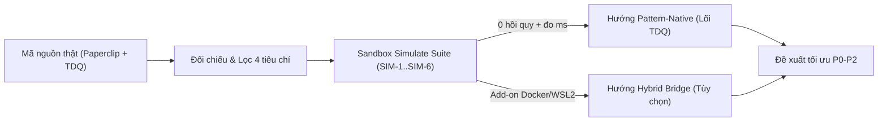

# SPEC — Nghiên cứu khả thi, simulate test và đề xuất tích hợp cơ chế Paperclip vào TDQ-Workflow

Ngày: 2026-11-25 · Bản: 1.0 · Brief: ../brief/2026-11-25-1439-paperclip-tdq-integration-sim.md
Soul: chất lượng > runtime > context cost · luật gốc: skills/tdq-conventions/references/soul.md
Chế độ: full · Work kind: investigate · Trạng thái: ĐÃ DUYỆT

> **Tóm tắt dễ hiểu:** Yêu cầu này kiểm chứng xem các cơ chế quản trị của Paperclip có giúp TDQ Workflow điều hành phase, task ổn định và xử lý đa lĩnh vực hơn không. Chúng tôi đối chiếu trực tiếp hai mã nguồn và chạy sáu kịch bản mô phỏng thực tế trong sandbox cô lập. Kết quả cho ra bản thiết kế tích hợp ba pha giữ nguyên kỷ luật chất lượng TDQ và không sửa code sản phẩm.

## Mục lục

- 1. Mục tiêu & phạm vi
- 1b. Lộ trình
- 2. Đầu ra cụ thể
- 2b. Ranh giới module
- 2c. Luồng hoạt động & Sơ đồ kiến trúc
- 3. Cách tiếp cận & lý do
- 3b. Năng lực & công cụ
- 3c. Giải thuật & Xử lý cốt lõi
- 3d. Mental Model cho Fresher Dev
- 4. Yêu cầu bắt buộc
- 5. Ràng buộc & rủi ro
- 6. QC & Definition of Done
- 7. Câu hỏi còn mở

## 1. Mục tiêu & phạm vi

- **Mục tiêu:** Đánh giá có chứng cứ mã nguồn và số liệu `simulate test` về khả năng tích hợp cơ chế Paperclip vào `TDQ-Workflow-Antigravity` nhằm làm ổn định điều hành `phase`/`task` và mở rộng xử lý đa lĩnh vực phi-code, đồng thời giữ nguyên 100% hành vi và chất lượng cốt lõi của TDQ (`5b`).
- **Trong phạm vi (`1abcd`, `2a`, `3a`, `4a`, `1a`, `2a+c`, `3a`, `4c`):**
  - Đối chiếu trực tiếp kiến trúc điều hành `phase`/`task`, lock state, hàng đợi wave, recovery, MCP policy và ngân sách giữa `TDQ-Workflow-Antigravity` và `C:/Users/admin/Documents/paperclip`.
  - Thiết kế và chạy bộ `simulate test` Python (`SIM-1`–`SIM-6`) hoàn toàn cô lập trong `docs/tdq/artifacts/<slug>/sim/` theo mô hình Baseline (hiện trạng TDQ) vs Proposed (tích hợp cơ chế Paperclip).
  - Kiểm chứng `3` nhóm lĩnh vực phi-code (`Nghiên cứu/Phân tích`, `PM/BA/Nội dung`, `Vận hành/Checklist`) song song luồng `Code Build` để xác nhận không suy giảm kỷ luật phần mềm.
  - So sánh định lượng 2 hướng (`Pattern-Native` thuần Python/Git vs `Hybrid Bridge` add-on tùy chọn qua Docker/WSL2) bằng `4` tiêu chí cứng: `0` hồi quy hook/hành vi TDQ, không ép DB server trên Windows, độ trễ thấp đo theo `ms`, và cải thiện rõ tỷ lệ tránh sự cố khi mô phỏng.
  - Đề xuất kiến trúc tích hợp tối ưu theo lộ trình `3` pha (`P0`–`P2`), ghi rõ file TDQ dự kiến chạm, hợp đồng dữ liệu mẫu và danh sách hạng mục `CẤM` sao chép.
- **NGOÀI phạm vi:**
  - Sửa đổi bất kỳ tệp nào trong `scripts/`, `hooks/`, `plugins/`, `tools/`, `tests/` của `TDQ-Workflow-Antigravity` hoặc trong `C:/Users/admin/Documents/paperclip`.
  - Cài đặt PostgreSQL/Node runtime của Paperclip hoặc chạy live Paperclip server trên máy chủ đích.

## 1b. Lộ trình

| Bước/phase | Chạy? | Vì sao |
|---|---|---|
| `analyze` (B0 + B1 nông + phỏng vấn 2 vòng) | CÓ | Khung bất biến — đã chốt đủ `4` mặt bao quanh, `3` lĩnh vực phi-code, bộ lọc `4` tiêu chí + add-on tùy chọn và `muc_qc=ultra` |
| `spec` (Đặc tả nghiên cứu + thiết kế simulate test) | CÓ | Khung bất biến — chốt giả thuyết `H1`–`H4`, `6` kịch bản `SIM-1..SIM-6`, `5` đầu ra và `6` cổng DoD; miễn preview trước duyệt theo `investigate-mode.md:13` |
| `plan` (Kế hoạch 4 shard + suite simulate test) | CÓ | Khung bất biến — phân rã shard khảo sát đối chiếu, mã mô phỏng Python sandbox và tổng hợp kiến trúc |
| `implement` (Khảo sát sâu 2 repo + chạy `SIM-1..SIM-6` + soạn báo cáo) | CÓ | Khung bất biến — thu bằng chứng `path:line` hai codebase, chạy thực nghiệm `SIM-1..SIM-6` (Baseline vs Proposed), xuất blueprint `P0`–`P2` và báo cáo `2` tầng |
| `qc` (`QC-I1..I4` mức `ultra`) | CÓ | Theo lựa chọn `4c` (`muc_qc=ultra`) — kiểm grounding `100%` bằng chứng, tái chạy `SIM-1..SIM-6`, xác minh `0` sửa code TDQ và giữ đủ hành vi lõi |
| `qc` Red-Team độc lập (`tdq-qc-tester`) | CÓ | Theo lựa chọn `4c` (`muc_qc=ultra`) — subagent độc lập phản biện mã mô phỏng, dữ liệu đo và rủi ro hồi quy TDQ |
| `report` (Báo cáo MD + Archify HTML + Tailscale verify) | CÓ | Khung bất biến — xuất báo cáo trực quan `current`, Tailscale HTTP `200` và mở cổng hỏi commit/merge |

## 2. Đầu ra cụ thể

| # | Đầu ra | Đường dẫn/vị trí | Đo "xong" bằng |
|---|---|---|---|
| 1 | Sổ bằng chứng hợp nhất (`evidence.jsonl` + bảng đọc) | `docs/tdq/artifacts/2026-11-25-1439-paperclip-tdq-integration-sim/evidence.jsonl` | `tdq_team.py evidence merge` thành công; `100%` mã ID và `path:line` tồn tại trên đĩa |
| 2 | 4 shard phân tích đối chiếu (`S1`–`S4`) | `docs/tdq/artifacts/2026-11-25-1439-paperclip-tdq-integration-sim/s{1..4}.md` | Phủ đủ điều hành `phase`/`task`, đa lĩnh vực, bảo mật/ngân sách và đối chiếu `2` hướng tích hợp |
| 3 | Bộ `simulate test` Python + kết quả đo | `docs/tdq/artifacts/2026-11-25-1439-paperclip-tdq-integration-sim/sim/run_simulations.py`, `sim-results.json`, `sim-summary.md` | Chạy qua Python stdlib exit `0`, tái lập `6/6` kịch bản `SIM-1..SIM-6` với số liệu Baseline vs Proposed |
| 4 | Bản thiết kế tích hợp tối ưu (`P0`–`P2`) | `docs/tdq/artifacts/2026-11-25-1439-paperclip-tdq-integration-sim/integration-blueprint.md` | Đủ bảng điểm 4 tiêu chí + add-on, lộ trình `P0`–`P2`, file dự kiến chạm, schema mẫu và mục `CẤM` copy; `doc_lint` exit `0` |
| 5 | Báo cáo tổng hợp 2 tầng (MD + Archify HTML + QC) | `docs/tdq/reports/2026-11-25-1439-paperclip-tdq-integration-sim.md`, `.html`, `docs/tdq/qc/<slug>.md` | `doc_lint` exit `0`, `6/6` cổng `Q1`–`Q6` PASS, Archify `current` và Tailscale HTTP `200` |

## 2b. Ranh giới module

BỎ — Theo `investigate-mode.md:21`, request `Work kind: investigate` không sửa code sản phẩm (`scripts/`, `hooks/`, `plugins/`, `tools/`, `tests/`). Mã kiểm thử mô phỏng nằm riêng trong `docs/tdq/artifacts/2026-11-25-1439-paperclip-tdq-integration-sim/sim/` theo ngoại lệ `investigate-mode.md:15`.

## 2c. Luồng hoạt động & Sơ đồ kiến trúc

Miễn bản xem trước Archify HTML trước duyệt theo `investigate-mode.md:13`; bản trực quan chính thức sẽ dựng ở pha `report`.

| Khía cạnh | Hiện trạng (Trước) | Đích sau nghiên cứu & mô phỏng (Sau) |
|---|---|---|
| Điều hành `phase`/`task` TDQ | Khóa file đơn giản theo slot wave, chưa có lease timeout chuẩn, `blockedBy` hoặc circuit breaker tự ngắt | Có số liệu chứng minh phương án thêm lease checkout, hàng đợi có chống bỏ đói, `blockedBy` và circuit breaker không phá `tdq_state.py` |
| Xử lý đa lĩnh vực | Chủ yếu xoay quanh `build` và `investigate` rời rạc | Có thiết kế Domain Pack tách rạch ròi giữa `Code Build` (giữ nguyên 6 trụ cột) và 3 nhánh phi-code |
| Lựa chọn tích hợp tối ưu | Chưa có số liệu thực nghiệm so sánh `Pattern-Native` vs `Hybrid Bridge` | Chốt kiến trúc tối ưu dựa trên kết quả chạy `SIM-1..SIM-6` và phản biện độc lập `ultra` |

## 3. Cách tiếp cận & lý do

- **Chọn:** Tam giác đối chiếu mã nguồn (`tdq_state.py`, `tdq_team.py`, `agy_stop_gate.py` bên TDQ vs `issues.ts`, `queue.ts`, `automatic-run-brake.ts`, `budgets.ts`, `teams-catalog/` bên Paperclip) kết hợp bộ `simulate test` Python stdlib trong thư mục tạm cô lập. Mỗi kịch bản đo rõ **Baseline (TDQ hiện hành)** đối đầu **Proposed (cơ chế đề xuất)** kèm ngưỡng độ trễ `ms` trên Windows. Cuối quy trình chạy `tdq-qc-tester` độc lập kiểm chứng chéo toàn bộ chứng cứ.
- **Vì:** Giữ `0` rủi ro lên code đang chạy của TDQ, chạy tái lập được 100% trên Windows bằng Python chuẩn (`0` dependency mới) và chứng minh trực tiếp bằng con số thay vì suy đoán lý thuyết.
- **Đã loại:** (1) Thử ghép trực tiếp server Node/PostgreSQL của Paperclip vào máy rồi sửa hook TDQ ngay — vi phạm ràng buộc `4a`/`5b` và làm nặng hệ thống; (2) Chỉ đọc văn bản mà không chạy mô phỏng — không kiểm chứng được tranh chấp lock, race condition hay suy giảm hành vi TDQ.

## 3b. Năng lực & công cụ

| Skill | Nguồn | Phán quyết | Dùng ở đâu / Lý do loại |
|---|---|---|---|
| `tdq-intake`, `tdq-conventions`, `tdq-spec`, `tdq-plan`, `tdq-build`, `tdq-lean`, `tdq-status`, `tdq-setup` | `plugin:tdq-workflow`, `plugin:tdq-workflow-agy` | NỀN | Quy trình nền điều hành phân tích, đặc tả, lập kế hoạch, kiểm chứng `QC-I1..I4` và báo cáo |
| Đã xét `40+` skill khác (`chrome-devtools`, `a11y-debugging`, `tdq-browser-*`, `gemini-api-*`, `gdocs`/`gsheets`/`gslides`/`gdrive`, `run-workflow`, `swarm_*`…) | `plugin`, `built-in` | KHÔNG | khác lĩnh vực |

## 3c. Giải thuật & Xử lý cốt lõi

1. **Bước 1 — Khảo sát sâu 2 codebase (`S1`–`S4`):** Thu thập chứng cứ `path:line` về cơ chế lock/wave/hook hiện tại của TDQ (`tdq_state.py`, `tdq_team.py`, `tdq_worktree_registry.py`, `agy_pretooluse_gate.py`, `agy_stop_gate.py`, `skill_router.py`) và đối chiếu với các pattern ứng viên bên Paperclip (`checkout`, 4-tier queue, `automaticRunBrakes`, `budgets.ts`, `MCP Policy`, `teams-catalog`).
2. **Bước 2 — Thiết kế & chạy bộ `simulate test` (`SIM-1`–`SIM-6`) trong `sim/run_simulations.py`:**
   - `SIM-1` (**Tranh chấp claim task & lease hết hạn**): Mô phỏng `8` worker song song tranh nhận `12` task + `2` worker treo chết giữ lock; đo số va chạm ghi đè và thời gian thu hồi lock (Baseline không lease timeout vs Proposed có atomic claim + lease TTL).
   - `SIM-2` (**Hàng đợi ưu tiên, chống bỏ đói & `blockedBy`**): Mô phỏng `20` task gồm việc khẩn từ user, task phụ thuộc `blockedBy` và `1` chuỗi subtask sâu; đo tình trạng bỏ đói task cũ và khả năng tự đánh thức đúng thứ tự khi blocker xong.
   - `SIM-3` (**Cầu dao ngắt lặp lỗi & trần ngân sách**): Mô phỏng worker gặp lỗi liên tiếp hoặc provider refusal + vượt ngưỡng token/chi phí; đo số lượt retry lãng phí và trạng thái dừng an toàn (`closed -> open -> half_open` + `hard_stop`).
   - `SIM-4` (**Bảo toàn 100% hành vi TDQ & MCP Policy/Quarantine**): Chạy đối chiếu `12` bất biến hành vi hiện có của TDQ (`Stop` Verify-by-Effect, `tdq_state` single-writer, `Chạm:` worktree scope, LSP gate, Red → Green) kèm kịch bản MCP server âm thầm thêm tool `destructive` mới để xác minh quarantine hoạt động mà không chặn sai hook TDQ.
   - `SIM-5` (**Mô phỏng đa lĩnh vực với `4` Domain Pack**): Chạy cùng lõi điều hành `phase -> plan -> qc -> report` qua `4` cấu hình (`Code Build`, `Nghiên cứu/Phân tích`, `PM/BA/Nội dung`, `Vận hành/Checklist`) để đo độ phủ cổng kiểm chứng và chứng minh nhánh `Code Build` giữ nguyên 100% kỷ luật chặt.
   - `SIM-6` (**Đo lường `Pattern-Native` vs `Hybrid Bridge` trên Windows**): Đo độ trễ `ms` thực tế của hook/CLI Python chuẩn trên thư mục tạm và tính tổng chi phí vận hành/rủi ro giữa hai mô hình để chọn phương án tối ưu.
3. **Bước 3 — Tổng hợp `integration-blueprint.md` & Báo cáo 2 tầng:** Lọc mọi ý tưởng qua ma trận 4 tiêu chí cứng + tùy chọn add-on (`2a+c`), lập lộ trình `P0`–`P2` và xuất báo cáo kèm Archify HTML.
4. **Bước 4 — Kiểm chứng `ultra` (`Q1`–`Q6`):** Xác minh 100% trích dẫn, tái chạy `run_simulations.py` trong môi trường sạch và gọi `tdq-qc-tester` phản biện độc lập.

- **Độ phức tạp & ca góc hiểm:** Với $T = 30$ task và $K = 6$ kịch bản trong mỗi đợt mô phỏng, thuật toán kiểm khóa/hàng đợi chạy trong thời gian $O(T \log T)$ và bộ nhớ $O(T)$ dùng tệp tạm cô lập `tempfile.TemporaryDirectory()`. Ca góc hiểm phải xử lý phòng thủ gồm: Windows file lock contention khi 8 thread mở cùng tệp JSON, tránh assert giả (`ANTI-2`) bằng kiểm chứng Baseline fail → Proposed pass rõ ràng, và không dùng thư viện ngoài Python stdlib.

## 3d. Mental Model cho Fresher Dev

- **Ẩn dụ:** Hãy hình dung `TDQ-Workflow` giống một **bác sĩ phẫu thuật kỹ tính** (kiểm tra cực kỹ trước khi cắt từng dòng code), còn Paperclip giống **ban điều phối bệnh viện** (biết sắp lịch phòng mổ, chia việc cho nhiều khoa, tự ngắt máy nếu kẹt và khóa chi phí). Nghiên cứu này thử nghiệm trong phòng mô phỏng xem đưa bảng điều phối bệnh viện ghép vào bác sĩ phẫu thuật có giúp làm được nhiều ca hơn mà tay nghề bác sĩ vẫn sắc nguyên vẹn hay không.
- **Thuật ngữ chính:**
  - `Atomic Claim + Lease TTL`: Cơ chế giành quyền làm việc nguyên tử kèm thời hạn giữ khóa để task tự giải phóng nếu worker chết giữa chừng.
  - `Circuit Breaker (3 pha)`: Cầu dao `closed / open / half_open` tự ngắt khi lỗi lặp vượt ngưỡng rồi thử mở hé lại an toàn.
  - `Domain Pack`: Gói cấu hình vai trò, tiêu chí `spec`/`qc` riêng cho từng lĩnh vực gắn lên trên khung lõi TDQ.
  - `Pattern-Native` vs `Hybrid Bridge`: Cách một là viết lại cơ chế gọn vào TDQ bằng Python/Git; cách hai là chạy thêm cầu nối sang server Paperclip.

## 4. Yêu cầu bắt buộc

- **Log service:** BỎ cho mã nguồn sản phẩm (không sửa code TDQ). Riêng script mô phỏng `docs/tdq/artifacts/<slug>/sim/run_simulations.py` phải ghi log có timestamp, hỗ trợ `TDQ_LOG=0` tắt log nhiễu và xuất JSON chuẩn kết quả từng kịch bản.
- **Không bịa số liệu / không placeholder:** Mọi nhận định mã nguồn đều có ID trong `evidence.jsonl`; mọi số liệu `ms`, tỷ lệ tránh va chạm, tỷ lệ tiết kiệm retry đều lấy từ stdout thật của `run_simulations.py`.
- **Không sửa code sản phẩm:** `0` diff trong `scripts/`, `hooks/`, `plugins/`, `tools/`, `tests/` và `0` thay đổi trong `C:/Users/admin/Documents/paperclip`.

## 5. Ràng buộc & rủi ro

Ràng buộc kiến trúc phải giữ (chép từ `docs/kien-truc.md` + `5b`):
- Bảo toàn 100% bất biến TDQ: `scripts/tdq_state.py` là nơi ghi duy nhất `state.json`, `scripts/` không import `hooks/`, giữ nguyên `6` trụ cột chất lượng và không làm yếu cổng `Stop` Verify-by-Effect.
- Thư mục mô phỏng `sim/` chỉ chạy trong `tempfile` / artifact cô lập, tuyệt đối không ghi đè `docs/tdq/state.json` đang chạy thật.

| Rủi ro | Ảnh hưởng | Cách giảm |
|---|---|---|
| Kịch bản mô phỏng tự viết dễ bị thiên vị cho phương án đề xuất (`confirmation bias`) | Đánh giá lạc quan sai thực tế | Mỗi `SIM-1..SIM-6` phải chạy cả trường hợp Baseline giữ tốt hơn (ví dụ độ trễ cực nhỏ hay zero-server) và để `tdq-qc-tester` phản biện độc lập |
| Trích nhầm khả năng lý thuyết thành mã đang chạy ở Paperclip hoặc TDQ | Đề xuất tích hợp gãy khi đem đi build | Đối chiếu `100%` bằng chứng qua `evidence.jsonl` + kiểm `L2` đọc nguyên văn mã nguồn cả hai repo |
| Mở rộng đa lĩnh vực làm loãng kỷ luật `build` | Vi phạm nguyên tắc bất biến `5b` của người dùng | `SIM-5` bắt buộc kiểm tra đối chứng nhánh `Code Build` giữ nguyên 100% cổng Red → Green, LSP và QC |

## 6. QC & Definition of Done

Mức QC đã chốt với người dùng: **`ultra`** (`muc_qc=ultra`). Áp dụng `QC-I1..I4` kèm thực thi tái lập `simulate test` và phản biện độc lập từ `tdq-qc-tester`:

| # | Hạng mục kiểm | Điều kiện PASS | Đo trước | Dự phòng nếu trượt |
|---|---|---|---|---|
| Q1 | `QC-I1` Grounding chứng cứ & không placeholder | `100%` ID trong `evidence.jsonl` (cả hai repo), `100%` `path:line` tồn tại trong biên dòng, `0` placeholder | Chưa có (tạo ở `implement`) | Sửa lại đường dẫn nguồn hoặc bỏ khẳng định thiếu chứng cứ |
| Q2 | `QC-I2` Đối chiếu nguyên văn mã nguồn 2 repo (`L2`) | Các điểm neo cốt lõi của Paperclip (`checkout`, `queue`, `automaticRunBrakes`, `budgets`, `MCP`, `roles`) và TDQ (`tdq_state`, `tdq_team`, `agy_stop_gate`, `edit_gate`) khớp nguyên văn | — | Đọc lại trực tiếp dòng nguồn, chỉnh sai lệch ngay |
| Q3 | Thực thi thực nghiệm `SIM-1..SIM-6` có tái lập | `py -3 -X utf8 .../sim/run_simulations.py` thoát mã `0`, sinh `sim-results.json` hợp lệ đủ `6/6` kịch bản Baseline vs Proposed không assert rỗng | — | Sửa bug kịch bản, thêm kiểm tra điều kiện thất bại thật |
| Q4 | Kết luận `H1`–`H4`, bộ lọc `2a+c` & bảo toàn `5b` | Đủ `4` giả thuyết kèm phản ví dụ, đủ lộ trình `P0`–`P2` + danh sách `CẤM` copy + so sánh `Pattern-Native` vs `Hybrid Bridge` | — | Bổ sung mặt còn thiếu trước khi xuất bản |
| Q5 | `doc_lint.py`, ranh giới `0` code diff & Archify HTML | `doc_lint.py` exit `0`; `git diff` code TDQ rỗng và `git status` `paperclip` sạch; `tdq_archify.py verify` trả `current` + Tailscale HTTP `200` | `0` file code sửa | Hoàn tác file lệch phạm vi hoặc sửa vi phạm lint/Archify |
| Q6 | QC độc lập (`tdq-qc-tester` — mức `ultra`) | Subagent `tdq-qc-tester` đọc thẳng mã `run_simulations.py`, `evidence.jsonl`, `integration-blueprint.md`, `report.md` và xác nhận `PASS` không phát hiện sai lệch hoặc gian lận mô phỏng | — | Tạo `## QC vòng N — fix` trong plan và sửa dứt điểm |

**DoD:** Đủ `5` đầu ra ở §2, `6/6` cổng `Q1`–`Q6` đạt `PASS`, trả lời rành mạch 2 câu hỏi lớn (ổn định điều hành `phase`/`task` + xử lý đa lĩnh vực không đổi chất lượng) bằng bằng chứng thật từ cả hai codebase và số liệu `SIM-1..SIM-6`.

## 7. Câu hỏi còn mở

(Rỗng — toàn bộ câu hỏi đã được chốt qua 2 vòng phỏng vấn trong `docs/tdq/brief/2026-11-25-1439-paperclip-tdq-integration-sim.md`.)
