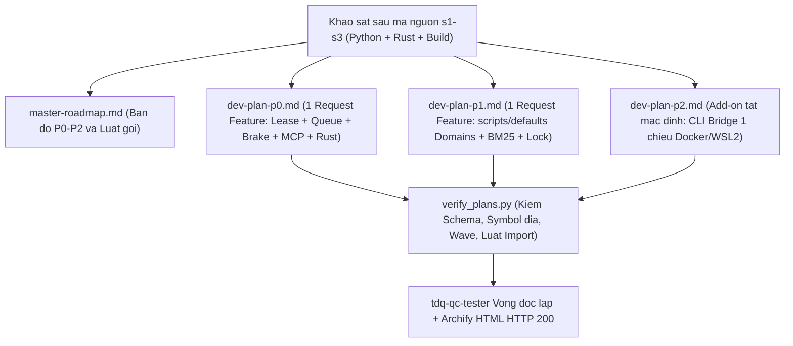

# SPEC — Phân tích kiến trúc & Bộ Development Plan chi tiết tối ưu cho 3 pha tích hợp Paperclip (P0–P2)

Ngày: 2026-11-25 · Bản: 1.0 · Brief: ../brief/2026-11-25-1633-paperclip-3phase-dev-plan.md
Soul: chất lượng > runtime > context cost · luật gốc: skills/tdq-conventions/references/soul.md
Chế độ: full · Work kind: investigate · Trạng thái: ĐÃ DUYỆT

> **Tóm tắt dễ hiểu:** Trước khi bắt tay vào sửa mã nguồn thật cho ba pha nâng cấp Paperclip, chúng tôi cần khảo sát sâu từng tệp điều hành và lập bộ kế hoạch thi công chi tiết. Bản đặc tả này chốt cấu trúc gồm một lộ trình tổng và ba bản kế hoạch riêng cho từng pha, giữ nguyên toàn bộ kỷ luật kiểm thử cũ. Kết quả giúp việc triển khai sau này chạy mượt, an toàn trên Windows và không làm vỡ bất kỳ hook hay nhánh phát hành nào.

## Mục lục

- 1. Mục tiêu & phạm vi
- 1b. Lộ trình
- 2. Đầu ra cụ thể
- 2b. Ranh giới module
- 2c. Luồng hoạt động & Sơ đồ kiến trúc
- 3. Cách tiếp cận & lý do
- 3b. Năng lực & công cụ
- 3c. Giải thuật & Xử lý cốt lõi
- 3d. Mental Model cho Fresher Dev
- 4. Yêu cầu bắt buộc
- 5. Ràng buộc & rủi ro
- 6. QC & Definition of Done
- 7. Câu hỏi còn mở

## 1. Mục tiêu & phạm vi

- **Mục tiêu:** Khảo sát sâu toàn bộ mã nguồn chạm của `TDQ-Workflow-Antigravity` (`scripts/`, `hooks/scripts/`, `hooks/rust/tdq-dispatch/`, `tools/`, `plugins/tdq-workflow-agy/`, `tests/`) để xuất bản bộ phân tích kiến trúc có bằng chứng và **bộ Development Plan chi tiết, tối ưu cho đủ cả `3` pha tích hợp Paperclip (`P0`–`P2`)**, sẵn sàng mở từng request `feature` mà vẫn bảo toàn `100%` hành vi, kỷ luật `7-rung` và cấu trúc 2 nhánh `dev`/`main`.
- **Trong phạm vi (`1abcd 2a 3a 4a 5a` + `1c 2a 3a 4a 5c`):**
  - Ba hồ sơ khảo sát mã nguồn (`s1`–`s3`) + sổ bằng chứng `evidence.jsonl` nối trực tiếp tới symbol, dòng và hợp đồng thật trên đĩa.
  - `1` Master Roadmap (`master-roadmap.md`) + `3` bản Development Plan chi tiết (`dev-plan-p0.md`, `dev-plan-p1.md`, `dev-plan-p2.md`) phủ đủ: Độ tin cậy & Song song (`O_EXCL`/`with_ntfs_lock`, Rust `lock.rs`, `blockedBy`, recovery TTL, rollback), Bảo mật & Cửa ngõ MCP (`mcp-policy.json`, SHA-256 `Changed-Tool Quarantine`, Rust `pre_tool_use.rs`), Tương thích đa host & Đóng gói (`build_agy_plugin.py`, `build_portable.py --sinh-main`, `i18n_check.py`, `TRAN_TOKEN = 3500`), và Tách wave thực thi (`TRAN_SONG_SONG = 4`, EARS, test matrix `Red -> Green`).
  - Đóng gói `P0` thành đặc tả thi công `1` request `feature` thống nhất (`1c`), dùng `scripts/defaults/` cho template mặc định + override trong `docs/tdq/` + giữ `state.json` ở `schema_version=6` (`2a`), bật chế độ cân bằng mặc định (`3a`), và thiết kế `P2` dạng cầu nối CLI một chiều (`4a`).
  - Script kiểm chứng cô lập `verify_plans.py` (stdlib Python, hỗ trợ `TDQ_LOG=1/0`) tự động xác nhận mọi đường dẫn/symbol trích dẫn tồn tại, JSON schema mẫu hợp lệ, wave không đụng file nóng và không vi phạm luật import `scripts/` ↔ `hooks/`.
- **NGOÀI phạm vi:**
  - `0` chỉnh sửa mã nguồn sản phẩm (`scripts/`, `hooks/`, `plugins/`, `tools/`, `tests/`) trong request `docs`/`investigate` này — toàn bộ thay đổi chỉ nằm dưới `docs/tdq/`.
  - KHÔNG tách `P0` thành nhiều PR rời (`1c`); KHÔNG nâng `state.json` lên `schema_version=7` (`2a`); KHÔNG mặc định khóa cứng mọi tool đọc MCP hay ép budget cap khi user chưa cấu hình (`3a`); KHÔNG dựng daemon webhook 2 chiều cho `P2` (`4a`); KHÔNG đưa 6 hạng mục bị cấm từ Paperclip (`Postgres nhúng`, `same-origin UI`, `local_trusted` Windows, `ACPX darwin-arm64`, `heartbeat poll` rỗng, hay gỡ bỏ `TCAS`/`Verify-by-Effect`) vào thiết kế.

## 1b. Lộ trình

| Bước/phase | Chạy? | Vì sao |
|---|---|---|
| Research web | BỎ | Toàn bộ mã nguồn TDQ-Workflow-Antigravity và bản thiết kế nền (`7d9c6a97`) đã có sẵn trong repo |
| Interview sâu | CÓ | Đã hoàn tất 2 vòng chốt phạm vi (`1abcd 2a 3a 4a 5a`), tách P0 (`1c`), lưu trữ (`2a`), bảo vệ (`3a`), P2 (`4a`) và `muc_qc=ultra` (`5c`) |
| Khảo sát mã nguồn sâu (`implement`) | CÓ | Chia `3` shard `s1`–`s3` đọc trực tiếp `scripts/`, `hooks/scripts/`, `hooks/rust/tdq-dispatch/`, `tools/`, `tests/` để khóa từng symbol |
| Lập bộ Development Plan + `verify_plans.py` | CÓ | Xuất `1` Master Roadmap + `3` dev plan pha (`P0`–`P2`) + script Python tự kiểm schema JSON, luật import và bất biến wave |
| QC độc lập (`tdq-qc-tester`, mức `ultra`) | CÓ | Người dùng chốt `5c` (`muc_qc=ultra`): chạy kiểm `Q1`–`Q6`, `verify_plans.py` (`TDQ_LOG=1/0`), `QC-I1..I4` và agent QC độc lập |
| Archify HTML & Tailscale | CÓ | `work_kind=investigate`: miễn preview trước duyệt spec, dựng HTML một lần ở pha `report` và xác nhận HTTP `200` |

## 2. Đầu ra cụ thể

| # | Đầu ra | Đường dẫn/vị trí | Đo "xong" bằng |
|---|---|---|---|
| 1 | `3` shard khảo sát mã nguồn sâu (`P0`+Rust, `P1`+đóng gói, `P2`+test) & sổ bằng chứng | `docs/tdq/artifacts/2026-11-25-1633-paperclip-3phase-dev-plan/{s1.md,s2.md,s3.md,evidence.jsonl,evidence-log.md}` | `100%` ID chứng cứ tồn tại, `0` vượt biên dòng trên đĩa |
| 2 | Lộ trình tổng thể & đồ thị phụ thuộc `P0`–`P2` | `docs/tdq/artifacts/2026-11-25-1633-paperclip-3phase-dev-plan/master-roadmap.md` | Có đủ bảng request/wave, bất biến `docs/kien-truc.md`, quy trình sync `main` và `6` mục CẤM copy |
| 3 | Development Plan chi tiết pha `P0` (`1` request `feature` gộp kèm parity Rust) | `docs/tdq/artifacts/2026-11-25-1633-paperclip-3phase-dev-plan/dev-plan-p0.md` | Có đủ task theo wave (`<= 4`/wave), hợp đồng `tdq_lease.py`, `tdq_state` v6, `tdq_team`, `mcp-policy.json`, `lock.rs`/`pre_tool_use.rs`, rollback & test `Red -> Green` |
| 4 | Development Plan chi tiết pha `P1` (4 `Domain Pack` + `KhoBM25`) & pha `P2` (`Bridge`) | `docs/tdq/artifacts/2026-11-25-1633-paperclip-3phase-dev-plan/{dev-plan-p1.md,dev-plan-p2.md}` | Đầy đủ hợp đồng `scripts/defaults/`, `escalate-to-build`, `TRAN_TOKEN=3500`, `i18n_check.py`, và CLI 1 chiều `P2` tắt mặc định |
| 5 | Script tự kiểm tính nhất quán bộ Development Plan (`TDQ_LOG=1/0`) | `docs/tdq/artifacts/2026-11-25-1633-paperclip-3phase-dev-plan/verify_plans.py` | Exit `0`, kiểm tự động disk symbols, JSON schema, import rule, wave overlap và không còn placeholder |
| 6 | Báo cáo tổng hợp 2 tầng, Archify HTML (`current`, HTTP `200`) & biên bản QC `ultra` | `docs/tdq/reports/2026-11-25-1633-paperclip-3phase-dev-plan.{md,html}` & `docs/tdq/qc/2026-11-25-1633-paperclip-3phase-dev-plan.md` | `doc_lint.py` exit `0`, `tdq_archify.py verify` trả `current`, `tdq-qc-tester` trả `Verdict: PASS` |

## 2b. Ranh giới module

Miễn lập bảng ranh giới sửa code cho request này theo quy chế `work_kind=investigate` (`investigate-mode.md:21`): toàn bộ tạo mới/chỉnh sửa chỉ nằm trong `docs/tdq/`, `0` file mã nguồn sản phẩm bị sửa. Ranh giới module chi tiết cho các đợt triển khai `P0`–`P2` được thiết kế đầy đủ bên trong `master-roadmap.md` và `dev-plan-p0/p1/p2.md`.

## 2c. Luồng hoạt động & Sơ đồ kiến trúc

Miễn preview HTML Trước/Sau trước cổng duyệt spec theo quy chế `work_kind=investigate` (`investigate-mode.md:13`); Archify HTML trực quan sẽ được dựng một lần ở pha `report`.

| Khía cạnh | Hiện trạng (Trước) | Thiết kế mới (Sau) |
|---|---|---|
| Tài liệu tích hợp | Mới có phác thảo ý tưởng `integration-blueprint.md` cấp cao ở `docs/` | Có trọn bộ `1` Master Roadmap + `3` Development Plan `P0`–`P2` gắn symbol thật, hợp đồng JSON/CLI, wave không đụng file nóng và kế hoạch test `Red -> Green` |
| Chuẩn kiểm tra trước khi code | Chưa kiểm khớp với `with_ntfs_lock`, Rust `tdq-dispatch`, `TRAN_TOKEN`, `i18n_check.py`, `--sinh-main` | Đã kiểm chứng tự động qua `verify_plans.py` và đối chiếu trực tiếp mã nguồn thật (`0` xung đột ẩn khi mở request `feature`) |

## 3. Cách tiếp cận & lý do

- **Chọn:**
  - Chốt `1c`: Tổ chức toàn bộ `P0` thành `1` request `feature` thống nhất có cấu trúc wave nội bộ chặt chẽ (`Wave 1`: primitive `tdq_lease` + `tdq_state` + `lock.rs`; `Wave 2`: `tdq_team` queue/blockedBy + breaker/budget; `Wave 3`: MCP Policy/Quarantine + `pre_tool_use.rs`; `Wave 4`: `build_agy_plugin.py` + `tron-bo` + parity tests) thay vì xé lẻ thành nhiều request rời.
  - Chốt `2a` + `3a` + `4a`: Đặt template mặc định trong `scripts/defaults/`, giữ `schema_version=6` cho `state.json`, mặc định bật cân bằng không chặn nhầm thao tác đọc hằng ngày, và tách `P2` thành cầu nối CLI một chiều (`tdq_paperclip_bridge.py`).
- **Vì:** Tận dụng tối đa các primitive sẵn có (`with_ntfs_lock`, `KhoBM25`, `investigate-mode`, `rust tdq-dispatch`) giúp giảm trùng lặp, giữ tốc độ `<0.5 ms` ở hook Rust và đảm bảo nhánh `main` đóng gói bởi `build_portable.py --sinh-main` luôn mang đủ template cần thiết.
- **Đã loại:** Tách `P0` 2–3 PR (`1a`/`1b` theo quyết định `1c`); nâng `state.json` lên `schema_version=7`; chặn cứng toàn bộ tool MCP đọc từ ngày đầu; dựng webhook daemon 2 chiều ở `P2`.

## 3b. Năng lực & công cụ

Phân vân → DÙNG. Kiểm kê ngày 2026-11-25: 42 skill trên đĩa (23 khớp lọc, 19 ẩn), cộng skill built-in trong context. Không xoá bảng này kể cả khi không có dòng DÙNG nào.

| Skill | Nguồn | Phán quyết | Dùng ở đâu / Lý do loại |
|---|---|---|---|
| `tdq-conventions`, `tdq-intake`, `tdq-spec`, `tdq-plan`, `tdq-build`, `tdq-setup`, `tdq-lean`, `tdq-status`, `tdq-check-status`, `tdq-checkportable`, `tdq-browser-research`, `tdq-browser-test` | `plugin:tdq-workflow` / `plugin:tdq-workflow-agy` | NỀN | Bộ khung điều phối TDQ-Workflow đang chạy cho toàn bộ request |
| Đã xét 19 skill đĩa khác + skill built-in | user/plugin/built-in | KHÔNG | khác lĩnh vực |

## 3c. Giải thuật & Xử lý cốt lõi

- **Từng bước giải thuật tổng hợp Development Plan (Step-by-step Execution Logic):**
  1. **Bước 1 (`s1`–`s3` Audit):** Ba luồng đọc chỉ phân tích toàn bộ mã nguồn chạm thật (`tdq_state.py`, `tdq_team.py`, `tdq_test.py`, `tdq_finish.py`, `skill_router.py`, `token_budget.py`, `i18n_check.py`, `build_portable.py`, `tools/build_agy_plugin.py`, `hooks/scripts/*.py`, `hooks/rust/tdq-dispatch/src/**/*.rs` cùng bộ test parity Python–Rust trong `tests/`) và ghi chứng cứ qua `tdq_team.py evidence add` + `merge`.
  2. **Bước 2 (Phân hoạch Wave & Chống File Nóng):** Gom các thay đổi theo đồ thị phụ thuộc (`scripts/` trước → `hooks/scripts/` & `hooks/rust/` sau → `skills/` & `tools/build_agy_plugin.py` → `tests/`), dùng quy tắc `TRAN_SONG_SONG <= 4`, buộc mỗi wave chỉ sở hữu tập file rời nhau hoặc có khóa tích hợp tuần tự rõ ràng cho hub `tdq_state.py`.
  3. **Bước 3 (Khóa Hợp đồng & Test Matrix):** Viết hợp đồng schema JSON (giữ `schema_version=6`), chữ ký hàm Python/Rust, cờ CLI mặc định cân bằng (`3a`), rollback trigger và danh sách test `Red -> Green` bao phủ parity Python–Rust và kiểm tra toàn diện qua `run_full_verification.py`.
  4. **Bước 4 (Kiểm chứng Tự động `verify_plans.py`):** Script phân tích AST/JSON trích xuất toàn bộ đường dẫn file, tên symbol, khối JSON hợp đồng và bảng wave trong `master-roadmap.md` + `dev-plan-p0/p1/p2.md`, xác minh đối chiếu `100%` với repo trên đĩa.
- **Độ phức tạp tính toán:**
  - Thời gian (Time Complexity): `O(F + E + W)` với `F` là số file mã nguồn kiểm tra, `E` là số bằng chứng trong `evidence.jsonl`, `W` là tổng số task/wave trong `3` dev plan.
  - Không gian (Space Complexity): `O(E + D)` lưu sổ bằng chứng JSONL và `4` tài liệu Markdown kế hoạch (~`50`–`150 KB` thuần text).
- **Các ca góc hiểm (Edge Cases & Defensive Handling):**
  - Rủi ro `1c` (1 PR `P0` quá lớn): giải bằng bắt buộc chia `4` checkpoint nội bộ tuần tự kèm feature-flag runtime trong `tdq-config.json` để tắt nhanh từng lớp nếu kiểm tra hồi quy báo lỗi.
  - Rủi ro nhánh `main` sạch (`--sinh-main`): `build_portable.py` loại bỏ `docs/`, `tests/`, nên `dev-plan-p1.md` bắt buộc đặt JSON template trong `scripts/defaults/` chứ không đọc ngược từ `docs/tdq/domains/`.
  - Rủi ro trần `TRAN_TOKEN = 3500`: `dev-plan-p1.md` chỉ thêm mục ngắn dưới `skills/*/references/` và tách bảng domain sang JSON data ngoài để `token_budget.py` và `i18n_check.py` luôn xanh.

## 3d. Mental Model cho Fresher Dev

- **Ẩn dụ trực quan (Analogy):** Bộ tài liệu này giống bản vẽ thi công chi tiết trước khi cải tạo một nhà máy đang chạy — `master-roadmap.md` là sơ đồ tổng thể các tuyến ống và nguồn điện, `dev-plan-p0/p1/p2.md` là bản vẽ kỹ thuật từng phân xưởng kèm danh sách mối hàn cần siết, còn `verify_plans.py` là máy kiểm tra xem mọi đường ống trên bản vẽ có nối đúng vào cổng thật của nhà máy hay không trước khi cắt băng thi công.
- **Thuật ngữ dự án (Glossary):**
  - `Pattern-Native`: Mang cơ chế quản trị của Paperclip viết lại bằng Python chuẩn và Rust có sẵn trong TDQ, không kéo PostgreSQL hay Node server.
  - `Rust Parity`: Yêu cầu lớp dispatcher viết bằng Rust (`hooks/rust/tdq-dispatch`) và Python (`hooks/scripts/`) trả quyết định `Allow`/`Deny` giống hệt nhau.
  - `Zero-Downgrade Lock`: Khóa tự động ép nâng từ gói phi-code (`investigate`) lên `code-build` ngay khi phát hiện sửa mã nguồn ngoài `docs/`.
  - `Runtime Defaults vs Project Overrides`: Mẫu mặc định đóng gói chung trong plugin (`scripts/defaults/`), còn cấu hình riêng của từng dự án nằm ở `docs/tdq/`.

## 4. Yêu cầu bắt buộc

- Log service: BỎ cho mã nguồn sản phẩm (`work_kind=investigate`, `0` thay đổi file chạy sản phẩm); riêng script kiểm chứng `verify_plans.py` bắt buộc bật timestamp log chuẩn qua stderr mặc định và tắt sạch (`0B`) khi `TDQ_LOG=0`.
- Không placeholder, không `TODO`/`TBD`; `eval: chưa kích hoạt (opt-in)`.
- Mỗi hạng mục trong `§2` có lệnh kiểm 1 bước rõ ràng (`verify_plans.py`, `doc_lint.py`, kiểm biên `evidence.jsonl`, `tdq_archify.py verify`).
- Mọi thiết kế đề xuất trong `dev-plan-p0/p1/p2.md` phải tuân thủ 5 nguyên tắc SOLID, 7 bậc `TDQ:GON` (`skills/tdq-build/references/rules/chung.md`) và quy tắc ngôn ngữ 3 tầng (`i18n_check.py`).

## 5. Ràng buộc & rủi ro

Ràng buộc kiến trúc phải giữ nguyên (trích từ `docs/kien-truc.md:19-118`):
- `hooks/` được gọi `scripts/`; `scripts/` **không** được import `hooks/` — áp dụng chặt cho thiết kế `tdq_lease.py`, `tdq_state.py`, `tdq_team.py`, `tdq_paperclip_bridge.py`.
- Chỉ `scripts/tdq_state.py` được ghi `docs/tdq/state.json`; giữ `schema_version=6` tương thích ngược — kiểm soát tại hợp đồng `P0` và `P2`.
- File code MỚI bắt buộc nằm trong `scripts/` hoặc `hooks/` (trừ adapter host do host quy định) — đảm bảo `.graphifyignore` nhìn thấy trọn vẹn mọi file mới ở `P0`–`P2`.
- Giữ mô hình 2 nhánh `dev` (đủ `docs/`, `tests/`) và `main` (chỉ lõi runtime qua `scripts/build_portable.py --sinh-main`) + `tools/build_agy_plugin.py` cho bundle Antigravity.
- Tuân thủ 3 tầng ngôn ngữ (`scripts/i18n_check.py`) và trần token file luật `TRAN_TOKEN = 3500` (`scripts/token_budget.py`).

| Rủi ro | Ảnh hưởng | Cách giảm |
|---|---|---|
| `1c` gom trọn `P0` vào 1 request làm hub `tdq_state.py` chạm ~98 module test | Dễ đụng hàng loạt test cũ hoặc chậm rollback nếu sai ở lớp hook | Chia `4` wave rõ trong `dev-plan-p0.md`, giữ tương thích `schema_version=6` và chạy bộ parity Python–Rust + trọn bộ kiểm thử từng mốc |
| Lệch hành vi giữa Python hooks và Rust `tdq-dispatch` | Hook Antigravity chạy Rust ra quyết định khác hook Claude/Codex | Bắt buộc thiết kế song song trong `dev-plan-p0.md` cho `lock.rs` & `pre_tool_use.rs` cùng nhóm test parity chéo |
| Nhánh `main` bị thiếu template vì `build_portable.py --sinh-main` lọc bỏ `docs/` | Cài bản phát hành lên máy mới bị lỗi thiếu `Domain Pack` hoặc `mcp-policy` | Chốt theo `2a` đặt template gốc ở `scripts/defaults/`, kiểm `build_portable.py --sinh-main --dry-run` trong kế hoạch test `P0`/`P1` |
| Nhồi thêm luật cho `P1` làm vượt trần `TRAN_TOKEN = 3500` | `tdq_finish.py` khóa token báo đỏ | Tách dữ liệu cấu hình domain sang JSON trong `scripts/defaults/`, chỉ thêm hướng dẫn ngắn trong `skills/` và đưa `token_budget.py` vào DoD của `P1` |

## 6. QC & Definition of Done

| # | Hạng mục kiểm | Điều kiện PASS | Đo trước | Dự phòng nếu trượt |
|---|---|---|---|---|
| Q1 | `QC-I1` Grounding & không placeholder | `100%` ID trong `evidence.jsonl` được trích dẫn, `100%` đường dẫn `file:line` tồn tại hợp lệ trên đĩa (`0` vượt biên), `0` `TODO`/`TBD`/placeholder | Chưa mở `evidence.jsonl` (mục tiêu `>= 20` bằng chứng, `0` lỗi biên) | Đọc lại file gốc cắt đúng khoảng dòng hợp lệ và thay toàn bộ placeholder bằng hợp đồng cụ thể |
| Q2 | `QC-I2` Đối chiếu nguyên văn `L2` | Tối thiểu `10` điểm neo mã nguồn cốt lõi (`tdq_state.py`, `_common.py`, `tdq_team.py`, `agy_pretooluse_gate.py`, `pre_tool_use.rs`, `lock.rs`, `skill_router.py`, `token_budget.py`, `build_portable.py`, `build_agy_plugin.py`) khớp nguyên văn | Đã xác nhận vị trí `7` điểm neo ở B1 nông (chưa kiểm nguyên văn cả `10`) | Mở `read_file` đúng dòng thực tế để chỉnh khớp từng chữ ký hàm/biến |
| Q3 | Script kiểm chứng `verify_plans.py` (`TDQ_LOG=1/0`) | Chạy `verify_plans.py` pass `100%` kiểm tra (`TDQ_LOG=1` in log timestamp; `TDQ_LOG=0` xuất `0B` stderr, exit `0`) xác nhận symbol tồn tại, JSON schema mẫu hợp lệ, wave không đụng file nóng và không vi phạm luật import | Chưa tạo `verify_plans.py` (mục tiêu `100%` check xanh, `0B` stderr khi `TDQ_LOG=0`) | Sửa lại JSON mẫu, wave hoặc tên symbol trong plan cho đến khi `verify_plans.py` pass |
| Q4 | Đủ quyết định kiến trúc & `6` mục CẤM copy | Kiểm tra `master-roadmap.md` + `dev-plan-p0/p1/p2.md` phủ trọn `1abcd 2a 3a 4a 5a` + `1c 2a 3a 4a 5c`, giả thuyết `H1`–`H4` và đủ `6` hạng mục CẤM copy từ Paperclip | Chưa viết `master-roadmap.md` và `dev-plan-p0/p1/p2.md` | Bổ sung từng mục thiếu vào bản plan tương ứng trước khi chốt QC |
| Q5 | Ranh giới git `0` code diff, `doc_lint.py` & Archify HTML + Tailscale | `doc_lint.py` exit `0` tất cả tài liệu mới; `git diff --name-only dev -- scripts/ hooks/ plugins/ tools/ tests/` rỗng; `tdq_archify.py verify` trả `current` (`0` diagnostics) và Tailscale trả HTTP `200` | Mới lint được `brief` (`0` lỗi), chưa có report/HTML | Giữ sạch mọi file ngoài `docs/tdq/`, sửa lỗi lint hoặc render lại Archify HTML trước khi kết thúc |
| Q6 | QC độc lập mức `ultra` (`tdq-qc-tester`) | Agent `tdq-qc-tester` đọc chéo mã nguồn thật, chạy lại `verify_plans.py` và soi toàn bộ `Q1`–`Q5`, trả `Verdict: PASS`, `DEFECTS: None` | Chưa chạy kiểm chứng `tdq-qc-tester` (mức `ultra` bắt buộc PASS) | Lập `## QC vòng N — fix` trong plan và sửa dứt điểm mọi defect rồi tái kiểm (tối đa `3` vòng) |

DoD: Đủ `6` đầu ra ở `§2`, `100%` task và `6/6` mục `Q1`–`Q6` đạt `PASS`, `tdq-qc-tester` xác nhận độc lập không khiếm khuyết, `0` thay đổi ngoài `docs/tdq/` và Archify HTML trả `current` + Tailscale HTTP `200`.

## 7. Câu hỏi còn mở

(Không có.)
