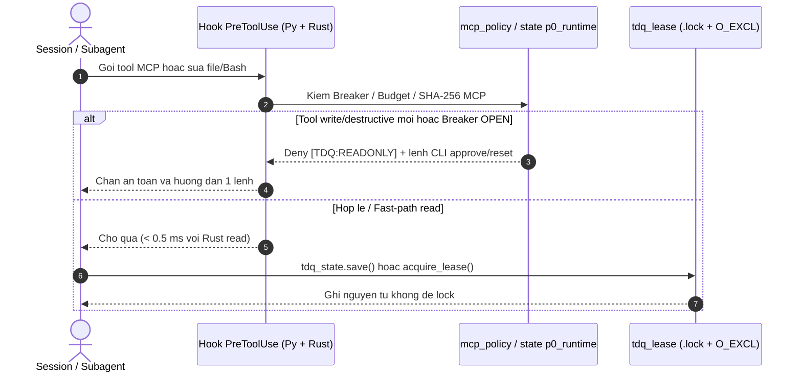

# SPEC — Triển khai Pha P0: Lõi An toàn Runtime, Khóa NTFS/Rust & Cửa ngõ MCP

Ngày: 2026-11-25 · Bản: 1.0 · Brief: ../brief/2026-11-25-1834-p0-runtime-safety-rust-parity.md
Soul: chất lượng > runtime > context cost · luật gốc: skills/tdq-conventions/references/soul.md
Chế độ: full · Loại: build · Trạng thái: CHỜ DUYỆT

> **Tóm tắt dễ hiểu:** Hiện tại hàm lưu trạng thái của TDQ thiếu khóa liên tiến trình ở ngoài hook. Hàng đợi chưa xử lý phụ thuộc động và tool ghi MCP lạ chưa được kiểm tra chữ ký trước khi chạy. Bản nâng cấp này triển khai pha đầu tiên trong một request duy nhất với bốn đợt tách file nóng, đồng bộ cả Python lẫn Rust. Kết quả giúp khóa thuê chống đè, ngắt vòng lặp lỗi, cách ly tool ghi MCP mới và hoàn nguyên tức thì bằng cờ cấu hình.

## Mục lục

- 1. Mục tiêu & phạm vi
- 1b. Lộ trình
- 2. Đầu ra cụ thể
- 2b. Ranh giới module
- 2c. Luồng hoạt động & Sơ đồ kiến trúc
- 3. Cách tiếp cận & lý do
- 3b. Năng lực & công cụ
- 3c. Giải thuật & Xử lý cốt lõi
- 3d. Mental Model cho Fresher Dev
- 4. Yêu cầu bắt buộc
- 5. Ràng buộc & rủi ro
- 6. QC & Definition of Done
- 7. Câu hỏi còn mở

## 1. Mục tiêu & phạm vi

- **Mục tiêu:** Triển khai đầy đủ pha `P0` theo [dev-plan-p0.md](file:///c:/Users/admin/Documents/Projects/TDQ-Workflow-Antigravity/docs/tdq/artifacts/2026-11-25-1633-paperclip-3phase-dev-plan/dev-plan-p0.md) và các lựa chọn `1a 2a 3a`: bổ sung khóa sidecar NTFS/POSIX + thuê tác vụ TTL (`tdq_lease.py`, `lock.rs`), bọc khóa cho `tdq_state.save()` giữ nguyên `schema_version=6`, nâng hàng đợi `tdq_team.py` (3 tầng, aging `OLDEST_DISPATCH_SHARE=4`, `blocked_by`, `idempotency_key`), gắn Circuit Breaker (`3` lỗi liên tiếp) & Budget `80%`/`hard_stop`, dựng cửa ngõ `mcp_policy.py` cân bằng (`[TDQ:READONLY]` + `approve` CLI) nối qua `lsp_gate.py`/`edit_gate.py`/`bash_gate.py` + `hooks/hooks.json` + `agy_manifests.py` + Rust `pre_tool_use.rs`, và đồng bộ đóng gói Antigravity/nhánh `main`.
- **Trong phạm vi:**
  - Bộ `4` wave nội bộ `P0-W1`–`P0-W4` thuộc `1` request `feature` duy nhất trên nhánh `feat/p0-runtime-safety-rust-parity` (tách từ `dev`).
  - Parity hoàn chỉnh Python + Rust (`hooks/rust/tdq-dispatch/src/lock.rs`, `events/pre_tool_use.rs`, build lại `tdq-dispatch.exe` và sync `plugins/tdq-workflow-agy/` qua `tools/build_agy_plugin.py`).
  - Bảo toàn trọn vẹn bộ test nền (`106` test Python và `39` test Rust), bổ sung bộ test `Red -> Green` cho từng thành phần mới và thẩm định `tdq-qc-tester` mức `ultra`.
- **NGOÀI phạm vi:**
  - KHÔNG làm `P1` (`4` Domain Packs, `KhoBM25`, `Zero-Downgrade Lock` — mở request riêng sau khi `P0` merge về `dev`).
  - KHÔNG làm `P2` (`tdq_paperclip_bridge.py` CLI 1 chiều tắt mặc định).
  - KHÔNG nâng `docs/tdq/state.json` lên `schema_version=7` và KHÔNG đổi số lượng `23` mã cổng `all_agy_codes` trong `tools/patches/gate_guidance.json`.
  - TUYỆT ĐỐI KHÔNG đưa `6` hạng mục CẤM copy từ Paperclip (Postgres nhúng, Same-Origin Vite+React UI, `local_trusted` Windows, `ACPX darwin-arm64`, heartbeat poll rỗng, bỏ `TCAS`/`Verify-by-Effect`).

## 1b. Lộ trình

| Bước/phase | Chạy? | Vì sao |
|---|---|---|
| Research web | BỎ | Toàn bộ mã nguồn TDQ-Workflow-Antigravity và `dev-plan-p0.md` đã kiểm chứng sẵn trong repo |
| Interview | CÓ | Đã hoàn tất xác nhận kỹ thuật (`1a 2a`) và chốt `muc_qc=ultra` (`3a`) |
| Spec + Archify BA preview | CÓ | `work_kind=build`: bắt buộc lập `§2b` ranh giới module và HTML preview Trước/Sau bound manifest trước cổng duyệt spec |
| Plan (`4` wave tách file nóng) | CÓ | Tổ chức `4` wave (`P0-W1`–`P0-W4`) không phụ thuộc cùng wave, `Red -> Green` từng task |
| Implement Python + Rust parity | CÓ | Nâng cấp lõi `scripts/`, hooks Python, Rust `tdq-dispatch`, sync `build_agy_plugin.py` |
| QC độc lập (`tdq-qc-tester`, mức `ultra`) | CÓ | Người dùng chốt `3a` (`muc_qc=ultra`): chạy đủ bộ test, parity, `run_full_verification.py` và `tdq-qc-tester` |
| Report + Archify HTML | CÓ | Xuất báo cáo 2 tầng kèm trang Archify HTML + Tailscale HTTP `200` trước khi hỏi merge `dev` |

## 2. Đầu ra cụ thể

| # | Đầu ra | Đường dẫn/vị trí | Đo "xong" bằng |
|---|---|---|---|
| 1 | Thư viện khóa sidecar & lease TTL (`O_EXCL` + `.lock` bền) + mẫu MCP mặc định + unit test | `scripts/tdq_lease.py`, `scripts/defaults/mcp-policy.default.json` | Kiểm tra unit tạo/gia hạn/thu hồi lease quá hạn & lock đa tiến trình pass `100%`, `TDQ_LOG=0` ra `0B` stderr |
| 2 | Cấu hình `p0` mặc định cân bằng & `3` kill-switch | `scripts/tdq_config.py` | Kiểm tra nạp `DEFAULT_CONFIG` + override `docs/tdq/config.json` & tương thích state pass `100%` |
| 3 | Sidecar lock Rust hỗ trợ lease TTL & dọn lease hết hạn | `hooks/rust/tdq-dispatch/src/lock.rs` | `cargo test --manifest-path hooks/rust/tdq-dispatch/Cargo.toml lock` exit `0` |
| 4 | Hub `tdq_state` v6 (`p0_runtime` additive + bọc `save()` bằng sidecar lock) | `scripts/tdq_state.py` | Kiểm tra hợp đồng `schema_version=6` cũ/mới và bài test ghi đồng thời NTFS `8x40` pass `100%` |
| 5 | Hàng đợi 3 tầng + aging `4` + `blocked_by` + `idempotency_key` & unit test | `scripts/tdq_team.py` | Kiểm tra xếp hạng 3 tầng, luân chuyển aging, chặn `blocked_by` & chống trùng `idempotency_key` pass `100%` |
| 6 | Bộ đếm ngân sách mềm `80%` / `hard_stop` (chỉ cứng khi khai trần) & unit test | `scripts/tdq_timing.py` | Kiểm tra cảnh báo `80%`, `hard_stop` khi khai trần và cho qua khi để `null` pass `100%` |
| 7 | Chính sách MCP cân bằng, SHA-256 quarantine & CLI `approve` + unit test | `scripts/mcp_policy.py` | Kiểm tra allow `read`/`tdq-lsp`, chặn `write`/`destructive` mới mã `READONLY`, mở khóa qua `approve` pass `100%` và `TDQ_LOG=0` ra `0B` |
| 8 | Hook Python `lsp_gate`/`edit_gate`/`bash_gate` & matcher non-LSP MCP | `hooks/scripts/{lsp_gate,edit_gate,bash_gate}.py`, `hooks/hooks.json`, `tools/patches/agy_manifests.py` | Kiểm tra mở matcher non-LSP, chặn Breaker/MCP đồng bộ Python–Rust pass `100%` |
| 9 | Hook Rust `pre_tool_use.rs` parity (`[TDQ:READONLY]` + breaker/budget) & nhị phân | `hooks/rust/tdq-dispatch/src/events/pre_tool_use.rs`, `plugins/tdq-workflow-agy/` | `cargo test` + `py -3 -X utf8 tools/build_agy_plugin.py` + kiểm danh sách module `main` + parity Python–Rust + `tools/run_full_verification.py` exit `0` |

## 2b. Ranh giới module

Xây dựng từ đối chiếu Rust LSP (`find_references` trên `command_parser.rs:417` và `pre_tool_use.rs:723`), AST Python và kiểm tra `tools/patches/agy_hooks.py`:

| Module | Vùng file | Phụ thuộc module | Đầu ra §2 nào |
|---|---|---|---|
| `lease-core` | `scripts/tdq_lease.py`, `scripts/defaults/mcp-policy.default.json` | không | 1 |
| `config-p0` | `scripts/tdq_config.py` | không | 2 |
| `rust-lock` | `hooks/rust/tdq-dispatch/src/lock.rs` | không | 3 |
| `state-v6` | `scripts/tdq_state.py` | `lease-core`, `config-p0` | 4 |
| `team-queue` | `scripts/tdq_team.py` | `lease-core`, `state-v6` (`chia_dot` từ API sẵn) | 5 |
| `timing-budget` | `scripts/tdq_timing.py` | `config-p0` | 6 |
| `mcp-policy` | `scripts/mcp_policy.py` | `lease-core`, `config-p0` | 7 |
| `python-hooks` | `hooks/scripts/{lsp_gate,edit_gate,bash_gate}.py` | `state-v6`, `timing-budget`, `mcp-policy` | 8 |
| `host-manifests` | `hooks/hooks.json`, `tools/patches/agy_manifests.py` | `mcp-policy` | 8 |
| `rust-pretool` | `hooks/rust/tdq-dispatch/src/events/pre_tool_use.rs` | `rust-lock`, `mcp-policy` (đọc policy JSON tĩnh) | 9 |
| `agy-bundle` | `plugins/tdq-workflow-agy/` (biên dịch bởi `tools/build_agy_plugin.py`) | `lease-core`, `mcp-policy`, `python-hooks`, `host-manifests`, `rust-pretool` | 9 |

## 2c. Luồng hoạt động & Sơ đồ kiến trúc

HTML preview Trước/Sau trực quan: [2026-11-25-1834-p0-runtime-safety-rust-parity-preview.html](file:///c:/Users/admin/Documents/Projects/TDQ-Workflow-Antigravity/docs/tdq/spec/2026-11-25-1834-p0-runtime-safety-rust-parity-preview.html).

| Khía cạnh | Hiện trạng (Trước) | Thiết kế mới (Sau) |
|---|---|---|
| Ghi state & khóa tác vụ | `tdq_state.save()` ghi đè trực tiếp kèm cảnh báo `"overwriting anyway"`, chưa có lease TTL cho tác vụ | `tdq_lease.acquire_sidecar_lock()` giữ neo `.lock` bền đồng bộ `lock.rs` trước `os.replace`, kèm `O_EXCL` TTL lease trong `docs/tdq/leases/` |
| Hàng đợi & dừng mạch lỗi | `tdq_team.chia_dot()` xếp tuyến tính, chưa có aging, `blocked_by`, Circuit Breaker hay ngân sách | Hàng đợi 3 tầng (`OLDEST_DISPATCH_SHARE=4`), `blocked_by`, `idempotency_key`, nhánh `p0_runtime` v6 chặn khi `breaker.open` hoặc vượt trần user đặt |
| Cửa ngõ MCP & Parity | `hooks.json:76` và `agy_manifests.py:72` bỏ lọt non-LSP MCP; `lsp_gate.py` thoát `0` khi `op is None`; `agy_pretooluse_gate.py` bị loại khỏi AGY | Mở rộng matcher non-LSP, nối `mcp_policy.evaluate_tool_call()` vào `lsp_gate.py:main()` & Rust `handle_mcp_tool`, chặn tool ghi mới bằng `[TDQ:READONLY]` + `approve` CLI, giữ tròn `23` mã AGY |

## 3. Cách tiếp cận & lý do

- **Chọn:**
  - Dùng `scripts/tdq_lease.py` thuần stdlib (`os`/`msvcrt`/`fcntl`) giữ anchor `.lock` trên đĩa không unlink sau unlock (đối xứng `hooks/rust/tdq-dispatch/src/lock.rs`), để giữ bất biến `scripts/` không import `hooks/`.
  - Móc `mcp_policy.evaluate_tool_call()` vào nhánh `op is None` trong `lsp_gate.py:main()`, và móc helper Circuit Breaker/Budget sau đoạn kiểm `load(cwd)` trong `edit_gate.py` và `bash_gate.py` để giữ nguyên vẹn mọi neo `replace_exact` của `_patch_lsp_gate`, `_patch_bash_gate` và `_patch_edit_gate` (`tools/patches/agy_hooks.py`).
  - Dùng lại mã cứng sẵn có `[TDQ:READONLY]` ở cả Python lẫn Rust `handle_mcp_tool()` cho tool `write`/`destructive` bị quarantine và Circuit Breaker đang mở (kèm hướng dẫn lệnh CLI `approve`/`reset`), không thêm mã thứ `24` vào `all_agy_codes`.
- **Vì:** Giữ nguyên `100%` tốc độ fast-path Rust `< 0.5 ms` cho mọi tool đọc và bộ `tdq-lsp`, tránh gãy bản build Antigravity trong `tools/build_agy_plugin.py`, không làm vỡ nhánh `main` sạch (`la_duong_dan_release` tự giữ `scripts/defaults/`).
- **Đã loại:**
  - Đặt rào `P0` vào `agy_pretooluse_gate.py` — loại vì `tools/patches/common_utils.py:26` exclude tệp này khi đóng gói Antigravity.
  - Chế độ `warn-only` ở MCP Quarantine (`1b`) hoặc chỉ kiểm Breaker ở tầng chia wave (`2b`) — loại theo quyết định `1a 2a`.
  - Nâng `state.json` lên `schema_version=7` — loại theo quyết định `2a` (`master-roadmap.md`).

## 3b. Năng lực & công cụ

Phân vân → DÙNG. Kiểm kê ngày 2026-11-25: 42 skill trên đĩa (23 khớp lọc, 19 ẩn), cộng skill built-in trong context. Không xoá bảng này kể cả khi không có dòng DÙNG nào.

| Skill | Nguồn | Phán quyết | Dùng ở đâu / Lý do loại |
|---|---|---|---|
| `tdq-conventions`, `tdq-intake`, `tdq-spec`, `tdq-plan`, `tdq-build`, `tdq-setup`, `tdq-lean`, `tdq-status`, `tdq-check-status`, `tdq-checkportable` | `plugin:tdq-workflow` / `plugin:tdq-workflow-agy` | NỀN | Bộ khung điều phối cho request `feature` `P0` trên nhánh `feat/p0-runtime-safety-rust-parity` |
| Đã xét 19 skill đĩa khác + skill built-in (`frontend-design`, `illustrator-preflight`, ...) | user/plugin/built-in | KHÔNG | khác lĩnh vực |

## 3c. Giải thuật & Xử lý cốt lõi

- **Từng bước giải thuật (Step-by-step Execution Logic):**
  1. **Bước 1 (`tdq_lease.py` & `lock.rs`):** Tạo `<target>.lock` bằng `OpenOptions::create(true)` (Rust) hoặc mở tệp bền (Python) rồi khóa byte-range (`msvcrt.locking` `LK_NBLCK` trên Windows, `fcntl.flock` trên POSIX) với backoff có giới hạn; tuyệt đối không unlink `.lock` sau khi nhả khóa. Quản lý thuê tác vụ `docs/tdq/leases/<lease_id>.json` qua `os.O_CREAT | os.O_EXCL`, kèm `renew_lease()` và `release_or_reclaim()` thu hồi lease quá `expires_at`.
  2. **Bước 2 (`tdq_state.py`, `tdq_team.py`, `tdq_timing.py`):** `tdq_state.save()` lấy sidecar lock của `state.json` trước khi ghi tạm + `os.replace()`; `default_state()` & `load()` điền mặc định tùy chọn `p0_runtime: {breaker, budget, quarantined_tools}` giữ `schema_version=6`. `tdq_team.py` bổ sung `prioritize_tasks()` 3 tầng (`high`/`normal`/`low`) xen 1 tác vụ chờ lâu sau mỗi `OLDEST_DISPATCH_SHARE=4` lượt thường và `dispatch_ready_waves()` lọc `blocked_by` + `idempotency_key` trước `chia_dot()`. `tdq_timing.py` tính `check_budget_status()` từ `telemetry.jsonl` (trả `soft_warn` ở `>= 80%`, `hard_stop` ở `>= 100%` CHỈ khi `budget_caps` khác `null`).
  3. **Bước 3 (`mcp_policy.py` + Hooks Python/Rust):** Tính SHA-256 canonical schema của tool MCP; nạp policy theo thứ tự `docs/tdq/mcp-policy.json` (project) > `scripts/defaults/mcp-policy.default.json` (bundle). Trong chế độ `balanced`: mọi `tdq-lsp`, `trusted_servers`, và tool phân loại `read` đi thẳng; nếu là tool `write`/`destructive` chưa có trong baseline hoặc đổi SHA-256, `evaluate_tool_call()` trả `deny` mã `READONLY` kèm lệnh `py -3 scripts/mcp_policy.py approve <server> <tool>`. Ở Rust `handle_mcp_tool()`: đọc nhanh policy JSON cho non-LSP MCP, allow nhanh trong `< 0.5 ms` với tool đọc/đã duyệt, và chặn `READONLY` khi tool ghi mới hoặc `p0_runtime.breaker.open` / `budget.hard_stopped` bật.
- **Độ phức tạp tính toán:**
  - Thời gian (Time Complexity): $O(1)$ theo chiều kích thước tool cho mỗi lần kiểm MCP/Breaker ở Rust và $O(N \log N)$ theo số tác vụ $N$ khi xếp hàng đợi `prioritize_tasks`.
  - Không gian (Space Complexity): $O(K + T)$ với $K$ số tool baseline trong `mcp-policy.json` và $T$ số lease đang hoạt động dưới `docs/tdq/leases/`.
- **Các ca góc hiểm (Edge Cases & Defensive Handling):**
  - Lease mồ côi do tiến trình crash: `expires_at` quá hạn cho phép `release_or_reclaim(..., force_expired=True)` thu hồi nguyên tử bằng sidecar lock, không kẹt vĩnh viễn.
  - Thiếu `docs/tdq/mcp-policy.json` trên repo mới hoặc nhánh `main`: rơi an toàn về `scripts/defaults/mcp-policy.default.json`; nếu file override JSON hỏng cú pháp, fail-closed chặn riêng tool `write`/`destructive` và log stderr qua `TDQ_LOG`.
  - Khóa `p0` trong `docs/tdq/config.json` tắt từng lớp (`lease_enabled`, `breaker_enabled`, `mcp_quarantine_enabled`): trả kết quả cho qua ngay mà không cần xóa dữ liệu `p0_runtime` trong `state.json`.
  - Chuỗi ASCII trong `scripts/defaults/mcp-policy.default.json`: giữ `100%` tiếng Anh chuẩn để `scripts/i18n_check.py` luôn xanh trên cả file JSON.

## 3d. Mental Model cho Fresher Dev

- **Ẩn dụ trực quan:** Tưởng tượng TDQ là xưởng cơ khí có nhiều thợ cùng vào kho lấy vật tư: `tdq_lease` là thẻ ổ khóa treo cố định trên cửa kho (dùng xong khóa trả chìa nhưng giữ nguyên ổ trên cửa để người sau không bóc mất ổ), `tdq_team` là bảng xếp lịch nhường việc lâu ngày và chờ đủ linh kiện mới mở ca, `Circuit Breaker` giống cầu dao tự ngắt sau ba lần chập điện liên tiếp, còn `mcp_policy` là bảo vệ cổng xưởng chỉ mở kiểm tra khi thấy máy hàn mới lạ đi vào chứ không làm chậm người chỉ vào đọc bản vẽ.
- **Thuật ngữ dự án:**
  - `Sidecar Anchor Lock`: File `<path>.lock` nằm cố định cạnh file dữ liệu chính, chỉ mở khóa byte OS chứ không xóa file `.lock` để tránh race trên NTFS.
  - `Balanced Quarantine`: Chế độ bảo vệ MCP không chặn thao tác đọc hằng ngày, chỉ khóa tool ghi/xóa mới xuất hiện hoặc bị đổi schema cho tới khi chạy lệnh `approve`.
  - `Kill-Switch Config`: Các cờ bật/tắt độc lập trong `docs/tdq/config.json` cho phép tắt nhanh từng rào `P0` mà không đụng mã nguồn.
  - `Rust Parity`: Yêu cầu `tdq-dispatch.exe` (Rust) và bộ hook Python trả quyết định Allow/Deny cùng mã cổng giống hệt nhau.

## 4. Yêu cầu bắt buộc

- **Log service bật mặc định:** Mọi module mới hoặc sửa đổi (`tdq_lease.py`, `mcp_policy.py`, `tdq_state.py`, `tdq_team.py`, `tdq_timing.py`) in log có ISO timestamp trên `stderr` mặc định (`TDQ_LOG=1`) và xuất đúng `0B` `stderr` khi `TDQ_LOG=0`.
- **Không placeholder, không bỏ trống stub; eval chưa kích hoạt (opt-in):** Chỉ chạy các bộ test thực dụng `Red -> Green`, không thêm test/placeholder giả.
- **Mỗi thành phần có unit test riêng chạy bằng 1 lệnh:** Có unit test cô lập cho khóa thuê, hàng đợi, ngân sách, chính sách MCP, kiểm Rust và nhóm kiểm hiện hữu.
- **Bám 5 nguyên tắc SOLID, 7 bậc `TDQ:GON` và rule ngôn ngữ:** Từng hàm Python `<= 50` dòng, `ruff check` sạch và `scripts/i18n_check.py` exit `0`.

## 5. Ràng buộc & rủi ro

Ràng buộc kiến trúc phải giữ từ [docs/kien-truc.md](file:///c:/Users/admin/Documents/Projects/TDQ-Workflow-Antigravity/docs/kien-truc.md):
- `hooks/` được gọi `scripts/`; `scripts/` **không** được import `hooks/` — `tdq_lease.py`, `mcp_policy.py`, `tdq_state.py`, `tdq_team.py`, `tdq_timing.py` giữ `0` import từ `hooks/`.
- Chỉ `scripts/tdq_state.py` được ghi `docs/tdq/state.json` — mọi hook và CLI đọc/cập nhật trạng thái đi qua API/CLI của `tdq_state.py`, giữ nguyên `schema_version=6`.
- File code MỚI bắt buộc đặt trong `scripts/` hoặc `hooks/` để `graphify`, `token_budget.py` và `build_agy_plugin.py` nhận diện đúng.
- Giữ đồng bộ `dev` và nhánh `main` (`build_portable.py --sinh-main`) + bundle Antigravity (`tools/build_agy_plugin.py`), giữ nguyên trần `TRAN_TOKEN = 3500` và `i18n_check.py`.

| Rủi ro | Ảnh hưởng | Cách giảm |
|---|---|---|
| Chỉnh `lsp_gate.py`/`edit_gate.py`/`bash_gate.py` làm gãy `replace_exact` trong `tools/patches/agy_hooks.py` | `build_agy_plugin.py` báo lỗi không patch được bundle AGY | Chỉ chèn sau điểm neo đã đọc trong `agy_hooks.py` và chạy `tools/build_agy_plugin.py` ngay ở `P0-W4` |
| Thêm mã cổng mới làm lệch giới hạn `23` mã cổng của bộ kiểm parity Python–Rust | Bộ kiểm parity Python–Rust gãy ngay lập tức | Tái dụng mã `READONLY` trong `all_agy_codes`, kèm lệnh CLI 1 bước rõ ràng trong thông báo deny |
| Sửa hub `tdq_state.py` gây hồi quy trên nhiều suite test | Gãy vòng đời `init`/`set`/`approve`/`pause`/NTFS lock | Giữ nguyên `schema_version=6`, field mới tùy chọn, giữ tương thích state cũ và bài test NTFS đa tiến trình |
| Quên cập nhật danh sách module runtime được duyệt (`APPROVED_RUNTIME_MODULES`) khi thêm `tdq_lease.py` & `mcp_policy.py` | Kiểm tra đóng gói nhánh `main` báo thiếu module được duyệt | Khai báo cả hai module vào danh sách module runtime nhánh `main` tại `P0-W3` và chạy `--sinh-main --dry-run` |

## 6. QC & Definition of Done

| # | Hạng mục kiểm | Điều kiện PASS | Đo trước | Dự phòng nếu trượt |
|---|---|---|---|---|
| Q1 | Unit test mới (`P0-W1`–`W2`) & Log service `TDQ_LOG=1/0` | Bốn nhóm kiểm mới (`lease`, `queue`, `budget`, `mcp_policy`) tạo đỏ trước → xanh sau, `TDQ_LOG=0` ra `0B` stderr | Chưa có `4` nhóm kiểm mới này (`0` ca) | Sửa riêng từng module thất bại và chạy lại bài kiểm tương ứng |
| Q2 | Khóa NTFS, tương thích `schema_version=6` & `tdq_state` | Toàn bộ kiểm tra state & ghi đồng thời NTFS `8x40` pass `100%`, không làm hỏng dữ liệu `state.json` cũ | Baseline `dev` pass (thuộc cụm `106` test Python PASS) | Bọc rollback tương thích ngược trong `load()` / kiểm sidecar `.lock` |
| Q3 | Rust unit tests & Parity Python ↔ Rust (`23` codes) | `cargo build --release` + `cargo test` + bộ parity Python–Rust pass `100%`, non-LSP MCP `write` chặn đồng bộ `READONLY`, tool đọc allow | Baseline Rust `39/39` PASS (`35+4`); parity thuộc cụm `106` test PASS | Đối chiếu quyết định lệch giữa Rust `pre_tool_use.rs` và Python `lsp_gate.py`/`edit_gate.py`/`bash_gate.py` |
| Q4 | Đóng gói đa host (`build_agy_plugin.py`, `main` dry-run, `i18n`, `token`) | `tools/build_agy_plugin.py` exit `0`, kiểm tra đóng gói portable PASS, `--sinh-main --dry-run` mang đủ `scripts/defaults/`, `i18n_check.py` & `token_budget.py` exit `0` | Đóng gói `dev` pass (cụm `106` test); chưa chứa `tdq_lease`/`mcp_policy` | Cập nhật `APPROVED_RUNTIME_MODULES` hoặc sửa chuỗi ASCII trong `defaults/` / `agy_hooks.py` |
| Q5 | Hồi quy toàn dự án & kiến trúc sạch | `tools/run_full_verification.py`, `scripts/tdq_test.py tron-bo` và `ruff check` trên các file Python chạm exit `0`; `0` import ngược `scripts/` → `hooks/` | Chưa chạy trên thay đổi `P0` mới | Khoanh vùng file hỏng bằng `tdq-debugger` và vá tối đa `3` vòng fix |
| Q6 | Thẩm định độc lập `ultra` (`tdq-qc-tester`) | Agent `tdq-qc-tester` đọc chéo code Python/Rust mới, chạy kiểm `Q1`–`Q5` độc lập, trả `Verdict: PASS`, `DEFECTS: None` | Chưa chạy QC `ultra` | Mở `## QC vòng N — fix`, khắc phục dứt điểm và tái kiểm |
| Q7 | Báo cáo, working log & Archify HTML (`current`, HTTP `200`) | Đủ working log, tick `[x]` plan, `doc_lint.py` exit `0`, `tdq_archify.py verify` trả `status=current`, Tailscale trả HTTP `200` | Chưa có report `P0` | Re-render Archify HTML ngay sau sửa cuối của `report.md` |

DoD: Đủ `9` nhóm đầu ra ở `§2`, toàn bộ `Q1`–`Q7` đạt `PASS`, `tdq-qc-tester` ký xác nhận `Verdict: PASS` (`DEFECTS: None`), bản build `plugins/tdq-workflow-agy/` được đồng bộ đầy đủ và `tdq_archify.py verify` xác nhận `status=current`.

## 7. Câu hỏi còn mở

(Không có.)
<!-- tdq-archify-binding:start -->
<!-- manifest: 2026-11-25-1834-p0-runtime-safety-rust-parity-preview.manifest.json -->
<!-- manifest_digest: da26843239c2747734f4db9ee8b1cd3c3e6277aaab62e24abb8371a2e66a7854 -->
<!-- tdq-archify-binding:end -->