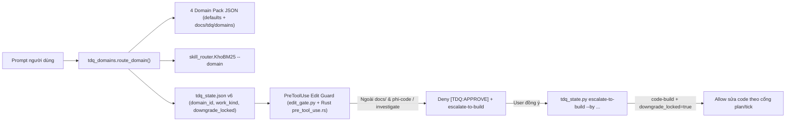

# SPEC — Triển khai Pha P1: Bộ 4 Domain Pack, KhoBM25 và Khóa Chống Hạ Cấp

Ngày: 2026-11-26 · Bản: 1.0 · Brief: ../brief/2026-11-26-0210-p1-domain-packs-bm25.md
Soul: chất lượng > runtime > context cost · luật gốc: skills/tdq-conventions/references/soul.md
Chế độ: full · Loại: build · Trạng thái: CHỜ DUYỆT

> **Tóm tắt dễ hiểu:** Hiện tại bộ định tuyến kỹ năng BM25 vẫn tách rời và bị loại khỏi nhánh phát hành chính. Các phiên nghiên cứu cũng chưa bị khóa sửa mã nguồn tại hook sau khi duyệt kế hoạch. Nay hệ thống gom bốn gói lĩnh vực chuẩn bằng từ khóa không dấu và nối BM25 vào bước tiếp nhận. Đồng thời hook Python và Rust khóa nâng cấp một chiều sang sửa mã nguồn. Nhờ đó hệ thống giữ sạch kiểm tra ngôn ngữ, dưới trần token và đóng gói thông suốt hai nhánh.

## Mục lục

- 1. Mục tiêu & phạm vi
- 1b. Lộ trình
- 2. Đầu ra cụ thể
- 2b. Ranh giới module
- 2c. Luồng hoạt động & Sơ đồ kiến trúc
- 3. Cách tiếp cận & lý do
- 3b. Năng lực & công cụ
- 3c. Giải thuật & Xử lý cốt lõi
- 3d. Mental Model cho Fresher Dev
- 4. Yêu cầu bắt buộc
- 5. Ràng buộc & rủi ro
- 6. QC & Definition of Done
- 7. Câu hỏi còn mở

## 1. Mục tiêu & phạm vi

- **Mục tiêu:** Triển khai trọn vẹn Pha P1 theo [dev-plan-p1.md](file:///C:/Users/admin/Documents/Projects/TDQ-Workflow-Antigravity/docs/tdq/artifacts/2026-11-25-1633-paperclip-3phase-dev-plan/dev-plan-p1.md) và các quyết định đã chốt `1a 2a 3a 4a`: dựng 4 gói `Domain Pack` mặc định trong `scripts/defaults/domains/` kèm bộ nạp và định tuyến `scripts/tdq_domains.py`; nối lọc và tăng trọng số `domain_id` vào `KhoBM25` (`scripts/skill_router.py`); mở đóng gói `skill_router.py`, `tdq_domains.py` và 4 file JSON lên nhánh `main` (`scripts/build_portable.py`); bổ sung cấu hình rollback khối `p1` (`scripts/tdq_config.py`, `tdq-config.json`); khóa nâng cấp một chiều `Zero-Downgrade Lock` trên `scripts/tdq_state.py`, `hooks/scripts/edit_gate.py` và Rust `hooks/rust/tdq-dispatch/src/{storage.rs,events/pre_tool_use.rs}` (áp dụng cho cả pack có `escalate_on_code_edit=true` lẫn `work_kind=investigate`); thêm con trỏ router `<= 4` dòng vào `skills/tdq-intake/SKILL.md` và đồng bộ bundle `plugins/tdq-workflow-agy/`.
- **Trong phạm vi:**
  - Một request `feature` duy nhất trên nhánh `feat/p1-domain-packs-bm25` (tách từ `dev`) chia thành 4 wave nội bộ không trùng file nóng (`P1-W1`–`P1-W4`).
  - Parity đầy đủ Python + Rust cho `Zero-Downgrade Lock` (tái dụng mã cổng `APPROVE`, giữ tròn 23 mã AGY và `schema_version=6`), biên dịch lại `tdq-dispatch.exe` và đồng bộ `plugins/tdq-workflow-agy/` qua `tools/build_agy_plugin.py`.
  - Toàn bộ bộ test mới và hồi quy hiện hữu ở mức `muc_qc=ultra` (`tdq-qc-tester` thẩm định độc lập).
- **NGOÀI phạm vi:**
  - KHÔNG triển khai Pha P2 (`scripts/tdq_paperclip_bridge.py` và cấu hình cầu nối CLI 1 chiều).
  - KHÔNG nâng `docs/tdq/state.json` lên `schema_version=7` và KHÔNG thêm mã cổng thứ 24 vào `all_agy_codes` (`tools/patches/gate_guidance.json`).
  - KHÔNG sửa hay nhồi dữ liệu domain vào `skills/*/references/**/*.md` và KHÔNG tăng trần dòng `148` của `tdq-intake` trong `scripts/doc_lint.py`.
  - KHÔNG đưa 6 hạng mục CẤM copy từ Paperclip (Postgres nhúng, Vite+React UI cục bộ, `local_trusted`, `ACPX darwin-arm64`, heartbeat poll rỗng, bỏ `TCAS`/`Verify-by-Effect`).
  - KHÔNG tải model AI hay phụ thuộc bên ngoài (thuần Python stdlib + Rust workspace hiện có).

## 1b. Lộ trình

| Bước/phase | Chạy? | Vì sao |
|---|---|---|
| Research web ngoài | BỎ | Công việc thuần nội bộ Python stdlib + Rust `tdq-dispatch`, đã đọc đủ mã nguồn thật và `dev-plan-p1.md` |
| Interview | CÓ | Đã chốt đủ 4 câu hỏi kỹ thuật và mức kiểm chứng (`1a 2a 3a 4a`) |
| Spec + Archify BA preview | CÓ | `work_kind=build`: bắt buộc lập `§2b` ranh giới module và HTML preview Trước/Sau bound manifest trước cổng duyệt spec |
| Plan tách 4 wave không trùng file nóng | CÓ | Tuân thủ đúng phân hoạch `P1-W1`–`P1-W4` của `dev-plan-p1.md` và `tdq_team.py` |
| Implement Python + Rust parity | CÓ | Nâng cấp lõi `scripts/`, `hooks/scripts/edit_gate.py`, `skills/tdq-intake/SKILL.md`, Rust `storage.rs`/`pre_tool_use.rs`, sync `build_agy_plugin.py` |
| QC độc lập (`tdq-qc-tester`, mức `ultra`) | CÓ | Người dùng chốt `3a` (`muc_qc=ultra`): chạy đủ unit test, parity, đóng gói `main`/AGY, `tron-bo`, `run_full_verification.py` và agent QC độc lập |
| Report + Archify HTML | CÓ | Xuất báo cáo 2 tầng kèm Archify HTML `current` trước khi hỏi chốt commit và merge `dev` |

## 2. Đầu ra cụ thể

| # | Đầu ra | Đường dẫn/vị trí | Đo "xong" bằng |
|---|---|---|---|
| 1 | 4 gói `Domain Pack` JSON ASCII mặc định và thư viện nạp/định tuyến + khóa chuyển đổi domain | `scripts/defaults/domains/code-build.json`, `scripts/defaults/domains/research-rca.json`, `scripts/defaults/domains/pm-ba-content.json`, `scripts/defaults/domains/ops-checklist.json`, `scripts/tdq_domains.py` | Unit test nạp mặc định + override `docs/tdq/domains/`, khớp 4 domain cho cả tiếng Anh và tiếng Việt có dấu, kiểm `can_transition_domain()` chặn hạ cấp, `TDQ_LOG=0` ra `0B` stderr và `i18n_check.py` 0 lỗi |
| 2 | Bộ định tuyến `KhoBM25` hỗ trợ lọc/ưu tiên theo `domain_id` và cờ CLI `--domain` | `scripts/skill_router.py` | Giữ nguyên 100% kết quả chuẩn 22 prompt cũ (`>= 80%` top-5 nhóm dễ, tiếng Anh > tiếng Việt) và tăng hạng đúng `preferred_skills` khi truyền `--domain` |
| 3 | Mở đóng gói `skill_router.py`, `tdq_domains.py` và 4 file JSON domain cho nhánh `main` | `scripts/build_portable.py` | `skill_router.py` không còn trong `RELEASE_EXCLUDE_SCRIPTS`; bao đóng import nhánh `main` và dry-run giữ đủ cả 2 module cùng 4 file JSON domain |
| 4 | Cấu hình rollback khối `p1` (`domain_router_enabled`, `zero_downgrade_enabled`) | `scripts/tdq_config.py`, `tdq-config.json` | Đọc cấu hình theo thứ tự `env > docs/tdq/config.json > tdq-config.json`, đồng thời đọc fallback cờ phẳng `domain_router_enabled` nếu đặt ở top-level |
| 5 | Trạng thái v6 bổ sung `domain_id` + `downgrade_locked` và khóa cứng chống hạ cấp | `scripts/tdq_state.py` | Giữ nguyên `schema_version=6`; `escalate-to-build` cập nhật `domain_id="code-build"` + `downgrade_locked=True`; mọi nỗ lực hạ cấp `domain_id` hoặc `work_kind` về phi-code bị từ chối rõ lý do |
| 6 | Khóa sửa code ngoài `docs/` trong hook Python và con trỏ intake `<= 4` dòng | `hooks/scripts/edit_gate.py`, `skills/tdq-intake/SKILL.md` | Hook Python chặn sửa file ngoài `docs/` bằng mã `APPROVE` kèm lệnh `escalate-to-build` khi `escalate_on_code_edit=true` hoặc `work_kind=investigate`; `SKILL.md` giữ `<= 148` dòng (`0` lỗi `doc_lint.py`) và `< 24,000` bytes |
| 7 | Đồng bộ Rust `TdqState` + `Zero-Downgrade Lock` (`APPROVE`) và gói `plugins/tdq-workflow-agy/` | `hooks/rust/tdq-dispatch/src/storage.rs`, `hooks/rust/tdq-dispatch/src/events/pre_tool_use.rs`, `plugins/tdq-workflow-agy/` | Test Rust xanh 100%, parity Python–Rust trả cùng quyết định Allow/Deny `APPROVE`, giữ tròn 23 mã AGY, `build_agy_plugin.py` và kiểm chứng đóng gói Antigravity đạt 0 phát hiện lỗi |

## 2b. Ranh giới module

Xây dựng từ đối chiếu Rust LSP (`find_references` trên `TdqState` tại `storage.rs:19` trả 11 tham chiếu), Graphify query (`skill_router` → `skill_tokens`, `skill_inventory`, `tdq_state`) và kiểm tra neo `replace_exact` trong `tools/patches/agy_hooks.py`:

| Module | Vùng file | Phụ thuộc module | Đầu ra §2 nào |
|---|---|---|---|
| `domain-packs` | `scripts/defaults/domains/*.json`, `scripts/tdq_domains.py` | `config-p1`, `skill-router` (nạp `tach_tu` khi định tuyến) | 1 |
| `skill-router` | `scripts/skill_router.py` | `state-v6` (`tdq_state` log service) | 2 |
| `portable-release` | `scripts/build_portable.py` | không | 3 |
| `config-p1` | `scripts/tdq_config.py`, `tdq-config.json` | không | 4 |
| `state-v6` | `scripts/tdq_state.py` | `domain-packs` (kiểm chuyển đổi domain) | 5 |
| `intake-skill` | `skills/tdq-intake/SKILL.md` | không (chỉ nêu tên lệnh CLI) | 6 |
| `python-edit-gate` | `hooks/scripts/edit_gate.py` | `state-v6`, `config-p1`, `domain-packs` | 6 |
| `rust-dispatch` | `hooks/rust/tdq-dispatch/src/storage.rs`, `hooks/rust/tdq-dispatch/src/events/pre_tool_use.rs` | `domain-packs` (đọc tĩnh JSON pack và `config.json`) | 7 |
| `agy-bundle` | `plugins/tdq-workflow-agy/` | `domain-packs`, `skill-router`, `config-p1`, `state-v6`, `intake-skill`, `python-edit-gate`, `rust-dispatch` | 7 |

## 2c. Luồng hoạt động & Sơ đồ kiến trúc

HTML preview Trước/Sau trực quan: [2026-11-26-0210-p1-domain-packs-bm25-preview.html](file:///C:/Users/admin/Documents/Projects/TDQ-Workflow-Antigravity/docs/tdq/spec/2026-11-26-0210-p1-domain-packs-bm25-preview.html).

| Khía cạnh | Hiện trạng (Trước) | Thiết kế mới (Sau) |
|---|---|---|
| Định tuyến lĩnh vực & `KhoBM25` | `skill_router.py` nằm ở dạng nguyên mẫu rời, bị chặn bởi `RELEASE_EXCLUDE_SCRIPTS` và chưa có `Domain Pack` | 4 gói JSON ASCII chuẩn dưới `scripts/defaults/domains/` + override `docs/tdq/domains/`, `tdq_domains.py` định tuyến câu lệnh và truyền `--domain` tăng hạng kỹ năng trong `KhoBM25`, ship lên cả `main` lẫn AGY |
| Khóa chống hạ cấp (`Zero-Downgrade`) | Khi `work_kind=investigate` đã qua duyệt kế hoạch, `edit_gate.py` và Rust `pre_tool_use.rs` chưa chặn sửa code ngoài `docs/`; state chưa lưu `domain_id` hay `downgrade_locked` | `state.json` v6 lưu thêm `domain_id` và `downgrade_locked`; cả Python `edit_gate.py` và Rust `handle_edit_tool` chặn sửa ngoài `docs/` bằng `[TDQ:APPROVE]` khi `escalate_on_code_edit=true` hoặc `work_kind=investigate`, mở 1 chiều bằng `escalate-to-build` và cấm hạ ngược |
| Đóng gói, ngân sách token & rollback | Chưa có công tắc tắt router/khóa P1; `skills/tdq-intake/SKILL.md` đang ở 143/148 dòng | Khối `p1` (`domain_router_enabled`, `zero_downgrade_enabled`) trong `tdq-config.json` giúp tắt nhanh không đụng state; `SKILL.md` thêm `<= 4` dòng giữ `<= 147` dòng (`0` lỗi `doc_lint` và `TRAN_TOKEN <= 3500`) |

## 3. Cách tiếp cận & lý do

- **Chọn:**
  - Lưu 4 `Domain Pack` dưới `scripts/defaults/domains/*.json` chỉ dùng ASCII (`keywords_en` + `keywords_vi_ascii`), tận dụng hàm bỏ dấu `skill_router.bo_dau()`/`tach_tu()` để khớp 100% câu lệnh tiếng Việt có dấu mà đạt `0` lỗi `i18n_check.py`, đồng thời đi tự động qua `la_duong_dan_release` lên nhánh `main`.
  - Trong `hooks/scripts/edit_gate.py`, chèn hàm `_kiem_p1_zero_downgrade(cwd, payload, state, abs_target)` ngay sau `_kiem_p0_runtime_guard` và trước `cong_dang_cho`, giữ nguyên toàn bộ neo `replace_exact` trong `tools/patches/agy_hooks.py:_patch_edit_gate`. Trong Rust `pre_tool_use.rs:handle_edit_tool`, thêm `check_p1_zero_downgrade_guard` đối xứng đọc `TdqState.domain_id`/`work_kind` và kiểm tra pack `escalate_on_code_edit` + cờ `p1.zero_downgrade_enabled` (áp dụng cả cho `main` và trả về cùng mã `APPROVE` mà không thêm mã thứ 24).
  - Giữ ràng buộc Q18 (`hooks/` không import `skill_router.py`): `edit_gate.py` chỉ gọi `tdq_domains.should_block_code_edit()` (đọc JSON pack không import `skill_router` ở top-level), còn `tdq_domains.route_domain()` nạp `tach_tu` cục bộ khi cần tách từ.
  - Thêm đúng `<= 4` dòng con trỏ lệnh `tdq_domains.py` / `skill_router.py` vào `skills/tdq-intake/SKILL.md` để giữ tổng số dòng `<= 147` (dưới trần `148` của `doc_lint.py:63`) và không chạm bất kỳ file nào dưới `skills/*/references/**/*.md`.
- **Vì:** Giữ nguyên tốc độ hot-path Rust, không vỡ bất kỳ neo patch nào của `tools/build_agy_plugin.py`, không làm phình token luật (`TRAN_TOKEN = 3500`), không vi phạm `i18n_check.py`, và bảo đảm an toàn ngược cho cả request `work_kind=investigate` cũ.
- **Đã loại:**
  - Chỉ khóa khi state có sẵn `domain_id` (`1b`) — loại theo quyết định `1a` vì bỏ lọt các phiên `work_kind=investigate` chưa gắn `domain_id`.
  - Chỉ đặt 1 cờ phẳng duy nhất không có khối `p1` (`2b`) — loại theo quyết định `2a` để đồng bộ với khối `p0` và cho phép tắt riêng `zero_downgrade_enabled` hoặc `domain_router_enabled`.
  - Nhồi bảng mô tả 4 domain vào `skills/tdq-intake/references/*.md` — loại vì làm tăng token nạp sẵn và đụng trần `TRAN_TOKEN = 3500`.

## 3b. Năng lực & công cụ

Phân vân → DÙNG. Kiểm kê ngày 2026-11-26: 42 skill trên đĩa (23 giữ lại sau lọc, 19 ẩn), cộng skill built-in trong context. Không xoá bảng này kể cả khi không có dòng DÙNG nào.

| Skill | Nguồn | Phán quyết | Dùng ở đâu / Lý do loại |
|---|---|---|---|
| `tdq-intake`, `tdq-spec`, `tdq-plan`, `tdq-build`, `tdq-conventions`, `tdq-status`, `tdq-setup`, `tdq-lean`, `tdq-check-status`, `tdq-checkportable`, `tdq-browser-research`, `tdq-browser-test` | `plugin:tdq-workflow` / `plugin:tdq-workflow-agy` | NỀN | Khung quy trình điều phối request `feature` Pha P1 trên nhánh `feat/p1-domain-packs-bm25` |
| Đã xét 19 skill khác | user/plugin/built-in | KHÔNG | khác lĩnh vực |

## 3c. Giải thuật & Xử lý cốt lõi

- **Hợp đồng chữ ký hàm (`Contract Signatures`):**
  - `scripts/tdq_domains.py`:
    - `load_domain_packs(cwd: str) -> dict[str, dict]`
    - `route_domain(cwd: str, prompt_text: str) -> dict`
    - `can_transition_domain(current_domain: str | None, target_domain: str, packs: dict[str, dict], downgrade_locked: bool = False) -> tuple[bool, str]`
    - `should_block_code_edit(cwd: str, state: dict | None, config: dict | None = None) -> tuple[bool, str]`
  - `scripts/skill_router.py`:
    - `KhoBM25.tra(self, cau_hoi: str, k: int = TOP_K, preferred_skills: Iterable[str] | None = None) -> list[tuple[float, dict]]`
    - `tra_cuu(cau: str, ban_ghi: list[dict], domain_id: str | None = None, top_k: int = TOP_K, cwd: str | None = None) -> list[dict]`
  - `scripts/tdq_state.py`:
    - `_validate_domain_id_set(cwd: str, state: dict, raw_value: str) -> str`
    - `_cli_escalate_to_build(cwd: str, rest: list[str]) -> None` (ghi `work_kind="build"`, `domain_id="code-build"`, `downgrade_locked=True`)
  - `hooks/rust/tdq-dispatch/src/storage.rs` & `pre_tool_use.rs`:
    - `TdqState { ..., pub domain_id: Option<String>, pub downgrade_locked: Option<bool> }`
    - `check_p1_zero_downgrade_guard(workspace_root: &Path, sid: &str, state: &TdqState) -> Option<RouteOutcome>`
- **Từng bước giải thuật (Step-by-step Execution Logic):**
  1. **Bước 1 (`tdq_domains.py`):** Đọc tất cả `*.json` trong `scripts/defaults/domains/` làm lớp nền, rồi hợp nhất ghi đè từng pack theo `domain_id` từ `docs/tdq/domains/*.json` (bỏ qua file lỗi cú pháp kèm cảnh báo stderr qua `TDQ_LOG`). Khi `route_domain(cwd, prompt_text)` chạy: kiểm tra cờ `p1.domain_router_enabled` (kèm biến môi trường `TDQ_DOMAIN_ROUTER_ENABLED` và fallback khóa phẳng `domain_router_enabled`); nếu tắt trả về pack mặc định `"code-build"`. Khi bật, chuẩn hóa `prompt_text` thành chuỗi ASCII không dấu và danh sách token bằng `tach_tu` / `bo_dau`; tính điểm khớp cụm từ (`+2` cho cụm nhiều từ khớp nguyên cụm) và khớp token (`+1`) trên hợp nhất `keywords_en` + `keywords_vi_ascii`. Nếu hòa điểm hoặc tổng điểm bằng `0`, rơi an toàn về `"code-build"`.
  2. **Bước 2 (`skill_router.py`):** Giữ nguyên điểm BM25 gốc khi `domain_id` là `None` hoặc không khớp pack. Khi có `domain_id` hợp lệ, đọc danh sách `preferred_skills` từ `tdq_domains.load_domain_packs(cwd)` và nhân hệ số tăng hạng nhẹ (`1.25x` trên điểm dương, hoặc gán điểm sàn nhỏ `0.05` khi không có skill nào vượt điểm dương) để ưu tiên skill thuộc domain mà vẫn bảo toàn 100% thứ tự gốc cho query không truyền `--domain`.
  3. **Bước 3 (`tdq_state.py`, `edit_gate.py`, Rust `pre_tool_use.rs`):** `default_state()` và `load()` bổ sung tùy chọn `domain_id: None`, `downgrade_locked: False` giữ `schema_version=6`. Khi chạy `tdq_state.py set domain_id=<id>`, gọi `can_transition_domain()`: chỉ cho chuyển tự do trước khi duyệt trong pha `analyze`/`idle` khi chưa khóa; một khi `downgrade_locked=True` hoặc đang là `"code-build"` (`allow_downgrade=false`) trong request đã hoạt động sau `analyze`, từ chối mọi lệnh hạ về pack có `escalate_on_code_edit=true`. Khi chạy `escalate-to-build --by "<lời user>"`, ghi `work_kind="build"`, `domain_id="code-build"`, `downgrade_locked=True`. Ở cả Python `edit_gate.py` và Rust `pre_tool_use.rs` (`handle_edit_tool`), với mọi thao tác ghi ngoài `docs/` trong repo khi `p1.zero_downgrade_enabled=true`: nếu `state.work_kind == "investigate"` HOẶC pack của `state.domain_id` có `escalate_on_code_edit == true`, chặn ngay bằng mã sẵn có `[TDQ:APPROVE]` kèm lệnh `py -3 scripts/tdq_state.py escalate-to-build --by "<user words>"`.
- **Độ phức tạp tính toán:**
  - Thời gian (Time Complexity): $O(P \cdot K + Q)$ cho `route_domain` (với $P \approx 4$ pack, $K \le 20$ từ khóa/pack, $Q$ số token câu hỏi), $O(1)$ cho `should_block_code_edit` trên hook Python/Rust, và $O(N \cdot Q)$ cho `KhoBM25.tra` ($N$ số skill).
  - Không gian (Space Complexity): $O(P \cdot K)$ bộ nhớ cho từ điển domain pack.
- **Các ca góc hiểm (Edge Cases & Defensive Handling):**
  - Prompt mơ hồ hoặc rỗng (`""`, `"hello"`, hòa điểm giữa 2 pack): luôn rơi về `"code-build"` (fail-safe không chặn oan luồng phát triển mặc định).
  - File override `docs/tdq/domains/<bad>.json` bị lỗi JSON hoặc thiếu `domain_id`: ghi log cảnh báo stderr (`TDQ_LOG=1`), bỏ qua file lỗi và giữ nguyên pack mặc định; với kiểm tra hook `should_block_code_edit`, nếu `work_kind == "investigate"` vẫn fail-closed chặn sửa code ngoài `docs/`.
  - Request mở trước Pha P1 không có khóa `domain_id` hay `downgrade_locked` trong `state.json`: `load()` tự điền mặc định `None`/`False`, giữ `work_kind == "investigate"` vẫn được bảo vệ theo quyết định `1a`, còn `work_kind == "build"` hoạt động bình thường không hồi quy.
  - Tắt cờ rollback (`docs/tdq/config.json` đặt `p1.zero_downgrade_enabled: false` hoặc `p1.domain_router_enabled: false` hoặc top-level `domain_router_enabled: false`): trả về hành vi cũ ngay lập tức mà không đụng `state.json` v6.

## 3d. Mental Model cho Fresher Dev

- **Ẩn dụ trực quan:** Hãy hình dung quy trình TDQ như một phòng khám đa khoa: 4 `Domain Pack` là 4 bảng phân luồng khoa (Xây code, Khảo sát/Điều tra lỗi, Tài liệu sản phẩm, Vận hành phát hành), `tdq_domains.py` là nhân viên tiếp đón đọc triệu chứng trong câu yêu cầu để đưa vào đúng khoa, `KhoBM25` là tủ tra cứu dụng cụ ưu tiên bày đúng bộ dụng cụ của khoa đó lên trước, còn `Zero-Downgrade Lock` giống cửa một chiều vào phòng mổ: đang ở phòng khám nghiên cứu (`investigate` / pack phi-code) thì không được tự ý cầm dao mổ sửa code cho đến khi bệnh nhân (người dùng) ký giấy chuyển sang phòng mổ (`escalate-to-build`), và đã bước vào phòng mổ rồi thì không quay ngược xuống phòng khám trong cùng ca.
- **Thuật ngữ dự án:**
  - `Domain Pack`: File JSON mô tả một lĩnh vực công việc (từ khóa tiếng Anh, từ khóa tiếng Việt không dấu ASCII, skill ưu tiên và cờ `escalate_on_code_edit`).
  - `Zero-Downgrade Lock`: Khóa nâng cấp một chiều từ phiên phi-code/điều tra lên phiên sửa code (`code-build`), ngăn việc tự ý hạ ngược để né cổng kiểm soát code.
  - `keywords_vi_ascii`: Từ khóa tiếng Việt viết không dấu hoàn toàn bằng bảng chữ cái ASCII để đồng thời vượt qua bộ kiểm soát ngôn ngữ `i18n_check.py` và vẫn khớp câu hỏi tiếng Việt có dấu nhờ `bo_dau()`.
  - `APPROVE` (mã cổng): Mã chặn sẵn có trong 23 mã cổng Antigravity, được tái dụng cho khóa sửa code khi chưa nâng cấp để không làm lệch hợp đồng parity Python–Rust.

## 4. Yêu cầu bắt buộc

- **Log service bật mặc định:** `scripts/tdq_domains.py`, `scripts/skill_router.py`, `scripts/tdq_state.py`, `scripts/tdq_config.py` in log kèm ISO timestamp trên `stderr` khi `TDQ_LOG=1` (mặc định) và xuất đúng `0B` `stderr` khi `TDQ_LOG=0`.
- **Không placeholder, không stub rỗng; eval chưa kích hoạt (opt-in):** Mọi unit test và parity test chạy thật theo vòng `Red -> Green`.
- **Mỗi thành phần có unit test riêng chạy bằng 1 lệnh:** Có bộ test độc lập cho `tdq_domains`, `skill_router` (domain boost), `tdq_state` (v6 `domain_id` + `downgrade_locked`), `edit_gate` + Rust `pre_tool_use` parity, và đóng gói `build_portable`.
- **Clean Code & SOLID (`TDQ:GON`):** Mọi hàm mới `<= 50` dòng, `ruff check` `0` lỗi trên file mới/sửa, `i18n_check.py` `0` dòng tiếng Việt mới.

## 5. Ràng buộc & rủi ro

Ràng buộc kiến trúc phải giữ từ [docs/kien-truc.md](file:///C:/Users/admin/Documents/Projects/TDQ-Workflow-Antigravity/docs/kien-truc.md):
- `hooks/` được gọi `scripts/`; `scripts/` **không** được import `hooks/` — `tdq_domains.py`, `skill_router.py`, `tdq_state.py`, `tdq_config.py` giữ `0` import từ `hooks/`.
- Chỉ `scripts/tdq_state.py` được ghi `docs/tdq/state.json`; giữ nguyên `schema_version=6`.
- File code MỚI bắt buộc đặt trong `scripts/` (`scripts/tdq_domains.py`) hoặc `hooks/` để Graphify và bộ đóng gói tự nhận diện; mẫu mặc định đặt tại `scripts/defaults/domains/`.
- Không có model mới, không tải gói ngoài; mọi thành phần dùng thuần Python 3.11+ stdlib và Rust workspace sẵn có.

| Rủi ro | Ảnh hưởng | Cách giảm |
|---|---|---|
| Thêm quá 5 dòng vào `skills/tdq-intake/SKILL.md` vượt trần `148` dòng của `doc_lint.py:63` | `doc_lint.py` và kiểm tra hình dạng skill báo đỏ | Giới hạn đúng `<= 4` dòng trỏ CLI vào `skills/tdq-intake/SKILL.md` (tổng `<= 147` dòng) và chạy `doc_lint.py` ngay |
| Quên 1 trong 3 vị trí trong kiểm tra đóng gói `main` (`APPROVED_RUNTIME_MODULES`, `APPROVED_RELEASE_DOCS`, `bi_loai` ở dòng 570) | Kiểm tra đóng gói nhánh `main` báo trượt ngân sách release hoặc báo lỗi `skill_router.py` | Cập nhật đồng thời cả 3 vị trí trong cùng task `P1-W2` và kiểm chứng bằng `--sinh-main --dry-run` |
| Chèn khóa `Zero-Downgrade` trong `hooks/scripts/edit_gate.py` làm gãy neo `replace_exact` của `tools/patches/agy_hooks.py` | `tools/build_agy_plugin.py` lỗi khi sinh bundle Antigravity | Chèn sau `_kiem_p0_runtime_guard` không sửa dòng neo của `_patch_edit_gate` và chạy `build_agy_plugin.py` ngay ở `P1-W4` |
| Khóa `work_kind=investigate` trong `edit_gate.py` / Rust `pre_tool_use.rs` vô tình chặn ghi shard trong `docs/tdq/artifacts/` hoặc làm lệch test cũ | Hồi quy luồng `investigate` hiện hữu | Chỉ kích hoạt khóa với đường dẫn nằm NGOÀI `docs/`; giữ nguyên ngoại lệ ghi `docs/**` và chạy toàn bộ bộ kiểm tra luồng điều tra |

## 6. QC & Definition of Done

| # | Hạng mục kiểm | Điều kiện PASS | Đo trước | Dự phòng nếu trượt |
|---|---|---|---|---|
| Q1 | 4 `Domain Pack` JSON, `tdq_domains.py` & `TDQ_LOG=1/0` | Nạp đủ 4 pack mặc định + override `docs/tdq/domains/`, khớp đúng 4 lĩnh vực cho cả tiếng Anh lẫn tiếng Việt có dấu, chặn hạ cấp từ `code-build`, `TDQ_LOG=0` ra `0B` stderr | Chưa có 4 file JSON và module `tdq_domains.py` (0 bài kiểm) | Sửa từ khóa ASCII hoặc logic chấm điểm/chuyển đổi trong `tdq_domains.py` và chạy lại |
| Q2 | `KhoBM25` + cờ `--domain` & tương thích ngược 22 prompt | Top-5 nhóm dễ đạt `>= 80%`, tiếng Anh cao hơn tiếng Việt trên bộ đối chiếu, `--domain` nâng hạng `preferred_skills` và 0 hook nào import `skill_router.py` | Baseline `dev`: bộ mẫu cố định 22 prompt (`>= 80%` nhóm dễ), chưa có tham số `domain_id` | Điều chỉnh hệ số cộng/nhân `preferred_skills` chỉ áp dụng khi truyền `domain_id` khác `None` |
| Q3 | Trạng thái v6 (`domain_id`, `downgrade_locked`), rollback `p1` & khóa 1 chiều | Giữ nguyên `schema_version=6`, `escalate-to-build` chuyển `domain_id="code-build"` + `downgrade_locked=True`, mọi nỗ lực hạ cấp bị từ chối, cờ rollback `p1` tắt mở đúng cả dạng khối lẫn khóa phẳng | Baseline `dev`: `schema_version=6` xanh, chưa có `domain_id`/`downgrade_locked` hay khối `p1` | Sửa hàm normalize/validate trong `tdq_state.py` và `tdq_config.py`, chạy lại kiểm tra state |
| Q4 | Parity Python (`edit_gate.py`) ↔ Rust (`storage.rs`, `pre_tool_use.rs`) & 23 mã AGY | Biên dịch Rust release và test Rust đạt `100%` (`0` cảnh báo Clippy ở file chạm); cả Python nguồn, bundle AGY và `tdq-dispatch.exe` cùng chặn sửa ngoài `docs/` bằng `APPROVE` khi `escalate_on_code_edit=true` hoặc `work_kind=investigate`, mở khóa sau `escalate-to-build`; giữ tròn `23` mã AGY | Baseline Rust trên `dev`: `41/41` passed (`37` lib + `4` bin), `23` mã AGY cố định | Đối chiếu từng nhánh allow/deny giữa `edit_gate.py` và `pre_tool_use.rs` rồi biên dịch lại |
| Q5 | Đóng gói đa host (`main`, AGY), `TRAN_TOKEN <= 3500`, `doc_lint` & `i18n_check` | `skills/tdq-intake/SKILL.md` giữ `<= 148` dòng (`< 24,000` bytes) với `0` lỗi `doc_lint`; `token_budget` giữ dưới trần `3500`; `i18n_check` có `0` dòng tiếng Việt mới (kể cả 4 file JSON); dry-run nhánh `main` giữ đủ `skill_router.py`, `tdq_domains.py` và 4 file JSON; đóng gói Antigravity đạt `0` finding | Đo trước trên `dev@baf0d8e8`: `SKILL.md` dài `143` dòng (`11,526` bytes), dry-run `main` `kept=203`, `token_budget --kiem` exit `0`, `run_full_verification` `24/24` | Rút gọn con trỏ `SKILL.md` xuống `<= 3` dòng, sửa chuỗi non-ASCII trong JSON hoặc cập nhật danh sách duyệt release |
| Q6 | Hồi quy toàn dự án, Ruff, AST `0` import ngược & thẩm định độc lập `ultra` | Toàn bộ suite hồi quy kho đạt `0` thất bại, Ruff sạch trên file P1, AST xác nhận `0` import từ `hooks/` trong `scripts/`, và `tdq-qc-tester` độc lập trả `Verdict: PASS`, `DEFECTS: None` | Baseline `dev@baf0d8e8`: toàn kho `5,005` test (`37` skip sẵn có, `0` lỗi), `0` import ngược | Khoanh vùng lỗi bằng `tdq-debugger`, mở vòng fix `QCn.x` (tối đa 3 vòng) và tái kiểm |
| Q7 | Báo cáo, working log & Archify HTML (`current`, HTTP `200`) | Đủ working log, tick `[x]` đủ task và DoD trong plan, `doc_lint` exit `0`, `tdq_archify verify` trả `status=current`, Tailscale trả HTTP `200` | Chưa có báo cáo Pha P1 (`0` file) | Render lại Archify HTML ngay sau sửa cuối của file báo cáo trước khi chốt |

DoD: Hoàn thành đủ 7 đầu ra tại `§2`, toàn bộ `Q1`–`Q7` đạt `PASS`, `tdq-qc-tester` ký xác nhận `Verdict: PASS` (`DEFECTS: None`), đồng bộ sạch bundle `plugins/tdq-workflow-agy/` cùng nhánh `main` dry-run, và Archify HTML ở trạng thái `current`.

## 7. Câu hỏi còn mở

(Không có.)
<!-- tdq-archify-binding:start -->
<!-- manifest: 2026-11-26-0210-p1-domain-packs-bm25-preview.manifest.json -->
<!-- manifest_digest: e0259f4f9e110bf7ac26ae22cd741021b8ec3abe53dddaeac749d0ccbd1890be -->
<!-- tdq-archify-binding:end -->