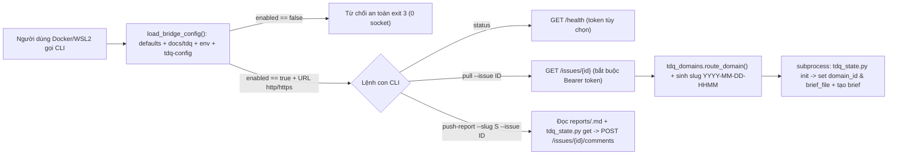

# SPEC — Triển khai Pha P2: Cầu nối CLI 1 chiều Paperclip Bridge

Ngày: 2026-11-26 · Bản: 1.0 · Brief: ../brief/2026-11-26-2321-p2-paperclip-cli-bridge.md
Soul: chất lượng > runtime > context cost · luật gốc: skills/tdq-conventions/references/soul.md
Chế độ: full · Loại: build · Trạng thái: CHỜ DUYỆT

> **Tóm tắt dễ hiểu:** Hiện tại, môi trường Docker hoặc WSL2 chưa có cầu nối dòng lệnh nào để kéo ticket từ Paperclip sang TDQ. Nay hệ thống thêm công cụ CLI một chiều thuần thư viện chuẩn Python, tắt mặc định để không chạm luồng Windows hằng ngày. Ba lệnh trạng thái, kéo ticket và gửi tóm tắt nối thẳng với định tuyến domain và bộ khởi tạo state duy nhất. Toàn bộ được kiểm thử giả lập ngoại tuyến hoàn toàn và tháo gỡ sạch không ảnh hưởng hai pha trước.

## Mục lục

- 1. Mục tiêu & phạm vi
- 1b. Lộ trình
- 2. Đầu ra cụ thể
- 2b. Ranh giới module
- 2c. Luồng hoạt động & Sơ đồ kiến trúc
- 3. Cách tiếp cận & lý do
- 3b. Năng lực & công cụ
- 3c. Giải thuật & Xử lý cốt lõi
- 3d. Mental Model cho Fresher Dev
- 4. Yêu cầu bắt buộc
- 5. Ràng buộc & rủi ro
- 6. QC & Definition of Done
- 7. Câu hỏi còn mở

## 1. Mục tiêu & phạm vi

- **Mục tiêu:** Triển khai trọn vẹn Pha P2 theo [dev-plan-p2.md](file:///c:/Users/admin/Documents/Projects/TDQ-Workflow-Antigravity/docs/tdq/artifacts/2026-11-25-1633-paperclip-3phase-dev-plan/dev-plan-p2.md) và các lựa chọn đã chốt `1a2a3a4a`: dựng cấu hình mặc định tắt trong `scripts/defaults/paperclip-bridge.default.json` kèm khóa `paperclip_bridge` trong `scripts/tdq_config.py` và `tdq-config.json`; xây dựng CLI `1` chiều thuần thư viện chuẩn `scripts/tdq_paperclip_bridge.py` với `3` lệnh `status`, `pull`, `push-report` (nối `tdq_domains.route_domain()`, gọi `tdq_state.py init` + `set domain_id=... brief_file=...` và khởi tạo tệp brief phần `## Nguyên văn`); bổ sung bộ kiểm thử giả lập ngoại tuyến `100%`; mở danh sách module/tệp phát hành nhánh `main`; đồng bộ gói `plugins/tdq-workflow-agy/` và kiểm chứng mức `ultra`.
- **Trong phạm vi:**
  - Một request `feature` trên nhánh `feat/p2-paperclip-cli-bridge` tách từ `dev`, tổ chức `3` wave không trùng file (`P2-W1`–`P2-W3`).
  - Thuần Python 3.11+ stdlib (`urllib.request`, `urllib.parse`, `subprocess`, `argparse`, `json`, `re`, `os`, `sys`, `pathlib`) với `0` thư viện ngoài.
  - Tuân thủ tuyệt đối kiến trúc đơn chủ ghi `state.json` (`schema_version=6` giữ nguyên), nạp tĩnh `utf8_io`, `TDQ_LOG=1/0` (`0B` stderr khi tắt), `0` import `hooks/`, và `0` dòng tiếng Việt trong mã nguồn mới/test mới (`i18n_check.py`).
  - Toàn bộ unit test mock, đóng gói `main`/`agy` và thẩm định độc lập `tdq-qc-tester` ở mức `ultra`.
- **NGOÀI phạm vi:**
  - KHÔNG sửa `hooks/` hay Rust `hooks/rust/tdq-dispatch` (giữ nguyên `23` mã cổng AGY và `schema_version=6`).
  - KHÔNG dựng HTTP webhook daemon 2 chiều, KHÔNG mở cổng lắng nghe mạng trên Windows và KHÔNG nối vào `PreToolUse` / `Stop`.
  - KHÔNG gọi mạng thật hay dựng server Paperclip trong test (`100%` mock bằng `unittest.mock`).
  - KHÔNG đưa `6` hạng mục CẤM copy từ Paperclip (Postgres nhúng, Vite+React Same-Origin UI, bỏ xác thực `local_trusted`, binary `ACPX darwin-arm64`, heartbeat poll rỗng, bỏ/nới lỏng `TCAS` và `Verify-by-Effect`).

## 1b. Lộ trình

| Bước/phase | Chạy? | Vì sao |
|---|---|---|
| Research web ngoài | BỎ | Thuần nội bộ Python stdlib; đã có hồ sơ khảo sát Paperclip (`2026-11-24-2359`, `2026-11-25-1439`) và `dev-plan-p2.md` |
| Analyze & Interview | CÓ | Đã đối soát 3 chiều và chốt `1a2a3a4a` (hành vi `pull`, endpoint + token REST, `muc_qc=ultra`) |
| Spec + Archify BA preview | CÓ | `work_kind=build`: chốt chữ ký CLI, hợp đồng JSON, bảo mật HTTP và HTML preview Trước/Sau bound manifest |
| Plan tách 3 wave | CÓ | Chia `P2-W1`..`P2-W3` bảo đảm mỗi file nguồn thuộc đúng 1 task mỗi wave |
| Implement (`feat/p2-paperclip-cli-bridge`) | CÓ | Thi công CLI, cấu hình tắt mặc định, mock test, cập nhật đóng gói và sync bundle AGY |
| QC (`muc_qc=ultra`) | CÓ | Người dùng chốt `3a`: đủ unit, đóng gói, `tron-bo`, `run_full_verification.py` và `tdq-qc-tester` độc lập |
| Report + Archify HTML | CÓ | Xuất báo cáo 2 tầng + HTML `current` trước khi hỏi chốt commit và gộp về `dev` |

## 2. Đầu ra cụ thể

| # | Đầu ra | Đường dẫn/vị trí | Đo "xong" bằng |
|---|---|---|---|
| 1 | Tệp mẫu cấu hình mặc định tắt (`"enabled": false`, pure ASCII) | `scripts/defaults/paperclip-bridge.default.json` | Đọc JSON hợp lệ, đủ khóa `schema_version`, `enabled=false`, `transport="cli-one-way"`, `base_url`, `token_env_var`, `timeout_sec=5`, `default_lane="full"`, `endpoints`; `i18n_check.py` `0` dòng VI |
| 2 | Khối cấu hình `paperclip_bridge` trong config gốc và plugin | `scripts/tdq_config.py`, `tdq-config.json` | `DEFAULT_CONFIG["paperclip_bridge"] == {"enabled": false}`; kiểm khớp `tdq-config.json` gốc với `plugins/tdq-workflow-agy/tdq-config.json` và `DEFAULT_CONFIG` đạt PASS |
| 3 | Công cụ CLI 1 chiều Paperclip Bridge (`status`, `pull`, `push-report`) | `scripts/tdq_paperclip_bridge.py` | Tắt mặc định trả exit `3` (`0` socket mở); `status` ping `/health` không cần token; `pull` buộc có token + tạo brief + gọi `tdq_domains.route_domain` + `tdq_state.py init` + `set domain_id/brief_file`; `push-report` tóm tắt báo cáo + POST comment; `TDQ_LOG=0` ra `0B` stderr |
| 4 | Bộ kiểm thử giả lập ngoại tuyến 100% dùng `unittest.mock` stdlib | Bộ unit test riêng cho `tdq_paperclip_bridge` | PASS mọi ca: tắt mặc định exit `3`, ping `status`, `pull` nối `tdq_state.py init`/`set`/brief, `push-report`, lỗi HTTP `401`/`500`/timeout, chặn `file://`/traversal, che token khỏi stderr, `TDQ_LOG=1/0`, `ruff` & `i18n_check` sạch |
| 5 | Whitelist đóng gói `main` và bundle Antigravity đồng bộ | Whitelist `APPROVED_RUNTIME_MODULES` & `APPROVED_RELEASE_DOCS`, `plugins/tdq-workflow-agy/` | Cập nhật đủ danh sách duyệt; `build_portable.py --sinh-main --dry-run` giữ `tdq_paperclip_bridge.py` + `paperclip-bridge.default.json`; `build_agy_plugin.py` OK và `run_full_verification.py` PASS |

## 2b. Ranh giới module

Xây dựng từ đối chiếu 3 chiều (`rg`, `graphify query/affected/god-nodes`, đọc mã nguồn; Python LSP `start_lsp` báo chưa cấu hình server nên ghi nhận qua `--bo-qua-lsp`):

| Module | Vùng file | Phụ thuộc module | Đầu ra §2 nào |
|---|---|---|---|
| `bridge-default-config` | `scripts/defaults/paperclip-bridge.default.json` | không (JSON tĩnh) | 1 |
| `tdq-config` | `scripts/tdq_config.py`, `tdq-config.json` | `utf8_io` (hiện hữu), đồng bộ qua `tools/build_agy_plugin.py` | 2 |
| `paperclip-bridge-cli` | `scripts/tdq_paperclip_bridge.py` | `utf8_io`, `tdq_domains` (route domain lúc `pull`), CLI `tdq_state.py` qua `subprocess` | 3 |
| `bridge-mock-suite` | Bộ kiểm thử giả lập của cầu nối (`unittest.mock`, offline) | `paperclip-bridge-cli`, `tdq-config` | 4 |
| `portable-whitelist` | Tập whitelist đóng gói nhánh phát hành `main` | `scripts/build_portable.py`, `bridge-default-config`, `paperclip-bridge-cli` | 5 |
| `agy-bundle` | `plugins/tdq-workflow-agy/` | `tdq-config`, `bridge-default-config`, `paperclip-bridge-cli` | 5 |

## 2c. Luồng hoạt động & Sơ đồ kiến trúc

HTML preview Trước/Sau trực quan: [2026-11-26-2321-p2-paperclip-cli-bridge-preview.html](file:///c:/Users/admin/Documents/Projects/TDQ-Workflow-Antigravity/docs/tdq/spec/2026-11-26-2321-p2-paperclip-cli-bridge-preview.html).



| Khía cạnh | Hiện trạng (Trước) | Thiết kế mới (Sau) |
|---|---|---|
| Kéo issue & đẩy báo cáo Paperclip | Chưa có công cụ CLI nào ở TDQ để kéo issue từ Paperclip hay gửi báo cáo hoàn thành lại issue | Có `scripts/tdq_paperclip_bridge.py` 1 chiều (`status`, `pull`, `push-report`) dùng thuần stdlib `urllib.request`, mặc định tắt (`enabled=false`) |
| Nối với TDQ State & Domain P1 | Nếu gọi tay dễ quên format `HHMM` của `parse_slug`, thiếu `domain_id` P1 hoặc ghi đè trực tiếp `state.json` | `pull` tự tạo slug `YYYY-MM-DD-HHMM-<kebab>`, định tuyến `tdq_domains.route_domain()`, gọi CLI `tdq_state.py init` + `set domain_id/brief_file` và tạo sẵn brief |
| Đóng gói `main` & AGY | `tdq-config.json` chỉ có `qc`, `agents`, `p0`, `p1`; `APPROVED_RUNTIME_MODULES` chưa chứa `tdq_paperclip_bridge` | Thêm `paperclip_bridge.enabled=false` vào `DEFAULT_CONFIG` + `tdq-config.json`, cập nhật `APPROVED_RUNTIME_MODULES` + `APPROVED_RELEASE_DOCS`, sync bundle AGY |

## 3. Cách tiếp cận & lý do

- **Chọn:**
  - Dùng thuần `urllib.request`, `urllib.parse`, `subprocess`, `json`, `argparse` của Python stdlib, đọc cấu hình theo tầng `env > docs/tdq/paperclip-bridge.json > scripts/defaults/paperclip-bridge.default.json` và kế thừa khóa bật/tắt `paperclip_bridge.enabled` từ `tdq_config.load_config()`.
  - Thiết kế fail-closed hoàn toàn: khi `enabled=false` thoát ngay mã `3` trước khi parse token hay mở kết nối; khi URL không thuộc scheme `http`/`https` hoặc thiếu/hỏng `base_url` thoát mã `2`/`4`; khi `pull`/`push-report` thiếu token hoặc API lỗi (`HTTPError`/`URLError`/`TimeoutError`/JSON sai) thoát mã `4`, che toàn bộ giá trị token trước khi ghi stderr, và không ghi dở tệp brief nếu `tdq_state.py init` thất bại.
  - Ở `pull` (`1a`): tạo slug chuẩn `YYYY-MM-DD-HHMM-<kebab>` theo ngày/giờ hiện hành, gọi `tdq_domains.route_domain(cwd, f"{title} {description}")`, chạy `subprocess` tới `tdq_state.py init <slug> <lane> --kind <work_kind> --lang vi --bo-qua-lsp ...` trước khi ghi `docs/tdq/brief/<slug>.md` và gắn `domain_id`/`brief_file` qua `tdq_state.py set`.
  - Ở endpoint & xác thực (`2a`): đặt khối `endpoints` mặc định (`health: "/health"`, `issue: "/issues/{issue_id}"`, `comments: "/issues/{issue_id}/comments"`) trong `paperclip-bridge.default.json`, chuẩn hóa nối URL và `urllib.parse.quote(issue_id, safe="")` để chặn path traversal (`../`). `status` cho phép gửi không cần token (nếu biến môi trường có token vẫn đính kèm `Authorization: Bearer ...`), còn `pull` và `push-report` bắt buộc có token hợp lệ trước khi gọi mạng.
- **Vì:** Giữ 0 phụ thuộc ngoài trên Windows cá nhân, tận dụng toàn bộ hạ tầng Domain Pack P1 và cơ chế đơn chủ ghi `tdq_state.py`, đồng thời đảm bảo xóa 3 file mới + rút 2 dòng cấu hình là hoàn nguyên sạch sẽ `100%`.
- **Đã loại:**
  - `1b` (`pull` chỉ in JSON, không định tuyến domain và không tạo tệp brief) — loại vì bỏ phí khả năng nối thẳng với Pha P1, người dùng vẫn phải tạo brief và gắn domain thủ công.
  - `2b` (khóa cứng 3 đường dẫn API không cho override `endpoints` và ép token cho cả `status`) — loại vì endpoint Paperclip giữa các bản Docker có thể thêm tiền tố (`/api/v1/...`), còn `status` thường dùng ping healthcheck trước khi cấp token.
  - Webhook daemon 2 chiều chạy nền — vi phạm quy tắc `5a` (`0` DB/daemon nền) và quy tắc cô lập Windows.

## 3b. Năng lực & công cụ

Phân vân → DÙNG. Kiểm kê ngày 2026-11-26: 42 skill trên đĩa (23 giữ lại sau lọc từ khóa `paperclip bridge cli urllib config portable`, 19 ẩn), cộng skill built-in trong context. Không xoá bảng này kể cả khi không có dòng DÙNG nào.

| Skill | Nguồn | Phán quyết | Dùng ở đâu / Lý do loại |
|---|---|---|---|
| `tdq-intake`, `tdq-spec`, `tdq-plan`, `tdq-build`, `tdq-conventions`, `tdq-status`, `tdq-setup`, `tdq-lean`, `tdq-check-status`, `tdq-checkportable` | `plugin:tdq-workflow` / `plugin:tdq-workflow-agy` | NỀN | Điều phối trọn vòng đời P2 trên `feat/p2-paperclip-cli-bridge`, giữ thiết kế gọn không over-engineer |
| `tdq-browser-research`, `tdq-browser-test` | `plugin:tdq-workflow` / `plugin:tdq-workflow-agy` | KHÔNG | khác lĩnh vực |
| Đã xét 19+ skill khác (`chrome-devtools`, `a11y-debugging`, `cookie-debugging`, `debug-optimize-lcp`, `memory-leak-debugging`, `gemini-api-*`, `gdocs`, `gdrive`, `gsheets`, `gslides`, `generative_ui`, `mcp-app-development`, `automation`, `conversations`, `plugin`, `run-workflow`, `swarm_*`) | user/plugin/built-in | KHÔNG | khác lĩnh vực |

## 3c. Giải thuật & Xử lý cốt lõi

- **Hợp đồng chữ ký hàm (`scripts/tdq_paperclip_bridge.py`):**
  - `load_bridge_config(cwd: str | Path | None = None) -> dict[str, Any]`
  - `validate_base_url(base_url: str) -> str`
  - `build_endpoint_url(base_url: str, template: str, issue_id: str | None = None) -> str`
  - `resolve_api_token(cfg: dict[str, Any], required: bool = False) -> str | None`
  - `redact_secrets(text: str, secrets: Iterable[str]) -> str`
  - `http_json_request(method: str, url: str, timeout_sec: float = 5.0, token: str | None = None, payload: dict[str, Any] | None = None) -> dict[str, Any]`
  - `fetch_issue_json(base_url: str, issue_id: str, token: str, timeout_sec: float = 5.0, issue_endpoint: str = "/issues/{issue_id}") -> dict[str, Any]`
  - `map_issue_to_tdq_init(issue_payload: dict[str, Any], cwd: str | Path | None = None, default_lane: str = "full", now_dt: datetime | None = None) -> dict[str, Any]`
  - `extract_report_summary(report_md_path: Path, state_snapshot: dict[str, Any], issue_id: str) -> dict[str, Any]`
  - `run_status(cwd: Path, cfg: dict[str, Any]) -> dict[str, Any]`
  - `run_pull(cwd: Path, cfg: dict[str, Any], issue_id: str, lane_override: str | None = None, bo_qua_lsp: str | None = None) -> dict[str, Any]`
  - `run_push_report(cwd: Path, cfg: dict[str, Any], slug: str, issue_id: str) -> dict[str, Any]`
  - `main(argv: list[str] | None = None) -> int` (exit `0` thành công, `2` tham số/URL/tệp đầu vào sai, `3` bridge đang tắt `enabled=false`, `4` thiếu token hoặc lỗi HTTP/subprocess).

- **Hợp đồng JSON mẫu:**
  - `scripts/defaults/paperclip-bridge.default.json`:
    ```json
    {
      "schema_version": 1,
      "enabled": false,
      "transport": "cli-one-way",
      "base_url": "http://127.0.0.1:3100/api",
      "token_env_var": "PAPERCLIP_API_TOKEN",
      "timeout_sec": 5,
      "default_lane": "full",
      "endpoints": {
        "health": "/health",
        "issue": "/issues/{issue_id}",
        "comments": "/issues/{issue_id}/comments"
      }
    }
    ```
  - Khối bổ sung trong `scripts/tdq_config.py` (`DEFAULT_CONFIG`) & `tdq-config.json`:
    ```json
    "paperclip_bridge": {
      "enabled": false
    }
    ```
  - Kết quả ánh xạ `pull` (stdout `--json` / giá trị trả về `map_issue_to_tdq_init`):
    ```json
    {
      "bridge_action": "pull",
      "paperclip_issue_id": "PAP-42",
      "tdq_slug": "2026-11-26-2340-pap-42-sync",
      "tdq_work_kind": "build",
      "tdq_domain_id": "code-build",
      "tdq_lane": "full",
      "brief_file": "docs/tdq/brief/2026-11-26-2340-pap-42-sync.md",
      "authority": "tdq_state.py"
    }
    ```
  - Payload gửi ở lệnh `push-report`:
    ```json
    {
      "bridge_action": "push-report",
      "paperclip_issue_id": "PAP-42",
      "tdq_request": "2026-11-26-2340-pap-42-sync",
      "tdq_phase": "report",
      "report_relpath": "docs/tdq/reports/2026-11-26-2340-pap-42-sync.md",
      "summary": "<tóm tắt rút gọn từ báo cáo>"
    }
    ```

- **Từng bước giải thuật (Step-by-step Execution Logic):**
  1. `load_bridge_config(cwd)`: Nạp `scripts/defaults/paperclip-bridge.default.json` → ghi đè bởi `docs/tdq/paperclip-bridge.json` (nếu có và parse được; nếu file project lỗi JSON thì log cảnh báo và fail-closed `enabled=False`) → nạp trạng thái bật từ `tdq_config.load_config(cwd).get("paperclip_bridge", {}).get("enabled", False)` nếu project chưa ghi đè rõ ràng → áp dụng biến môi trường `PAPERCLIP_BRIDGE_ENABLED` / `TDQ_PAPERCLIP_BRIDGE_ENABLED` (chỉ bật khi giá trị rõ `1/true/yes/on`), `PAPERCLIP_API_URL`, `PAPERCLIP_TOKEN_ENV`, `PAPERCLIP_TIMEOUT_SEC`. Nếu `enabled` là `False`, thoát ngay mã `3` trước khi mở bất kỳ socket nào.
  2. `validate_base_url` + `build_endpoint_url`: Parse `urllib.parse.urlparse`, bắt buộc `scheme in {"http", "https"}` và `netloc` không rỗng; nối sạch `base_url` + template endpoint đã thế `{issue_id}` bằng `urllib.parse.quote(issue_id, safe="")` (không nhận `issue_id` rỗng hoặc có ký tự điều khiển).
  3. `run_status`: Gọi `resolve_api_token(cfg, required=False)` → `GET` endpoint `health` → in trạng thái JSON/text sạch token.
  4. `run_pull`: Gọi `resolve_api_token(cfg, required=True)` → `fetch_issue_json` → `map_issue_to_tdq_init` dùng `tdq_domains.route_domain(cwd, f"{title} {description}")` (nhận `work_kind` và `domain_id`) và sinh slug `YYYY-MM-DD-HHMM-<kebab>` (dùng `bo_dau()` + chuẩn `re` độ dài `<= 5` từ) → chạy `subprocess.run([sys.executable, tdq_state_py, "init", slug, lane, "--kind", work_kind, "--lang", "vi", "--bo-qua-lsp", ...])` → nếu `returncode == 0`, ghi `docs/tdq/brief/<slug>.md` (header Soul chuẩn + `## Nguyên văn` trích tiêu đề/mô tả issue + `## Hiểu & kiến thức` + `## Hỏi đáp`) và chạy `tdq_state.py set domain_id=<id> brief_file=docs/tdq/brief/<slug>.md`.
  5. `run_push_report`: Gọi `resolve_api_token(cfg, required=True)` → đọc `tdq_state.py get` qua `subprocess` để lấy `active_request`, `phase`, `archify_url` (nếu tìm thấy trong báo cáo) → đọc `docs/tdq/reports/<slug>.md` (báo lỗi thoát `2` nếu không tồn tại) rút gọn phần `Tóm tắt dễ hiểu` + trạng thái pha → `POST` JSON tới endpoint `comments`.

- **Độ phức tạp:** Thời gian $O(1)$ xử lý cấu hình/mạng trên 1 issue và $O(L)$ ($L$ số dòng file report/brief khi đọc rút trích); không gian $O(S)$ ($S$ kích thước payload JSON 1 issue/báo cáo).
- **Các ca góc hiểm (Edge Cases & Defensive Handling):**
  - `enabled == false` hoặc `docs/tdq/paperclip-bridge.json` bị hỏng cú pháp JSON: fail-closed trả mã `3`, `0` lời gọi `urllib.request.urlopen`, `0` socket mở.
  - `base_url` dùng scheme nguy hiểm (`file://`, `ftp://`, `javascript:`) hoặc rỗng: từ chối trước khi gọi `urlopen`, thoát mã `2`.
  - `issue_id` chứa `../`, khoảng trắng hoặc ký tự đặc biệt (`PAP/../../secret`): bị `urllib.parse.quote(..., safe="")` mã hóa `%2F` và không phá cấu trúc path.
  - Lỗi HTTP (`401`, `403`, `404`, `500`), `URLError` hoặc `TimeoutError`: dùng `redact_secrets` thay mọi bản sao token thành `***` trước khi ghi log stderr hoặc in lỗi, thoát mã `4`, giữ nguyên dữ liệu TDQ chưa thay đổi.
  - `tdq_state.py init` thất bại (`returncode != 0`): không tạo tệp brief mồ côi và không chạy `tdq_state.py set`, thoát mã `4`.
  - `TDQ_LOG=0`: cả stderr không xuất ký tự nào (`b""`), bảo đảm sạch cho pipe JSON stdout.

## 3d. Mental Model cho Fresher Dev

- **Ẩn dụ trực quan:** Hãy xem `tdq_paperclip_bridge.py` như một anh bưu tá giao nhận một chiều đang nghỉ chờ ở cổng: bình thường công tắc ở cổng tắt nên anh ngồi yên không tốn tài nguyên nào của máy Windows. Chỉ khi bạn bật công tắc trong Docker hoặc WSL2 rồi bấm lệnh cụ thể (`pull` hoặc `push-report`), anh mới đi một cuốc xe duy nhất sang Paperclip lấy đơn hàng đưa cho cô lễ tân `tdq_state.py` ghi vào sổ, chứ không bao giờ tự mở đường dây trực tiếp hay tự tay sửa cuốn sổ gốc.
- **Thuật ngữ dự án:**
  - `cli-one-way`: Kiểu giao tiếp chỉ chạy khi người dùng gọi lệnh CLI rõ ràng, không mở web server hay vòng lặp nền.
  - `Single-Writer State`: Nguyên tắc bất biến mọi thao tác ghi `docs/tdq/state.json` đều đi qua `scripts/tdq_state.py`.
  - `Delete-Only Rollback`: Khả năng gỡ sạch hoàn toàn tính năng Pha P2 bằng việc xóa 3 tệp mới và rút khóa trong config mà không làm hỏng P0 hay P1.
  - `Token Redaction`: Kỹ thuật quét thay thế chuỗi bí mật API bằng `***` trước khi in ra màn hình hoặc nhật ký lỗi.

## 4. Yêu cầu bắt buộc

- **Log service bật mặc định:** `scripts/tdq_paperclip_bridge.py` và `scripts/tdq_config.py` in log ISO timestamp ra `stderr` khi `TDQ_LOG=1` (mặc định) và im lặng đúng `0B` `stderr` khi `TDQ_LOG=0`.
- **Không placeholder, không stub rỗng; eval chưa kích hoạt (opt-in):** Mọi test chạy thật theo vòng `Red -> Green` dùng `unittest.mock` chuẩn stdlib.
- **Mỗi thành phần có unit test riêng chạy bằng 1 lệnh:** Có bộ unit test độc lập cho cầu nối Paperclip, cấu hình `tdq_config` và đóng gói `build_portable`.
- **Clean Code & SOLID (`TDQ:GON`):** Mọi hàm mới `<= 50` dòng, nạp tĩnh `import utf8_io`, `ruff check` `0` lỗi, `i18n_check.py` `0` dòng tiếng Việt mới trong P2.

## 5. Ràng buộc & rủi ro

Từ [docs/kien-truc.md](file:///c:/Users/admin/Documents/Projects/TDQ-Workflow-Antigravity/docs/kien-truc.md):
- `scripts/tdq_paperclip_bridge.py` nằm trong `scripts/`, giữ `0` import `hooks/` và `0` phụ thuộc ngoài stdlib.
- Chỉ `scripts/tdq_state.py` ghi `docs/tdq/state.json` (`schema_version=6` giữ nguyên); bridge chỉ gọi CLI `init`/`set`/`get` qua `subprocess`.
- Không sửa `hooks/` hay Rust `tdq-dispatch`; giữ tròn `23` mã cổng AGY.

| Rủi ro | Ảnh hưởng | Cách giảm |
|---|---|---|
| Thêm `paperclip_bridge` vào `tdq_config.DEFAULT_CONFIG` mà quên cập nhật `tdq-config.json` gốc | Bộ kiểm tra khớp cấu hình MVP báo đỏ vì lệch `tdq-config.json` vs `DEFAULT_CONFIG` | Cập nhật đồng thời `scripts/tdq_config.py` (`DEFAULT_CONFIG`) và `tdq-config.json` trong cùng wave đầu, rồi sync qua `tools/build_agy_plugin.py` ở wave cuối |
| Quên thêm `scripts/defaults/paperclip-bridge.default.json` vào `APPROVED_RELEASE_DOCS` trong danh sách whitelist đóng gói | Bộ kiểm tra ngân sách nhánh `main` (`<= 161` mục ngoài whitelist) báo vượt hoặc thiếu tệp | Cập nhật đồng thời cả `APPROVED_RUNTIME_MODULES` (`tdq_paperclip_bridge`) lẫn `APPROVED_RELEASE_DOCS` (`scripts/defaults/paperclip-bridge.default.json`) |
| `pull` sinh slug thiếu phần giờ-phút `HHMM` hoặc quá dài | `tdq_state.py init` từ chối slug sai định dạng (`Malformed slug` / `Slug missing the hour and minute`) | Dùng helper chuẩn hóa tên có `YYYY-MM-DD-HHMM-` + `<= 5` từ kebab không dấu và kiểm chứng đối chiếu với `tdq_state.parse_slug()` |
| Lộ `PAPERCLIP_API_TOKEN` qua log traceback hoặc `URLError` khi gọi HTTP lỗi | Rò rỉ credential ra log phiên làm việc | Bọc mọi thông báo lỗi HTTP/IO qua `redact_secrets(text, [token])` trước khi ghi log hay trả mã lỗi |

## 6. QC & Definition of Done

| # | Hạng mục kiểm | Điều kiện PASS | Đo trước | Dự phòng nếu trượt |
|---|---|---|---|---|
| Q1 | Cấu hình tắt mặc định & `tdq-config.json` sync | `paperclip-bridge.default.json` hợp lệ với `"enabled": false`, `DEFAULT_CONFIG["paperclip_bridge"] == {"enabled": false}`, env override hoạt động và kiểm tra khớp `tdq-config.json` gốc/plugin với `DEFAULT_CONFIG` PASS | Trên `dev@24acb575`: chưa có `scripts/defaults/paperclip-bridge.default.json` và `DEFAULT_CONFIG` chưa có khóa `paperclip_bridge`; cấu hình gốc đang khóa khớp `1:1` với `DEFAULT_CONFIG` | Sửa đồng bộ `DEFAULT_CONFIG`, `tdq-config.json` và chạy lại `tools/build_agy_plugin.py` |
| Q2 | CLI `status`, `pull`, `push-report` & tích hợp P1/state (`1a`, `2a`) | `enabled=false` thoát mã `3` (`0` socket); `status` ping không buộc token; `pull` buộc token + route domain P1 + gọi `tdq_state.py init`/`set` + ghi brief; `push-report` đọc report + POST comment; `TDQ_LOG=0` ra `0B` stderr | Trên `dev@24acb575`: chưa có `scripts/tdq_paperclip_bridge.py` (`0` bài kiểm); `tdq_state.parse_slug()` buộc định dạng `YYYY-MM-DD-HHMM-<kebab>` | Điều chỉnh bộ tạo slug, ánh xạ endpoint hoặc trình bọc subprocess rồi chạy lại kiểm tra |
| Q3 | Bảo mật HTTP & Bộ kiểm thử mock ngoại tuyến `100%` | Bộ kiểm thử giả lập đạt `100%` PASS không gọi mạng thật; chặn URL ngoài `http`/`https`, escape `issue_id`, che token ở mọi thông báo lỗi HTTP `401`/`500`/timeout | Trên `dev@24acb575`: chưa có bộ ca giả lập `unittest.mock` cho bridge (`0` ca mock) | Bổ sung ca kiểm thử góc còn thiếu hoặc siết trình chuẩn hóa URL / che secret |
| Q4 | Đóng gói đa host (`main`, AGY), `i18n_check` & `token_budget` | Kiểm tra đóng gói PASS (`APPROVED_RUNTIME_MODULES` + `APPROVED_RELEASE_DOCS`, `<= 161` budget); `build_portable.py --sinh-main --dry-run` giữ đủ 2 tệp P2; `i18n_check.py` `0` dòng VI mới; `token_budget.py --kiem` exit `0`; `tools/build_agy_plugin.py` OK (`0` finding) | Trên `dev@24acb575`: dry-run `main` đang giữ `kept=209`; `run_full_verification.py` đạt `24/24` (`0` finding); `all_agy_codes == 23` | Bổ sung khóa còn thiếu vào whitelist đóng gói hoặc sửa chuỗi non-ASCII bị `i18n_check.py` bắt |
| Q5 | Hồi quy toàn kho (`tron-bo`), Ruff, AST `0` import ngược & thẩm định độc lập `ultra` | Toàn bộ test `tron-bo` đạt `0` lỗi chức năng (ca nhiễu tải 16 worker nếu có phải chạy tách PASS `100%`); `ruff check` `0` lỗi trên P2; AST xác nhận `0` import `hooks` trong `scripts/`; `tdq-qc-tester` độc lập chốt `Verdict: PASS`, `DEFECTS: None` | Baseline `dev@24acb575` (sau merge P1 `58bedb71`): `5,036` test thu thập (`37` skip sẵn có Windows), `0` import ngược giữa `scripts/` và `hooks/` | Dùng `tdq-debugger` khoanh vùng ca đỏ, mở vòng fix `QCn.x` (tối đa `3` vòng) rồi chạy lại |
| Q6 | Sạch Clean Code, độ dài hàm `<= 50` dòng & Rollback xóa sạch | Mọi hàm mới `<= 50` dòng, không tạo stub/placeholder, xóa 3 file mới không ảnh hưởng `P0`/`P1`, giữ nguyên `schema_version=6` và `23` mã AGY | Trên `dev@24acb575`: `schema_version == 6`, `len(all_agy_codes) == 23` | Tách helper nhỏ cho hàm dài quá `50` dòng và xác minh lại |
| Q7 | Báo cáo, working log & Archify HTML (`current`, HTTP `200`) | Đủ `workinglog`, tick `[x]` đủ task và DoD trong plan, `doc_lint` exit `0`, `tdq_archify verify` trả `status=current`, Tailscale trả HTTP `200` | Chưa có báo cáo Pha P2 (`0` file) | Render lại Archify HTML ngay sau sửa cuối của file báo cáo trước khi chốt |

DoD: Đủ `5` đầu ra tại `§2`, toàn bộ `Q1`–`Q7` đạt `PASS`, `tdq-qc-tester` (`ultra`) trả `Verdict: PASS` (`DEFECTS: None`), đồng bộ sạch bundle `plugins/tdq-workflow-agy/` cùng nhánh `main` dry-run, và Archify HTML đạt `current`.

## 7. Câu hỏi còn mở

(Không có.)
<!-- tdq-archify-binding:start -->
<!-- manifest: 2026-11-26-2321-p2-paperclip-cli-bridge-preview.manifest.json -->
<!-- manifest_digest: 04aca0a97f35de4ce46853245e879bb12240cc5c8c217e90c31733b1cbe1a612 -->
<!-- tdq-archify-binding:end -->