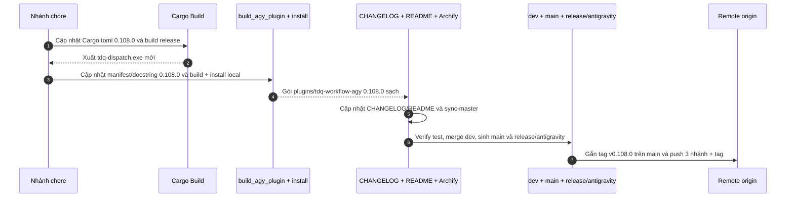

# SPEC — Nâng phiên bản 0.108.0, phát hành đa nhánh, commit và push

Ngày: 2026-11-27 · Bản: 1.0 · Brief: ../brief/2026-11-27-0157-nang-version-release-commit-push.md
Soul: chất lượng > runtime > context cost · luật gốc: skills/tdq-conventions/references/soul.md
Chế độ: full · Loại: build (loại request: `chore`) · Trạng thái: CHỜ DUYỆT

> **Tóm tắt dễ hiểu:** Trước khi làm, mã nguồn ba pha mới đã nằm trên nhánh phát triển nhưng nhãn phiên bản và bản đồ kiến trúc vẫn ở bản cũ. Nay toàn bộ khai báo đa nền tảng, gói Rust và tài liệu được nâng đồng nhất rồi kiểm thử sạch lỗi. Kết quả là người dùng cả trên máy cục bộ lẫn GitHub đều nhận trọn bản phát hành mới đồng bộ.

## Mục lục

- 1. Mục tiêu & phạm vi
- 1b. Lộ trình
- 2. Đầu ra cụ thể
- 2b. Ranh giới module
- 2c. Luồng hoạt động & Sơ đồ kiến trúc
- 3. Cách tiếp cận & lý do
- 3b. Năng lực & công cụ
- 3c. Giải thuật & Xử lý cốt lõi
- 3d. Mental Model cho Fresher Dev
- 4. Yêu cầu bắt buộc
- 5. Ràng buộc & rủi ro
- 6. QC & Definition of Done
- 7. Câu hỏi còn mở

## 1. Mục tiêu & phạm vi

- Mục tiêu: Nâng đồng bộ phiên bản dự án lên `0.108.0` trên toàn bộ manifest đa host và crate Rust `tdq-dispatch`, biên dịch lại binary Windows và gói `plugins/tdq-workflow-agy/`, cập nhật `CHANGELOG.md`, `README.md` và Master Map, kiểm định QC mức `full`, cài đồng bộ bản cục bộ `~/.gemini/config/plugins/tdq-workflow-agy`, rồi merge về `dev`, xuất bản 2 nhánh sạch `main` và `release/antigravity`, gắn annotated tag `v0.108.0` và đẩy lên remote `origin`.
- Trong phạm vi:
  - Cập nhật số phiên bản lên `0.108.0` ở `.claude-plugin/plugin.json`, `.codex-plugin/plugin.json`, `docs/tdq/.tdq-phat-hanh.json`, `README.md`, `README-Antigravity.md`, `tools/build_agy_plugin.py`, `tools/patches/__init__.py`, `tools/patches/agy_manifests.py` và `hooks/rust/tdq-dispatch/Cargo.toml` (kèm `Cargo.lock`).
  - Biên dịch release binary Windows (`cargo build --release`) và chạy `tools/build_agy_plugin.py` để đồng bộ trọn gói `plugins/tdq-workflow-agy/`.
  - Thêm mục `## 0.108.0 — 2026-11-27` vào `CHANGELOG.md` (tổng hợp 3 pha `P0`–`P2`, xoay mục cũ sang `docs/CHANGELOG-archive-4.md` nếu vượt `500` dòng), nâng badge kiểm thử `README.md` (`4602` → `5012 passed`), và chạy `tdq_archify.py sync-master` làm mới `docs/architecture/`.
  - Cài đặt đồng bộ sang `~/.gemini/config/plugins/tdq-workflow-agy` qua `tools/install_agy_plugin.py`.
  - Hợp nhất về `dev`, chạy `scripts/build_portable.py --sinh-main` và `--sinh-release-agy`, gắn annotated tag `v0.108.0` trên `main`, rồi `git push origin dev main release/antigravity v0.108.0`.
- NGOÀI phạm vi:
  - Không thay đổi logic nghiệp vụ, thuật toán hook, chính sách MCP hay cầu nối của `P0`–`P2` đã nghiệm thu.
  - Không biên dịch lại binary cho Linux/macOS (máy phát hành là Windows; giữ nguyên 2 binary cross-OS prebuilt có sẵn trong `plugins/tdq-workflow-agy/bin/`).
  - Không đẩy lên remote `local-upstream` hay `upstream`.
  - Không tự ý tải gói ngoài hay đổi cấu hình IDE toàn cục ngoài thư mục `~/.gemini/config/plugins/tdq-workflow-agy`.

## 1b. Lộ trình

| Bước/phase | Chạy? | Vì sao |
|---|---|---|
| Research web | BỎ | Toàn bộ cấu trúc phiên bản, kịch bản đóng gói và nhánh phát hành đã xác minh trực tiếp trong mã nguồn repo (`89c99384`, `build_portable.py`, `build_agy_plugin.py`, `README-Antigravity.md`). |
| Interview | CÓ | Đã hoàn tất chốt 6 câu hỏi chi tiết (`1b 2a 3a 4a 5a 6a`) và khóa `muc_qc=full`. |
| Spec & Plan | CÓ | Chế độ chuyên sâu (`full`): lập spec + HTML Trước/Sau Archify → user duyệt spec → lập plan kiểm chứng → user duyệt plan. |
| Implement & Build | CÓ | Nâng version `0.108.0` đa host + Rust, build lại `tdq-dispatch.exe` và `plugins/tdq-workflow-agy/`, đồng bộ docs & Master Map, cài local `~/.gemini/`, chạy đầy đủ test + `agy validate`, xuất bản `main` + `release/antigravity` + tag `v0.108.0` và push `origin`. |
| QC độc lập (agent) | BỎ | User chọn `muc_qc=full` (`5a`): thực thi đủ DoD + full suite `tron-bo` + `smoke-e2e --changed` + hồi quy vùng chạm + kiểm tra kiến trúc + clean code (không gọi subagent `tdq-qc-tester` vốn chỉ bật ở `ultra`). |
| Report & Archify HTML | CÓ | Xuất báo cáo Markdown + Archify HTML, cập nhật sổ `workinglog` và đóng `state.json` về `idle`. |

## 2. Đầu ra cụ thể

| # | Đầu ra | Đường dẫn/vị trí | Đo "xong" bằng |
|---|---|---|---|
| 1 | Bộ khai báo phiên bản `0.108.0` và binary Rust Windows mới | `.claude-plugin/plugin.json`, `.codex-plugin/plugin.json`, `docs/tdq/.tdq-phat-hanh.json`, `hooks/rust/tdq-dispatch/Cargo.toml`, `hooks/rust/tdq-dispatch/Cargo.lock`, `hooks/rust/tdq-dispatch/target/release/tdq-dispatch.exe` | Mọi file JSON/TOML khớp `"0.108.0"` và `cargo test` đạt `100%` pass không lỗi biên dịch. |
| 2 | Gói biên dịch `tdq-workflow-agy` `0.108.0` và bản cài máy cục bộ | `tools/build_agy_plugin.py`, `tools/patches/__init__.py`, `tools/patches/agy_manifests.py`, `plugins/tdq-workflow-agy/`, `~/.gemini/config/plugins/tdq-workflow-agy/` | `agy plugin validate --strict` đạt `0` findings, `plugins/tdq-workflow-agy/plugin.json` mang `"0.108.0"`, và tệp cài ở `~/.gemini/` khớp version `0.108.0`. |
| 3 | Tài liệu `CHANGELOG`, `README`, `README-Antigravity` và Master Map đồng bộ | `CHANGELOG.md`, `README.md`, `README-Antigravity.md`, `docs/architecture/` | `doc_lint.py` `0` lỗi, `CHANGELOG.md` `<= 500` dòng, `README.md` mang badge `0.108.0` + `5012 passed`, `tdq_archify.py status` đạt `current`. |
| 4 | Nhánh phát hành sạch, tag `v0.108.0` và đồng bộ remote `origin` | Nhánh `dev`, `main`, `release/antigravity`, tag `v0.108.0` trên local và `origin` | `git ls-remote origin` khớp SHA head của cả 3 nhánh và annotated tag `v0.108.0` trỏ đúng commit trên `main`. |

## 2b. Ranh giới module

| Module | Vùng file | Phụ thuộc module | Đầu ra §2 nào |
|---|---|---|---|
| `Version & Rust` | `.claude-plugin/plugin.json`, `.codex-plugin/plugin.json`, `docs/tdq/.tdq-phat-hanh.json`, `hooks/rust/tdq-dispatch/` | không | 1 |
| `AGY Build & Local Install` | `tools/build_agy_plugin.py`, `tools/patches/`, `plugins/tdq-workflow-agy/`, `tools/install_agy_plugin.py` | `Version & Rust` | 2 |
| `Docs & Master Map` | `CHANGELOG.md`, `docs/CHANGELOG-archive-4.md`, `README.md`, `README-Antigravity.md`, `docs/architecture/` | `Version & Rust`, `AGY Build & Local Install` | 3 |
| `Git Release & Push` | `scripts/build_portable.py` (chỉ gọi thực thi `--sinh-main`, `--sinh-release-agy`), nhánh `dev`, `main`, `release/antigravity`, tag `v0.108.0` | `Docs & Master Map`, `AGY Build & Local Install` | 4 |

## 2c. Luồng hoạt động & Sơ đồ kiến trúc

Cơ chế hiện tại vs Sau update — trang HTML Trước/Sau đã dựng tại `docs/tdq/spec/2026-11-27-0157-nang-version-release-commit-push-preview.html` làm nội dung trực quan chính, bảng dưới đây tóm tắt phụ trợ:

| Khía cạnh | Hiện trạng (Trước) | Thiết kế mới (Sau) |
|---|---|---|
| Số phiên bản toàn repo | Host/AGY ở `0.107.0`; `Cargo.toml` ở `0.105.0`; cài đặt local lệch phiên bản | Toàn bộ host, AGY bundle, `Cargo.toml`, `tdq-dispatch.exe` và cài đặt local đồng nhất `0.108.0` |
| Tài liệu & Master Map | `CHANGELOG.md` chưa tổng hợp `P0`–`P2`; `README.md` ghi badge `4602 passed`; `docs/architecture/` ở trạng thái `stale` | `CHANGELOG.md` có đầu mục `0.108.0` (`<= 500` dòng R6), `README.md` ghi `0.108.0` + `5012 passed`, Master Map ở trạng thái `current` |
| Nhánh phát hành & Remote | `dev` đi trước `origin/dev` `73` commit; `main`, `release/antigravity` và tag dừng ở `v0.107.0` | `dev` sạch sau merge; `main` + `release/antigravity` xuất bản từ commit mới nhất; annotated tag `v0.108.0` trên `main`; `origin` đồng bộ `100%` |

## 3. Cách tiếp cận & lý do

- Chọn: Nâng version đồng bộ `0.108.0` qua đúng bộ công cụ sẵn có của repo (`cargo build --release` → `tools/build_agy_plugin.py` → `tdq_archify.py sync-master` → `build_portable.py --sinh-main` & `--sinh-release-agy` → `tools/install_agy_plugin.py` → `git tag -a v0.108.0` trên `main` → `git push origin`).
- Vì: Đối chiếu trực tiếp từ commit phát hành `89c99384` (`v0.107.0`) và `build_portable.py` cho thấy `sinh_nhanh_main()` đọc version từ `.claude-plugin/plugin.json` còn `sinh_nhanh_release_agy()` đọc từ `plugins/tdq-workflow-agy/plugin.json`, trong khi `docs/tdq/.tdq-phat-hanh.json` và `Cargo.toml` phải khớp trước khi chạy `build_agy_plugin.py` để binary Windows và manifest không lệch vòng.
- Đã loại: Chỉnh tay file trong `plugins/tdq-workflow-agy/` không qua `tools/build_agy_plugin.py` — vì dễ lệch checksum `manifest.json` hoặc quên stage đủ 3 OS binary. Đã loại bỏ push lên `main` bằng `git merge dev` — vì sẽ kéo theo toàn bộ `docs/`, `tests/`, `graphify-out/` làm phình nhánh phát hành sạch.

## 3b. Năng lực & công cụ

| Skill | Nguồn | Phán quyết | Dùng ở đâu / Lý do loại |
|---|---|---|---|
| `tdq-intake`, `tdq-spec`, `tdq-plan`, `tdq-build`, `tdq-conventions`, `tdq-setup`, `tdq-lean`, `tdq-status`, `tdq-check-status`, `tdq-checkportable` | `plugin:tdq-workflow` / `plugin:tdq-workflow-agy` | NỀN | Quy trình lõi `analyze` → `spec` → `plan` → `implement` → `qc` → `report` và kiểm tra gói portable |
| `tdq-browser-research`, `tdq-browser-test` | `plugin:tdq-workflow` / `plugin:tdq-workflow-agy` | KHÔNG | khác lĩnh vực |
| Đã xét 19 skill khác trên đĩa | user/plugin | KHÔNG | khác lĩnh vực |
| `chrome-devtools`, `a11y-debugging`, `cookie-debugging`, `debug-optimize-lcp`, `memory-leak-debugging`, `gdocs`, `gdrive`, `gsheets`, `gslides`, `gemini-api-*`, `generative_ui`, `mcp-app-development`, `automation`, `conversations`, `plugin`, `run-workflow`, `migrate-*`, `agy-customizations`, `antigravity-guide`, `google-antigravity-sdk`, `ui-plugin-navigation` | built-in/plugins | KHÔNG | khác lĩnh vực |

## 3c. Giải thuật & Xử lý cốt lõi

- **Từng bước giải thuật (Step-by-step Execution Logic)**:
  1. **Bước 1 — Chốt nguồn version và Rust (`Version & Rust`):** Cập nhật `"0.108.0"` ở `.claude-plugin/plugin.json`, `.codex-plugin/plugin.json`, `docs/tdq/.tdq-phat-hanh.json` (kèm `cap_nhat` ISO) và `hooks/rust/tdq-dispatch/Cargo.toml`. Chạy `cargo test` để cập nhật `Cargo.lock` và xác nhận unit test Rust xanh trước khi `build_agy_plugin.py` gọi `cargo build --release`.
  2. **Bước 2 — Biên dịch gói AGY & Tài liệu (`AGY Build` + `Docs & Master Map`):** Cập nhật `"0.108.0"` trong `tools/patches/agy_manifests.py`, `tools/patches/__init__.py`, `tools/build_agy_plugin.py`, `README.md` (kèm `5012%20passed`) và `README-Antigravity.md`. Chạy `tools/build_agy_plugin.py` để tái tạo `plugins/tdq-workflow-agy/` (kèm `tdq-dispatch.exe` mới và giữ 2 binary Linux/macOS hợp lệ magic bytes). Thêm mục `## 0.108.0 — 2026-11-27` vào đầu `CHANGELOG.md`; nếu số dòng vượt `490` dòng thì chuyển nhóm cũ nhất ở cuối sang `docs/CHANGELOG-archive-4.md` để bảo đảm `<= 500` dòng (R6). Chạy `graphify extract . --code-only` (vì sửa file `.py`/Rust) và `tdq_archify.py sync-master` để Master Map đạt `current`.
  3. **Bước 3 — Kiểm chứng, Merge, Xuất bản nhánh sạch & Push (`Git Release & Push`):** Chạy trọn bộ kiểm thử mức `full` (`run_full_verification.py`, `smoke-e2e --changed`, `tron-bo`, `doc_lint.py`). Sau khi viết và duyệt commit phát hành trên nhánh `chore/nang-version-release-commit-push`, merge `--no-ff` về `dev`, kiểm `tdq_archify.py sync-master` / `verify` nếu SHA thay đổi, xuất bản `main` qua `build_portable.py --sinh-main` và `release/antigravity` qua `build_portable.py --sinh-release-agy`, gắn annotated tag `v0.108.0` trực tiếp lên commit đỉnh của `main`, chạy `tools/install_agy_plugin.py` cập nhật `~/.gemini/config/plugins/tdq-workflow-agy`, và cuối cùng `git push origin dev main release/antigravity v0.108.0`.
- **Độ phức tạp tính toán**:
  - Thời gian (Time Complexity): $O(N + B)$ — với $N$ là số tệp tracked trong git index khi chạy `ls-tree` lọc nhánh phát hành (`~8,000` mục, chạy `< 2` giây) và $B$ là thời gian biên dịch Rust incremental + chạy `tron-bo` (`~360` giây ở `16` worker).
  - Không gian (Space Complexity): $O(F)$ — với $F$ là kích thước tệp staging tạm trong `build_agy_plugin.py` và index git tạm của `build_portable.py` (dưới `100 MB`, dọn tự động sau khi kết thúc).
- **Các ca góc hiểm (Edge Cases & Defensive Handling)**:
  - **Ca 1 — Lệch SHA-256 `tdq-dispatch.exe` giữa `Cargo.toml` mới và 2 binary cross-OS:** Trên Windows chỉ biên dịch được `tdq-dispatch.exe`; hàm `_stage_rust_binaries()` trong `tools/build_agy_plugin.py` sẽ lấy `tdq-dispatch.exe` mới biên dịch và tái sử dụng bản `tdq-dispatch-linux-x86_64` + `tdq-dispatch-darwin-arm64` từ `existing_output_bin` kèm kiểm `verify_binary_magic()`, bảo đảm `0` binary rỗng hoặc sai header ELF/Mach-O.
  - **Ca 2 — `CHANGELOG.md` tiến sát trần `500` dòng (R6) hoặc tag/push thất bại giữa chừng:** Kiểm tra `(Get-Content CHANGELOG.md).Count` ngay sau khi chèn mục `0.108.0`; nếu vượt `500` dòng lập tức tách các phiên bản cũ ở cuối file sang `docs/CHANGELOG-archive-4.md` trước khi chạy `doc_lint.py`. Khi `git push` hoặc `tag`, kiểm `git tag -l v0.108.0` chưa tồn tại trước khi gắn lên `main`, và chỉ push bằng `--atomic` hoặc kiểm đủ `git ls-remote origin` nếu mạng lỗi giữa chừng (tuyệt đối không `--force` push).

## 3d. Mental Model cho Fresher Dev

- **Ẩn dụ trực quan (Analogy):** Quá trình release giống như "đóng hộp xuất xưởng sản phẩm": trước hết đóng cùng một con dấu ngày/số lô (`0.108.0`) lên cả thân máy (`Cargo.toml` + `.exe`) lẫn vỏ hộp đa nền tảng (`.claude-plugin`, `.codex-plugin`, `plugins/tdq-workflow-agy/`), in kèm tờ hướng dẫn sử dụng mới (`CHANGELOG.md`, `README.md`, Master Map), chạy kiểm tra chất lượng toàn dây chuyền trước khi niêm phong, rồi mới gửi đúng phiên bản tinh gọn vào từng kệ hàng riêng (`main` cho Claude Code, `release/antigravity` cho Antigravity) và dán nhãn lô `v0.108.0` lên kho chung (`origin`).
- **Thuật ngữ dự án (Glossary)**:
  - `Git plumbing (--sinh-main / --sinh-release-agy)`: Kỹ thuật tạo commit trực tiếp từ danh sách tệp đã lọc mà không checkout chuyển nhánh làm bẩn thư mục đang làm việc.
  - `Annotated tag trên main`: Nhãn Git có ghi tên tác giả, ngày và thông điệp phát hành gắn trực tiếp vào commit đỉnh của nhánh `main` tinh gọn (giống tiền lệ `v0.107.0` trỏ `ba155551`).
  - `Master Map (docs/architecture/)`: Bộ bản đồ kiến trúc tổng hợp tự kiểm hash mã nguồn; đổi trạng thái thành `stale` mỗi khi có file nguồn mới từ `P0`–`P2` chưa chạy `sync-master`.

## 4. Yêu cầu bắt buộc

- Log service bật mặc định (`TDQ_LOG=1` mặc định ra ISO timestamp, `TDQ_LOG=0` tắt `0B` stderr): giữ nguyên bộ logger chuẩn có sẵn trong `tools/build_agy_plugin.py`, `tools/install_agy_plugin.py` và `scripts/build_portable.py` vì request chỉ cập nhật hằng phiên bản/docstring và thực thi CLI sẵn có; xác minh `TDQ_LOG=0` với CLI build/install trong lúc thực thi.
- Không placeholder, không TODO stub; eval chỉ chạy khi người dùng yêu cầu và đồng ý (không bật ở request này).
- Mỗi thành phần và cổng đóng gói giữ nguyên hoặc bổ sung kiểm chứng chạy bằng một lệnh (`cargo test`, `run_full_verification.py`, `agy plugin validate`, `tdq_test.py tron-bo`).
- Bám kỷ luật chỉnh sửa phẫu thuật, không để lại `Co-Authored-By:` hay attribution trailer trong commit message / tag.

## 5. Ràng buộc & rủi ro

Ràng buộc kiến trúc phải giữ (chép từ `docs/kien-truc.md`):
- `CHANGELOG.md giữ dưới trần 500 dòng của doc_lint R6; phần cũ xoay vào docs/archive/CHANGELOG-*.md` (kho hiện lưu ở `docs/CHANGELOG-archive-4.md`) — chạm ở `CHANGELOG.md`.
- `mô hình 2 nhánh dev (develop) và main (release sạch). ... Lệnh scripts/build_portable.py --sinh-main lọc bỏ docs/, tests/, evals/...` — chạm ở bước xuất bản `main` và `release/antigravity`.
- `ngôn ngữ chia 3 tầng — luật trong skills/, agents/, chú thích/docstring của hooks/ + scripts/ và chuỗi máy in ra đều viết TIẾNG ANH cố định ... tài liệu sinh cho user và lời thoại viết theo doc_lang khai một lần lúc init, mặc định vi` — chạm ở docstring tiếng Anh của `tools/build_agy_plugin.py`, `tools/patches/__init__.py` và nội dung tiếng Việt ở `CHANGELOG.md`/`README.md`.
- `Chỉ scripts/tdq_state.py được ghi docs/tdq/state.json; mọi nơi khác chỉ đọc qua CLI.` — chạm ở toàn bộ chu trình chốt phase và đóng state về `idle`.

| Rủi ro | Ảnh hưởng | Cách giảm |
|---|---|---|
| Biên dịch lại Rust đổi binary Windows trong khi binary Linux/macOS giữ bản P1 | Hai binary non-Windows mang `CARGO_PKG_VERSION` cũ bên trong nếu chúng đọc version crate | `tdq-dispatch` không tự in `CARGO_PKG_VERSION` trong luồng hook, và `_stage_rust_binaries()` kiểm đủ magic bytes 3 OS kết hợp `run_full_verification.py` giữ `0` findings. |
| Thêm mục `0.108.0` làm `CHANGELOG.md` vượt `500` dòng | `doc_lint.py` R6 báo FAIL ở bước `tdq_finish` và QC | Đo số dòng ngay sau khi viết; nếu `> 490` dòng thì chuyển bớt các bản cũ nhất sang `docs/CHANGELOG-archive-4.md`. |
| Mất đồng bộ hoặc lỗi mạng khi `git push` 3 nhánh + tag lên `origin` | Remote có nhánh mới nhưng thiếu tag hoặc `dev` chưa cập nhật | Merge `--no-ff` vào `dev` và chạy `--sinh-main` + `--sinh-release-agy` ở local kiểm chứng xong mới push cả 4 ref lên `origin`, sau đó đối chiếu `git ls-remote origin`. |

## 6. QC & Definition of Done

| # | Hạng mục kiểm | Điều kiện PASS | Đo trước | Dự phòng nếu trượt |
|---|---|---|---|---|
| Q1 | Đồng bộ chuỗi phiên bản `0.108.0` đa host, Rust và `CHANGELOG.md` R6 | Mọi manifest host, `Cargo.toml`, `docs/tdq/.tdq-phat-hanh.json`, `tools/` và `README*` khớp `0.108.0`, không còn nhãn cũ `0.107.0` ở dòng version chính, và `CHANGELOG.md` đạt `<= 500` dòng | `CHANGELOG.md` hiện `417` dòng (dư `83` dòng trước trần `500`); `Cargo.toml` đang `0.105.0`; host/AGY đang `0.107.0` | Nếu `CHANGELOG.md` vượt `500` dòng sau khi thêm mục `0.108.0` thì cắt các mục từ `0.75.0` trở xuống chuyển sang `docs/CHANGELOG-archive-4.md` rồi ghi `lech add` nếu vượt chuẩn trình bày khác |
| Q2 | Biên dịch Rust Windows, gói `plugins/tdq-workflow-agy/` và cài cục bộ `~/.gemini/` | Unit test Rust pass `100%`, binary Windows biên dịch mới không lỗi, trình kiểm `agy plugin validate --strict` trả `0` findings, kiểm tra đa tầng AGY đạt `100%` và thư mục cài cục bộ mang version `0.108.0` | `tdq-dispatch.exe` hiện `2,119,680` bytes; `install_agy_plugin.py --dry-run` thoát `0`; bộ verify gốc `24/24` pass với `0` findings | Nếu `cargo build --release` báo lỗi dependency/lock hoặc binary Linux/macOS không qua magic check thì dừng xử lý lỗi Rust rồi build lại trước khi đóng gói |
| Q3 | Cập nhật `README.md` và làm mới Master Map `docs/architecture/` | `README.md` mang badge `0.108.0` và `5012 passed`; lệnh kiểm `tdq_archify.py status` báo `status = current` (`0` lý do `stale`) và mọi tài liệu Markdown sửa đạt `0` vi phạm linter | `README.md` đang ghi `4602 passed`; `docs/architecture/status.json` đang `stale` với `24` lý do từ `P0`–`P2`; `tdq_archify.py check` trả `ready = true` | Nếu `sync-master` báo node `planned` hoặc thiếu module mới thì bổ sung node tương ứng hoặc khai fallback bằng `lech add` rồi kiểm lại |
| Q4 | Xuất bản 2 nhánh phát hành sạch, gắn tag `v0.108.0` và kiểm thử toàn kho mức `full` | Bộ kiểm thử toàn kho thoát mã `0` (`0` bài lỗi), smoke thay đổi thoát mã `0`, nhánh `main` và `release/antigravity` lọc đúng bản runtime sạch, tag `v0.108.0` trỏ đúng commit trên `main`, và đối chiếu `origin` khớp SHA cả `dev`, `main`, `release/antigravity` lẫn tag | Dry-run `--sinh-main` giữ `211` tệp (bỏ `7787`); `--sinh-release-agy` giữ `216` tệp (bỏ `7782`); kho `dev@42467fe9` hiện đạt `5012 passed, 37 skipped`; `origin/dev` trễ `73` commit | Nếu test toàn kho gặp 1 ca nhạy tải CPU ở chế độ chạy song song thì chạy tách xác nhận theo tiền lệ P1 hoặc sửa nguyên nhân trước khi merge `dev` và push |

DoD: Mọi file cấu hình host/plugin và `Cargo.toml` khớp `0.108.0`; binary Rust và gói `plugins/tdq-workflow-agy/` biên dịch sạch (`0` findings); `CHANGELOG.md <= 500` dòng, `README.md` ghi `5012 passed` và Master Map đạt `current`; bản cục bộ tại `~/.gemini/config/plugins/tdq-workflow-agy` đã đồng bộ `0.108.0`; toàn bộ bài kiểm thử mức `full` (`tron-bo`, `smoke-e2e --changed`, kiểm định AGY) xanh `0` lỗi; đã merge về `dev`, xuất bản `main` + `release/antigravity`, gắn annotated tag `v0.108.0` trên `main`, và push thành công lên `origin` khớp SHA.

## 7. Câu hỏi còn mở

(Không có — toàn bộ lựa chọn đã chốt ở brief.)
<!-- tdq-archify-binding:start -->
<!-- manifest: 2026-11-27-0157-nang-version-release-commit-push-preview.manifest.json -->
<!-- manifest_digest: a57842e72d4966d074dab9c6b5cdc1eb15a40a18d59698df494fcd100512da15 -->
<!-- tdq-archify-binding:end -->