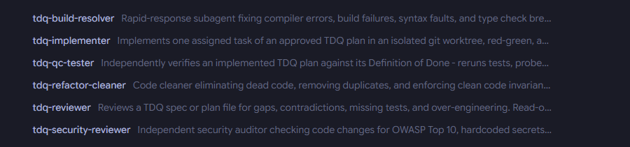

# Working log 2026-11-20

## 00:01

Hoan tat QC full (4423 passed, 35 skipped, 0 failed), cap nhat bao cao 4 phan + timing + tai render Archify HTML (HTTP 200 Tailscale), cho hoi commit/merge

## 00:19

Mo brief request moi 2026-11-20-0015-trien-khai-plan-v2-planner-spec (3 chang V2 + per-task spec + planner rules/examples + research cac planner hang dau), cho user chot dong request cu va chon pipeline

## 00:21

Dong request 2026-11-19-2213-chi-tiet-plan-model-thap (user chon 1a) de commit va merge --no-ff ve dev

## 00:50

Hoan tat khao sat 3 chieu (LSP/Grep/Graphify), B0 skill inventory va nghien cuu 10 Coding Planner hang dau; cap nhat brief va gui vong phong van chot thiet ke + muc_qc

## 01:01

Chot brief (1a 2a 3A 4A 5a, muc_qc=full), hoan tat Spec V2+ (doc_lint 0 loi, R8/R11/R14 dat), render va bind Archify BA preview (status=current, Tailscale HTTP 200), trinh user duyet spec

## 01:09

Duyet spec, lap xong Plan V2+ (4 phase, 10 task, 158 phut, ap dung chinh Per-Task Mini-Spec + Ownership Map, doc_lint --pair 0 loi, simulate winner subagent +2.0 phut), dang ky plan_file va trinh user duyet plan

## 01:28

Ghi nhan user duyet plan (phase=mode), chot de xuat subagent tu tdq_bench simulate va trinh cong chon cach chay

## 02:02

T1.1 done on branch tdq/2026-11-20-0015-trien-khai-plan-v2-planner-spec/t1.1 (64f34e68): doc_plan isolation, stable assignment SHA, packet command; 216 unittest + 15 pytest + 53 test_bench + 29 tcas/uu_tien passed

## 02:27

T1.3 worktree done (scripts/doc_lint.py, tests/test_plan_v2_linter.py, commit b78d729): 80/80 unittest passed.

## 02:28

Check + merge T1.3 (doc_lint R15 V2+ & test_plan_v2_linter.py, 80/80 pass), tick [x] T1.3, refresh assign, cho T1.2 hoan tat refactoring & commit

## 02:32

T1.2 done: created scripts/tdq_plan_scaffold.py and tests/test_plan_scaffold.py (17/17 OK, i18n_check 0). TDQ:GON rung 7.

## 02:45

T1.4 (t1.4 worktree): R15 pre-approval gate (_kiem_r15_plan) + multiline Cham _extract_plan_targets in scripts/tdq_state.py; RE_TICK [>]/T2.1a/QC1.1 in scripts/tdq_eval.py; tests/test_state_plan_v2_gate.py + quick_qc + dual_protocol (31/31), state/eval regression (212/212), pytest (7/7) passed.

## 03:00

Completed P2 T2.1/T2.2/T2.3 (planner-rules <=30, plan-examples 1281 tok, Per-Task Mini-Spec template, qc-vong-fix, team-mode packet, tdq-implementer 31 lines + circuit breaker); synced 337c5365 and started T3.1.

## 03:07

T3.1 (worktree t3.1 commit ff8f8c98): updated SUBAGENT_DISPATCH_GATE_PY, locked token-budget.json (65 refs), rebuilt plugins/tdq-workflow-agy (validate --strict PASS, 57 pytest PASS, 50 unittest PASS); reported STATUS: blocked on out-of-scope tests/test_build_portable.py:659 (165>161) and missing build_portable.py --kiem.

## 03:30

T3.1 & T3.2: vá subagent_dispatch_gate nhắc tdq_team packet, khóa token-budget (65 ref), cập nhật release allowlist trong test_build_portable.py, tái đóng gói plugins/tdq-workflow-agy/ (validate --strict sạch), bổ sung bộ kiểm thử E2E 3 kịch bản (tests/test_plan_v2_e2e.py, 5/5 OK) và hợp nhất sạch về feature/trien-khai-plan-v2-planner-spec

## 04:02

T4.1: fix 5 hoi quy vung-cham (bare section paths, Auto-Clarity, BAT BUOC, L027, drift luat-hien-co), cap nhat token-budget & rebuild plugin AGY, 67/67 unified tests va 293 regression+contract tests xanh, sang pha qc

## 04:33

QC full & Report xong: 4525/4525 tron-bo PASS (0 failed, 35 skip), 67/67 suite moi OK, 6/6 DoD Q1..Q6 & QC-F1..F4 PASS, xuat Archify HTML bao cao qua Tailscale, cho user chot commit/chua

## 09:50

Bump version v0.102.0 (README/CHANGELOG/UPSTREAM-TRACE/manifests), rebuild plugins/tdq-workflow-agy, re-verify Archify report HTML (current) va pass 113/113 tests

## 09:52

Dong request 2026-11-20-0015-trien-khai-plan-v2-planner-spec sang phase=idle tren dev sau khi bump v0.102.0 va gop nhanh

## 11:00

Mo request 2026-11-20-1056-phan-tich-nang-cap-agent (intake Part A): ghi brief phan tich 6 agent TDQ , tdq_lsp.py check DAT 6/8 bac (smoke 3/3), hoi chon pipeline

## 11:16

Analyze 2026-11-20-1056-phan-tich-nang-cap-agent: mo nhanh docs/phan-tich-nang-cap-agent tu dev, fanout 4 subagent kiem toan 6 agent TDQ + research GitHub/internet qua Tavily, tong hop 14 diem han che, trinh vong phong van + muc QC

## 11:27

Chot analyze (muc_qc=full) va hoan thanh spec + Archify preview HTML (current, Tailscale HTTP 200) cho 2026-11-20-1056-phan-tich-nang-cap-agent, cho user duyet spec

## 11:42

Duyet spec va hoan thanh Plan V2 cho 2026-11-20-1056-phan-tich-nang-cap-agent, cho user duyet plan

## 11:47

Ghi nhan duyet plan, cho user chon mode thuc thi cho 2026-11-20-1056-phan-tich-nang-cap-agent

## 11:56

Hoan thanh T1.1 bao cao 14 han che va T2.1 Archify HTML Tailscale 200, chuyen sang phase qc chay T3.1

## 12:17

Hoan tat T3.1 QC full (Q1-Q5 PASS, 4525 tests pass, 36 skipped), cap nhat bao cao va Archify HTML Tailscale 200, cho user duyet commit

## 12:31

Commit va merge request phan tich agent ve dev; mo brief moi 2026-11-20-1230-trien-khai-4-de-xuat-agent, tra loi ve model/effort tren AGY va hoi chon pipeline

## 12:37

Khoi tao request feature/trien-khai-4-de-xuat-agent (deep), khao sat 3 chieu LSP+Graphify+Grep va trinh vong phong van chot thiet ke

## 12:48

Chot phan tich va hoan thanh Spec v1.0 + Archify preview HTTP 200 cho 2026-11-20-1230-trien-khai-4-de-xuat-agent (muc_qc=ultra), cho user duyet spec

## 12:52

Cap nhat Spec v1.1 bo sung quyen user doi type model/effort tai cong trinh duyet Plan va khoa lai Archify preview, cho user duyet spec v1.1

## 12:58

Duyet Spec v1.1 va hoan thanh Plan V2+ (10 task, bang Model va Effort Gemini 3.8/4) cho 2026-11-20-1230-trien-khai-4-de-xuat-agent, cho user duyet plan

## 13:32

Ghi nhan duyet plan (bang Model va Effort Gemini 3.8/4) va hoi mode thuc thi (de xuat A: subagent) cho 2026-11-20-1230-trien-khai-4-de-xuat-agent

## 13:39

Hoan thanh T1.2 + tdq-config.json (Wave 1), cho T1.1 subagent va tdq_test vung-cham hoan tat

## 13:44

T1.1 (worktree t1.1, commit 3ccfb27): added scripts/tdq_config.py and tests/test_agent_upgrade_mvp.py (TestTdqConfig 7/7 pass, i18n_check 0 findings). Rung 7: T1.1 requires new config module + test suite; reused utf8_io and stdlib.

## 13:45

Tick xong T1.2, cap nhat lai assign/audit sau khi chuan hoa lenh pytest va gui tiep T1.1 trong worktree

## 15:27

T5.2 (worktree t5.2, commit 82a9cfd4): expanded parity/runtime/smoke tests (204 passed, 1 failed); caught bug at scripts/tdq_team.py:2557 (_extract_mini_spec_fields checks stripped.startswith('- ') after doc_plan stripped '- ').

## 15:30

Implement complete (Waves 1-6, 10/10 tasks)

## 15:32

Implement complete (Waves 1-6, 10/10 tasks)

## 15:39

QC Shard Q5: 212 passed (1 Win chmod skip), tdq-dispatch.exe TDQ_LOG=1/0 & boundary probes pass, repo isolation & budgets pass -> docs/tdq/qc/shard-2026-11-20-1230-q5.md

## 15:40

QC Shard Q2: verified Handoff Schema, Packet V2+, Blackboard & Auto-Escalation (VERDICT: FAIL: Q2) -> docs/tdq/qc/shard-2026-11-20-1230-q2.md

## 15:51

QC1.1 fix pass: quote-aware shell parser (Python+Rust), test_verdict enum, <=50-line helpers, report lint check, rebuilt AGY plugin (236 passed)

## 15:51

QC Shard Q2 re-verify QC1.1: all 4 findings resolved (26/26 unittest, 40/40 pytest+1 skip, SHA match, AST<=45, VERDICT: PASS everything)

## 16:19

QC1.2 doc/agent/anchor fixes after tron-bo run #1: doc_index, luat-hien-co, README 8/17 counts, Auto-Clarity across 8 agents, rebuilt AGY plugin

## 17:06

Close QC & Report (10/10 tasks, 6/6 DoD, 4563 tests PASS, Archify HTML current)

## 23:43

Merged feature/trien-khai-4-de-xuat-agent into dev (commit b2938171) and closed request to idle

## 23:55

Part A intake: recorded brief 2026-11-20-2355-toi-uu-research-phan-tich and verified timing.jsonl pre-implement ratios before lane selection
