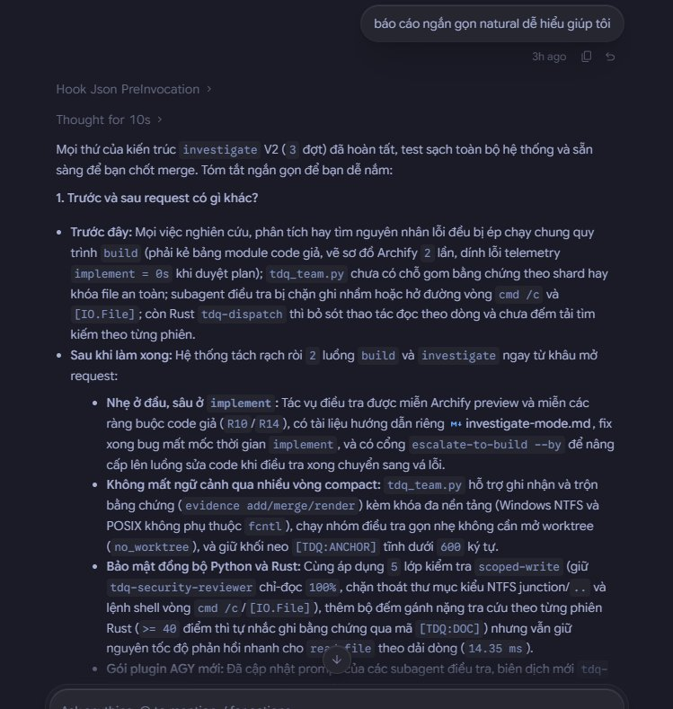

# Working log 2026-11-21

## 00:08

Analyze B0-B2 complete: opened branch feature/toi-uu-research-phan-tich, completed 3-tier codebase triangulation and external research, preparing interview round 1

## 00:14

Recorded interview round 1 answers (1abc 2a 3a 4a 5b) and scope summary in brief; prepared detail interview round 2 + QC level question

## 00:28

Closed analyze round 2 (1a 2a 3a 4a 5a 6a, muc_qc=full), authored spec v1.0 (0 doc_lint violations) and bound Archify Before/After HTML preview (current)

## 00:34

Recorded spec approval, drafted Two-Pass plan (6 phases, 13 tasks, 185m ETA, Model & Effort table), verified 0 errors across --verify-plan, --check-wave and doc_lint --pair

## 00:50

Pivoted request per user choice 1b to docs-only deep analysis, 3-angle Red-Team and V2 architecture proposal (renamed branch to docs/toi-uu-research-phan-tich, authored Spec v2.0 + Archify preview)

## 00:54

Recorded Spec v2.0 approval, authored docs-only Plan v2.0 (5 phases, 10 tasks, 135m ETA, 2-round + 3-angle Red-Team, Zero-Code-Touch), verified 0 errors across --verify-plan, --check-wave and doc_lint --pair

## 01:04

Approved plan with mode=subagent, entered phase=implement, ran assign/audit/wave and launched Wave 1 parallel subagents (T1.1 timing, T1.2 codebase, T1.3 deep research)

## 01:13

Completed T1.2 codebase architecture and AGY 2.0 audit (39,138 chars, verified path:line anchors, 8 Python-Rust parity gaps, 65-file token headroom); waiting on T1.1 and T1.3

## 01:14

Completed T1.3 deep external research (37,526 chars, 29 verified extracted URLs covering multi-compact memory, MAS breakeven, and MiniCheck/CAR dual-track verification); waiting on T1.1

## 01:37

Completed Wave 2 checkpoint (EV-001..EV-018 in evidence-log.md) and V1 proposal (22,978 chars, M1-M6); launched Wave 3 parallel Red-Team A/B/C

## 01:48

Completed T3.1 Red-Team A (27,535 chars, ND-A1..ND-A5 covering Rust weighted burden, evidence add-batch/compact recovery, 45% SAS zero-fanout, escalate-to-build, and raw QC-I2); waiting on T3.2 and T3.3

## 01:58

Hoan thanh Wave 3 (T3.2 Red-Team B), Wave 4 (T4.1 evidence-log 29 EV + De xuat V2 va 100% ND-1..9), va T5.1 kiem chung 248 path:line + doc_lint 0 loi + Zero-Code-Touch; chuyen pha qc.

## 02:10

Hoan tat QC doc lap 6/6 DoD (tdq-qc-tester PASS everything, 0 F6, 0 code touched), khoi phuc 10/10 task + 6/6 DoD tick du, ket xuat Bao cao V2 + Archify HTML current (Tailscale HTTP 200).

## 02:29

Hoan thanh analyze (1a 2a 3a 4a, muc_qc=full) va Spec trien khai 3 dot work_kind=investigate V2 (doc_lint 0 loi, Archify preview current).

## 02:35

Duyet spec va hoan tat Plan 3 dot trien khai investigate V2 (8 task + 6 DoD, verify-plan 0 loi, check-wave 0 loi, doc_lint 0 loi, simulate team thang 6.1 phut).

## 02:54

T1.3: them investigate-mode.md (1783 tok), cap nhat skills/refs va lock token-budget.json (33 passed)

## 04:38

QC1.1: sua xung dot sys.path test_read_gate & test_investigate_workflow (125 passed); Q1/Q2/Q3/Q4 PASS, chuan bi tron-bo

## 05:11

QC1.2: fix all 10 red modules from tron-bo (228 passed, 444 subtests passed) and rebuild AGY plugin

## 05:49

QC doc lap (tdq-qc-tester) 2026-11-21-0217-trien-khai-investigate-v2: PASS Q1-Q6 va QC-F1-QC-F4; ghi docs/tdq/qc/2026-11-21-0217-trien-khai-investigate-v2.md.

## 05:50

Hoan thanh QC doc lap PASS everything (Q1-Q6, QC-F1..F4), tron-bo 4596 passed/36 skipped/0 fail, Bao cao & Archify HTML current (Tailscale HTTP 200)

## 09:19

Refresh report Archify binding post-merge tren dev, dong request 2026-11-21-0217-trien-khai-investigate-v2 ve idle 

## 09:20

Ghi nhan brief intake 2026-11-21-0917-mac-dinh-trinh-bay-ngan (report, spec, plan mac dinh trinh bay ngan gon natural)

## 09:26

analyze: khảo sát B0/B1/B2 (triangle + B0 inventory) và mở phỏng vấn vòng 1 cho 2026-11-21-0917-mac-dinh-trinh-bay-ngan

## 09:34

spec: hoàn thiện đặc tả chuẩn trình bày ngắn gọn tự nhiên và Archify preview HTML (current)

## 09:42

plan: lập kế hoạch 3 đợt (7 task) chuẩn trình bày ngắn gọn tự nhiên, qua doc_lint --pair, scaffold verify và bench simulate

## 09:57

implement: hoàn thành 7/7 task T1.1-T3.2 chuẩn trình bày ngắn gọn tự nhiên, khóa doc_index/token-budget/luat-hien-co và build plugins/tdq-workflow-agy

## 10:26

report: hoàn tất 7/7 task, QC full PASS (tron-bo 4.602 passed / 36 skipped), xuất cặp report + Archify HTML (Tailscale HTTP 200)

## 10:30

idle: chốt commit 86eb30ba, merge ae3e0ddf về dev, cập nhật report binding và đóng 2026-11-21-0917-mac-dinh-trinh-bay-ngan

## 10:35

intake: ghi nhan yeu cau bump version, release va update user-level local

## 10:41

analyze: khao sat ma nguon phat hanh, bang nang luc B0 va chuan bi cau hoi chot pham vi

## 10:47

spec: hoan thien va dang ky spec 0.103.0 kèm Archify preview HTML (current + Tailscale HTTP 200)

## 10:53

plan: lap ke hoach 5 dot 9 task (verify-plan/check-wave/doc_lint --pair 0 loi, simulate winner=main)

## 11:10

implement: xong T1.1-T4.1 (bump 0.103.0, build Rust 3 OS + don sach SSH, dong goi AGY, TDQ_LOG), dang cho tron-bo 222 module o T4.2

## 11:39

report: hoan tat Q1-Q5, Q7 va QC-F1-F4 (4603 passed, Rust 3 OS + SSH sach 0, user-level ~/.gemini 0.103.0), xuat cap report + Archify HTML (Tailscale HTTP 200), cho user chot commit de chay T5.2 --sinh-main + tag v0.103.0

## 12:35

idle: hoan tat T5.2/Q6 (--sinh-main main@38f7ce6, tag v0.103.0), refresh report binding va dong 2026-11-21-1034-bump-version-release-local ve idle tren dev
